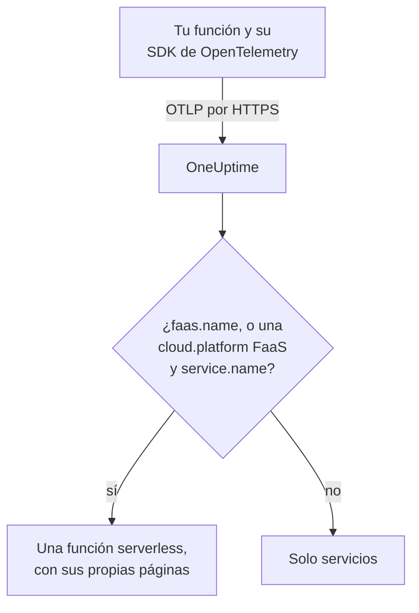

# Funciones serverless

OneUptime reconoce una función serverless en el momento en que recibe datos de OpenTelemetry de ella, y la muestra en **Funciones serverless** con sus trazas, registros y métricas. Funciona con AWS Lambda, Google Cloud Functions, Azure Functions, Cloudflare Workers y cualquier otro runtime FaaS que pueda enviar OpenTelemetry. No hay nada que crear a mano: instrumenta la función con el SDK de OpenTelemetry de su runtime y apunta su exportador OTLP a OneUptime.

:::cards
- [Cómo identifica OneUptime una función](#cómo-identifica-oneuptime-una-función): `faas.name`, o una `cloud.platform` FaaS con un `service.name`.
- [Enviar la telemetría de una función](#enviar-la-telemetría-de-una-función): La configuración del exportador y la capa de Lambda.
- [Azure Functions](#azure-functions): Una función por Function App, desde el host de Functions.
- [Solución de problemas](#solución-de-problemas): Una función que no aparece, o cuyas páginas están vacías.
:::

## Cómo funciona

OneUptime lee los atributos de recurso de cada lote a medida que llega. Un recurso con un `faas.name`, o con una `cloud.platform` FaaS como `aws_lambda` o `azure_functions` junto con un `service.name`, es una función serverless: OneUptime la crea con sus primeros datos y archiva la telemetría bajo ella.



## Antes de empezar

- Una clave de ingesta. Crea una en **Ajustes del proyecto → Telemetría y APM → Claves de ingesta** y copia su valor.
- El SDK de OpenTelemetry, o una capa de autoinstrumentación, para el lenguaje de tu función.

## Cómo identifica OneUptime una función

OneUptime identifica cada función por el atributo de recurso `faas.name`. Los detectores de recursos de algunas plataformas nunca lo definen ([Azure Functions](#azure-functions) es el caso habitual), así que cuando un recurso no tiene `faas.name` pero su `cloud.platform` es una plataforma FaaS, OneUptime usa en su lugar su `service.name` como identidad de la función, y escribe ese valor como `faas.name` en cada span, registro, métrica y perfil que almacena, para que las páginas de la función encuentren toda su telemetría:

| Atributo | Obligatorio | Propósito |
| --- | --- | --- |
| `faas.name` | **sí**, salvo que estén definidos los dos siguientes | Identidad de la función (por ejemplo `checkout-handler`) |
| `cloud.platform` | con `service.name`, cuando no hay `faas.name` | `aws_lambda`, `gcp_cloud_functions`, `azure_functions`, `tencent_cloud_scf` o `alibaba_cloud_fc` |
| `service.name` | en una `cloud.platform` FaaS sin `faas.name` | Identidad de la función, escrita en la telemetría como `faas.name` |
| `faas.version` | no | Se muestra en la vista general |
| `faas.instance` | no | Se sigue por instancia en la página **Instancias** |
| `cloud.provider` / `cloud.region` / `cloud.account.id` | no | Se muestra en la vista general |
| `process.runtime.name` / `process.runtime.version` | no | Se muestra como runtime en la vista general |

Un `faas.name` que definas nunca se reemplaza. El valor de `cloud.platform` debe escribirse como aparece en la lista (también se acepta el `azure.functions` con punto que envían algunos detectores de Azure), y `service.name` debe ser un atributo de recurso: la cabecera `x-oneuptime-service-name` nombra un servicio, no una función.

> [!NOTE]
> Una función que también define `service.name` sigue apareciendo además en **Servicios**. **Funciones serverless** es la vista creada para las funciones, acotada por `faas.name`.

## Enviar la telemetría de una función

:::steps
### Define las variables de entorno del exportador OTLP

La mayoría de las autoinstrumentaciones de los lenguajes leen las variables de entorno estándar de OpenTelemetry:

```bash
OTEL_EXPORTER_OTLP_ENDPOINT="https://oneuptime.com/otlp"
OTEL_EXPORTER_OTLP_HEADERS="x-oneuptime-token=YOUR_TELEMETRY_INGESTION_TOKEN"
OTEL_RESOURCE_ATTRIBUTES="faas.name=checkout-handler,faas.version=1.4.2"
```

Si alojas OneUptime tú mismo, sustituye el endpoint por `https://YOUR-ONEUPTIME-HOST/otlp`. En Azure Functions, deja `faas.name` fuera de `OTEL_RESOURCE_ATTRIBUTES`; consulta [Azure Functions](#azure-functions).

> [!WARNING]
> La clave de ingesta es un secreto. Usa una clave de ingesta de tipo **Servidor**, definida como variable de entorno de la función. Cualquiera que vea el código fuente de la página puede leer una clave que llegue a un navegador.

### Añade la capa de Lambda de OpenTelemetry (AWS Lambda)

En AWS Lambda, el camino más sencillo es la [capa de Lambda de OpenTelemetry](https://opentelemetry.io/docs/faas/lambda-auto/). Adjunta la capa del runtime de tu función y define:

```bash
AWS_LAMBDA_EXEC_WRAPPER=/opt/otel-handler
OTEL_EXPORTER_OTLP_ENDPOINT=https://oneuptime.com/otlp
OTEL_EXPORTER_OTLP_HEADERS=x-oneuptime-token=YOUR_TELEMETRY_INGESTION_TOKEN
```

La capa define `faas.name` a partir del nombre de la función, y su detector de recursos rellena `cloud.platform`, `cloud.region` y `cloud.account.id`. En otra plataforma, omite este paso.

### Invoca la función y comprueba que llega

Comprueba que OneUptime acepta la clave:

```bash
curl -i https://oneuptime.com/otlp/v1/validate \
  -H "x-oneuptime-token: YOUR_TELEMETRY_INGESTION_TOKEN"
```

`200` con `"valid": true` significa que OneUptime acepta la clave; `401` significa que es desconocida, está revocada, desactivada o caducada. Después invoca la función. En cuanto envía un span, un registro o una métrica, aparece en **Productos → Infraestructura → Serverless → Todas las funciones**.
:::

## Azure Functions

El host de Azure Functions puede enviar OpenTelemetry por sí mismo, así que una Function App informa de sus invocaciones (trazas, registros y métricas) sin cambios de código, sea cual sea el lenguaje en que esté escrita. La guía de Microsoft es [Use OpenTelemetry with Azure Functions](https://learn.microsoft.com/en-us/azure/azure-functions/opentelemetry-howto).

### Cómo aparece una Function App

Los detectores de recursos de Azure (el propio del host de Functions, el del worker aislado de .NET en `Microsoft.Azure.Functions.Worker.OpenTelemetry` y el de Node.js en `@opentelemetry/resource-detector-azure`) describen la **Function App**, no una función concreta, y ninguno de ellos define `faas.name`:

| Atributo | Valor |
| --- | --- |
| `service.name` | El nombre de la Function App, tomado de `WEBSITE_SITE_NAME` |
| `cloud.provider` | `azure` |
| `cloud.platform` | `azure_functions`; el detector de Node.js escribe `azure.functions`, que OneUptime reescribe |
| `cloud.region` | La región de la app, tomada de `REGION_NAME` |
| `cloud.resource_id` | `/subscriptions/<subscription>/resourceGroups/<group>/providers/Microsoft.Web/sites/<app>` |
| `faas.instance` | La instancia, tomada de `WEBSITE_INSTANCE_ID`: solo el detector de Node.js |

Así que OneUptime identifica la función por `service.name`, rellena `faas.name` con el nombre de la Function App y muestra **una función serverless por Function App**. El recurso describe la app, no una de sus funciones: cada instancia informa de los mismos atributos de nivel de app, sea cual sea la función de la app que ejecute, y en el plan Flex Consumption algunas funciones incluso escalan en instancias propias. Las funciones individuales están en la propia telemetría:

- El host inicia un span por cada invocación, con el nombre de la función que ejecutó: busca ese nombre en la página **Trazas** de la función.
- El host registra `faas.invoke_duration`, un histograma en segundos, con el nombre de la función en el atributo de punto de datos `faas.name`: agrupa la métrica por él en la página **Métricas** o en un panel para ver la latencia de cada función.

No añadas `faas.name` a `OTEL_RESOURCE_ATTRIBUTES` en una Function App, como hace el ejemplo genérico del [primer paso](#define-las-variables-de-entorno-del-exportador-otlp). La configuración de la aplicación llega a todos los procesos de la app, así que la telemetría de todas sus funciones llevaría ese único nombre, y OneUptime nunca reemplaza un `faas.name` que recibe. La guía de Microsoft dice lo mismo: no pongas valores específicos de una función en el recurso. Déjalo sin definir y la función tomará el nombre de la app.

El host y el worker aislado de .NET usan `OTEL_SERVICE_NAME` en lugar del nombre de la app cuando está definido. Mantén todos los procesos de una app en el mismo `service.name`: el host y el worker del lenguaje envían telemetría, y un worker que informa de un segundo nombre crea una segunda función serverless. Un worker cuyo recurso no tiene una `cloud.platform` FaaS no se une a ninguna función serverless; consulta [Instrumenta el código de tu función](#instrumenta-el-código-de-tu-función-opcional).

:::steps
### Activa OpenTelemetry en el host de Functions

Añade `"telemetryMode": "OpenTelemetry"` a la raíz del `host.json` de la app:

```json title="host.json"
{
  "version": "2.0",
  "telemetryMode": "OpenTelemetry"
}
```

Entonces el host envía, sea cual sea el lenguaje de la app, sus propias trazas (un span por invocación, más los spans de procesador de Service Bus y Event Hubs detrás de las funciones desencadenadas), sus registros y métricas, entre ellas `faas.invoke_duration`.

### Apunta el host a OneUptime

Define el exportador como configuración de la aplicación:

```bash
az functionapp config appsettings set \
  --name my-function-app \
  --resource-group my-rg \
  --settings \
    OTEL_EXPORTER_OTLP_ENDPOINT=https://oneuptime.com/otlp \
    OTEL_EXPORTER_OTLP_PROTOCOL=http/protobuf \
    "OTEL_EXPORTER_OTLP_HEADERS=x-oneuptime-token=YOUR_TELEMETRY_INGESTION_TOKEN"
```

Si alojas OneUptime tú mismo, sustituye el endpoint por `https://YOUR-ONEUPTIME-HOST/otlp`. `OTEL_EXPORTER_OTLP_PROTOCOL=http/protobuf` importa: el exportador .NET del host usa gRPC de forma predeterminada, y con `http/protobuf` envía a `/otlp/v1/traces`, `/otlp/v1/metrics` y `/otlp/v1/logs` bajo el endpoint. El host solo envía OTLP mientras `OTEL_EXPORTER_OTLP_ENDPOINT` está definido.

> [!WARNING]
> Este token es un secreto: usa una clave de ingesta de tipo **Servidor**. La configuración de la aplicación se cifra en reposo; para guardar el token en Key Vault, define `OTEL_EXPORTER_OTLP_HEADERS` con una referencia de Key Vault como `@Microsoft.KeyVault(SecretUri=https://my-vault.vault.azure.net/secrets/oneuptime-otlp-headers/)` y concede a la identidad administrada de la app el rol **Key Vault Secrets User** en el almacén. La referencia se resuelve en el valor del secreto tal como está almacenado, así que guarda la cabecera completa, `x-oneuptime-token=YOUR_TELEMETRY_INGESTION_TOKEN`, no solo el token.

Conserva `APPLICATIONINSIGHTS_CONNECTION_STRING` si todavía quieres Application Insights: con ambos definidos, el host envía los mismos datos de OpenTelemetry a Application Insights y a OneUptime. Quítalo para enviar solo a OneUptime.

### Instrumenta el código de tu función (opcional)

El host ya traza cada invocación. Para añadir spans y registros de tu propio código, conectados a los del host, activa también OpenTelemetry en el worker del lenguaje. Envía con la misma configuración `OTEL_EXPORTER_OTLP_*`:

- **C# (isolated worker)**: añade los paquetes NuGet `Microsoft.Azure.Functions.Worker.OpenTelemetry`, `OpenTelemetry.Extensions.Hosting` y `OpenTelemetry.Exporter.OpenTelemetryProtocol`, y luego en `Program.cs`: `builder.Services.AddOpenTelemetry().UseFunctionsWorkerDefaults().UseOtlpExporter();`
- **JavaScript / TypeScript**: `npm install @azure/functions-opentelemetry-instrumentation` junto con el SDK de OpenTelemetry para Node.js y sus exportadores OTLP, y registra `AzureFunctionsInstrumentation` en un archivo que incluya el campo `main` de `package.json`.
- **Java**: añade la dependencia de Maven `com.microsoft.azure.functions:azure-functions-java-opentelemetry`.
- **Python**: define la configuración de la aplicación `PYTHON_ENABLE_OPENTELEMETRY=true`, añade los paquetes de OpenTelemetry que indica Microsoft (entre ellos `opentelemetry-sdk` y `opentelemetry-exporter-otlp`) a `requirements.txt` y configura los exportadores en `function_app.py`.
- **PowerShell**: define la configuración de la aplicación `OTEL_FUNCTIONS_WORKER_ENABLED=True` y carga el módulo `AzureFunctions.PowerShell.OpenTelemetry.SDK` desde `profile.ps1`.

La guía de Microsoft tiene el código completo para cada lenguaje. El worker de .NET (mediante `UseFunctionsWorkerDefaults()`) y el worker de Python (mediante `PYTHON_ENABLE_OPENTELEMETRY`) le indican al host que les deje sus registros, así que esos registros no se envían dos veces.

Los spans y registros de un worker solo llegan a las páginas de la función cuando su recurso describe la app igual que el del host: el mismo `service.name` y una `cloud.platform` FaaS. El worker aislado de .NET (mediante `UseFunctionsWorkerDefaults()`) y el ejemplo de Node.js de Microsoft (mediante los detectores de Azure que incluye `getResourceDetectors()`) informan de ambos. El ejemplo de Python de Microsoft construye su recurso sin un detector de Azure, así que de serie no informa de ninguno y su telemetría nunca llega a la función. Para Python, o cualquier worker configurado sin un detector de recursos de Azure Functions, añade dos opciones más de configuración de la aplicación. Todos los procesos de la app las leen, el host incluido, así que todos informan de la misma identidad:

```bash
az functionapp config appsettings set \
  --name my-function-app \
  --resource-group my-rg \
  --settings \
    OTEL_SERVICE_NAME=my-function-app \
    "OTEL_RESOURCE_ATTRIBUTES=cloud.provider=azure,cloud.platform=azure_functions"
```

Define `OTEL_SERVICE_NAME` con el nombre propio de la Function App. Es el nombre que el host y el detector de Node.js informan sin ella, así que la función conserva la identidad que ya tiene.
:::

### Limitaciones

- Las **apps de C# en proceso** no pueden usar OpenTelemetry: pásalas primero al modelo de worker aislado.
- El **streaming de registros** del portal de Azure no funciona mientras el host está en modo OpenTelemetry, y la lista _Recent function invocations_ del portal necesita la telemetría en Application Insights. Usa en su lugar las páginas **Registros** y **Trazas** de la función en OneUptime.
- La sección `logging.applicationInsights` de `host.json` deja de aplicarse en cuanto `telemetryMode` es `OpenTelemetry`.
- **Instancias** muestra los valores de `faas.instance`. De los detectores anteriores, solo el de Node.js lo define, así que la página queda vacía para la telemetría del host y del worker de .NET.

## Qué obtienes

En cuanto la función envía un span, un registro o una métrica, aparece en **Funciones serverless**. Su **Vista general** muestra:

- **Invocaciones**, **tasa de errores** y **duración p95**, calculadas a partir de tus trazas en el intervalo de tiempo que elijas, con gráficos de tendencia.
- **Instancias**: una lista en vivo de los valores de `faas.instance` que informa la función.
- Páginas completas de **Registros**, **Trazas** y **Métricas** acotadas a esta función.

## Etiqueta funciones y asigna propietarios

Un atributo de recurso que empieza por `oneuptime.label.` se convierte en una etiqueta del proyecto en la función: `oneuptime.label.team=payments` añade la etiqueta `team:payments`. Añade los atributos a `OTEL_RESOURCE_ATTRIBUTES`:

```bash
OTEL_RESOURCE_ATTRIBUTES="faas.name=checkout-handler,oneuptime.label.team=payments,oneuptime.label.env=production"
```

Para etiquetar funciones o asignar propietarios por sus nombres, abre **Productos → Infraestructura → Serverless** y usa **Reglas de etiquetas** y **Reglas del propietario** en el menú lateral. Las reglas se ejecutan cuando se crea una función, incluidas las descubiertas automáticamente. Para aplicar una regla a las funciones que ya tienes, usa su **Ejecutar ahora** (consulta [Ejecutar reglas sobre recursos existentes](/docs/configuration/run-rules-now)).

## Solución de problemas

:::details La función no aparece en Funciones serverless
Comprueba, en orden:

1. La función se ha invocado desde que definiste las variables: solo envía telemetría mientras se ejecuta.
2. En AWS Lambda, la capa está adjunta para el runtime de la función y `AWS_LAMBDA_EXEC_WRAPPER` es `/opt/otel-handler`: sin el wrapper, la instrumentación de la capa nunca arranca.
3. En otros entornos, el código de la función carga el SDK de OpenTelemetry o la autoinstrumentación: las variables por sí solas no envían nada.
4. El recurso lleva `faas.name`, o una `cloud.platform` FaaS y un `service.name`. Sin ellos, la telemetría se archiva en **Servicios**, como un servicio.
5. La función puede llegar a tu URL de OneUptime. Una en una red privada necesita una ruta de salida hacia ella, como una puerta de enlace NAT.
:::

:::details La función aparece en la lista, pero sus páginas están vacías
**Vista general**, **Registros**, **Trazas** y **Métricas** de la función muestran la telemetría cuyo `faas.name` coincide exactamente con el nombre de la función, mayúsculas incluidas. Una función nombrada por una `cloud.platform` FaaS y su `service.name` no necesita un `faas.name` propio: OneUptime escribe el `service.name` en la telemetría como `faas.name` a medida que llega. La telemetría almacenada antes de que OneUptime empezara a rellenar `faas.name` no se actualiza y queda fuera de las páginas: invoca la función para enviar telemetría nueva. Comprueba también el intervalo de tiempo de la parte superior de la página.
:::

:::details La función aparece como desconectada
Una función pasa a desconectada cuando OneUptime no ha recibido nada de ella durante 15 minutos; OneUptime lo comprueba cada 5 minutos, y el tiempo en que él mismo no recibía datos no cuenta. Una función que solo se ejecuta de vez en cuando está desconectada entre ejecuciones: vuelve a conectada con su siguiente telemetría.
:::

## Próximos pasos

:::cards
- [OpenTelemetry](/docs/telemetry/open-telemetry): Envía trazas, registros y métricas desde cualquier aplicación.
- [Colas](/docs/telemetry/queues): Las colas y los temas en los que publican tus funciones y de los que consumen.
- [Monitor de trazas](/docs/monitor/traces-monitor): Alerta sobre las invocaciones fallidas o lentas de una función.
:::
