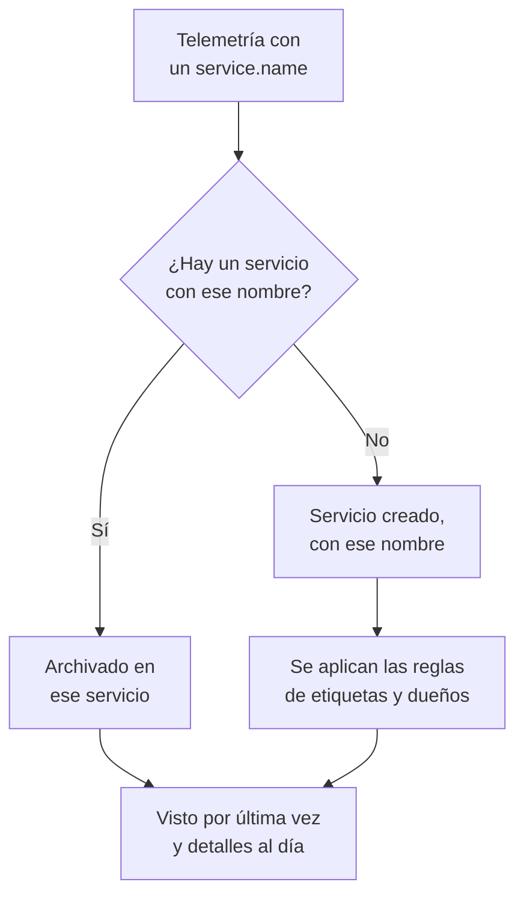

# Catálogo de servicios

El catálogo de servicios enumera las aplicaciones y los microservicios que ejecuta. OneUptime añade un servicio la primera vez que llega su telemetría y luego reúne sus registros, trazas, métricas, excepciones, incidentes y propietarios en una sola página, para que cualquiera sepa qué hace un servicio, quién es su responsable y cómo está.

:::cards
- [Cómo entra un servicio en el catálogo](#cómo-entra-un-servicio-en-el-catálogo): Su `service.name`, con su primera telemetría.
- [Encontrar un servicio](#encontrar-un-servicio): La lista, sus filtros y sus columnas.
- [Las páginas de un servicio](#las-páginas-de-un-servicio): Todo sobre un servicio.
- [Archivar o eliminar un servicio](#archivar-o-eliminar-un-servicio): Conservar su historial o quitarlo.
:::

## Cómo entra un servicio en el catálogo

No tiene que crear servicios. Cada lote de telemetría nombra el servicio que lo envió en su atributo de recurso `service.name`. OneUptime archiva el lote bajo el servicio con ese nombre y crea el servicio cuando el proyecto aún no tiene ninguno.

- **El nombre es la identidad del servicio.** Se compara sin distinguir mayúsculas y minúsculas, así que `Checkout-API` y `checkout-api` son un solo servicio. Un `service.name` nuevo inicia un servicio nuevo.
- **Los contenedores se nombran solos.** La telemetría de los agentes de Docker y Podman nombra un servicio según su contenedor cuando no tiene `service.name`.
- **Una clave de ingesta puede fijar el servicio.** Los datos de OpenTelemetry enviados con una clave que tiene un **Nombre de servicio fijado** se archivan con ese nombre, diga lo que diga su `service.name`. Consulte [Claves de ingesta](/docs/telemetry/ingestion-keys#proteger-una-clave-de-navegador).
- **Los navegadores y los teléfonos no son servicios.** La telemetría de un navegador o de una aplicación móvil pertenece a una [aplicación RUM](/docs/rum/applications).
- **Las etiquetas pueden llegar con la telemetría.** Un atributo de recurso llamado `oneuptime.label.<name>` añade la etiqueta `<name>:<value>` al servicio, como `oneuptime.label.team=payments` para `team:payments`.

Cada vez que llega telemetría, el **Visto por última vez** del servicio avanza, y sus detalles se actualizan a partir de los atributos de recurso que la acompañan:

| Detalle | Del atributo |
| --- | --- |
| Versión del servicio | `service.version` |
| Entorno de despliegue | `deployment.environment.name`, o `deployment.environment` |
| Espacio de nombres del servicio | `service.namespace` |
| Entorno de ejecución | `process.runtime.name` y `process.runtime.version` |
| Tecnología | `telemetry.sdk.language`, o el entorno de ejecución |
| Nube | `cloud.provider`, `cloud.platform`, `cloud.region` y `cloud.account.id` |

## Antes de empezar

- **Telemetría que llega** con un `service.name`. Consulte [OpenTelemetry](/docs/telemetry/open-telemetry): `OTEL_SERVICE_NAME` lo establece.
- **Un rol que pueda leer servicios.** Project Owner, Project Admin, Project Member, Viewer, Settings Admin, Settings Member o Settings Viewer, o un rol personalizado con el permiso Read Service. Crear, cambiar y eliminar servicios requiere Project Owner, Project Admin, Project Member, Settings Admin o Settings Member, o los permisos de servicio correspondientes.

## Encontrar un servicio

Vaya a **Productos → Recursos → Servicios**. **Todos los servicios** enumera cada servicio con su **Nombre**, **Descripción**, **Tecnología**, **Visto por última vez**, **Etiquetas** y **Propietarios**.

- Busque por nombre o descripción, y filtre por propietario o etiqueta con la barra situada sobre la lista.
- Seleccione varios servicios para añadirles etiquetas o propietarios a todos a la vez, o para archivarlos.
- Haga clic en un servicio para abrir sus páginas.

Para añadir un servicio antes de que llegue su telemetría, por ejemplo para fijar primero sus propietarios, haga clic en **Crear Servicio** e introduzca su **Nombre** exactamente como será su `service.name`. Las reglas de etiquetas y de propietarios se aplican a él como a un servicio descubierto. Una vez guardado, se abre la guía de configuración de OpenTelemetry con ese nombre en cada fragmento de código, y su último paso, **Esperar a que se conecte**, indica cuándo llegan los primeros datos del servicio.

## Las páginas de un servicio

El menú lateral de un servicio tiene cinco secciones:

| Sección | Páginas |
| --- | --- |
| **Básico** | **Vista general**: solicitudes, tasa de errores y latencia p95 de sus spans, gráficos y sus detalles. **Recomendaciones**: monitores listos para usar para el servicio, elegidos según su lenguaje. **Propietarios**: las personas y los equipos responsables de él. **Feed**: todo lo que le ha ocurrido, desde cómo se creó hasta cada cambio posterior. |
| **Telemetría** | Sus **Registros**, **Trazas**, **Métricas**, **Perfiles de rendimiento**, **Excepciones** y **Source maps**, ya filtrados a este servicio. |
| **Actividad** | Los **Incidentes**, las **Alertas** y los eventos de **Mantenimiento programado** que le afectan. |
| **Desarrolladores** | **Terraform**, **API** y **Asistentes de IA**: el servicio gestionado desde código. Empieza contraída. |
| **Avanzado** | **Ajustes**, **Registros de auditoría** y **Eliminar servicio**. **Avanzado** empieza contraído: despliéguelo primero. |

Los propietarios importan más allá de la página: un rol cuyo ámbito es Owned lee la telemetría de los servicios que le pertenecen a usted o a sus equipos. Consulte [Telemetría](/docs/permissions/index#telemetría).

## Cambiar un servicio

:::steps
### Abrir sus ajustes

Abra el servicio, despliegue **Avanzado** en su menú lateral y haga clic en **Ajustes**.

### Renombrarlo o describirlo

En **Detalles del servicio**, haga clic en **Editar detalles** para cambiar su **Nombre**, su **Descripción** o sus **Etiquetas**. El nombre debe seguir coincidiendo con el `service.name` que informa su telemetría: cámbielo también en su configuración de OpenTelemetry, o la siguiente telemetría creará un servicio nuevo.

### Elegir su color y su stack tecnológico

En **Ajustes del servicio**, haga clic en **Editar configuración**. El **Color del servicio** lo distingue en gráficos y listas; un servicio nuevo recibe uno propio. **Stack tecnológico** es opcional: déjelo vacío para mostrar el lenguaje detectado en su telemetría.
:::

La misma página contiene la retención del servicio, plegada en **Más ajustes**. Las tarjetas **Retención de datos de telemetría** y **Retención por tipo de telemetría** conservan su telemetría más o menos tiempo que la retención predeterminada del proyecto. Forman parte de la [Enterprise Edition](/docs/self-hosted/enterprise), y del plan Scale en OneUptime Cloud; sin ellas, la página muestra lo que aportan y el servicio mantiene la retención del proyecto.

## Asignar etiquetas y propietarios automáticamente

Las reglas dan a los servicios nuevos sus etiquetas y propietarios al crearse, también a los descubiertos. Las encontrará en **Servicios → Ajustes → Reglas del propietario** y **Servicios → Ajustes → Reglas de etiquetas**; **Ajustes** empieza contraído en el menú lateral. Consulte [Reglas de etiquetas y propietarios](/docs/configuration/label-and-owner-rules).

## Archivar o eliminar un servicio

Archive un servicio que ya no vigila pero cuyo historial quiere conservar. Un servicio archivado se oculta en **Todos los servicios**, pero sigue recibiendo telemetría. Archívelo desde su página **Ajustes**, o seleccione varios en la lista. Para recuperar uno, abra **Servicios → Avanzado → Archivado**.

> [!WARNING]
> Eliminar un servicio también elimina sus source maps, y las reglas de canalización de métricas y los presupuestos de coste de LLM definidos para él. Si OneUptime sigue recibiendo su telemetría, el servicio se vuelve a crear, sin las etiquetas, los propietarios y los ajustes que le dio. Para quitarlo de la lista y conservarlo todo, archívelo en su lugar.

## Solución de problemas

:::details Un servicio aparece dos veces
Dos valores de `service.name` llegaron a OneUptime, por ejemplo desde dos versiones de su configuración o tras un cambio de nombre en un solo lado. La telemetría se asocia por nombre: haga que cada instancia informe el mismo `service.name` y luego archive o elimine el servicio que ya no necesite.
:::

:::details Mi servicio no está en el catálogo
Compruebe que su telemetría lleve un `service.name`. La telemetría de un navegador o de una aplicación móvil va a Real User Monitoring, y un host o un clúster sin nombre de servicio se archiva bajo ese host o clúster.
:::

:::details Visto por última vez va con retraso
**Visto por última vez** se actualiza aproximadamente una vez por minuto, no con cada lote, así que puede ir un minuto o así por detrás de la telemetría en directo.
:::

## Próximos pasos

:::cards
- [Explorador de registros](/docs/telemetry/logs-explorer): Buscar en los registros de un servicio.
- [Explorador de trazas](/docs/telemetry/traces-explorer): Seguir sus solicitudes.
- [Seguimiento de excepciones](/docs/telemetry/exceptions): Revisar los errores que lanza.
- [Reglas de etiquetas y propietarios](/docs/configuration/label-and-owner-rules): Dar etiquetas y propietarios a los servicios nuevos.
:::
