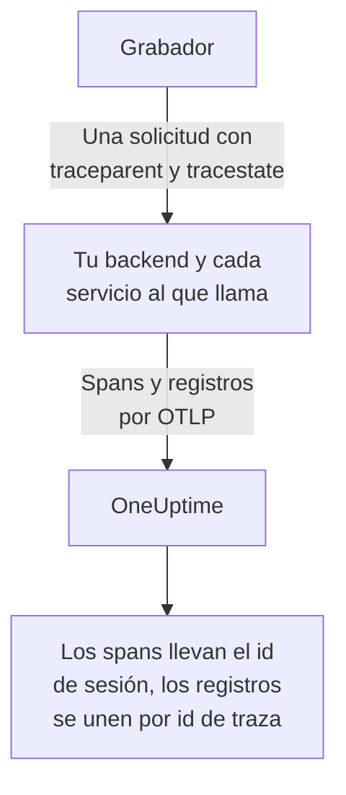
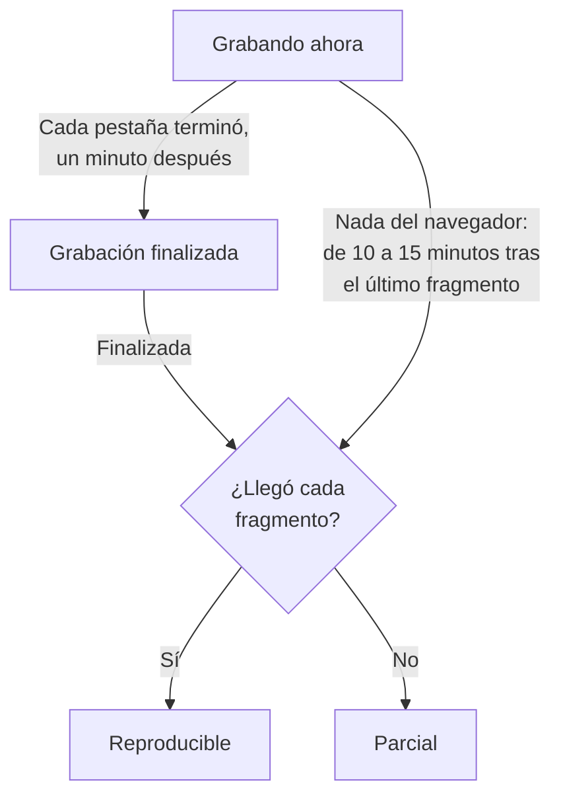
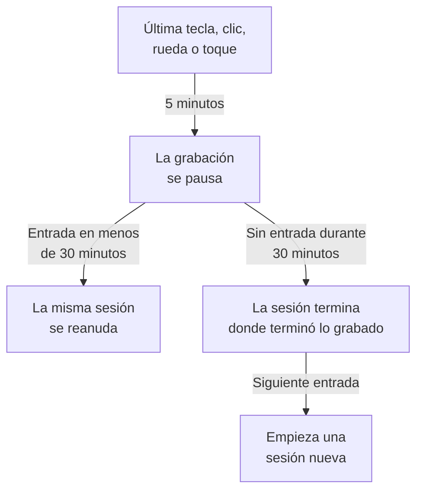

# Reproducción de sesiones

La reproducción de sesiones graba lo que vieron los usuarios reales en tu aplicación web o React Native, y lo reproduce junto a los errores, trazas y registros de la misma sesión. Añades una etiqueta script, eliges qué se enmascara y ves cualquier sesión desde su aplicación RUM.

:::cards
- [Cómo funciona](#cómo-funciona): Un cargador, una política y un grabador que sube sobre la marcha.
- [Instalación](#instalación): Una etiqueta script en cada página, o el SDK de React Native.
- [Privacidad](#privacidad): Qué se enmascara, el consentimiento y quién puede enviar grabaciones.
- [Correlacionar con el resto de tu telemetría](#correlacionar-con-el-resto-de-tu-telemetría): Trazas, registros y errores del backend, vinculados sin código.
- [Ver una sesión](#ver-una-sesión): La lista de sesiones, la página Usuarios, los flujos de usuarios y el reproductor.
- [Estado de la grabación](#estado-de-la-grabación): Por qué no llega nada, y alertas antes de que se agote un presupuesto.
:::

## Cómo funciona

El script de tu página es un pequeño cargador. Comprueba las señales de privacidad del navegador, obtiene de OneUptime la política de la aplicación y solo entonces carga el grabador, que enmascara la página mientras la graba y la sube en fragmentos mientras el usuario está activo.

```mermaid title="De la carga de una página a una grabación que puedes ver"
flowchart TB
    page["Tu página carga<br/>la etiqueta script"] --> dnt{"¿Señal Do Not Track<br/>o GPC?"}
    dnt -->|"Sí"| none["No se graba<br/>nada"]
    dnt -->|"No"| policy["El cargador obtiene<br/>la política"]
    policy --> recorder["El grabador enmascara<br/>y graba la página"]
    recorder -->|"Fragmentos mientras<br/>el usuario está activo"| ingest["OneUptime"]
    ingest --> player["Lista de sesiones<br/>y reproductor"]
```

Por defecto, cada sesión se graba y se sube a medida que ocurre, no solo las que fallaron. Las sesiones en las que nada falló son donde encuentras el pago que nadie completó, el formulario que todos abandonaron y la página que, según un cliente, «se veía mal».

Para almacenar menos, dos ajustes de la política de la aplicación funcionan juntos:

| Ajuste | Predeterminado | Qué cambia |
| --- | --- | --- |
| **Porcentaje de muestreo** | 100 | Cuántas sesiones son elegibles. Redúcelo a la mitad y reduces a la mitad tanto los bytes almacenados como los datos de usuarios finales en reposo. La decisión se toma una vez por sesión a partir de un hash del id de sesión, así que una sesión nunca se graba a medias. |
| **Cuándo subir una grabación** | _Always_ | Con _On error or frustration_, el grabador mantiene un búfer circular en memoria y solo sube cuando algo falla. Entonces existe una grabación de casi cada sesión fallida, con un coste unas 15 veces menor que grabar a todo el mundo, pero no puedes ver una sesión que no falló. |

## Antes de empezar

- Una aplicación RUM. Crea una en **Productos → Recursos → Monitoreo de usuarios reales**, o deja que tu telemetría la cree: consulta [Gestionar aplicaciones](/docs/rum/applications).
- Una clave de ingesta **Navegador**, de **Ajustes del proyecto → Telemetría y APM → Claves de ingesta**. Una clave Navegador solo funciona desde los orígenes que indiques en ella: consulta [Define tus orígenes permitidos en producción](#define-tus-orígenes-permitidos-en-producción).

La reproducción de sesiones está activada por defecto. Sus ajustes están en tres sitios:

| Dónde | Qué hay allí |
| --- | --- |
| La página **Política de reproducción** de la aplicación | La política (grabación, enmascaramiento, consentimiento, trazado y límites), un resumen de **Estado de la grabación**, la tarjeta **Qué contiene una grabación**, el panel **Prueba tu instalación** y **Grabar la próxima sesión de un usuario concreto**. |
| La página **Salud** de la aplicación | Si llegan las grabaciones, y por qué no cuando no llegan. Consulta [Estado de la grabación](#estado-de-la-grabación). |
| **Monitoreo de usuarios reales → Ajustes → Reproducción de sesiones** | El interruptor de todo el proyecto que detiene todas las aplicaciones a la vez, y una lista de solo lectura con la política de cada aplicación. |

## Instalación

Añade una etiqueta script a cada página que quieras grabar.

:::steps
### Crear una clave Navegador

En **Ajustes del proyecto → Telemetría y APM → Claves de ingesta**, haz clic en **Crear clave de ingesta**, elige **Navegador** como **Tipo de clave** e indica los orígenes de tu sitio en **Orígenes permitidos**. Después copia la **Clave secreta** de la clave. [Configuración para navegadores](/docs/rum/browser-setup#configurarlo) muestra cada pantalla.

### Añadir la etiqueta script

Pon la etiqueta en cada página, con tu clave y el identificador de tu aplicación:

```html
<script
  src="https://oneuptime.com/telemetry/session-replay/v1/recorder.js"
  data-oneuptime-token="YOUR_TELEMETRY_INGESTION_KEY"
  data-oneuptime-app-identifier="storefront-web"
  crossorigin="anonymous"
  async
></script>
```

`data-oneuptime-app-identifier` debe coincidir con el identificador de la aplicación RUM, el mismo valor que usas para `service.name`. La página **Documentación** de la aplicación, en la sección **Reproducción de sesiones** de su menú lateral, muestra este fragmento con ambos valores ya rellenados, junto con sus versiones para Next.js / React y Google Tag Manager.

### Comprobar que llegan las grabaciones

Abre una de tus páginas y haz clic aquí y allá durante unos segundos. En más o menos un minuto, la sesión aparece en la página **Reproducción de sesiones** de la aplicación, marcada como **Grabando ahora**. Si no aparece, la página **Salud** de la aplicación dice por qué: consulta [Estado de la grabación](#estado-de-la-grabación).
:::

El script en `/v1/recorder.js` es un pequeño cargador. Comprueba Do Not Track, obtiene la política de tu aplicación y solo entonces carga `/latest/recorder.js`. La política y el grabador se sirven con `no-store`, así que un cambio en cualquiera de los dos llega a la siguiente carga de página sin esperar a que caduque una caché del navegador.

### Atributos de la etiqueta script

| Atributo | Obligatorio | Qué hace |
| --- | --- | --- |
| `data-oneuptime-token` | Sí | Tu token de ingesta de telemetría. |
| `data-oneuptime-app-identifier` | Sí | El identificador de la aplicación RUM. |
| `data-oneuptime-host` | No | El origen de OneUptime. Si se omite, se deduce del propio `src` del script, así que solo lo necesitas cuando sirves el script a través de tu propio dominio. |
| `data-oneuptime-user-ref` | No | La referencia del usuario final conocida al cargar la página (un id de usuario, nunca un correo que no quieras almacenar). Lo mismo que `identify()` define más tarde; es la única forma que funciona para [Grabar la próxima sesión de un usuario concreto](#grabar-la-próxima-sesión-de-un-usuario-concreto). |
| `data-oneuptime-respect-do-not-track` | No | Por defecto respeta Do Not Track y Global Privacy Control. Ponlo en `"false"` para grabar sin tener en cuenta la señal; consulta [Do Not Track](#do-not-track). |
| `data-oneuptime-debug` | No | `"true"` imprime las decisiones del grabador en la consola. Consulta [Solución de problemas de reproducción de sesiones](/docs/rum/session-replay-troubleshooting). |
| `data-oneuptime-offline-storage` | No | Ponlo en `"false"` para mantener solo en memoria los fragmentos grabados mientras el visitante está sin conexión, en lugar de guardarlos también en el IndexedDB del navegador. Consulta [Modo sin conexión](#modo-sin-conexión). |

Las mismas opciones se pueden dar en un global en lugar de en la etiqueta, que es lo que usan los gestores de etiquetas y las instalaciones empaquetadas:

```js
window.__ONEUPTIME_SESSION_REPLAY__ = {
  host: "https://oneuptime.com",
  token: "YOUR_TELEMETRY_INGESTION_KEY",
  appIdentifier: "storefront-web",
  userRef: "user-123", // optional
  respectDoNotTrack: true, // optional
  debug: false, // optional
  offlineStorage: true, // optional; false keeps offline chunks in memory only
};
```

### Cómo es una instalación sana

Abre DevTools → Network y filtra por `session-replay`. Una página que funciona produce:

1. **Un `GET .../session-replay/v1/config`** por cada carga de página — la obtención de la política.
2. **Un `POST .../session-replay/v1/chunk` aproximadamente cada 15 segundos mientras el usuario hace algo**, o antes cuando se acumulan 256 KB de eventos. Una pestaña inactiva no produce eventos y por tanto ningún POST: mueve el ratón o haz clic antes de juzgar una instalación desde la pestaña Network.
3. Cuando la pestaña se oculta, y otra vez cuando la página se va, un `POST` enviado con `keepalive`. La salida de la página — la pestaña cerrada, recargada o llevada a otra página, o la página puesta en la caché back/forward del navegador (cada `pagehide`) — lo marca como final, lo que indica a OneUptime que la grabación de esa pestaña ha terminado; una página que el usuario recupera de la caché back/forward sigue grabando como una pestaña nueva de la misma sesión. Una pestaña que solo se oculta sigue abierta, así que la grabación continúa cuando el usuario vuelve a ella. Su cuerpo entero se mantiene por debajo de 56 KB — la parte del grabador en la cuota keepalive de 64 KB por origen del navegador — y puede llevar varios fragmentos como tramas de esa única solicitud: el fragmento de cierre, los trozos en que se partió un fragmento de cierre grande (como mucho 48 KB de eventos cada uno, para que aún quepa la cabecera de la trama) y cualquier fragmento que aún esperaba un reintento. Un fragmento que ya es más grande que ese presupuesto cuando la pestaña solo se oculta sale en su lugar por el camino ordinario, mientras la página sigue viva para enviarlo.

Con el disparador _On error or frustration_, el paso 2 no ocurre hasta que se dispara un disparador — consulta [Solución de problemas](#solución-de-problemas).

## Instalación en React Native

El SDK de React Native graba la jerarquía de vistas nativas como eventos sintéticos compatibles con rrweb, así que las grabaciones móviles se abren en la misma lista de sesiones y el mismo reproductor que las grabaciones web. No hace capturas de pantalla. El reproductor marca cada grabación como una aplicación React Native, y su pestaña **Fidelidad** explica las superficies nativas que no se pudieron representar.

:::steps
### Instalar el SDK

El SDK es compatible con aplicaciones React Native de iOS y Android. Instálalo con su dependencia par de bandeja de salida persistente:

```bash
npm install @oneuptime/react-native-replay @react-native-async-storage/async-storage
```

En un proyecto iOS sin Expo, ejecuta tu instalación habitual de CocoaPods después de añadir los paquetes; las versiones actuales de React Native enlazan Android automáticamente sin registro manual. El grabador tiene su propio módulo nativo de árbol de vistas además de Async Storage, así que los proyectos de Expo deben usar una compilación personalizada de desarrollo o producción (por ejemplo EAS Build o un prebuild). Expo Go no puede ejecutar este SDK porque ninguno de los dos módulos nativos se puede añadir al binario fijo de Expo Go.

### Iniciar el grabador y envolver tu aplicación

Inicia el singleton una vez y coloca el provider por encima de la parte de la aplicación que quieres grabar:

```tsx
import {
  OneUptimeReplay,
  OneUptimeReplayProvider,
} from "@oneuptime/react-native-replay";

OneUptimeReplay.start({
  host: "https://oneuptime.com",
  token: "YOUR_TELEMETRY_INGESTION_KEY",
  appIdentifier: "storefront-mobile",
  mobileAppIdentifier: "com.example.storefront",
  appName: "Storefront", // optional, shown in session details
  appVersion: "4.2.0", // optional, shown in session details
});

export default function App() {
  return (
    <OneUptimeReplayProvider>
      <Navigation />
    </OneUptimeReplayProvider>
  );
}
```

`appIdentifier` es el identificador de la aplicación RUM. `mobileAppIdentifier` es el id de aplicación de Android o el identificador de bundle de iOS que se distribuye en el binario, no un nombre para mostrar. Usa el mismo valor en las [listas de permitidos `app://`](#define-tus-orígenes-permitidos-en-producción). El SDK obtiene de `host` la política de reproducción de la aplicación; el muestreo, el disparador, el consentimiento, la retención y los presupuestos de subida siguen controlados por el servidor.
:::

El provider tiene una raíz nativa no colapsable y graba su árbol de vistas y los eventos de inicio, movimiento y fin de los toques. Si ya construyes instancias del grabador tú mismo, pasa una con `<OneUptimeReplayProvider recorder={recorder}>`. `MobileReplayRecorder` también se exporta para integraciones aisladas o de varios clientes; la mayoría de las aplicaciones deberían usar el singleton.

### API de React Native

Importa `OneUptimeReplay` directamente, o llama a `useOneUptimeReplay()` debajo del provider. El singleton expone:

| Método | Qué hace |
| --- | --- |
| `start(options)` | Obtiene la política e inicia la captura. Las opciones obligatorias son `host`, `token`, `appIdentifier` y `mobileAppIdentifier`; `appName` y `appVersion` son metadatos de visualización opcionales, y `connectivity` es una fuente opcional del estado de la red para el [modo sin conexión](#modo-sin-conexión). |
| `stop()` | Vacía lo que se puede enviar, detiene la captura y desconecta los controladores del ciclo de vida. |
| `identify(userRef, traits?)` | Adjunta el usuario con sesión iniciada y atributos opcionales, sujeto a **Capturar la identidad del usuario final**. |
| `setTags(tags)` / `addTag(key, value)` | Sustituye todas las etiquetas buscables de la sesión, o añade una etiqueta sin sustituir las demás. |
| `track(name, properties?)` | Pone un evento de la aplicación en la cronología de la reproducción. |
| `setRoute(route)` | Graba una pantalla o ruta lógica saneada tras una navegación. Llámalo desde el callback de cambio de ruta de tu navegador de pantallas. |
| `captureSession(reason?)` | Con _On error or frustration_, sube el búfer circular por un motivo propio de la aplicación, como un usuario que toca «Informar de un problema». |
| `captureError(error)` | Graba un error de JavaScript gestionado y activa la captura disparada por errores. |
| `grantConsent()` / `revokeConsent()` | Permite las subidas, o borra de inmediato el búfer en memoria, la bandeja de salida almacenada, la sesión y el id de visitante. Un consentimiento posterior empieza con identificadores nuevos. |
| `getSessionId()` / `onSessionChange(listener)` | Lee el id de la sesión de reproducción actual con consentimiento, o se suscribe a él, para correlacionar trazas y registros. El oyente también recibe `null` cuando termina la captura o el consentimiento. |
| `getDiagnostics()` | Devuelve el estado del grabador y sus decisiones recientes, sin devolver el contenido de las vistas capturadas. |

El SDK escucha `AppState` de React Native: pasar a segundo plano cierra y vacía los eventos con consentimiento, mientras que la grabación previa al consentimiento se queda solo en memoria. Antes de que se reanude la captura en primer plano, el SDK actualiza la política sin usar una respuesta en caché. También actualiza la política periódicamente mientras está activo, para que la desactivación, el consentimiento, el muestreo, la segmentación y los cambios de identidad surtan efecto en una aplicación que permanece abierta mucho tiempo. Llama a `stop()` cuando tu integración se desmonte de forma permanente; la navegación normal entre pantallas debe usar `setRoute()` en lugar de detener y volver a iniciar el grabador.

**Cuándo termina por inactividad una sesión móvil.** Cinco minutos sin entrada ya pausan la captura (consulta [Tiempo de inactividad](#tiempo-de-inactividad)). Treinta minutos sin ningún toque y sin ninguna llamada del SDK grabada (`track()`, `setTags()`, `identify()` y similares, hechas mientras la captura estaba en marcha) terminan la sesión. Termina en esa última actividad, o para una sesión en pausa en la pausa, donde terminó su grabación — no cuando la aplicación vuelve o el grabador lo nota — así que el tiempo pasado en segundo plano o en pausa nunca se añade al final de una sesión. Una aplicación que se deja abierta en primer plano no inicia una sesión nueva cada media hora. La siguiente sesión empieza cuando el usuario vuelve: su primer toque, que el teclado en pantalla aparezca o desaparezca, que la aplicación vuelva a primer plano, o una llamada a `captureSession()`. Se abre con una instantánea nueva de la pantalla. Hasta entonces, `getSessionId()` devuelve `null` y se llama a `onSessionChange()` con `null`. Los errores, la navegación y las llamadas a `track()` entre medias no se graban.

Para correlacionar la telemetría móvil con una reproducción, suscríbete con `onSessionChange()` y pon el valor devuelto como el atributo `session.id` en tu instrumentación de OpenTelemetry. Sustituye ese atributo cada vez que se dispare el callback, borrándolo incluso cuando el valor sea `null`. El SDK de reproducción no modifica la red nativa ni altera por sí mismo un provider de OpenTelemetry.

### Privacidad y enmascaramiento en React Native

La captura móvil es deliberadamente más estricta que los modos de enmascaramiento web. El texto de la interfaz nativa, los valores de accesibilidad, los valores de entrada y los píxeles de las imágenes nunca se serializan; el servidor recibe una estructura de alambre incluso cuando el modo de enmascaramiento web de la aplicación permitiría texto legible. Los metadatos que aporta quien llama, como referencias de usuario, nombres de eventos, rutas y etiquetas buscables, siguen el contrato de la API, así que no pongas secretos en esos campos. Envuelve un subárbol especialmente sensible en `<ReplayMask>` para sustituir esa zona por un marcador de privacidad conservando el diseño de alrededor.

El consentimiento no se deduce de un permiso del sistema operativo ni de tu banner de consentimiento. Con _Require explicit_, llama a `grantConsent()` solo cuando tu aplicación tenga el consentimiento necesario. Llamar a `revokeConsent()` descarta tanto los datos no enviados en cola y persistidos como los identificadores que podrían vincular una sesión posterior con la revocada.

El grabador móvil captura los límites y tipos de las vistas, las posiciones de los toques, las rutas lógicas, los eventos personalizados y los errores de JavaScript. Estos límites siempre se indican en la pestaña Fidelidad del reproductor:

- Los píxeles de `Image` nativa son opacos; solo se representa el marco.
- El contenido de `WebView` está fuera del árbol de React Native. Instala el grabador web dentro de la página alojada si necesita su propia grabación.
- Canvas, Skia, OpenGL, los mapas, las vistas previas de cámara, el vídeo y otras superficies dibujadas a medida son opacos.
- Los recorridos de toque dentro de `ReplayMask` o de una superficie opaca no se graban. El puente nativo comprueba el destino real del toque y sus antecesores, y suprime el gesto si esa comprobación de privacidad no se puede completar.
- Las animaciones de Reanimated, native-driver y del hilo de UI se muestrean en las instantáneas del árbol de vistas, no se reproducen fotograma a fotograma.
- Los fallos nativos que terminan JavaScript antes de que pueda vaciarse necesitan un SDK de fallos nativo; `captureError()` cubre los errores de JavaScript gestionados, no los volcados de fallos a nivel de proceso.

## Identificar a tus usuarios

Cada sesión es anónima hasta que tu página dice a quién pertenece. Sin eso, la lista todavía puede agrupar las sesiones de un navegador bajo un id de visitante anónimo (consulta [Visitantes anónimos](#visitantes-anónimos) más abajo), pero nada nombra a la persona ni vincula su segundo navegador con el primero. Llama a `identify()` en cuanto lo sepas, o ponlo en cola antes de que se cargue el script — en ambos casos se aplica antes de subir el primer fragmento, así que la sesión se puede buscar por usuario desde el momento en que aparece:

```js
// After the script has loaded:
OneUptimeReplay.identify("user-123", { plan: "pro", tenant: "acme" });

// Or at any time, whether or not the script has loaded yet:
(window.OneUptimeReplayQueue = window.OneUptimeReplayQueue || []).push([
  "identify",
  "user-123",
  { plan: "pro", tenant: "acme" },
]);
```

- La referencia es lo que muestra la lista de sesiones y con lo que coinciden las búsquedas `user:`. Los atributos se muestran en la cabecera del reproductor y en el panel de detalles de la sesión.
- **La identidad pertenece a la sesión, no solo a la página.** Una sesión abarca cada carga de página y cada pestaña de la visita, y en cuanto cualquiera de sus páginas llama a `identify()`, toda la sesión es de ese usuario — incluidas las páginas anteriores al inicio de sesión, ya que son la misma visita. Cada página y pestaña posterior de la sesión también nombra al usuario, incluso una que nunca llama a `identify()` por sí misma: la página de destino de la redirección del inicio de sesión, un enlace abierto en una pestaña nueva. Mientras **Capturar la identidad del usuario final** está activado, el grabador recuerda de quién es la sesión actual en `localStorage` bajo `oneuptime.replay.user` — el id de sesión y la referencia, nada más, y con el consentimiento _Require explicit_ solo una vez dado el consentimiento — y solo para esa sesión: la siguiente sesión (tras 30 minutos de inactividad o el tope de 4 horas) empieza anónima hasta que una página la identifica, salvo que la página que la inició hubiera identificado ella misma al usuario. Así que llama a `identify()` en cada carga de página en la que tu aplicación conozca al usuario, no solo justo después de iniciar sesión.
- **Otro usuario obtiene su propia sesión.** Cuando `identify()` nombra a alguien distinto del usuario al que ya pertenece la sesión — una persona cerró sesión y otra la inició en el mismo navegador, en esta pestaña o en otra —, la sesión actual termina, todavía archivada bajo el primer usuario, y empieza una sesión nueva para el segundo. Se avisa a los oyentes de `onSessionChange`, y el reproductor muestra el cambio como el final de una grabación y el comienzo de la siguiente. Identificar de nuevo al mismo usuario no cambia nada; las referencias se comparan tras quitar los espacios de los extremos y distinguiendo mayúsculas y minúsculas, exactamente como las compara el servidor.
- Lo que `identify()` da al grabador solo se sube con la grabación mientras **Capturar la identidad del usuario final** está activado para la aplicación (el valor predeterminado). Si está desactivado, el grabador deja la referencia y los atributos fuera del fragmento, y el servidor no almacena **absolutamente nada** sobre la persona — ni la referencia, ni un hash con clave de ella, ni atributos. Esas sesiones son realmente seudónimas, y el precio es que no se pueden borrar _por usuario_: una solicitud de borrado no tiene nada con qué coincidir, así que usa en su lugar `BySessionId`, `ByDateRange` o `ByRumApplication` (consulta [Borrar sesiones](#borrar-sesiones)). Si atender una solicitud de eliminación por usuario te importa más que no almacenar ningún identificador, deja el interruptor activado — la clave almacenada es un hash con clave de un solo sentido, que se puede comparar pero no leer, y solo la etiqueta aparte lleva la propia referencia.
- Una referencia sí sale del navegador sea cual sea ese interruptor, por diseño: la que tu página aporta **al cargar** mediante `data-oneuptime-user-ref` o `userRef` en el global de inicialización viaja como cabecera de solicitud en la obtención de la política de cada carga de página, porque así es como [Grabar la próxima sesión de un usuario concreto](#grabar-la-próxima-sesión-de-un-usuario-concreto) reconoce a un visitante antes de que exista ningún grabador. El servidor la compara con el objetivo armado y la descarta; no se escribe en la sesión salvo que la captura de identidad esté activada y el grabador la vuelva a enviar con la grabación. Una referencia pasada a `identify()` nunca se envía de esta forma.
- Los atributos se limitan a 20 claves, 40 caracteres por clave y 200 por valor, se convierten en cadenas y pasan por el modo de enmascaramiento de la aplicación: con _Mask all text_ se enmascaran antes de subirse.
- Volver a leer la identidad en el panel exige el mismo permiso que ver la grabación (consulta [Quién puede ver una grabación](#quién-puede-ver-una-grabación)); los demás roles ven «Identity hidden».

### Visitantes anónimos

Una página que nunca llama a `identify()` sigue necesitando que sus sesiones se puedan agrupar, o una lista de cuarenta filas _Anonymous_ no te dirá si una persona tuvo el mismo error cuarenta veces o cuarenta personas lo tuvieron una vez. Así que el grabador crea un id de visitante aleatorio por perfil de navegador y por origen — 32 caracteres hexadecimales en minúsculas, guardados en `localStorage` bajo `oneuptime.replay.visitor`, junto al registro de la sesión, de modo que un sitio servido desde dos nombres de host o puertos aparece como dos visitantes y solo `identify()` los une — y lo envía como `meta.visitorId` en cada fragmento que lleva metadatos: el primer fragmento, el fragmento de cierre y el fragmento posterior a una llamada a `identify()` o `setTags()`. El servidor comprueba su forma y lo almacena en la sesión con las mismas reglas de acceso que el resto de la cabecera de la sesión. Sobrevive al id de sesión a propósito: el cambio tras 30 minutos de inactividad y el tope de 4 horas inician una sesión nueva, y la sesión nueva lleva el mismo id de visitante, así que dos visitas desde el mismo navegador con una semana de diferencia aparecen juntas en la [página Usuarios](#la-página-usuarios) y en el menú de otras sesiones del reproductor (consulta [El reproductor](#el-reproductor)).

Sé preciso sobre lo que no es:

- **No es una identidad.** Es aleatorio, se crea en el navegador y no se deriva de nada que tu página aportara ni de nada del dispositivo. Dos navegadores en un mismo portátil, o la misma persona en un teléfono y un ordenador, son dos visitantes; solo `identify()` los une. Una ventana privada recibe un id nuevo que desaparece con la ventana, y donde no se puede escribir nada en el almacenamiento (modo privado de Safari, datos de sitio bloqueados) el id dura una carga de página.
- **No depende de Capturar la identidad del usuario final.** Ese interruptor decide si la referencia y los atributos salen del navegador; el id de visitante se envía en cualquier caso, porque no nombra a nadie. Si no quieres que se cree ningún id, la respuesta es no tener grabador: desactiva la reproducción de sesiones para la aplicación, o deja que se respete [Do Not Track](#do-not-track).
- **Sigue las reglas de consentimiento del id de sesión.** `revokeConsent()` lo quita del almacenamiento junto con la sesión, no se escribe nada mientras el consentimiento está retirado, y un `grantConsent()` posterior crea uno nuevo — así que un usuario que retira su consentimiento y vuelve no queda vinculado de nuevo a las sesiones que te pidió olvidar. Con Do Not Track o Global Privacy Control no se ejecuta ningún grabador, así que no se crea ningún id.
- **Nunca viaja en tus propias solicitudes.** El contexto de traza que el grabador añade a las solicitudes de tu página a su propio origen nombra la sesión, nunca al visitante (consulta [Lo que llevan tus propias solicitudes](#lo-que-llevan-tus-propias-solicitudes)); el id de visitante solo va a OneUptime, con la grabación.
- **No puede ser el objetivo de una solicitud de borrado.** Los tipos de solicitud no han cambiado (consulta [Borrar sesiones](#borrar-sesiones)); una búsqueda `visitor:` reduce la lista a las sesiones de un navegador, de donde tomas los ids de sesión que borrar.

`OneUptimeReplay.getVisitorId()` devuelve el id actual, o una cadena vacía antes de que arranque el grabador, después de `stop()` y entre un `revokeConsent()` y el siguiente `grantConsent()`. Los grabadores compilados antes de que esto existiera no enviaban ninguno, así que las sesiones que grabaron tienen un `visitorId` vacío: la lista las muestra como _Anonymous_ y la página Usuarios las archiva en **Sesiones no vinculadas**. Un grabador que crea uno lista `visitor-id` entre sus `capabilities` en `getDiagnostics()` y en la página **Salud**.

## API de JavaScript

El grabador publica `window.OneUptimeReplay`. Como se carga de forma asíncrona, cualquier cosa que tu página llame antes de que haya llegado debe pasar por la cola de comandos — `window.OneUptimeReplayQueue` es un simple array de entradas `[command, ...arguments]` que el grabador vacía en cuanto arranca, y acepta por su nombre todos los comandos de abajo:

```js
(window.OneUptimeReplayQueue = window.OneUptimeReplayQueue || []).push(
  ["grantConsent"],
  ["identify", "user-123", { plan: "pro" }],
  ["setTags", { build: "1.4.2" }],
  ["onSessionChange", (sessionId, tabId) => console.log(sessionId)],
);
```

`grantConsent`, `revokeConsent`, `stop`, `identify`, `setTags` y `addTag` se aplican antes de que arranque el grabador, así que una decisión de consentimiento en cola decide si se sube algo, y una identidad en cola viaja ya en el primer fragmento. `track`, `captureSession` y `onSessionChange` se ejecutan justo después de que arranque.

| Método | Qué hace |
| --- | --- |
| `identify(userRef, traits?)` | Adjunta el usuario final a la sesión — a cada página y pestaña de ella, desde su inicio (consulta [Identificar a tus usuarios](#identificar-a-tus-usuarios)). `traits` es un objeto de valores de cadena, número o booleano (≤ 20 claves, clave ≤ 40 caracteres, valor ≤ 200 caracteres), enmascarado con _Mask all text_ y subido solo cuando **Capturar la identidad del usuario final** está activado. Llamarlo de nuevo para el mismo usuario vuelve a enviar la identidad (y cualquier atributo nuevo) en el siguiente fragmento; nombrar a otro usuario termina la sesión e inicia una nueva para él. |
| `track(name, properties?)` | Graba un evento de negocio (`"checkout_failed"`) en la cronología. `name` ≤ 64 caracteres, ≤ 20 claves de propiedades con los mismos topes de valor que los atributos. Hasta 50 por fragmento de 15 segundos; por encima de eso, el fragmento lleva un único marcador «events dropped» con el recuento. |
| `setTags(tags)` / `addTag(key, value)` | Etiquetas por sesión (`{ build: "1.4.2", experiment: "new-checkout" }`), ≤ 20 etiquetas, clave ≤ 32 caracteres, valor ≤ 128. Se pueden buscar desde la lista de sesiones con `tag:key=value` y se muestran en los detalles de la sesión. `setTags` **sustituye** el mapa entero, así que un segundo `setTags({ experiment })` elimina una etiqueta `build` definida por el primero; `addTag` define una clave y conserva las demás. Construye el mapa en una sola llamada a `setTags`, o usa `addTag` a medida que conoces cada valor. |
| `captureSession(reason?)` | Con _On error or frustration_, obliga a esta sesión a subir desde su búfer circular en adelante; con _Always_ no cambia nada en la subida, pero la `reason` (≤ 80 caracteres) se marca igualmente en la cronología. Úsalo desde tu propio botón «informar de un problema». |
| `onSessionChange(listener)` | `listener(sessionId, tabId)` se llama de inmediato si existe una sesión y de nuevo cada vez que cambia el id — cuando el usuario vuelve tras 30 minutos de inactividad, en el tope de 4 horas, cuando `identify()` nombra a otro usuario, o cuando otra pestaña del mismo visitante cambió de sesión antes. Devuelve una función para cancelar la suscripción. **Opcional**: las solicitudes a tu propio origen vinculan sin él los spans, registros y excepciones de tu backend a la grabación (consulta [Correlacionar con el resto de tu telemetría](#correlacionar-con-el-resto-de-tu-telemetría)). Úsalo para poner `session.id` en la telemetría que produce la propia página, como los spans del SDK de OpenTelemetry para navegador; consulta [La telemetría de navegador de tu propia página](#la-telemetría-de-navegador-de-tu-propia-página). |
| `grantConsent()` | Con el modo de consentimiento _Require explicit_, permite las subidas. Antes de esto no se sube nada. |
| `revokeConsent()` | Descarta todo lo que hay en el búfer y detiene las subidas. El grabador sigue funcionando solo en memoria, así que un `grantConsent()` posterior continúa con un id de sesión nuevo. |
| `getSessionId()` | El id de sesión actual, o `null` cuando no se graba nada. Prefiere `onSessionChange()`, que también sigue los cambios de sesión. |
| `getVisitorId()` | El [id de visitante anónimo](#visitantes-anónimos) — 32 caracteres hexadecimales, uno por perfil de navegador, el mismo en todos los cambios de sesión — o `""` antes de que arranque el grabador, después de `stop()` y mientras el consentimiento está retirado. Aleatorio y no una identidad; no depende de **Capturar la identidad del usuario final**. |
| `stop()` | Sube el último fragmento, sella la sesión y se detiene durante el resto de la vida de la página. |
| `setDebug(enabled)` | Imprime a partir de ahora las decisiones del grabador en la consola. |
| `getDiagnostics()` | Todo lo que decidió el grabador, estuviera o no activado el diagnóstico. Consulta más abajo. |

### `getDiagnostics()`

Es lo primero que hay que pegar en un ticket de soporte. Por construcción no contiene contenido de la página (consulta [Lo que el diagnóstico nunca contiene](/docs/rum/session-replay-troubleshooting#lo-que-el-diagnóstico-nunca-contiene)).

```js
copy(JSON.stringify(OneUptimeReplay.getDiagnostics(), null, 2));
```

| Campo | Significado |
| --- | --- |
| `state` | `none` (no se construyó ningún grabador), `not-started`, `recording` (solo en memoria), `uploading`, `paused` (nadie ha tocado la página en cinco minutos, así que no se captura nada hasta la siguiente entrada — consulta [Tiempo de inactividad](#tiempo-de-inactividad)), `not-sampled` o `stopped`. |
| `stopReason` | Por qué se detuvo, si lo hizo: `api` (tu `stop()`), `server-directive`, `transport-failure` o `chunk-cap`. |
| `bootstrapDecision` | Por qué el artefacto construyó o no un grabador: `started`, `privacy-signal`, `directive-stop`, `already-started`, `cancelled-before-start` (un `revokeConsent`/`stop` en cola) o `not-started`. |
| `decisions` | La respuesta de cada barrera: `isSampled`, `captureTrigger`, `consentMode`, `consentState`, `uploadsAllowed`, `uploadBlockedBy` (`consent`, `transport` o `null`), `lastDirective` y su motivo, y `startDecision` (`recording-and-uploading`, `recording-into-memory`, `not-sampled`, `not-started`). |
| `capabilities` | Lo que captura esta compilación del grabador: `click-events`, `web-vitals`, `custom-events`, `traits`, `tags`, `visibility`, `visitor-id`. La página **Salud** del panel muestra la misma lista para la sesión más reciente, así que es fácil detectar una grabación de una página antigua abierta durante mucho tiempo. |
| `tags`, `hasTraits`, `triggerReason`, `isRecording`, `isUploading`, `sessionId`, `tabId`, `visitorId`, `version` | El estado actual de la sesión. `isRecording` solo es true mientras el grabador graba de verdad. `visitorId` es `null` hasta que existe un grabador y `""` mientras el consentimiento está retirado. |
| `records` | Las últimas 250 decisiones con códigos estables — incluidas las del cargador, de antes de que existiera el artefacto. Cada código se explica en [Solución de problemas de reproducción de sesiones](/docs/rum/session-replay-troubleshooting#códigos). |

## Privacidad

**El enmascaramiento ocurre en la captura, en el dispositivo del usuario final, antes de subir nada.** El servidor nunca recibe lo que se enmascaró, así que una decisión de enmascaramiento no se puede deshacer a posteriori, ni tampoco aplicarse con efecto retroactivo. En la web, lo que se enmascara depende del modo; React Native siempre envía la estructura de alambre más estricta descrita en [Privacidad y enmascaramiento en React Native](#privacidad-y-enmascaramiento-en-react-native). La tarjeta **Qué contiene una grabación** de la página **Política de reproducción** de la aplicación reformula estas decisiones en frases sencillas para lo que hayas configurado.

Los ajustes de privacidad de la política, con el nombre que les da **Editar política**:

| Ajuste | Predeterminado | Qué hace |
| --- | --- | --- |
| **Grabar sesiones de esta aplicación** | Activado | El interruptor propio de la aplicación. Desactívalo para dejar de grabar esta aplicación. |
| **Modo de enmascaramiento** | _Mask sensitive inputs only_ | Se enmascaran las contraseñas y los campos de tarjeta y de código de un solo uso. El resto de la página, su texto estático y los valores de entrada normales, se graba tal como se veía. Consulta [Elige un modo de enmascaramiento a conciencia](#elige-un-modo-de-enmascaramiento-a-conciencia). |
| **Consentimiento** | _Not required_ | Las subidas empiezan de inmediato. Elige _Require explicit_ si necesitas un intercambio de consentimiento para cada sesión, como hará la mayoría de los despliegues en la UE. |
| **Cuándo subir una grabación** | _Always_ | Cada sesión muestreada se sube desde su primer evento. Elige _On error or frustration_ para subir solo cuando algo falla. |
| **Porcentaje de muestreo** | 100 % | La parte de las sesiones elegibles para grabarse, y el ajuste del coste. 0 % junto con _Always_ no graba nada en absoluto, y la página de la política avisa cuando lo configuras. |
| **Orígenes permitidos** | Vacío: cualquier origen | Indica tus dominios para restringir quién puede enviar grabaciones. Consulta [Define tus orígenes permitidos en producción](#define-tus-orígenes-permitidos-en-producción). |
| **Capturar la identidad del usuario final** | Activado | Se almacenan la referencia y los atributos del usuario final que aporta tu página, para que puedas encontrar la sesión de un cliente con nombre. Desactívalo para mantener las grabaciones seudónimas: desactivado, no se almacena nada sobre la persona, ni siquiera la clave con la que tendría que coincidir una solicitud de borrado por usuario ([Identificar a tus usuarios](#identificar-a-tus-usuarios)). No afecta al [id de visitante anónimo](#visitantes-anónimos), que es aleatorio, no nombra a nadie y se envía en cualquier caso. |
| **Propagación de trazas del mismo origen** | Activado | Mientras una sesión sube, las solicitudes de tu página a su propio origen llevan un `traceparent` W3C y un `tracestate` que nombra la sesión, así que la telemetría de tu backend se vincula a la grabación sin código. El OpenTelemetry de tu backend reenvía ambos a cada servicio que llama. Consulta [Lo que llevan tus propias solicitudes](#lo-que-llevan-tus-propias-solicitudes). |
| **Capturar país** | Activado | Solo el país, nunca una dirección IP. |
| **Grabar el contenido del canvas** | Desactivado | Canvas y WebGL no se graban. |
| **Retención** | 7 días | Más corta que la del resto de la telemetría, a propósito. También están disponibles 1, 14, 30 y 90 días. |
| **Presupuesto mensual (GB)** | Vacío | Un tope opcional de bytes subidos por mes natural para esta aplicación. Vacío o 0 significa sin tope. |

### Elige un modo de enmascaramiento a conciencia

> [!WARNING]
> El valor predeterminado graba una página legible, porque una estructura de alambre rara vez basta para depurar. Todo lo que se muestra en tu página está en la grabación: un número de pedido, una dirección de correo en una cabecera, un banner de error que cita datos del usuario. Y también todo lo que se escribe en un campo que tu marcado no declara como sensible. El enmascaramiento ocurre en el navegador antes de la subida, así que endurecer el modo más adelante no limpia las grabaciones ya hechas.

Los tres modos, de menos a más privado:

| Modo | Texto estático de la página | Valores de entrada normales | Campos de contraseña, tarjeta y OTP |
| --- | --- | --- | --- |
| Mask sensitive inputs only *(predeterminado)* | se graba | se graban | enmascarados |
| Mask inputs only | se graba | enmascarados | enmascarados |
| Mask all text | enmascarado | enmascarados | enmascarados |

Con _Mask all text_ la reproducción es una estructura de alambre: los nodos de texto, las etiquetas que el grabador adjunta a los clics, los atributos de `identify()` y las propiedades de `track()` se enmascaran antes de subirse, y el reproductor no carga ninguna de las imágenes ni de las fuentes web de la página desde sus direcciones. La grabación sigue guardando esas direcciones, y una sesión grabada en este modo se reproduce sin ellas, con una excepción: una imagen que la página tenía como URL `data:` forma parte de la propia grabación, y se sigue mostrando. Bloquea los elementos que puedan mostrar así una imagen personal, como la vista previa de un documento que sube el usuario. Las hojas de estilos se siguen cargando, así que el diseño conserva su forma (consulta [Imágenes, estilos y fuentes durante la reproducción](#imágenes-estilos-y-fuentes-durante-la-reproducción)).

Si tus páginas muestran datos personales, sube un modo o añade selectores de enmascaramiento o de bloqueo para los elementos concretos: consulta [Marcar tu propio contenido](#marcar-tu-propio-contenido). Los selectores son la herramienta adecuada cuando solo unas pocas zonas son sensibles; un modo más estricto es la herramienta adecuada cuando no puedes enumerarlas.

### Define tus orígenes permitidos en producción

La reproducción de sesiones funciona desde el primer momento con una lista de orígenes permitidos vacía, que acepta grabaciones de cualquier origen. Es cómodo para empezar e inadecuado para producción.

Tu token de ingesta se entrega al cliente — en el JavaScript de la página o en el binario móvil — así que hay dos barreras, y se combinan:

- **En la clave.** Crea la clave de ingesta con **Navegador** como **Tipo de clave**. Para la web, indica sus **Orígenes permitidos** (`https://app.example.com`, o `https://*.example.com` para un nivel de subdominio). Para React Native, añade la identidad exacta de la aplicación como `app://com.example.storefront`. Dale también a la clave un **Caduca el**: así un token copiado deja de funcionar en una fecha que tú eliges en lugar de nunca.
- **En la aplicación.** **Política de reproducción → Orígenes permitidos** restringe quién puede escribir grabaciones en esta aplicación, presente la clave que presente. Añade aquí los mismos orígenes web y las identidades móviles `app://` exactas.

Una entrada `app://` es el prefijo literal más el id de aplicación de Android o el identificador de bundle de iOS normalizado que se aporta como `mobileAppIdentifier`. La comparación no distingue mayúsculas de minúsculas, tras quitar espacios y pasar a minúsculas un identificador reverse-DNS válido. Las identidades móviles **no** aceptan comodines: `app://*.example.com` no es válido. El SDK móvil no envía ningún `Origin` de navegador; envía su tipo de grabador y la identidad de la aplicación en cabeceras específicas. Si una solicitud sí lleva un `Origin` real, ese origen siempre manda — las cabeceras móviles nunca pueden usarse para saltarse la comprobación del origen del navegador.

Esa identidad móvil son metadatos HTTP autodeclarados, no una atestación de plataforma de Apple/Google ni una prueba de que la solicitud vino de tu binario firmado. Alguien que extraiga el token del cliente puede enviar una solicitud que no sea de navegador con la misma cabecera de identidad de aplicación. Las entradas `app://` exactas siguen evitando el uso accidental entre aplicaciones y separando las identidades móviles que quieres aceptar, pero no las llames una frontera de autenticidad. Define una caducidad, rota las claves expuestas y mantén activados los presupuestos de frecuencia y de bytes para acotar el abuso; nunca pongas un secreto de servidor en la aplicación tratándolo como una protección, porque se puede extraer.

Una solicitud tiene que pasar ambas listas de permitidos. En las solicitudes web, la comprobación del `Origin`, que controla el navegador, impide que un sitio web reutilice la clave de otro sitio; en las solicitudes nativas, los controles anteriores limitan y compartimentan una identidad autodeclarada. Define ambas listas antes de dirigir tráfico real a cualquiera de los dos grabadores; las subidas rechazadas aparecen en la página **Salud** como `origin-not-allowed`.

### Siempre enmascarado

Siempre enmascarado sea cual sea el modo, y no configurable:

- **Contraseñas**, incluso después de un botón de «mostrar contraseña». Un campo que alguna vez fue de contraseña sigue enmascarado, y el propio cambio de tipo se suprime.
- **Campos de tarjeta**, detectados mediante `autocomplete` (`cc-number`, `cc-csc`, `cc-exp`), porque las entradas de tarjeta son `type="text"` y, si no, serían invisibles para el enmascaramiento basado en el tipo.
- **Códigos de un solo uso** (`autocomplete="one-time-code"`).
- **Valores de los campos de archivo** — el navegador expone el nombre real del archivo, y los nombres de archivo suelen ser personales.
- **Cadenas de consulta y fragmentos**: se quitan de las URL de página que guarda la grabación y de la URL de cada solicitud de red, y se sustituyen los segmentos de ruta con forma de identificador (UUID, correos, series largas de dígitos, tokens opacos largos). Es el único canal que el enmascaramiento de texto no cubre: si no, un enlace de restablecimiento de contraseña acabaría en la lista de sesiones. Las direcciones dentro de la página son otra cosa. El destino de un enlace solo se limpia de esta forma con _Mask all text_; en los otros dos modos se graba como el resto de la página. Las direcciones de imágenes, hojas de estilos y fuentes se conservan tal como las escribió la página en todos los modos, cadena de consulta incluida, porque la reproducción las carga desde ahí (con _Mask all text_, solo las hojas de estilos; consulta [Imágenes, estilos y fuentes durante la reproducción](#imágenes-estilos-y-fuentes-durante-la-reproducción)). Bloquea un elemento cuya dirección de imagen lleve algo sensible, como un token firmado.
- **Eventos del portapapeles**: nunca se graban.
- **El ritmo de pulsación de teclas** se cuantiza, porque los intervalos entre pulsaciones revelan el contenido escrito incluso cuando el valor está enmascarado.
- **Cuerpos y cabeceras de solicitudes y respuestas**: nunca se graban. Una fila de red del reproductor lleva el método, la URL, el estado, los tiempos, los recuentos de bytes y el id de traza — nada más. (El grabador sí _añade_ contexto de traza a las solicitudes a tu propio origen; consulta [Lo que llevan tus propias solicitudes](#lo-que-llevan-tus-propias-solicitudes).)
- **Etiquetas de clic**: vienen del `aria-label` o del texto visible de un elemento, nunca del valor de un control de formulario, y se descartan por completo dentro de las zonas enmascaradas.

Los valores enmascarados no conservan la longitud. Un campo enmascarado es un marcador de ancho fijo, así que no sirve para deducir la longitud de una contraseña o de un número de tarjeta.

### Marcar tu propio contenido

```html
<!-- Not recorded at all: the element and its subtree are omitted. -->
<div class="oneuptime-block">...</div>

<!-- Recorded, but all text inside is masked. -->
<div class="oneuptime-mask">...</div>

<!-- Recorded, but input events inside are dropped. -->
<div class="oneuptime-ignore">...</div>
```

También puedes añadir **Selectores de enmascaramiento adicionales** y **Selectores de bloqueo** en la página **Política de reproducción** de tu aplicación, sin cambiar tu marcado. Con el modo de enmascaramiento predeterminado, son la herramienta principal para proteger contenido que tu marcado no declara como sensible.

### Lo que llevan tus propias solicitudes

El grabador nunca graba las cabeceras ni el cuerpo de una solicitud, pero sí **añade** contexto de traza a algunas de las solicitudes de tu propia página, y eso va a tu backend en lugar de a OneUptime. Es lo que vincula la telemetría del backend a una grabación (consulta [Correlacionar con el resto de tu telemetría](#correlacionar-con-el-resto-de-tu-telemetría)):

```text
traceparent: 00-<32 hex trace id>-<16 hex parent id>-01
tracestate:  oneuptime=sid:<32 hex session id>;p:<16 hex parent id>
```

- **Qué solicitudes.** Las llamadas `fetch` y `XMLHttpRequest` al **origen propio** de la página, hechas mientras la sesión está **subiendo**, excepto las exportaciones de OpenTelemetry de la propia página (solicitudes `POST` a rutas que terminan en `/v1/traces`, `/v1/logs` o `/v1/metrics`). No se añade nada antes del consentimiento con _Require explicit_, después de `revokeConsent()`, con _On error or frustration_ hasta que se dispara un disparador, en una sesión no muestreada, mientras la grabación está [en pausa porque no hay nadie en la página](#tiempo-de-inactividad), ni después de `stop()`. Un `traceparent` o `tracestate` que la solicitud ya lleva nunca se sustituye: conserva el suyo, y el grabador solo añade lo que falta. `;p:` solo aparece cuando el grabador creó él mismo el `traceparent`. Las solicitudes a otros orígenes no reciben nada salvo que indiques el origen en **Orígenes de propagación de trazas**, y entonces solo un `traceparent`, que no lleva id de sesión.
- **Qué es el id de sesión.** El mismo id aleatorio de 32 caracteres hexadecimales bajo el que se archiva la grabación. No dice nada de la persona y se mantiene igual durante toda la visita, hasta que 30 minutos de inactividad o el tope de 4 horas terminan la sesión, `identify()` nombra a otro usuario, o un `revokeConsent()` seguido de `grantConsent()` crea uno nuevo. Una sesión que terminó por inactividad no envía ningún id hasta que el usuario vuelve, lo que inicia la siguiente sesión. El [id de visitante anónimo](#visitantes-anónimos), la referencia del usuario y los atributos nunca viajan de esta forma.
- **Adónde va.** El OpenTelemetry de tu backend conserva `tracestate` con la traza y lo reenvía en cada llamada que hace, a tus otros servicios y a cualquier API de terceros a la que llame con contexto de traza, exactamente igual que el id de traza. OneUptime lee el miembro de cada span en la ingesta, guarda el id de sesión en la columna de id de sesión del span y quita el miembro del estado de traza que almacena.
- **Qué vincula.** Un span, registro o excepción del backend que nombra al usuario (un atributo `enduser.id`, un correo en una línea de registro) queda ahora a un clic de la grabación, incluso con **Capturar la identidad del usuario final** desactivado: ese interruptor decide lo que guarda la grabación, no lo que registra tu backend. Si las grabaciones no deben poder vincularse con quién era el usuario, desactiva también **Propagación de trazas del mismo origen**.
- **Quién puede declararlo.** Como cualquier contexto de traza, el miembro lo escribe el cliente. Alguien que conociera un id de sesión podría enviarlo a tu API y hacer que los spans de sus propias solicitudes se archivaran bajo esa sesión. Los ids de sesión son valores aleatorios de 128 bits, así que primero necesitaría el id. Lo mismo vale para la traza que nombra un cliente: una solicitud que envía un `traceparent` de una traza que conoce, junto al miembro de su propia sesión, trae las filas de backend de esa traza al carril de su sesión y al alcance del borrado de esa sesión. El borrado solo quita una traza entera cuando pertenece únicamente a las sesiones borradas; de una traza compartida con otras sesiones solo quita las filas marcadas con los ids borrados (consulta [Borrar sesiones](#borrar-sesiones)).

Desactívalo por aplicación con **Propagación de trazas del mismo origen** en la página **Política de reproducción**; consulta [Desactivar la vinculación automática](#desactivar-la-vinculación-automática).

### Consentimiento

```js
// After the user accepts. Nothing is uploaded before this.
window.OneUptimeReplay.grantConsent();

// Drops everything buffered and stops uploading. A later grantConsent()
// continues on a fresh session.
window.OneUptimeReplay.revokeConsent();
```

Tu banner suele resolverse antes de que se cargue el script del grabador, así que pon la decisión en cola en lugar de esperar al global:

```js
(window.OneUptimeReplayQueue = window.OneUptimeReplayQueue || []).push(["grantConsent"]);
```

Con _Require explicit_ el grabador graba en memoria desde el primer evento y sube todo el búfer en cuanto llega el consentimiento, así que no se pierden los segundos anteriores a que se aceptara el banner. Hasta que llega, la página **Salud** dice «waiting for consent», que es una respuesta de la política y no un fallo.

`revokeConsent()` olvida tres cosas, y un `grantConsent()` posterior vuelve a crear las dos primeras:

- El id de sesión, para que un usuario que retira su consentimiento y vuelve no quede vinculado de nuevo a la misma sesión.
- El [id de visitante anónimo](#visitantes-anónimos), que se quita del almacenamiento junto con la sesión. No se escribe nada mientras el consentimiento está retirado, y `getVisitorId()` responde `""` hasta el siguiente consentimiento — así que las sesiones grabadas tras volver a consentir se agrupan entre sí, nunca con las que el usuario te pidió olvidar.
- De quién era la sesión (`oneuptime.replay.user`), que se quita del almacenamiento junto con la sesión. Una página que llamó a `identify()` conserva la referencia en memoria, y la sesión que inicia un consentimiento posterior vuelve a pertenecer a ese usuario; no queda nada del usuario de la sesión retirada para que lo recoja una página posterior.

La misma barrera rige el [contexto de traza que el grabador añade a tus propias solicitudes](#lo-que-llevan-tus-propias-solicitudes): no se envía ningún id de sesión antes de `grantConsent()` ni después de `revokeConsent()`, y tras un nuevo consentimiento las solicitudes llevan el id de la sesión nueva, nunca el retirado.

### Do Not Track

`navigator.doNotTrack` y `navigator.globalPrivacyControl` se respetan antes de hacer la solicitud de configuración: una página que no dice nada en su etiqueta script se retira para un usuario que envía cualquiera de las dos señales, sin que se haga ninguna solicitud sobre él solo para averiguar si se le habría grabado. El cargador registra `privacy-signal` y no pasa nada más.

La regla tiene una única excepción. Define `data-oneuptime-respect-do-not-track="false"` (o `respectDoNotTrack: false` en el global de inicialización) para grabar sin tener en cuenta la señal, si tu base legal de verdad no depende de ella. Solo el propio marcado de la página puede decirlo: nada en la política del panel lo relaja, y una página que no dice nada respeta la señal.

## Content Security Policy

> [!IMPORTANT]
> Si tu sitio envía una Content Security Policy, el grabador falla en silencio hasta que lo permitas. Desde los navegadores de tus usuarios no llega ningún error a OneUptime, así que es lo primero que debes comprobar cuando no aparecen grabaciones.

Añade el origen de OneUptime a las directivas que ya tienes. No las sustituyas, o dejarás tus propios scripts fuera de tu página:

```text
script-src  'self' https://oneuptime.com;
connect-src 'self' https://oneuptime.com;
```

Si alojas OneUptime tú mismo, usa en su lugar tu propio host.

Un detalle más relacionado con la CSP, sobre las hojas de estilos y no sobre tu política: el grabador solo puede guardar una hoja de estilos que pueda leer. Una hoja de estilos de otro origen solo se puede leer cuando su servidor envía una cabecera `Access-Control-Allow-Origin` que permite tu sitio **y** tu `<link>` lleva `crossorigin="anonymous"`. Si no, la grabación solo guarda su dirección, y la reproducción la carga desde ahí en el navegador de quien mira; consulta [Imágenes, estilos y fuentes durante la reproducción](#imágenes-estilos-y-fuentes-durante-la-reproducción). Añade el atributo solo cuando la cabecera esté en su sitio: `crossorigin` sin la cabecera hace que tu propia página rechace la hoja de estilos.

Usa el panel **Prueba tu instalación** de la página **Política de reproducción** de la aplicación para confirmar desde el lado del servidor el token, los interruptores de la política y las listas de orígenes permitidos. No puede comprobar tu CSP: una CSP es una cabecera que tu propio sitio envía a tus propios visitantes, y nada del lado del servidor la ve nunca. Un bloqueo de la CSP solo se nota allí de forma indirecta: `script-src` bloquea el grabador, así que la fila _Recorder loaded on your site_ del panel sigue esperando; `connect-src` bloquea la subida, así que esa fila pasa mientras la fila de la grabación recibida, debajo, sigue esperando. En cualquier caso la consola del navegador en la página bloqueada registra el rechazo, y esa es la única prueba positiva.

## Correlacionar con el resto de tu telemetría

Instalar el grabador basta para vincular una grabación con las trazas, registros y excepciones de tu backend. No hay código que añadir a la página ni a tus servicios.



Mientras una sesión sube, cada `fetch` y `XMLHttpRequest` que tu página hace **a su propio origen** lleva el contexto de traza W3C de la sesión:

- un `traceparent`, creado por el grabador, salvo que la solicitud ya tenga uno u otro agente de trazas de la página esté configurado para trazarla, en cuyo caso el grabador se lo deja al agente;
- un miembro de `tracestate`, `oneuptime=sid:<session id>`, salvo que la solicitud ya lleve un `tracestate`.

El grabador solo deja el `traceparent` a otro agente cuando ese agente está configurado para trazar la solicitud: la instrumentación de fetch o XMLHttpRequest del SDK de OpenTelemetry para navegador; Datadog RUM, una vez iniciado y siguiendo la sesión, cuando la primera entrada de su `allowedTracingUrls` que coincide con la URL de la solicitud usa el propagador `tracecontext` (una entrada sin `propagatorTypes` lo usa); un agente RUM de Elastic APM activo con el trazado distribuido activado y su nombre de cabecera `traceparent` predeterminado (`distributedTracingHeaderName`); o New Relic con el trazado distribuido activado. Aun así añade su miembro de `tracestate`. Con los tres primeros, la solicitud solo se vincula si ese agente envía de verdad un `traceparent` W3C con ella, y Datadog solo envía uno en una sesión de Datadog seguida y muestreada para trazas. New Relic envía su propio `tracestate` con su `traceparent`, y ese ocupa el lugar del miembro, así que las solicitudes de New Relic nunca se marcan con la sesión y solo se vinculan por id de traza (consulta [Lo que no se vincula automáticamente](#lo-que-no-se-vincula-automáticamente)). Un agente que simplemente está cargado no impide que el grabador cree uno: Datadog RUM sin entrada en `allowedTracingUrls` para tu origen, antes de que haya arrancado o de que se conceda su `trackingConsent`, o en una sesión que no sigue.

Las solicitudes del mismo origen no hacen solicitud previa CORS, así que estas cabeceras no activan las reglas CORS de tu API; la única excepción es una [redirección a otro origen](#redirecciones-a-otro-origen).

El SDK de OpenTelemetry de tu backend extrae ambas cabeceras, cada span que registra para la solicitud hereda el estado de traza, y cada llamada que hace a otro servicio lo reenvía. Así, en la ingesta, OneUptime marca con el id de sesión los spans de **cada servicio que continúa el contexto de traza W3C**, y las excepciones registradas en esos spans. Los registros de log OTLP no llevan estado de traza, así que los registros del backend, y las excepciones informadas mediante registros, se unen a la grabación **por id de traza** cuando la abres. Cuando el grabador creó el `traceparent`, el miembro también lleva su id padre (`;p:<parent id>`): ese span del navegador nunca se exporta, y la ingesta usa el id para mantener el span de entrada de tu backend como span raíz en lugar de uno al que le falta el padre. Un span que lleva tanto el miembro como un atributo `session.id` se archiva bajo el id del miembro, porque `session.id` también es la clave de conversación de varios SDK de LLM.

Las pestañas **Registros**, **Trazas** y **Errores** del reproductor muestran entonces esas filas en el reloj de la grabación, y la fila de cada solicitud en la pestaña **Red** enlaza con su traza de backend. Lo que estas cabeceras significan para la privacidad está en [Lo que llevan tus propias solicitudes](#lo-que-llevan-tus-propias-solicitudes).

### API en otro origen

Una solicitud a otro origen no recibe nada por defecto: añadir cualquier cabecera convierte una solicitud entre orígenes simple en una con solicitud previa, y una API que no permita la cabecera empezaría a fallar porque instalaste un grabador. Para vincular una, añade su origen a **Orígenes de propagación de trazas** en la página **Política de reproducción**, en el paso **Rendimiento y trazado** de **Editar política**. Indica solo un origen cuya API permita `traceparent` en `Access-Control-Allow-Headers`; esa es toda la razón de que sea una lista de permitidos explícita.

Las solicitudes a un origen de la lista solo reciben un `traceparent`, sin `tracestate` y por tanto sin id de sesión, y la telemetría de su backend se asocia con la grabación **por id de traza**, a través de los ids de traza que observó la grabación. Las solicitudes que ya llevan un `traceparent`, y las llamadas `fetch` hechas con un objeto `Request` en lugar de una URL, no se tocan en este camino.

### Muestreo de las trazas iniciadas en el navegador

El grabador crea su `traceparent` con la marca de muestreo activada (`-01`), porque un backend que sigue la decisión de su padre descartaría si no todos los spans de la solicitud. La contrapartida es que los muestreadores `ParentBased` predeterminados conservan cada traza que inicia el grabador, aunque tu backend muestree sus propias trazas raíz al, por ejemplo, 10 %: las solicitudes del mismo origen de cada sesión que sube, y las solicitudes a los orígenes de **Orígenes de propagación de trazas** de cada sesión en la que se ejecuta el grabador, grabada o no. El volumen de trazas y el coste de ingesta pueden subir cuando tus páginas ejecutan el grabador. `OTEL_TRACES_SAMPLER=parentbased_traceidratio` se comporta igual: su proporción solo se aplica a los spans raíz.

Para mantener el muestreo por proporción en las trazas iniciadas en el navegador, da un muestreador por proporción para padres remotos muestreados **solo al servicio o los servicios a los que llaman directamente tus páginas**. Deja el muestreador `ParentBased` predeterminado en cada servicio al que estos llaman, para que sigan la decisión del primer salto:

:::tabs
@tab Node.js
```js
import {
  ParentBasedSampler,
  TraceIdRatioBasedSampler,
} from "@opentelemetry/sdk-trace-base";

const sampler = new ParentBasedSampler({
  root: new TraceIdRatioBasedSampler(0.1),
  remoteParentSampled: new TraceIdRatioBasedSampler(0.1),
});
```
@tab Java
```java
Sampler sampler = Sampler.parentBasedBuilder(Sampler.traceIdRatioBased(0.1))
    .setRemoteParentSampled(Sampler.traceIdRatioBased(0.1))
    .build();
```
@tab Python
```python
from opentelemetry.sdk.trace.sampling import ParentBased, TraceIdRatioBased

sampler = ParentBased(
    root=TraceIdRatioBased(0.1),
    remote_parent_sampled=TraceIdRatioBased(0.1),
)
```
@tab Go
```go
sampler := sdktrace.ParentBased(
    sdktrace.TraceIDRatioBased(0.1),
    sdktrace.WithRemoteParentSampled(sdktrace.TraceIDRatioBased(0.1)),
)
```
:::

No pongas este delegado en los servicios más abajo. `TraceIdRatioBased` aplica el hash al id de traza de forma distinta en el SDK de cada lenguaje: JavaScript hace un XOR de sus palabras de 32 bits, Go y Python usan sus 64 bits bajos, y Java usa el valor absoluto de los 64 bits bajos con signo. Un servicio posterior en otro lenguaje descartaría spans de trazas que el primer salto conservó, y volvería a muestrear también las trazas que empiezan en tu backend. La especificación de OpenTelemetry recomienda este muestreador solo para spans raíz. Para una tasa de muestreo coherente entre servicios, usa en su lugar el tail sampling en un OpenTelemetry Collector.

Una traza que tu backend descarte entonces nunca llega a OneUptime, así que tampoco se vincula. O desactiva la [vinculación automática](#desactivar-la-vinculación-automática). Un `traceparent` definido por la propia instrumentación de la página lleva la decisión de esa instrumentación, no la del grabador.

### Desactivar la vinculación automática

**Propagación de trazas del mismo origen**, en la página **Política de reproducción** junto a **Orígenes de propagación de trazas**, está activada por defecto en cada aplicación. Si se desactiva, el grabador no añade nada a las solicitudes del mismo origen a partir de la siguiente carga de página, y **Orígenes de propagación de trazas** sigue funcionando como antes, para cada origen que contiene. Así que, si pusiste ahí tu propio origen (las versiones anteriores de esta página lo indicaban), quítalo también, o tus propias solicitudes seguirán recibiendo un `traceparent`. Con el diagnóstico activado, el grabador dice cuál se aplica al arrancar: `same-origin-propagation`, con `enabled` y una `reason` (consulta [Solución de problemas de reproducción de sesiones](/docs/rum/session-replay-troubleshooting#códigos)).

### Redirecciones a otro origen

Una solicitud del mismo origen que tu servidor redirige a otro origen (una descarga redirigida a una URL prefirmada de S3, GCS o Azure Blob, un avatar servido desde una CDN) se lleva consigo las cabeceras añadidas, y el navegador tiene entonces que pedir primero permiso a ese origen con una solicitud previa CORS. Si ese origen no permite `traceparent` y `tracestate`, la solicitud falla.

El grabador lo nota. Cuando una solicitud a la que añadió cabeceras falla a nivel de red, deja de añadirlas durante el resto de la carga de página y registra `same-origin-propagation-tripped`. Un `fetch` `GET` o `HEAD` sin cuerpo se reintenta una vez, exactamente como lo hizo tu página, y tu página recibe el resultado del reintento. Nada más se reintenta: un `XMLHttpRequest` no se puede reintentar, ni un `fetch` con cualquier otro método o con cuerpo, así que esa solicitud falla. Para arreglarlo definitivamente, permite `traceparent` y `tracestate` en la configuración CORS del otro origen (los `AllowedHeaders` del bucket en S3), o desactiva **Propagación de trazas del mismo origen** y quita tu propio origen de **Orígenes de propagación de trazas** si lo pusiste ahí.

### Lo que no se vincula automáticamente

- **Solicitudes que el grabador no ve:** navegaciones de documento y envíos de formularios, el renderizado en el servidor de una página, WebSocket y server-sent events, `navigator.sendBeacon`, y las solicitudes hechas desde Web Workers o Service Workers.
- **Solicitudes hechas antes de que arranque el grabador** en cada carga de página. El grabador se carga de forma asíncrona, a menudo después de que hayan salido las primeras solicitudes de la página.
- **Solicitudes hechas mientras la sesión no está subiendo:** antes del consentimiento con _Require explicit_, después de `revokeConsent()`, antes de un disparador con _On error or frustration_ (los segundos del búfer anteriores al disparador solo se vinculan mediante un `traceparent` que haya definido tu propia página), y en una sesión no muestreada.
- **Solicitudes que ya llevan un `tracestate`**, de Datadog RUM, Elastic RUM o tu propia instrumentación, y cada solicitud que traza New Relic. El grabador no escribe en la cabecera de otro proveedor. Estas solicitudes aún se vinculan por id de traza cuando la grabación observó su `traceparent`. New Relic, con el trazado distribuido activado, envía su propio `tracestate` con cada `traceparent` que añade, en lugar del miembro, así que ninguna de sus solicitudes se marca con la sesión. Sus llamadas `XMLHttpRequest` y sus llamadas `fetch` hechas con un objeto `Request` aún se vinculan por id de traza. Un `fetch` llamado con una URL no se vincula en absoluto cuando New Relic se carga primero (su fragmento va en el `<head>` de la página), porque New Relic añade entonces sus cabeceras a una copia de las opciones de la solicitud que el grabador nunca ve.
- **Solicitudes sin `traceparent`.** El estado de traza solo viaja con una traza, así que una solicitud que tu propia instrumentación deja sin trazar a propósito (una URL de su `ignoreUrls`) no se vincula.
- **Solicitudes que otro agente de trazas debía trazar pero envió sin `traceparent` W3C.** Cuando Datadog RUM sigue la sesión e incluye la URL en `allowedTracingUrls`, o un agente RUM de Elastic APM está activo con el trazado distribuido activado, el grabador deja el `traceparent` a ese agente y solo añade su miembro de `tracestate`. Si el agente no envía entonces ningún `traceparent`, tu backend descarta el `tracestate` solitario y no se vincula nada. Datadog solo envía uno en las sesiones que muestrea para trazas: con un `traceSampleRate` por debajo de 100 y el `traceContextInjection: "sampled"` predeterminado, las solicitudes de sus otras sesiones no se vinculan. `traceSampleRate: 100` vincula cada sesión que sigue Datadog. `traceContextInjection: "all"` hace que Datadog envíe un `traceparent` también en esas otras sesiones, pero marcado como no muestreado, así que solo se vinculan si tu backend conserva esas trazas (el muestreador `ParentBased` predeterminado las descarta). Con el diagnóstico activado, `same-origin-propagation` con `reason: "agent-stand-down"` nombra al agente la primera vez que el grabador se retira en una carga de página. Si el agente omitió la solicitud por otro motivo (en Elastic, `fetch` o `xmlhttprequest` en su `disableInstrumentations`), configúralo para que envíe un `traceparent` W3C a tu propio origen.
- **Las propias exportaciones de OpenTelemetry de tu página.** Un `POST` del mismo origen cuya ruta termina en `/v1/traces`, `/v1/logs` o `/v1/metrics` (el exportador del navegador enviando a través de un proxy en tu propio origen) no recibe nada del camino del mismo origen del grabador, así que exportar la telemetría de tu navegador no añade una traza de backend por lote a la grabación. Las demás solicitudes a esas rutas, como un `GET /api/v1/logs` en tu propia API, se vinculan como siempre. Si tu propio origen también está en **Orígenes de propagación de trazas** (las versiones anteriores de esta página indicaban ponerlo), esas exportaciones siguen recibiendo el `traceparent` de esa lista, así que quita tu origen de la lista.
- **Backends que no continúan el contexto de traza W3C:** un servicio cuyos propagadores omiten el `tracecontext` W3C (el SDK de OpenTelemetry de Go no propaga nada hasta que llamas a `otel.SetTextMapPropagator(propagation.TraceContext{})`; configuraciones solo B3 o solo X-Ray), y los proxies o CDN que eliminan `traceparent` y `tracestate` antes de que los vea tu backend.
- **API en otro origen** que no has incluido en [Orígenes de propagación de trazas](#api-en-otro-origen).
- **Páginas sin un origen propio real:** iframes con sandbox, `about:blank`, `srcdoc` y páginas `file:`.
- **React Native.** El SDK no instrumenta la red, así que vincula tú mismo la telemetría móvil con `onSessionChange()` (consulta [API de React Native](#api-de-react-native)).

### La telemetría de navegador de tu propia página

La telemetría del backend no necesita nada de esto. Si la página también ejecuta el [SDK de OpenTelemetry para navegador](/docs/rum/browser-setup), sus propios spans (cargas de documento, cambios de ruta, los errores que informas) son una telemetría aparte que las cabeceras no tocan. Para archivarlos también bajo la grabación, marca cada span con `session.id` al iniciarse, usando `onSessionChange`, que se dispara de inmediato cuando existe una sesión y de nuevo en cada cambio de sesión:

```js
let replaySessionId = null;

(window.OneUptimeReplayQueue = window.OneUptimeReplayQueue || []).push([
  "onSessionChange",
  (sessionId) => {
    replaySessionId = sessionId;
  },
]);

// Add to the spanProcessors of your WebTracerProvider.
const replaySessionSpanProcessor = {
  onStart: (span) => {
    if (replaySessionId) {
      span.setAttribute("session.id", replaySessionId);
    }
  },
  onEnd: () => {},
  forceFlush: () => Promise.resolve(),
  shutdown: () => Promise.resolve(),
};
```

Un procesador de spans marca cada span con el id que estaba vigente cuando empezó. Escribir en su lugar el id en `resource.attributes` volvería a etiquetar los spans que aún esperan en el lote de exportación cuando cambia la sesión. A diferencia de las cabeceras automáticas, el oyente recibe el id en cuanto arranca el grabador, antes del consentimiento o de un disparador, así que condiciona el marcado a tu propio estado de consentimiento si eso importa. [Configuración para navegadores](/docs/rum/browser-setup#unir-las-trazas-a-la-reproducción-de-sesiones) muestra dónde va esto en una configuración completa.

### Dónde están los enlaces

Una excepción en el panel muestra una tarjeta **Ver lo que vio el usuario** cuando existe una grabación de una sesión que tuvo ese error, y abre el reproductor diez segundos antes de la excepción con la pestaña Errors seleccionada. Los detalles de un span ofrecen **Watch session at this span**; los detalles de una fila de registro ofrecen **View session replay** en el momento de la línea cuando el propio registro lleva el id de sesión, y un registro vinculado por id de traza llega a la grabación a través de su traza. En la otra dirección, cada fila de red, registro, traza y error del reproductor enlaza con la vista de la traza, el explorador de registros limitado a la sesión en ese momento, o el grupo de excepciones.

## Ver una sesión

### La lista de sesiones

La página **Reproducción de sesiones** de la aplicación lista las sesiones del periodo seleccionado (las últimas 24 horas por defecto), de la más reciente a la más antigua. Si están llegando grabaciones ahora mismo, y por qué no si no llegan, está en la página **Salud** de la aplicación (consulta [Estado de la grabación](#estado-de-la-grabación)); cuando la lista está vacía, su estado vacío nombra la misma causa.

Cada fila muestra:

| Columna | Qué muestra |
| --- | --- |
| **Sesión** | La ruta de entrada y, debajo, hasta tres de las páginas visitadas después («→ /cart → /checkout → /pay +2»), luego cuándo empezó y, donde hay espacio, el id corto de la sesión. Un punto que late marca una sesión que todavía se está grabando. |
| **Usuario y dispositivo** | Un avatar y un nombre: la referencia del usuario identificado; _Visitor a1b2c3_ (los seis primeros caracteres del [id de visitante anónimo](#visitantes-anónimos)) para una sesión no identificada de un grabador actual; _Anonymous_ cuando la sesión no lleva ninguno de los dos; o _Hidden_ cuando tu rol no puede leer la identidad. Después el navegador, el sistema operativo, el tipo de dispositivo y el país. Haz clic en el nombre para reducir la lista a esa persona: un token `user:` para un usuario identificado (aparece en el cuadro de búsqueda), un token `visitor:` para un visitante, y un filtro por clave seudónima cuando la etiqueta está oculta para ti. |
| **Duración** | Duración, páginas, clics y la proporción de inactividad («idle 40%»). Los recuentos solo se muestran una vez medidos; una sesión que aún no está finalizada dice «counting». |
| **Señales** | Errores, clics de rabia / muertos / de error, rabia de recarga, trazas, grupos de excepciones y _Slow_ (saltó un presupuesto de rendimiento). Cada distintivo abre el reproductor en la pestaña correspondiente del carril. Una sesión finalizada sin nada que informar dice _Clean_; una que aún no está finalizada, _Not counted yet_. |
| **Grabación** | Un distintivo que dice con honestidad si hay grabación que ver, más el motivo del disparador («Always-on», «Sampled (25%)», «Error», «Frustration», «Slow page», «Manual»). |
| **Acciones** | **Ver** es el botón de la fila. Su menú **⋯** tiene **Mostrar ID**, el ID completo de la sesión para copiarlo, y, cuando la sesión tuvo un error, **Ver desde el primer error**, que abre el reproductor en el primer error con la pestaña Errors seleccionada. **Ver** solo se ofrece donde existe grabación; si no, la fila dice _Signals only_. Haz clic en cualquier parte de una fila para abrirla; Cmd/Ctrl-clic abre una pestaña nueva. |

Los estados del distintivo Grabación:

| Distintivo | Significado |
| --- | --- |
| **Grabando ahora** | Puede que la sesión todavía se esté grabando; la grabación se reproduce a medida que llega y el reproductor se actualiza cada 30 segundos. Cambia a _Recording ended_ aproximadamente un minuto después de que termine cada pestaña de la sesión. La duración, las páginas y las señales se cuentan cuando la sesión se finaliza (consulta más abajo). |
| **Grabación finalizada** — finalizing | Todas las pestañas de la sesión han terminado, así que ya no se graba nada. La grabación se reproduce ya; la duración, las páginas y las señales se cuentan poco después, cuando la sesión se finaliza y la fila pasa a _Playable_ o _Partial_. |
| **Reproducible** — expires in 6d | La grabación está almacenada, con la fecha en que sale de la retención. |
| **Parcial** — about 45s missing | Algunos fragmentos nunca llegaron. El reproductor se salta los huecos y los marca en la cronología. |
| **Solo metadatos** | Solo quedan los metadatos de la sesión — las señales, el dispositivo y la lista de páginas — y la grabación ya no se almacena. |
| **Grabación perdida** | Se abrió una sesión pero su grabación nunca llegó, o caducó antes de poder procesarse. Las señales y los recuentos siguen siendo exactos; no hay nada que reproducir. |



**Cuándo termina una sesión por inactividad.** Treinta minutos sin tecla, clic, movimiento del ratón, rueda ni toque en ninguna pestaña de la sesión la terminan — donde terminó su grabación, no cuando el grabador lo notó —, así que una página que se deja abierta en un escritorio aparece en la lista con la duración que alguien pasó realmente en ella, y su duración coincide con la grabación que puedes reproducir. La grabación ya llevaba [en pausa](#tiempo-de-inactividad) 25 de esos minutos, así que no se capturó ni almacenó nada de ellos. Después, la pestaña no graba nada hasta que el usuario vuelve; su primer clic, desplazamiento o pulsación inicia una sesión nueva sobre una instantánea nueva, con el mismo id de visitante. Por tanto, una pestaña abierta toda la noche produce una sesión, no una cada media hora.

**Cuándo se finaliza una sesión.** La duración, las páginas y las señales de una sesión se cuentan, y su distintivo se asienta en _Playable_ o _Partial_, en cuanto ya no va a llegar nada más para ella. Una pestaña ha terminado cuando su página se fue — cerrada, recargada, abandonada por otra página o guardada en la caché back/forward — o cuando alcanzó el tope de fragmentos (480 fragmentos, unas dos horas de grabación continua), a partir del cual OneUptime ya no acepta nada de ella. Cuando todas las pestañas de una sesión han terminado, OneUptime espera aproximadamente un minuto por si la siguiente página de la misma aplicación retoma la sesión; si ninguna lo hace, la fila dice **Grabación finalizada**, y la sesión suele finalizarse en aproximadamente otro minuto. Cuando el navegador nunca dice que la pestaña terminó — un navegador móvil descartado con un gesto, un navegador que se bloqueó o que desechó una pestaña en segundo plano —, la sesión se finaliza en su lugar entre 10 y 15 minutos después de su último fragmento, y dice **Grabando ahora** hasta entonces. Lo mismo ocurre con una página que aún ejecuta un grabador más antiguo que el que publica esta versión de OneUptime cuando pasa a la caché back/forward: los grabadores antiguos no lo marcaban como un final.

Mientras la página de la lista en la que estás muestra una sesión sin finalizar, la lista se actualiza sola cada 30 segundos, conservando tus filtros y tu página — solo mientras su pestaña del navegador está visible, y hasta 10 minutos después de que cargaste la lista o volviste a su pestaña por última vez; después, **Actualizar** en el menú **⋯** la vuelve a leer y reinicia los 10 minutos. Una actualización espera mientras tu puntero está sobre la lista o una fila tiene el foco, para que la fila que estás a punto de abrir no cambie bajo tu mano.

Una fila de chips encima de la lista la acota, cada uno por un campo. **Señal** deja un tipo de sesión: Errors, Frustration, Identified (la página llamó a `identify()`), Playable, Slow (disparador de rendimiento), Live (aún sin finalizar: todavía grabando, o terminada y aún contándose) o Traced (lleva al menos un id de traza del backend). **Navegador**, **Sistema operativo**, **Dispositivo**, **País**, **Disparador** y **Duración** dejan un valor cada uno; **Borrar todo** al final de la fila los vacía todos. La sección **Ordenar** del menú **⋯** junto al cuadro de búsqueda ordena la lista por Más recientes, La más larga, Más errores o Más frustración. El tamaño de página es 20, 50 o 100.

**Búsqueda.** El cuadro de búsqueda es el campo **Buscar…** de la cabecera de la lista; `/` lo abre desde cualquier parte de la página y, mientras está vacío, enumera los tokens que admite. Admite texto libre y tokens, que se combinan:

| Token | Coincide con |
| --- | --- |
| `user:jane@acme.com` | La referencia del usuario identificado. Nunca se escribe en la URL. |
| `visitor:<id>` | Cada sesión de un navegador, por su [id de visitante anónimo](#visitantes-anónimos) completo. Hacer clic en un nombre _Visitor_, o en **Sesiones** en una fila de la página Usuarios, lo define por ti; se escribe en la URL como `visitor`. |
| `url:/checkout` o `page:/checkout` | Las sesiones cuya URL de entrada o cualquier ruta visitada empieza por esa ruta (una URL `https://` completa también funciona). |
| `tag:build=1.4.2` | Una etiqueta definida con `setTags()` / `addTag()`. Repite el token para varias etiquetas. |
| `browser:Chrome` `os:macOS` `device:mobile` `country:DE` | Datos del dispositivo. `device:` es `desktop`, `mobile` o `tablet`. |
| `trigger:error` | El motivo del disparador: `error`, `frustration` (o `rage`), `slow` (o `performance`), `sampled` (o `always`), `manual`. |
| `min:2m` | Duración mínima: `90`, `90s`, `2m`, `1h30m` o `1:30`. |
| `id:<sessionId>` | Reduce la lista a los ids con ese prefijo; pulsar `Enter` abre la sesión directamente. |

El texto sin token se interpreta según su forma: lo que empieza por `/` o `http` es un prefijo de URL, lo que contiene `@` es una referencia de usuario, y todo lo demás es una búsqueda de texto libre en el prefijo del id de sesión, las URL de entrada y salida, las rutas visitadas, los ids de traza exactos y — cuando tu rol puede leerla — la etiqueta del usuario. El texto libre se limita a 200 caracteres y a una ventana de 30 días; un rango más amplio responde «narrow the range» en lugar de una lista vacía. Pon entre comillas un valor que contenga espacios. El cuadro conserva lo que buscas y los chips muestran el resto: un token `browser:`, `os:`, `device:`, `country:`, `trigger:` o `min:` acota la lista mientras escribes, y `Enter` lo pasa a su chip. **Filtro** en el menú **⋯** abre los mismos campos como formulario, más un filtro de ruta exacta que el cuadro no cubre.

La URL de la lista lleva todo el estado — `signal`, `browser`, `os`, `device`, `country`, `route`, `urlPrefix`, `tag` (repetible), `minDuration`, `trigger`, `sort`, `q`, `visitor`, `userKey`, `range` o un par absoluto `startTime`/`endTime`, y `page` —, así que una vista filtrada se puede enlazar desde un incidente. La referencia del usuario es el único filtro que nunca se escribe en la URL. Los dos filtros de persona que sí se escriben no nombran a nadie por sí solos: `visitor` es el id aleatorio del grabador, y `userKey` es la clave seudónima con la que el servidor almacena a un usuario identificado — el filtro que aplica la lista cuando haces clic en un nombre que tu rol ve como _Hidden_. La clave en bruto nunca se muestra; la etiqueta de su filtro dice «pseudonymous key».

Si tu rol no puede leer la identidad del usuario final, el servidor descarta un filtro `user:` y la lista muestra un aviso **Se ignoró el filtro de usuario** en lugar de responder en silencio para todos. Los filtros `visitor:` y de clave seudónima no tienen esa barrera, porque ninguno de esos tokens dice quién es la persona.

**Cuando todas las sesiones son anónimas.** Si todas las filas de la página están sin identificar, una nota discreta encima de la lista lo dice — _No session here is linked to a signed-in user_ — y explica que llamar a `OneUptimeReplay.identify()` cuando tu página sabe quién ha iniciado sesión agrupa las sesiones por persona aquí y en el reproductor, y que hasta entonces las sesiones de un mismo navegador se agrupan por id de visitante. Enlaza con la guía de configuración y con la página Usuarios, y al cerrarla se silencia para esa pestaña. Necesita al menos tres filas para aparecer, y no aparece cuando la identidad de alguna fila simplemente está oculta para tu rol, ya que esa fila bien puede ser una persona identificada.

### La página Usuarios

La página Usuarios es una página propia junto a la lista de sesiones: **Usuarios de la reproducción** en la sección **Reproducción de sesiones** del menú lateral de la aplicación, en `.../session-replay-users`, y accesible desde el banner de `identify()` encima de la lista de sesiones. Muestra el mismo periodo agrupado por persona. Donde la lista de sesiones responde «qué pasó», la página Usuarios responde «quién tuvo problemas, y con qué frecuencia»: una fila por usuario identificado, una por [visitante anónimo](#visitantes-anónimos), y como mucho una fila **Sesiones no vinculadas** para las grabaciones hechas por un grabador que no enviaba id de visitante. Las filas se ordenan por la última vez que se vio a la persona. La página no tiene controles de búsqueda, ordenación ni filtro porque la agrupación no admite ninguno; solo se aplica el periodo, y es lo único que comparten las dos páginas — la URL lo lleva con las mismas claves `range` o `startTime`/`endTime`, así que un enlace a cualquiera de las dos páginas abre la otra con la misma ventana.

Una fila de visitante solo cuenta las sesiones en las que no se identificó a nadie; al abrir sus sesiones se ve cada sesión de ese navegador, incluidas las grabadas después de que la persona iniciara sesión, así que la lista puede tener más filas que el recuento.

| Columna | Qué muestra |
| --- | --- |
| **Usuario** | El avatar y el nombre con las mismas reglas que la lista de sesiones — la referencia, _Visitor a1b2c3_ o _Hidden_ —, con el navegador, el sistema operativo y el país de la sesión más reciente de la persona y, para un usuario identificado, cuántos atributos llevaba. |
| **Sesiones** | Cuántas sesiones hay en el periodo, y cuántas siguen grabándose («2 live») o, cuando no hay ninguna, cuándo se vio a la persona por primera vez. |
| **Visto por última vez** | Cuándo empezó su sesión más reciente. |
| **Hora** | El tiempo grabado sumado en sus sesiones, y el número total de páginas. |
| **Señales** | Los totales de errores y frustración en sus sesiones (el distintivo de error dice en cuántas sesiones ocurrieron); _Clean_ cuando no hay ninguno. |
| **Acciones** | **Sesiones** abre la lista de sesiones filtrada por esa persona, con el mismo periodo — para un usuario identificado la lista muestra `user:<reference>` en el cuadro de búsqueda, para un visitante `visitor:`, y la clave seudónima cuando la etiqueta está oculta para ti. La referencia en sí nunca viaja en la URL: el enlace solo lleva la clave seudónima, y la lista busca el nombre desde tu propia pestaña del navegador. **Ver la más reciente** abre su sesión más reciente en el reproductor — desde el menú **⋯** de la fila cuando se ofrece **Sesiones**, o como el propio enlace de la fila cuando no. |

Los usuarios identificados se agrupan por la clave seudónima con la que el servidor almacena la referencia, así que la agrupación funciona para los roles que no pueden leer la identidad; la etiqueta y los atributos solo se envían a los roles que sí pueden, y en otro caso la fila dice _Hidden_. Los visitantes se agrupan por id de visitante. Ese es también el límite honesto de la página: una persona que navegó de forma anónima y luego inició sesión en el mismo navegador se cuenta en su fila de visitante para las sesiones anteriores a `identify()` y en su fila de usuario después. El menú de otras sesiones del reproductor une ambas; la agrupación no. La fila **Sesiones no vinculadas** no ofrece el filtro **Sesiones** — nada en esas sesiones permite seleccionarlas como grupo —, aunque **Ver la más reciente** sigue abriendo la más nueva.

La agrupación se calcula en el servidor (`POST /telemetry/rum/session-replay/users`, con los mismos permisos que la lista) en lugar de agrupando la lista de sesiones en el navegador, porque la lista se pagina por conjunto de claves: una página de 20 sesiones diría «3 sessions» de una persona que tuvo 30, con las otras 27 en páginas que no habías obtenido. El servidor agrupa todo el periodo y pagina en su lugar a las personas.

### Flujos de usuarios

**Flujos de usuarios** está en la sección **Reproducción de sesiones** del menú lateral de la aplicación, en `.../user-flows`. Dibuja cómo se mueve la gente por tu aplicación de página en página, a partir de las grabaciones del periodo seleccionado (una semana por defecto): dónde aterrizan, a qué página van después, dónde se van y dónde dan vueltas.

El mapa de flujos tiene una columna por paso. Una página es una caja cuya altura es el número de sesiones en ese paso, y una banda entre dos cajas es tan gruesa como el número de sesiones que hicieron ese movimiento. Un muñón rojo que sale de una caja son las sesiones que abandonaron la aplicación ahí; un difuminado gris significa que el recorrido continúa más allá de la última columna. Una banda dibujada en ámbar es una en la que la mayoría de las sesiones volvían a una página que ya habían visto. Un punto rojo en una caja significa que hubo sesiones con un error en esa página. Pasa el puntero sobre una caja o una banda para seguir su tráfico por el mapa; haz clic para ver el panel de detalles.

| Control | Qué hace |
| --- | --- |
| **Desde el inicio de la sesión** | El paso 1 es la página de aterrizaje de cada sesión. |
| **Después de una página** | Ancla el mapa en una página y sigue las sesiones desde la primera vez que llegaron a ella — «¿adónde va la gente después de `/pricing`?» |
| **Antes de una página** | Sigue las sesiones hacia atrás desde la primera vez que llegaron a una página — «¿cómo llega la gente a `/checkout`?» El ancla se dibuja a la derecha. |
| **Pasos** / **Páginas por paso** | Cuántas columnas dibujar y cuántas páginas nombra una columna antes de que el resto se agrupe en **Other pages** (haz clic en él para ver lo que contiene). |
| **Sesiones** | Todas las sesiones, solo las sesiones con errores, o solo las sesiones con señales de frustración (clics de rabia, clics muertos, clics de error, rabia de recarga). |
| **Dispositivo** | Solo sesiones de escritorio, móvil o tableta. |
| **ID de grupo en las URL** | Activado por defecto: `/orders/1042` y `/orders/1043` son una sola página, `/orders/:id`. Se agrupan los números, los ids hexadecimales y los tokens largos de letras y dígitos, al igual que cada segmento que el grabador ya sustituyó por `[redacted]`. |
| **Ocultar esta página** | En el panel de detalles de una página. Quita la página de todos los recorridos, para que una página intermedia de inicio de sesión o de consentimiento deje de partir los recorridos en dos; las páginas ocultas se listan encima del mapa y se pueden volver a mostrar. |

El panel de detalles de una página muestra cuántas sesiones llegaron a ella en ese paso, cuántas se fueron de ahí, cuántas tuvieron un error ahí, de dónde venían los visitantes y adónde fueron después en todo el periodo, hasta cinco sesiones que ver, y un enlace a la lista de sesiones filtrada por cada sesión que visitó la página. Para una banda muestra la proporción de cada lado y las sesiones que hicieron exactamente ese movimiento.

Encima del mapa, unos cuantos hallazgos nombran las páginas que conviene mirar primero: la página donde la mayor proporción de visitantes tuvo un error, la página donde terminan más recorridos que iban a alguna parte (las páginas desde las que casi nadie continúa, como una confirmación de pedido, se tratan como finales naturales y nunca se nombran), la página con más frustración, y el par de páginas entre las que la gente va y viene (A → B → A). Cada hallazgo necesita al menos tres sesiones. Haz clic en uno para orientar el mapa hacia esa página. Debajo del mapa, **Rutas principales** lista los recorridos completos según cuántas sesiones los hicieron, **Páginas** tiene las entradas, salidas, tasa de salida, errores y frustración de cada página, e **Ida y vuelta** lista los bucles.

Cada control se conserva en la URL, así que un mapa es un enlace que puedes compartir.

De qué se construye el mapa: cada fragmento de grabación lleva, en orden, las páginas visitadas mientras estaba abierto, y los fragmentos se ordenan por tiempo entre pestañas (el grabador inicia una pestaña nueva en cada carga completa de página). Una página repetida seguida — una recarga, o dos fragmentos en una misma página — cuenta una vez, y dos visitas a la misma página dentro de un solo fragmento también cuentan una vez, así que el mapa muestra recorridos en lugar de recuentos exactos de páginas vistas. Los errores y la frustración se atribuyen a la página desde la que se vació un fragmento. La página lee las 5000 sesiones grabadas más recientes del periodo, y lo dice cuando el periodo tenía más; solo aparecen las sesiones grabadas, así que el muestreo y los disparadores de captura la moldean igual que moldean la lista de sesiones. La página la sirve `POST /telemetry/rum/session-replay/user-flow` con los mismos permisos y el mismo plan que la lista de sesiones.

### El reproductor

El reproductor se abre en modo ancho por defecto — el menú lateral de RUM se aparta para que el escenario y el carril de eventos tengan el ancho; pulsa `W` o usa **Ancho** en la cabecera para recuperarlo. La cabecera es una barra compacta en lugar de una tarjeta de resumen, porque cada fila que no ocupa es una fila que obtiene la grabación. Su primera línea lleva **All recordings** (vuelta a la lista con tus filtros intactos), el usuario (o _Visitor a1b2c3_ para una sesión anónima que lleva un [id de visitante](#visitantes-anónimos), _Anonymous_ cuando no lo lleva, _Identity hidden_ cuando tu rol no puede leer la identidad), las otras sesiones de esta persona, y los botones **Copiar enlace**, **Detalles de la sesión**, **Ancho** y **Modo cine**. Su segunda línea lleva el navegador, el sistema operativo, el viewport y el país, cuándo se grabó la sesión, el id corto de la sesión y el cabezal como desplazamiento y como hora real, para que puedas cruzar paneles a simple vista.

A partir de 1280px de ancho, el reproductor se ajusta a la ventana: el escenario ocupa cada píxel que no ocupan la cabecera, la cronología y los controles, así que la grabación se dibuja tan grande como lo permite la pantalla en lugar de dentro de una caja fija. Nunca mide menos de 720px de alto, así que en una ventana de portátil baja la página se desplaza un poco en lugar de comprimir la grabación en la franja que queda tras los marcos — ocultar los carriles de señales de la cronología desde el menú de controles devuelve unos 90px más a la imagen. Por debajo de ese ancho, la página vuelve a un flujo normal — el escenario mantiene la relación de aspecto de la grabación, con un máximo del 70 % de la altura de la ventana, y el carril de eventos se coloca debajo.

**Las otras sesiones de esta persona.** Junto a la identidad, la cabecera dice cuántas sesiones hay, por ejemplo _3 sessions_: cada sesión de la misma persona en los 30 días anteriores a esta, hasta ahora — asociada por la clave de usuario seudónima para un usuario identificado, si no por el id de visitante, y por ambos cuando la sesión lleva los dos, así que se incluyen las sesiones que un usuario grabó antes de iniciar sesión en el mismo navegador. Treinta días es una ventana fija que mantiene barata la búsqueda; la retención puede llegar a 90 días, y las sesiones más antiguas siguen siendo accesibles mediante los filtros `user:` y `visitor:` de la lista. El recuento abre un desplegable que las lista de la más reciente a la más antigua — cuándo, la página de entrada, el navegador y el dispositivo, la duración, un recuento de errores, un punto rojo para la que aún se graba y _Watching_ en la que está en pantalla —, y los botones **Older** / **Newer** a su lado las recorren; `{` y `}` hacen lo mismo con el teclado y están en la hoja de atajos `?`. Una sesión sin ninguna otra en la ventana dice _Only session in 30 days_. Una sesión que no lleva ni clave de usuario ni id de visitante — grabada por un grabador antiguo para una página que nunca identificó a nadie — dice _Not linked to other sessions_, porque no hay nada por lo que buscar sus otras sesiones. Cuando una grabación termina de reproducirse y la misma persona tiene una sesión más reciente, la tarjeta de final sobre el escenario ofrece **Next session by this user** junto a **Watch again**, que abre la misma grabación que abriría `}`.

Encima del escenario, una barra de URL muestra la página en la que estaba el usuario en el cabezal, con botones para copiar y abrir, y una etiqueta muestra el viewport grabado y la escala a la que se dibuja. A su lado, el ajuste del escenario tiene tres opciones: **Ajustar** escala la página entera al escenario, **Ancho** llena el ancho del escenario y desplaza la grabación en vertical — que es como se lee una página alta con todo detalle en lugar de en miniatura — y **1:1** la dibuja en píxeles grabados y la desplaza en ambas direcciones (la etiqueta omite ahí el porcentaje, ya que 1:1 es el 100 % por definición). `Z` alterna entre las tres, y la opción se recuerda para la próxima grabación que abras. Las grabaciones móviles se dibujan en un marco con forma de teléfono.

Usa **Seleccionar texto** en esa barra para pausar la reproducción y copiar el texto visible de la página grabada a un informe de error, una búsqueda o una terminal. La página sigue siendo de solo lectura: los enlaces no navegan, los controles y los medios no funcionan, y se bloquean la edición, pegar, cortar, arrastrar y el envío de formularios. Cualquier desplazamiento hecho durante la inspección se restaura al salir; iniciar la reproducción, saltar en el tiempo o cambiar de pestaña grabada sale primero del modo de selección. Copiar no puede revelar contenido que se enmascaró o bloqueó al capturarse; las grabaciones con _Mask all text_ siguen conteniendo marcadores en lugar de las palabras originales.

Mientras la reproducción está en pausa, un dock de captura de pantalla en la esquina inferior derecha del escenario ofrece **Copiar imagen** y **Descargar**. Ambos toman el fotograma del escenario como PNG — al tamaño del viewport grabado, o hasta el doble en una pantalla de alta densidad, con el puntero donde lo dibuja el escenario — y una miniatura confirma lo que se tomó. **Copiar imagen** lo pone en el portapapeles, listo para pegarlo en una incidencia o un chat; **Descargar** lo guarda como `session-replay-<session>-<offset>.png`, con el nombre de la sesión y del cabezal (y de la pestaña, cuando la sesión tiene varias). La imagen se vuelve a dibujar en tu navegador a partir de la propia reproducción y no se obtiene nada para hacerla, así que puede ser más sencilla que el escenario: la mayoría de las imágenes que el escenario cargó desde otros sitios se dibujan como cajas grises del mismo tamaño, porque el navegador no deja que una página lea sus píxeles; se omiten las imágenes de fondo CSS y las fuentes web, así que el texto se dibuja con una fuente de respaldo; y se omiten las reglas de una hoja de estilos de otro sitio que el navegador no deja leer a la página, salvo que lo que oculta con `display: none` o `visibility` sigue oculto. Por eso el texto solo para lectores de pantalla, y cualquier otra cosa que esa hoja de estilos recorte, transforme o saque de la pantalla, puede aparecer en la imagen aunque el escenario no lo muestre. Una imagen que el escenario no pudo cargar se dibuja rota; una que aún se está cargando queda en blanco, incluida una cuya dirección acaba de cambiar mientras el escenario aún muestra la imagen anterior; y el contenido que se enmascaró o bloqueó al capturarse sigue enmascarado. Los navegadores solo dejan copiar imágenes a una página segura (`https`); en una instalación con http simple, **Copiar imagen** lo dice y ofrece en su lugar **Descargar**. El dock se aparta mientras **Seleccionar texto** está activado.

Los controles bajo el escenario están en una fila: reproducir/pausar, el tiempo actual y la duración, −10s / +10s, un menú de velocidad (0,25× a 8×), **Omitir inactividad**, error anterior / siguiente, siguiente frustración, un botón **?** que lista todos los atajos de teclado, y un menú para el rastro del ratón, el seguimiento del carril, los carriles de señales de la cronología y si la reproducción continúa entre pestañas.

**La cronología** muestra qué grabación existe y qué ocurrió en ella:

- La pista se colorea según lo que está cargado y lo que sigue en el servidor. Los **Huecos** — tramos que el grabador nunca entregó — van rayados en ámbar y etiquetados («18s missing»); la reproducción los salta con un aviso de dos segundos en lugar de reproducir mutaciones sobre un agujero. Los tramos **Inactivo** (cinco segundos o más sin ratón, desplazamiento, entrada ni clic) van rayados en gris y etiquetados; **Omitir inactividad** los salta, y una etiqueta sobre el escenario ofrece el mismo salto siempre que el cabezal está en uno. Un tramo de pestaña en segundo plano (el usuario cambió de pestaña) se dibuja punteado. Un tramo **Grabación en pausa**, en el que el grabador se detuvo porque nadie tocó la página (consulta [Tiempo de inactividad](#tiempo-de-inactividad)), se dibuja con barras verticales y un borde discontinuo. La reproducción siempre lo salta, con un aviso como _Skipped 23m: recording paused while the page was idle_, porque no se grabó nada ahí, y el carril de eventos marca dónde se pausó la grabación y dónde se reanudó.
- El carril de actividad muestra cuánto ocurría en cada fragmento. Tres carriles de marcadores muestran Errors (errores del cliente, excepciones del servidor y registros de error), Network / Traces (solicitudes 4xx, 5xx y fallidas, solicitudes lentas, spans con error) y Navigation / Frustration (cambios de ruta, clics de rabia, muertos y de error, rabia de recarga). Los marcadores que se solapan se agrupan en una píldora con recuento. Los marcadores dibujados huecos son aproximados — el fragmento al que pertenecen aún no se ha descodificado — y se rellenan cuando se carga. **Ocultar carriles de señales** en el menú de controles quita los tres carriles y la leyenda y devuelve esa altura a la grabación; la pista conserva sus colores y los marcadores que avisan de que un tramo no se puede reproducir, y la elección se recuerda.
- Pasa el puntero para ver una vista previa del tiempo, la ruta más cercana y las señales en un margen de dos segundos; haz clic en un marcador para saltar un segundo antes y seleccionarlo en el carril; arrastra para desplazarte; usa la rueda para avanzar de segundo en segundo.

**Pestañas.** Una sesión tiene una grabación por pestaña, y el grabador inicia un id de pestaña nuevo en cada carga de página — así que un visitante que recorrió cuatro páginas llega como cuatro «pestañas» de una sesión, y un visitante con dos ventanas abiertas añade más. El selector de la cabecera lista primero las pestañas que siguen abiertas, cada una con un punto verde que indica que aún se graba, y después las cerradas; cada píldora nombra la página en la que estaba y cuánto duró («Tab 3 · /checkout · 30s»), y una línea encima las cuenta («3 tabs · 1 open · 2 closed»). Cambiar de pestaña mantiene el cabezal donde está en el reloj de la sesión. Las píldoras pasan a filas adicionales en lugar de desplazarse en horizontal, y una pestaña sin grabación almacenada está desactivada y lo indica.

Por encima de seis pestañas, la tira deja de crecer: muestra las pestañas abiertas y la que estás viendo, y _All 11 tabs_ abre un selector que las lista todas. El selector las agrupa en abiertas, cerradas o sin grabación, con un recuento en cada título, filtra mientras escribes una página o un número de pestaña, y da a cada fila la página, cuándo se abrió la pestaña, cuánto duró, sus errores y señales de frustración, una barra que sitúa la pestaña en el reloj de la sesión para que «la que estaba abierta cuando falló» se encuentre por su posición, y **Viendo** en la pestaña que está en pantalla. Cuando una sesión ha terminado ya no hay nada abierto, así que los títulos se reducen a una sola lista.

**Reproducir una visita completa.** Como cada carga de página es otra pestaña, la reproducción se detendría si no en cada página de una visita. No lo hace: cuando la pestaña que estás viendo termina y otra tiene grabación posterior, el reproductor pasa a esa pestaña y sigue reproduciendo, diciendo a cuál fue. Así, una visita de cuatro páginas se reproduce de principio a fin con una sola pulsación de Reproducir. El recorrido sigue el reloj de la sesión, entra en cada pestaña como mucho una vez y se detiene cuando no hay nada después — donde la tarjeta de final ofrece **Watch again** y, cuando la misma persona tiene una, **Next session by this user**.

Nunca se impone a ti. Una pestaña que pausaste al final sigue en pausa, y elegir tú una pestaña en el selector te devuelve el control del recorrido para ese tramo. Para ver una carga de página cada vez, desactívalo con **Detenerse al final de cada pestaña** en el menú desplegable de los controles; la elección se recuerda, y la etiqueta _Continue in Tab 2_ en la cabecera y en la tarjeta de final es entonces la forma de avanzar — una sola pulsación cambia de pestaña y reanuda. Esa etiqueta es también lo que obtienes allí donde el recorrido se niega a moverte — la parada en pausa de arriba, y una pestaña en la que ya ha entrado una vez. Una página a la que el usuario volvió mediante la caché back/forward del navegador aparece como una pestaña propia.

**Sesiones en vivo.** Mientras una sesión todavía se graba, la cabecera muestra una píldora roja **En vivo** y el reproductor obtiene grabación nueva cada 30 segundos sin escribir entradas adicionales en el registro de acceso. La píldora se apaga aproximadamente un minuto después de que termine cada pestaña de la sesión; el reproductor sigue comprobando cada 30 segundos hasta que la sesión se finaliza, así que sus recuentos aparecen sin recargar.

**Modo cine y enlaces.** `F` o **Modo cine** pasa a pantalla completa con el carril a un lado; `Esc` sale. **Copiar enlace** (o `C`) copia una URL del momento actual, incluidas la fila y la pestaña del carril seleccionadas, para que un compañero abra exactamente lo que estás viendo. Los parámetros de la URL son `t` (segundos desde el inicio), `at` (una hora absoluta en milisegundos Unix — lo que usan los enlaces desde los registros y las excepciones; tiene prioridad sobre `t`), `tab`, `rail`, `signal` y `q` (una búsqueda en el carril).

**Detalles de la sesión** (`I`) abre un panel lateral con tres pestañas: **Sesión** (los datos, los ids de traza y los grupos de excepciones observados, las etiquetas y los atributos de la sesión), **Privacidad** (el modo de enmascaramiento, el estado del consentimiento y la versión del grabador con los que se capturó la sesión) y **Fidelidad** (cada aviso sobre lo que la grabación no pudo capturar — una hoja de estilos de otro origen, un canvas, un iframe, una instantánea demasiado grande para almacenarse, errores del grabador —, con lo que significa cada uno para la reproducción, y en **Recursos que faltan** las imágenes y hojas de estilos que no se cargaron en tu navegador mientras mirabas).

### El carril de eventos

Junto al escenario, el carril lista todo lo que ocurrió, en el reloj de la grabación, con un separador «now» fijo que sigue al cabezal. Haz clic en una fila para saltar un segundo antes; despliégala para ver el detalle. Cada pestaña muestra un recuento en cuanto se ha obtenido — nunca un cero supuesto. `R` oculta el carril y lo vuelve a mostrar, con cualquier ancho; oculto, deja en el borde una tira estrecha **Eventos** que lo vuelve a abrir. (El botón de plegar de la cabecera del propio carril es una opción de escritorio, así que en una pantalla estrecha se hace con `R`.)

| Pestaña | Qué lista |
| --- | --- |
| **Todos** | Todo lo de abajo, combinado. |
| **Consola** | La salida de `console.error` y `console.warn`, con argumentos serializados de forma superficial y enmascarados. |
| **Red** | Cada `fetch` y XHR: método, URL, estado, duración, bytes de solicitud y de respuesta, iniciador. Cuando existe una traza de backend para la solicitud, la fila la muestra en línea: span raíz, servicio, duración, estado, número de spans y cualquier registro de error de esa traza. El grabador captura como mucho 500 solicitudes por sesión. |
| **Nav** | Cambios de ruta, cargas completas de página y restauraciones desde la caché back/forward, con el LCP de la página cuando se midió. |
| **Interactuar** | Clics con el selector y la etiqueta del elemento, más clics de rabia, muertos y de error, y rabia de recarga. Las grabaciones hechas antes de que existieran las etiquetas de clic solo muestran coordenadas. |
| **Rendimiento** | Web vitals (LCP, CLS, INP, FCP, TTFB con sus valoraciones) y los eventos de presupuesto de rendimiento que saltaron. |
| **Errores** | Los errores del lado del cliente de la grabación combinados con las excepciones del lado del servidor vinculadas a la sesión, ya sea marcadas con su id o en una de sus trazas; un error del cliente y una excepción del servidor con el mismo mensaje a menos de dos segundos se relacionan entre sí, nunca se fusionan. |
| **Registros** | Los registros de tu backend en las trazas de esta sesión, unidos por id de traza, más cualquier registro que lleve él mismo el id de sesión, desde el explorador de registros. Consulta [Correlacionar con el resto de tu telemetría](#correlacionar-con-el-resto-de-tu-telemetría). |
| **Trazas** | Las trazas de tu backend vinculadas a esta sesión: los spans marcados con su id en la ingesta, y las trazas que llevaban sus solicitudes. Una fila por traza con una pequeña cascada en el detalle. |

Logs, Traces y la mitad del servidor de Errors se leen con los mismos permisos que las páginas Logs, Traces y Exceptions; un rol sin ellos ve una pestaña bloqueada que nombra el permiso. Las filas marcadas por el servidor se colocan en el reloj de la grabación anclándolas a las trazas que la propia grabación observó; el carril dice si ese anclaje funcionó («server times anchored via 6 traces») o si la hora de la fila es aproximada.

El cuadro de búsqueda del carril (`/`) admite texto libre y tokens: `status:500`, `status:>=400`, `status:5xx`, `status:failed`, `level:error`, `kind:network`, `trace:<id>`, `method:post`, `url:/api/orders`, `service:payment`. Un selector de alcance reduce cualquier pestaña a ±30 segundos alrededor del cabezal. El carril sigue al cabezal hasta que lo desplazas; una etiqueta **Reanudar el seguimiento** (o `M`) vuelve a activar el seguimiento.

### Atajos de teclado

Pulsa `?` en el reproductor para ver esta lista. Los atajos nunca se activan mientras escribes en un campo.

| Teclas | Acción |
| --- | --- |
| `Space`, `K` | Reproducir o pausar |
| `J` / `L` | Retroceder / avanzar 10 segundos |
| `ArrowLeft` / `ArrowRight` | Retroceder / avanzar 5 segundos |
| `Shift + ArrowLeft` / `Shift + ArrowRight` | Retroceder / avanzar 30 segundos |
| `,` / `.` | Retroceder / avanzar 1 segundo |
| `0` … `9` | Saltar del 0 % al 90 % de la sesión |
| `Home` / `End` | Saltar al inicio / al final |
| `<` / `>` | Más lento / más rápido |
| `S` | Saltar el tramo inactivo actual |
| `Shift + S` | Activar o desactivar el salto de los tiempos inactivos |
| `E` / `Shift + E` | Error siguiente / anterior |
| `N` | Siguiente frustración |
| `[` / `]` | Fila anterior / siguiente en la pestaña actual del carril |
| `{` / `}` | Sesión anterior / más reciente de este usuario |
| `J` / `K` (carril con foco) | Fila siguiente / anterior del carril |
| `Enter` (carril con foco) | Saltar a la fila seleccionada del carril |
| `Escape` | Borrar la selección, o cerrar una ventana modal |
| `F` | Modo cine |
| `W` | Diseño ancho |
| `M` | Seguir el cabezal en el carril |
| `R` | Mostrar u ocultar el carril de eventos |
| `Z` | Alternar el ajuste del escenario (Fit, Width, 1:1) |
| `/` | Buscar en el carril |
| `C` | Copiar un enlace a este momento |
| `I` | Detalles de la sesión |
| `?` | Hoja de atajos |

## Estado de la grabación

La página **Salud** de la aplicación, en la sección **Reproducción de sesiones** de su menú lateral, responde desde el lado del servidor a «¿se está grabando algo y, si no, por qué?», y la página **Política de reproducción** repite su diagnóstico de una línea encima de la política. El diagnóstico nombra una causa, la cuantifica y ofrece una acción; nunca dice «disconnected» sin un motivo. Los estados, en el orden en que se comprueban:

| Estado | Qué significa | Qué hacer |
| --- | --- | --- |
| `disabled-project` | El interruptor general de todo el proyecto está desactivado. | Actívalo en **Monitoreo de usuarios reales → Ajustes → Reproducción de sesiones**. |
| `disabled-app` | La reproducción de sesiones está desactivada para esta aplicación. | Actívala en **Política de reproducción**. |
| `budget-paused` | Se agotó el presupuesto mensual de la aplicación o el límite diario de bytes del despliegue; se ha pedido a los grabadores activos que se detengan. | Aumenta el presupuesto, o espera al día / mes siguiente. Configura [alertas de presupuesto de almacenamiento](#alertas-de-presupuesto-de-almacenamiento) para enterarte antes de que ocurra. |
| `refusing` | Están llegando subidas y se rechazan — el diagnóstico indica el motivo principal y el recuento de las últimas 24 horas, por ejemplo `origin-not-allowed` (212 subidas desde un origen que no está en tus orígenes permitidos) o `not-sampled`. | Sigue el motivo: edita los orígenes permitidos, aumenta el porcentaje de muestreo, etc. |
| `never-loaded` | Ningún navegador ha obtenido nunca la política de esta aplicación. La etiqueta script no está en la página, o el identificador no coincide. | La guía de configuración de la página **Documentación** de la aplicación, en su sección **Reproducción de sesiones**, te guía paso a paso. |
| `loaded-never-uploaded` | El grabador obtuvo su política hace poco pero nunca ha llegado ningún fragmento. El detalle lo explica a partir de la política: el muestreo está al 0 %, el modo de consentimiento es _Require explicit_ y la página no lo ha concedido, el disparador es _On error or frustration_ y no se ha disparado nada — o, con una política sana, una CSP o un bloqueador de anuncios rechaza la URL de ingesta. | La acción corresponde a la causa. |
| `stale` | Los grabadores siguen obteniendo la política pero no ha llegado ningún fragmento en más de seis horas. | Las mismas causas que arriba, en una página que antes funcionaba: comprueba qué cambió. |
| `healthy-quiet` | Ningún fragmento en más de seis horas **y** ninguna página ha obtenido la política en las últimas 24 horas, sin nada desactivado, fuera de presupuesto ni rechazado. Ningún grabador se ejecuta ahora mismo en esta aplicación — una aplicación con poco tráfico o de staging, o un snippet que ya no está en la página. La página cuantifica ambos silencios. | Si tus páginas se están sirviendo, comprueba que la etiqueta script sigue en ellas; si no, nada. |
| `healthy` | Están llegando fragmentos: el diagnóstico muestra la antigüedad del último fragmento, las sesiones de hoy y el porcentaje de muestreo. | Nada. |
| `unknown` | No se pudo leer el endpoint de estado. | Reinténtalo; revisa el error de permisos que muestra la página. |

Debajo del diagnóstico, la página presenta una grabación en cuatro etapas — **Recorder loaded**, **Recording allowed**, **Chunks received** y **Sessions in 24h** —, cada una marcada en verde, ámbar o rojo según lo que el servidor sabe de ella, así que la primera etapa ámbar o roja es donde se detienen las grabaciones. Debajo lista por motivo las subidas rechazadas en la barrera y los fragmentos descartados después de aceptarse, los bytes usados hoy y este mes frente a sus límites, la política tal como la recibe el grabador, la etiqueta del artefacto del grabador publicado y las capacidades del grabador más reciente que informó. Los contadores que vienen de Valkey muestran **desconocido** — nunca 0 — cuando Valkey no está accesible. Al final, **Preguntar al navegador** toma la salida de `getDiagnostics()` y explica cada código que contiene.

### Alertas de presupuesto de almacenamiento

Los dos presupuestos de almacenamiento — el límite diario de subida del proyecto y el **Presupuesto mensual (GB)** opcional de una aplicación — se aplican sin avisar: en cuanto uno se agota, se pide a los grabadores que se detengan y las grabaciones simplemente dejan de llegar. Para que alguien se entere, idealmente antes de que ocurra, OneUptime escribe cada 5 minutos, como métricas, cuánto se ha usado de cada uno, y los [monitores de métricas](/docs/monitor/metrics-monitor) normales alertan sobre ellas.

**Configurarlas.** Cuatro alertas listas para usar vigilan estos presupuestos, en la pestaña **Recomendaciones** de la aplicación, en **Reproducción de sesiones**:

| Recomendación | Gravedad | Alerta cuando |
| --- | --- | --- |
| **Session Replay Daily Budget Nearly Spent** | Advertencia | El proyecto ha usado el 80 % del límite de hoy. |
| **Session Replay Daily Budget Spent** | Crítica | Se agotó el límite diario del proyecto: se ha pedido a todos los grabadores del proyecto que se detengan hasta las 00:00 UTC. |
| **Session Replay Monthly Budget Nearly Spent** | Advertencia | La aplicación ha usado el 80 % de su presupuesto mensual. |
| **Session Replay Monthly Budget Spent** | Crítica | Se agotó el presupuesto mensual de la aplicación: se ha pedido a sus grabadores que se detengan hasta el día 1 del mes siguiente (UTC) o hasta que se aumente el presupuesto. |

Mientras la reproducción de sesiones está activada para la aplicación, el par diario se ofrece en cuanto ha grabado una reproducción, y el par mensual en cuanto además tiene un **Presupuesto mensual (GB)** en su página **Política de reproducción**; si falta alguno en una aplicación en la que usas la reproducción de sesiones, la pestaña dice por qué. En cuanto se ofrece el par diario, **Configurar alertas** en el panel **Presupuesto de almacenamiento** de la página **Salud** abre la pestaña filtrada por las alertas de presupuesto, incluidas las que ya has creado. Cada una que creas es un monitor de métricas normal sobre la aplicación, y el incidente y la alerta que abre dicen qué hacer. Para que un presupuesto dure más, baja el **Porcentaje de muestreo**, sube solo _On error or frustration_ o restringe los **Orígenes permitidos** en **Política de reproducción** — cada uno detiene una subida antes de que se cuente — o aumenta el **Presupuesto mensual (GB)**. El límite diario no se puede aumentar desde el panel; en una instalación autoalojada es `SESSION_REPLAY_MAX_BYTES_PER_PROJECT_PER_DAY` (consulta [Notas para instalaciones autoalojadas](#notas-para-instalaciones-autoalojadas)).

**Un solo monitor diario cubre el proyecto.** El límite diario pertenece al proyecto, no a una aplicación: todas sus aplicaciones lo consumen juntas, y cada aplicación que graba lleva la cifra del proyecto, así que el par diario se ofrece en cada una de ellas, y un monitor diario en cualquiera de ellas las cubre todas. Crea el par diario en una sola aplicación, una que mantenga activada la reproducción de sesiones (su monitor solo ve los puntos escritos para esa aplicación), y descarta las tarjetas diarias de las demás; si no, un día agotado genera una alerta por aplicación. El par mensual es propio de cada aplicación: créalo dondequiera que definas un presupuesto.

**Las métricas.**

| Métrica | Unidad | Agregación | Qué contiene |
| --- | --- | --- | --- |
| `oneuptime.rum.session.replay.budget.project.daily.used.bytes` | `By` | Máx. | Los bytes de subida de reproducción de sesiones contados contra el límite diario del proyecto desde las 00:00 UTC, todas sus aplicaciones juntas, tal como los enviaron los grabadores (normalmente comprimidos). |
| `oneuptime.rum.session.replay.budget.project.daily.used.percent` | `%` | Máx. | Lo mismo, como porcentaje del límite diario. A partir de 100, se pide a todos los grabadores del proyecto que se detengan hasta las 00:00 UTC. |
| `oneuptime.rum.session.replay.budget.application.monthly.used.bytes` | `By` | Máx. | Los bytes de subida de reproducción de sesiones contados contra el presupuesto mensual de la aplicación desde el día 1 del mes (UTC). |
| `oneuptime.rum.session.replay.budget.application.monthly.used.percent` | `%` | Máx. | Lo mismo, como porcentaje de su **Presupuesto mensual (GB)**. A partir de 100, se pide a sus grabadores que se detengan hasta el día 1 del mes siguiente (UTC) o hasta que se aumente el presupuesto. |

Los porcentajes se redondean hacia abajo a 0,01, así que 100 o más significa exactamente lo que la barrera de subida entiende por agotado. No tienen tope: la subida que cruza un límite se rechaza pero sigue contada, así que un presupuesto agotado puede marcar un poco más de 100, y un presupuesto mensual rebajado por debajo de lo ya usado marca bastante más.

Cada punto se archiva bajo la aplicación RUM para la que se escribió, y así es como un monitor creado a partir de una recomendación vigila solo su propia aplicación. Por eso la cifra diaria del proyecto se escribe una vez por cada aplicación que graba, con el mismo valor en cada una: agrégala con Máx., nunca la sumes.

| Atributo | En | Valor |
| --- | --- | --- |
| `projectId` | Las cuatro | ID del proyecto. |
| `rumApplicationId` | El par mensual | ID de la aplicación. Filtra por este: nunca cambia. |
| `rumApplicationName` | El par mensual | Nombre de la aplicación cuando se escribió el punto; se omite cuando está vacío. |

El par diario solo lleva `projectId`: su cifra es la del proyecto, y nada en un punto diario dice qué aplicación la consumió.

**Cuándo no se escribe ningún punto.** Un punto que falta es un hueco en el gráfico, nunca un 0:

- Todavía no se ha contado ninguna subida hoy, o este mes para el par mensual — por ejemplo entre las 00:00 UTC y la primera subida del día.
- Los contadores de uso no se pueden leer de Valkey. Una cifra desconocida nunca se escribe como 0, igual que la página Salud muestra **desconocido** en lugar de 0. Las alertas abiertas se resuelven en cuanto su ventana no contiene ningún punto, y se vuelven a abrir, notificando de nuevo, cuando los contadores se pueden leer y el presupuesto sigue por encima del umbral.
- La reproducción de sesiones está desactivada para la aplicación (**Política de reproducción**) o para todo el proyecto (**Monitoreo de usuarios reales → Ajustes → Reproducción de sesiones**).
- La aplicación nunca ha grabado una reproducción.
- La aplicación no tiene presupuesto mensual: no se cuenta nada contra un presupuesto que no está definido, así que no hay ningún par mensual. Quitar el presupuesto silencia sus monitores mensuales, y la cifra mensual solo cuenta las subidas hechas mientras hay un presupuesto definido: uno definido por primera vez a mitad de mes cuenta desde ese momento, no desde el día 1, mientras que uno quitado y vuelto a definir en el mismo mes retoma el recuento anterior de ese mes.

**Crear tu propio monitor.** Un [monitor de métricas](/docs/monitor/metrics-monitor) que creas tú mismo necesita los mismos ajustes que usan las recomendaciones:

- Encuentra las métricas en el explorador de métricas del proyecto (**Métricas** en la navegación principal), y en el selector de métricas de un monitor, en cuanto se ha escrito su primer punto. No aparecen en la pestaña **Métricas** propia de la aplicación.
- Define la [ventana de tiempo móvil](/docs/monitor/metrics-monitor#ventana-de-tiempo-móvil) en 15 minutos o más. Llega un punto cada 5 minutos, así que una ventana más corta puede contener un punto o ninguno, y una ventana vacía resuelve la alerta: una sola pasada con retraso la haría oscilar.
- Define la agregación de la consulta en **Máx.** y la del criterio en **Maximum Value**. **Suma** suma las lecturas — las copias de la cifra diaria, una por aplicación que graba, y, en el criterio, cada lectura de la ventana — y **Recuento** cuenta las lecturas en lugar de usar sus valores.
- Filtra el par mensual por `rumApplicationId` para vigilar una aplicación, o [agrupa por](/docs/monitor/metrics-monitor#alertas-por-serie-group-by) él para obtener una alerta por aplicación. El par diario no necesita filtro: un solo monitor cubre el proyecto.
- Deja **Si no hay datos** (en **Más campos** del criterio) en **Ignore**. Los huecos son normales aquí — no se escribe nada antes de la primera subida del día o del mes, ni mientras los contadores no se pueden leer — y **Disparador** alertaría en cada uno de ellos.
- Alerta sobre el porcentaje, no sobre los bytes. Los límites se cuentan en unidades binarias — el «GB» de la página Salud son 1024³ bytes — mientras que los gráficos escalan los bytes en unidades decimales, así que un día que agota el límite predeterminado de 1 GB aparece en el gráfico como unos 1,07 GB.

**Cuándo se abren y se resuelven las alertas.** Un cruce se escribe en la siguiente pasada de 5 minutos, así que una alerta se abre en unos 6 minutos. Se resuelve entre 10 y 15 minutos después de que el valor vuelva a bajar del umbral, cuando la última lectura igual o superior a él ha salido de la ventana de 15 minutos: las alertas diarias solas hacia las 00:10–00:15 UTC, las mensuales a la misma hora el día 1 del mes, o entre 10 y 15 minutos después de que se aumente el presupuesto. Un límite diario agotado en los últimos minutos antes de las 00:00 UTC puede no generar ninguna alerta: el día termina antes de que la siguiente pasada pueda escribirlo.

**Retención y uso.** Estas series se conservan tanto como las métricas de monitores: **30 días** por defecto, definido en una instalación autoalojada por **Retención de métricas del monitor (días)** en los ajustes de **Retención de datos** del Admin Dashboard. No cuentan como uso de telemetría. Los nombres de métricas que empiezan por `oneuptime.rum.session.replay.`, en cualquier combinación de mayúsculas y minúsculas, están reservados para ellas: las métricas que tus propias aplicaciones envían con un nombre así, o que renombran a uno así con una regla de pipeline de métricas, se descartan en la ingesta, y una regla de grabación no se puede guardar con uno así como salida.

## Disparadores de captura por rendimiento

Con el disparador _Always_ predeterminado se sube cada sesión muestreada, así que estos presupuestos no cambian nada de lo que se graba — solo marcan en la cronología y en la pestaña **Rendimiento** los eventos que los superaron. Cuando el disparador es _On error or frustration_, amplían los disparadores a las sesiones que simplemente fueron *lentas*. Defínelos en la página **Política de reproducción**, en el paso **Rendimiento y trazado** de **Editar política**:

| Presupuesto | Se dispara cuando | Punto de partida sugerido |
| --- | --- | --- |
| **Presupuesto de Largest Contentful Paint (ms)** | El LCP de la página supera el presupuesto | 4000 — el límite de un LCP «poor» |
| **Presupuesto de tareas largas (ms)** | Una sola tarea del hilo principal bloquea durante al menos el presupuesto | 200+ — los navegadores solo informan de tareas de más de 50 ms |
| **Presupuesto de solicitudes lentas (ms)** | Un `fetch`/XHR tiene éxito pero tarda al menos el presupuesto | Los tiempos de espera que esperas de tu API |

Cada presupuesto está desactivado con `0` (el valor predeterminado). Las sesiones capturadas así aparecen con el motivo de disparador `performance` (_Slow_ en la lista). Las solicitudes fallidas y canceladas no se cuentan aquí — un 5xx o un fallo de red ya dispara por la vía de los errores.

Con independencia de los presupuestos, el grabador informa de las Core Web Vitals de cada página — LCP, CLS, INP, FCP y TTFB con su valoración good / needs-improvement / poor — como filas **Rendimiento**. Las vitals nunca disparan una subida por sí solas. CLS e INP abarcan toda la vida de la página: si alguna crece después de que el visitante vuelva a la pestaña, se informa de nuevo como una fila nueva, y los detalles de cada una de las dos filas enlazan con la otra.

El grabador mide cada vital como lo hace la biblioteca `web-vitals` de Google, así que una grabación da las mismas cifras que tu propia telemetría de web-vitals para la misma visita. Tres tipos de carga de página se miden de forma distinta a una carga normal:

- Una página que el navegador prerrenderizó antes de que el visitante la abriera, como hace Chrome con una página que espera que se abra desde la barra de direcciones, se mide desde el momento en que se abrió: su FCP, LCP y TTFB dejan fuera el tiempo que esperó sin ser vista, y lo mismo hace el presupuesto de LCP. Cada una de sus vitals lo indica en sus detalles.
- Una página abierta en una pestaña en segundo plano no informa de FCP, LCP ni CLS. El navegador solo pinta una página oculta cuando se muestra, así que esas cifras medirían la pestaña, no la página.
- Una página restaurada desde la caché back/forward informa de un conjunto propio: TTFB 0, FCP y LCP hasta su primer fotograma de vuelta en pantalla, y luego CLS e INP de esa visita. Cada una de ellas lo indica en sus detalles.

El INP se informa por vista, no por carga de página. En una aplicación de una sola página, cada cambio de ruta (`pushState`, `replaceState`, atrás/adelante, o una ruta hash `#/`) cierra la vista actual e inicia una nueva, así que una visita que pasa por cinco rutas recibe hasta cinco filas INP, cada una etiquetada con su ruta. Una interacción pertenece a la vista en la que empezó: el clic que navegó de `/products` a `/cart` cuenta para `/products`, que es la página que tardó en responder. Cada fila INP también dice cuál fue la interacción lenta — puntero o teclado, el elemento (un selector estructural como `div#checkout > button.pay`, construido como el de un clic y que nunca contiene texto ni valores de atributos), y cómo se repartió su tiempo entre retraso de entrada, procesamiento y presentación. Una vista se informa aproximadamente un segundo después de que el usuario la abandona, o cuando la pestaña se oculta.

Los errores pueden ser un disparador demasiado ruidoso: un script de terceros que lanza una excepción en cada página subiría cada sesión. Lista sus mensajes en **Patrones de errores ignorados**, en el paso **Grabación** de **Editar política**, que solo lo muestra con _On error or frustration_, el único disparador al que afecta: un array JSON de hasta 20 expresiones regulares, de hasta 200 caracteres cada una, comparadas con el mensaje y la URL de origen de un error no capturado, por ejemplo `["ResizeObserver loop"]`. Un error que coincide se sigue grabando en la sesión; simplemente ya no inicia una subida. El ruido `Script error.` sin pila de otros orígenes se ignora automáticamente.

## Grabar la próxima sesión de un usuario concreto

Cuando un cliente concreto informa de un problema que no puedes reproducir, arma un objetivo de un solo uso en lugar de esperar a un error.

:::steps
### Abre la política

Abre la página **Política de reproducción** de la aplicación y busca **Grabar la próxima sesión de un usuario concreto**.

### Arma el objetivo

Introduce la misma referencia de usuario final que proporciona tu página, y haz clic en **Grabar la próxima sesión**.

### Espera la visita

La próxima visita de ese usuario se graba desde su primer evento, con el motivo de disparador `manual`.
:::

Sus límites, para que «armado» no se lea como «garantizado»:

- Tu página debe proporcionar la referencia **al cargar** — el atributo `data-oneuptime-user-ref` o `userRef` en el objeto global de inicialización —, porque el objetivo se compara cuando se obtiene la política, antes de que exista el artefacto del grabador. Una referencia definida más tarde mediante `identify()` llega demasiado tarde para esa carga de página, aunque sigue haciendo que la sesión se pueda buscar con `user:`.
- El consentimiento sigue aplicándose. Una sesión objetivo en modo _Require explicit_ no sube nada hasta que tu página concede el consentimiento.
- El objetivo caduca a las 24 horas, lo consume la primera carga de página que coincide, y en el servidor solo se almacena un hash con clave de la referencia.

## Tiempo de inactividad

Una pestaña que nadie usa deja de costar nada a los cinco minutos.



- **Qué cuenta como que hay alguien.** Una pulsación de tecla, un botón del ratón, el movimiento del ratón, la rueda o un toque en la página. Lo que la página hace por sí sola no cuenta, por mucho que cambie la página: un panel que se vuelve a dibujar con cada sondeo, un reloj que avanza, un carrusel que se desplaza solo, un framework que escribe en un campo, una animación, un vídeo que se reproduce.
- **Los primeros cinco minutos se graban como siempre.** Nadie puede saber que un usuario se ha ido hasta que lleva un rato fuera, así que hasta entonces la página se graba como cualquier otro momento. Una página que no cambia no sube nada en ese tiempo, porque el grabador solo envía lo que cambió; una que cambia por sí sola sube esos cambios.
- **Tras cinco minutos sin entrada, la grabación se pausa.** El grabador pone un marcador _Recording paused_ al final de lo grabado, envía lo que tenía guardado y deja de observar la página: ni cambios del DOM, ni instantáneas, ni captura de consola, red o errores, ni subidas, nada almacenado y ningún trabajo en tu página. Las solicitudes que tu página hace a su propio origen no llevan id de sesión mientras está en pausa. Un error o un 5xx en segundo plano ni cuenta para la sesión ni, con _On error or frustration_, inicia una subida, y una llamada a `track()` se descarta. Antes de pausarse, el grabador informa de las web vitals de la página como lo haría cuando la pestaña se oculta, así que una pestaña que cierra más tarde alguien que se había ido las sigue teniendo.
- **La siguiente entrada reanuda la misma sesión.** En los 30 minutos siguientes a la última entrada, la siguiente tecla, clic, desplazamiento o toque del usuario reanuda la grabación en la misma sesión y la misma pestaña, sobre una instantánea nueva de la página tal como está entonces, seguida de un marcador _Recording resumed_. Pasados 30 minutos la sesión ha terminado, al final de lo grabado, y esa entrada inicia una sesión nueva con el mismo id de visitante. En ambos casos, la primera instantánea tras la pausa muestra la página tal como el usuario la encontró al volver. Lo que cambió mientras no había nadie no se graba.
- **La duración cuenta lo grabado, no la ausencia.** Una sesión que termina durante la pausa termina en su marcador _Recording paused_, ya sea porque se cierra la pestaña, se llama a `stop()` o se agotan los 30 minutos, así que una pestaña que se deja abierta a la hora de comer no aparece en la lista como de una hora. Una sesión que se reanuda aparece desde lo primero que grabó hasta lo último, con el tramo en pausa dentro, y la proporción de inactividad de la lista cuenta ese tramo como inactivo.
- **La reproducción salta el tramo en pausa.** El reproductor lo dibuja en la cronología como _Grabación en pausa_ y lo salta por sí solo, con un aviso, tenga **Omitir inactividad** el valor que tenga, porque no hay nada grabado que ver. Los tramos inactivos normales, que son grabación en la que no pasó nada, siguen a **Omitir inactividad** como antes.
- **Almacenamiento y coste.** No se sube nada durante la pausa, así que el tiempo inactivo más allá de los primeros cinco minutos no añade nada a los bytes almacenados, a tus presupuestos diario y mensual ni a los datos que envían los navegadores de tus usuarios. La retención cuenta desde el inicio de la sesión y no depende del tiempo inactivo.
- **No es un ajuste.** Los cinco minutos y los 30 minutos son fijos. Cinco minutos es mucho más que lo que cualquiera tarda en leer una pantalla sin desplazarse ni mover el ratón, y lo que hace una página después de eso, sin nadie mirándola, no es para lo que sirve una reproducción. Para grabar un momento mientras no hay nadie en la página, llama a `OneUptimeReplay.captureSession()`. Reanuda la grabación al instante, y la grabación vuelve a pausarse en la siguiente comprobación si sigue sin haber nadie.
- **React Native** se pausa de la misma forma. Tras cinco minutos sin un toque, el muestreo del árbol de vistas se detiene (`getDiagnostics().status` dice `paused`) hasta que el siguiente toque, el teclado en pantalla al mostrarse u ocultarse o la vuelta de la aplicación al primer plano lo reanuda en la misma sesión. Nunca se pausa mientras el teclado en pantalla está visible, porque escribir en él no llega a ninguna vista que el SDK pueda ver.

Las páginas lo aplican la próxima vez que se cargan. Una pestaña abierta desde antes de que se actualizara tu OneUptime sigue grabando el tiempo inactivo hasta que se recarga.

## Modo sin conexión

Los dos grabadores siguen grabando cuando el dispositivo pierde la conexión, y suben todo lo que grabaron, en orden y en la misma sesión, cuando vuelve. No hay nada que configurar.

- **Un corte no es un fallo.** Una solicitud que nunca llega a OneUptime no cuenta para el disyuntor del grabador ni para el fragmento, dure lo que dure el corte. Las limitaciones del servidor se esperan de la misma forma. (El grabador del navegador sí cuenta un fallo antes de su primera subida correcta, porque así es también como se ve un bloqueador de anuncios que rechaza la URL de subida.)
- **Sube en cuanto puede.** El grabador del navegador no envía nada mientras el navegador dice estar sin conexión y vacía lo pendiente con el evento `online` del navegador; el SDK de React Native reintenta con una espera progresiva suave, de nuevo cuando la aplicación vuelve al primer plano, y de inmediato si le pasas una fuente `connectivity` como NetInfo: `connectivity: { subscribe: (listener) => NetInfo.addEventListener((state) => listener(state.isConnected)) }`.
- **Una pestaña cerrada o una aplicación cerrada a la fuerza no pierde nada.** El grabador del navegador también escribe lo que tiene en cola en el IndexedDB del navegador (base de datos `oneuptime-session-replay`), incluidos los últimos segundos de una pestaña cerrada sin conexión, y la siguiente página de tu aplicación que se carga con conexión lo sube. El SDK de React Native guarda su cola en AsyncStorage, comprimida, y la sube en el siguiente arranque. Una aplicación que arranca sin conexión graba con la última política que recibió (de tres días como máximo) y obtiene una nueva cuando puede.
- **Las grabaciones conservan su hora real.** Una sesión grabada durante un vuelo y subida al aterrizar aparece en la lista de sesiones a la hora en que ocurrió, no a la hora en que llegó.
- **Limitado y privado.** La cola del navegador guarda hasta 240 fragmentos o 4 MB, y la bandeja de salida móvil 240 fragmentos o 3 MB comprimidos; por encima de eso se descartan los fragmentos más antiguos y el reproductor muestra el hueco. Lo que se almacena es el mismo contenido enmascarado que se habría subido, se borra a los tres días si nunca se envió, y `revokeConsent()` lo borra al instante. Una página que no ha recibido consentimiento no sube nada de lo que almacenó una página anterior. Define `data-oneuptime-offline-storage="false"` para guardar los fragmentos en cola solo en memoria.

Una página web _cargada_ sin conexión no graba: el grabador tiene que obtener la política de tu aplicación desde OneUptime antes de empezar.

## Lo que no se graba

La mayoría de estas cosas se nombran en la pestaña **Fidelidad** del reproductor en lugar de quedar en blanco sin aviso, y la lista **Recursos que faltan** de esa misma pestaña nombra las imágenes y hojas de estilos que no se cargaron mientras mirabas:

| No se captura | Por qué |
| --- | --- |
| Canvas / WebGL | Desactivado por defecto. Se activa por aplicación; es costoso y puede capturar datos de usuario dibujados. |
| Iframes de otros orígenes | Los iframes de pago siguen siendo cajas negras. Es intencionado. |
| Shadow roots cerrados | No se pueden recorrer, así que no se graban en lugar de grabarse sin enmascarar. |
| Imágenes | Se guardan como direcciones en lugar de archivos, y se cargan desde el sitio original mientras miras — nunca con _Mask all text_. Una imagen incrustada como URL `data:` forma parte de la grabación, y se muestra en todos los modos. Consulta [Imágenes, estilos y fuentes durante la reproducción](#imágenes-estilos-y-fuentes-durante-la-reproducción). |
| Fuentes web | Demasiado grandes para grabarlas. La reproducción las carga desde sus direcciones originales cuando el servidor de la fuente lo permite — nunca con _Mask all text_ — y recurre a una fuente del sistema cuando no. Consulta [Imágenes, estilos y fuentes durante la reproducción](#imágenes-estilos-y-fuentes-durante-la-reproducción). |
| `<video>` / `<audio>` | No se reproducen en la reproducción: sus fuentes suelen ser URL firmadas que caducan, y la posición de reproducción no se puede sincronizar. Se muestra una imagen de póster donde la página definió una (no con _Mask all text_); una dirección de póster que la página escribió como relativa se resuelve primero contra la dirección de la página grabada, así que se pide a tu sitio, nunca a OneUptime. |
| Hojas de estilos de otros orígenes | No se graban salvo que se sirvan con `Access-Control-Allow-Origin` y se enlacen con `crossorigin`. La reproducción las carga en su lugar desde sus direcciones originales, y un aviso lo dice. Consulta [Grabar una hoja de estilos de otro origen](#grabar-una-hoja-de-estilos-de-otro-origen). |
| Una instantánea del DOM muy grande | Una instantánea que el grabador no pudo almacenar se notifica, y la reproducción empieza en la siguiente. |
| Las señales por encima de un tope | La salida de consola, las solicitudes de red y los clics tienen un tope por sesión o por fragmento; el carril marca dónde se detuvo la captura. |
| Una página prerrenderizada antes de abrirse | Chrome puede cargar y ejecutar una página que espera que se abra a continuación antes de que nadie la abra, y también pueden hacerlo las speculation rules de un sitio. La grabación empieza cuando el visitante abre la página, desde lo que ve en ese momento, y una página que nunca se abre no graba nada. |
| Píxeles de imágenes de React Native | El marco de la imagen se conserva como un marcador de posición opaco; las fotos de los usuarios y los píxeles descargados no se copian. |
| WebViews de React Native | Están fuera del árbol de vistas nativo. Si hace falta, graba aparte la página alojada con el grabador web. |
| Canvas y dibujo personalizado de React Native | Skia, OpenGL, los mapas, las vistas previas de cámara/vídeo y superficies parecidas son marcadores de posición opacos. |
| Fotogramas de animación de React Native | El movimiento nativo y del hilo de UI se muestrea en las instantáneas en lugar de reproducirse fotograma a fotograma. |

## Imágenes, estilos y fuentes durante la reproducción

Una grabación guarda la estructura, el texto y los estilos de la página, pero no los archivos que la página cargó. De una imagen guarda la dirección — `src`, `srcset`, el `poster` de un vídeo, una `url()` en el CSS de la página — y nunca la imagen en sí. Una hoja de estilos que el grabador puede leer se copia entera en la grabación; una que no puede leer, una hoja de estilos de otro origen que no se comparte con tu página mediante CORS, se guarda solo como su dirección. Las fuentes web se guardan como las direcciones que nombran sus reglas `@font-face`. El grabador nunca descarga una imagen ni una fuente para almacenarla (una imagen que tu página incrusta como URL `data:` forma parte del marcado, y se graba con él).

**La reproducción carga esos archivos desde sus direcciones originales, en tu navegador, mientras miras.** Las imágenes (incluidos los candidatos de `srcset`, los pósteres de vídeo y las imágenes de fondo CSS), las hojas de estilos que el grabador no pudo leer y las fuentes web se piden a los sitios desde los que tu página las cargó, igual que las pidió el navegador de tu usuario, salvo que la solicitud viene de tu navegador y del origen de OneUptime. Un póster de vídeo cuya dirección tu página escribió como relativa (`poster="/media/hero.jpg"`) se graba así, de modo que antes de la reproducción el reproductor lo resuelve contra la dirección de la página grabada, tal como la guarda la grabación (origen y ruta): también va a tu sitio, nunca a OneUptime, y cuando el reproductor no tiene una dirección de página contra la que resolverlo, el póster se omite. Funciona para las grabaciones que ya tienes, incluidas las hechas antes de que OneUptime cargara estos archivos durante la reproducción: nada en una grabación tiene que cambiar, porque es el reproductor el que los carga.

Todo lo demás sigue bloqueado dentro de la reproducción: los scripts, las conexiones `fetch`, XHR y WebSocket, la carga de una página en un marco, `<object>` y `<embed>`, el vídeo y el audio, y el envío de formularios. Una página grabada no puede ejecutar código, abrir una conexión, incrustar otra página ni enviar un formulario mientras la miras.

Con _Mask all text_ el reproductor no carga ni imágenes ni fuentes web desde sus direcciones. La grabación guarda esas direcciones, pero la reproducción sigue siendo el esquema que promete ese modo, y una nota de captura bajo el reproductor dice _Images and web fonts are not loaded_. Las hojas de estilos se siguen cargando, para que el diseño conserve su forma, y tu navegador sigue contactando con los sitios de los que vienen (consulta [Lo que revela ver una reproducción](#lo-que-revela-ver-una-reproducción)). Una imagen que tu página tenía como URL `data:` es la excepción: forma parte de la grabación en lugar de ser una dirección, así que se sigue mostrando, en este modo como en los demás. Bloquea un elemento que pueda mostrar así una imagen personal, como la vista previa de un documento que sube el usuario (consulta [Marcar tu propio contenido](#marcar-tu-propio-contenido)).

Una sesión cuyo modo de enmascaramiento no se notificó, o es uno que este panel no reconoce, también se reproduce sin sus imágenes ni sus fuentes web, por seguridad; su texto se reproduce tal como se grabó. El reproductor se guía por el modo de enmascaramiento que notifica la sesión, que es el de su carga de página más reciente: una sesión cuya política se relajó mientras se grababa se reproduce con el modo relajado, y carga sus imágenes.

### Lo que necesita un archivo para mostrarse en la reproducción

Como la solicitud viene de tu navegador y no del de tu usuario, y del origen de OneUptime y no del de tu sitio, un archivo solo se muestra cuando:

- **No necesita inicio de sesión.** Tu navegador no tiene nada de la sesión de tu usuario, así que un archivo que solo puede obtener un usuario con sesión iniciada — un avatar privado, un adjunto, una imagen tras un inicio de sesión — no se carga.
- **No exige un `Referer` de tu sitio.** Las solicitudes de imágenes y hojas de estilos de la reproducción no llevan `Referer`, y las solicitudes que hace el CSS de la página (imágenes de fondo, fuentes) llevan tu origen de OneUptime en Chrome y Edge, así que una protección contra hotlinking que solo acepta la dirección de tu propio sitio las rechaza. Haz que acepte las solicitudes sin `Referer` y las solicitudes cuyo `Referer` es tu origen de OneUptime.
- **Su servidor deja que otros sitios lo usen.** `Cross-Origin-Resource-Policy: same-origin` o `same-site` rechaza cualquier otro sitio, incluida la reproducción; envía `cross-origin` en los archivos estáticos, o ninguna cabecera de ese tipo. Las fuentes web, y las imágenes que tu página carga con un atributo `crossorigin`, también necesitan `Access-Control-Allow-Origin` definido como `*` o como tu origen de OneUptime.
- **Sigue existiendo.** La reproducción pide el archivo tal como está ahora. Un despliegue que renombró sus archivos con hash, una imagen borrada o un enlace firmado caducado deja un hueco donde tu usuario vio el archivo. Mantener en línea los archivos del despliegue anterior mientras conserves las grabaciones lo evita.
- **Tu navegador puede llegar a él.** Los archivos de una intranet, tras una VPN o tras una lista de IP permitidas solo se cargan en una red que pueda llegar a ellos.
- **Se sirve por `https` cuando el panel lo hace.** En un panel con `https`, el navegador bloquea las hojas de estilos, las fuentes, los candidatos de `srcset` y las imágenes dentro de `<picture>` con `http://` como contenido mixto, y convierte las demás imágenes `http://` (un `` simple, un póster de vídeo, un fondo CSS) en `https://`, lo que falla donde el host no responde por `https`.
- **Nada en tu propio navegador lo rechaza.** Un bloqueador de anuncios o de rastreadores, u otra extensión, rechaza los archivos de los hosts de sus listas en una reproducción igual que en cualquier otro sitio, incluso donde tu usuario los vio.

Los iconos dibujados a partir de un archivo de sprites SVG (`<use href="/icons.svg#close">`) nunca se muestran. Los navegadores solo dejan que `<use>` apunte a un archivo del propio origen de la página, y el origen de la reproducción es el de OneUptime, así que un sprite en tu propio dominio también queda fuera de alcance. Un sprite incrustado en la página (`<use href="#close">`) funciona.

**Autoalojado:** si un proxy inverso delante de OneUptime añade una cabecera `Content-Security-Policy` al panel, esa política se aplica también dentro de la reproducción. Sus `img-src`, `style-src` y `font-src` tienen que permitir los sitios desde los que tus páginas grabadas cargan archivos (`https:` los cubre), o esos archivos no se muestran.

### Grabar una hoja de estilos de otro origen

Una hoja de estilos que el grabador pudo leer forma parte de la grabación, así que sus reglas se reproducen lleguen o no a ella el navegador de quien mira (las imágenes y fuentes que nombra se siguen cargando desde sus direcciones). Para que se grabe una de otro origen, sírvela con una cabecera `Access-Control-Allow-Origin` que permita tu sitio (`*`, o el origen de tu sitio) **y** añade `crossorigin="anonymous"` a su `<link>`:

```html
<link rel="stylesheet" href="https://cdn.example.com/app.css" crossorigin="anonymous" />
```

Configura primero la cabecera, y nunca añadas el atributo por sí solo: con `crossorigin` y sin cabecera, tu propia página rechaza la hoja de estilos, para tus usuarios y también en la reproducción.

### Lo que revela ver una reproducción

Cargar estos archivos hace que tu navegador contacte con los sitios que usaba la página grabada:

- Esos sitios ven tu dirección IP y tu user agent, y cuándo miraste.
- Las solicitudes de imágenes y hojas de estilos no llevan `Referer`. El reproductor también quita de la grabación, antes de reproducirla, los propios ajustes de referrer de la página grabada — un atributo `referrerpolicy`, una etiqueta `<meta name="referrer">` —, para que nada en la página pueda volver a poner uno. Las solicitudes que hace el CSS de la página grabada — sus imágenes de fondo y sus fuentes — llevan tu origen de OneUptime (`https://oneuptime.com/`, o tu propio host) en Chrome y Edge, y las solicitudes que hace una hoja de estilos cargada desde su propia dirección llevan como mucho la dirección de esa hoja de estilos, igual que en tu sitio. Ninguna solicitud a otro sitio lleva la URL de la reproducción ni el id de sesión. Una solicitud que el CSS de la página hace al propio host de OneUptime es la excepción: Chrome y Edge la envían con la dirección completa del reproductor.
- Un `` cuyos atributos `width` y `height` valen ambos 1 o menos, como suelen ser los píxeles de seguimiento y de conversión, nunca se pide durante la reproducción. Cualquier otra imagen que tu página use como rastreador (una con tamaño u oculta con CSS, por ejemplo) se vuelve a pedir, desde tu navegador, cada vez que se ve la reproducción, y puede contar otra visita a página, conversión o venta en ese servicio, enviada con las cookies que tu navegador guarde para él. Deja esos elementos fuera de la grabación con **Selectores de bloqueo** o `.oneuptime-block`.
- Las direcciones se cargan tal como la página las escribió, cadena de consulta incluida, así que un enlace firmado que sigue siendo válido funciona. Para dejar por completo las direcciones de un elemento fuera de la grabación, bloquéalo con `.oneuptime-block` o con una entrada de **Selectores de bloqueo** (consulta [Marcar tu propio contenido](#marcar-tu-propio-contenido)): un elemento bloqueado no se graba en absoluto. El bloqueo no llega a una dirección escrita en una hoja de estilos: forma parte de la hoja de estilos, no del elemento.

### Cuando un archivo no se carga

El reproductor te lo dice. Cuando hay imágenes u hojas de estilos que no se cargan en tu navegador, la primera nota de captura bajo el reproductor lo dice — _2 images didn't load in this replay_, con los sitios de los que venían y lo que puede detener un archivo, desde el inicio de sesión de tu usuario hasta un bloqueador de anuncios o de rastreadores en tu propio navegador — y **Detalles de la sesión** (`I`) → **Fidelidad** → **Recursos que faltan** lista cada dirección. Ambas cubren cada pestaña que el reproductor ha reproducido desde que abriste la sesión, no solo la página que está en el escenario. La lista guarda las 200 primeras direcciones: por encima de eso, la nota lo dice, por ejemplo _At least 200 images didn't load in this replay_, y la lista termina con _More failed than this; only the first 200 are listed._ Ambas enlazan con [Faltan imágenes, iconos o estilos en la reproducción](/docs/rum/session-replay-troubleshooting#faltan-imágenes-iconos-o-estilos-en-la-reproducción), que repasa las causas y qué cambiar. La lista cubre las imágenes `` y las hojas de estilos `<link>`. Una imagen de fondo CSS o una fuente que falla no aparece en la lista, ni tampoco nada que esté dentro de un shadow root o de un marco, así que búscalos en las herramientas para desarrolladores de tu navegador. Una imagen que tu página creó en el navegador (una dirección `blob:`, como suelen ser las vistas previas de subidas y las imágenes obtenidas con un token) nunca se carga en una reproducción, porque la dirección solo tiene sentido dentro de la pestaña de tu usuario, y tampoco aparece en la lista.

## Retención y borrado

Las grabaciones se conservan 7 días por defecto; también hay 1, 14, 30 y 90 días disponibles por aplicación. La caducidad se calcula desde el inicio de la sesión, no desde que llegó cada fragmento, así que una sesión caduca entera en lugar de perder primero sus últimos minutos. La lista de sesiones muestra la caducidad en cada fila («expires in 6d»).

Ten en cuenta que la fila de la sesión caduca con su grabación: los recuentos de errores, las señales de frustración, los datos del dispositivo y el resto de los metadatos comparten la retención de la grabación y desaparecen con ella. Los spans y las excepciones marcados con el id de la sesión siguen en cambio la retención de telemetría de la aplicación y se pueden seguir buscando por id de sesión en sus propios exploradores; los registros del backend vinculados por id de traza se pueden seguir buscando por ese id de traza. El borrado se ejecuta en segundo plano, así que durante un breve tiempo después de la caducidad una sesión puede seguir en la lista mientras el reproductor explica que su grabación ha caducado; cuando la fila desaparece, un enlace guardado responde «expired on ⟨date⟩ under the application's N-day retention».

### Borrar sesiones

Para atender una solicitud de borrado, presenta una solicitud de borrado mediante la API de OneUptime — el recurso `/rum-session-erasure-request`; todavía no hay un formulario en el panel para ello. Una solicitud necesita `CreateRumSessionErasureRequest` (o un propietario / administrador del proyecto) y recibe:

| Campo | Valores |
| --- | --- |
| `requestType` | `BySessionId`, `ByIdentifiedUserKey`, `ByDateRange` o `ByRumApplication`. |
| `targetValue` | El id de sesión, la clave del usuario final tal como está almacenada en la sesión (la derivación unidireccional de la referencia — la referencia en bruto nunca se acepta, por diseño), o el id de la aplicación. No se usa para un rango de fechas. |
| `startDate` / `endDate` | La ventana para `ByDateRange`. |
| `rumApplicationId` | La aplicación a la que se aplica la solicitud. |

Dos límites honestos de `ByIdentifiedUserKey`. La clave no se muestra en ninguna parte del panel: vuelve como `identifiedUserKey` en cada fila de la API de la lista de sesiones (`POST /telemetry/rum/session-replay/list`), así que hoy un borrado por usuario empieza con una búsqueda `user:` ahí y una copia de ese campo. Y una sesión grabada mientras **Capturar la identidad del usuario final** estaba desactivado no tiene ninguna clave — no se almacenó nada sobre la persona —, así que solo se puede alcanzar por id de sesión, rango de fechas o aplicación.

Cada solicitud registra su `status` (`Pending`, `InProgress`, `Completed`, `Failed`), los recuentos `sessionsDeleted` y `chunksDeleted` y cualquier `failureReason`; `ReadRumSessionErasureRequest` permite a alguien revisarlas. El borrado elimina la grabación y la telemetría vinculada a esas sesiones, y cualquier grabación que siga en tránsito cuando la solicitud termina se descarta en lugar de escribirse. Un enlace a una sesión borrada responde «erased» en lugar de «not found». La telemetría vinculada es:

- cada span y cada excepción marcados con el id de la sesión, incluidos los spans del backend marcados [automáticamente](#correlacionar-con-el-resto-de-tu-telemetría) en cada servicio que reenvió el contexto de traza, y cualquier registro que lleve él mismo el id;
- los registros, las excepciones y los spans de cada traza que pertenece solo a las sesiones borradas: cada span marcado de la traza lleva uno de sus ids, y nada en la traza empezó más de diez minutos antes del primero o después del último de esos spans. Eso cubre los registros del backend de las solicitudes que tus páginas hicieron a su propio origen, que comparten un id de traza con esos spans marcados.

El borrado no sigue un id de traza más allá, así que deja en su sitio:

- la telemetría que el reproductor relacionó con la grabación solo por un id de traza que la grabación observó, porque nada en esa traza lleva el id de sesión: las solicitudes a API de otro origen listadas en [Orígenes de propagación de trazas](#api-en-otro-origen), las solicitudes que ya llevaban un `tracestate`, y otros ids de traza que tu página definió en solicitudes que no llevaban id de sesión;
- el resto de una traza compartida con otras sesiones, o de una que empezó más de diez minutos antes de su primer span marcado o continuó más de diez minutos después del último (un id de traza que tu página reutiliza entre visitantes, una traza de larga duración a la que se unió la solicitud): solo se eliminan sus filas marcadas con un id borrado, porque las demás pueden pertenecer a otras personas;
- el resto de una traza compartida solo por sesiones borradas que el borrado procesa en lotes distintos. El borrado juzga la pertenencia por lotes de hasta 1000 sesiones, así que en un borrado que cubre más sesiones que eso (por aplicación o por rango de fechas, normalmente), una traza que comparten dos de ellas puede contar como compartida en cada lote, y solo se eliminan sus filas marcadas con un id borrado.

Borra tú mismo esa telemetría por id de traza, o deja que la retención de telemetría la elimine. El borrado solo elimina filas de este proyecto. Y una pestaña que sigue abierta cuando se borra su sesión sigue enviando el id borrado en sus solicitudes hasta que esa sesión termina (30 minutos de inactividad, o el tope de 4 horas), así que los spans del backend marcados después del borrado no se eliminan; los elimina la retención de telemetría.

Como el marcado llega a cada servicio por el que pasó una solicitud del navegador, un borrado por aplicación o por rango de fechas también elimina los spans, registros y excepciones del backend de ese tráfico del navegador, dentro de los límites de arriba, lo que en una aplicación con mucho tráfico son muchas filas. El borrado por clave de usuario, rango de fechas o aplicación encuentra sus sesiones a través de la lista de sesiones, que caduca con la grabación (consulta más arriba); una vez caducada una grabación, borra su telemetría con `BySessionId`, ya que el id está en los spans marcados, o deja que la retención de telemetría la elimine.

## Quién puede ver una grabación

Ver una grabación es un permiso distinto del de listar sesiones, y ninguno de los dos lo concede el rol Viewer de todo el proyecto. Los propietarios y administradores del proyecto los tienen todos.

| Permiso | Da acceso a |
| --- | --- |
| `ReadRumSessionReplay` (_List Session Replays_) | La lista de sesiones, la página Usuarios y los metadatos de cada sesión: recuentos, señales, dispositivo, el id de visitante — pero no la grabación, ni quién era el usuario. Un ingeniero de soporte puede clasificar qué sesiones tuvieron errores sin reproducir la pantalla de nadie. |
| `ReadRumSessionReplayPayload` (_Watch Session Replays_) | Reproducir una grabación, y leer la referencia y los atributos del usuario identificado en la lista, el reproductor y el filtro `user:`. |
| `ReadRumSessionReplayAudit` (_Read Session Replay Audit_) | El **Registro de acceso a las reproducciones** — quién vio qué. |
| `DeleteRumSessionReplay` (_Delete Session Replays_) | Borrar grabaciones. |
| `CreateRumSessionErasureRequest` / `ReadRumSessionErasureRequest` | Presentar y revisar solicitudes de borrado. |

Se aplica el acceso por etiquetas: un miembro restringido a un conjunto de etiquetas solo puede llegar a las aplicaciones que llevan una de ellas, y la barrera de identidad respeta el mismo alcance. Un miembro cuyo permiso se limita a **Owned** llega a las aplicaciones de las que él o uno de sus equipos es propietario, y un bloqueo con etiquetas en uno de estos permisos le quita las aplicaciones que llevan esas etiquetas, tenga lo que tenga además el miembro. Consulta [Telemetría](/docs/permissions/index) en Usuarios, equipos y permisos.

Cada reproducción se registra en una pista de auditoría en la página **Registro de acceso a las reproducciones** de la aplicación: quién vio qué sesión, cuándo, desde qué dirección IP y user agent, durante cuánto tiempo (se informa en tramos de 15 segundos mientras el reproductor está reproduciendo de verdad, así que «< 15s» significa que se abrió y se cerró), y el motivo — el incidente o la excepción desde la que llegó quien miraba, cuando la hubo. Actualizar una sesión en vivo no añade entradas; cada apertura del reproductor añade una.

## Solución de problemas

Con el disparador _Always_ predeterminado, una página que funciona envía un fragmento aproximadamente cada 15 segundos mientras el usuario hace algo; una página inactiva no envía nada, así que interactúa con ella antes de decidir que la instalación está rota. Con _On error or frustration_, una página sana hace exactamente una solicitud a OneUptime por carga de página, la obtención de la configuración, y no envía nada más hasta que ocurre un error, un 5xx, una señal de frustración o la superación de un presupuesto de rendimiento. Desde la pestaña Red del navegador, eso parece exactamente una instalación que no funciona.

Dos cosas te dicen cuál de las dos tienes delante:

- **Desde el lado del servidor**, la página **Salud** de la aplicación (consulta [Estado de la grabación](#estado-de-la-grabación)) y el panel **Prueba tu instalación** de **Política de reproducción**.
- **Desde el lado del navegador**, el propio diagnóstico del grabador. Actívalo y recarga:

  ```js
  localStorage.setItem("oneuptime.sessionReplay.debug", "true");
  // then reload the page
  ```

  Cada decisión que toma el grabador se imprime entonces con un código estable, y `OneUptimeReplay.getDiagnostics()` devuelve las 250 últimas con el `state`, las `decisions` y las `capabilities` del grabador, estuviera o no activado el diagnóstico cuando ocurrieron. No lleva contenido de la página, así que se puede pegar sin riesgo en un ticket de soporte, y la página **Salud** tiene un cuadro que te lo explica.

[Solución de problemas de reproducción de sesiones](/docs/rum/session-replay-troubleshooting) explica cada código y qué hacer al respecto. Si las grabaciones llegan y se reproducen pero les faltan imágenes, iconos o estilos, consulta [Faltan imágenes, iconos o estilos en la reproducción](/docs/rum/session-replay-troubleshooting#faltan-imágenes-iconos-o-estilos-en-la-reproducción).

## Notas para instalaciones autoalojadas

- La reproducción de sesiones está activada por defecto a nivel del despliegue. Define `SESSION_REPLAY_ENABLED_BY_DEFAULT=false` para desactivarla en toda la instancia — los grabadores que ya se ejecutan en las páginas de los clientes dejan entonces de grabar, no solo de subir.
- Define `SESSION_REPLAY_MAX_BYTES_PER_PROJECT_PER_DAY` para acotar el uso de disco. La reproducción es la tabla más grande del sistema, y una configuración sin límite puede llevar a ClickHouse a una poda por capacidad. Cuando se agota el límite, la página **Salud** dice «Uploads paused for today». La aplicación aplica el límite, y el worker en segundo plano calcula los porcentajes de las [alertas de presupuesto de almacenamiento](#alertas-de-presupuesto-de-almacenamiento) a partir de su propia copia de la variable, así que ambos necesitan el mismo valor. Con Docker Compose, defínela en `config.env`: un solo contenedor `app` ejecuta ambos. Con Helm, defínela en el `extraEnv` común del chart, y también en `app.extraEnv` o `worker.extraEnv` si defines alguno de ellos, porque un componente que define su propio `extraEnv` sustituye la lista común del chart en lugar de añadirse a ella. Los contadores de uso se guardan en Valkey, que funciona sin persistencia por defecto, así que un reinicio de Valkey los pone a cero: el uso del día, y el mes de cada aplicación, vuelven a empezar desde 0.
- Las grabaciones se almacenan en ClickHouse. No se necesita almacenamiento de objetos.
- Una cabecera `Content-Security-Policy` que un proxy inverso añade al panel de OneUptime también se aplica dentro de la reproducción, así que sus `img-src`, `style-src` y `font-src` deben permitir los sitios desde los que tus páginas grabadas cargan imágenes, hojas de estilos y fuentes. Consulta [Imágenes, estilos y fuentes durante la reproducción](#imágenes-estilos-y-fuentes-durante-la-reproducción).
- `SESSION_REPLAY_DEBUG=true` hace que cada grabador que sirve este despliegue imprima sus decisiones en la consola del navegador. Es el único interruptor de diagnóstico que no necesita a nadie delante del navegador que falla, así que es útil cuando un cliente informa de que «no pasa nada» en una página en la que no puedes abrir una consola. No cambia ninguna política — ni el muestreo, ni el enmascaramiento, ni el consentimiento —, pero registra en cada página en la que se ejecuta un grabador, así que actívalo, recoge una recarga y desactívalo.

## Próximos pasos

:::cards
- [Solución de problemas de reproducción de sesiones](/docs/rum/session-replay-troubleshooting): Cada código del grabador, y qué hacer al respecto.
- [Configuración para navegadores](/docs/rum/browser-setup): Añade trazas, registros y Core Web Vitals de OpenTelemetry a las mismas páginas.
- [Gestionar aplicaciones](/docs/rum/applications): Retención, etiquetas y quién puede ver las grabaciones.
- [Monitor de métricas](/docs/monitor/metrics-monitor): Alerta sobre las métricas del presupuesto de almacenamiento, o sobre cualquier otra cosa que envíe tu aplicación.
:::
