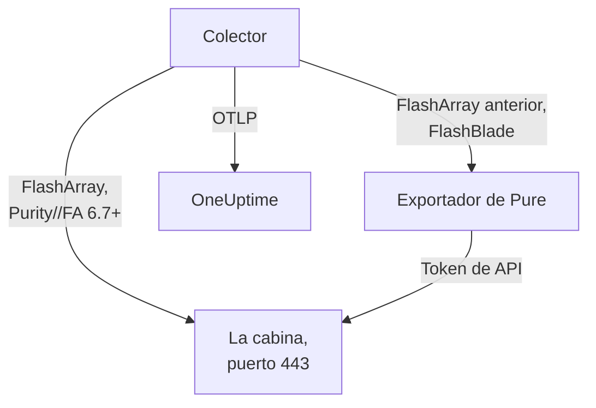

# Agente de cabinas de almacenamiento

El agente de Storage Array de OneUptime supervisa cabinas de almacenamiento: capacidad y reducción de datos, latencia, IOPS y ancho de banda, volúmenes, hosts, pods y replicación, estado del hardware, sistemas de archivos y buckets. Es un OpenTelemetry Collector estándar que recopila los endpoints OpenMetrics de la cabina con el token de API de un usuario de solo lectura, marca cada métrica con la identidad de tu cabina y la envía a OneUptime. Los [monitores de cabinas de almacenamiento](/docs/monitor/storage-array-monitor) alertan sobre lo que llega.

:::cards
- [Instalar el agente](#instala-el-agente): Un usuario de solo lectura y luego el script de instalación o Docker Compose.
- [Qué recopila el agente](#qué-recopila-el-agente): Cada endpoint y las páginas que se construyen a partir de él.
- [Supervisar varias cabinas](#supervisar-varias-cabinas): Un agente por cabina, en una sola máquina.
- [Solución de problemas](#solución-de-problemas): Un script de diagnóstico y los problemas habituales.
:::

## Cómo funciona

Storage Arrays es un producto que funciona igual para cada fabricante. Es compatible con:

| Cabina | Cómo la lee el agente | Configuración del colector |
| --- | --- | --- |
| **Pure Storage FlashArray**, Purity//FA 6.7 y posteriores | El propio endpoint OpenMetrics de la cabina (`https://<array>/metrics/...?namespace=purefa`): no se ejecuta nada junto al colector | `otel-collector-config.yaml` (la predeterminada) |
| **Pure Storage FlashArray**, Purity//FA anterior | El exportador OpenMetrics de FlashArray de Pure, que el mismo archivo de Compose ejecuta como el servicio `pure-fa-exporter` | `otel-collector-config.flasharray-exporter.yaml` |
| **Pure Storage FlashBlade** | El exportador OpenMetrics de FlashBlade de Pure, que el mismo archivo de Compose ejecuta como el servicio `pure-fb-exporter` | `otel-collector-config.flashblade.yaml` |

Pure Storage pasó a llamarse **Everpure** en febrero de 2026. FlashArray, FlashBlade y Purity conservaron sus nombres, y también las métricas `purefa_*` y `purefb_*`, así que todo lo de esta página se aplica a las cabinas vendidas con cualquiera de los dos nombres.



Un agente supervisa una cabina: ejecuta un agente por cabina (consulta [Supervisar varias cabinas](#supervisar-varias-cabinas)). La cabina se registra con sus primeros datos, con el nombre que el agente marca en cada métrica como `storage.array.name`.

## Antes de empezar

- Docker Engine 20.10 o posterior con el plugin Docker Compose v2, en una máquina que llegue a la interfaz de administración de la cabina por HTTPS (TCP 443).
- Una cuenta de administrador en la cabina, para crear un usuario con el rol integrado **readonly** y un token de API para él.
- Una clave de ingesta. Crea una en **Ajustes del proyecto → Telemetría y APM → Claves de ingesta** y copia su valor.

### Dónde ejecutar el agente

El agente habla con la interfaz de administración de la cabina por HTTPS, así que puede ejecutarse en cualquier máquina con Docker y una ruta a la red de administración por TCP 443: un host de monitorización o una pequeña VM de administración. Prefiere una máquina cuyo propio almacenamiento no esté en la cabina que vigila: si la cabina cae, tu monitorización no debería caer con ella. El receptor de syslog opcional también necesita que la cabina llegue al agente en el puerto de syslog (consulta [Enviar el syslog de la cabina](#opcional-enviar-el-syslog-de-la-cabina)).

## Instala el agente

:::steps
### Crear el usuario de solo lectura y el token de API

El agente solo lee. Dale un usuario propio con el rol integrado **readonly**, nunca un administrador, y un token de API para ese usuario. Crea el token **sin fecha de caducidad**, o el agente se detendrá el día en que caduque el token.

:::tabs
@tab Purity CLI
Conéctate por SSH a la FlashArray como administrador. El primer comando pide la contraseña del nuevo usuario; el segundo imprime su token de API, un UUID:

```bash
pureadmin create --role readonly oneuptime
pureadmin create --api-token oneuptime
```
@tab FlashArray GUI
1. Abre _Settings → Users and Policies_ (_Settings → Access_ en versiones anteriores).
2. En el menú ⋮ del panel **Users**, elige **Create User…**, llama al usuario `oneuptime` y dale el rol readonly.
3. En el menú ⋮ del nuevo usuario, elige **Create API Token…**, deja **Expires In** vacío y copia el token.
@tab FlashBlade
Crea de la misma forma un usuario con el rol **readonly** y un token de API para él: en la configuración de usuarios de la GUI de FlashBlade o con `pureadmin` en la CLI de Purity//FB. En una versión sin usuarios locales, usa una cuenta de un servicio de directorio (LDAP o Active Directory) cuyo grupo se asigne al rol readonly. Los tokens de API de FlashBlade empiezan por `T-`.
:::

### Comprobar si la FlashArray sirve sus propias métricas

Pure documenta el endpoint OpenMetrics nativo para **Purity//FA 6.7.0 y posteriores** (el aviso de obsolescencia del exportador de FlashArray de Pure dice 6.6.11 y posteriores). La forma más rápida de saberlo es preguntar a la cabina, desde la máquina en la que se ejecutará el agente:

```bash
curl -k 'https://<array>/metrics/array?namespace=purefa' --header 'Authorization: Bearer <api-token>' | grep purefa_info
```

Una línea `purefa_info{...} 1` significa que la cabina sirve sus métricas de forma nativa: usa la configuración predeterminada. Un `404` significa que no: usa la configuración con exportador, que ejecuta el exportador de Pure junto al colector. Pure ha dejado obsoleto ese exportador, así que pásate a la configuración nativa cuando se actualice la cabina. Una FlashBlade siempre pasa por el exportador de FlashBlade de Pure, así que en ese caso omite este paso.

### Instala e inicia el agente

:::tabs
@tab install.sh
Descarga el script de instalación y ejecútalo en la máquina que alojará el agente:

```bash
curl -sSL https://raw.githubusercontent.com/OneUptime/oneuptime/master/agents/StorageArrayAgent/install.sh -o install.sh
bash install.sh
```

El script pregunta qué cabina es (una FlashArray que sirve métricas nativas, una FlashArray con un Purity//FA anterior o una FlashBlade) y luego pide tu URL de OneUptime, la clave de ingesta, un nombre para la cabina, la dirección de administración de la cabina y el token de API del usuario de solo lectura (leído sin mostrarse). Se instala en `/opt/oneuptime-storage-array-agent`, descarga el archivo de Compose y las tres configuraciones del colector, escribe un archivo con `0600` llamado `.env` con la configuración y el perfil de Compose correspondientes e inicia el agente con Docker Compose. Entrecomilla cada valor para Docker Compose tal como lo escribiste. Volver a ejecutarlo reutiliza todo lo que hay en un `.env` existente en lugar de volver a preguntar, y conserva un archivo que hayas editado como `<file>.bak.<timestamp>` antes de sustituirlo.
@tab Docker Compose
Descarga `docker-compose.yml` y los tres archivos `otel-collector-config*.yaml` del [directorio StorageArrayAgent](https://github.com/OneUptime/oneuptime/tree/master/agents/StorageArrayAgent) en una carpeta nueva:

```bash
curl -fsSLO https://raw.githubusercontent.com/OneUptime/oneuptime/master/agents/StorageArrayAgent/docker-compose.yml
curl -fsSLO https://raw.githubusercontent.com/OneUptime/oneuptime/master/agents/StorageArrayAgent/otel-collector-config.yaml
curl -fsSLO https://raw.githubusercontent.com/OneUptime/oneuptime/master/agents/StorageArrayAgent/otel-collector-config.flasharray-exporter.yaml
curl -fsSLO https://raw.githubusercontent.com/OneUptime/oneuptime/master/agents/StorageArrayAgent/otel-collector-config.flashblade.yaml
```

Crea un archivo `.env` junto a ellos. Contiene el token de API, así que mantenlo privado con `chmod 600 .env`. Para una FlashArray que sirve métricas nativas:

```bash title=".env"
ONEUPTIME_URL=YOUR_ONEUPTIME_URL
ONEUPTIME_TELEMETRY_INGESTION_KEY=YOUR_TELEMETRY_INGESTION_TOKEN
STORAGE_ARRAY_NAME=my-storage-array
STORAGE_SYSTEM=purestorage.flasharray
STORAGE_ARRAY_COLLECTOR_CONFIG=otel-collector-config.yaml
COMPOSE_PROFILES=
PURE_FA_ENDPOINT=fa-prod-01.example.com
PURE_FA_API_TOKEN=YOUR_READ_ONLY_API_TOKEN
PURE_FB_ENDPOINT=
PURE_FB_API_TOKEN=
STORAGE_ARRAY_INSECURE_SKIP_VERIFY=true
```

Para una FlashArray con un Purity//FA anterior, establece `STORAGE_ARRAY_COLLECTOR_CONFIG=otel-collector-config.flasharray-exporter.yaml` y `COMPOSE_PROFILES=flasharray-exporter`. Para una FlashBlade, establece `STORAGE_SYSTEM=purestorage.flashblade`, `STORAGE_ARRAY_COLLECTOR_CONFIG=otel-collector-config.flashblade.yaml` y `COMPOSE_PROFILES=flashblade`, y rellena `PURE_FB_ENDPOINT` y `PURE_FB_API_TOKEN` en lugar del par `PURE_FA_*`. Inicia el agente:

```bash
docker compose up -d
```
:::

### Comprueba que el agente se está ejecutando

```bash
docker compose ps
docker logs -f oneuptime-storage-array-agent
```

`docker compose ps` muestra el colector (`oneuptime-storage-array-agent`) y, con una configuración con exportador, el exportador (`pure-fa-exporter` o `pure-fb-exporter`). Los logs del colector deberían mostrar esta línea una vez iniciado:

```text
Everything is ready. Begin running and processing data.
```

### Encontrar la cabina en OneUptime

Abre **Productos → Infraestructura → Storage Arrays → All Storage Arrays**. Tras la primera recopilación (un minuto aproximadamente), la cabina está ahí con su capacidad, rendimiento, alertas abiertas y hardware. Los volúmenes, hosts y pods llegan en menos de 2 minutos, los sistemas de archivos y buckets de una FlashBlade en menos de 5, y los directorios de FlashArray en menos de 30.
:::

## Variables de entorno

El script de instalación las escribe en `/opt/oneuptime-storage-array-agent/.env`; una instalación con Docker Compose las lee del `.env` que está junto a `docker-compose.yml`. Después de cambiar una, ejecuta `docker compose up -d` en esa carpeta.

| Variable | Obligatoria | Descripción |
| --- | --- | --- |
| `ONEUPTIME_URL` | Sí | Tu URL de OneUptime, como `https://oneuptime.com` o tu instancia autoalojada. Usa `http://` y su puerto si la instancia solo admite HTTP. |
| `ONEUPTIME_TELEMETRY_INGESTION_KEY` | Sí | La clave de ingesta de **Ajustes del proyecto → Telemetría y APM → Claves de ingesta**. |
| `STORAGE_ARRAY_NAME` | Sí | El nombre con el que la cabina se registra en OneUptime, marcado en cada métrica como el atributo de recurso `storage.array.name`. Mantenlo estable: cambiarlo más tarde registra una segunda cabina. El colector se niega a iniciarse sin él. |
| `STORAGE_SYSTEM` | No | La plataforma, marcada como el atributo de recurso `storage.system`: `purestorage.flasharray` o `purestorage.flashblade`. Su valor predeterminado es `purestorage.flasharray`. |
| `STORAGE_ARRAY_COLLECTOR_CONFIG` | No | Qué configuración incluida del colector se ejecuta: `otel-collector-config.yaml` (FlashArray, nativa: la predeterminada), `otel-collector-config.flasharray-exporter.yaml` (FlashArray anterior) o `otel-collector-config.flashblade.yaml` (FlashBlade). |
| `COMPOSE_PROFILES` | No | Inicia el exportador que recopila la configuración elegida: vacío para la configuración nativa de FlashArray, `flasharray-exporter` o `flashblade` para las otras dos. |
| `PURE_FA_ENDPOINT` | FlashArray | La dirección de administración de la FlashArray: un nombre de host o una IP, sin `https://`. |
| `PURE_FA_API_TOKEN` | FlashArray | El token de API del usuario de FlashArray con el rol readonly. |
| `PURE_FB_ENDPOINT` | FlashBlade | La dirección de administración de la FlashBlade: un nombre de host o una IP, sin `https://`. |
| `PURE_FB_API_TOKEN` | FlashBlade | El token de API del usuario de FlashBlade con el rol readonly. |
| `STORAGE_ARRAY_INSECURE_SKIP_VERIFY` | No | `true` acepta el certificado autofirmado de la cabina en el endpoint nativo; `false` lo verifica. Su valor predeterminado es `true`. Los exportadores de Pure nunca verifican el certificado de la cabina, así que no se aplica a ellos. |

## Cómo recopila el agente

- **Un job de recopilación por endpoint, cada uno leído con la frecuencia que merece.** FlashArray: `/metrics/array` cada 60 segundos; `/metrics/volumes`, `/metrics/hosts` y `/metrics/pods` cada 2 minutos; `/metrics/directories` cada 30 minutos, que es lo que recomienda la propia Pure, ya que a la cabina le cuesta calcular el espacio de los directorios. FlashBlade: `/metrics/array` cada 60 segundos; `/metrics/filesystems` y `/metrics/objectstore` cada 5 minutos, de nuevo siguiendo el consejo de Pure de leer los endpoints de sistemas de archivos y del almacén de objetos con menos frecuencia que la cabina.
- **Cada job etiqueta sus series con `scrape_endpoint: <endpoint>`.** Cada endpoint también exporta `purefa_info` o `purefb_info`, así que OneUptime sabe de qué familias un lote es la lista completa: así es como un volumen, host, pod, sistema de archivos o bucket eliminado sale del inventario en lugar de quedarse. Mantén las etiquetas tal como vienen.
- **La latencia por volumen y por host conserva tres dimensiones.** Cada volumen y cada host exporta su latencia en hasta dieciséis `dimension`s. Una regla `metric_relabel_configs` conserva `usec_per_read_op`, `usec_per_write_op` y `usec_per_mirrored_write_op` y descarta el desglose por límite de tasa de QoS, cola, SAN y tiempo de servicio, que multiplica las series de una cabina grande. El desglose de toda la cabina en `purefa_array_performance_latency_usec` se conserva. Elimina la regla para conservar también el desglose por volumen.
- **El token de API es un token Bearer.** La configuración nativa lo envía a la propia cabina; las configuraciones con exportador lo envían al exportador solo por la red de Compose, y los puertos de los exportadores nunca se publican.
- **Sin `send_batch_max_size`.** OneUptime reconstruye el inventario a partir de una recopilación entera por solicitud, así que el procesador `batch` incluido nunca reparte una recopilación entre varias exportaciones. Mantén los ajustes de batch tal como vienen.

## Qué recopila el agente

Las convenciones semánticas de Pure son comunes al endpoint nativo de FlashArray y a ambos exportadores. Cada valor es un gauge que calcula la propia cabina (latencias en microsegundos por operación, rendimiento por segundo), así que no hay que calcular tasas, y los objetos se nombran mediante **etiquetas de punto de datos**: `name` para volúmenes, pods, directorios, sistemas de archivos y buckets, `host` para hosts, `component_name` para el hardware de FlashArray. El agente añade los atributos de recurso `storage.array.name` y `storage.system`, así que OneUptime archiva todo bajo tu cabina:

| Endpoint | Familias de métricas | Lo que OneUptime construye con ellas |
| --- | --- | --- |
| FlashArray `/metrics/array` | `purefa_info`, `purefa_alerts_open`, `purefa_array_space_*`, `purefa_array_performance_*`, `purefa_hw_component_status`, `purefa_hw_component_temperature_celsius`, `purefa_hw_controller_info`, `purefa_drive_capacity_bytes`, `purefa_network_interface_*` | El nombre, la versión de Purity y el ID de sistema de la cabina; capacidad, espacio usado y reducción de datos; número de alertas abiertas; el estado de la cabina; la página **Hardware** (componentes, discos, controladoras, interfaces de red) |
| FlashArray `/metrics/volumes` | `purefa_volume_performance_*`, `purefa_volume_space_*`, `purefa_volume_qos_*` | La página **Volúmenes**: tamaño aprovisionado y físico, reducción de datos, latencia de lectura y escritura, IOPS y ancho de banda por volumen |
| FlashArray `/metrics/hosts` | `purefa_host_connectivity_info`, `purefa_host_connections_info`, `purefa_host_performance_*`, `purefa_host_space_*` | La página **Hosts**: conectividad (rutas redundantes o no), volúmenes conectados, latencia, IOPS y ancho de banda por host |
| FlashArray `/metrics/pods` | `purefa_pod_performance_*`, `purefa_pod_space_*`, `purefa_pod_replica_links_*`, `purefa_pod_mediator_status` | La página **Replicación**: pods de ActiveCluster y ActiveDR, estado y retraso de los enlaces de réplica |
| FlashArray `/metrics/directories` | `purefa_directory_performance_*`, `purefa_directory_space_*` | La página **Directories** (FlashArray File Services) |
| FlashBlade `/metrics/array` | `purefb_info`, `purefb_alerts_open`, `purefb_array_space_*`, `purefb_array_performance_*`, `purefb_hardware_health` | El nombre, la versión de Purity y el ID de sistema de la FlashBlade; capacidad y reducción de datos; número de alertas abiertas; el estado de la cabina; la página **Hardware** |
| FlashBlade `/metrics/filesystems` | `purefb_file_systems_space_*`, `purefb_file_systems_performance_*` | La página **File Systems**: espacio aprovisionado y usado, reducción de datos, latencia, IOPS y ancho de banda por sistema de archivos |
| FlashBlade `/metrics/objectstore` | `purefb_buckets_space_*`, `purefb_buckets_quota_space_bytes`, `purefb_buckets_object_count`, `purefb_buckets_performance_*`, `purefb_object_store_accounts_*` | La página **Buckets**: espacio, cuota, número de objetos y rendimiento por bucket, agrupados por cuenta |

El estado de la cabina en su página **Vista general** es **Crítico** mientras informa de una alerta crítica abierta, o de un componente de hardware, disco o controladora en estado crítico, averiado, ausente o no saludable; **Advertencia** mientras informa de una alerta de advertencia abierta, o de un componente degradado o desconocido; y **OK** en caso contrario. En los criterios de un monitor, los atributos de la cabina llevan un prefijo `resource.` (`resource.storage.array.name`, `resource.storage.system`), mientras que las etiquetas de punto de datos van sin prefijo (`name`, `host`, `dimension`, `space`).

## Opcional — Enviar el syslog de la cabina

Por defecto el agente solo envía métricas, así que la página **Registros** de la cabina queda vacía. Las cabinas reenvían sus alertas y eventos de auditoría como syslog, y cada configuración incluida del colector tiene un par de receptores `syslog` comentados (TCP y UDP en el puerto 5514, RFC 3164), conectados a un pipeline `logs` comentado que marca `storage.array.name` para que los logs lleguen a tu cabina.

:::steps
### Activar los receptores

Descomenta los dos receptores `syslog/*` y el pipeline `logs` en la configuración del colector que uses. Las marcas de tiempo de RFC 3164 no llevan zona horaria: establece `location` en la zona horaria de la cabina, salvo que su reloj vaya en UTC.

### Abrir el puerto

Descomenta el bloque `ports:` en `docker-compose.yml` para que la máquina publique `5514/tcp` y `5514/udp`, y luego ejecuta `docker compose up -d`. Abre el puerto en el cortafuegos de la máquina para la red de administración de la cabina.

### Apuntar la cabina al agente

Hazlo como administrador, no como el usuario de monitorización de solo lectura. En una FlashArray, abre _Settings → System → Syslog Servers_, añade `udp://<agent-host>:5514` (o `tcp://<agent-host>:5514`) y envía un mensaje de prueba. En una FlashBlade, añade un servidor de syslog con la misma URI en su configuración de syslog. Ambas cabinas aceptan la forma `PROTOCOL://HOST:PORT`, también a través de sus API REST (`syslog-servers`).
:::

Un receptor de syslog escucha en un solo transporte, por eso TCP y UDP son dos receptores: deja uno comentado si solo necesitas el otro. La imagen estándar del colector lee el syslog tal cual: no hace falta ninguna imagen personalizada.

## Etiquetar la cabina con etiquetas del proyecto

Un atributo de recurso que empieza por `oneuptime.label.` se convierte en una etiqueta del proyecto en la cabina de almacenamiento: `oneuptime.label.<dimension>=<value>` es la etiqueta `<dimension>:<value>`. Añade los atributos al procesador `resource` de la configuración del colector que uses, junto a `storage.array.name`:

```yaml
processors:
  resource:
    attributes:
      # ...existing attributes...
      - key: oneuptime.label.team
        value: storage
        action: upsert
      - key: oneuptime.label.env
        value: production
        action: upsert
```

El colector lee su configuración solo al iniciarse: ejecuta `docker compose restart oneuptime-storage-array-agent`. La cabina muestra entonces las etiquetas `team:storage` y `env:production`. Las etiquetas se comparan sin distinguir mayúsculas de minúsculas, así que una etiqueta `Production` existente se reutiliza en lugar de duplicarse, y el agente nunca quita una etiqueta que alguien añadió en OneUptime.

## Supervisar varias cabinas

Un agente lee una cabina. Para supervisar varias desde la misma máquina, instala cada una en su propia carpeta con su propio `.env`, como `INSTALL_DIR=/opt/oneuptime-storage-array-agent-fa02 bash install.sh`, y dale a cada una su propio `container_name` en su `docker-compose.yml` (como `oneuptime-storage-array-agent-fa02`): dos contenedores no pueden compartir nombre. Pasa la carpeta al script de diagnóstico con `-d`.

## Ejecutar como servicio de systemd

Para iniciar el agente con la máquina y reiniciarlo cuando falle, instala su unidad de systemd. Supone que el agente está en `/opt/oneuptime-storage-array-agent`, donde lo pone el script de instalación:

```bash
sudo curl -fsSL https://raw.githubusercontent.com/OneUptime/oneuptime/master/agents/StorageArrayAgent/systemd/oneuptime-storage-array-agent.service -o /etc/systemd/system/oneuptime-storage-array-agent.service
sudo systemctl daemon-reload
sudo systemctl enable --now oneuptime-storage-array-agent
```

## Actualizar el agente

El agente informa como su **Versión del agente** de la versión del colector que fijan sus archivos. Cuando es más antigua que la versión que fija esta versión de OneUptime, aparece una señal de advertencia a su lado en la página **Vista general** de la cabina. Selecciónala para ver estos comandos. Un agente instalado antes de que sus archivos informaran una versión no muestra ninguna hasta que se actualiza de esta forma.

La imagen del colector está fijada en `docker-compose.yml` y sus configuraciones son archivos junto a él, así que descargar las imágenes no basta para que el agente avance. Vuelve a ejecutar `install.sh`: reutiliza todos los valores de tu `.env` existente (no se vuelve a preguntar nada), renueva `docker-compose.yml` y las tres configuraciones del colector (un archivo que editaste se conserva como `<file>.bak.<timestamp>`) y vuelve a crear el agente para que el colector lea su nueva configuración. Un agente instalado fuera de `/opt/oneuptime-storage-array-agent` necesita su carpeta: `INSTALL_DIR=<folder> bash install.sh`.

```bash
curl -sSL https://raw.githubusercontent.com/OneUptime/oneuptime/master/agents/StorageArrayAgent/install.sh -o install.sh
bash install.sh
```

¿Lo instalaste con Docker Compose? En la carpeta del agente, vuelve a descargar el archivo de Compose y las tres configuraciones del colector (y vuelve a hacer cualquier cambio que les hicieras), luego descarga las imágenes y vuelve a crear el agente:

```bash
curl -fsSLO https://raw.githubusercontent.com/OneUptime/oneuptime/master/agents/StorageArrayAgent/docker-compose.yml
curl -fsSLO https://raw.githubusercontent.com/OneUptime/oneuptime/master/agents/StorageArrayAgent/otel-collector-config.yaml
curl -fsSLO https://raw.githubusercontent.com/OneUptime/oneuptime/master/agents/StorageArrayAgent/otel-collector-config.flasharray-exporter.yaml
curl -fsSLO https://raw.githubusercontent.com/OneUptime/oneuptime/master/agents/StorageArrayAgent/otel-collector-config.flashblade.yaml
docker compose pull
docker compose up -d --force-recreate
```

## Desinstalar el agente

```bash
cd /opt/oneuptime-storage-array-agent
docker compose down
```

Después elimina el usuario de solo lectura y su token de API en la cabina si ya no los necesitas.

## Solución de problemas

:::details Ejecuta primero el script de diagnóstico
El agente incluye un script, [`troubleshoot.sh`](https://github.com/OneUptime/oneuptime/blob/master/agents/StorageArrayAgent/troubleshoot.sh), que comprueba toda la cadena: el runtime de contenedores; el endpoint de la cabina exactamente como lo alcanza el colector (el endpoint nativo o el exportador de Pure: DNS, TLS, si una FlashArray tiene siquiera el endpoint nativo y si la cabina acepta el token de API, que el script pasa a curl por stdin); el nombre de la cabina marcado en cada métrica; la forma del token; las propias métricas del colector; y si OneUptime acepta la clave de ingesta. Esa última comprobación es la que más importa. OneUptime rechaza una clave incorrecta con `401` (`422` para una clave desactivada o una clave de navegador), y el colector trata ambas como permanentes: descarta el lote y registra un error `Exporting failed`, fácil de pasar por alto mientras el contenedor sigue sano. El script pide `GET <url>/otlp/v1/validate` desde dentro de la red del agente para obtener un `200` (válida) o un `401` (no válida) directos, y en servidores más antiguos recurre a `POST /fluentd/v1/logs`.

```bash
curl -sSL https://raw.githubusercontent.com/OneUptime/oneuptime/master/agents/StorageArrayAgent/troubleshoot.sh -o troubleshoot.sh
bash troubleshoot.sh    # add -d <dir> if you installed outside /opt/oneuptime-storage-array-agent
```

Termina con un veredicto que nombra la causa más probable.
:::

:::details No aparece ninguna cabina en OneUptime
1. Lee los logs del colector: `docker logs oneuptime-storage-array-agent`. `server returned HTTP status 401` significa que la cabina rechazó el token de API, `404` que la FlashArray no tiene endpoint nativo, `x509` que la verificación TLS está activada frente al certificado autofirmado de la cabina, `no such host` o `connection refused` que `PURE_FA_ENDPOINT` o `PURE_FB_ENDPOINT` es incorrecto, y un `401` al exportar que la clave de ingesta es incorrecta.
2. Pregunta a la cabina desde la red del agente. La imagen del colector no tiene shell ni curl, así que pregunta desde un contenedor en su red: `docker run --rm --network container:oneuptime-storage-array-agent curlimages/curl -sk -H 'Authorization: Bearer <api-token>' 'https://<array>/metrics/array?namespace=purefa'` debería imprimir líneas `purefa_*`.
3. Comprueba que `STORAGE_ARRAY_NAME` está definido: la cabina se encuentra por su atributo de recurso `storage.array.name`, y el colector se niega a iniciarse sin él.
:::

:::details La cabina aparece como desconectada
Una cabina pasa a desconectada cuando OneUptime no ha recibido nada de ella durante 15 minutos; OneUptime lo comprueba cada 5 minutos, y el tiempo en que él mismo no recibía datos no cuenta. Comprueba que el colector se está ejecutando (`docker compose ps`), que sus logs no muestran errores de recopilación ni de exportación, y que la máquina sigue llegando a la cabina y a tu URL de OneUptime. La cabina vuelve a estar conectada con sus siguientes datos.
:::

:::details La FlashArray responde 404
Su Purity//FA no tiene endpoint OpenMetrics nativo. Vuelve a ejecutar `install.sh` y elige la opción de Purity anterior, o establece `STORAGE_ARRAY_COLLECTOR_CONFIG=otel-collector-config.flasharray-exporter.yaml` y `COMPOSE_PROFILES=flasharray-exporter` en `.env` y ejecuta `docker compose up -d`. Después de actualizar la cabina a Purity//FA 6.7 o posterior, vuelve a la configuración nativa y quita el perfil.
:::

:::details La cabina rechaza el token de API
Comprueba que pegaste el token de API y no la contraseña del usuario, que el usuario sigue existiendo y tiene el rol readonly, y que el token no ha caducado. Crea un token nuevo (`pureadmin create --api-token oneuptime` en una FlashArray), ponlo en `.env` y ejecuta `docker compose up -d`. A través de los exportadores de Pure, un token rechazado aparece en el log del colector como un HTTP `400` del exportador, cuyo cuerpo dice `failed to login`.
:::

:::details Errores de x509 o TLS
Las cabinas presentan por defecto un certificado autofirmado, en el que no confía ninguna imagen de Docker. O bien establece `STORAGE_ARRAY_INSECURE_SKIP_VERIFY=true` (la opción práctica en una red de administración privada), o bien instala en la cabina un certificado de una CA en la que confíe la imagen del colector.
:::

:::details pure-fa-exporter o pure-fb-exporter no se resuelve
El exportador no se está ejecutando: `COMPOSE_PROFILES` debe coincidir con `STORAGE_ARRAY_COLLECTOR_CONFIG` (`flasharray-exporter` para la configuración con el exportador de FlashArray, `flashblade` para la configuración de FlashBlade). Corrige `.env` y ejecuta `docker compose up -d`; `docker compose ps` mostrará entonces el exportador.
:::

:::details Los volúmenes o hosts eliminados siguen en el inventario
OneUptime quita un objeto cuando una recopilación completa de su endpoint ya no lo contiene, lo que reconoce por la etiqueta `scrape_endpoint`. Si sustituiste la configuración incluida del colector por la tuya, conserva las etiquetas `scrape_endpoint` en sus jobs de recopilación; si no, los objetos solo salen del inventario cuando quedan obsoletos.
:::

:::details Las métricas llegan a la cabina equivocada
OneUptime registra una cabina de almacenamiento por su `storage.array.name`, que el agente toma de `STORAGE_ARRAY_NAME`. Cambiarlo después de los primeros datos crea una segunda cabina en lugar de renombrar la primera.
:::

:::details Enviar métricas sin el agente
El agente es una única configuración estándar del colector, así que los colectores que ya ejecutas pueden hacer el mismo trabajo: copia los jobs de recopilación y el procesador `resource` de la configuración incluida a la tuya. El atributo de recurso `storage.array.name` es lo que registra la cabina en OneUptime, y las eliminaciones de `service.name` / `service.instance.id` evitan que los datos se archiven bajo un servicio: conserva ambas cosas y conserva las etiquetas `scrape_endpoint`.
:::

## Próximos pasos

:::cards
- [Monitor de cabinas de almacenamiento](/docs/monitor/storage-array-monitor): Alerta sobre alertas, capacidad, latencia, hardware, rutas de host, replicación y sistemas de archivos.
- [Agente de VMware](/docs/telemetry/vmware): ¿Ejecutas VMware en la cabina? Consulta también sus datastores y VM.
- [Colector OpenTelemetry en el host](/docs/telemetry/host-otel-collector): La vista del sistema operativo de las máquinas que usan la cabina.
:::
