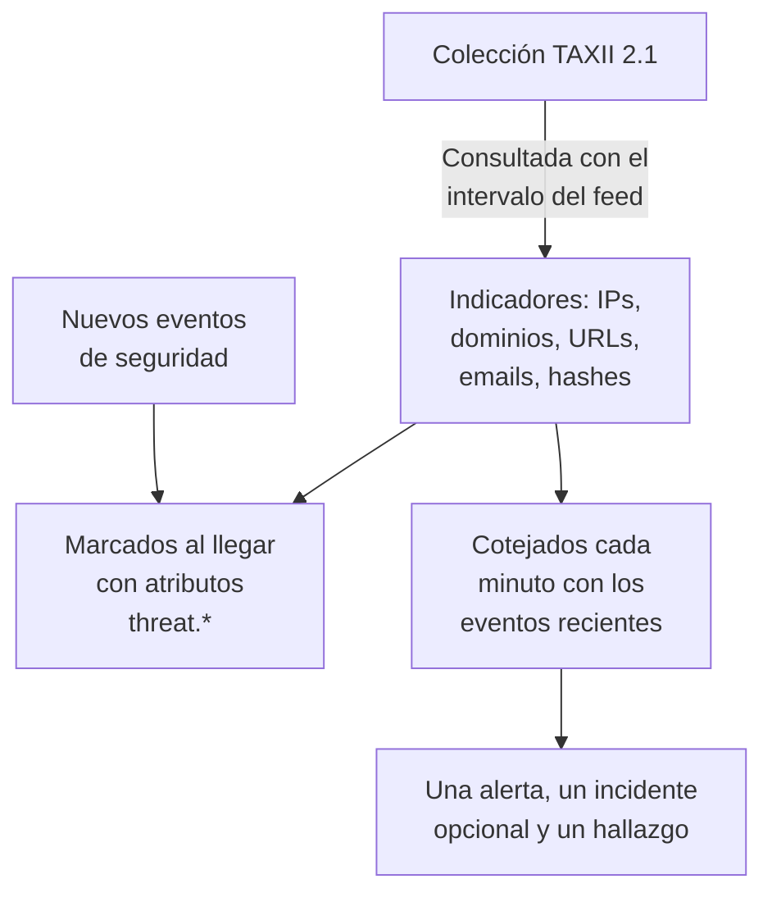

# Inteligencia de amenazas (STIX/TAXII)

Un feed de inteligencia de amenazas trae a OneUptime direcciones IP, dominios, URLs, direcciones de email y hashes de archivos maliciosos conocidos, y te avisa cuando tus [eventos de seguridad](/docs/telemetry/security-events) mencionan uno. Cada feed se suscribe a una colección TAXII 2.1 de indicadores STIX 2.1: tu propio servidor MISP, OpenCTI u OpenTAXII, o la colección de un proveedor. OneUptime no incluye contenido de feeds propio: tú aportas las colecciones, igual que aportas las reglas Sigma.

:::cards
- [Suscribirse a un feed](#suscribirse-a-un-feed): Un servidor TAXII, una colección y cómo iniciar sesión.
- [Qué se ingiere](#qué-se-ingiere): Los patrones de indicador que conserva OneUptime, y durante cuánto tiempo.
- [Cómo se encuentran las coincidencias](#cómo-se-encuentran-las-coincidencias): Marcadas al llegar los eventos y cotejadas cada minuto.
- [Niveles de amenaza](#niveles-de-amenaza): Cómo la confianza de un indicador se convierte en una gravedad.
:::

## Cómo funciona



## Antes de empezar

- Un servidor TAXII 2.1 que publique objetos STIX 2.1 de tipo `indicator`, y el ID de la colección que consultar. Un feed inicia sesión de forma anónima, con un token bearer o con autenticación básica HTTP.
- No se admiten los servidores que exigen un certificado de cliente TLS (TLS mutuo), como CISA AIS. El servidor ATT&CK público de MITRE publica técnicas y grupos en lugar de indicadores, así que un feed que apunte a él se queda vacío.
- Un rol que pueda crear feeds: Project Owner, Project Admin, Security Admin o Security Member. Security Viewer puede leer feeds e indicadores. Consulta [Roles](/docs/permissions/reference#roles).

## Suscribirse a un feed

:::steps
### Abre Inteligencia de amenazas

Abre **Productos → Eventos de seguridad → Inteligencia de amenazas**.

### Crea el feed

Haz clic en **Crear Feed de inteligencia de amenazas** y rellena sus cuatro pasos: **Información básica**, **Servidor TAXII**, **Autenticación** y **Al coincidir**. Los campos están en la tabla de abajo.

### Comprueba la primera consulta

En uno o dos minutos, la fila del feed muestra **Último sondeo**, y **Resumen del último sondeo** indica lo que trajo la consulta. Los indicadores aparecen en la tabla **Indicadores**, debajo de los feeds.
:::

| Campo | Qué introducir |
| --- | --- |
| **URL raíz de la API de TAXII** | La raíz de la API TAXII 2.1 del servidor, como `https://taxii.example.com/api1/`. Las colecciones se direccionan debajo de ella. |
| **ID de la colección** | La colección que publica los indicadores. |
| **Intervalo de sondeo (minutos)** | Cada cuánto se traen objetos nuevos: de 1 a 1440 minutos, 60 por defecto. |
| **Confianza mínima** | Los indicadores con una `confidence` STIX menor se omiten: de 0 a 100, y 0 lo conserva todo. Los indicadores sin confianza siempre pasan. |
| **Token de API** | Un token bearer, para una colección que lo pida. |
| **Usuario de Basic Auth** y **Contraseña de Basic Auth** | Para una colección que use autenticación básica HTTP. Deja ambos y el token vacíos para una colección pública. |
| **Crear alerta al coincidir** | Activado por defecto: cada indicador coincidente abre una alerta. |
| **Gravedad de la alerta** | La gravedad de cada alerta que abre este feed. Déjala vacía para tomar el nivel de amenaza de cada indicador. |
| **Crear incidente al coincidir** | Desactivado por defecto. Los incidentes impulsan la escalada de guardia, los SLA y las páginas de estado, y para las coincidencias de indicadores suelen bastar las alertas. |
| **Gravedad del incidente** | Como **Gravedad de la alerta**, para los incidentes. |
| **Escribir un hallazgo de detección al coincidir** | Activado por defecto: cada coincidencia escribe un hallazgo en el flujo de eventos. |

Los tokens y las contraseñas se cifran y no vuelven a mostrarse después de guardarlos. Para cambiarlos, elige **Actualizar credenciales** en la fila del feed y elige **Token de API (Bearer)**, **Basic Auth** o **Anónimo (borrar las credenciales almacenadas)**: tu elección sustituye el inicio de sesión del feed, así que guardar un token borra una contraseña guardada, y al revés.

### Cómo se consulta un feed

Cada consulta pide los objetos añadidos desde la anterior, mediante el cursor `added_after` de TAXII, y lee hasta 10 páginas de 500 objetos. Una colección grande se sincroniza, por tanto, a lo largo de varias consultas: **Resumen del último sondeo** indica cuándo quedan páginas. Para terminar antes una primera sincronización grande, baja el **Intervalo de sondeo (minutos)**, hasta 1, hasta que se ponga al día.

Las consultas se identifican con el user agent `OneUptime/<version> (+https://oneuptime.com)`. Si el firewall del proveedor responde `403`, pídele que lo permita: muchos firewalls bloquean las peticiones que parecen un script sin nombre.

Un feed desactivado no se consulta ni se coteja. Los indicadores que ya tiene siguen marcando eventos nuevos hasta que caducan.

## Qué se ingiere

OneUptime conserva los objetos STIX de tipo `indicator` cuyo patrón es una igualdad simple sobre uno de estos tipos:

| Tipo | Patrón de ejemplo |
| --- | --- |
| Dirección IPv4 (`ipv4-addr`) | `[ipv4-addr:value = '198.51.100.7']` |
| Dirección IPv6 (`ipv6-addr`) | `[ipv6-addr:value = '2001:db8::7']` |
| Nombre de dominio (`domain-name`) | `[domain-name:value = 'evil.example']` |
| URL (`url`) | `[url:value = 'http://evil.example/payload']` |
| Dirección de email (`email-addr`) | `[email-addr:value = 'billing@evil.example']` |
| Hash de archivo, SHA-256 (`file-hash-sha256`) | `[file:hashes.'SHA-256' = 'e3b0…b855']` |
| Hash de archivo, SHA-1 (`file-hash-sha1`) | `[file:hashes.'SHA-1' = 'da39…0709']` |
| Hash de archivo, MD5 (`file-hash-md5`) | `[file:hashes.MD5 = 'd41d…427e']` |

Las comparaciones unidas con `OR`, dentro de un `[...]` o entre varios, valen, y cada valor se convierte en un indicador propio:

```text
[domain-name:value = 'evil.example' OR domain-name:value = 'evil2.example']
[ipv4-addr:value = '198.51.100.7'] OR [url:value = 'http://evil.example/x']
```

Cualquier otro patrón, con `AND`, `FOLLOWEDBY`, `NOT`, `LIKE`, `MATCHES`, un calificador de tiempo como `WITHIN` u otro tipo de objeto, se omite entero y se cuenta como no admitido en **Resumen del último sondeo**. Traducir solo una parte de un patrón `AND` coincidiría con mucho más de lo que quería el autor del feed.

### Cuánto tiempo sigue activo un indicador

- Un indicador coincide desde su `valid_from` hasta su `valid_until`. Sin `valid_until`, sigue activo 365 días desde `valid_from`, y volver a consultarlo no lo alarga.
- Un indicador revocado, o uno actualizado con un `valid_until` en el pasado, deja de coincidir en cuanto se consulta la actualización. Lo mismo un valor que el proveedor quita de un patrón actualizado.
- Los valores se guardan en minúsculas y se cotejan sin importar sus mayúsculas.

La tabla **Indicadores** lista los indicadores tal como están guardados, con un **Estado** de **Activo**, **Caducado** o **Revocado**. Un indicador consultado de nuevo puede aparecer dos veces durante un tiempo, y una fila caducada o revocada sigue en la lista hasta que la limpieza del almacenamiento la elimina, hasta un mes aproximadamente después de caducar. El cotejo siempre comprueba la validez y la revocación, así que una fila así nunca coincide.

## Cómo se encuentran las coincidencias

### Marcados al llegar

Cada evento de seguridad entrante, desde la API de ingesta o una conexión, se coteja con tus indicadores activos antes de guardarse. Cuando uno de sus observables (las IPs, hosts, dominios, hashes y usuarios extraídos del evento) es igual al valor de un indicador, el evento recibe estos atributos:

| Atributo | Valor |
| --- | --- |
| `threat.matched` | Siempre `"true"` en un evento marcado |
| `threat.indicator_id` | El ID del indicador STIX |
| `threat.indicator_type` | El tipo del indicador, como `ipv4-addr` o `file-hash-sha256` |
| `threat.indicator_value` | El valor coincidente, en minúsculas |
| `threat.feed` / `threat.feed_id` | El feed del que vino el indicador |
| `threat.confidence` | La confianza STIX del indicador |
| `threat.match_count` | Cuántos observables del evento coincidieron con un indicador |

Cuando varios indicadores coinciden con un evento, el de mayor confianza rellena estos valores. Son atributos corrientes, así que puedes buscarlos en **Eventos**, filtrar con ellos los monitores de eventos de seguridad y usarlos en reglas de detección:

```yaml title="threat-intel-logon.yml"
title: High-confidence indicator in a successful logon
level: critical
detection:
  selection:
    threat.matched: 'true'
    threat.confidence|gte: 80
    className: Authentication
    statusName: Success
  condition: selection
```

El marcado solo conoce los indicadores que existen cuando llega un evento: los eventos nunca se vuelven a marcar después.

### Cotejados cada minuto

Cada minuto, los indicadores activos de cada feed habilitado se cotejan con los eventos cuya hora de evento cae desde la comprobación anterior del feed. Así se atrapa la inteligencia que llegó después de que se marcara un evento.

- La primera comprobación cubre los últimos 15 minutos. Tras una caída, la siguiente comprobación recupera como mucho las últimas 24 horas.
- Cada ventana se comprueba una vez. La inteligencia que llega después de comprobarse su ventana solo se aplica a eventos posteriores.
- Un evento que llega tarde, con una hora anterior a la comprobación anterior, se sigue marcando al llegar, pero no se coteja.
- Cada comprobación coteja como mucho 100 valores de indicador por feed: los vistos en más eventos.

### Qué hace una coincidencia

- Una alerta, titulada `[Threat Intel] <feed name> — <indicator value>`, una por feed y valor mientras siga abierta. Cuando se resuelve, la siguiente coincidencia abre una nueva. Las alertas no se resuelven automáticamente.
- Un incidente, solo con **Crear incidente al coincidir**, deduplicado de la misma forma.
- Un hallazgo de inteligencia de amenazas, con **Escribir un hallazgo de detección al coincidir**: un evento `Detection Finding` (clase OCSF 2004) del producto `OneUptime Threat Intel`, con el nivel de amenaza del indicador como gravedad y estos atributos:

| Atributo | Valor |
| --- | --- |
| `oneuptime.threat.feed_id` / `oneuptime.threat.feed_name` | El feed |
| `oneuptime.threat.indicator_id` | El ID del indicador STIX |
| `oneuptime.threat.indicator_type` / `oneuptime.threat.indicator_value` | Lo que coincidió |
| `oneuptime.threat.confidence` | La confianza del indicador |
| `oneuptime.threat.match_count` | Cuántos eventos hay detrás de este hallazgo |

Los hallazgos nunca se cotejan a sí mismos, así que una coincidencia no puede desencadenar otra.

## Niveles de amenaza

Los indicadores no tienen nivel Sigma: su `confidence` STIX fija en su lugar un nivel de amenaza.

| Confianza del indicador | Nivel de amenaza |
| --- | --- |
| De 90 a 100 | Critical |
| De 70 a 89 | High |
| De 40 a 69 | Medium |
| De 1 a 39 | Low |
| Sin puntuar (0 o ausente) | Medium |

Un indicador sin puntuar cuenta como Medium: alguien decidió igualmente ponerlo en un feed. El nivel de amenaza es la gravedad del hallazgo y elige la gravedad de la alerta entre las gravedades de tu proyecto, en este orden:

1. La **Gravedad de la alerta** (o **Gravedad del incidente**) del feed, si está definida: se aplica a cada coincidencia del feed.
2. Tu gravedad con el nombre del nivel de amenaza, como High, sin importar mayúsculas.
3. Por rango: Critical y High toman tu gravedad más alta, Medium y Low la más baja.

El nivel de amenaza pertenece a cada indicador, no al feed, así que un mismo feed puede abrir una alerta Critical y una Low en el mismo minuto. **Confianza mínima** filtra por el mismo número: un mínimo de 70 conserva solo los indicadores High y Critical, más los sin puntuar, que siempre pasan.

## Vigila las coincidencias de un feed

La acción **Crear monitor** de la fila de un feed abre un monitor de eventos de seguridad nuevo que cuenta los hallazgos del feed: clase de evento `Detection Finding`, filtrada por el ID del feed en `oneuptime.threat.feed_id` (nunca por su nombre, que un cambio de nombre alteraría), sobre la última hora. Úsalo para una ráfaga repentina de coincidencias, o para un feed normalmente activo que se queda en silencio.

## Retención y facturación

Los indicadores son configuración, no telemetría, y no se facturan como datos ingeridos. Los hallazgos que escribe una coincidencia son eventos de seguridad corrientes, facturados y conservados como el resto: consulta [Eventos de seguridad](/docs/telemetry/security-events#retención-y-facturación).

## Solución de problemas

:::details Último error tiene un valor tras una consulta
`401` o `403`: las credenciales son incorrectas o faltan; sustitúyelas con **Actualizar credenciales**. Un `403` también puede ser el firewall del proveedor bloqueando el user agent. `404`: revisa la **URL raíz de la API de TAXII**, que suele terminar en una ruta como `/api1/`, y el **ID de la colección**. El error desaparece con la siguiente consulta correcta.
:::

:::details El feed se consulta, pero no aparecen indicadores
Lee **Resumen del último sondeo**. Ningún objeto traído: la colección está vacía o no publica indicadores. Patrones no admitidos: el proveedor usa funciones de patrón que esta página enumera como omitidas. Por debajo de la confianza mínima: baja la **Confianza mínima**. Ya inactivos: el proveedor envió indicadores que ya estaban revocados o caducados.
:::

:::details Hay indicadores, pero nada coincide
El cotejo compara el valor de un indicador con los observables de un evento, no con cada campo: abre en **Eventos** un evento que esperabas que coincidiera y comprueba que sus observables contienen el valor. Solo coinciden los indicadores con el estado **Activo**. Revisa **Error de la última coincidencia** en el feed.
:::

:::details Una coincidencia no abrió una alerta
**Crear alerta al coincidir** está desactivado, o sigue abierta una alerta del mismo feed y valor, y las coincidencias posteriores se suman a ella. Un proyecto necesita al menos una gravedad de alerta para que un feed abra alertas.
:::

## Próximos pasos

:::cards
- [Eventos de seguridad](/docs/telemetry/security-events): Envía eventos, búscalos y escribe reglas de detección.
- [Google SecOps](/docs/integrations/google-secops): Trae las detecciones y los eventos de Chronicle.
- [Referencia de permisos](/docs/permissions/reference): Los roles de seguridad y lo que puede hacer cada uno.
:::
