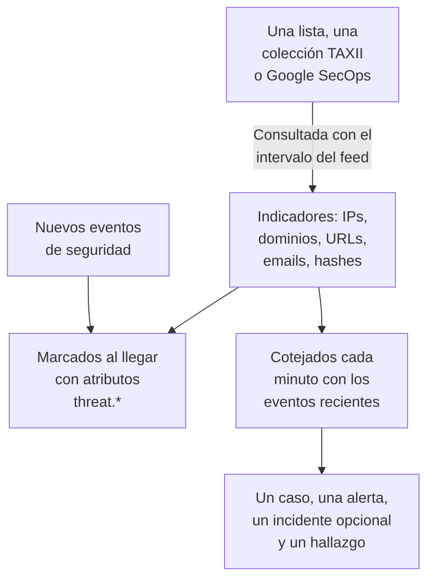

# Inteligencia de amenazas (STIX/TAXII)

Un feed de inteligencia de amenazas trae a OneUptime direcciones IP, dominios, URLs, direcciones de email y hashes de archivos maliciosos conocidos, y te avisa cuando tus [eventos de seguridad](/docs/telemetry/security-events) mencionan uno. Un feed lee un origen: una lista de indicadores en una dirección https, como las listas gratuitas que OneUptime añade con un clic, una colección TAXII 2.1 de indicadores STIX 2.1 de tu propio servidor MISP, OpenCTI u OpenTAXII o de un proveedor, o los indicadores que Google SecOps encontró en tus eventos.

:::cards
- [Añadir una lista gratuita](#añadir-una-lista-gratuita): Feodo Tracker, Emerging Threats y los nodos de salida de Tor, con un clic.
- [Suscribirse a un feed](#suscribirse-a-un-feed): La dirección de una lista, una colección TAXII o una conexión de Google SecOps.
- [Qué se ingiere](#qué-se-ingiere): Los patrones de indicador que conserva OneUptime, y durante cuánto tiempo.
- [Cómo se encuentran las coincidencias](#cómo-se-encuentran-las-coincidencias): Marcadas al llegar los eventos y cotejadas cada minuto.
- [Niveles de amenaza](#niveles-de-amenaza): Cómo la confianza de un indicador se convierte en una gravedad.
:::

## Cómo funciona



## Antes de empezar

- Para una lista, una dirección `https` que descargue un archivo de texto con un indicador por línea.
- Para un feed TAXII, un servidor TAXII 2.1 que publique objetos STIX 2.1 de tipo `indicator`, y el ID de la colección que consultar. Un feed TAXII inicia sesión de forma anónima, con un token bearer o con autenticación básica HTTP.
- Para un feed de Google SecOps, una [conexión de Google SecOps](/docs/integrations/google-secops#configurar-el-conector-gestionado) cuya cuenta de servicio pueda buscar coincidencias de indicadores: el rol `roles/chronicle.viewer` puede.
- No se admiten los servidores que exigen un certificado de cliente TLS (TLS mutuo), como CISA AIS. El servidor ATT&CK público de MITRE publica técnicas y grupos en lugar de indicadores, así que un feed que apunte a él se queda vacío.
- Un rol que pueda crear feeds: Project Owner, Project Admin, Security Admin o Security Member. Security Viewer puede leer feeds e indicadores. Consulta [Roles](/docs/permissions/reference#roles).

## Añadir una lista gratuita

La tarjeta **Listas gratuitas** de **Inteligencia de amenazas** añade una lista de bloqueo gratuita con un clic: haz clic en **Añadir lista** en una lista, y OneUptime crea un feed que la descarga según el calendario de la lista. Una lista que el proyecto ya lee indica **Añadido**.

| Lista | Publicada por | Lectura | Confianza | Una coincidencia abre |
| --- | --- | --- | --- | --- |
| Servidores C2 de botnets de Feodo Tracker | abuse.ch | Cada hora | 90, Critical | Un caso y una alerta |
| Hosts comprometidos de Emerging Threats | Proofpoint Emerging Threats | Cada día | 70, High | Un caso y una alerta |
| Nodos de salida de Tor | The Tor Project | Cada hora | 30, Low | Un caso |

La tarjeta de cada lista enlaza sus condiciones: Feodo Tracker es libre para cualquier uso (CC0), y la lista de Emerging Threats tiene licencia BSD. Un feed añadido desde una lista se edita y se elimina como cualquier otro.

## Suscribirse a un feed

:::steps
### Abre Inteligencia de amenazas

Abre **Productos → Eventos de seguridad → Detecciones → Inteligencia de amenazas**.

### Crea el feed

Haz clic en **Crear Feed de inteligencia de amenazas** y elige su **Origen**: **Lista de indicadores**, **Colección TAXII** o **Google SecOps**. El siguiente paso pide solo ese origen: la **URL de la lista** de una lista, el **Servidor TAXII** y el **Inicio de sesión** de una colección, o la **Conexión de Google SecOps**. **Al coincidir** va al final. Los campos están en la tabla de abajo.

### Comprueba la primera consulta

En uno o dos minutos, la fila del feed muestra **Último sondeo**, y **Resumen del último sondeo** indica lo que trajo la consulta. Los indicadores aparecen en la tabla **Indicadores**, debajo de los feeds.
:::

| Campo | Qué introducir |
| --- | --- |
| **Origen** | De dónde vienen los indicadores. Se fija al crear el feed: un feed de otro origen es un feed nuevo. |
| **URL de la lista** | Para una lista: la dirección `https` de un archivo de texto con una dirección IP, un dominio, una URL o un hash de archivo por línea. |
| **Confianza** | Para una lista: lo segura que está la lista, de 1 a 100. Cada indicador de la lista la recibe, y fija el [nivel de amenaza](#niveles-de-amenaza); vacío es Medium. |
| **Conexión de Google SecOps** | Para Google SecOps: la conexión cuya clave lee los indicadores que encontró Google SecOps. **Conectar Google SecOps** abre **Conexiones** cuando no hay ninguna. |
| **URL raíz de la API de TAXII** | La raíz de la API TAXII 2.1 del servidor, como `https://taxii.example.com/api1/`. Las colecciones se direccionan debajo de ella. |
| **ID de la colección** | La colección que publica los indicadores. |
| **Intervalo de sondeo (minutos)** | Cada cuánto se lee el origen: de 1 a 1440 minutos, 60 por defecto. Una lista se lee como mucho cada 15 minutos. |
| **Confianza mínima** | Para una colección TAXII o Google SecOps: los indicadores con una confianza menor se omiten, de 0 a 100, y 0 lo conserva todo. Los indicadores sin confianza siempre pasan. |
| **Inicio de sesión** | Cómo inicia sesión OneUptime: **Sin inicio de sesión** para una colección pública, **Token bearer** para un token del operador del servidor, o **Usuario y contraseña** para la autenticación básica HTTP. |
| **Token de API**, **Usuario de Basic Auth** y **Contraseña de Basic Auth** | Solo se piden para el inicio de sesión elegido. |
| **Abrir un caso al coincidir** | Activado por defecto: cada evento que nombra un indicador abre un [caso](/docs/telemetry/security-cases) sobre él, o se suma al caso abierto que ya trata sobre él. |
| **Alertas e incidentes** | **Crear una alerta** por defecto: cada indicador coincidente abre una alerta. |
| **Gravedad de la alerta** | La gravedad de cada alerta que abre este feed. Déjala vacía para tomar el nivel de amenaza de cada indicador. |
| **Declarar un incidente** o **Ambos** | En **Alertas e incidentes**. Los incidentes impulsan la escalada de guardia, los SLA y las páginas de estado, y para las coincidencias de indicadores suelen bastar las alertas. |
| **Gravedad del incidente** | Como **Gravedad de la alerta**, para los incidentes. |
| **Escribir un hallazgo de detección al coincidir** | Activado por defecto: cada coincidencia escribe un hallazgo en el flujo de eventos. |

Los tokens y las contraseñas de un feed TAXII se cifran y no vuelven a mostrarse después de guardarlos. Para cambiarlos, elige **Actualizar credenciales** en la fila del feed y elige **Token bearer**, **Usuario y contraseña** o **Sin inicio de sesión**, que borra lo almacenado: tu elección sustituye el inicio de sesión del feed, así que guardar un token borra una contraseña guardada, y al revés.

### Cómo se consulta un feed

Cada consulta pide los objetos añadidos desde la anterior, mediante el cursor `added_after` de TAXII, y lee hasta 10 páginas de 500 objetos. Una colección grande se sincroniza, por tanto, a lo largo de varias consultas: **Resumen del último sondeo** indica cuándo quedan páginas. Para terminar antes una primera sincronización grande, baja el **Intervalo de sondeo (minutos)**, hasta 1, hasta que se ponga al día.

Las consultas se identifican con el user agent `OneUptime/<version> (+https://oneuptime.com)`. Si el firewall del proveedor responde `403`, pídele que lo permita: muchos firewalls bloquean las peticiones que parecen un script sin nombre.

Un feed desactivado no se consulta ni se coteja. Los indicadores que ya tiene siguen marcando eventos nuevos hasta que caducan.

### Cómo se lee una lista

- Cada sondeo descarga la lista entera y la lee línea a línea: el primer valor de una línea, hasta un espacio, un tabulador, una coma o un punto y coma. Las líneas que empiezan por `#`, `;` o `//` son comentarios, el puerto que sigue a una dirección o un dominio se quita, y un rango de direcciones como `198.51.100.0/24` se omite.
- Un valor sigue siendo un indicador activo durante 2 días después del sondeo que lo leyó por última vez, y un valor que la lista quita deja de coincidir en el siguiente sondeo. Una lista que no ha cambiado se vuelve a escribir una vez al día.
- Una lista tiene como máximo 50.000 indicadores. **Resumen del último sondeo** dice cuántos se leyeron, cuántas líneas se omitieron y cuántos se dejaron fuera.
- La dirección debe usar `https` y sigue las mismas reglas de salida que una conexión: en OneUptime Cloud se rechaza una dirección privada.

### Cómo se lee Google SecOps

- Cada sondeo lee las coincidencias de indicadores que Google SecOps registró desde el sondeo anterior, con los atributos de Mandiant: el dominio, la dirección o el hash de archivo coincidente, su confianza, su categoría y las campañas y actores con los que está relacionado. El primer sondeo lee los últimos 7 días.
- Un indicador sigue activo durante 30 días después de que Google SecOps lo viera por última vez, o hasta que su origen diga que deja de estar activo, y uno que un analista silenció en Google SecOps deja de coincidir aquí también.
- Una coincidencia que Google SecOps marca como una intrusión activa es Critical, y una de prioridad alta es como mínimo High.

## Qué se ingiere

De una colección TAXII, OneUptime conserva los objetos STIX de tipo `indicator` cuyo patrón es una igualdad simple sobre uno de estos tipos. Una lista y Google SecOps dan los mismos tipos:

| Tipo | Patrón de ejemplo |
| --- | --- |
| Dirección IPv4 (`ipv4-addr`) | `[ipv4-addr:value = '198.51.100.7']` |
| Dirección IPv6 (`ipv6-addr`) | `[ipv6-addr:value = '2001:db8::7']` |
| Nombre de dominio (`domain-name`) | `[domain-name:value = 'evil.example']` |
| URL (`url`) | `[url:value = 'http://evil.example/payload']` |
| Dirección de email (`email-addr`) | `[email-addr:value = 'billing@evil.example']` |
| Hash de archivo, SHA-256 (`file-hash-sha256`) | `[file:hashes.'SHA-256' = 'e3b0…b855']` |
| Hash de archivo, SHA-1 (`file-hash-sha1`) | `[file:hashes.'SHA-1' = 'da39…0709']` |
| Hash de archivo, MD5 (`file-hash-md5`) | `[file:hashes.MD5 = 'd41d…427e']` |

Las comparaciones unidas con `OR`, dentro de un `[...]` o entre varios, valen, y cada valor se convierte en un indicador propio:

```text
[domain-name:value = 'evil.example' OR domain-name:value = 'evil2.example']
[ipv4-addr:value = '198.51.100.7'] OR [url:value = 'http://evil.example/x']
```

Cualquier otro patrón, con `AND`, `FOLLOWEDBY`, `NOT`, `LIKE`, `MATCHES`, un calificador de tiempo como `WITHIN` u otro tipo de objeto, se omite entero y se cuenta como no admitido en **Resumen del último sondeo**. Traducir solo una parte de un patrón `AND` coincidiría con mucho más de lo que quería el autor del feed.

### Cuánto tiempo sigue activo un indicador

- Un indicador coincide desde su `valid_from` hasta su `valid_until`. Sin `valid_until`, sigue activo 365 días desde `valid_from`, y volver a consultarlo no lo alarga.
- Un indicador revocado, o uno actualizado con un `valid_until` en el pasado, deja de coincidir en cuanto se consulta la actualización. Lo mismo un valor que el proveedor quita de un patrón actualizado.
- Los valores se guardan en minúsculas y se cotejan sin importar sus mayúsculas.

La tabla **Indicadores** lista los indicadores tal como están guardados, con un **Estado** de **Activo**, **Caducado** o **Revocado**. Un indicador consultado de nuevo puede aparecer dos veces durante un tiempo, y una fila caducada o revocada sigue en la lista hasta que la limpieza del almacenamiento la elimina, hasta un mes aproximadamente después de caducar. El cotejo siempre comprueba la validez y la revocación, así que una fila así nunca coincide.

## Cómo se encuentran las coincidencias

### Marcados al llegar

Cada evento de seguridad entrante, desde la API de ingesta o una conexión, se coteja con tus indicadores activos antes de guardarse. Cuando uno de sus observables (las IPs, hosts, dominios, hashes y usuarios extraídos del evento) es igual al valor de un indicador, el evento recibe estos atributos:

| Atributo | Valor |
| --- | --- |
| `threat.matched` | Siempre `"true"` en un evento marcado |
| `threat.indicator_id` | El ID del indicador STIX, o `list` o `google-secops` para esos orígenes |
| `threat.indicator_type` | El tipo del indicador, como `ipv4-addr` o `file-hash-sha256` |
| `threat.indicator_value` | El valor coincidente, en minúsculas |
| `threat.feed` / `threat.feed_id` | El feed del que vino el indicador |
| `threat.confidence` | La confianza STIX del indicador |
| `threat.match_count` | Cuántos observables del evento coincidieron con un indicador |

Cuando varios indicadores coinciden con un evento, el de mayor confianza rellena estos valores. Son atributos corrientes, así que puedes buscarlos en **Eventos**, filtrar con ellos los monitores de eventos de seguridad y usarlos en reglas de detección:

```yaml title="threat-intel-logon.yml"
title: High-confidence indicator in a successful logon
level: critical
detection:
  selection:
    threat.matched: 'true'
    threat.confidence|gte: 80
    className: Authentication
    statusName: Success
  condition: selection
```

El marcado solo conoce los indicadores que existen cuando llega un evento: los eventos nunca se vuelven a marcar después.

### Cotejados cada minuto

Cada minuto, los indicadores activos de cada feed habilitado se cotejan con los eventos cuya hora de evento cae desde la comprobación anterior del feed. Así se atrapa la inteligencia que llegó después de que se marcara un evento.

- La primera comprobación cubre los últimos 15 minutos. Tras una caída, la siguiente comprobación recupera como mucho las últimas 24 horas.
- Cada ventana se comprueba una vez. La inteligencia que llega después de comprobarse su ventana solo se aplica a eventos posteriores.
- Un evento que llega tarde, con una hora anterior a la comprobación anterior, se sigue marcando al llegar, pero no se coteja.
- Cada comprobación registra cada valor de indicador coincidente como un Detection Finding, hasta 10.000 por feed. Se abren alertas, incidentes y casos para los 100 valores vistos en más eventos; el resto comparte un caso sobre el feed, y el **Error de la última coincidencia** del feed dice cuántos coincidieron.

### Qué hace una coincidencia

- Una alerta, titulada `[Threat Intel] <feed name> — <indicator value>`, una por feed y valor mientras siga abierta. Cuando se resuelve, la siguiente coincidencia abre una nueva. Las alertas no se resuelven automáticamente.
- Un incidente, solo con **Declarar un incidente** o **Ambos** en **Alertas e incidentes**, deduplicado de la misma forma.
- Un hallazgo de inteligencia de amenazas, con **Escribir un hallazgo de detección al coincidir**: un evento `Detection Finding` (clase OCSF 2004) del producto `OneUptime Threat Intel`, con el nivel de amenaza del indicador como gravedad y estos atributos:

| Atributo | Valor |
| --- | --- |
| `oneuptime.threat.feed_id` / `oneuptime.threat.feed_name` | El feed |
| `oneuptime.threat.indicator_id` | El ID del indicador STIX, o `list` o `google-secops` para esos orígenes |
| `oneuptime.threat.indicator_type` / `oneuptime.threat.indicator_value` | Lo que coincidió |
| `oneuptime.threat.confidence` | La confianza del indicador |
| `oneuptime.threat.match_count` | Cuántos eventos hay detrás de este hallazgo |

Los hallazgos nunca se cotejan a sí mismos, así que una coincidencia no puede desencadenar otra.

## Niveles de amenaza

Los indicadores no tienen nivel Sigma: su `confidence` STIX fija en su lugar un nivel de amenaza.

| Confianza del indicador | Nivel de amenaza |
| --- | --- |
| De 90 a 100 | Critical |
| De 70 a 89 | High |
| De 40 a 69 | Medium |
| De 1 a 39 | Low |
| Sin puntuar (0 o ausente) | Medium |

Un indicador sin puntuar cuenta como Medium: alguien decidió igualmente ponerlo en un feed. El nivel de amenaza es la gravedad del hallazgo y elige la gravedad de la alerta entre las gravedades de tu proyecto, en este orden:

1. La **Gravedad de la alerta** (o **Gravedad del incidente**) del feed, si está definida: se aplica a cada coincidencia del feed.
2. Tu gravedad con el nombre del nivel de amenaza, como High, sin importar mayúsculas.
3. Por rango: Critical y High toman tu gravedad más alta, Medium y Low la más baja.

El nivel de amenaza pertenece a cada indicador, no al feed, así que un mismo feed puede abrir una alerta Critical y una Low en el mismo minuto. **Confianza mínima** filtra por el mismo número: un mínimo de 70 conserva solo los indicadores High y Critical, más los sin puntuar, que siempre pasan.

## Vigila las coincidencias de un feed

La acción **Crear monitor** de la fila de un feed abre un monitor de eventos de seguridad nuevo que cuenta los hallazgos del feed: clase de evento `Detection Finding`, filtrada por el ID del feed en `oneuptime.threat.feed_id` (nunca por su nombre, que un cambio de nombre alteraría), sobre la última hora. Úsalo para una ráfaga repentina de coincidencias, o para un feed normalmente activo que se queda en silencio.

## Retención y facturación

Los indicadores son configuración, no telemetría, y no se facturan como datos ingeridos. Los hallazgos que escribe una coincidencia son eventos de seguridad corrientes, facturados y conservados como el resto: consulta [Eventos de seguridad](/docs/telemetry/security-events#retención-y-facturación).

## Solución de problemas

:::details Último error tiene un valor tras una consulta
`401` o `403`: las credenciales son incorrectas o faltan; sustitúyelas con **Actualizar credenciales**. Un `403` también puede ser el firewall del proveedor bloqueando el user agent. `404`: revisa la **URL raíz de la API de TAXII**, que suele terminar en una ruta como `/api1/`, y el **ID de la colección**. El error desaparece con la siguiente consulta correcta.
:::

:::details El feed se consulta, pero no aparecen indicadores
Lee **Resumen del último sondeo**. Ningún objeto traído: la colección está vacía o no publica indicadores. Patrones no admitidos: el proveedor usa funciones de patrón que esta página enumera como omitidas. Por debajo de la confianza mínima: baja la **Confianza mínima**. Ya inactivos: el proveedor envió indicadores que ya estaban revocados o caducados.
:::

:::details Hay indicadores, pero nada coincide
El cotejo compara el valor de un indicador con los observables de un evento, no con cada campo: abre en **Eventos** un evento que esperabas que coincidiera y comprueba que sus observables contienen el valor. Solo coinciden los indicadores con el estado **Activo**. Si el **Estado** del feed dice **La comparación falló**, **Ver error** en su fila muestra por qué.
:::

:::details El Último error de un feed de lista dice que la dirección respondió con una página web
La **URL de la lista** abre una página, como una de inicio de sesión o de error, y no la lista: ábrela en un navegador y copia la dirección del propio archivo. Una lista cuyo texto no tiene ninguna dirección IP, dominio, URL ni hash de archivo se rechaza igual, y los indicadores del feed se quedan como estaban.
:::

:::details El Último error de un feed de Google SecOps dice HTTP 403
La cuenta de servicio de la conexión no puede buscar coincidencias de indicadores: concédele `roles/chronicle.viewer`. Si la conexión se eliminó, el feed lo dice: edítalo y elige otra **Conexión de Google SecOps**.
:::

:::details Una coincidencia no abrió una alerta
**Alertas e incidentes** está en **Declarar un incidente** o **Ninguno**, o sigue abierta una alerta del mismo feed y valor, y las coincidencias posteriores se suman a ella. Un proyecto necesita al menos una gravedad de alerta para que un feed abra alertas.
:::

## Próximos pasos

:::cards
- [Eventos de seguridad](/docs/telemetry/security-events): Envía eventos, búscalos y escribe reglas de detección.
- [Google SecOps](/docs/integrations/google-secops): Trae las detecciones y los eventos de Chronicle.
- [Referencia de permisos](/docs/permissions/reference): Los roles de seguridad y lo que puede hacer cada uno.
:::
