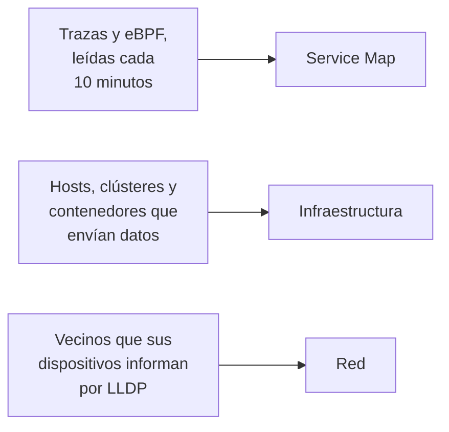

# Topología

La topología dibuja cómo se conectan sus sistemas: qué servicios llaman a cuáles, qué se ejecuta dónde y cómo están cableados sus dispositivos de red. OneUptime la construye a partir de la telemetría que ya envía, así que no hay nada que dibujar a mano, y muestra de un vistazo dónde están los errores y los incidentes.

:::cards
- [Abrir la topología](#abrir-la-topología): Tres vistas de una misma página.
- [Leer el mapa de servicios](#leer-el-mapa-de-servicios): Quién llama a quién, y lo sanas que son las llamadas.
- [Explorar su infraestructura](#explorar-su-infraestructura): Dónde se ejecuta cada servicio.
- [Abrir el mapa propio de un recurso](#abrir-el-mapa-propio-de-un-recurso): Un vCenter, un clúster o un host en detalle.
- [Ver su red](#ver-su-red): Los dispositivos y sus enlaces, en directo.
:::

## Cómo se construye el mapa

Cada vista de la topología se construye a partir de un tipo de telemetría distinto:

- **Solo se dibuja lo que estuvo activo.** Una vista muestra los servicios y los recursos que enviaron datos en el intervalo de tiempo, y las conexiones vistas en él. Active **Mostrar inactivos** para dibujar también los que estuvieron en silencio.
- **Las llamadas se cuentan en una ventana reciente.** OneUptime busca llamadas entre servicios cada 10 minutos, y las cifras de tráfico cubren los últimos 15 minutos, no todo el intervalo de tiempo.
- **La vista de red es en directo.** Muestra sus dispositivos tal como están conectados ahora, así que no tiene intervalo de tiempo.

## Antes de empezar

- **Telemetría que llega.** El mapa de servicios necesita trazas: consulte [OpenTelemetry](/docs/telemetry/open-telemetry). La vista de infraestructura necesita un host o un clúster que envíe datos: consulte el [agente de Kubernetes](/docs/telemetry/kubernetes-agent). La vista de red necesita dispositivos de red: consulte [Monitor de dispositivos de red](/docs/monitor/network-device-monitor).
- **Un rol que lea la telemetría.** Project Owner, Project Admin, Project Member, Viewer, Telemetry Admin, Telemetry Member o Telemetry Viewer, o un rol personalizado con el permiso Read Telemetry Service.

## Abrir la topología

Vaya a **Productos → Observabilidad → Topología**. **Inventario → Mapa de topología** abre la misma página. Se abre en el **Service Map**, para el **Último día**.

| Vista | La pregunta que responde |
| --- | --- |
| **Service Map** | ¿Qué servicios dependen unos de otros? |
| **Infraestructura** | ¿Qué se ejecuta dónde en su infraestructura? |
| **Red** | ¿Cómo están conectados sus dispositivos de red? |

Junto al selector de tiempo, **Mostrar inactivos** añade lo que no envió datos en el intervalo, y el botón de actualizar vuelve a cargar la vista. **Qué se muestra · Acerca de estos datos** explica qué dibuja la vista y cada cuánto se calcula. La barra de direcciones guarda la vista en la que está, así que un enlace que comparta abre la misma vista.

## Leer el mapa de servicios

El **Service Map** dibuja cada servicio que envió datos, y las bases de datos, las API y los brokers de mensajes a los que llama, aunque estos no envíen telemetría propia. Las flechas van del que llama al llamado, y las líneas más gruesas llevan más solicitudes. Las cifras de encima dicen cuántos servicios, dependencias y conexiones dibuja, y cuántos requieren atención.

Cada servicio muestra su estado, calculado a partir de las llamadas que recibió en los últimos 15 minutos:

| Estado | Cuándo |
| --- | --- |
| **En buen estado** | Falló como máximo el 1 % de las llamadas que recibió. |
| **Some errors** | Falló más del 1 % y menos del 5 %. |
| **High error rate** | Falló el 5 % o más. |
| **Entry point** | No recibió llamadas, pero hizo algunas: un frontend web o una tarea programada. |
| **No calls observed** | No hizo ni recibió ninguna llamada. |

Un servicio con un incidente o una alerta activos muestra cuántos tiene, y, como un servicio con **Some errors** o con **High error rate**, cuenta como que requiere atención.

:::steps
### Encontrar los servicios que requieren atención

Haga clic en **Requiere atención** para dejar solo esos servicios y sus conexiones directas, o busque por nombre en el cuadro de encima del mapa.

### Abrir un servicio

Haga clic en un servicio para ver sus solicitudes, sus errores y su latencia media de los últimos 15 minutos, sus **Incidentes activos** y **Alertas activas**, y enlaces a **Trazas de este servicio** y a sus **Detalles del inventario**.

### Abrir una conexión

Haga clic en una flecha para ver su tasa de solicitudes, su tasa de errores y su latencia media. Entre dos servicios que usted instrumenta, también tiene un **Historial** de llamadas, errores y latencia.
:::

**Etiquetas de la conexión** escribe una cifra en cada flecha: **Tasa de solicitudes**, **Tasa de errores** o **Latencia media**, o ninguna hasta que pase el ratón por encima. **Tabla** lista los mismos servicios con sus **Solicitudes**, **Tasa de errores**, **Latencia media** y **Conexiones**, y **Mostrar en el mapa** dibuja uno de ellos.

## Explorar su infraestructura

**Infraestructura** muestra dónde se ejecutan sus servicios: clústeres, hosts, pods, contenedores y los demás recursos que envían datos. Las réplicas de una misma carga de trabajo se agrupan en una sola entrada, y puede abrir cualquier cosa para ver su interior.

- **Recórrala a su manera.** Muéstrela como **Lista** o como **Mapa**, desde toda su infraestructura hasta un solo pod. Las cifras de encima dicen cuántos recursos y cargas de trabajo dibuja, cuántos servicios puede ubicar y cuántos recursos en silencio deja fuera.
- **Encuentre un recurso.** Búsquelo por nombre y haga clic en **Ver detalles** para abrir su página.
- **Pase de una vista a otra.** Un servicio listado en un recurso se abre en el **Service Map**, y los recursos en los que se ejecuta un servicio se abren en **Infraestructura**.

## Abrir el mapa propio de un recurso

Un vCenter, un clúster de Kubernetes, un host, un host de Docker o Podman, un clúster de Docker Swarm, Proxmox o Ceph y una cabina de almacenamiento tienen cada uno su propia página **Topología**. Dibuja ese recurso en detalle, a partir de su propio inventario: qué está dentro de qué, cada parte coloreada según su estado, y cada incidente y alerta abiertos en la parte a la que se refieren.

- **Léala como un árbol.** El recurso está arriba, y las partes de cada parte se dibujan a su derecha, unidas a ella por una línea que se vuelve roja o ámbar donde algo requiere atención. Las partes con problemas dentro se abren solas, el botón redondo de una parte la abre o la cierra, y las teclas de flecha recorren el mapa.
- **Encuentre lo que requiere atención.** **Requiere atención** deja solo las partes con problemas y el camino hasta cada una, y la búsqueda encuentra una parte en cualquier lugar del recurso.
- **Mire más de cerca.** Haga clic en una parte para ver qué es y un enlace a su propia página, y en **Enfocar esto** para dibujar solo esa parte, lo que contiene y aquello con lo que se relaciona.
- **Vaya en ambos sentidos.** **Abrir en Topología** abre el recurso en **Infraestructura**, y su botón **Abrir la topología del vCenter**, **Abrir la topología del clúster**, **Abrir la topología del host** o **Abrir la topología de la cabina de almacenamiento** lleva de vuelta.

## Ver su red

**Red** es el mapa en directo de sus dispositivos de red, construido a partir de los vecinos que informan por LLDP, y por CDP en los dispositivos Cisco. No tiene selector de tiempo: las conexiones se actualizan solas.

Si agrupa dispositivos en sitios, la vista se abre en sus sitios: elija uno o cambie a **Todos los dispositivos**. **Opciones del mapa** ordena el mapa y elige lo que incluye, y **Exportar PDF** guarda el mapa que ve. Las páginas de los dispositivos de red dibujan el mismo mapa: consulte [Topología de red](/docs/monitor/network-device-monitor#topología-de-la-red).

## Solución de problemas

:::details El mapa de servicios muestra servicios pero ninguna conexión
OneUptime busca llamadas entre servicios en sus trazas cada 10 minutos. Ve una cuando una solicitud lleva el contexto de traza, el encabezado `traceparent`, de un servicio instrumentado al siguiente, como hacen las instrumentaciones HTTP y gRPC de OpenTelemetry; cuando un servicio informa spans de cliente para las bases de datos y las API a las que llama; o cuando el agente de Kubernetes se ejecuta con eBPF.
:::

:::details Un servicio que quité sigue en el mapa
Envió datos dentro del intervalo de tiempo. Elija un intervalo más corto, o espere a que su última telemetría quede fuera del intervalo. Con **Mostrar inactivos** activado, el mapa también dibuja lo que dejó de enviar datos.
:::

:::details El mapa dice que solo se muestra una parte
Un proyecto muy grande alcanza los límites del mapa, y un aviso dice cuántos recursos o conexiones muestra. Busque un servicio, o use **Mostrar en el mapa** en la tabla, para dibujar una parte legible.
:::

## Próximos pasos

:::cards
- [Catálogo de servicios](/docs/telemetry/services): Todo sobre un servicio.
- [Explorador de trazas](/docs/telemetry/traces-explorer): Las solicitudes detrás de cada flecha.
- [Visión general del inventario](/docs/inventory/overview): Cada recurso que dibuja el mapa.
- [Monitor de dispositivos de red](/docs/monitor/network-device-monitor): Ponga su red en el mapa.
:::
