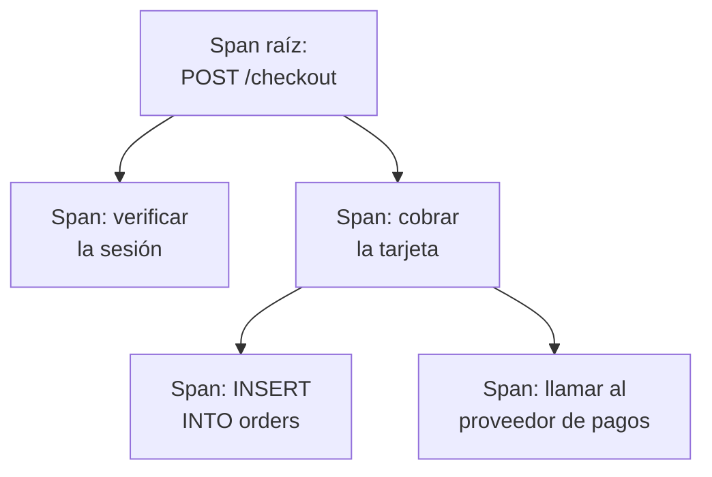

# Explorador de trazas

El explorador de trazas encuentra las solicitudes que pasaron por sus servicios: las lentas, las fallidas, las que tocaron la cuenta de un cliente concreto. Busque y filtre los spans que envían sus servicios y luego abra una traza para ver cada paso de la solicitud como cascada, gráfico de llamas o mapa de servicios.

:::cards
- [Encontrar una solicitud](#encontrar-una-solicitud): Buscar spans y luego filtrar por servicio, estado o tipo.
- [Leer una traza](#leer-una-traza): Adónde fue el tiempo y qué paso falló.
- [Representar sus spans en gráficos](#representar-sus-spans-en-gráficos): Recuentos de solicitudes y tiempos de respuesta, agrupados a su manera.
- [Análisis de trazas](#análisis-de-trazas): Tasas de error, latencia y las solicitudes más lentas.
- [Encontrar y corregir operaciones lentas o que fallan con IA](#encontrar-y-corregir-operaciones-lentas-o-que-fallan-con-ia): Pull requests que las corrigen y añaden el trazado que le falta a una traza.
:::

## Trazas y spans

Una traza es una solicitud en su camino por su sistema. Cada paso que da, como un manejador HTTP, una consulta a la base de datos o una llamada a otro servicio, es un span, y los spans se anidan dentro de los spans que los iniciaron. El primer span de una traza, sin padre, es su span raíz: el punto de entrada de la solicitud.

Cada fila del explorador es un span, así que un servicio con mucho trabajo llena la lista con sus consultas a la base de datos y sus llamadas internas. Para listar una fila por solicitud, elija **Root spans** en **Categoría de span** en la barra lateral.

El explorador tiene cinco pestañas:

| Pestaña | Para qué sirve |
| --- | --- |
| **Visor** | Buscar y filtrar spans, y abrir sus trazas. Se abre con la última hora, los más recientes primero, 50 spans por página. |
| **Análisis** | Tasas de solicitudes, tasas de error y latencia por servicio, y las solicitudes que merecen un vistazo. |
| **IA** | Las operaciones lentas o que fallan y el trazado faltante que OneUptime encuentra en sus trazas, y lo que la IA de OneUptime hizo al respecto. Consulte [Encontrar y corregir operaciones lentas o que fallan con IA](#encontrar-y-corregir-operaciones-lentas-o-que-fallan-con-ia). |
| **Guía de configuración** | Cómo enviar trazas con OpenTelemetry, usando una de sus [claves de ingesta](/docs/telemetry/ingestion-keys). |
| **Ajustes** | Lo que les pasa a los spans al llegar: **Canalizaciones**, **Filtros de descarte**, **Reglas de depuración** y **Reglas de grabación**. |

## Antes de empezar

- **Trazas que llegan.** Instrumente sus servicios con [OpenTelemetry](/docs/telemetry/open-telemetry). La pestaña **Guía de configuración** muestra el código para su lenguaje.
- **Un rol que pueda leer telemetría.** Project Owner, Project Admin, Project Member, Viewer, Telemetry Admin, Telemetry Member o Telemetry Viewer, o un rol personalizado con el permiso Read Telemetry Service Traces. Su ámbito decide de quién son los spans que ve: consulte [Telemetría](/docs/permissions/index#telemetría).

## Encontrar una solicitud

:::steps
### Abrir el Visor

Vaya a **Productos → Observabilidad → Trazas**. El **Visor** enumera los spans de la última hora, los más recientes primero, cada uno con su estado, servicio, nombre y duración.

### Elegir el intervalo de tiempo

Elija un intervalo en el selector de tiempo, o arrastre sobre el gráfico que hay encima de la lista para acercarse a un pico. Haga doble clic en el gráfico para alejarse. Consulte [Hacer zoom en un intervalo de tiempo](/docs/telemetry/charts-and-time-ranges).

### Buscar

Escriba una consulta y pulse Intro, por ejemplo `service:checkout status:error duration:>500`. Las palabras sueltas buscan en los nombres de span, y `@key:value` busca en un atributo como `@http.route:/orders`. Consulte [Sintaxis de búsqueda](/docs/telemetry/search-syntax#trazas).

### Acotar con filtros

Haga clic en un valor de la barra lateral **Filtros** para añadirlo como chip. La barra lateral filtra por **Servicio**, por el host, el clúster u otro recurso que envió el span, por **Estado**, **Categoría de span**, **Tiene excepción**, **Tipo de span**, **Nombre del span**, **Instancia del servicio** y **Nombre del host**.

### Abrir un span

Haga clic en una fila para desplegarla: sus atributos, y los registros y excepciones que registró. Haga clic en **See full trace** para abrir toda su traza.
:::

Su búsqueda, sus chips y el intervalo de tiempo se guardan en la dirección de la página, así que al recargar, con un marcador o con un enlace compartido se abren los mismos spans.

## Leer una traza

La página de una traza empieza con las cifras de la solicitud:

| Cifra | Qué es |
| --- | --- |
| Duración | Cuánto duró toda la solicitud. |
| Spans | Cuántos spans tiene la traza. |
| Servicios | Por cuántos servicios pasó la solicitud. |
| Errores | Cuántos spans terminaron con un estado de error. Haga clic para mostrar solo esos. |
| Profundidad | La cadena más larga de spans anidados. |

Debajo, elija una de cuatro vistas:

| Vista | Qué muestra |
| --- | --- |
| **Cascada** | Cada span en una línea de tiempo, anidado bajo el span que lo inició. Active **Critical path** para resaltar la cadena de spans que decidió cuánto duró la solicitud. |
| **Gráfico de llamas** | El mismo árbol como barras apiladas, donde las barras más anchas tardaron más. |
| **Mapa de servicios** | Los servicios por los que pasó la solicitud y las llamadas entre ellos. |
| **Operaciones** | Una fila por servicio y nombre de span, con sus llamadas, errores, tiempo propio y tiempo total. Una operación llamada 10 o más veces desde un mismo span padre se marca: suele ser una consulta N+1 o un bucle que podría agruparse. |

Haga clic en un span en cualquier vista para abrir su panel, con pestañas para sus atributos, eventos, registros, excepciones y enlaces, y su perfil o su llamada a un LLM cuando los tiene. Busque entre los spans de la traza por nombre, ID o servicio con el cuadro de búsqueda junto a las vistas (pulse `/`), y active **Errors only** para quedarse solo con los spans que fallaron.

Una traza grande carga 500 spans cada vez. Haga clic en el botón al final de la traza para cargar más, o todos.

> [!TIP]
> **Acelerar con IA** solo aparece en una traza que vale la pena corregir: una con una consulta N+1, llamadas hechas una tras otra que podrían ir en paralelo, o una llamada que ocupa casi toda la solicitud, cuando eso cuesta tiempo real (100 ms o más entre todas las llamadas, 500 ms o más para una sola llamada, y al menos una décima parte de la solicitud). Indica lo que encontró, por ejemplo «La misma consulta a la base de datos se ejecutó 40 veces en ReportService.build», e inicia una tarea de IA que abre un pull request para corregirlo. Cuando una corrección de la traza ya hizo su trabajo, la traza enlaza a su tarea en lugar de ofrecer una segunda. Cuando otra cosa impide trabajar a la IA, como el plan, los créditos de IA agotados o ningún Runner en línea, la traza dice qué es, con el enlace que lo resuelve. Consulte [Código](/docs/ai/ai-agent).

## Representar sus spans en gráficos

El gráfico de encima de la lista muestra el número de spans a lo largo del tiempo, dividido por estado. Elija otra medida en la cabecera del gráfico para mostrar en su lugar su tiempo de respuesta medio, mediano (P50) o P95.

Para más, cambie la lista de **Spans** a **Analítica**. Elija una serie temporal, una lista de los primeros o una tabla; mida recuentos de solicitudes, recuentos de errores o tiempos de respuesta (media, P50, P90, P95, P99, mínimo o máximo); y agrupe por nombre de span, servicio, estado, tipo de span o cualquier atributo, y luego por un segundo campo. Una lista de los primeros o una tabla muestra de 5 a 100 grupos.

## Seguir, guardar y compartir

- Haga clic en **Pausado** encima de la lista para activar las actualizaciones en vivo. El botón pasa a mostrar **En vivo**, y la lista busca spans nuevos cada 10 segundos. Haga clic de nuevo para pausar.
- **Vistas guardadas** conserva una búsqueda, sus filtros y el intervalo de tiempo con un nombre, para todos en el proyecto. Las vistas guardadas funcionan como en el [Explorador de registros](/docs/telemetry/logs-explorer#guardar-una-vista).
- Los botones **Registros** y **Métricas** abren esos exploradores para la misma ventana de tiempo, con tanto de su filtrado como puedan usar. Apunte a un botón para ver lo que no puede trasladar.

## Análisis de trazas

La pestaña **Análisis** resume las solicitudes de un intervalo de tiempo:

- el número de solicitudes, la tasa de errores y la latencia P50, P95 y P99;
- una tabla de salud de sus servicios, ordenada por tasa de errores, para que los servicios que necesitan atención aparezcan primero;
- las solicitudes fallidas más recientes y las más lentas.

Limítela a algunos servicios con la lista desplegable junto al selector de tiempo.

## Encontrar y corregir operaciones lentas o que fallan con IA

Cada hora OneUptime revisa las trazas de la última hora de cada servicio en busca de operaciones lentas, que fallan o cuyas trazas no dicen por qué, y registra lo que encuentra como hallazgos de IA, con las pruebas. Después, la IA de OneUptime analiza cada uno y abre una pull request para corregirlo. Nunca se fusiona nada: su equipo revisa cada pull request.

Una operación son los spans de un mismo nombre en un servicio, como `GET /orders`. OneUptime lee un servicio en cuanto envió al menos 100 spans en la última hora, y registra tres tipos de hallazgo:

| Hallazgo | Cuándo lo registra OneUptime | La pull request |
| --- | --- | --- |
| **Operación lenta** | El P99 de la operación es de 1 segundo o más en al menos 20 spans, y su solicitud más lenta repite un patrón que cuesta tiempo real: la misma llamada hecha una y otra vez, llamadas hechas una tras otra que podrían ejecutarse en paralelo, o una llamada que ocupa la mayor parte de la solicitud. | Hace la operación más rápida. |
| **Operación que falla** | Al menos 20 spans de la operación fallaron, el 5 % o más de ellos, y los fallos más recientes dicen por qué, con una excepción o un mensaje de error. | Corrige por qué falla. |
| **Trazado faltante** | Las trazas no dicen por qué: cada uno de los 500 spans o más de un servicio fue la raíz de su traza, sin ningún span del servicio debajo, una solicitud lenta pasó el 60 % o más de su tiempo (y 500 ms o más) en un span sin nada trazado debajo, o los fallos de una operación no registraron ningún mensaje de error ni ninguna excepción. | Añade el trazado que falta. |

La IA de OneUptime abre por su cuenta la pull request de una operación que falla solo cuando encuentra el código culpable. Un fallo que viene de otra parte, como una dependencia caída, no recibe ninguna pull request a menos que alguien la pida con **Corregir con IA**.

### Activarlo

**Trazas → IA → Ajustes** contiene el interruptor **Encontrar y corregir operaciones lentas o que fallan**, activado en los proyectos nuevos. Con **Habilitar IA** desactivado, las operaciones lentas o que fallan se siguen encontrando, pero la IA de OneUptime no hace nada con ellas. Para abrir pull requests, la IA de OneUptime necesita un repositorio conectado en [Código](/docs/ai/ai-agent): la página indica primero lo que falta. El código de cada repositorio se cambia en el Runner que el repositorio elige en Código.

La IA de OneUptime abre por su cuenta como máximo 5 pull requests al día (UTC), una por hallazgo, y nunca más que el límite de pull requests de IA abiertas de un repositorio.

### Reglas de IA

Sin reglas, la IA de OneUptime analiza de inmediato cada problema que encuentra en sus trazas y abre una pull request para cada uno que pueda corregir. Las **Reglas de IA** de **Más ajustes** lo acotan, en tres pasos:

| Paso | Qué decide |
| --- | --- |
| **Coincidencia** | Qué servicios: los elegidos, los que tienen ciertas etiquetas o aquellos cuyo nombre coincide con un patrón. |
| **Investigar** | **De inmediato**, o **Solo si sigue encontrándose tras una espera**: un problema que desaparece durante la espera no se analiza. |
| **Corrección** | **No corregir**, **Preguntar antes de corregir** o **Corregir sin preguntar**. Preguntar primero deja la pull request en manos de una persona: el hallazgo ofrece **Corregir con IA**. |

En **Más campos** una regla elige los repositorios de código, los servidores MCP y el proveedor de LLM que la IA de OneUptime puede usar para ella. Si no se elige ninguno, puede usar cualquiera, y el proveedor de LLM predeterminado del proyecto.

### Ver lo que hizo

- **Trazas → IA → Análisis** muestra lo que OneUptime encontró, cada hallazgo con sus pruebas y **Abrir en Trazas**, que abre los spans de los que trata, de la hora en que se encontró, en el **Visor**. En una operación que falla, **Crear monitor** configura un monitor de trazas sobre sus spans fallidos.
- **Trazas → IA → Registros** muestra cada investigación y cada pull request, lo más reciente primero, con el estado de cada una y lo que encontró cada investigación.
- En Código, la tarea indica que OneUptime la inició, con un enlace a su hallazgo, y la pull request explica por qué se abrió.

## Qué les pasa a los spans al llegar

La pestaña **Ajustes** contiene las reglas que OneUptime aplica a los spans al llegar, como hace con los registros. Actúan sobre los spans que llegan después, no sobre los ya almacenados. Cuánto tiempo se conserva cada span también se decide cuando llega: consulte [Retención de datos](/docs/telemetry/data-retention).

| Regla | Qué hace |
| --- | --- |
| **Filtros de descarte** | Descartar los spans que no quiere conservar, o conservar solo una muestra. Consulte [Descartar o muestrear entradas](/docs/telemetry/drop-filters-and-scrub-rules#descartar-o-muestrear-entradas). |
| **Reglas de depuración** | Ocultar datos sensibles en los atributos de los spans. Consulte [Depurar datos sensibles](/docs/telemetry/drop-filters-and-scrub-rules#depurar-datos-sensibles). |
| **Canalizaciones** | Cambiar y enriquecer spans: cada canalización selecciona spans con un filtro y luego ejecuta sus procesadores en orden. |
| **Reglas de grabación** | Convertir cada minuto los recuentos de spans, los recuentos de errores y las duraciones en métricas nuevas. Consulte [Reglas de grabación de registros](/docs/telemetry/log-recording-rules). |

## Solución de problemas

:::details Una traza dice que no se encontraron spans
Los spans suelen llegar menos de un minuto después de que termine la solicitud. Haga clic en **Actualizar** en la página de la traza para volver a comprobarlo.
:::

:::details Algunos spans quedan en el nivel superior de la cascada
Nombran un span padre que OneUptime no ha recibido, a menudo porque el servicio que escribió el padre aún no envía trazas a OneUptime. Instrumente también ese servicio.
:::

:::details La lista muestra muchas más filas que solicitudes
Cada fila es un span, no una solicitud. Elija **Root spans** en **Categoría de span** en la barra lateral para listar una fila por solicitud.
:::

## Próximos pasos

:::cards
- [Sintaxis de búsqueda](/docs/telemetry/search-syntax): Todos los filtros que entiende el cuadro de búsqueda.
- [Monitor de trazas](/docs/monitor/traces-monitor): Recibir alertas de solicitudes fallidas o lentas.
- [Seguimiento de excepciones](/docs/telemetry/exceptions): Revisar los errores que registran sus spans.
- [Explorador de registros](/docs/telemetry/logs-explorer): Leer las líneas de registro que escribió una solicitud.
:::
