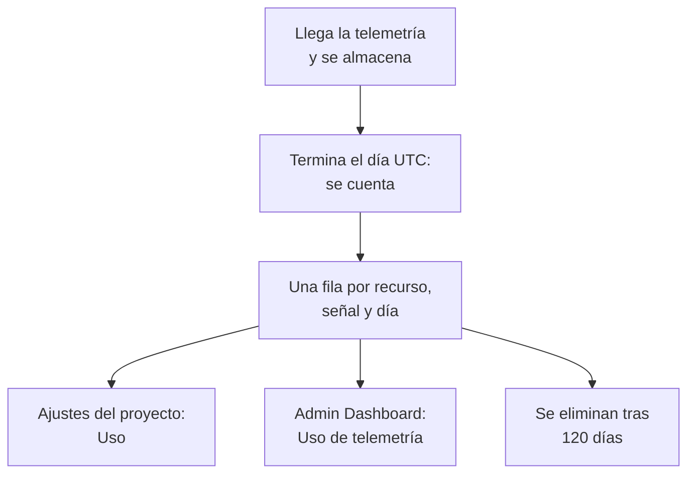

# Uso de telemetría

Vea cuánta telemetría envía cada proyecto, y cada servicio o recurso que contiene: registros, métricas, trazas, excepciones, perfiles, reproducciones de sesiones y eventos de seguridad. El uso se cuenta en todas las instalaciones de OneUptime, con facturación o sin ella, para que pueda encontrar lo que llena su almacenamiento sin consultar ClickHouse.

:::cards
- [Cómo se cuenta el uso](#cómo-se-cuenta-el-uso): Una vez al día, para cada recurso y cada señal.
- [Ver el uso de un proyecto](#ver-el-uso-de-un-proyecto): Ajustes del proyecto → Telemetría y APM → Uso.
- [Ver el uso de todos los proyectos](#ver-el-uso-de-todos-los-proyectos): El Admin Dashboard, para el administrador de la instancia.
- [Cuánto tiempo se conserva el uso](#cuánto-tiempo-se-conserva-el-uso): 120 días, salvo que lo cambie.
:::

## Cómo se cuenta el uso

Una vez al día, cuando un día ha terminado en UTC, OneUptime cuenta lo que envió ese día cada recurso de cada proyecto, para cada señal, y guarda el recuento como una fila por recurso, señal y día.



- **Un día se cuenta cuando termina.** Cada día queda contado a más tardar hacia las 08:00 UTC del día siguiente, así que el uso de hoy aparece mañana. Un día que no se pudo contar se vuelve a intentar durante una semana.
- **El tamaño es el tamaño almacenado.** Cada señal se cuenta como el tamaño de las filas en las que se almacena, antes de la compresión. Las reproducciones de sesiones se cuentan como los bytes que subieron las grabadoras.
- **Las excepciones se muestran aparte.** Las excepciones recogidas de spans y registros tienen su propio total, su propia columna y su propia parte del gráfico, y **Trazas** cuenta los spans. No tienen fila propia: cada fila de trazas indica qué parte de ella corresponde a excepciones. Un día contado antes de que las excepciones se mostraran aparte las sigue incluyendo en **Trazas**, como antes.
- **Los perfiles incluyen sus muestras.**
- **La telemetría propia de OneUptime no se cuenta.** Las lecturas de monitores, alertas, incidentes y SLO, las lecturas de Observabilidad de datos y las métricas de presupuesto de las reproducciones de sesiones las escribe el propio OneUptime.
- **En OneUptime Cloud, la telemetría se factura a partir de estas filas.** En una instalación sin facturación, el uso se cuenta sin costo, y no se cobra nada por él, aunque la facturación se active más adelante.
- **Las excepciones se facturan como parte de las trazas.** En OneUptime Cloud, las trazas se facturan por sus spans y sus excepciones en conjunto, al precio de las trazas, como siempre. Mostrar las excepciones aparte no cambia nada de lo que se le factura, y nunca se cobran dos veces.
- **Un presupuesto se cuenta aparte del uso.** Un [presupuesto de ingesta](/docs/telemetry/ingestion-budgets) cuenta la telemetría a medida que llega, descomprimida, así que puede detener la telemetría de un día el mismo día. Mientras haya uno fijado, esta página se abre con los presupuestos de hoy. Las excepciones no tienen presupuesto propio: cuentan en el presupuesto de las trazas o los registros en los que llegan.

## Antes de empezar

- **Un rol que lea la telemetría del proyecto.** Propietario del proyecto, Administrador del proyecto, Miembro del proyecto, Visor, Administrador de telemetría, Miembro de telemetría o Visor de telemetría, o uno de los roles de facturación. El rol tiene que abarcar todo el proyecto: uno limitado a algunas etiquetas no muestra el uso.
- **Telemetría en el proyecto.** El uso se cuenta para la telemetría que envían las [claves de ingesta](/docs/telemetry/ingestion-keys) del proyecto.

## Ver el uso de un proyecto

:::steps
### Abrir Uso

Vaya a **Ajustes del proyecto → Telemetría y APM → Uso**. **Telemetría y APM** empieza contraído en el menú lateral: haga clic en él para abrirlo.

### Elegir un intervalo

La página se abre en **Últimos 30 días**. Elija **Últimos 7 días** o **Últimos 90 días** en el cuadro de la parte superior derecha de la tarjeta **Uso de telemetría**. Un intervalo termina ayer, el día más reciente que se ha contado.

### Encontrar lo que creció

La tarjeta **Uso por recurso** lista cada servicio y recurso que envió algo en el intervalo, de mayor a menor. Haga clic en el título de una columna para ordenar por ella, y en el nombre de un recurso para abrir su página.
:::

La página tiene tres tarjetas:

| Tarjeta | Qué muestra |
| --- | --- |
| **Uso de telemetría** | El **Total** del intervalo, un total por cada señal y un gráfico de cada día, con sus señales apiladas. |
| **Uso por recurso** | Cada **Recurso** con su tipo, una columna por cada señal, el **Total** y, en **Retención**, cuánto tiempo se conserva su telemetría. |
| **Historial de uso de telemetría** | Una fila por producto, recurso y día, con filtros por **Producto**, **Día** y **Servicio**. Una fila de **Trazas** reúne sus spans y sus excepciones, tal como se facturan las trazas, e indica en **Datos ingeridos (en GB)** qué parte corresponde a excepciones. |

La telemetría que no indicaba ningún servicio aparece como **Servicio desconocido**. Un recurso que se ha eliminado desde entonces, o cuyo tipo su rol no lee, aparece con su tipo y el comienzo de su ID.

## Quién ve qué

| Rol | Ve |
| --- | --- |
| Propietario del proyecto, Administrador del proyecto, Administrador de facturación, Miembro de facturación, Visor de facturación, Manage Billing | Cuánto envió cada recurso y cuánto tiempo se conserva, y en OneUptime Cloud cuánto costó |
| Miembro del proyecto, Visor, Administrador de telemetría, Miembro de telemetría, Visor de telemetría | Cuánto envió cada recurso y cuánto tiempo se conserva |

Lo que costó el uso solo se muestra en OneUptime Cloud: una instalación sin facturación no cobra nada por él. Consulte [Facturación y uso](/docs/configuration/billing#historial-de-uso) para ver los precios.

## Ver el uso de todos los proyectos

En una instalación autoalojada, el administrador de la instancia ve el uso de todos los proyectos en el Admin Dashboard:

:::steps
### Abrir Uso de telemetría

En el Admin Dashboard, abra el menú y haga clic en **Uso de telemetría**. La lista muestra cada proyecto que envió algo en el intervalo, de mayor a menor, con una columna por cada señal y el **Total**.

### Encontrar los proyectos que más envían

Elija un intervalo en la parte superior derecha de la tarjeta, y haga clic en el título de una columna para ordenar por ella: **Total**, una señal o **Proyecto** para el nombre.

### Abrir un proyecto

Haga clic en el nombre de un proyecto. Su página **Uso de telemetría**, en **Proyectos** del Admin Dashboard, muestra su uso por día, señal y recurso, tal como lo ven sus miembros.
:::

## Cuánto tiempo se conserva el uso

El uso se conserva 120 días, salvo que lo cambie, con la facturación activada o desactivada. Es el tiempo que se conservan los recuentos de uso, no la telemetría en sí: para eso, consulte [Retención de datos](/docs/telemetry/data-retention).

:::steps
### Abrir la retención de datos

En el Admin Dashboard, vaya a **Ajustes → Retención de datos**.

### Fijar el número de días

En la tarjeta **Retención del uso de telemetría**, haga clic en **Editar retención del uso de telemetría**, escriba **Retención del uso de telemetría (días)** de 30 a 1095, y haga clic en **Guardar cambios**. Déjelo vacío para 120 días.
:::

El uso más antiguo se elimina una vez al día. La retención nunca es inferior a 30 días: un día que se ha contado nunca se elimina para volver a contarse.

## Leer el uso con la API

`GET /api/telemetry-usage/project` responde con el uso de un proyecto durante un intervalo de días UTC, tal como lo muestra la página. Llámelo con una [clave de API](/docs/permissions/index#claves-de-api) que tenga uno de los roles anteriores:

```bash
curl 'https://oneuptime.com/api/telemetry-usage/project?startDay=2026-10-01&endDay=2026-10-31' \
  -H "ApiKey: $ONEUPTIME_API_KEY"
```

`startDay` y `endDay` son días escritos `YYYY-MM-DD`, ambos incluidos, y un intervalo puede durar hasta 1095 días. La respuesta tiene los totales, cada día por señal y cada recurso por señal, en GB, con el costo solo donde la facturación está activada y la clave lee la facturación. Las excepciones están en `Exceptions`, separadas de `Traces`, y un día contado antes de que las excepciones se mostraran aparte las incluye en `Traces`.

## Solución de problemas

:::details La página Uso dice «Aún no hay uso de telemetría»
Un día se cuenta cuando ha terminado en UTC, a más tardar hacia las 08:00 UTC del día siguiente: un proyecto que empezó a enviar hoy muestra su primer día mañana. Compruebe que el proyecto recibe telemetría en los exploradores.
:::

:::details Las cifras son mayores que mi disco de ClickHouse
El uso es el tamaño de las filas antes de la compresión. ClickHouse comprime lo que almacena, así que el disco que ocupa es varias veces más pequeño.
:::

:::details Un recurso aparece con su tipo y un ID
El recurso se eliminó después de enviar la telemetría, o su rol no lee ese tipo de recurso. Su uso se sigue contando.
:::

:::details Las Trazas bajaron el día en que aparecieron las Excepciones
Antes, las excepciones se contaban dentro de **Trazas**. Desde el primer día contado con las excepciones aparte, **Trazas** cuenta los spans y **Excepciones** cuenta las excepciones. Juntas suman lo que era **Trazas**, y aquello por lo que se facturan las trazas.
:::

## Próximos pasos

:::cards
- [Filtros de descarte y reglas de depuración](/docs/telemetry/drop-filters-and-scrub-rules): Deje de almacenar la telemetría que no necesita.
- [Retención de datos](/docs/telemetry/data-retention): Conserve la telemetría el tiempo que necesite, y no más.
- [Facturación y uso](/docs/configuration/billing): Lo que cuesta la telemetría en OneUptime Cloud.
- [Claves de ingesta](/docs/telemetry/ingestion-keys): Envíe telemetría a su proyecto.
- [Presupuestos de ingesta](/docs/telemetry/ingestion-budgets): Limite cuánto envía un proyecto de cada señal en un día.
:::
