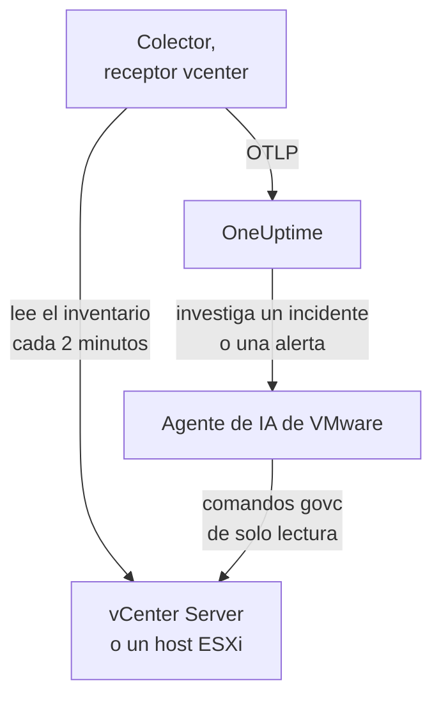

# Agente de VMware

El agente de VMware de OneUptime supervisa VMware vSphere: vCenter Server, hosts ESXi, máquinas virtuales, datastores, clústeres, pools de recursos y vSAN. Es un OpenTelemetry Collector estándar cuyo [receptor `vcenter`](https://github.com/open-telemetry/opentelemetry-collector-contrib/tree/main/receiver/vcenterreceiver) lee la API de vSphere con un usuario de solo lectura, marca cada métrica con el nombre de tu vCenter y la envía a OneUptime: ningún plugin en vCenter y nada dentro de las VM. Los [monitores de VMware](/docs/monitor/vmware-monitor) alertan sobre lo que llega.

:::cards
- [Instalar el agente](#instala-el-agente): Un usuario de solo lectura y luego el script de instalación, Docker Compose o systemd.
- [Qué recopila el agente](#qué-recopila-el-agente): Cada objeto de vSphere, su identidad y sus métricas.
- [Agente de IA](#agente-de-ia): Deja que OneUptime AI lea el vCenter mientras investiga.
- [Solución de problemas](#solución-de-problemas): Un script de diagnóstico y los problemas habituales.
:::

## Cómo funciona

Un agente supervisa un endpoint de vSphere: un **vCenter Server**, que cubre cada datacenter, clúster y host que gestiona, o un **host ESXi independiente** que ningún vCenter gestiona. Ejecuta un agente por vCenter. El colector recorre todo el inventario una vez por recopilación (cada 2 minutos por defecto) y envía un recurso por objeto. El mismo archivo de Compose ejecuta a su lado el agente de IA de VMware, para OneUptime AI. ¿Prefieres no ejecutar Docker? El mismo colector, con la misma configuración, también se ejecuta como servicio de systemd en cualquier máquina Linux.



El vCenter se registra con sus primeros datos, con el nombre que el agente marca en cada métrica como `vmware.vcenter.name`. Para supervisar un vCenter sin ejecutar el agente, consulta [VMware sin agente](/docs/telemetry/vmware-agentless): una de tus sondas recopila los mismos datos con una cuenta de solo lectura.

## Antes de empezar

- Docker Engine 20.10 o posterior con el plugin Docker Compose v2 o, para instalar sin Docker, una máquina Linux (x86_64 o arm64) con systemd 235 o posterior. En cualquier caso, la máquina debe llegar a vCenter por HTTPS (TCP 443).
- vCenter Server o ESXi 7.0 o posterior: el receptor es compatible con vSphere 7 y 8.
- Una cuenta que pueda crear un usuario de vSphere y asignarle un rol en el objeto vCenter de nivel superior.
- Una clave de ingesta. Crea una en **Ajustes del proyecto → Telemetría y APM → Claves de ingesta** y copia su valor.

### Dónde ejecutar el agente

El agente habla con vCenter por HTTPS, así que no tiene que ejecutarse cerca de él, e idealmente no debería ejecutarse ni en la vCenter Server Appliance ni en una VM del clúster que vigila: si ese clúster cae, tu monitorización cae con él. Una pequeña VM de administración en hardware separado, un host de monitorización o cualquier máquina que ejecute Docker (o, sin Docker, cualquier máquina Linux con systemd) y llegue a vCenter por TCP 443 es el lugar adecuado. El receptor de syslog opcional también necesita que los hosts ESXi lleguen al agente en el puerto de syslog (consulta [Enviar el syslog de ESXi](#opcional-enviar-el-syslog-de-esxi)).

## Instala el agente

:::steps
### Crear el usuario de vSphere de solo lectura

El agente solo lee: el inventario, los contadores de rendimiento y las estadísticas de vSAN. Dale una cuenta propia con el rol integrado **Read-Only**, nunca un administrador.

:::tabs
@tab vSphere Client
1. Crea la cuenta: abre _Menu → Administration → Single Sign On → Users and Groups_, elige el dominio `vsphere.local` (o tu origen de identidades), haz clic en **Add**, llama al usuario `oneuptime` y establece una contraseña. El usuario es entonces `oneuptime@vsphere.local`.
2. Asigna el rol: selecciona el objeto **vCenter Server** de nivel superior en el inventario _Hosts and Clusters_, abre la pestaña **Permissions**, haz clic en **Add**, elige el usuario, establece el rol en **Read-Only** y marca **Propagate to children**.
@tab govc
Desde una máquina con credenciales de administrador:

```bash
govc sso.user.create -p 'a-strong-password' -R ReadOnly oneuptime
govc permissions.set -principal oneuptime@vsphere.local -role ReadOnly -propagate=true /
```
@tab PowerCLI
Desde una sesión conectada a vCenter como administrador:

```powershell
New-SsoPersonUser -UserName oneuptime -Password 'a-strong-password'
New-VIPermission -Entity (Get-Folder -NoRecursion) -Principal 'VSPHERE.LOCAL\oneuptime' -Role ReadOnly -Propagate:$true
```
@tab ESXi Host Client
Para un host ESXi independiente (sin vCenter), crea el usuario en _Host → Manage → Security & Users → Users_ y dale el rol Read-Only en _Host → Manage → Security & Users → Permissions_. O, en la shell del host, ejecuta `esxcli system account add` y después `esxcli system permission set --id oneuptime --role ReadOnly`.
:::

> [!IMPORTANT]
> La propagación es la parte que se suele pasar por alto. El receptor recorre datacenters, clústeres, hosts, VM, datastores y pools de recursos, y cada objeto que el usuario no puede ver se omite sin aviso. Un rol Read-Only asignado en el objeto vCenter _sin_ propagación da un inventario vacío y un panel lleno de ceros.

### Instala e inicia el agente

:::tabs
@tab install.sh
Descarga el script de instalación y ejecútalo en la máquina que alojará el agente:

```bash
curl -sSL https://raw.githubusercontent.com/OneUptime/oneuptime/master/agents/VMwareAgent/install.sh -o install.sh
bash install.sh
```

El script pide tu URL de OneUptime, la clave de ingesta, un nombre para el vCenter, el endpoint de vCenter y las credenciales de solo lectura (lee la contraseña sin mostrarla), y si el agente de IA puede aplicar correcciones (en ese caso, un usuario de vSphere propio y las VM que nunca debe cambiar). Se instala en `/opt/oneuptime-vmware-agent`, escribe un archivo con `0600` llamado `.env` e inicia el agente con Docker Compose. Entrecomilla cada valor para Docker Compose tal como lo escribiste, así que una contraseña con `$`, `#`, espacios o comillas funciona tal como la escribiste. Volver a ejecutar el script reutiliza todo lo que hay en un `.env` existente en lugar de volver a preguntar, y así es como [actualizas el agente](#actualizar-el-agente).
@tab Docker Compose
Descarga `docker-compose.yml` y `otel-collector-config.yaml` del [directorio VMwareAgent](https://github.com/OneUptime/oneuptime/tree/master/agents/VMwareAgent) en una carpeta nueva y luego crea un archivo `.env` junto a ellos. Contiene una contraseña, así que mantenlo privado con `chmod 600 .env`:

```bash title=".env"
ONEUPTIME_URL=YOUR_ONEUPTIME_URL
ONEUPTIME_TELEMETRY_INGESTION_KEY=YOUR_TELEMETRY_INGESTION_TOKEN
VMWARE_VCENTER_NAME=my-vcenter
VCENTER_ENDPOINT=https://vcsa.example.com
VCENTER_USERNAME=oneuptime@vsphere.local
VCENTER_PASSWORD=a-strong-password
VCENTER_INSECURE_SKIP_VERIFY=true
VCENTER_COLLECTION_INTERVAL=2m
```

Una contraseña con `$`, `#`, espacios o comillas va entre comillas simples (consulta [vCenter rechaza el inicio de sesión](#solución-de-problemas)). Inicia el agente:

```bash
docker compose up -d
```
@tab systemd
El agente no necesita Docker: es un binario de OpenTelemetry Collector y un archivo de configuración. En una máquina Linux (x86_64 o arm64) con systemd 235 o posterior (Ubuntu 18.04, Debian 10, RHEL 8 o más reciente), ejecuta la versión de `otelcol-contrib` que fija el agente, con el mismo `otel-collector-config.yaml`, como servicio de systemd. La unidad que el agente incluye para ello, [`oneuptime-vmware-agent-native.service`](https://github.com/OneUptime/oneuptime/blob/master/agents/VMwareAgent/systemd/oneuptime-vmware-agent-native.service), ejecuta el colector como un usuario efímero sin privilegios, sin capabilities y sin nada en lo que pueda escribir.

Descarga el colector, la configuración y la unidad, e instálalos en `/opt/oneuptime-vmware-agent`:

```bash
cd "$(mktemp -d)"
VERSION=0.161.0   # the collector release the agent pins
ARCH=$(uname -m | sed 's/x86_64/amd64/;s/aarch64/arm64/')
curl -fL -o otelcol-contrib.tar.gz \
  https://github.com/open-telemetry/opentelemetry-collector-releases/releases/download/v${VERSION}/otelcol-contrib_${VERSION}_linux_${ARCH}.tar.gz
curl -fsSLO https://raw.githubusercontent.com/OneUptime/oneuptime/master/agents/VMwareAgent/otel-collector-config.yaml
curl -fsSL -o oneuptime-vmware-agent.service \
  https://raw.githubusercontent.com/OneUptime/oneuptime/master/agents/VMwareAgent/systemd/oneuptime-vmware-agent-native.service

sudo install -d -m 0755 /opt/oneuptime-vmware-agent
sudo tar --no-same-owner --preserve-permissions -xzf otelcol-contrib.tar.gz -C /opt/oneuptime-vmware-agent otelcol-contrib
sudo install -m 0644 otel-collector-config.yaml /opt/oneuptime-vmware-agent/otel-collector-config.yaml
sudo install -m 0644 oneuptime-vmware-agent.service /etc/systemd/system/oneuptime-vmware-agent.service
```

Los ajustes van en `/opt/oneuptime-vmware-agent/.env`: las mismas variables que el `.env` de la instalación con Docker. Contiene una contraseña, así que haz que solo root pueda leerlo antes de abrirlo:

```bash
sudo touch /opt/oneuptime-vmware-agent/.env
sudo chmod 600 /opt/oneuptime-vmware-agent/.env
sudoedit /opt/oneuptime-vmware-agent/.env
```

Pon esto en él:

```bash
ONEUPTIME_URL=YOUR_ONEUPTIME_URL
ONEUPTIME_TELEMETRY_INGESTION_KEY=YOUR_TELEMETRY_INGESTION_TOKEN
VMWARE_VCENTER_NAME=my-vcenter
VCENTER_ENDPOINT=https://vcsa.example.com
VCENTER_USERNAME="oneuptime@vsphere.local"
VCENTER_PASSWORD="a-strong-password"
VCENTER_INSECURE_SKIP_VERIFY=true
VCENTER_COLLECTION_INTERVAL=2m
```

systemd lee este archivo, no una shell: mantén el nombre de usuario y la contraseña entre comillas dobles, escribiendo cada `\` como `\\` y cada `"` como `\"` — `DOMAIN\user` es `"DOMAIN\\user"` —, mientras que `$`, `#`, `'` y los espacios van tal cual. Esa es la forma que todas las versiones de systemd leen igual; las más antiguas (la de RHEL 8, por ejemplo) eliminan una barra invertida incluso dentro de comillas simples. Después inicia el agente y haz que arranque en cada inicio:

```bash
sudo systemctl daemon-reload
sudo systemctl enable oneuptime-vmware-agent
sudo systemctl restart oneuptime-vmware-agent
```

Esta instalación ejecuta solo el colector: el [agente de IA](#agente-de-ia) solo se distribuye como imagen de contenedor. Ejecuta un agente por vCenter: si dejas la instalación con Docker, ejecuta primero `docker compose down` allí, o cada métrica llegará dos veces.
:::

### Verificar la instalación

Comprueba que el agente se está ejecutando y lee los logs del colector:

```bash
docker compose ps
docker logs -f oneuptime-vmware-agent
```

¿Lo instalaste con systemd? Comprueba en su lugar el servicio y su journal:

```bash
systemctl status oneuptime-vmware-agent --no-pager
sudo journalctl -u oneuptime-vmware-agent -f
```

Los logs del colector deberían mostrar esta línea una vez iniciado:

```text
Everything is ready. Begin running and processing data.
```

### Encontrar el vCenter en OneUptime

No se envía nada hasta que termina el primer recorrido completo del inventario, así que espera un intervalo de recopilación (2 minutos por defecto). Después abre **Productos → Infraestructura → VMware → Todos los vCenter**: el vCenter está ahí, con sus datacenters, clústeres, hosts ESXi, máquinas virtuales, datastores y pools de recursos.
:::

## Variables de entorno

Docker Compose las lee del `.env` que está junto a `docker-compose.yml`; la instalación con systemd las lee de `/opt/oneuptime-vmware-agent/.env`, y su unidad da los mismos valores predeterminados.

| Variable | Obligatoria | Descripción |
| --- | --- | --- |
| `ONEUPTIME_URL` | Sí | Tu URL de OneUptime, como `https://oneuptime.com` o tu instancia autoalojada. Usa `http://` y su puerto si la instancia solo admite HTTP. |
| `ONEUPTIME_TELEMETRY_INGESTION_KEY` | Sí | La clave de ingesta de **Ajustes del proyecto → Telemetría y APM → Claves de ingesta**. |
| `VMWARE_VCENTER_NAME` | Sí | El nombre del vCenter en OneUptime, marcado en cada métrica como el atributo de recurso `vmware.vcenter.name`. Mantenlo estable: cambiarlo más tarde registra un segundo vCenter. Su valor predeterminado es `vmware-vcenter`. |
| `VCENTER_ENDPOINT` | Sí | El esquema y el host del vCenter Server o de un host ESXi independiente, **sin** `/sdk`, como `https://vcsa.example.com`. |
| `VCENTER_USERNAME` | Sí | El usuario de vSphere con el rol Read-Only, como `oneuptime@vsphere.local` (o `DOMAIN\user` para un origen de identidades de Active Directory). |
| `VCENTER_PASSWORD` | Sí | La contraseña de ese usuario. Si contiene `$`, `#`, espacios o comillas, ponla entre comillas simples en el `.env` de la instalación con Docker (`install.sh` lo hace por ti), y entre comillas dobles en el de la instalación con systemd (consulta [Solución de problemas](#solución-de-problemas)). |
| `VCENTER_INSECURE_SKIP_VERIFY` | No | `true` acepta el certificado autofirmado (VMCA) predeterminado de vCenter; `false` mantiene activada la verificación TLS. Su valor predeterminado es `false`. |
| `VCENTER_COLLECTION_INTERVAL` | No | Cada cuánto se lee todo el inventario. Súbelo a `5m` o `10m` para vCenters muy grandes. Su valor predeterminado es `2m`. |

Los ajustes propios del agente de IA están en [Agente de IA](#agente-de-ia).

## Qué recopila el agente

En cada `VCENTER_COLLECTION_INTERVAL`, el receptor recorre todo el inventario de vSphere y envía un recurso de OpenTelemetry por objeto. La identidad de cada objeto está en sus **atributos de recurso** — `vcenter.datacenter.name`, `vcenter.cluster.name`, `vcenter.host.name`, `vcenter.vm.name` / `vcenter.vm.id`, `vcenter.datastore.name`, `vcenter.resource_pool.name` / `vcenter.resource_pool.inventory_path` — y el agente añade encima `vmware.vcenter.name`, así que OneUptime archiva todo bajo tu vCenter:

| Objeto de vSphere | Identidad (atributos de recurso) | Métricas |
| --- | --- | --- |
| Datacenter | `vcenter.datacenter.name` | `vcenter.datacenter.cluster.count`, `vcenter.datacenter.host.count`, `vcenter.datacenter.vm.count`, `vcenter.datacenter.datastore.count`, `vcenter.datacenter.disk.space`, `vcenter.datacenter.cpu.limit`, `vcenter.datacenter.memory.limit` |
| Clúster | + `vcenter.cluster.name` | `vcenter.cluster.cpu.effective`, `vcenter.cluster.cpu.limit`, `vcenter.cluster.memory.effective`, `vcenter.cluster.memory.limit`, `vcenter.cluster.host.count`, `vcenter.cluster.vm.count`, `vcenter.cluster.vm_template.count`, `vcenter.cluster.vsan.*` (rendimiento, operaciones, latencia, congestiones) |
| Host ESXi | + `vcenter.host.name` (y `vcenter.cluster.name` cuando el host está en un clúster) | `vcenter.host.cpu.usage` / `.capacity` / `.utilization` / `.reserved`, `vcenter.host.memory.usage` / `.utilization` / `.capacity`, `vcenter.host.disk.latency.avg` / `.latency.max` / `.throughput`, `vcenter.host.network.usage` / `.throughput` / `.packet.rate` / `.packet.drop.rate` / `.packet.error.rate`, `vcenter.host.vsan.*` |
| Máquina virtual | + `vcenter.host.name`, `vcenter.vm.name`, `vcenter.vm.id` (UUID de instancia); `vcenter.resource_pool.*` o `vcenter.virtual_app.*` | `vcenter.vm.disk.usage`, `vcenter.vm.disk.utilization`, `vcenter.vm.memory.usage` / `.utilization` / `.ballooned` / `.swapped` / `.swapped_ssd`; solo VM encendidas: `vcenter.vm.cpu.usage`, `vcenter.vm.cpu.readiness`, `vcenter.vm.cpu.utilization`, `vcenter.vm.disk.latency.avg` / `.latency.max` / `.throughput`, `vcenter.vm.network.*`, `vcenter.vm.vsan.*` |
| Plantilla de VM | `vcenter.vm_template.name`, `vcenter.vm_template.id` | solo `vcenter.vm.disk.usage` |
| Datastore | + `vcenter.datastore.name` | `vcenter.datastore.disk.usage`, `vcenter.datastore.disk.utilization` |
| Pool de recursos | + `vcenter.resource_pool.name`, `vcenter.resource_pool.inventory_path` | `vcenter.resource_pool.cpu.usage` / `.cpu.shares`, `vcenter.resource_pool.memory.usage` / `.memory.shares` / `.memory.ballooned` / `.memory.swapped` / `.memory.granted` |

Las métricas de recuento y de capacidad se desglosan por **atributos de punto de datos**, que son justo aquello por lo que filtras y agrupas en los criterios de un monitor:

| Atributo | Valores | Lo llevan |
| --- | --- | --- |
| `direction` | `read` / `write` para disco, `transmitted` / `received` para red | Latencia y rendimiento de disco, rendimiento de red y tasas de paquetes |
| `disk_state` | `available` / `used` | `vcenter.datastore.disk.usage`, `vcenter.vm.disk.usage`, `vcenter.datacenter.disk.space` |
| `status` | `red` / `yellow` / `green` / `gray` (el estado general del objeto en vSphere) | `vcenter.datacenter.cluster.count` / `.host.count` / `.vm.count` |
| `power_state` | Hosts: `on` / `off` / `standby` / `unknown`; VM: `on` / `off` / `suspended` / `unknown` | `vcenter.datacenter.host.count` / `.vm.count`, `vcenter.cluster.vm.count` |
| `effective` | `true` / `false` (guardados como cadenas) | `vcenter.cluster.host.count` |
| `object` | La instancia de NIC, disco o vCPU (como `vmnic0`) | Series de disco y red por dispositivo de hosts y VM |
| `cpu_reservation_type` | `total` / `used` | `vcenter.host.cpu.reserved` |
| `type` | Memoria: `guest` / `host` / `overhead`, `private` / `shared`; vSAN: `read` / `write` / `unmap` | Series de memoria de pools de recursos, latencia y operaciones de vSAN |

Las unidades son las unidades OTLP propias del receptor, que OneUptime escala para mostrarlas: `MHz` para uso y capacidad de CPU, `%` para utilización y CPU ready, `MiBy` para la memoria de hosts, VM y pools de recursos, `By` para la memoria de clústeres y datacenters y todo el espacio en disco, `ms` para la latencia de disco de hosts y VM, y `us` (microsegundos) para la latencia de vSAN. En los criterios de un monitor, los atributos de identidad llevan un prefijo `resource.` (`resource.vcenter.host.name`, `resource.vmware.vcenter.name`), mientras que los atributos de punto de datos van sin prefijo (`disk_state`, `power_state`, `status`).

`vcenter.host.memory.capacity` está desactivada por defecto en el proyecto original; la configuración incluida la activa, porque OneUptime divide por ella para la utilización de memoria de los hosts. Un comentario en `otel-collector-config.yaml` enumera las demás métricas opcionales (`vcenter.vm.cpu.time`, `vcenter.vm.memory.granted`, `vcenter.host.memory.active`, `vcenter.host.memory.ballooned`, `vcenter.host.memory.granted`, `vcenter.vm.network.broadcast.packet.rate`, `vcenter.vm.network.multicast.packet.rate`): activa cualquiera de ellas de la misma forma.

### Estado de encendido de las VM

El receptor no envía ninguna métrica de estado de encendido para una VM. Envía `vcenter.vm.cpu.*` **solo para VM encendidas**, así que OneUptime deduce el estado de lo que llegó en cada recopilación: una VM que informó métricas de CPU está **Encendido**; una que solo informó uso de memoria y disco está **Apagado** (o suspendida: vSphere no distingue aquí entre ambas). Las plantillas de VM no tienen estado de encendido. Esto lee **una recopilación entera a la vez**, por eso el procesador `batch` incluido tiene un `send_batch_size` grande y, a propósito, ningún `send_batch_max_size`: una recopilación repartida en dos exportaciones pondría a cero los recuentos del inventario y "apagaría" VM. Mantén los ajustes de batch tal como vienen.

## El vCenter en OneUptime


La página **Vista general** responde primero a "¿está sano este vCenter?": los hosts efectivos, la CPU y la memoria de los hosts ponderadas por capacidad, el datastore más lleno y el peor tiempo de CPU ready de una VM. Cuando algo está degradado, nombra el objeto responsable, para que no tengas que buscarlo.

### Hosts ESXi


### Máquinas virtuales


Las máquinas virtuales apagadas y las plantillas también aparecen. vCenter solo informa de contadores de CPU para las VM encendidas, así que sus columnas de CPU muestran N/A en lugar de un cero engañoso.

### Datastores


## Opcional — Enviar el syslog de ESXi

Por defecto el agente solo envía métricas, así que la página **Registros** del vCenter queda vacía. Los hosts ESXi (y el propio vCenter) pueden reenviar su syslog a cualquier receptor, y el `otel-collector-config.yaml` incluido tiene un par de receptores `syslog` comentados (TCP y UDP en el puerto 5514, RFC 3164: el formato propio de ESXi), conectados a un pipeline `logs` comentado que marca `vmware.vcenter.name` para que los logs lleguen a tu vCenter.

:::steps
### Activar los receptores

Descomenta los dos receptores `syslog/*` y el pipeline `logs` en `otel-collector-config.yaml`.

### Abrir el puerto

Descomenta el bloque `ports:` en `docker-compose.yml` para que la máquina publique `5514/tcp` y `5514/udp`, y luego ejecuta `docker compose up -d`. Con systemd no hay ningún puerto que publicar, ya que el colector escucha en la propia máquina: ejecuta en su lugar `sudo systemctl restart oneuptime-vmware-agent`. Abre el puerto en el cortafuegos de la máquina para la red de administración de ESXi.

### Apuntar cada host ESXi al agente

En el vSphere Client, selecciona el host, abre _Configure → System → Advanced System Settings_, edita `Syslog.global.logHost` y establécelo en `udp://<agent-host>:5514` (o `tcp://<agent-host>:5514`; separa varios destinos con comas). Luego permite el tráfico saliente en _Configure → System → Firewall → Edit → syslog_. O, en cada host, con `esxcli`:

```bash
esxcli system syslog config set --loghost='udp://<agent-host>:5514'
esxcli system syslog reload
esxcli network firewall ruleset set --ruleset-id=syslog --enabled=true
```

Con PowerCLI, en todo un clúster: `Get-VMHost | Get-AdvancedSetting -Name Syslog.global.logHost | Set-AdvancedSetting -Value 'udp://<agent-host>:5514' -Confirm:$false`.
:::

Un receptor de syslog escucha en un solo transporte, por eso TCP y UDP son dos receptores: deja uno comentado si solo necesitas el otro. Para syslog con TLS (`ssl://`), termina el TLS delante del agente; el propio receptor habla TCP y UDP sin cifrar. La imagen estándar del colector lee el syslog tal cual: no hace falta ninguna imagen personalizada.

## Etiquetar el vCenter con etiquetas del proyecto

Un atributo de recurso que empieza por `oneuptime.label.` se convierte en una etiqueta del proyecto en el vCenter: `oneuptime.label.<dimension>=<value>` es la etiqueta `<dimension>:<value>`. Añade los atributos al procesador `resource` en `otel-collector-config.yaml`, junto a `vmware.vcenter.name`:

```yaml
processors:
  resource:
    attributes:
      # ...existing attributes...
      - key: oneuptime.label.team
        value: platform
        action: upsert
      - key: oneuptime.label.env
        value: production
        action: upsert
```

El colector lee su configuración solo al iniciarse: ejecuta `docker compose restart oneuptime-vmware-agent`, o `sudo systemctl restart oneuptime-vmware-agent` con systemd. El vCenter muestra entonces las etiquetas `team:platform` y `env:production`. Las etiquetas se comparan sin distinguir mayúsculas de minúsculas, así que una etiqueta `Production` existente se reutiliza en lugar de duplicarse, y el agente nunca quita una etiqueta que alguien añadió en OneUptime.

## Ejecutar como servicio de systemd

La instalación con Docker también puede ejecutarse bajo systemd, para que arranque con la máquina y se reinicie cuando falle. Su unidad envuelve Docker Compose y supone que el agente está en `/opt/oneuptime-vmware-agent`, donde lo pone el script de instalación:

```bash
sudo curl -fsSL https://raw.githubusercontent.com/OneUptime/oneuptime/master/agents/VMwareAgent/systemd/oneuptime-vmware-agent.service -o /etc/systemd/system/oneuptime-vmware-agent.service
sudo systemctl daemon-reload
sudo systemctl enable --now oneuptime-vmware-agent
```

La instalación sin Docker ya es un servicio de systemd, con una unidad propia.

## Actualizar el agente

El agente informa como su **Versión del agente** de la versión del colector que fijan sus archivos. Cuando es más antigua que la versión que fija esta versión de OneUptime, aparece una señal de advertencia a su lado, en la página **Vista general** del vCenter y en la lista **Todos los vCenter**. Selecciónala para ver estos comandos. Un agente instalado antes de que sus archivos informaran una versión no muestra ninguna hasta que se actualiza de esta forma.

El colector está fijado en `docker-compose.yml` (o, sin Docker, por la versión que descargaste) y su configuración es un archivo junto a él, así que descargar las imágenes no basta para que el agente avance:

:::tabs
@tab install.sh
Vuelve a ejecutar `install.sh`: reutiliza todos los valores de tu `.env` existente (no se vuelve a preguntar nada), renueva `docker-compose.yml` y `otel-collector-config.yaml`, y vuelve a crear el agente para que el colector lea su nueva configuración.

```bash
curl -sSL https://raw.githubusercontent.com/OneUptime/oneuptime/master/agents/VMwareAgent/install.sh -o install.sh
bash install.sh
```
@tab Docker Compose
En la carpeta del agente, vuelve a descargar los dos archivos (y vuelve a hacer cualquier cambio que les hicieras), luego descarga las imágenes y vuelve a crear el agente:

```bash
curl -fsSLO https://raw.githubusercontent.com/OneUptime/oneuptime/master/agents/VMwareAgent/docker-compose.yml
curl -fsSLO https://raw.githubusercontent.com/OneUptime/oneuptime/master/agents/VMwareAgent/otel-collector-config.yaml
docker compose pull
docker compose up -d --force-recreate
```
@tab systemd
Vuelve a ejecutar los comandos de instalación: descargan la versión que fija este OneUptime con el `otel-collector-config.yaml` y la unidad más recientes, y dejan tu `.env` como está (vuelve a hacer cualquier cambio que hicieras en la configuración). Después reinicia el servicio:

```bash
cd "$(mktemp -d)"
VERSION=0.161.0   # the collector release the agent pins
ARCH=$(uname -m | sed 's/x86_64/amd64/;s/aarch64/arm64/')
curl -fL -o otelcol-contrib.tar.gz \
  https://github.com/open-telemetry/opentelemetry-collector-releases/releases/download/v${VERSION}/otelcol-contrib_${VERSION}_linux_${ARCH}.tar.gz
curl -fsSLO https://raw.githubusercontent.com/OneUptime/oneuptime/master/agents/VMwareAgent/otel-collector-config.yaml
curl -fsSL -o oneuptime-vmware-agent.service \
  https://raw.githubusercontent.com/OneUptime/oneuptime/master/agents/VMwareAgent/systemd/oneuptime-vmware-agent-native.service

sudo install -d -m 0755 /opt/oneuptime-vmware-agent
sudo tar --no-same-owner --preserve-permissions -xzf otelcol-contrib.tar.gz -C /opt/oneuptime-vmware-agent otelcol-contrib
sudo install -m 0644 otel-collector-config.yaml /opt/oneuptime-vmware-agent/otel-collector-config.yaml
sudo install -m 0644 oneuptime-vmware-agent.service /etc/systemd/system/oneuptime-vmware-agent.service
sudo systemctl daemon-reload
sudo systemctl restart oneuptime-vmware-agent
```
:::

## Desinstalar el agente

:::tabs
@tab Docker Compose
```bash
cd /opt/oneuptime-vmware-agent
docker compose down
```
@tab systemd
```bash
sudo systemctl disable --now oneuptime-vmware-agent
sudo rm /etc/systemd/system/oneuptime-vmware-agent.service
sudo systemctl daemon-reload
sudo rm -r /opt/oneuptime-vmware-agent
```
:::

Después quita el permiso del usuario `oneuptime` en vCenter si ya no lo necesitas, y el usuario propio del agente de IA si creaste uno.

## Agente de IA

El `docker-compose.yml` del agente también ejecuta el **Agente de IA de VMware**, `oneuptime-vmware-ai-agent` (imagen `oneuptime/resource-ai-agent:release`). Mientras OneUptime AI investiga un incidente o una alerta en este vCenter, ejecuta a través de él comandos `govc` de solo lectura — `govc vm.info web-01`, `govc events -n 50 /DC/vm/web-01`, `govc metric.sample -n 12 /DC/vm/web-01 cpu.usage.average` — y, solo si lo permites, aplica correcciones como volver a encender una VM. Se registra como el vCenter llamado `VMWARE_VCENTER_NAME`, igual que el colector, y aparece en la página **IA → Agente de IA** del vCenter en OneUptime.

- **Las investigaciones con IA están activadas por defecto.** En cuanto el agente se conecta, OneUptime AI investiga con él los incidentes y alertas de este vCenter, y la página **Vista general** del vCenter muestra el estado del agente. Para detenerlo, establece `ONEUPTIME_AI_INVESTIGATION=false` donde se ejecuta el agente (**Cambiar** en **Lo que puede hacer la IA**, en la página del agente de IA, muestra cómo), u omite el agente.
- **El rol de vSphere es el límite estricto.** Las investigaciones inician sesión como el usuario **Read-Only** del colector (`VCENTER_USERNAME` / `VCENTER_PASSWORD`), que puede leer y nada más. Las correcciones necesitan un usuario propio del agente de IA cuyo rol pueda encender, apagar y reiniciar VM (`VirtualMachine.Interact.PowerOn`, `PowerOff` y `Reset`), asignado solo en las carpetas que la IA puede corregir y establecido como `ONEUPTIME_AI_VCENTER_USERNAME` / `ONEUPTIME_AI_VCENTER_PASSWORD`.
- Es de **solo lectura** salvo que establezcas `ONEUPTIME_AI_ALLOW_WRITES=true`; `ONEUPTIME_AI_WRITE_TARGETS` (nombres de VM y hosts o rutas del inventario) limita lo que una corrección puede tocar. Nunca cambia la VM que se llama como el host de `VCENTER_ENDPOINT` — normalmente la appliance de vCenter — y solo reconoce la appliance por ese nombre: cuando `VCENTER_ENDPOINT` es una dirección IP, o la VM de la appliance tiene otro nombre, pon esa VM en `ONEUPTIME_AI_PROTECTED_TARGETS`, junto con la VM en la que se ejecuta el agente. `ONEUPTIME_AI_FIXES`, en el mismo `.env`, indica cómo se ejecutan las correcciones — `ask-for-approval` (una persona aprueba cada una), `automatic` o `bypass-approval` — y la página del agente de IA lo muestra en solo lectura ([Lo que puede hacer la IA, fijado por el agente](/docs/ai/infrastructure-ai-agents#what-ai-may-do-set-by-the-agent)).
- Para verificar el certificado de vCenter en lugar de omitir la verificación, monta su CA en el contenedor y establece `VCENTER_CA_FILE`; en un vCenter con varios datacenters, establece `GOVC_DATACENTER`.
- Se ejecuta como UID 1000 sin capabilities y nunca ejecuta operaciones de invitado, snapshots, `esxcli` ni nada que cree o destruya una VM. Elimina el servicio `oneuptime-vmware-ai-agent` de `docker-compose.yml` si no usas OneUptime AI.
- La instalación sin Docker no tiene agente de IA: solo se distribuye como imagen de contenedor. Para añadir uno, ejecútalo con Docker en cualquier máquina que llegue a vCenter — descarga `docker-compose.yml`, escribe junto a él un `.env` con los ajustes de `/opt/oneuptime-vmware-agent/.env`, entre comillas simples como los quiere Docker Compose, e inicia solo el agente de IA con `docker compose up -d oneuptime-vmware-ai-agent` (no el colector, que ya está en marcha).

Qué puede ejecutar, cómo funcionan las correcciones y cómo solucionar sus problemas: [Infrastructure AI Agents](/docs/ai/infrastructure-ai-agents#vmware-vcenter). El README del agente tiene los comandos exactos para el rol de correcciones.

## Solución de problemas

:::details Ejecuta primero el script de diagnóstico
El agente incluye un script, [`troubleshoot.sh`](https://github.com/OneUptime/oneuptime/blob/master/agents/VMwareAgent/troubleshoot.sh), que comprueba toda la cadena: el runtime de contenedores, si vCenter responde y acepta las credenciales, el nombre del vCenter marcado en cada métrica, la forma del token, las propias métricas del colector y si OneUptime acepta la clave de ingesta. Esa última comprobación es la que más importa. OneUptime rechaza una clave incorrecta con `401` (`422` para una clave desactivada o una clave de navegador), y el colector trata ambas como permanentes: descarta el lote y registra un error `Exporting failed`, fácil de pasar por alto mientras el contenedor sigue sano. El script pide `GET <url>/otlp/v1/validate` desde dentro de la red del agente para obtener un `200` (válida) o un `401` (no válida) directos, recurre a `POST /fluentd/v1/logs` en servidores más antiguos y pide `<VCENTER_ENDPOINT>/sdk/vimServiceVersions.xml` de la misma forma, así que los fallos de DNS, cortafuegos y TLS aparecen exactamente como los encuentra el colector.

```bash
curl -sSL https://raw.githubusercontent.com/OneUptime/oneuptime/master/agents/VMwareAgent/troubleshoot.sh -o troubleshoot.sh
bash troubleshoot.sh    # add -d <dir> if you installed outside /opt/oneuptime-vmware-agent
```

Termina con un veredicto que nombra la causa más probable.
:::

:::details Instalado sin Docker
El script de diagnóstico necesita Docker. Sin él, el colector se ejecuta en la propia máquina, así que comprueba directamente la misma cadena: el servicio y su log, la API de vCenter en la ruta de red del propio colector, si OneUptime acepta la clave de ingesta (`"valid":true` con `"keyType":"Server"`) y los contadores propios del colector, que sirve en `127.0.0.1:8890` en lugar de `8888` para poder ejecutarse junto a otro colector:

```bash
systemctl status oneuptime-vmware-agent --no-pager
sudo journalctl -u oneuptime-vmware-agent -n 100 --no-pager
curl -sk https://<vcenter-host>/sdk/vimServiceVersions.xml
curl -s -H "x-oneuptime-token: <key>" https://<oneuptime-host>/otlp/v1/validate
curl -s http://127.0.0.1:8890/metrics | grep -E 'otelcol_(receiver_accepted|exporter_sent|exporter_send_failed)_metric_points'
```

El log se lee como el del contenedor, así que se aplican las entradas de abajo. Un servicio que no para de reiniciarse registra el motivo: `Failed with result 'resources'` significa que systemd no puede leer `/opt/oneuptime-vmware-agent/.env`, y `cannot unmarshal the configuration` o `requires positive value` significa que un valor de ese archivo no es uno que el colector acepte. systemd lee `.env` con reglas propias, y las versiones más antiguas (la de RHEL 8, por ejemplo) eliminan una barra invertida incluso dentro de comillas simples: mantén el nombre de usuario y la contraseña entre comillas dobles, escribiendo cada `\` como `\\` y cada `"` como `\"`, la única forma que todas las versiones leen tal como está escrita. Como el colector confía en el almacén de CA de la máquina, puedes mantener activada la verificación TLS: añade el certificado raíz de vCenter (los archivos `.0` de `certs/lin/` en `https://<vcenter>/certs/download.zip`) a `/usr/local/share/ca-certificates/` con un nombre `.crt` y ejecuta `update-ca-certificates` en Debian y Ubuntu, o a `/etc/pki/ca-trust/source/anchors/` y ejecuta `update-ca-trust` en RHEL; después reinicia el servicio.
:::

:::details No aparece ningún vCenter en OneUptime
1. Lee los logs del colector: `docker logs oneuptime-vmware-agent`. Un error de inicio de sesión (`incorrect user name or password`, `InvalidLogin`) significa credenciales incorrectas, `x509: certificate signed by unknown authority` significa que la verificación TLS está activada frente a un certificado autofirmado, `connection refused` o `no such host` significa un `VCENTER_ENDPOINT` incorrecto, y un `401` al exportar significa una clave de ingesta incorrecta.
2. Comprueba que vCenter responde desde la red del agente. La imagen del colector no tiene shell ni curl, así que pregunta desde un contenedor en su red: `docker run --rm --network container:oneuptime-vmware-agent curlimages/curl -sk https://<vcenter-host>/sdk/vimServiceVersions.xml` debería imprimir un documento XML que nombre `urn:vim25`.
3. Comprueba que `VMWARE_VCENTER_NAME` está definido: el vCenter se encuentra por su atributo de recurso `vmware.vcenter.name`.
4. Espera un intervalo de recopilación: no se envía nada hasta que termina el primer recorrido completo del inventario.
:::

:::details El vCenter aparece como desconectado
Un vCenter pasa a desconectado cuando OneUptime no ha recibido nada de él durante 15 minutos; OneUptime lo comprueba cada 5 minutos, y el tiempo en que él mismo no recibía datos no cuenta. Comprueba que el colector se ejecuta, que sus logs no muestran errores de exportación y que una recopilación termina dentro de `VCENTER_COLLECTION_INTERVAL` (consulta la entrada sobre inventarios grandes más abajo). El vCenter vuelve a estar conectado con sus siguientes datos.
:::

:::details Errores de x509 o TLS
Las appliances de vCenter presentan un certificado emitido por su propia VMCA, en el que no confía ninguna imagen de Docker. O bien establece `VCENTER_INSECURE_SKIP_VERIFY=true` (la opción práctica en una red de administración privada), o bien sustituye el certificado de máquina de vCenter por uno de una CA en la que confíe la imagen del colector. **No** apuntes el endpoint a una URL `http://`: vCenter sirve su API solo por HTTPS.
:::

:::details vCenter rechaza el inicio de sesión (401 o InvalidLogin)
Usa el principal completo — `oneuptime@vsphere.local`, o `DOMAIN\user` / `user@domain.example` para un origen de identidades de Active Directory — y comprueba cómo está escrita la contraseña en `.env`. Docker Compose v2 expande las referencias `$VAR` en los valores sin comillas y entre comillas dobles, y lee un espacio seguido de `#` como el inicio de un comentario, así que una contraseña que contenga `$`, `#`, espacios o comillas debe ir entre comillas simples — `VCENTER_PASSWORD='p@ss$word'` —, que es lo que escribe `install.sh`. Una contraseña que contiene una comilla simple va entre comillas dobles, con cada `$` escrito como `$$` y `"` / `\` escapados con una barra invertida. Una cuenta bloqueada (demasiados intentos fallidos) también rechaza una contraseña correcta: revisa _Administration → Single Sign On → Users and Groups_.
:::

:::details Aparecen hosts pero no VM, datastores ni clústeres (NoPermission)
El rol Read-Only se asignó en el objeto vCenter sin **Propagate to children**, o en un objeto más restringido que la raíz de vCenter. Los objetos que el usuario no puede ver se omiten sin aviso. Corrige el permiso en el objeto vCenter de nivel superior con la propagación activada; la siguiente recopilación llena el inventario.
:::

:::details Todas las VM aparecen apagadas
El estado de encendido de una VM se deduce de los puntos de datos `vcenter.vm.cpu.*` que llegan en la misma recopilación que sus puntos de datos de memoria y disco (consulta [Estado de encendido de las VM](#estado-de-encendido-de-las-vm)). Si cambiaste el procesador `batch` y añadiste un `send_batch_max_size`, un inventario grande se reparte entre varias exportaciones y los puntos de datos de CPU llegan en otra solicitud distinta del resto: vuelve a poner los ajustes de batch incluidos.
:::

:::details Inventarios grandes: recopilaciones lentas, errores de vpxd.stats.maxQueryMetrics
Cada recopilación recorre todo el inventario y hace una consulta de rendimiento por lote de objetos. Para vCenters con miles de VM:

- Sube `VCENTER_COLLECTION_INTERVAL` a `5m` o `10m`. Una recopilación que tarda más que el intervalo se omite, no se solapa, así que un intervalo demasiado corto solo deja huecos.
- El receptor pide hasta `max_query_metrics: 256` entidades por consulta de rendimiento. vCenter lo limita con `vpxd.stats.maxQueryMetrics` (256 por defecto en vCenter 7 y 8). Si un administrador lo bajó, el colector registra `The maximum number of performance metrics per query exceeded`: baja `max_query_metrics` en `otel-collector-config.yaml` para que coincida, o sube el ajuste de vCenter en _vCenter → Configure → Advanced Settings_.
- Vigila la memoria del colector: el `memory_limiter` incluido permite 512 MiB. Si el log dice que el limitador está descartando datos, sube `limit_mib` (y dale más memoria al contenedor).
:::

:::details Supervisar un host ESXi independiente (sin vCenter)
Apunta `VCENTER_ENDPOINT` al propio host (`https://esxi01.example.com`), con un usuario local de ESXi que tenga el rol Read-Only. Se recopila todo lo que sabe un host: el host, sus VM, datastores y pools de recursos. Un host independiente no tiene objeto de datacenter ni de clúster, así que esas páginas quedan vacías, y no tiene API REST de vCenter, así que el script de diagnóstico da la comprobación de credenciales como no concluyente (el log del colector tiene ahí la respuesta).
:::

:::details Las métricas llegan al vCenter equivocado
OneUptime registra un vCenter por su `vmware.vcenter.name`, que el agente toma de `VMWARE_VCENTER_NAME`. Cambiarlo después de los primeros datos crea un segundo vCenter en lugar de renombrar el primero.
:::

:::details Enviar métricas sin el agente
vSphere no tiene un push de OpenTelemetry propio, así que el agente (o cualquier OpenTelemetry Collector con el receptor `vcenter`) es la vía de entrada. Si ya ejecutas colectores, añade el receptor `vcenter` a uno de ellos en lugar de ejecutar este agente: copia el receptor `vcenter` y el procesador `resource` del `otel-collector-config.yaml` incluido a tu propia configuración. El atributo de recurso `vmware.vcenter.name` es lo que registra el vCenter en OneUptime, y las eliminaciones de `service.name` / `service.instance.id` evitan que los datos se archiven bajo un servicio: conserva ambas cosas.
:::

## Próximos pasos

:::cards
- [Monitor de VMware](/docs/monitor/vmware-monitor): Alerta sobre hosts, VM, datastores, clústeres, datacenters y vSAN.
- [VMware sin agente](/docs/telemetry/vmware-agentless): Deja que una sonda recopile el vCenter en su lugar.
- [Infrastructure AI Agents](/docs/ai/infrastructure-ai-agents): Qué puede ejecutar el agente de IA de VMware y cómo funcionan las correcciones.
- [Colector OpenTelemetry en el host](/docs/telemetry/host-otel-collector): La vista del sistema operativo dentro de las VM, o de la máquina del agente.
:::
