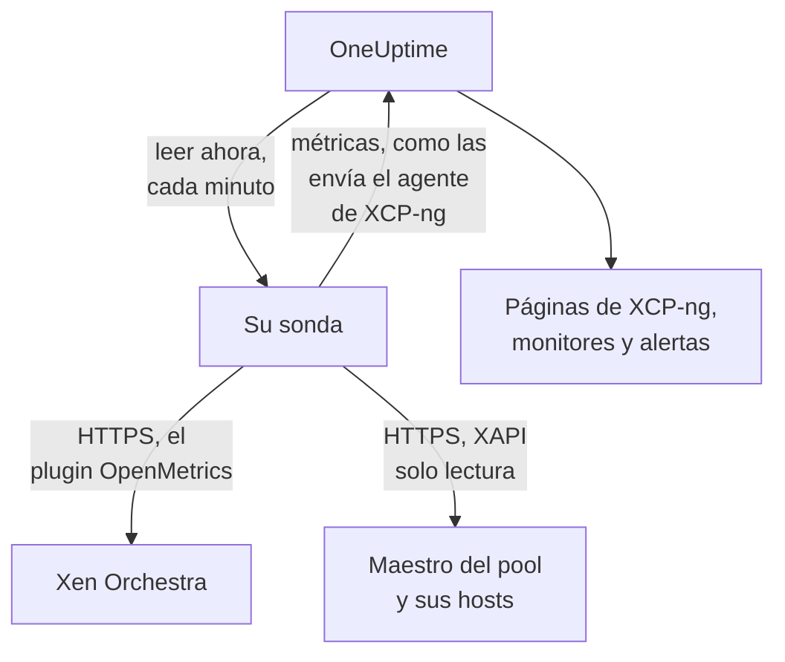

# XCP-ng sin agente

Supervise pools de XCP-ng sin instalar nada: una sonda de OneUptime los lee, ya sea a través del Xen Orchestra que los administra o, para un pool sin Xen Orchestra, directamente desde la XAPI del maestro del pool. Cada pool obtiene las mismas páginas, [monitores de XCP-ng](/docs/monitor/xcp-ng-monitor) y plantillas que un pool que envía el [agente de XCP-ng](/docs/telemetry/xcp-ng). No hay ningún agente que instalar, actualizar ni mantener en ejecución.

:::cards
- [Antes de empezar](#antes-de-empezar): una sonda que alcance Xen Orchestra o el pool, y acceso de solo lectura.
- [Conectar Xen Orchestra](#conectar-xen-orchestra): todos los pools que administra, a través de una sola conexión.
- [Conectar un pool sin Xen Orchestra](#conectar-un-pool-sin-xen-orchestra): un solo pool, leído desde su maestro.
- [Alarmas, HA y copias de seguridad](#alarmas-ha-y-copias-de-seguridad): qué lee una sonda además de las métricas, y las alertas que ofrece.
- [Solución de problemas](#solución-de-problemas): qué significa cada mensaje y qué lo soluciona.
:::

## Cómo funciona

Cada minuto, la sonda lee cada conexión y envía lo que leyó a OneUptime:

- **Xen Orchestra**: la sonda lee el plugin OpenMetrics de Xen Orchestra con el secreto del plugin, exactamente como el agente de XCP-ng, así que cada pool que administra Xen Orchestra llega con las mismas series. Con un token de API, también lee las alarmas, la HA y las copias de seguridad de cada pool desde la API REST de Xen Orchestra.
- **La XAPI de un pool**: la sonda inicia sesión en el maestro del pool y hace las lecturas que hace el propio plugin de Xen Orchestra: los registros del pool y las métricas de cada host en ejecución, leídas en ese host. Las convierte en las mismas series que sirve el plugin, así que el pool se lee exactamente igual que a través de Xen Orchestra. También publica los mensajes de XAPI del pool, como una VM que falló o un host que la HA perdió, en el feed del pool.

Cada pool se registra por su UUID con su primera lectura, como los pools del agente, y aparece en **XCP-ng → Todos los pools**.

## Qué forma de conectar elegir

| | Xen Orchestra, desde una sonda | La XAPI de un pool, desde una sonda | El agente de XCP-ng |
|---|---|---|---|
| Qué ejecuta | Una sonda que ya ejecuta, o una nueva | Una sonda que ya ejecuta, o una nueva | El agente, en una máquina propia |
| Qué lee | Todos los pools que administra Xen Orchestra | Un solo pool | Todos los pools que administra Xen Orchestra |
| Qué necesita | El secreto del plugin OpenMetrics y, opcionalmente, un token de API de solo lectura | Una cuenta del pool: root, o un usuario de Active Directory con el rol read-only | El secreto del plugin OpenMetrics |
| Dónde se guardan los secretos | Cifrados en OneUptime, enviados solo a la sonda | Cifrados en OneUptime, enviados solo a la sonda | En el archivo `.env` del agente |
| Alarmas, HA y copias de seguridad | Las tres, y los parches que faltan, con un token de API | Alarmas y HA, sin copias de seguridad | No incluidos |

Los tres envían las mismas series. Cada pool lo lee uno solo de ellos a la vez, para que su historial siga siendo una sola línea, lo lea quien lo lea.

## Antes de empezar

- **Una sonda que alcance la dirección por TCP 443.** Suele ser una [sonda personalizada](/docs/probe/custom-probe) en la misma red. En OneUptime Cloud, las sondas compartidas nunca reciben secretos de XCP-ng, así que añada una sonda propia. En una instancia autoalojada, también pueden leer las sondas propias de la instancia.
- **Para Xen Orchestra:** Xen Orchestra 6.9 o posterior con su plugin OpenMetrics activado: siga [Activar el plugin OpenMetrics](/docs/telemetry/xcp-ng#activa-el-plugin-openmetrics) y copie su secreto. Opcionalmente, un token de API de un usuario de Xen Orchestra con el rol integrado **Read only**: OneUptime comprueba que solo lee y le avisa antes de que venza.
- **Para un pool sin Xen Orchestra:** XCP-ng 8.2 o posterior, y la dirección de su maestro. Los roles de XAPI solo se aplican a usuarios de Active Directory, así que su única cuenta local, `root`, puede cambiar todo en el pool. Para un acceso de solo lectura, una el pool a Active Directory y dé a un usuario el rol `read-only`.

> [!IMPORTANT]
> Conecte un pool a través de Xen Orchestra o a través de su XAPI, no de ambos: la segunda conexión que lee un pool se lo deja a la primera.

## Conectar Xen Orchestra

:::steps
### Abrir las conexiones
En OneUptime, abra **XCP-ng → Conexiones** y haga clic en **Conectar XCP-ng**.

### Elegir Xen Orchestra
En **Qué leer**, elija **Xen Orchestra**. Introduzca la **Dirección de Xen Orchestra**, la que usa para abrirlo en un navegador, como `https://xo.example.com`, y elija la sonda que lo alcanza.

### Introducir el secreto del plugin
Pegue el **Secreto de OpenMetrics**. Añada un **Token de API** del usuario de solo lectura si tiene uno.

### Probar la conexión y confiar en el certificado
Haga clic en **Probar conexión**. Xen Orchestra firma su propio certificado, así que la prueba lo muestra: compruebe su huella digital y luego haga clic en **Confiar en este certificado**. El resultado enumera los pools que sirve Xen Orchestra, con sus hosts, VM y repositorios de almacenamiento.

### Ponerle nombre y conectar
El nombre predeterminado es el nombre de host de Xen Orchestra, y cada pool que lee lo muestra. Haga clic en **Conectar XCP-ng**, y se abre la página de la conexión.
:::

## Conectar un pool sin Xen Orchestra

:::steps
### Empezar desde las conexiones
En OneUptime, abra **XCP-ng → Conexiones** y haga clic en **Conectar XCP-ng**.

### Elegir el pool
En **Qué leer**, elija **Un pool sin Xen Orchestra**. Introduzca la **Dirección del maestro del pool**, como `https://10.0.0.10`, y elija la sonda que lo alcanza.

### Introducir la cuenta
Introduzca el **Nombre de usuario** y la **Contraseña**: `root`, o un usuario de Active Directory con el rol read-only, escrito con su dominio, como `EXAMPLE\oneuptime`.

### Probar la conexión y confiar en el certificado del maestro
Haga clic en **Probar conexión**. Cada host de XCP-ng firma su propio certificado, así que la prueba muestra el del maestro: compruebe su huella digital y luego haga clic en **Confiar en este certificado**. El resultado indica qué versión de XCP-ng ejecuta el maestro y qué puede leer la cuenta, y le avisa cuando la cuenta puede cambiar el pool.

### Poner nombre al pool y conectar
Haga clic en **Conectar XCP-ng**, y se abre la página de la conexión.
:::

La página de la conexión muestra cómo va su lectura. Muestra **Comprobando** hasta la primera lectura, que empieza en menos de un minuto, luego **Recopilando**, y los pools que lee aparecen en **Pools que lee**.

Si ninguna sonda viene a por la conexión durante 20 minutos, porque está desconectada o es demasiado antigua, la página muestra **Sin recopilar** y lo dice. Cuando ninguna sonda puede leer la conexión, muestra **Sin recopilar** de inmediato y dice qué cambiar: falta un secreto, un nombre de usuario o una contraseña, no hay ninguna sonda configurada para leerla, su sonda no puede leerla (una sonda compartida en OneUptime Cloud, o la de otro proyecto), o su sonda está desconectada.

## Pools que ya envía el agente

Un pool que registró el agente de XCP-ng pasa a la primera conexión que lo lee: su historial continúa como una sola línea, y el feed del pool indica que se puede detener el agente.

> [!WARNING]
> Detenga el agente de XCP-ng en cuanto una sonda lea sus pools. Mientras ambos se ejecuten, cada métrica llegará dos veces.

Para volver atrás, abra la página **Ajustes** del pool. Su tarjeta **Recopilación de datos** ofrece **Usar el agente de XCP-ng** para un pool que lee una sonda, y **Recopilar con una sonda** para un pool que envía el agente. Un pool que vuelve al agente se queda con él, lea lo que lea la conexión.

## Certificados

La sonda nunca omite la verificación de certificados. Cada conexión completa un protocolo de enlace TLS entero, y luego:

- sin ningún certificado de confianza, el certificado debe proceder de una autoridad en la que confíe la máquina de la sonda, para la dirección introducida;
- con un certificado de confianza, la dirección debe presentar exactamente ese certificado, identificado por su huella digital SHA-256, sea cual sea el nombre que lleve. El certificado propio de Xen Orchestra no nombra ninguna dirección, y se confía en él de este modo.

Para comprobar una huella digital, ejecute `openssl s_client -connect xo.example.com:443 </dev/null | openssl x509 -noout -fingerprint -sha256` desde la máquina de la sonda, y compárela con el propio certificado: en un maestro de pool, `openssl x509 -noout -fingerprint -sha256 -in /etc/xensource/xapi-ssl.pem`.

En un pool, usted confía en el certificado del maestro. El propio pool enumera el certificado que sirve cada uno de sus hosts, y la sonda lee cada uno de los demás hosts fijado a ese certificado. Cuando otro host pasa a ser maestro, la sonda solo lo sigue hasta un host que el pool avaló en su última lectura. Cuando un certificado cambia, la lectura se detiene con **El certificado cambió** y se muestra el nuevo certificado: no se envía nada hasta que confíe en él, en la página de la conexión.

## Los secretos guardados

El secreto, el token y la contraseña están cifrados y son de solo escritura: nadie puede volver a leerlos, y la API nunca los devuelve. Solo se envían a la sonda que lee la conexión, que los guarda en memoria.

Un secreto guardado solo se envía a la dirección, a través de la sonda y al certificado para los que se introdujo. Cambiar la dirección, la sonda o el certificado de confianza en **Editar conexión** obliga a introducirlo de nuevo, así que nadie que pueda editar la conexión puede enviarlo a otra parte, y un token de API guardado que no se vuelve a introducir se olvida. Confiar en el certificado que la sonda encontró en la dirección guardada los conserva. **Quitar el token de API** elimina el token de OneUptime: revóquelo también en Xen Orchestra.

## El token de API

Un token de API es opcional: las métricas llegan a través del secreto del plugin, y el token lee las alarmas, la HA y las copias de seguridad de cada pool. Con un token, cada lectura lo comprueba como máximo una vez por hora:

- **Solo lee.** Un token cuyo usuario es administrador, o cuyo rol puede cambiar algo, no supera la prueba y se muestra como un problema en la página de la conexión. OneUptime solo guarda tokens de solo lectura.
- **Lee lo que OneUptime necesita.** Xen Orchestra responde con una lista vacía a una lista que un usuario no puede leer, así que el token debe leer alarmas, mensajes y registros de copias de seguridad. El rol integrado **Read only** lee los tres.
- **Cuándo vence.** Xen Orchestra olvida un token en el momento en que vence. Dos semanas antes, la página de la conexión y el feed de cada pool que lee lo avisan. Cree un token nuevo para el mismo usuario e introdúzcalo en **Editar conexión**.

## Alarmas, HA y copias de seguridad

Además de las métricas, una sonda lee lo que XCP-ng y Xen Orchestra informan de cada pool. Lo que lee depende de la conexión:

| | Xen Orchestra, con un token de API | La XAPI de un pool |
|---|---|---|
| Mensajes y alarmas de XAPI | Se leen | Se leen |
| La HA y el maestro del pool | Se leen | Se leen, con el propio plan de la HA |
| Tareas de copia de seguridad y sus ejecuciones | Se leen | No se leen: las copias de seguridad son de Xen Orchestra |
| Parches que faltan | Se leen cada seis horas, si la suscripción de Xen Orchestra los incluye | No se leen: los determina Xen Orchestra |

Una conexión de Xen Orchestra sin token de API solo lee las métricas, como el agente de XCP-ng.

- **En las páginas del pool.** La **Vista general** del pool muestra el estado de la HA y las últimas ejecuciones de cada tarea de copia de seguridad; la página de un host, los parches que le faltan, y la de una VM, su última copia de seguridad. Los mensajes de prioridad 1 a 4, un cambio de maestro, la HA al activarse o desactivarse o cuando ya no puede tolerar el fallo de un host, y las ejecuciones de copia de seguridad fallidas aparecen en el **Feed** del pool, y cada mensaje y cada ejecución de copia de seguridad es una entrada en su página **Registros**.
- **Como alertas.** Las **Recomendaciones** del pool ofrecen, en **Alarmas de XCP-ng** y **Copias de seguridad**, una plantilla para cada caso: VM Crashed, HA Host Failed, HA State File Lost, HA Protected VM Restart Failed, Storage Failed to Plug, Storage GC Out of Space, XAPI Alarm, Pool Master Changed y Backup Job Failed. El [monitor de XCP-ng](/docs/monitor/xcp-ng-monitor) añade HA Cannot Tolerate a Host Failure y VM Not Backed Up.
- **Desde la primera lectura.** Lo que XAPI dijo antes de la primera lectura de un pool no se señala, y cada mensaje se señala una sola vez. La primera lectura de los registros de copias de seguridad se remonta una semana y un día atrás, así que las últimas ejecuciones de cada tarea aparecen enseguida.

## Referencia

| Ajuste | Predeterminado | Notas |
|---|---|---|
| Leer cada | 1 minuto | De 1 a 60 minutos. Cada minuto coincide con el agente de XCP-ng; lea un Xen Orchestra grande con menos frecuencia para cargarlo menos. |
| Lecturas a la vez | 4 por sonda | Una lectura más lenta que su intervalo se omite, nunca se acumula. |
| Lectura más grande | Unos 48 MiB | Los Xen Orchestra más grandes necesitan el agente de XCP-ng. |
| Mensajes de XAPI | 200 por lectura | Desde el momento en que se conecta el pool, cada uno entregado una vez, el más antiguo primero. |
| Ejecuciones de copia de seguridad | 20 por lectura | La primera lectura se remonta una semana y un día atrás. Una ejecución que Xen Orchestra sigue dando como pendiente tras tres días deja de esperarse. |
| Parches que faltan | Cada 6 horas | A través de Xen Orchestra, para hasta 100 hosts por comprobación. |
| Prueba de conexión | 90 segundos para empezar | Una prueba que ninguna sonda recoge a tiempo, o que dura más de 150 segundos, se da por fallida. |

## Solución de problemas

:::details El certificado no es de confianza
Xen Orchestra y los hosts de XCP-ng firman sus propios certificados de forma predeterminada. Compare la huella digital mostrada con el certificado y luego haga clic en **Confiar en este certificado**.
:::

:::details El certificado cambió
No se envía nada hasta que confíe en el nuevo certificado. Si lo renovó, compruebe la nueva huella digital, confíe en él y vuelva a introducir los secretos en **Editar conexión**.
:::

:::details Xen Orchestra rechazó el secreto
Copie de nuevo el secreto desde **Settings → Plugins → openmetrics** en Xen Orchestra e introdúzcalo en **Editar conexión**.
:::

:::details El plugin OpenMetrics no responde
Cargue **openmetrics** en **Settings → Plugins** en Xen Orchestra y active **Auto-load** para que vuelva tras un reinicio.
:::

:::details Este Xen Orchestra no tiene plugin OpenMetrics
El plugin necesita Xen Orchestra 6.9 o posterior y, en una Xen Orchestra Appliance, una licencia Premium. Sin ella, conecte cada pool a través de su XAPI.
:::

:::details No hay ningún pool conectado
Xen Orchestra no informa de ningún pool conectado. Añada o vuelva a conectar sus pools en Xen Orchestra y pruebe de nuevo.
:::

:::details El token de API puede cambiar Xen Orchestra
OneUptime solo guarda tokens de solo lectura. Cree uno para un usuario con una copia del rol integrado **Read only** y ningún otro rol.
:::

:::details El token de API no puede leer alarmas, mensajes ni copias de seguridad
Dé al usuario del token una copia del rol integrado **Read only** de Xen Orchestra, que lee los tres.
:::

:::details El token de API venció
Cree un token nuevo para el usuario de solo lectura en Xen Orchestra e introdúzcalo en **Editar conexión**. Mientras tanto, las métricas siguen llegando.
:::

:::details XAPI rechazó el inicio de sesión
Compruebe el nombre de usuario y la contraseña. Un usuario de Active Directory se escribe con su dominio, como `EXAMPLE\oneuptime`.
:::

:::details Este host no es el maestro del pool
Un miembro del pool responde con la dirección de su maestro, que el mensaje indica. Introduzca esa dirección y vuelva a probar.
:::

:::details La cuenta no puede leer el pool
Dé al usuario de Active Directory el rol read-only en el pool, o use una cuenta que lo tenga.
:::

:::details La sonda no obtiene respuesta
La red de la sonda no puede alcanzar la dirección por TCP 443. Permítalo en el cortafuegos, o elija una sonda en la misma red.
:::

:::details La sonda no recogió esto
La sonda está desconectada, o ejecuta una versión de OneUptime anterior a la lectura de XCP-ng. Compruebe que está conectada en la tabla **Sondas personalizadas** y actualícela.
:::

:::details Esta conexión es demasiado grande para leerla desde una sonda
Sus métricas superan el tamaño de una carga de la sonda. Use el [agente de XCP-ng](/docs/telemetry/xcp-ng) para ella.
:::

## Próximos pasos

:::cards
- [Monitor de XCP-ng](/docs/monitor/xcp-ng-monitor): alerte sobre pools, hosts, VM y repositorios de almacenamiento.
- [Sonda personalizada](/docs/probe/custom-probe): ejecute una sonda en la red de los pools.
- [Agente de XCP-ng](/docs/telemetry/xcp-ng): lea Xen Orchestra con el agente en su lugar.
:::
