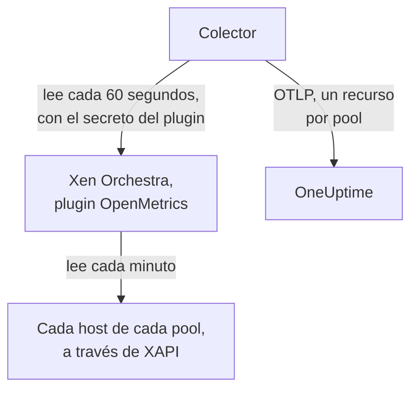

# Agente de XCP-ng

El agente de XCP-ng de OneUptime monitoriza los pools de XCP-ng que gestiona un Xen Orchestra: sus hosts, VM, repositorios de almacenamiento y discos virtuales. Es un OpenTelemetry Collector estándar que lee el propio plugin OpenMetrics de Xen Orchestra con el secreto del plugin y envía lo que lee a OneUptime, donde cada pool aparece con su inventario. Ninguna contraseña de un pool ni de Xen Orchestra llega nunca al agente. Los [monitores de XCP-ng](/docs/monitor/xcp-ng-monitor) alertan sobre lo que llega.

:::cards
- [Instala el agente](#instala-el-agente): Activa el plugin y después el script de instalación o Docker Compose.
- [El certificado de Xen Orchestra](#el-certificado-de-xen-orchestra): Cómo confía el agente en Xen Orchestra, nunca saltándose la comprobación.
- [Qué recoge el agente](#qué-recopila-el-agente): Cada serie del plugin, y los contadores que en realidad son tasas.
- [Solución de problemas](#solución-de-problemas): Un script de diagnóstico y los problemas habituales.
:::

## Qué obtienes

- **Cada pool por separado.** Cada pool que gestiona el Xen Orchestra se convierte en un pool de XCP-ng en OneUptime, reconocido por su UUID de XAPI y con el nombre que le da Xen Orchestra. Dos pools detrás de un mismo Xen Orchestra son dos pools, y renombrar un pool en OneUptime es seguro: la telemetría se asocia por su UUID.
- **Su inventario.** Los hosts, las VM, los repositorios de almacenamiento y los discos virtuales del pool, con su estado y sus métricas. Los dominios de control (dom0) se presentan como VM, y las páginas del pool los ocultan salvo que los pidas.
- **Un agente por Xen Orchestra.** El plugin sirve cada pool al que está conectado su Xen Orchestra, así que un solo agente los lee todos, y un pool conectado más tarde aparece en la siguiente lectura.

## Cómo funciona

El agente es un contenedor que ejecutas con Docker Compose en una máquina: un OpenTelemetry Collector estándar, sin una imagen propia de OneUptime. Cada 60 segundos pide `/openmetrics/metrics` a Xen Orchestra, con el secreto del plugin como token Bearer, en la propia dirección y con el propio certificado de Xen Orchestra. El plugin lee las métricas de cada host a través de XAPI con una resolución de 60 segundos. El colector conserva las series de los pools, las agrupa por pool y las envía a OneUptime por OTLP.



Cada pool se registra con sus primeros datos, bajo el UUID que el agente estampa en sus series como `xcp_ng.pool.id`, y con el nombre que le da Xen Orchestra, `xcp_ng.pool.name`. Un pool sin nombre en Xen Orchestra se llama "Pool" seguido del principio de su UUID hasta que lo renombres.

## Antes de empezar

- Xen Orchestra 6.9 o posterior, conectado a los pools que quieras monitorizar, con su plugin OpenMetrics. En un Xen Orchestra Appliance (XOA) el plugin necesita una licencia Premium; un Xen Orchestra compilado desde el código fuente lo incluye.
- Docker Engine 20.10 o posterior con el plugin Docker Compose v2, `curl` y `openssl`, en una máquina que llegue a Xen Orchestra por HTTPS.
- Un certificado en Xen Orchestra que nombre la dirección a la que se conecta el agente. El certificado autofirmado que Xen Orchestra crea para sí mismo no nombra ninguna, así que ningún cliente TLS actual puede comprobarlo, y un Xen Orchestra compilado desde el código fuente sirve HTTP sin cifrar hasta que le des uno: consulta [El certificado de Xen Orchestra](#el-certificado-de-xen-orchestra).
- Una clave de ingesta. Crea una en **Ajustes del proyecto → Telemetría y APM → Claves de ingesta** y copia su valor.
- HTTPS saliente desde esa máquina hacia tu URL de OneUptime.

### Versiones compatibles

| | Compatible | Por qué |
| --- | --- | --- |
| Xen Orchestra | 6.9 o posterior, con el plugin OpenMetrics `xo-server-openmetrics` 1.9 | Su plugin conserva su secreto cuando Xen Orchestra se reinicia, incluye las correcciones de las fugas de memoria de la lectura y sirve todas las series que leen las páginas del pool: el estado de los hosts y las VM, los repositorios de almacenamiento y los discos virtuales. Un plugin más antiguo podía crear un secreto nuevo en un reinicio, lo que dejaba fuera al agente hasta que alguien lo volvía a copiar. |
| XCP-ng | 8.3 LTS | Con soporte de Vates hasta el 30 de noviembre de 2028. XCP-ng 8.2 llegó al final de su vida útil el 16 de septiembre de 2025. |
| XenServer | Aún sin probar | Xen Orchestra informa de un pool de XenServer que gestiona con las mismas series, así que debería funcionar, pero nadie lo ha probado todavía con OneUptime. |

### Dónde ejecutar el agente

El agente habla con Xen Orchestra por HTTPS, así que puede ejecutarse en cualquier máquina con Docker y una ruta hasta él: la propia máquina de Xen Orchestra, un host de monitorización o una pequeña VM de administración. Prefiere una máquina cuya VM no se ejecute en los pools que vigila: si un pool cae, tu monitorización no debería caer con él. Un agente lee un Xen Orchestra; para varios, consulta [Leer varios Xen Orchestra](#leer-varios-xen-orchestra).

## Activa el plugin OpenMetrics

El agente lee cada pool a través del plugin OpenMetrics de Xen Orchestra, con el secreto del plugin.

:::steps
### Activa el plugin

En Xen Orchestra, abre *Settings → Plugins*, busca **openmetrics** y actívalo. La primera vez que arranca crea un secreto, y Xen Orchestra lo conserva entre reinicios.

### Copia su secreto

Abre los ajustes del plugin y copia su **Prometheus secret**: se lo darás al agente en el siguiente paso. También puedes escribir ahí un secreto propio y guardarlo. Mantenlo en privado: quien lo tenga puede leer las métricas de cada pool.

### Comprueba que responde

El plugin responde en la propia dirección y con el propio certificado de Xen Orchestra, en `/openmetrics/metrics`, y solo a una petición que lleve su secreto. Su comprobación de estado no necesita ninguno, así que esta única petición puede saltarse la comprobación del certificado con `-k`; el agente nunca lo hace:

```bash
curl -k https://xo.example.com/openmetrics/health
```

Responde `{"status":"ok"}` mientras el plugin funciona. Un `404` significa que el plugin no está activado.
:::

## Instala el agente

:::steps
### Instala e inicia el agente

Cada instancia de OneUptime sirve el script de instalación y los archivos del agente de su propia versión: los comandos de abajo los descargan de `https://oneuptime.com`, así que en una instancia autoalojada sustituye esa dirección por tu URL. El script de instalación se guarda primero como `install.sh`, para que puedas leerlo antes de ejecutarlo.

:::tabs
@tab install.sh
Descarga el script de instalación y ejecútalo en la máquina que alojará el agente:

```bash
curl -fsSL https://oneuptime.com/install/xcp-ng-agent -o install.sh
bash install.sh
```

El script pide tu URL de OneUptime, la clave de ingesta, la dirección de Xen Orchestra tal como la abres en un navegador (como `https://xo.example.com` o `https://10.0.0.5:8443`), el secreto del plugin (no se muestra al escribirlo) y cómo llamar a este Xen Orchestra en OneUptime. Después lee el certificado de Xen Orchestra: un certificado en el que esta máquina ya confía se comprueba con su paquete de CA; cualquier otro se muestra con su huella SHA-256, y respondes **y** para confiar en ese certificado y en nada más, una vez que hayas comparado la huella con la de la máquina de Xen Orchestra. Nunca desactiva la comprobación. Por último, pide al plugin sus métricas con el secreto e indica qué pools informa Xen Orchestra, antes de instalar nada. Se instala en `/opt/oneuptime-xcp-ng-agent`, escribe con permisos `0600` un archivo `.env` y `xo-ca.pem`, los certificados en los que el agente confía para Xen Orchestra, e inicia el agente con Docker Compose. Volver a ejecutar el script reutiliza todo lo que hay en ese `.env` en lugar de volver a preguntar, y así es como [actualizas el agente](#actualizar-el-agente).
@tab Docker Compose
Descarga `docker-compose.yml` y `otel-collector-config.yaml` de tu OneUptime en una carpeta nueva:

```bash
mkdir oneuptime-xcp-ng-agent && cd oneuptime-xcp-ng-agent
curl -fsSLO https://oneuptime.com/install/xcp-ng-agent/docker-compose.yml
curl -fsSLO https://oneuptime.com/install/xcp-ng-agent/otel-collector-config.yaml
```

Crea un archivo `.env` junto a ellos. Contiene el secreto del plugin, así que mantenlo en privado con `chmod 600 .env`:

```bash title=".env"
ONEUPTIME_URL=YOUR_ONEUPTIME_URL
ONEUPTIME_TELEMETRY_INGESTION_KEY=YOUR_TELEMETRY_INGESTION_TOKEN
XO_SCHEME=https
XO_ADDRESS=xo.example.com
XO_OPENMETRICS_SECRET='your-plugin-secret'
XO_NAME='Xen Orchestra'
XO_TLS_SERVER_NAME=
```

`XO_ADDRESS` es el `host` o el `host:port` de Xen Orchestra, sin `https://`. Pon el secreto del plugin entre comillas simples y escribe cada `$` que contenga como `$$`: el colector vuelve a leer el valor una vez más y tomaría un `$` por el inicio de una variable. Un secreto con una `'` no puede ir entre comillas simples: deja que lo escriba el script de instalación, o elige otro secreto en Xen Orchestra.

Después guarda el certificado de Xen Orchestra como `xo-ca.pem` junto a `docker-compose.yml`: el agente comprueba Xen Orchestra con este archivo y nada más. Para confiar en el propio certificado de Xen Orchestra, léelo y compara su huella con la de la máquina de Xen Orchestra antes de usarlo:

```bash
openssl s_client -connect xo.example.com:443 -servername xo.example.com </dev/null 2>/dev/null \
  | openssl x509 -out xo-ca.pem
openssl x509 -in xo-ca.pem -noout -fingerprint -sha256
```

Si una CA propia emitió el certificado, copia en su lugar el certificado de esa CA en `xo-ca.pem`; si lo emitió una CA pública, copia el paquete de CA de esta máquina (`cp /etc/ssl/certs/ca-certificates.crt xo-ca.pem`). Inicia el agente:

```bash
docker compose up -d
```
:::

### Comprueba que el agente se está ejecutando

```bash
docker compose ps
docker logs -f oneuptime-xcp-ng-agent
```

`docker compose ps` muestra el colector, `oneuptime-xcp-ng-agent`. Sus registros deberían mostrar esta línea una vez iniciado:

```text
Everything is ready. Begin running and processing data.
```

### Busca los pools en OneUptime

Abre **Productos → Infraestructura → XCP-ng → Todos los pools**. Cada pool que informa Xen Orchestra aparece alrededor de un minuto después de la primera lectura, con el nombre que le da Xen Orchestra, con sus hosts, VM y almacenamiento. Su página **Topología** los dibuja en un solo mapa: consulta [Topología](/docs/telemetry/topology#abrir-el-mapa-propio-de-un-recurso).
:::

## El certificado de Xen Orchestra

El agente comprueba el certificado de Xen Orchestra en cada lectura, con `xo-ca.pem` y nada más, y nunca se salta la comprobación: el secreto del plugin viaja en cada petición. `xo-ca.pem` contiene una de estas tres cosas:

- **El propio certificado de Xen Orchestra**, fijado por su huella SHA-256 (`XO_TLS_FINGERPRINT`): el agente confía en ese certificado y en ningún otro.
- **La CA que lo emitió** (`XO_CA_FILE`), para un certificado de una CA propia.
- **El paquete de CA de esta máquina**, para un certificado en el que esta máquina ya confía, como uno de una CA pública.

En cualquier caso, el certificado debe nombrar la dirección a la que se conecta el agente. El agente comprueba los nombres para los que se emitió un certificado, sus nombres alternativos del sujeto (subject alternative names), como hace todo cliente TLS actual, y nunca su sujeto. El certificado autofirmado que Xen Orchestra crea para sí mismo no nombra ninguno, así que el agente no puede confiar en él, fijado o no, y falla con `x509: certificate is not valid for any names`; el script de instalación se detiene ante un certificado así y explica por qué.

### Dar a Xen Orchestra un certificado que nombre su dirección

Usa un certificado de tu propia CA o de una pública, o crea uno autofirmado que nombre la dirección de Xen Orchestra, en la máquina de Xen Orchestra, con su nombre y su dirección en sus nombres alternativos del sujeto:

```bash
sudo mkdir -p /etc/ssl/xo
sudo openssl req -x509 -newkey rsa:2048 -nodes -days 825 \
  -subj "/CN=xo.example.com" \
  -addext "subjectAltName=DNS:xo.example.com,IP:10.0.0.5" \
  -keyout /etc/ssl/xo/key.pem -out /etc/ssl/xo/cert.pem
```

Apunta el listener HTTPS de xo-server a los dos archivos, que el usuario con el que se ejecuta xo-server (root de forma predeterminada) debe poder leer, en un archivo de configuración propio: `/etc/xo-server/config.httpscert.toml` en un XOA, o junto al `config.toml` de xo-server en un Xen Orchestra compilado desde el código fuente. Los listeners de Xen Orchestra están numerados, y el segundo, `http.listen.1`, es el de HTTPS:

```toml
[http.listen.1]
port = 443
cert = '/etc/ssl/xo/cert.pem'
key = '/etc/ssl/xo/key.pem'
```

Después reinicia xo-server con `systemctl restart xo-server` e instala el agente, o vuelve a ejecutar el script de instalación: lee el certificado nuevo y muestra su huella para que la compruebes. O deja que Xen Orchestra pida él mismo un certificado de Let's Encrypt, como puede hacer un XOA (consulta la documentación de Xen Orchestra): es de confianza pública, así que el agente no necesita ningún ajuste. Con un certificado que nombre a Xen Orchestra con un nombre distinto de la dirección de `XO_ADDRESS`, define `XO_TLS_SERVER_NAME` con ese nombre; el script de instalación lo rellena a partir del certificado cuando puede.

Cuando se renueva un certificado fijado, su huella cambia y el agente deja de leer Xen Orchestra hasta que confía en el nuevo: vuelve a ejecutar el script de instalación, que muestra la huella nueva y no cambia nada hasta que respondes **y**. Si lo instalaste con Docker Compose, vuelve a escribir `xo-ca.pem` y ejecuta `docker compose up -d --force-recreate`.

## Variables de entorno

El script de instalación las escribe en `/opt/oneuptime-xcp-ng-agent/.env`; una instalación con Docker Compose las lee del `.env` situado junto a `docker-compose.yml`. Después de cambiar una, ejecuta `docker compose up -d` en esa carpeta.

| Variable | Obligatoria | Descripción |
| --- | --- | --- |
| `ONEUPTIME_URL` | Sí | Tu URL de OneUptime, como `https://oneuptime.com` o tu instancia autoalojada. Usa `http://` y su puerto si la instancia solo admite HTTP. |
| `ONEUPTIME_TELEMETRY_INGESTION_KEY` | Sí | La clave de ingesta de **Ajustes del proyecto → Telemetría y APM → Claves de ingesta**. |
| `XO_URL` | Script de instalación | La dirección de Xen Orchestra tal como la abres en un navegador, como `https://xo.example.com` o `https://10.0.0.5:8443`. El script de instalación deduce de ella `XO_SCHEME` y `XO_ADDRESS`. |
| `XO_SCHEME` | No | `https`, el valor predeterminado. `http` solo en un laboratorio: el secreto cruza entonces la red sin cifrar. |
| `XO_ADDRESS` | Sí | El `host` o el `host:port` de Xen Orchestra, sin esquema. |
| `XO_OPENMETRICS_SECRET` | Sí | El secreto del plugin OpenMetrics, enviado como token Bearer. Cada `$` que contenga se escribe como `$$`. |
| `XO_NAME` | No | Cómo llamar a este Xen Orchestra en OneUptime, estampado como `xen_orchestra.name` en cada pool que lee y mostrado en los **Ajustes** de cada pool. Por defecto, la dirección de Xen Orchestra. |
| `XO_TLS_FINGERPRINT` | Script de instalación | La huella SHA-256 del propio certificado de Xen Orchestra, tal como la imprime `openssl x509 -fingerprint -sha256`, con los dos puntos opcionales, cuando el agente confía en ese certificado y en nada más. El script de instalación rechaza un certificado que no coincida con ella. |
| `XO_CA_FILE` | Script de instalación | Un paquete de CA que emitió el certificado de Xen Orchestra; el script de instalación comprueba el certificado con él y lo copia en `xo-ca.pem`. |
| `XO_TLS_SERVER_NAME` | No | El nombre con el que se comprueba el certificado de Xen Orchestra, cuando `XO_ADDRESS` es una dirección que el certificado no incluye. Vacío: el host de `XO_ADDRESS`. |

## Qué recopila el agente

Cada minuto el agente lee el plugin, que lee a través de XAPI las bases de datos round-robin de cada host con una resolución de 60 segundos. Conserva las series `xcp_*` y lleva el pool de cada serie al recurso con el que las envía, como `xcp_ng.pool.id` (el UUID del pool, que nunca cambia) y `xcp_ng.pool.name`:

| Categoría | Series |
| --- | --- |
| Pool | `xcp_pool_connected`, presente mientras Xen Orchestra está conectado al pool |
| Hosts | `xcp_host_status` (su estado de energía y si está habilitado), `xcp_host_uptime_seconds`, `xcp_host_cpu_average`, `xcp_host_cpu_core_usage`, `xcp_host_load`, `xcp_host_load_average`, `xcp_host_memory_*`, `xcp_host_running_vcpus`, `xcp_host_network_*` por interfaz física, `xcp_host_disk_*` por repositorio de almacenamiento, `xcp_host_power_consumption_watts` |
| VM | `xcp_vm_status`, `xcp_vm_uptime_seconds`, `xcp_vm_cpu_usage`, `xcp_vm_cpu_core_usage`, `xcp_vm_runstate_*` (contención de CPU), `xcp_vm_memory_*`, `xcp_vm_network_*` por interfaz, `xcp_vm_disk_*` por disco, `xcp_vm_power_consumption_watts` |
| Almacenamiento | `xcp_sr_physical_size_bytes`, `xcp_sr_physical_usage_bytes`, `xcp_sr_virtual_size_bytes`, `xcp_vdi_virtual_size_bytes`, `xcp_vdi_physical_usage_bytes` |
| XOSTOR | `xcp_xostor_*`, en los pools que ejecutan XOSTOR |

Los dominios de control se presentan como VM con `is_control_domain="true"`. Cada serie de Xen Orchestra conserva su nombre y sus etiquetas, como `uuid`, `host_name`, `vm_name`, `sr_name` y `tags`; el [Monitor de XCP-ng](/docs/monitor/xcp-ng-monitor#métricas-recopiladas) las enumera todas.

### Los contadores que son tasas

Xen Orchestra tipifica ocho series de rendimiento como contadores y las llama `_total`, aunque cada una contiene la tasa por segundo de XAPI: `xcp_host_network_receive_bytes_total`, `xcp_host_network_transmit_bytes_total`, `xcp_vm_network_receive_bytes_total`, `xcp_vm_network_transmit_bytes_total`, `xcp_vm_network_receive_errors_total`, `xcp_vm_network_transmit_errors_total`, `xcp_vm_disk_read_bytes_total` y `xcp_vm_disk_write_bytes_total`. Leídas como contadores, todos los gráficos de rendimiento de red y disco serían erróneos: una tasa que baja se lee como un reinicio del contador. El procesador `transform/xcp-ng-rates` del agente las convierte en gauges con sus nombres y valores intactos, así que OneUptime las guarda como las tasas que son, en bytes o errores por segundo. OneUptime también convierte las que aún lleguen como contadores, desde un colector que hayas configurado tú.

### Lo que añade OneUptime

OneUptime deriva para cada pool cuatro series 0/1 a medida que llegan sus datos, que leen las plantillas de alerta:

| Serie | 1 mientras |
| --- | --- |
| `xcp_ng.host.running` | Xen Orchestra informa del host como Running; 0 mientras está Halted, o su estado es Unknown |
| `xcp_ng.host.enabled` | el host está habilitado; 0 en modo de mantenimiento o mientras se evacua, cuando XAPI no inicia ninguna VM en él |
| `xcp_ng.vm.running` | la VM está Running; 0 mientras está Halted, Paused o Suspended |
| `xcp_ng.vm.stopped_after_running` | una VM que se ejecutó en las últimas 24 horas está Halted o Paused |

También estampa en cada punto `xcp_ng.scope` (`pool`, `host`, `vm`, `sr`, `vdi` o `xostor`) y `xcp_ng.id` (el UUID de ese objeto), por los que filtran los monitores y los paneles: consulta [Identidad de los recursos](/docs/monitor/xcp-ng-monitor#identidad-de-los-recursos).

### Lo que el agente no conserva

- Las propias series de proceso de Xen Orchestra (`xo_*`), que no pertenecen a ningún pool, y las propias series de lectura del colector.
- La potencia de un host que Xen Orchestra lee por IPMI: el plugin envía esa lectura sin su pool, así que tampoco pertenece a ningún pool. La parte estimada de cada VM, `xcp_vm_power_consumption_watts`, se conserva.

## Lo que muestran las páginas de un pool

Abre un pool desde **Productos → Infraestructura → XCP-ng → Todos los pools**. Su menú tiene:

| Página | Qué muestra |
| --- | --- |
| **Vista general** | El estado del pool y lo que requiere atención, sus hosts, VM y almacenamiento, sus VM y hosts más cargados, y el Xen Orchestra desde el que se lee, con la versión del agente. |
| **Hosts**, **VM**, **Almacenamiento** | Cada host, VM y repositorio de almacenamiento, cada uno con su propia página y sus gráficos. **VM** oculta los dominios de control salvo que los pidas, y la página de un repositorio de almacenamiento enumera sus discos virtuales. |
| **Topología** | El pool, sus hosts, las VM de cada uno y los repositorios de almacenamiento que usan, en un solo mapa. |
| **Uso de recursos** | Gráficos de los hosts, las VM, el almacenamiento, los discos y la red del pool a lo largo del tiempo, una línea por host, VM o repositorio de almacenamiento. |
| **Recomendaciones** | Las [plantillas de alerta](/docs/monitor/xcp-ng-monitor#plantillas-de-alerta-listas-para-usar) que activar, un monitor cada una. |
| **Métricas**, **Registros** | Cada serie del pool en los exploradores, limitada a él. El agente solo envía métricas, así que **Registros** solo enumera los registros que envíes con el `xcp_ng.pool.id` del pool. |
| **Incidentes**, **Alertas**, **Mantenimiento programado** | Los que nombran el pool. |
| **Feed** | Lo que le ha pasado al pool en OneUptime: cuándo se añadió, cambió, archivó o restauró, quiénes son sus propietarios y las reglas de propietario y de etiquetas que se le aplicaron. |
| **Propietarios** | A quién se avisa sobre él, a mano o mediante reglas de propietario. |
| **Ajustes** | Su nombre, el Xen Orchestra desde el que se lee, su nombre allí y la versión del agente, junto con cuánto tiempo se conserva su telemetría. |
| **Documentación** | Esta configuración, con tu URL y tu clave ya rellenadas. |

La **Vista general** del pool indica su estado, **En buen estado**, **Degradado** o **Con problemas**, a partir de lo que requiere atención, y lo enumera en **Requiere atención**, lo más urgente primero:

- **Crítico:** un host Halted, o en un estado que Xen Orchestra no puede determinar (Unknown); un repositorio de almacenamiento lleno en más del 95 %, donde las VM dejan de poder escribir.
- **Conviene revisar:** un host deshabilitado, en modo de mantenimiento o en evacuación; una VM Halted o Paused que se ejecutó en las últimas 24 horas; un repositorio de almacenamiento lleno en más del 90 %, donde salta la alerta Storage Repository Near Full, o asignado por encima de su tamaño mediante thin provisioning.

Una VM suspendida (Suspended) se suspendió a propósito y nunca cuenta, ni tampoco una VM que nadie ha visto ejecutarse en un día, ni un dominio de control. Las bibliotecas ISO y los medios extraíbles no contienen discos de VM, así que las cifras de almacenamiento del pool los dejan fuera.

Cuando Xen Orchestra deja de informar de un pool durante 15 minutos, el pool pasa a **Desconectado**, y sus páginas conservan lo último que informó. Un host, una VM, un repositorio de almacenamiento o un disco virtual que deja de aparecer en los informes de Xen Orchestra sale del inventario 15 minutos después; detener una VM nunca la quita.

## Etiqueta los pools con etiquetas de proyecto

Un atributo de recurso que empieza por `oneuptime.label.` se convierte en una etiqueta de proyecto en cada pool que lee el agente: `oneuptime.label.<dimension>=<value>` es la etiqueta `<dimension>:<value>`. Añade los atributos al procesador `resource` de `otel-collector-config.yaml`, junto a `oneuptime.agent.version`:

```yaml
processors:
  resource:
    attributes:
      # ...existing attributes...
      - key: oneuptime.label.team
        value: platform
        action: upsert
      - key: oneuptime.label.env
        value: production
        action: upsert
```

El colector solo lee su configuración al arrancar: ejecuta `docker compose restart oneuptime-xcp-ng-agent`. Los pools muestran entonces las etiquetas `team:platform` y `env:production`. Las etiquetas se comparan sin distinguir mayúsculas y minúsculas, así que una etiqueta `Production` existente se reutiliza en lugar de duplicarse, y el agente nunca quita una etiqueta que alguien añadió en OneUptime. Volver a ejecutar el script de instalación sustituye un `otel-collector-config.yaml` editado y conserva el tuyo al lado como `otel-collector-config.yaml.bak.<timestamp>`.

## Leer varios Xen Orchestra

Un agente lee un Xen Orchestra y cada pool que gestiona. Para leer un segundo Xen Orchestra desde la misma máquina, instala un segundo agente en su propia carpeta con su propio `.env`, como `INSTALL_DIR=/opt/oneuptime-xcp-ng-agent-lab bash install.sh`, y dale su propio `container_name` en su `docker-compose.yml` (como `oneuptime-xcp-ng-agent-lab`): dos contenedores no pueden compartir nombre. Dale a cada uno su propio `XO_NAME`, para que los **Ajustes** de cada pool digan qué Xen Orchestra lo lee, y pasa la carpeta al script de diagnóstico con `-d`.

Nunca dejes que dos agentes lean el mismo pool, a través de dos Xen Orchestra que lo gestionen ambos: es un solo pool en OneUptime, por su UUID, y se informaría de él dos veces.

## Ejecutar como servicio de systemd

Para que el agente arranque con la máquina y se reinicie cuando falle, instala su unidad de systemd. Da por hecho que el agente está en `/opt/oneuptime-xcp-ng-agent`, donde lo pone el script de instalación:

```bash
sudo curl -fsSL https://oneuptime.com/install/xcp-ng-agent/systemd/oneuptime-xcp-ng-agent.service -o /etc/systemd/system/oneuptime-xcp-ng-agent.service
sudo systemctl daemon-reload
sudo systemctl enable --now oneuptime-xcp-ng-agent
```

## Actualizar el agente

El agente informa como su **Versión del agente** de la versión del colector que fijan sus archivos, en la **Vista general** y los **Ajustes** de cada pool. Cuando es más antigua que la versión que fija esta versión de OneUptime, aparece un signo de advertencia a su lado. Selecciónalo para ver estos comandos.

La imagen del colector está fijada en `docker-compose.yml` y su configuración es un archivo situado al lado, así que descargar la imagen no basta para que el agente avance. Vuelve a ejecutar `install.sh`: reutiliza cada valor de tu `.env` existente (no se vuelve a preguntar nada), comprueba el certificado de Xen Orchestra de la misma forma, actualiza `docker-compose.yml` y `otel-collector-config.yaml` (un archivo que hayas editado se conserva como `<file>.bak.<timestamp>`), descarga la imagen y recrea el agente para que el colector lea su configuración nueva. Un agente instalado fuera de `/opt/oneuptime-xcp-ng-agent` necesita su carpeta: `INSTALL_DIR=<folder> bash install.sh`.

```bash
curl -fsSL https://oneuptime.com/install/xcp-ng-agent -o install.sh
bash install.sh
```

¿Lo instalaste con Docker Compose? En la carpeta del agente, vuelve a descargar ambos archivos (y repite cualquier cambio que les hubieras hecho), y después descarga la imagen y recrea el agente. Tu `.env` y `xo-ca.pem` se quedan:

```bash
curl -fsSLO https://oneuptime.com/install/xcp-ng-agent/docker-compose.yml
curl -fsSLO https://oneuptime.com/install/xcp-ng-agent/otel-collector-config.yaml
docker compose pull
docker compose up -d --force-recreate
```

## Desinstalar el agente

```bash
cd /opt/oneuptime-xcp-ng-agent
docker compose down
```

Después desactiva el plugin OpenMetrics en Xen Orchestra si nada más lo lee.

## Solución de problemas

:::details Ejecuta primero el script de diagnóstico
El agente incluye un script, [`troubleshoot.sh`](https://oneuptime.com/install/xcp-ng-agent/troubleshoot.sh), que comprueba toda la cadena en el orden en que viajan los datos: el contenedor; la dirección de Xen Orchestra desde la propia red del agente; la comprobación de estado del plugin; el certificado de Xen Orchestra con `xo-ca.pem`, y si uno fijado sigue siendo el que presenta; el secreto del plugin; los pools que informa Xen Orchestra; la forma de la clave de ingesta; las propias métricas del colector; y si OneUptime acepta la clave de ingesta. Esta última comprobación es la más importante. OneUptime rechaza una clave incorrecta con `401` (`422` para una clave desactivada o una clave de navegador), y el colector trata ambas como permanentes: descarta el lote y registra un único error `Exporting failed`, fácil de pasar por alto mientras el contenedor sigue sano. El script consulta `GET <url>/otlp/v1/validate` desde la red del agente para obtener directamente `200` (válida) o `401` (no válida), y recurre a `POST /fluentd/v1/logs` en servidores más antiguos. Nunca imprime el secreto ni la clave.

```bash
curl -fsSL https://oneuptime.com/install/xcp-ng-agent/troubleshoot.sh -o troubleshoot.sh
bash troubleshoot.sh    # add -d <dir> if you installed outside /opt/oneuptime-xcp-ng-agent
```

Termina con un veredicto que nombra la causa más probable.
:::

:::details Xen Orchestra rechaza el secreto (401)
El colector registra `server returned HTTP status 401 Unauthorized`. Vuelve a copiar el secreto de *Settings → Plugins → openmetrics*, define `XO_OPENMETRICS_SECRET` con él en `.env`, entre comillas simples y con cada `$` escrito como `$$`, y ejecuta `docker compose up -d` en la carpeta del agente. Antes de la 6.9, Xen Orchestra podía crear un secreto nuevo al reiniciarse: actualízalo.
:::

:::details El plugin no responde (404, 500, 502 o 503)
Xen Orchestra responde, pero su plugin OpenMetrics no. Activa el plugin en *Settings → Plugins → openmetrics* y comprueba que Xen Orchestra sea la 6.9 o posterior. Un XOA necesita una licencia Premium para el plugin. `/openmetrics/health` responde `{"status":"ok"}` sin secreto mientras el plugin funciona.
:::

:::details Errores de certificado
- `x509: certificate is not valid for any names`: el certificado no nombra ninguna dirección, como el propio certificado autofirmado de Xen Orchestra. [Da a Xen Orchestra un certificado que nombre su dirección](#dar-a-xen-orchestra-un-certificado-que-nombre-su-dirección).
- `x509: certificate is valid for <names>, not <address>`: conéctate a uno de esos nombres, o define `XO_TLS_SERVER_NAME` con uno de ellos.
- `x509: cannot validate certificate for <IP> because it doesn't contain any IP SANs`: `XO_ADDRESS` es una dirección IP que el certificado no incluye. Define `XO_TLS_SERVER_NAME` con un nombre que incluya, o vuelve a ejecutar el script de instalación, que lo hace.
- `x509: certificate signed by unknown authority`: `xo-ca.pem` no contiene ni este certificado ni la CA que lo emitió. El certificado se renovó, o el archivo contiene otro: vuelve a ejecutar el script de instalación, o vuelve a escribir el archivo.
- `unable to read CA cert`: `xo-ca.pem` falta o no se puede leer. Vuelve a ejecutar el script de instalación.
:::

:::details La lectura agota el tiempo (context deadline exceeded)
Xen Orchestra tardó más de 50 segundos, el límite del agente, en reunir las métricas, así que esa lectura no envía nada: normalmente un host de uno de sus pools no le responde. Revisa los hosts de los pools en Xen Orchestra; el agente vuelve a leer un minuto después.
:::

:::details Un pool aparece como Desconectado
OneUptime marca un pool como Desconectado cuando no se ha leído nada de él durante 15 minutos; OneUptime lo comprueba cada 5 minutos, y el tiempo en que él mismo no recibía datos no cuenta.

1. Si todos los pools de este Xen Orchestra están desconectados, revisa el agente: `docker compose ps` y `docker logs oneuptime-xcp-ng-agent`, en la carpeta del agente.
2. Si solo lo está uno, Xen Orchestra ha dejado de informar de él: en *Settings → Servers* de Xen Orchestra, el servidor del pool debe estar conectado. Los hosts, las VM y el almacenamiento del pool se quedan como Xen Orchestra los informó por última vez.
:::

:::details Falta un pool
Xen Orchestra solo informa de los pools a los que está conectado, y el agente solo lee ese Xen Orchestra. Conecta el servidor del pool en *Settings → Servers* de Xen Orchestra; el pool aparece en OneUptime con la siguiente lectura. Un pool que gestiona otro Xen Orchestra necesita un agente propio, junto a ese Xen Orchestra.
:::

:::details Los gráficos de rendimiento parecen erróneos
Las ocho series `_total` que contienen tasas deben llegar a OneUptime como gauges. Si sustituiste el `otel-collector-config.yaml` incluido por uno propio, conserva su procesador `transform/xcp-ng-rates`. Léelas tal como son, en bytes o errores por segundo: una tasa por segundo de ellas sería una tasa de una tasa.
:::

:::details Enviar métricas sin el agente
El agente es una sola configuración estándar del colector, así que un colector que ya ejecutes puede hacer el mismo trabajo: copia el trabajo de lectura y los procesadores de la configuración incluida en la tuya. El atributo de recurso `xcp_ng.pool.id` es lo que registra cada pool en OneUptime, el procesador `groupbyattrs` hace de cada pool un recurso, y las eliminaciones de `service.name` y `service.instance.id` evitan que los datos se archiven bajo un servicio: conserva los tres, y `transform/xcp-ng-rates`.
:::

## Lo que el plugin aún no cubre

El plugin OpenMetrics de Xen Orchestra sirve métricas, así que parte de lo que vigilas en un pool de XCP-ng aún no está en él:

- Las **alarmas**, salvo las de XOSTOR, el **estado de HA**, el **maestro del pool**, los **parches pendientes**, las **copias de seguridad** y las **instantáneas**, y el **estado del enlace** de las interfaces físicas de un host (PIF). Llegarán desde la API REST de Xen Orchestra, en [#10997](https://github.com/OneUptime/oneuptime/issues/10997).
- Los **pools sin Xen Orchestra**, o detrás de un XOA sin la licencia Premium que necesita el plugin: se leerán directamente desde XAPI, en [#10999](https://github.com/OneUptime/oneuptime/issues/10999).
- **Conectar sin agente**, desde una sonda de OneUptime, como ya se puede con VMware: [#10996](https://github.com/OneUptime/oneuptime/issues/10996).

## Próximos pasos

:::cards
- [Monitor de XCP-ng](/docs/monitor/xcp-ng-monitor): Alerta sobre pools, hosts, VM y repositorios de almacenamiento.
- [Agente de Proxmox](/docs/telemetry/proxmox): Monitoriza los clústeres de Proxmox VE de la misma forma.
- [Colector OpenTelemetry en el host](/docs/telemetry/host-otel-collector): La vista del sistema operativo dentro de tus VM.
:::
