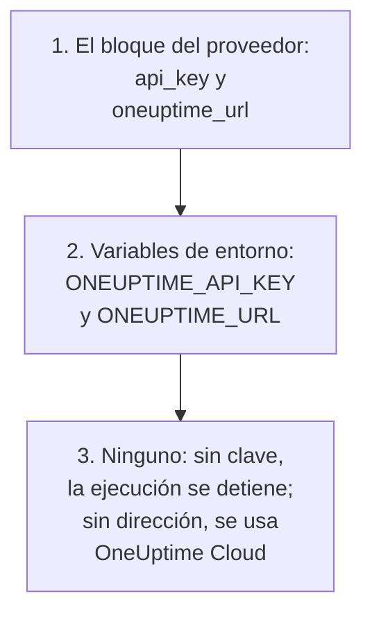

# Guía completa

Esta guía cubre lo que viene después de su primer apply: cómo encuentra el proveedor su clave de API, cómo organizar una configuración para uno o varios proyectos, cómo se hacen referencia los recursos entre sí, cómo leer registros que no gestiona, cómo proteger el estado y cómo actualizar. ¿Es nuevo en el proveedor? Empiece por el [Inicio rápido](/docs/terraform/quick-start).

:::cards
- [Configurar el proveedor](#configurar-el-proveedor): La clave de API y la dirección, y dónde las lee el proveedor.
- [Organizar una configuración](#organizar-una-configuración): Archivos, proyectos y muchos recursos a partir de un solo bloque.
- [Leer lo que ya existe](#leer-lo-que-ya-existe): Las fuentes de datos, y cómo coincide una búsqueda.
- [Proteger el estado](#proteger-el-estado): Un backend remoto, y lo que nunca debe confirmar en el repositorio.
:::

## Configurar el proveedor

El proveedor toma dos ajustes. Cada uno viene del bloque del proveedor o, si no, de una variable de entorno:

| Ajuste | Variable de entorno | Cuando no se indica ninguno |
| --- | --- | --- |
| `api_key` | `ONEUPTIME_API_KEY` | El proveedor se detiene antes de planificar nada: `Missing API Key` |
| `oneuptime_url` | `ONEUPTIME_URL` | `https://oneuptime.com`, es decir, OneUptime Cloud |



`oneuptime_url` es la dirección de su instancia de OneUptime, sin `/api`: el proveedor añade `https://` cuando la dirección no tiene esquema, y `/api` al final. `api_key` es sensible, así que Terraform nunca lo muestra.

La clave debe ser una clave de API del proyecto que gestiona, con permiso para crear, leer, cambiar y eliminar cada tipo de registro de su configuración: vea [Crear una clave de API del proyecto](/docs/terraform/quick-start#crear-una-clave-de-api-del-proyecto). La clave de API maestra de una instancia de OneUptime autoalojada no pertenece a ningún proyecto, así que una creación hecha con ella falla con `ProjectId required`.

### Dar al proveedor su clave

:::tabs
@tab Variable de entorno
```bash
export ONEUPTIME_API_KEY="<your-api-key>"
# Only on a self-hosted OneUptime:
export ONEUPTIME_URL="https://oneuptime.example.com"
```

```hcl title="main.tf"
provider "oneuptime" {}
```
@tab Variable de Terraform
```hcl title="variables.tf"
variable "oneuptime_api_key" {
  description = "API key of the OneUptime project"
  type        = string
  sensitive   = true
}

provider "oneuptime" {
  api_key = var.oneuptime_api_key
}
```

```hcl title="terraform.tfvars"
oneuptime_api_key = "<your-api-key>"
```
:::

Una variable de entorno mantiene la clave fuera de cualquier archivo. Un archivo de variables es práctico en su propia máquina: añada `terraform.tfvars` a `.gitignore`. En un pipeline, indique `TF_VAR_oneuptime_api_key` en lugar de escribir el archivo.

### Ejecutarlo en CI/CD

Dé la clave al job como secreto, en la variable de entorno `ONEUPTIME_API_KEY`:

:::tabs
@tab GitHub Actions
```yaml title=".github/workflows/oneuptime.yml"
name: OneUptime
on:
  push:
    branches: [main]

jobs:
  apply:
    runs-on: ubuntu-latest
    env:
      ONEUPTIME_API_KEY: ${{ secrets.ONEUPTIME_API_KEY }}
    steps:
      - uses: actions/checkout@v4
      - uses: hashicorp/setup-terraform@v3
      - run: terraform init -input=false
      - run: terraform plan -input=false -out=tfplan
      - run: terraform apply -input=false tfplan
```
@tab GitLab CI
```yaml title=".gitlab-ci.yml"
apply:
  image:
    name: hashicorp/terraform:latest
    entrypoint: [""]
  rules:
    - if: $CI_COMMIT_BRANCH == $CI_DEFAULT_BRANCH
  script:
    - terraform init -input=false
    - terraform plan -input=false -out=tfplan
    - terraform apply -input=false tfplan
```
:::

En GitHub, añada el secreto en **Settings → Secrets and variables → Actions**; en GitLab, añada una variable de CI/CD enmascarada con el mismo nombre. Mantenga el estado en un [backend remoto](#proteger-el-estado), para que cada ejecución empiece desde el estado que dejó la anterior.

## Organizar una configuración

Una organización que funciona bien:

```text
oneuptime/
├── main.tf          # the terraform and provider blocks
├── variables.tf     # input variables
├── outputs.tf       # the IDs other configurations need
├── shared.tf        # labels, teams and monitor statuses
├── monitors.tf      # monitors and monitor groups
├── status-pages.tf  # status pages and their domains
└── on-call.tf       # on-call policies and escalation rules
```

- **Una configuración para cada proyecto.** Una clave de API pertenece a un proyecto, así que una configuración gestiona uno de forma natural.
- **Los registros compartidos, una sola vez.** Defina las etiquetas, los equipos y los estados de monitor en un archivo, y haga referencia a ellos por su dirección en todos los demás.

### Gestionar varios proyectos

Para gestionar más de un proyecto desde una configuración, dé al proveedor un alias para cada uno, cada uno con la clave de ese proyecto. Un recurso nombra el alias que usa con `provider`:

```hcl
provider "oneuptime" {
  alias   = "production"
  api_key = var.production_api_key
}

provider "oneuptime" {
  alias   = "staging"
  api_key = var.staging_api_key
}

resource "oneuptime_label" "staging_critical" {
  provider = oneuptime.staging

  name  = "critical"
  color = "#FF5733"
}
```

Declare `production_api_key` y `staging_api_key` como variables marcadas como `sensitive`, como arriba.

### Muchos recursos a partir de un bloque

`for_each` crea un recurso por cada entrada de un map. Estos monitores comparten sus criterios y solo se diferencian en el nombre y la dirección:

```hcl
variable "websites" {
  type = map(string)
  default = {
    homepage = "https://example.com"
    docs     = "https://docs.example.com"
  }
}

resource "oneuptime_monitor" "website" {
  for_each = var.websites

  name                = "Website: ${each.key}"
  monitor_type        = "Website"
  monitoring_interval = "*/5 * * * *"

  monitor_steps = [{
    monitor_destination      = each.value
    monitor_destination_type = "URL"

    criteria = [
      {
        name                  = "Offline"
        filter_condition      = "Any"
        change_monitor_status = true
        monitor_status_id     = data.oneuptime_monitor_status.offline.id

        filters = [
          {
            check_on    = "Is Online"
            filter_type = "False"
          }
        ]
      }
    ]
  }]
}
```

Añada un sitio al map, y el siguiente apply crea su monitor. Quite uno, y lo elimina.

## Hacer referencia a otros recursos

Un recurso que nombra un atributo de otro depende de él, y Terraform ordena el trabajo según esas referencias. Aquí la etiqueta se crea primero y se elimina al final, porque el monitor y la página de estado la nombran:

```mermaid title="Terraform crea primero aquello a lo que hace referencia un recurso"
flowchart TB
    L["oneuptime_label<br/>payments"] --> M["oneuptime_monitor<br/>checkout_api"]
    L --> SP["oneuptime_status_page<br/>payments"]
    M --> R["oneuptime_status_page_resource<br/>checkout_api"]
    SP --> R
```

```hcl
resource "oneuptime_label" "payments" {
  name        = "payments"
  description = "Payment infrastructure"
  color       = "#2ECC71"
}

resource "oneuptime_monitor" "checkout_api" {
  name         = "Checkout API"
  description  = "Availability of the checkout API"
  monitor_type = "Manual"
  labels       = [oneuptime_label.payments.id]
}

resource "oneuptime_status_page" "payments" {
  name                  = "Payments Status"
  page_title            = "Payments Status"
  is_public_status_page = true
  labels                = [oneuptime_label.payments.id]
}

resource "oneuptime_status_page_resource" "checkout_api" {
  status_page_id = oneuptime_status_page.payments.id
  monitor_id     = oneuptime_monitor.checkout_api.id
  display_name   = "Checkout API"
}
```

Rara vez necesita `depends_on`: añádalo solo para un orden que Terraform no puede ver en los atributos. Las listas de ID como `labels` son conjuntos, así que cambiar su orden no cambia nada.

## Leer lo que ya existe

Cada recurso tiene una fuente de datos con el mismo nombre. Una fuente de datos lee un registro que esta configuración no gestiona, creado en el panel o por otra configuración, para que pueda hacer referencia a él sin hacerse cargo de él.

```hcl
data "oneuptime_label" "critical" {
  name = "critical"
}

data "oneuptime_monitor_status" "offline" {
  is_offline_state = true
}

data "oneuptime_status_page" "main" {
  id = "5f8a1b2c-3d4e-4f6a-8b9c-0d1e2f3a4b5c"
}

resource "oneuptime_monitor" "database" {
  name         = "Database Health"
  monitor_type = "Manual"
  labels       = [data.oneuptime_label.critical.id]
}
```

Cómo coincide una búsqueda:

| Usted indica | Encuentra | Errores |
| --- | --- | --- |
| `id` | El registro con ese ID | `Not Found` cuando ningún registro lo tiene |
| Cualesquiera otros argumentos sencillos, uno o varios | El único registro que coincide con todos | `Not Found` cuando ninguno coincide, `Ambiguous Match` cuando coincide más de uno |
| `id` y otro argumento, o nada | Nada | `Invalid Lookup` |

Los argumentos sencillos son texto, números y verdadero o falso: un nombre, una prioridad, un indicador como `is_offline_state`. No se puede buscar por listas, valores JSON, marcas de tiempo ni secretos. Para hacerse cargo de un registro en lugar de solo leerlo, [impórtelo](/docs/terraform/importing-resources).

## Proteger el estado

El estado de Terraform contiene los ID y los atributos de todo lo que gestiona, secretos incluidos. Guárdelo en un backend remoto que lo bloquee, para que un equipo comparta un solo estado y dos ejecuciones nunca lo escriban a la vez. Sirve cualquier backend estándar, por ejemplo un bucket de S3:

```hcl
terraform {
  backend "s3" {
    bucket       = "my-terraform-state"
    key          = "oneuptime/production.tfstate"
    region       = "us-east-1"
    encrypt      = true
    use_lockfile = true
  }
}
```

`use_lockfile` necesita Terraform 1.10 u OpenTofu 1.10, o posterior. Antes de ellos, el backend de S3 bloquea con una tabla de DynamoDB (`dynamodb_table`).

- **Nunca edite el estado a mano.** Use `terraform state mv` y `terraform state rm`.
- **Nunca confirme en el repositorio `terraform.tfstate`, ni un archivo `.tfvars` con un secreto dentro.**

## La deriva, y lo que no la causa

`terraform plan` compara OneUptime con su configuración y lista lo que difiere. Algunas diferencias nunca se muestran:

- **Las horas se comparan como instantes.** `2030-06-01T02:00:00Z` y la forma en que el servidor escribe el mismo instante son iguales.
- **Los valores predeterminados que añade el servidor** a los pasos de un monitor o a un valor JSON no son una diferencia con lo que usted escribió.
- **Lo que el servidor mantiene al día**, como el estado actual de un monitor, tampoco es una diferencia.

Un valor que calcula en cada ejecución sí lo es: `timestamp()` da una hora nueva en cada ejecución, así que un plan siempre la muestra. Escriba horas fijas en su lugar:

```hcl
resource "oneuptime_scheduled_maintenance_event" "database_upgrade" {
  title       = "Database upgrade"
  description = "Planned PostgreSQL upgrade"
  starts_at   = "2030-06-01T02:00:00Z"
  ends_at     = "2030-06-01T04:00:00Z"
}
```

## Actualizar el proveedor

:::steps
### Leer las notas de la versión

El [Terraform Registry](https://registry.terraform.io/providers/oneuptime/oneuptime) y las [versiones del proveedor en GitHub](https://github.com/OneUptime/terraform-provider-oneuptime/releases) listan lo que ha cambiado.

### Subir la restricción de versión

`{{TERRAFORM_PROVIDER_VERSION}}` ya toma todas las versiones {{TERRAFORM_PROVIDER_MAJOR}}.x. Una nueva versión mayor necesita una nueva restricción.

### Descargar la nueva versión

```bash
terraform init -upgrade
```

### Planificar antes de aplicar

Ejecute `terraform plan`, y aplique solo cuando el plan esté vacío o muestre los cambios que espera.
:::

En una instancia de OneUptime autoalojada, actualice primero OneUptime y después el proveedor: el proveedor no debe ser posterior a su instancia de OneUptime. Vea la [Configuración autoalojada](/docs/terraform/self-hosted).

## Próximos pasos

:::cards
- [Pasos del monitor](/docs/terraform/monitor-steps): Decidir qué comprueba un monitor y qué significa cada resultado.
- [Ejemplos](/docs/terraform/examples): Configuraciones listas para usar para los recursos habituales.
- [Importar recursos](/docs/terraform/importing-resources): Poner bajo Terraform lo que creó en el panel.
- [Solución de problemas](/docs/terraform/troubleshooting): Los errores habituales y cómo corregirlos.
:::
