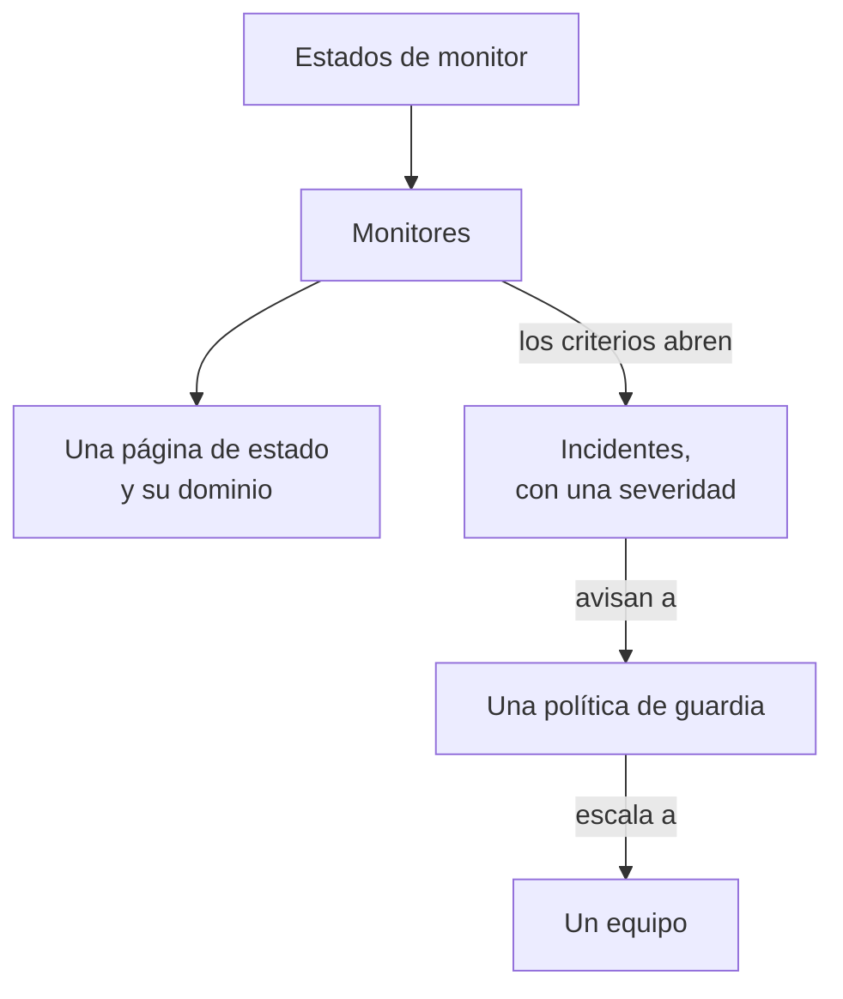

# Ejemplos

Configuraciones listas para usar para los recursos con los que empiezan la mayoría de los proyectos. Cada bloque se aplica tal cual sobre la configuración del proveedor de abajo, y la mayoría vienen de las pruebas de extremo a extremo del proveedor, que los aplican a una instancia real de OneUptime con cada cambio.

:::cards
- [Monitores](#monitores): Monitores de sitio web, API, ping, puerto, certificado SSL, heartbeat y manuales.
- [Páginas de estado](#páginas-de-estado): Una página de estado con un grupo y un monitor, y un dominio propio.
- [Equipos y guardias](#equipos-y-guardias): Un equipo, y una política de guardia que lo avisa.
- [Incidentes y mantenimiento](#incidentes-y-mantenimiento): Severidades, estados, un incidente declarado y una ventana de mantenimiento.
:::



## Configuración del proveedor

Cada ejemplo supone esta configuración, con la clave de API en la variable de entorno `ONEUPTIME_API_KEY`:

```hcl title="main.tf"
terraform {
  required_providers {
    oneuptime = {
      source  = "oneuptime/oneuptime"
      version = "{{TERRAFORM_PROVIDER_VERSION}}"
    }
  }
}

provider "oneuptime" {
  # On a self-hosted OneUptime, add your OneUptime's address:
  # oneuptime_url = "https://oneuptime.example.com"
}
```

## Etiquetas

Las etiquetas ordenan y filtran registros. La mayoría de los recursos admiten un conjunto de ID de etiquetas en `labels`:

```hcl
resource "oneuptime_label" "production" {
  name        = "production"
  description = "Production infrastructure"
  color       = "#FF5733"
}
```

## Monitores

Los monitores de abajo fijan su estado con tres de los estados con los que empieza cada proyecto, leídos con fuentes de datos:

```hcl
data "oneuptime_monitor_status" "operational" {
  name = "Operational"
}

data "oneuptime_monitor_status" "degraded" {
  name = "Degraded"
}

data "oneuptime_monitor_status" "offline" {
  name = "Offline"
}
```

Los `monitor_steps` de cada monitor dicen qué comprueba y cómo se juzga cada resultado: [Pasos del monitor](/docs/terraform/monitor-steps) explica cada atributo.

### Monitor de sitio web

Sin conexión cuando el sitio no responde, en línea cuando responde con 200. La prueba de extremo a extremo `35-monitor-with-steps` aplica un monitor con estas comprobaciones:

```hcl
resource "oneuptime_monitor" "website" {
  name                = "Website"
  description         = "Homepage availability and status code"
  monitor_type        = "Website"
  monitoring_interval = "*/5 * * * *"
  labels              = [oneuptime_label.production.id]

  monitor_steps = [{
    monitor_destination      = "https://example.com"
    monitor_destination_type = "URL"
    request_type             = "GET"

    criteria = [
      {
        name                  = "Offline"
        description           = "The website does not respond"
        filter_condition      = "Any"
        change_monitor_status = true
        monitor_status_id     = data.oneuptime_monitor_status.offline.id

        filters = [
          {
            check_on    = "Is Online"
            filter_type = "False"
          }
        ]
      },
      {
        name                  = "Online"
        description           = "The website responds with 200"
        filter_condition      = "All"
        change_monitor_status = true
        monitor_status_id     = data.oneuptime_monitor_status.operational.id

        filters = [
          {
            check_on    = "Is Online"
            filter_type = "True"
          },
          {
            check_on    = "Response Status Code"
            filter_type = "Equal To"
            value       = "200"
          }
        ]
      }
    ]
  }]
}
```

### Monitor de API

Un `POST` con cabeceras y un cuerpo JSON, degradado cuando la respuesta es lenta. La prueba de extremo a extremo `35-monitor-with-steps` aplica un monitor de API parecido:

```hcl
resource "oneuptime_monitor" "orders_api" {
  name         = "Orders API"
  description  = "Health check of the orders API"
  monitor_type = "API"

  monitor_steps = [{
    monitor_destination      = "https://api.example.com/v1/health"
    monitor_destination_type = "URL"
    request_type             = "POST"
    request_headers = {
      "Content-Type" = "application/json"
      "Accept"       = "application/json"
    }
    request_body = jsonencode({ check = "health" })

    criteria = [
      {
        name                  = "Offline"
        description           = "The API does not answer, or answers with an error"
        filter_condition      = "Any"
        change_monitor_status = true
        monitor_status_id     = data.oneuptime_monitor_status.offline.id

        filters = [
          {
            check_on    = "Is Online"
            filter_type = "False"
          },
          {
            check_on    = "Response Status Code"
            filter_type = "Greater Than Or Equal To"
            value       = "500"
          }
        ]
      },
      {
        name                  = "Slow"
        description           = "The API takes more than two seconds"
        filter_condition      = "All"
        change_monitor_status = true
        monitor_status_id     = data.oneuptime_monitor_status.degraded.id

        filters = [
          {
            check_on    = "Response Time (in ms)"
            filter_type = "Greater Than"
            value       = "2000"
          }
        ]
      },
      {
        name                  = "Online"
        description           = "The API answers in time"
        filter_condition      = "All"
        change_monitor_status = true
        monitor_status_id     = data.oneuptime_monitor_status.operational.id

        filters = [
          {
            check_on    = "Is Online"
            filter_type = "True"
          }
        ]
      }
    ]
  }]
}
```

### Monitor Ping

Un monitor Ping admite un nombre de host o una dirección IP en lugar de una URL:

```hcl
resource "oneuptime_monitor" "gateway" {
  name         = "Gateway"
  description  = "The gateway answers ping"
  monitor_type = "Ping"

  monitor_steps = [{
    monitor_destination      = "gateway.example.com"
    monitor_destination_type = "Hostname"

    criteria = [
      {
        name                  = "Unreachable"
        filter_condition      = "Any"
        change_monitor_status = true
        monitor_status_id     = data.oneuptime_monitor_status.offline.id

        filters = [
          {
            check_on    = "Is Online"
            filter_type = "False"
          }
        ]
      },
      {
        name                  = "Reachable"
        filter_condition      = "All"
        change_monitor_status = true
        monitor_status_id     = data.oneuptime_monitor_status.operational.id

        filters = [
          {
            check_on    = "Is Online"
            filter_type = "True"
          }
        ]
      }
    ]
  }]
}
```

### Monitor de puerto

Un monitor de puerto añade el `port` que comprobar, como número:

```hcl
resource "oneuptime_monitor" "database_port" {
  name         = "Database port"
  description  = "PostgreSQL accepts connections"
  monitor_type = "Port"

  monitor_steps = [{
    monitor_destination      = "db.example.com"
    monitor_destination_type = "Hostname"
    port                     = 5432

    criteria = [
      {
        name                  = "Closed"
        filter_condition      = "Any"
        change_monitor_status = true
        monitor_status_id     = data.oneuptime_monitor_status.offline.id

        filters = [
          {
            check_on    = "Is Online"
            filter_type = "False"
          }
        ]
      },
      {
        name                  = "Open"
        filter_condition      = "All"
        change_monitor_status = true
        monitor_status_id     = data.oneuptime_monitor_status.operational.id

        filters = [
          {
            check_on    = "Is Online"
            filter_type = "True"
          }
        ]
      }
    ]
  }]
}
```

### Monitor de certificado SSL

Sin conexión cuando el certificado no es válido, degradado cuando caduca en 14 días o menos, como un monitor de certificado SSL nuevo en el panel:

```hcl
resource "oneuptime_monitor" "certificate" {
  name         = "example.com certificate"
  description  = "The TLS certificate of example.com"
  monitor_type = "SSL Certificate"

  monitor_steps = [{
    monitor_destination      = "https://example.com"
    monitor_destination_type = "URL"

    criteria = [
      {
        name                  = "Not valid"
        description           = "Expired, self-signed, untrusted or not reachable"
        filter_condition      = "Any"
        change_monitor_status = true
        monitor_status_id     = data.oneuptime_monitor_status.offline.id

        filters = [
          {
            check_on    = "Is Not A Valid Certificate"
            filter_type = "True"
          }
        ]
      },
      {
        name                  = "Expires soon"
        description           = "Valid, and expires in 14 days or less"
        filter_condition      = "All"
        change_monitor_status = true
        monitor_status_id     = data.oneuptime_monitor_status.degraded.id

        filters = [
          {
            check_on    = "Is Valid Certificate"
            filter_type = "True"
          },
          {
            check_on    = "Expires In Days"
            filter_type = "Less Than Or Equal To"
            value       = "14"
          }
        ]
      },
      {
        name                  = "Valid"
        filter_condition      = "All"
        change_monitor_status = true
        monitor_status_id     = data.oneuptime_monitor_status.operational.id

        filters = [
          {
            check_on    = "Is Valid Certificate"
            filter_type = "True"
          }
        ]
      }
    ]
  }]
}
```

### Monitor manual

Un monitor manual no comprueba nada: usted fija su estado. No necesita `monitor_steps`:

```hcl
resource "oneuptime_monitor" "payment_provider" {
  name         = "Payment provider"
  description  = "Set by hand during the provider's incidents"
  monitor_type = "Manual"
}
```

### Monitor de heartbeat

Un monitor de solicitudes entrantes espera solicitudes en lugar de enviarlas: aquí, una tarea de copia de seguridad que se reporta cada noche. Pasa a sin conexión cuando no ha llegado ninguna solicitud en 25 horas:

```hcl
resource "oneuptime_monitor" "nightly_backup" {
  name         = "Nightly backup"
  description  = "The backup job sends a heartbeat when it finishes"
  monitor_type = "Incoming Request"

  monitor_steps = [{
    criteria = [
      {
        name                  = "No heartbeat"
        filter_condition      = "Any"
        change_monitor_status = true
        monitor_status_id     = data.oneuptime_monitor_status.offline.id

        filters = [
          {
            check_on    = "Incoming Request"
            filter_type = "Not Recieved In Minutes"
            value       = "1500"
          }
        ]
      },
      {
        name                  = "Heartbeat received"
        filter_condition      = "All"
        change_monitor_status = true
        monitor_status_id     = data.oneuptime_monitor_status.operational.id

        filters = [
          {
            check_on    = "Incoming Request"
            filter_type = "Recieved In Minutes"
            value       = "1500"
          }
        ]
      }
    ]
  }]
}

output "nightly_backup_heartbeat_key" {
  value     = oneuptime_monitor.nightly_backup.incoming_request_secret_key
  sensitive = true
}
```

La tarea envía su solicitud a `https://oneuptime.com/heartbeat/YOUR_SECRET_KEY`, con la clave que muestra `terraform output -raw nightly_backup_heartbeat_key`: vea [Monitor de solicitudes entrantes](/docs/monitor/incoming-request-monitor). El agente de un monitor de servidor se identifica de la misma forma, con `server_monitor_secret_key`.

### Grupo de monitores

Un grupo de monitores muestra un conjunto de monitores con un solo estado:

```hcl
resource "oneuptime_monitor_group" "storefront" {
  name        = "Storefront"
  description = "Everything the shop needs"
}

resource "oneuptime_monitor_group_resource" "website" {
  monitor_group_id = oneuptime_monitor_group.storefront.id
  monitor_id       = oneuptime_monitor.website.id
}

resource "oneuptime_monitor_group_resource" "orders_api" {
  monitor_group_id = oneuptime_monitor_group.storefront.id
  monitor_id       = oneuptime_monitor.orders_api.id
}
```

## Páginas de estado

### Una página de estado con un grupo y un monitor

Una página de estado muestra recursos, y puede ordenarlos en grupos. La prueba de extremo a extremo `42-status-page-resources` aplica esta configuración:

```hcl
resource "oneuptime_status_page" "public" {
  name                  = "Public Status"
  description           = "Customer-facing status page"
  page_title            = "System Status"
  page_description      = "Check our system status and incident history"
  is_public_status_page = true
}

resource "oneuptime_status_page_group" "services" {
  status_page_id = oneuptime_status_page.public.id
  name           = "Services"
}

resource "oneuptime_status_page_resource" "website" {
  status_page_id       = oneuptime_status_page.public.id
  status_page_group_id = oneuptime_status_page_group.services.id
  monitor_id           = oneuptime_monitor.website.id
  display_name         = "Website"
}
```

### Un dominio propio

Tres recursos trabajan juntos: un dominio de su proyecto, la página de estado y el dominio de la página de estado que los une. El servidor rellena `full_domain` y el token de verificación CNAME: no los indique. Las pruebas de extremo a extremo `12-status-page-domain` y `25-status-page-with-domain` aplican esta configuración:

```hcl
resource "oneuptime_domain" "company" {
  domain = "example.com"
}

resource "oneuptime_status_page_domain" "status" {
  domain_id      = oneuptime_domain.company.id
  status_page_id = oneuptime_status_page.public.id
  subdomain      = "status"
}

output "status_page_address" {
  # The subdomain and the domain, such as status.example.com.
  value = oneuptime_status_page_domain.status.full_domain
}
```

Un dominio nuevo debe pasar la verificación de DNS antes de que la página de estado responda en él.

## Equipos y guardias

### Un equipo y sus miembros

```hcl
resource "oneuptime_team" "sre" {
  name        = "SRE"
  description = "Site reliability engineering"
}

variable "alice_user_id" {
  description = "Alice's user ID, the last part of the address of her page under Users"
  type        = string
}

resource "oneuptime_team_member" "alice" {
  team_id = oneuptime_team.sre.id
  user_id = var.alice_user_id
}
```

Una persona que ya está en el proyecto entra en el equipo al momento. Cualquier otra persona recibe una invitación, y está en el equipo en cuanto la acepta. La prueba de extremo a extremo `33-team-crud` aplica el equipo.

### Una política de guardia que avisa a un equipo

La primera regla de la política avisa al equipo, y la política vuelve a empezar, hasta dos veces, cuando nadie confirma:

```hcl
resource "oneuptime_on_call_policy" "primary" {
  name                                             = "Primary on-call"
  description                                      = "First line for production incidents"
  repeat_policy_if_no_one_acknowledges             = true
  repeat_policy_if_no_one_acknowledges_no_of_times = 2
}

resource "oneuptime_escalation_rule" "first_line" {
  on_call_duty_policy_id    = oneuptime_on_call_policy.primary.id
  name                      = "Page the SRE team"
  description               = "Moves on after 5 minutes without an acknowledgement"
  order                     = 1
  escalate_after_in_minutes = 5
}

resource "oneuptime_team_on_call_duty_escalation_rule" "sre" {
  on_call_duty_policy_id                 = oneuptime_on_call_policy.primary.id
  on_call_duty_policy_escalation_rule_id = oneuptime_escalation_rule.first_line.id
  team_id                                = oneuptime_team.sre.id
}
```

Los criterios de un monitor avisan a la política mediante `on_call_policy_ids` en los incidentes que abren: vea [Incidentes y alertas](/docs/terraform/monitor-steps#incidentes-y-alertas).

## Incidentes y mantenimiento

### Severidades y estados

Las severidades clasifican el impacto de un incidente, y los estados son las etapas de su vida. `order` es el lugar en el que aparece cada uno:

```hcl
resource "oneuptime_incident_severity" "sev1" {
  name        = "SEV-1"
  description = "Full outage, all hands"
  color       = "#E74C3C"
  order       = 1
}

resource "oneuptime_incident_state" "mitigated" {
  name        = "Mitigated"
  description = "Impact contained, fix in progress"
  color       = "#F39C12"
  order       = 3
}
```

`oneuptime_alert_severity` y `oneuptime_alert_state` funcionan igual para las alertas. Las pruebas de extremo a extremo `03-incident-severity` y `04-incident-state` los aplican.

### Declarar un incidente

Normalmente son los monitores los que abren incidentes, pero un incidente también es un recurso, lo que viene bien para un game day. Es un incidente real, así que mantenga un simulacro fuera de sus páginas de estado:

```hcl
resource "oneuptime_incident" "drill" {
  title                     = "Disaster recovery drill"
  description               = "A game day: we fail over the database"
  incident_severity_id      = oneuptime_incident_severity.sev1.id
  is_visible_on_status_page = false

  should_status_page_subscribers_be_notified_on_incident_created = false
}
```

La prueba de extremo a extremo `28-incident-crud` aplica un incidente.

### Mantenimiento programado

Una ventana de mantenimiento con horas fijas, mostrada en sus páginas de estado:

```hcl
resource "oneuptime_scheduled_maintenance_event" "database_upgrade" {
  title                       = "Database maintenance"
  description                 = "Planned PostgreSQL upgrade: writes pause briefly"
  starts_at                   = "2030-06-01T02:00:00Z"
  ends_at                     = "2030-06-01T04:00:00Z"
  is_visible_on_status_page   = true
  monitors                    = [oneuptime_monitor.website.id]
  change_monitor_status_to_id = data.oneuptime_monitor_status.degraded.id
}
```

Las horas siguen RFC 3339, y el mismo instante escrito de otra forma no es un cambio. La prueba de extremo a extremo `30-scheduled-maintenance-crud` aplica eventos de mantenimiento.

Para poner los monitores del evento en un estado mientras dura, adjúntelos con `monitors` e indique en `change_monitor_status_to_id` uno de sus estados de monitor: los monitores pasan a ese estado cuando empieza el evento, y vuelven a operativo cuando termina. Terraform cambia `change_monitor_status_to_id` en el sitio hasta que empieza el evento. Una vez empezado el evento, sus monitores ya están en ese estado, y un apply que lo cambie falla con «Change Monitor Status to can no longer be changed: this event has already started.»

## Sondas

Una sonda propia ejecuta comprobaciones desde su red. Su clave es el secreto con el que se identifica la sonda, así que pásela en una variable:

```hcl
variable "probe_key" {
  description = "The key the probe signs in with"
  type        = string
  sensitive   = true
}

resource "oneuptime_probe" "eu_west" {
  key           = var.probe_key
  name          = "EU West"
  description   = "Probe in our eu-west-1 network"
  probe_version = "1.0.0"

  should_auto_enable_probe_on_new_monitors = true
}
```

Ejecute la sonda con `PROBE_ID` igual al `id` de la sonda y `PROBE_KEY` igual a la clave: vea [Sondas personalizadas](/docs/probe/custom-probe). La prueba de extremo a extremo `23-probe-crud` aplica sondas.

## Próximos pasos

:::cards
- [Pasos del monitor](/docs/terraform/monitor-steps): Cada atributo de las comprobaciones y los criterios de un monitor.
- [Importar recursos](/docs/terraform/importing-resources): Poner bajo Terraform lo que creó en el panel.
- [Guía completa](/docs/terraform/complete-guide): Fuentes de datos, estado, CI/CD y actualizaciones.
:::
