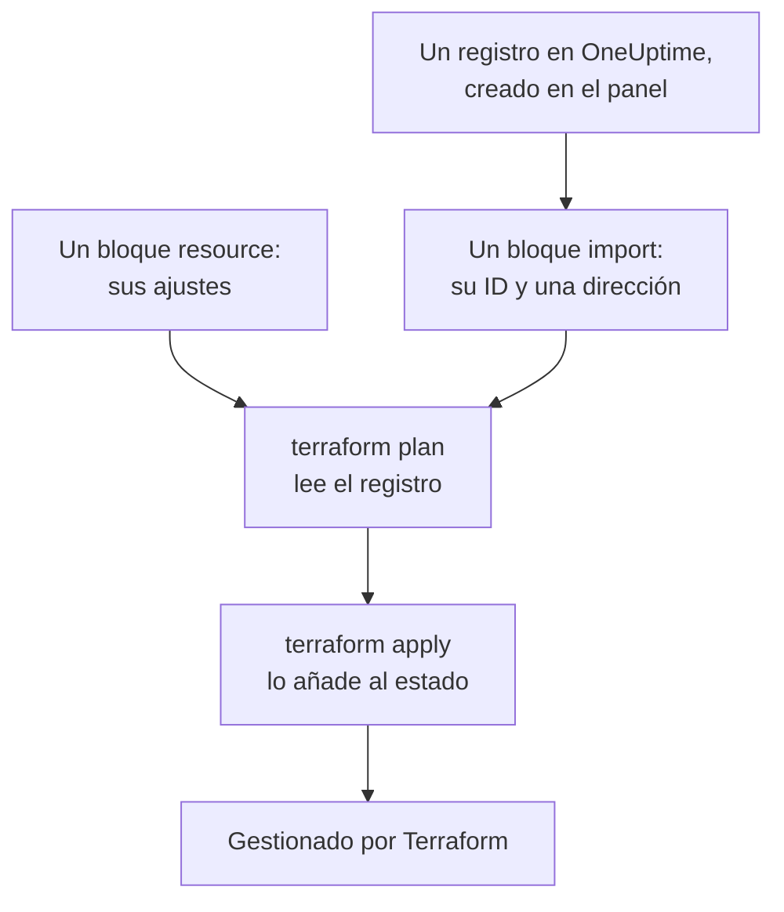

# Importar recursos

No tiene que empezar de cero para gestionar OneUptime con Terraform. Importe los monitores, páginas de estado, equipos y demás registros que ya tiene, y Terraform los gestiona a partir de entonces, tal como están. Una importación solo lee: nada cambia en OneUptime hasta que aplique un cambio que haya planificado.

:::cards
- [Cómo funciona una importación](#cómo-funciona-una-importación): Qué lee una importación, y qué escribe usted.
- [Importar un recurso](#importar-un-recurso): Desde su página en el panel, en cuatro pasos.
- [Importar muchos recursos](#importar-muchos-recursos): Bloques de importación para una lista entera, y la configuración que Terraform escribe por usted.
- [Dejar de gestionar un recurso](#dejar-de-gestionar-un-recurso): Devuélvalo al panel sin eliminarlo.
:::

## Cómo funciona una importación

Una importación conecta un registro que ya existe en OneUptime con un bloque `resource` de su configuración. Usted escribe un bloque `import` con el ID del registro y la dirección a la que va. El siguiente `terraform plan` lee el registro por su ID y muestra que se importará, junto con cualquier diferencia entre el registro y su configuración. `terraform apply` lo añade al estado de Terraform, y desde entonces el registro se gestiona como cualquier cosa que Terraform haya creado.



Escriba el bloque `resource` de modo que diga lo que el registro ya es. Donde difieran, el plan muestra la importación y un cambio, y aplicarlo cambia el registro en OneUptime.

### Qué se puede importar

Todos los recursos del proveedor se pueden importar por su ID, salvo `oneuptime_file`: la API de OneUptime no puede volver a leer un archivo, así que el proveedor responde `Import Not Supported`. Las fuentes de datos nunca se importan. Para usar un registro en su configuración sin gestionarlo, léalo en su lugar con una [fuente de datos](/docs/terraform/complete-guide#leer-lo-que-ya-existe).

## Antes de empezar

- **Terraform 1.5 o posterior, u OpenTofu 1.6 o posterior.** Los bloques `import` de esta página necesitan estas versiones. Un Terraform más antiguo importa desde la [línea de comandos](#importar-desde-la-línea-de-comandos).
- **Una clave de API que pueda leer lo que importa.** La importación lee cada registro con la clave del proveedor, y gestionarlo después requiere también los permisos para cambiarlo y eliminarlo. Consulte [Crear una clave de API del proyecto](/docs/terraform/quick-start#crear-una-clave-de-api-del-proyecto).
- **El proveedor en su configuración**, preparado como en el [Inicio rápido](/docs/terraform/quick-start#dirigir-terraform-a-oneuptime).

## Importar un recurso

El panel escribe la configuración del recurso que está mirando, con su bloque `import`, así que rara vez tendrá que escribir uno a mano.

:::steps
### Abrir la página de Terraform del recurso

Abra el monitor, la página de estado u otro recurso en el panel. En su menú lateral, abra **Desarrolladores** y luego **Terraform**.

### Copiar su configuración

La página escribe el bloque `resource` del recurso a partir de sus ajustes actuales, y un bloque `import` con su ID. Ponga ambos en un archivo `.tf`:

```hcl title="status-pages.tf"
resource "oneuptime_status_page" "public_status" {
  name       = "Public Status"
  page_title = "Acme Status"

  # Secrets are not shown here: master_password, embedded_overall_status_token.
  # Terraform leaves them as they are in OneUptime.
}

import {
  to = oneuptime_status_page.public_status
  id = "68a1b2c3-d4e5-4f6a-8b9c-0d1e2f3a4b02"
}
```

Escribe los ajustes que difieren de sus valores predeterminados, y un comentario tras cada ID nombra el registro al que apunta. Los secretos nunca se muestran: los que el recurso necesita se leen de variables marcadas como `sensitive`, y el comentario nombra los que deja fuera.

### Planificar

Ejecute `terraform plan`. Termina con `Plan: 1 to import, 0 to add, 0 to change, 0 to destroy.`: Terraform encontró el registro, y su configuración coincide con él.

### Aplicar

Ejecute `terraform apply`. La página de estado ya está en el estado de Terraform, y el siguiente plan responde `No changes.` Después puede eliminar el bloque `import`, o conservarlo como nota de dónde vino el recurso: no hace nada una vez que el recurso está gestionado.
:::

### Escribir los bloques usted mismo

Sin el panel, escriba usted mismo ambos bloques. Empiece el bloque `resource` con los atributos que el recurso necesita, y ejecute `terraform plan`. Donde su configuración difiera del registro, el plan muestra el cambio junto a la importación:

```text
  # oneuptime_label.critical will be updated in-place
  # (imported from "68a1b2c3-d4e5-4f6a-8b9c-0d1e2f3a4b03")
  ~ resource "oneuptime_label" "critical" {
      ~ color = "#FF5733" -> "#000000"
    }

Plan: 1 to import, 0 to add, 1 to change, 0 to destroy.
```

Copie el valor del registro en su configuración (aquí `color = "#FF5733"`), y vuelva a planificar hasta que el plan muestre la importación y ningún cambio. El ID del registro está en tres lugares:

| Dónde | Cómo |
| --- | --- |
| La página del recurso | Su tarjeta de detalles termina con una línea **ID**. Haga clic en el ID, o en el botón de copiar que tiene al lado, para copiar el ID completo. |
| La barra de direcciones | El ID va después del nombre de la lista: `/dashboard/<project-id>/monitors/<monitor-id>`. |
| La API | Cada registro lleva su ID en `_id`. |

## Importar muchos recursos

Para importar todos los monitores, páginas de estado u otros recursos de un tipo, empiece desde su lista.

:::steps
### Abrir la página de Terraform de la lista

Abra la lista, y luego **Desarrolladores** y **Terraform** en su menú lateral, por ejemplo **Monitores → Desarrolladores → Terraform**.

### Copiar los bloques de importación

La página escribe un bloque `import` por cada registro (los 100 primeros), con una dirección formada a partir del nombre del registro. Póngalos en un archivo propio, como `imports.tf`:

```hcl title="imports.tf"
import {
  to = oneuptime_monitor.homepage
  id = "68a1b2c3-d4e5-4f6a-8b9c-0d1e2f3a4b01"
}

import {
  to = oneuptime_monitor.checkout_api
  id = "68a1b2c3-d4e5-4f6a-8b9c-0d1e2f3a4b05"
}
```

### Dejar que Terraform escriba la configuración

Ejecute el plan con un nombre de archivo para la configuración que Terraform escribe. El archivo no debe existir todavía: Terraform solo escribe en un archivo nuevo.

```bash
terraform plan -generate-config-out=monitors.tf
```

Terraform lee cada registro y escribe un bloque `resource` por cada bloque `import` que no tiene ninguno. Advierte que la generación de configuración es experimental, así que lea lo que escribió.

### Revisar y aplicar

En el archivo nuevo, sustituya los ID de otros registros por referencias a sus recursos, como `labels = [oneuptime_label.critical.id]`, para que Terraform sepa en qué orden trabajar. Ejecute `terraform plan` hasta que muestre solo las importaciones, y luego `terraform apply`.
:::

### Un proyecto entero

Importe un proyecto lista por lista, empezando por los registros a los que otros hacen referencia. Así cada bloque de recurso puede referirse a los anteriores por su dirección en lugar de por su ID:

```mermaid title="Importar primero los registros a los que otros hacen referencia"
flowchart TB
    S["Etiquetas, equipos,<br/>estados de monitor<br/>y severidades de incidente"] --> M["Monitores, páginas de estado<br/>y políticas de guardia"]
    M --> L["Lo que los une:<br/>recursos de página de estado,<br/>reglas de escalado<br/>y miembros de equipo"]
```

Los registros con los que empieza cada proyecto, como sus estados de monitor y sus severidades de incidente, suelen leerse mejor con fuentes de datos que importarse: así Terraform puede hacer referencia a ellos, pero nunca los cambia ni los elimina. El proyecto está importado cuando `terraform plan` responde `No changes.`

## Importar desde la línea de comandos

`terraform import` importa un recurso cada vez, y funciona en cualquier versión de Terraform y de OpenTofu. Escriba primero el bloque `resource`, y luego ejecute el comando con la dirección del bloque y el ID del registro:

```bash
terraform import oneuptime_status_page.public_status 68a1b2c3-d4e5-4f6a-8b9c-0d1e2f3a4b02
terraform import oneuptime_label.critical 68a1b2c3-d4e5-4f6a-8b9c-0d1e2f3a4b03
terraform import oneuptime_team.sre 68a1b2c3-d4e5-4f6a-8b9c-0d1e2f3a4b04
```

Cada uno termina con `Import successful!`. A diferencia de un bloque `import`, el comando escribe el estado de inmediato, sin un plan que revisar antes: ejecute después `terraform plan`, y cambie su configuración hasta que el plan responda `No changes.`

## Dejar de gestionar un recurso

Para devolver un recurso al panel sin eliminarlo, sustituya su bloque `resource` por un bloque `removed` que conserve el registro:

```hcl
removed {
  from = oneuptime_team.sre

  lifecycle {
    destroy = false
  }
}
```

El plan dice que el equipo dejará de estar gestionado por Terraform, y no destruye nada. Aplíquelo, y luego elimine el bloque `removed`. Un bloque `removed` con `destroy = false` necesita Terraform 1.7 o posterior, u OpenTofu 1.10 o posterior. Con una versión más antigua, ejecute en su lugar `terraform state rm oneuptime_team.sre`.

> [!WARNING]
> Eliminar un bloque `resource` elimina su registro en OneUptime en el siguiente apply. En Terraform, también lo hace un bloque `removed` sin `destroy = false`: escriba siempre el bloque `lifecycle`.

## Conviene saber

- **Una importación no cambia nada, pero el siguiente apply sí.** Aplicar un plan que muestra un cambio junto a una importación cambia el registro en OneUptime. Consiga primero que el plan muestre solo la importación.
- **Los secretos no se vuelven a leer.** Un secreto que OneUptime nunca devuelve, como el `secret_value` de un secreto de monitor, no está en el estado tras una importación. Si su configuración lo define, el primer plan lo muestra como un cambio, y aplicarlo vuelve a escribir el secreto.
- **Una configuración por registro.** Un registro importado en dos configuraciones vuelve en cada apply a lo que dice cada una.
- **Los registros importados son registros gestionados.** `terraform destroy` los elimina de OneUptime, como a los registros que Terraform creó.

## Solución de problemas

:::details Mensaje «Cannot import non-existent remote object»
Ningún registro tiene ese ID, o la clave de API del proveedor no puede leerlo: OneUptime responde igual a ambos casos. Compruebe el ID, y que la clave pueda leer ese tipo de registro.
:::

:::details Mensaje «Import Not Supported»
`oneuptime_file` es el único recurso que no se puede importar. Déjelo fuera, y deje que Terraform cree en su lugar un archivo nuevo.
:::

:::details Mensaje «Invalid ID format»
El ID no es el ID de un registro, por ejemplo un nombre. Una importación toma el ID, un UUID como `68a1b2c3-d4e5-4f6a-8b9c-0d1e2f3a4b02`: cópielo de la página del recurso.
:::

:::details Mensaje «Target generated file already exists»
`-generate-config-out` nombra un archivo que ya existe. Nombre un archivo nuevo, o lleve lo que contiene el archivo a otro lugar y elimínelo.
:::

:::details Mensaje «Resource already managed by Terraform»
`terraform import` recibió una dirección que ya está en el estado. Importe el registro a otra dirección, o compruebe con `terraform state list` qué contiene esa dirección.
:::

## Próximos pasos

:::cards
- [Guía completa](/docs/terraform/complete-guide): Fuentes de datos, referencias entre recursos y el estado.
- [Pasos del monitor](/docs/terraform/monitor-steps): Lea y cambie lo que comprueba un monitor importado.
- [Ejemplos](/docs/terraform/examples): Configuraciones listas para usar para los recursos habituales.
- [Solución de problemas](/docs/terraform/troubleshooting): Errores comunes y cómo solucionarlos.
:::
