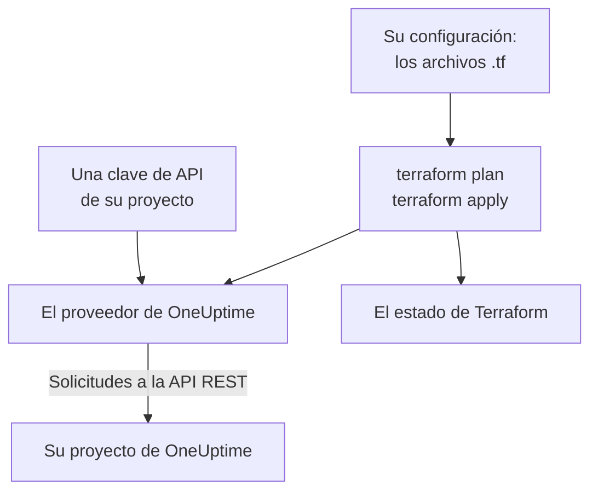

# Visión general de Terraform

El proveedor de Terraform de OneUptime gestiona su proyecto de OneUptime como código. Describa los monitores, las páginas de estado, las políticas de guardia, los equipos, las etiquetas y los demás registros de su proyecto en archivos `.tf`, vea lo que va a cambiar con `terraform plan` y aplique el cambio con `terraform apply`. Funciona con OneUptime Cloud y con una instancia de OneUptime autoalojada, y con OpenTofu igual que con Terraform.

:::cards
- [Cómo funciona el proveedor](#cómo-funciona-el-proveedor): Su configuración, el plan y las solicitudes a la API que hay detrás.
- [Instalar el proveedor](#instalar-el-proveedor): El bloque del proveedor y la versión que elegir.
- [Deje que el panel la escriba](#deje-que-el-panel-la-escriba): Configuración y bloques de importación para lo que ya tiene.
- [Qué puede gestionar](#qué-puede-gestionar): Recursos, fuentes de datos y cómo se escriben sus atributos.
:::

## Cómo funciona el proveedor

El proveedor es un plugin que Terraform descarga de un registro. Con `terraform apply`, convierte cada cambio del plan en una solicitud a la API REST de OneUptime, hecha con una clave de API de su proyecto. Terraform guarda en su estado lo que ha creado, así que el siguiente plan solo muestra lo que ha cambiado desde entonces.



Una clave de API pertenece a un proyecto y decide qué puede leer y cambiar Terraform en él, así que una configuración gestiona un proyecto. Para gestionar varios, dé al proveedor un [alias](/docs/terraform/complete-guide#gestionar-varios-proyectos) para cada uno.

## Antes de empezar

- **Terraform 1.5 o posterior, u OpenTofu 1.6 o posterior.** Los bloques `import` que escribe el panel necesitan estas versiones.
- **Una clave de API de su proyecto.** El [Inicio rápido](/docs/terraform/quick-start#crear-una-clave-de-api-del-proyecto) muestra cómo crear una en **Ajustes del proyecto → Avanzado → Claves de API**.
- **En OneUptime Cloud, el plan Growth o superior.** Las claves de API de un proyecto solo funcionan con él.

## Instalar el proveedor

Añada el proveedor a un archivo `.tf`. `terraform init` lo descarga del Terraform Registry, y `tofu init` del OpenTofu Registry:

```hcl title="main.tf"
terraform {
  required_providers {
    oneuptime = {
      source  = "oneuptime/oneuptime"
      version = "{{TERRAFORM_PROVIDER_VERSION}}"
    }
  }
}

provider "oneuptime" {
  # The API key comes from the ONEUPTIME_API_KEY environment variable.
  # On a self-hosted OneUptime, add your OneUptime's address:
  # oneuptime_url = "https://oneuptime.example.com"
}
```

Mantenga la clave fuera de sus archivos: expórtela antes de ejecutar Terraform, o pásela en una variable marcada como `sensitive`. La [Guía completa](/docs/terraform/complete-guide#configurar-el-proveedor) recoge todas las formas de dar al proveedor su clave y su dirección.

### Elegir una versión

Las versiones del proveedor siguen a las de OneUptime: el proveedor {{TERRAFORM_PROVIDER_MAJOR}}.x se genera a partir de OneUptime {{TERRAFORM_PROVIDER_MAJOR}}.x. La restricción de arriba, `{{TERRAFORM_PROVIDER_VERSION}}`, toma la versión {{TERRAFORM_PROVIDER_MAJOR}}.x más reciente, que es la adecuada para OneUptime Cloud. En una instancia de OneUptime autoalojada, use el proveedor más reciente que no sea posterior a su instancia: la [Configuración autoalojada](/docs/terraform/self-hosted) muestra cómo fijarlo.

## Deje que el panel la escriba

No tiene que escribir a mano un recurso que ya tiene. Cada recurso del panel de OneUptime (un monitor, una página de estado, un workflow, una política de guardia y los demás) tiene una sección **Desarrolladores** en su menú lateral, contraída hasta que la abre. Su página **Terraform** escribe la configuración por usted, rellenada con su propio proyecto.

:::steps
### Abrir el recurso

Abra el monitor, la página de estado u otro recurso que quiera que gestione Terraform.

### Abrir su página de Terraform

En el menú lateral, abra **Desarrolladores** y luego **Terraform**.

### Copiar la configuración

La página escribe la configuración del recurso a partir de sus ajustes actuales, con un bloque `import`. Un comentario después de cada ID nombra el registro al que apunta (`incident_severity_id = "..." # Critical Incident`).

### Planificar y aplicar

Ejecute `terraform plan`: el plan muestra el recurso importándose y nada que cambiar. Aplíquelo, y Terraform gestiona el recurso a partir de ese momento.
:::

Debajo de la configuración, **Ir más allá** reúne lo que se suele añadir junto al recurso, haciendo referencia a él por su dirección: un equipo propietario para un incidente, un grupo de monitores para una página de estado, una regla de escalado para una política de guardia.

Las páginas de lista (por ejemplo **Incidentes** o **Monitores**) tienen la misma sección. Allí, la página **Terraform** escribe un recurso nuevo con los campos que la mayoría rellena, usando los registros de su proyecto: un incidente con una de sus severidades, un monitor con los criterios que recibe un monitor nuevo en el panel, conectado a sus estados. Ofrece **Configuraciones comunes** listas para usar (una página de estado con un grupo y un monitor, una política de guardia que avisa a un equipo, una rotación de guardia semanal) y un bloque `import` para cada recurso que ya tiene (los 100 primeros), listo para `terraform plan -generate-config-out`. Ambas páginas dan también el bloque del proveedor para su instancia de OneUptime: la `oneuptime_url` correcta y una restricción de versión que coincide con su instancia.

Los secretos nunca se muestran en estas páginas. Cuando la configuración necesita uno (por ejemplo, la cabecera `Authorization` de un monitor), lo lee de una variable de Terraform marcada como `sensitive`. Los secretos que no necesita se dejan fuera, y Terraform los deja como están en OneUptime.

La misma sección tiene una página **API**, con comandos `curl` para el recurso, y una página **Asistentes de IA**, que conecta Claude, GitHub Copilot o Cursor con el [servidor MCP](/docs/ai/mcp-server).

## Qué puede gestionar

El proveedor tiene un recurso para cada tipo de registro que puede crear con la API de OneUptime, llamado `oneuptime_<name>`. Estos son con los que empieza la mayoría de las configuraciones:

| Recurso | Qué es |
| --- | --- |
| `oneuptime_monitor` | Un monitor: sitio web, API, ping, puerto, certificado SSL, servidor, solicitud entrante, manual y todos los demás tipos |
| `oneuptime_monitor_status` | Un estado de monitor, como Operational, Degraded u Offline |
| `oneuptime_monitor_group` | Un grupo de monitores, mostrado con un solo estado |
| `oneuptime_status_page` | Una página de estado pública o privada |
| `oneuptime_status_page_domain` | Un dominio propio de una página de estado |
| `oneuptime_domain` | Un dominio de su proyecto, verificado para las páginas de estado |
| `oneuptime_label` | Una etiqueta, para ordenar y filtrar registros |
| `oneuptime_team`, `oneuptime_team_member` | Un equipo, y quién está en él |
| `oneuptime_on_call_policy`, `oneuptime_escalation_rule` | Una política de guardia, y las reglas que avisa en orden |
| `oneuptime_incident`, `oneuptime_incident_severity`, `oneuptime_incident_state` | Los incidentes, sus severidades y sus estados |
| `oneuptime_alert`, `oneuptime_alert_severity`, `oneuptime_alert_state` | Las alertas, sus severidades y sus estados |
| `oneuptime_scheduled_maintenance_event` | Una ventana de mantenimiento programado |
| `oneuptime_probe` | Una sonda propia, que comprueba desde su red |

El [Terraform Registry](https://registry.terraform.io/providers/oneuptime/oneuptime/latest/docs) lista cada recurso con cada uno de sus atributos.

### Leer lo que ya existe

Cada recurso tiene una fuente de datos con el mismo nombre, como `data "oneuptime_label"`. Una fuente de datos lee un registro que esta configuración no gestiona, por ejemplo uno creado en el panel. Búsquelo por su `id`, o por sus otros argumentos sencillos: cada uno que indique debe coincidir, y exactamente un registro puede coincidir con todos.

```hcl
data "oneuptime_monitor_status" "offline" {
  name = "Offline"
}

# Any plain argument works. Set several, and all of them must match.
data "oneuptime_monitor_status" "offline_state" {
  is_offline_state = true
}
```

Que no coincida ninguno, o más de uno, es un error y no una respuesta vacía o arbitraria. La [Guía completa](/docs/terraform/complete-guide#leer-lo-que-ya-existe) tiene las reglas.

### Recursos renombrados

Los nombres de los recursos mantienen enteras palabras como IoT y vCenter: `oneuptime_iot_fleet` y `oneuptime_vcenter`, donde los proveedores antiguos tenían `oneuptime_io_t_fleet` y `oneuptime_v_center` (y lo mismo para sus reglas de etiquetas, propietarios y feeds). Los nombres antiguos siguen funcionando como alias obsoletos, y un plan que usa uno lo indica. Para cambiar, renombre el recurso en su configuración y añada un bloque `moved`, y Terraform conserva el recurso existente en lugar de reemplazarlo:

```hcl
# Was: resource "oneuptime_io_t_fleet" "factory"
resource "oneuptime_iot_fleet" "factory" {
  name = "Factory floor"
}

moved {
  from = oneuptime_io_t_fleet.factory
  to   = oneuptime_iot_fleet.factory
}
```

Mover un recurso a otro tipo necesita Terraform 1.8 o posterior. Con un motor más antiguo, mantenga de momento el nombre antiguo: sigue funcionando.

## Cómo se escriben los atributos

Los atributos siguen la API de OneUptime, en snake_case:

| Tipo de valor | Cómo se escribe | Ejemplo |
| --- | --- | --- |
| Texto, números, verdadero o falso | Tal cual | `is_public_status_page = false` |
| Una referencia a otro registro | Su ID, normalmente el `id` de otro recurso | `incident_severity_id = oneuptime_incident_severity.sev1.id` |
| Una lista de referencias | Un conjunto de ID, cuyo orden no cambia nada | `labels = [oneuptime_label.critical.id]` |
| Un color, un dominio y otros valores envueltos | Su valor sencillo | `color = "#FF5733"` |
| Una fecha y hora | Texto en formato RFC 3339 | `starts_at = "2030-06-01T02:00:00Z"` |
| Las comprobaciones de un monitor | Atributos anidados con tipo: vea [Pasos del monitor](/docs/terraform/monitor-steps) | `monitor_steps = [{ ... }]` |
| Otros ajustes estructurados | JSON, escrito con `jsonencode()` | `log_monitor = jsonencode({ ... })` |

Dos tipos de valores son del servidor, y usted los deja fuera:

- **Los ID dentro de un recurso.** Los pasos y criterios de un monitor, y sus plantillas de incidentes y alertas, tienen ID que el servidor asigna y conserva en cada apply, así que los incidentes siguen apuntando a los criterios que los generaron.
- **Lo que el servidor mantiene al día.** El estado actual de un monitor, o cuándo recibió su último heartbeat, puede cambiar entre `terraform plan` y el final de `terraform apply`. El proveedor conserva el valor planificado de todo lo que usted no indicó, y la siguiente actualización lee el del servidor, así que esto nunca hace fallar un apply ni aparece como un cambio.

## Obtener ayuda

- Errores y solicitudes de funciones: [github.com/OneUptime/oneuptime/issues](https://github.com/OneUptime/oneuptime/issues).
- El proveedor se genera a partir de la especificación OpenAPI de OneUptime en el [repositorio principal de OneUptime](https://github.com/OneUptime/oneuptime). El repositorio publicado del proveedor es de solo lectura, así que informe de los problemas en el repositorio principal.

## Próximos pasos

:::cards
- [Inicio rápido](/docs/terraform/quick-start): Crear una clave de API y aplicar sus primeros recursos en diez minutos.
- [Guía completa](/docs/terraform/complete-guide): Autenticación, estructura del proyecto, fuentes de datos, estado y actualizaciones.
- [Pasos del monitor](/docs/terraform/monitor-steps): Decidir qué comprueba un monitor y qué significa cada resultado.
- [Ejemplos](/docs/terraform/examples): Configuraciones listas para usar para los recursos habituales.
- [Importar recursos](/docs/terraform/importing-resources): Poner bajo Terraform lo que creó en el panel.
:::
