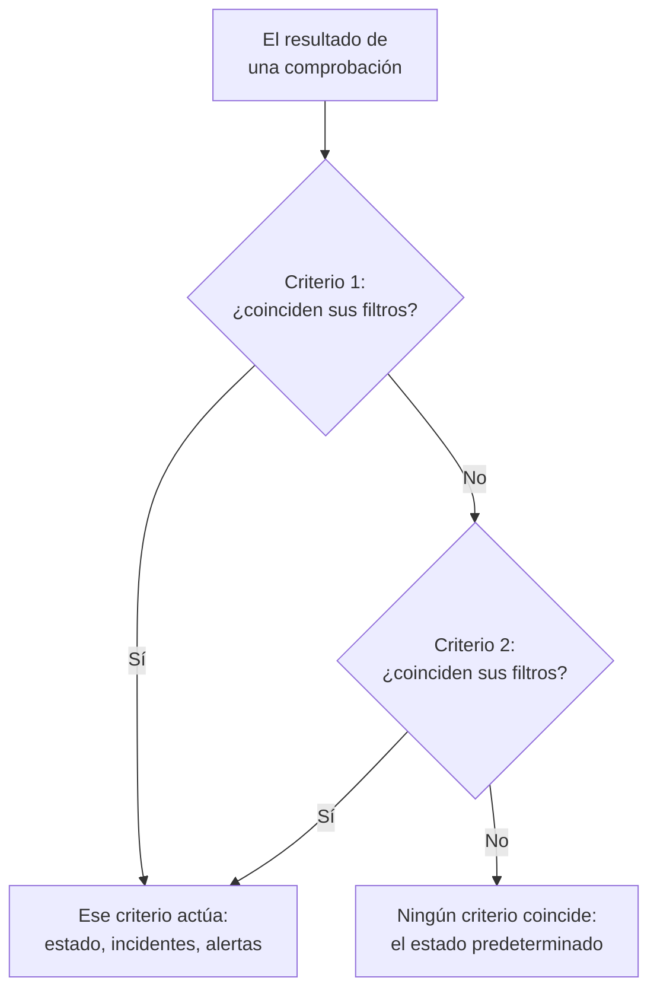
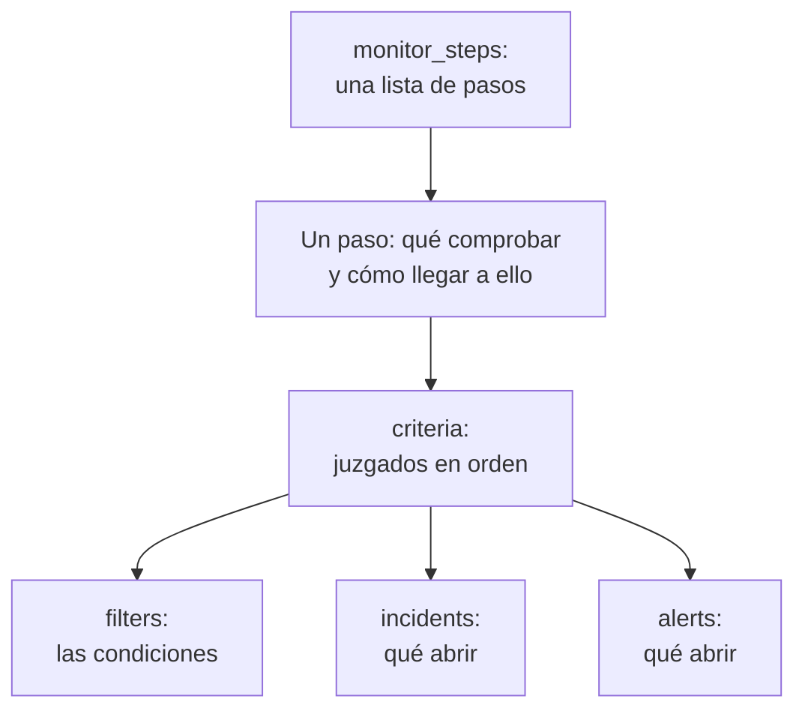

# Pasos del monitor

`monitor_steps` es el atributo de `oneuptime_monitor` que dice qué comprueba un monitor y cómo se juzga cada resultado: la dirección que comprobar, la solicitud que enviar y los criterios que convierten un resultado en un estado del monitor, un incidente o una alerta. Esta página explica cada parte.

:::cards
- [Cómo se juzga una comprobación](#cómo-se-juzga-una-comprobación): Los criterios en orden, y el primero que coincide.
- [Escribir los pasos](#escribir-los-pasos): Su forma, un ejemplo completo y las dos reglas para los valores.
- [Referencia de filtros](#referencia-de-filtros): Qué puede comprobar un filtro y cómo compara.
- [Errores habituales](#errores-habituales): Lo que sale mal más a menudo, y cómo arreglarlo.
:::

## Cómo se juzga una comprobación

Cada comprobación da un resultado: la respuesta de una sonda, el valor que devuelve un script o la telemetría que lee la comprobación. Los criterios del paso lo juzgan después en su orden. El primer criterio cuyos filtros coinciden decide lo que pasa: puede cambiar el estado del monitor, abrir incidentes y abrir alertas. Los criterios que vienen después no se miran en esa comprobación.



Así que el orden de los criterios importa: ponga primero los criterios que avisan, el más grave primero, y el de buen estado al final. [Atributos de un criterio](#atributos-de-un-criterio) explica por qué, y la única excepción.

## Escribir los pasos

`monitor_steps` es una lista de objetos con tipo escritos directamente en HCL. No hay `jsonencode()`, ni envoltorio `{_type, value}`, ni clave en camelCase, ni ID que escribir: el proveedor convierte su HCL al formato de la API, y el servidor da su ID a cada paso, a cada criterio, a cada plantilla de incidente y a cada plantilla de alerta. Conserva esos ID en cada apply, asociando cada criterio y plantilla a la que reemplaza por su nombre o, si no, por su posición, así que los resultados de las sondas se quedan con su paso y los incidentes siguen apuntando a los criterios que los generaron.



El paso útil más pequeño comprueba una dirección y tiene un criterio con un filtro:

```hcl
resource "oneuptime_monitor" "example" {
  name         = "Example"
  description  = "The smallest monitor_steps"
  monitor_type = "Website"

  monitor_steps = [{
    monitor_destination      = "https://example.com"
    monitor_destination_type = "URL"
    request_type             = "GET"

    criteria = [
      {
        name             = "Check if online"
        description      = "The website responds"
        filter_condition = "All"

        filters = [
          {
            check_on    = "Is Online"
            filter_type = "True"
          }
        ]
      }
    ]
  }]
}
```

Dos reglas valen en todo `monitor_steps`:

- **Deje fuera lo que no usa.** Un atributo que no indica no se envía a la API. Nunca escriba `[]`, `{}` ni `""` como marcador: el proveedor rechaza las cadenas, listas y maps vacíos, para que un valor ausente siempre signifique «no indicado».
- **Los valores de los filtros son cadenas.** El `value` de un filtro es una cadena, incluso un número: `value = "200"`, no `value = 200`. Los ajustes numéricos como `port` son números.

:::details Pasar del proveedor 1.x, donde monitor_steps era JSON
En el proveedor 1.x, `monitor_steps` era una cadena JSON escrita con `jsonencode({ _type = "MonitorSteps", value = { ... } })`. Reescríbala con los atributos con tipo de esta página: quite los envoltorios `_type` y `value`, escriba las claves en camelCase en snake_case (`monitorDestination` pasa a ser `monitor_destination` y `monitor_destination_type`, `filterCondition` pasa a ser `filter_condition`, `checkOn` pasa a ser `check_on`) y elimine cada `id`. El servidor asigna ahora todos los ID, lo que también acaba con los ID aleatorios fijos de la incidencia [#2291](https://github.com/OneUptime/oneuptime/issues/2291). El estado guardado como cadena JSON no se actualiza solo: aplique la nueva configuración.
:::

### Un ejemplo completo

Este monitor de sitio web comprueba lo mismo que el monitor de sitio web de las pruebas de extremo a extremo del proveedor (prueba `35-monitor-with-steps`): sin conexión cuando el sitio no responde, en línea cuando responde con 200.

```hcl
resource "oneuptime_monitor_status" "operational" {
  name                 = "Operational"
  description          = "Monitor is operational"
  color                = "#2ecc71"
  priority             = 1
  is_operational_state = true
}

resource "oneuptime_monitor_status" "offline" {
  name                 = "Offline"
  description          = "Monitor is offline"
  color                = "#e74c3c"
  priority             = 3
  is_operational_state = false
}

resource "oneuptime_monitor" "website" {
  name         = "Website"
  description  = "Website monitor with explicit steps"
  monitor_type = "Website"

  monitor_steps = [{
    monitor_destination      = "https://example.com" # what to check
    monitor_destination_type = "URL"                 # URL, Hostname or IP
    request_type             = "GET"                 # the HTTP method

    criteria = [ # judged in order: the first match decides
      {
        name                  = "Offline"
        description           = "Check if website is offline"
        filter_condition      = "Any"
        change_monitor_status = true
        create_incidents      = false
        create_alerts         = false
        monitor_status_id     = oneuptime_monitor_status.offline.id

        filters = [
          {
            check_on    = "Is Online"
            filter_type = "False"
          }
        ]
      },
      {
        name                  = "Online"
        description           = "Check if website is online"
        filter_condition      = "All" # All: every filter, Any: at least one
        change_monitor_status = true
        create_incidents      = false
        create_alerts         = false
        monitor_status_id     = oneuptime_monitor_status.operational.id

        filters = [
          {
            check_on    = "Is Online"
            filter_type = "True"
          },
          {
            check_on    = "Response Status Code"
            filter_type = "Equal To"
            value       = "200" # a string, even for a number
          }
        ]
      }
    ]
  }]
}
```

Un criterio hace referencia a un estado por su recurso, como hace aquí `oneuptime_monitor_status.offline.id`, o a uno que su proyecto ya tiene mediante una [fuente de datos](/docs/terraform/complete-guide#leer-lo-que-ya-existe).

## Atributos de un paso

Cada elemento de `monitor_steps` es una cosa que comprobar:

| Atributo | Tipo | Lo usan | Notas |
| --- | --- | --- | --- |
| `monitor_destination` | string | Sitio web, API, Ping, IP, Puerto, Certificado SSL, NTP | La URL, el nombre de host o la dirección IP que comprobar. Necesita `monitor_destination_type`. |
| `monitor_destination_type` | string | los mismos | `URL`, `Hostname` o `IP`, según lo que admita el tipo de monitor: una URL para los monitores de sitio web, API y certificado SSL; un nombre de host o una dirección IP para los monitores Ping, IP, Puerto y NTP. |
| `port` | number | Puerto, NTP | El puerto TCP que comprobar, como `443`. Para NTP, el puerto UDP en el que responde el servidor de hora: `123` si no se indica. |
| `request_type` | string | Sitio web, API | El método HTTP: `GET`, `POST`, `PUT`, `DELETE`, `HEAD` o `PATCH`. El servidor usa `GET` si no se indica. |
| `request_headers` | map(string) | Sitio web, API | Las cabeceras que enviar: `{ "Accept" = "application/json" }`. |
| `request_body` | string | API | El cuerpo de la solicitud, como texto. |
| `do_not_follow_redirects` | bool | Sitio web, API | Detenerse en la primera respuesta en lugar de seguir las redirecciones. |
| `allow_self_signed_certificates` | bool | Sitio web, API | Aceptar un certificado TLS autofirmado. |
| `tls_client_certificate` | string | Sitio web, API | Un certificado de cliente para TLS mutuo: PEM, o una referencia `{{monitorSecrets.name}}`. |
| `tls_client_key` | string (sensible) | Sitio web, API | La clave privada del certificado de cliente. Indíquela junto con el certificado. |
| `tls_client_key_passphrase` | string (sensible) | Sitio web, API | La frase de contraseña de la clave privada. |
| `request_timeout_in_ms` | number | Comprobaciones de una sonda | Cuánto puede durar un intento, en milisegundos. La sonda baja cualquier valor por encima de 60000 a 60000. |
| `retry_count` | number | Comprobaciones de una sonda | Los reintentos tras un primer intento fallido: `0` comprueba una vez, `3` hasta cuatro veces. La sonda baja cualquier valor por encima de 3 a 3. |
| `custom_code` | string | Custom JavaScript Code, Synthetic | El script que ejecuta el paso. |
| `screen_size_types` | list(string) | Synthetic | `Mobile`, `Tablet` y `Desktop`. |
| `browser_types` | list(string) | Synthetic | `Chromium` y `Firefox`. |
| `retry_count_on_error` | number | Synthetic | Los reintentos cuando el script falla: `0` lo ejecuta una vez. |
| `criteria` | list (obligatorio) | Todos | Cómo se juzga cada resultado: vea [Atributos de un criterio](#atributos-de-un-criterio). |

### Ajustes de cada tipo de monitor

Los tipos de monitor con más que ajustar que una dirección guardan sus ajustes (una consulta de logs, una conexión a una base de datos, un clúster que vigilar) en un atributo propio, como JSON sin procesar escrito con `jsonencode()`: `log_monitor`, `trace_monitor`, `llm_monitor`, `metric_monitor`, `exception_monitor`, `profile_monitor`, `dns_monitor`, `domain_monitor`, `dnssec_monitor`, `sql_monitor`, `database_monitor`, `external_status_page_monitor`, `network_device_monitor`, `kubernetes_monitor`, `docker_monitor`, `docker_swarm_monitor`, `host_monitor`, `podman_monitor`, `proxmox_monitor`, `vmware_monitor`, `ceph_monitor`, `storage_array_monitor`, `iot_monitor` y `probe_status_monitor`.

Su JSON es el mismo que el del panel, con las claves en camelCase. Un ID dentro de él se escribe como lo escribe la API: `{ _type = "ObjectID", value = "..." }`. Un monitor de Logs que cuenta los errores de un servicio:

```hcl
resource "oneuptime_service" "checkout" {
  name = "checkout"
}

resource "oneuptime_monitor" "checkout_errors" {
  name         = "Checkout errors"
  monitor_type = "Logs"

  monitor_steps = [{
    log_monitor = jsonencode({
      attributes          = {}
      body                = "error"
      severityTexts       = ["Error"]
      telemetryServiceIds = [{ _type = "ObjectID", value = oneuptime_service.checkout.id }]
      lastXSecondsOfLogs  = 300
    })

    criteria = [
      {
        name             = "Errors found"
        filter_condition = "Any"

        filters = [
          {
            check_on    = "Log Count"
            filter_type = "Greater Than"
            value       = "0"
          }
        ]
      }
    ]
  }]
}
```

> [!TIP]
> La forma más fácil de acertar con este JSON: configure el monitor en el panel y luego abra su sección **Desarrolladores** y **Terraform**. La página escribe los `monitor_steps` del monitor, `jsonencode()` incluido.

## Atributos de un criterio

Cada elemento de `criteria` es una regla: cuando sus filtros coinciden, hacer lo que dice.

Los criterios se juzgan desde arriba, y el primero que coincide decide, así que ponga primero los criterios que avisan, el más grave primero (crítico, luego advertencia), y el de buen estado al final. Un criterio de buen estado arriba del todo es la forma más común de construir un monitor que nunca avisa: una regla amplia como `Is Online` es `True`, o un valor de métrica `Greater Than` `0`, coincide en casi todas las comprobaciones, y los criterios de debajo nunca se miran. Puesto al final, solo coincide cuando no coincidió nada de lo de arriba, que es lo que usted quiere.

Los monitores de métricas agrupados son la única excepción. Cuando la consulta de un monitor de métricas está agrupada (`groupByAttributeKeys` indicado en el JSON de `metric_monitor`, en `metricViewConfig.queryConfigs[].metricQueryData.groupByAttributeKeys`), el monitor genera una alerta o un incidente por cada grupo (cada host, contenedor o punto de montaje), y se juzgan todos los criterios, así que un criterio crítico y uno de advertencia pueden dispararse para hosts distintos en la misma comprobación. Un host que incumple ambos solo recibe un aviso, del primer criterio que coincide, así que el más grave sigue yendo primero. Vea [Monitor de métricas](/docs/monitor/metrics-monitor).

| Atributo | Tipo | Qué es |
| --- | --- | --- |
| `name` | string (obligatorio) | El nombre que muestra el panel. |
| `description` | string | La descripción que muestra el panel. |
| `filter_condition` | string (obligatorio) | `All`: todos los filtros deben coincidir. `Any`: basta con uno. |
| `filters` | list (obligatorio) | Las condiciones, al menos una: vea [Referencia de filtros](#referencia-de-filtros). |
| `change_monitor_status` | bool | Si una coincidencia cambia el estado del monitor. |
| `monitor_status_id` | string | El ID del `oneuptime_monitor_status` al que cambiar. Indíquelo cuando `change_monitor_status` sea `true`. |
| `create_incidents` | bool | Si una coincidencia abre incidentes. |
| `incidents` | list | Los incidentes que abrir. Déjelo fuera salvo con `create_incidents = true`. |
| `create_alerts` | bool | Si una coincidencia abre alertas. |
| `alerts` | list | Las alertas que abrir. Déjelo fuera salvo con `create_alerts = true`. |
| `is_enabled` | bool | `true` en el servidor si no se indica. Ponga `false` para conservar un criterio sin juzgar con él. |
| `incident_grouping` | string (JSON) | Solo monitores de solicitudes entrantes: un incidente por cada valor encontrado en la solicitud, como `jsonencode({ groupByJSONPath = "..." })`. |
| `open_for_every_email` | bool | Solo monitores de correos entrantes: `true` abre un incidente (y una alerta) por cada correo que coincide, en lugar de uno cada vez. |

### Incidentes y alertas

Un elemento de `incidents` admite `title` y `description` (ambos obligatorios), `incident_severity_id`, `auto_resolve_incident`, `remediation_notes`, `on_call_policy_ids`, `label_ids`, `owner_team_ids`, `owner_user_ids`, `show_incident_on_status_page` e `is_private`. Un elemento de `alerts` admite lo mismo, con `alert_severity_id` y `auto_resolve_alert`, y sin `show_incident_on_status_page`.

Este criterio pone el monitor sin conexión, abre un incidente que avisa a la política de guardia y lo resuelve cuando el sitio vuelve:

```hcl
criteria = [
  {
    name                  = "Offline"
    description           = "The site is unreachable"
    filter_condition      = "Any"
    change_monitor_status = true
    monitor_status_id     = oneuptime_monitor_status.offline.id
    create_incidents      = true

    filters = [
      {
        check_on    = "Is Online"
        filter_type = "False"
      }
    ]

    incidents = [
      {
        title                 = "Website is down"
        description           = "The website did not respond to the probe."
        incident_severity_id  = oneuptime_incident_severity.critical.id
        auto_resolve_incident = true
        on_call_policy_ids    = [oneuptime_on_call_policy.primary.id]
      }
    ]
  }
]
```

## Referencia de filtros

Un filtro tiene `check_on` (qué mira), `filter_type` (cómo compara) y `value` (con qué compara, como cadena; déjelo fuera en las comprobaciones de verdadero o falso como `True` y `False`).

Un filtro también puede juzgar una ventana de tiempo en lugar de la última comprobación: indique `evaluate_over_time = true`, la duración de la ventana en `evaluate_over_time_minutes` y, en `evaluate_over_time_type`, cómo se lee la ventana: `Average`, `Sum`, `Maximum Value`, `Minimum Value`, `All Values` o `Any Value`.

`All Values` significa que todas las comprobaciones de la ventana incumplieron la regla, así que solo coincide cuando la ventana está cubierta de datos: un monitor recién creado espera a que se llene su ventana en lugar de coincidir en su primera comprobación. Dele una ventana de al menos el doble del `monitoring_interval` del monitor; si no, la ventana contiene una sola comprobación, y «todos los valores» significa lo mismo que «cualquier valor». `Any Value` coincide, a propósito, con una sola comprobación que incumple la regla.

`evaluate_over_time_no_data_policy` dice qué hace el filtro mientras la ventana no tiene datos suficientes: `Ignore` (el valor predeterminado) no coincide, `Trigger` trata los datos que faltan como el fallo, como hace un heartbeat, y `Treat As Zero` compara la ventana como un único cero.

### Qué puede comprobar un filtro

Los valores de `check_on` que más usa cada tipo de monitor. El editor de criterios del panel ofrece los mismos, y los lista todos:

| Tipo de monitor | Valores de `check_on` |
| --- | --- |
| Sitio web / API | `Is Online`, `Response Time (in ms)`, `Response Status Code`, `Response Body`, `Response Header`, `Response Header Value`, `JavaScript Expression`, `Is Request Timeout` |
| Ping / IP | `Is Online`, `Response Time (in ms)`, `Packet Loss (in %)`, `Jitter (in ms)`, `Is Request Timeout` |
| Puerto | `Is Online`, `Response Time (in ms)` (el tiempo total de conexión del panel), `Port DNS Lookup Time (in ms)`, `Port TCP Connect Time (in ms)`, `Is Request Timeout` |
| Certificado SSL | `Is Valid Certificate`, `Is Not A Valid Certificate`, `Is Self Signed Certificate`, `Is Expired Certificate`, `Expires In Days`, `Expires In Hours` |
| Solicitud entrante | `Incoming Request`, `Request Body`, `Request Header`, `Request Header Value`, `JavaScript Expression` |
| Correo entrante | `Email Received`, `Email Subject`, `Email From Address`, `Email To Address`, `Email Body` |
| Servidor | `Is Online`, `CPU Usage (in %)`, `Memory Usage (in %)`, `Disk Usage (in %)` (con `disk_path`), `Server Process Name` |
| Logs | `Log Count` |
| Trazas | `Span Count` |
| Excepciones | `Exception Count` |
| Perfiles | `Profile Count`, `Function Share (in %)` |
| IA / LLM | `Bad AI Answers (in %)`, `Bad AI Answers`, `AI Answers` |
| Métricas | `Metric Value` (los filtros de métricas pueden llevar JSON en `metric_monitor_options`) |
| Código personalizado / Synthetic | `Result Value` (puede comparar un campo de los datos devueltos, nombrado en el JSON de `custom_code_monitor_options`, p. ej. `jsonencode({ resultValuePath = "status" })` — vea más abajo), `Error`, `Execution Time (in ms)` |
| DNS | `DNS Is Online`, `DNS Response Time (in ms)`, `DNS Record Value`, `DNS Record Exists` |
| Dominio | `Domain Expires In Days`, `Domain Is Expired`, `Domain Registrar`, `Domain Name Server` |
| DNSSEC | `DNSSEC Chain Is Valid`, `DNSSEC DS Record Exists At Parent`, `DNSSEC Signature Expires In Days` |
| Consulta SQL | `SQL Is Online`, `SQL Query Row Count`, `SQL Query Scalar Value` |
| Salud de la base de datos | `Database Is Online`, `Database Metric` (con JSON en `database_monitor_options` que nombra la serie, p. ej. `jsonencode({ metricType = "oneuptime.monitor.database.connections.used.percent" })`), `Database Collection Error` |
| Página de estado externa | `External Status Page Is Online`, `External Status Page Active Incidents`, `External Status Page Component Status` |
| NTP | `NTP Is Online`, `NTP Is Synchronized`, `NTP Stratum`, `NTP Clock Offset (in ms)`, `NTP Response Time (in ms)`, `NTP Root Dispersion (in ms)` (`NTP Is Online` y `NTP Is Synchronized` no llevan `value`) |
| Dispositivo de red (SNMP) | `SNMP Device Is Online` (responde a ping o SNMP), `SNMP Walk Is Succeeding` (false cuando responde pero no se puede recorrer), `SNMP OID Value` (los filtros SNMP pueden llevar JSON en `snmp_monitor_options`) |

### Cómo compara un filtro

| Tipo | Valores de `filter_type` |
| --- | --- |
| Verdadero o falso | `True`, `False` |
| Números | `Equal To`, `Not Equal To`, `Greater Than`, `Less Than`, `Greater Than Or Equal To`, `Less Than Or Equal To` |
| Texto | `Contains`, `Not Contains`, `Starts With`, `Ends With`, `Is Empty`, `Is Not Empty` |
| Heartbeats | `Recieved In Minutes`, `Not Recieved In Minutes` (escritos como los escribe la API) |
| Procesos del servidor | `Is Executing`, `Is Not Executing` |
| Scripts | `Evaluates To True` |
| Anomalías, para métricas, logs y trazas | `Anomalously High`, `Anomalously Low`, `Anomalous` |

Un filtro que coincide cuando un certificado SSL caduca en 14 días o menos:

```hcl
filters = [
  {
    check_on    = "Expires In Days"
    filter_type = "Less Than Or Equal To"
    value       = "14"
  }
]
```

El proveedor comprueba `check_on`, `filter_type` y las demás listas fijas al planificar, así que una errata falla antes de que se envíe nada a la API. Los valores son los nombres que da la API a las opciones del editor de criterios del panel.

### Comparar un campo del resultado de un script

El script de un monitor de código personalizado o de un monitor Synthetic devuelve `data`, y un filtro `Result Value` lo compara. Cuando `data` es un objeto o un array, `custom_code_monitor_options` nombra el campo que comparar: la **Ruta del campo** del filtro Result Value del panel. Use puntos para los campos anidados y `[n]` para los elementos de un array, y deje fuera el atributo para comparar el valor entero:

```hcl
monitor_steps = [{
  custom_code = <<-EOT
    const response = await axios.get("https://api.example.com/health");
    // For example { status: "UP", checks: [{ name: "db", latency: 12 }] }
    return { data: response.data };
  EOT

  criteria = [
    {
      name             = "Unhealthy"
      filter_condition = "Any"
      filters = [
        {
          check_on                    = "Result Value"
          filter_type                 = "Not Equal To"
          value                       = "UP"
          custom_code_monitor_options = jsonencode({ resultValuePath = "status" })
        },
        {
          check_on                    = "Result Value"
          filter_type                 = "Greater Than"
          value                       = "500"
          custom_code_monitor_options = jsonencode({ resultValuePath = "checks[0].latency" })
        }
      ]
    }
  ]
}]
```

`Greater Than` y las demás condiciones numéricas solo coinciden con un campo que es un número, y un campo que falta en los datos devueltos solo coincide con `Is Empty`. Vea [Alertar sobre los datos devueltos](/docs/monitor/custom-code-monitor#alertar-sobre-los-datos-devueltos) para saber cómo funcionan las rutas y las condiciones.

## Errores habituales

1. **Marcadores vacíos.** `incidents = []`, `request_headers = {}` y `description = ""` se rechazan: deje fuera el atributo.
2. **Un número donde va una cadena.** El `value` de un filtro es una cadena, incluso para un número: `value = "200"`. Los ajustes numéricos como `port`, `retry_count`, `request_timeout_in_ms` y `evaluate_over_time_minutes` llevan números.
3. **El tipo de destino equivocado.** `monitor_destination_type = "URL"` con un nombre de host a secas, o `Hostname` con una URL completa, hace fallar la comprobación. Los monitores de sitio web y de API llevan URL; los monitores Ping, IP y Puerto llevan nombres de host o direcciones IP.
4. **Un cambio de estado sin estado.** `change_monitor_status = true` sin `monitor_status_id` coincide, y no tiene ningún estado al que cambiar.
5. **Los ID.** Ningún elemento de `monitor_steps` tiene un atributo `id`. Si pasa del JSON antiguo, elimínelos: el servidor asigna los ID.
6. **JSON escrito a mano.** Escriba `log_monitor` y los demás ajustes con `jsonencode()`, para que Terraform los entrecomille y escriba el JSON igual cada vez. Para `metric_monitor`, dé el objeto entero que escribe el panel: el servidor lo normaliza.

## Cuando no coincide ningún criterio

Una comprobación con la que no coincide ningún criterio pone el monitor en su estado predeterminado: el estado operativo del proyecto, el que elige el panel para un monitor nuevo. Sus incidentes abiertos cuyos criterios optaron por la resolución automática también se resuelven. Para decidir usted cada resultado, termine la lista con un criterio de buen estado amplio, como hacen los ejemplos de esta página.

## Un monitor sin pasos

`monitor_steps` es opcional, pero un monitor creado sin él no tiene criterios con los que juzgar un resultado: las sondas se saltan un monitor sin pasos, y se queda en el estado en el que empezó. Su estado de Terraform deja el atributo vacío, y el plan queda limpio. Un monitor manual nunca necesita pasos: usted fija su estado. Todos los demás tipos necesitan al menos un paso para comprobar algo.

## El formato de transferencia

Detrás del proveedor, la API sigue hablando su propio JSON, en el que cada objeto enriquecido se envuelve como `{_type, value}`:

```json
{
  "_type": "MonitorSteps",
  "value": {
    "monitorStepsInstanceArray": [
      {
        "_type": "MonitorStep",
        "value": {
          "monitorDestination": { "_type": "URL", "value": "https://example.com" },
          "requestType": "GET",
          "monitorCriteria": {
            "_type": "MonitorCriteria",
            "value": { "monitorCriteriaInstanceArray": [ { "_type": "MonitorCriteriaInstance", "value": { "...": "..." } } ] }
          }
        }
      }
    ]
  }
}
```

El proveedor construye esto a partir de su HCL cuando escribe, y lo vuelve a leer en HCL, dejando fuera lo que gestiona el servidor (los ID y los valores predeterminados que añade). Solo se lo encuentra cuando lee usted mismo las respuestas de la API, por ejemplo en un script que lee `monitorSteps`.

## Próximos pasos

:::cards
- [Ejemplos](/docs/terraform/examples): Monitores Ping, de puerto, de certificado SSL y de API, listos para usar.
- [Guía completa](/docs/terraform/complete-guide): Fuentes de datos, estado y actualizaciones.
- [Monitor de métricas](/docs/monitor/metrics-monitor): Consultas de métricas, agrupación y anomalías.
- [Solución de problemas](/docs/terraform/troubleshooting): Incluido un resultado incoherente tras un apply en un monitor.
:::
