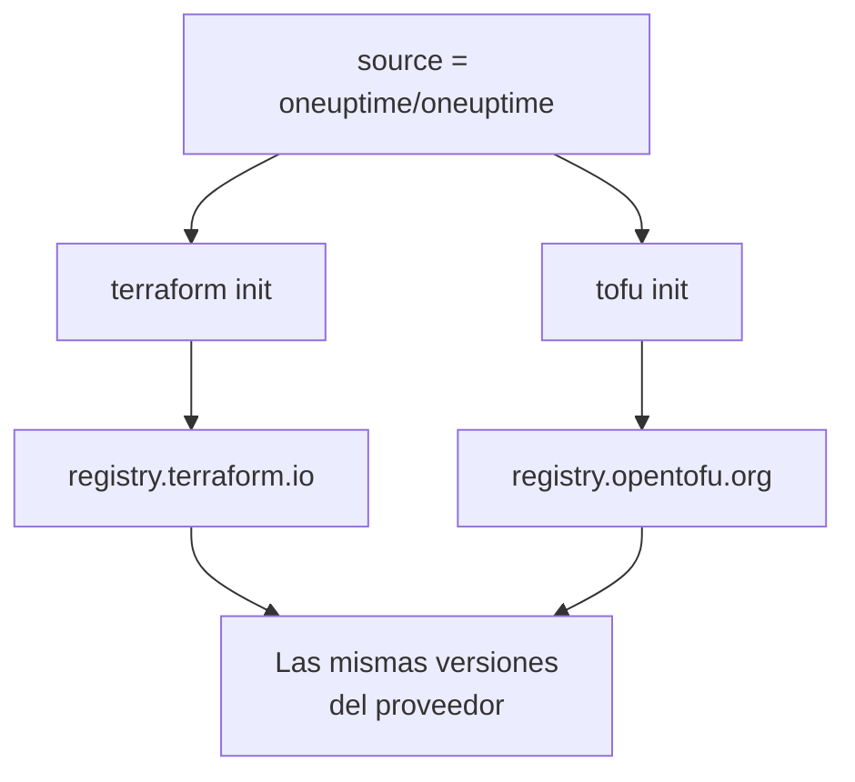

# OpenTofu

El proveedor de OneUptime funciona con [OpenTofu](https://opentofu.org) igual que con Terraform. Se publica en el [OpenTofu Registry](https://search.opentofu.org/provider/oneuptime/oneuptime/latest), y cada versión supera las mismas pruebas de extremo a extremo con ambos antes de publicarse. Su configuración no cambia: ejecute `tofu` donde estos documentos ejecutan `terraform`.

:::cards
- [Usar el proveedor con OpenTofu](#usar-el-proveedor-con-opentofu): La misma configuración, ejecutada con `tofu`.
- [Qué cambia respecto a Terraform](#qué-cambia-respecto-a-terraform): Registros, archivos de bloqueo, archivos `.tofu` y versiones.
- [Pasar una configuración a OpenTofu](#pasar-una-configuración-a-opentofu): Cambie una configuración existente en cuatro pasos.
- [Un módulo reutilizable](#un-módulo-reutilizable): Monitores, una política de guardia y una página de estado para un servicio.
:::

## Usar el proveedor con OpenTofu

Necesita OpenTofu 1.6 o posterior. Declare el proveedor como lo haría para Terraform:

```hcl title="main.tf"
terraform {
  required_providers {
    oneuptime = {
      source  = "oneuptime/oneuptime"
      version = "{{TERRAFORM_PROVIDER_VERSION}}"
    }
  }
}

provider "oneuptime" {
  # The API key comes from the ONEUPTIME_API_KEY environment variable.
  # On a self-hosted OneUptime, add your OneUptime's address:
  # oneuptime_url = "https://oneuptime.example.com"
}
```

Luego ejecútelo con `tofu`:

```bash
export ONEUPTIME_API_KEY="<your-api-key>"
tofu init
tofu plan
tofu apply
```

`tofu init` descarga el proveedor del OpenTofu Registry. Todo lo que hay en el [Inicio rápido](/docs/terraform/quick-start), la [Guía completa](/docs/terraform/complete-guide), [Pasos del monitor](/docs/terraform/monitor-steps), [Ejemplos](/docs/terraform/examples) e [Importar recursos](/docs/terraform/importing-resources) se aplica tal cual, y la configuración que escriben las páginas **Terraform** del panel funciona sin cambios.

### Mantener el registro fuera de la dirección de origen

`source = "oneuptime/oneuptime"` no nombra ningún registro, así que cada motor la lee del suyo:



Omita el nombre de host. Con él, cada motor usa ese registro: con `registry.terraform.io/oneuptime/oneuptime`, también OpenTofu descarga del Terraform Registry, y Terraform rechaza la copia del OpenTofu Registry con `authentication signature from unknown issuer`.

## Qué cambia respecto a Terraform

| Tema | Con OpenTofu |
| --- | --- |
| El registro | `oneuptime/oneuptime` es `registry.opentofu.org/oneuptime/oneuptime`, que publica las mismas versiones que el Terraform Registry. |
| Firmas | `tofu init` dice que se omitió la validación de la firma: el OpenTofu Registry no tiene ninguna clave de firma para este proveedor, así que OpenTofu comprueba la descarga contra las sumas de comprobación del registro. |
| El bloque `terraform` | Sigue siendo `terraform`: forma parte del lenguaje, y OpenTofu lo lee tal cual. |
| Archivos `.tofu` | OpenTofu 1.8 y posteriores también leen los archivos `.tofu`, y omiten un archivo `.tf` que tenga al lado un archivo `.tofu` del mismo nombre. Terraform solo lee archivos `.tf`. |
| `required_version` | Las versiones de OpenTofu empiezan en 1.6.0, así que `>= 1.5.0`, escrito para Terraform, admite cualquier OpenTofu. |
| El archivo de bloqueo | Nombra `registry.opentofu.org/oneuptime/oneuptime`. Cambiar de motor reescribe esa entrada: confirme el cambio. |
| Estado | OpenTofu lee tal cual un estado que escribió Terraform. |
| Variables | `TF_VAR_name` define una variable también con OpenTofu. |
| El archivo de configuración de la CLI | `~/.tofurc` o `~/.terraformrc`, o el archivo que nombra `TF_CLI_CONFIG_FILE`. |
| Un bloque `removed` | Su bloque `lifecycle` necesita OpenTofu 1.10 o posterior. Sin él, OpenTofu olvida el recurso y conserva el registro, donde Terraform lo destruye. |
| Pasar a un tipo de recurso renombrado | Un bloque `moved` de `oneuptime_io_t_fleet` a `oneuptime_iot_fleet`, o entre los demás tipos renombrados, necesita OpenTofu 1.12 o posterior. |

## Pasar una configuración a OpenTofu

Una configuración que gestiona Terraform pasa a OpenTofu tal cual, con su estado:

:::steps
### Instalar OpenTofu

Instale OpenTofu: la 1.6 basta para el proveedor, y la 1.12 o posterior también mueve un recurso a un tipo renombrado, como `oneuptime_io_t_fleet` a `oneuptime_iot_fleet`.

### Inicializar con tofu

En la carpeta de la configuración, ejecute `tofu init`. Descarga el proveedor del OpenTofu Registry, y dice que cambió el archivo de bloqueo: la entrada del proveedor nombra ahora el OpenTofu Registry.

### Planificar

Ejecute `tofu plan`. Lee el estado que dejó Terraform, y responde `No changes.`

### Confirmar el archivo de bloqueo

Confirme `.terraform.lock.hcl`, y ejecute la configuración con `tofu` a partir de ahora, también en CI.
:::

## Un módulo reutilizable

[`Examples/opentofu/`](https://github.com/OneUptime/oneuptime/tree/master/Examples/opentofu) en el repositorio de OneUptime contiene configuraciones listas para ejecutar, y un módulo que prepara un servicio: un monitor de sitio web por cada dirección que le dé, una etiqueta en todo lo que crea, una política de guardia con una regla de escalado, y una página de estado que lista los monitores. Es HCL simple, así que también funciona con Terraform.

```hcl title="main.tf"
module "storefront" {
  source = "github.com/OneUptime/terraform-provider-oneuptime//modules/monitoring-and-incident-response?ref=vX.Y.Z"

  service_name          = "storefront"
  status_page_is_public = true

  monitors = {
    homepage = { url = "https://example.com" }
    checkout = { url = "https://example.com/checkout" }
    api      = { url = "https://api.example.com/health", expected_status_code = "204" }
  }
}
```

Sustituya `vX.Y.Z` por una versión publicada del proveedor, como la más reciente de las [versiones del proveedor](https://github.com/OneUptime/terraform-provider-oneuptime/releases): el módulo se publica con el proveedor, y su repositorio cambia con cada versión.

El módulo no crea estados de monitor ni severidades de incidente. Busca por su nombre los que tiene cada proyecto al empezar: `Operational`, `Offline` y `Critical Incident`. Si su proyecto les cambió el nombre, defina `operational_monitor_status_name`, `offline_monitor_status_name` o `incident_severity_name`.

Su regla de escalado no avisa a nadie hasta que diga a quién: añádale un equipo con las salidas del módulo:

```hcl title="main.tf"
resource "oneuptime_team" "storefront" {
  name = "Storefront"
}

resource "oneuptime_team_on_call_duty_escalation_rule" "storefront" {
  on_call_duty_policy_id                 = module.storefront.on_call_policy_id
  on_call_duty_policy_escalation_rule_id = module.storefront.escalation_rule_id
  team_id                                = oneuptime_team.storefront.id
}
```

## Próximos pasos

:::cards
- [Inicio rápido](/docs/terraform/quick-start): Cree una clave de API y aplique sus primeros recursos.
- [Uso del registro](/docs/terraform/registry): Cómo se numeran las versiones, y el archivo de bloqueo.
- [Configuración autoalojada](/docs/terraform/self-hosted): Su propio OneUptime, y un espejo para las máquinas sin conexión.
- [Solución de problemas](/docs/terraform/troubleshooting): Errores comunes y cómo solucionarlos.
:::
