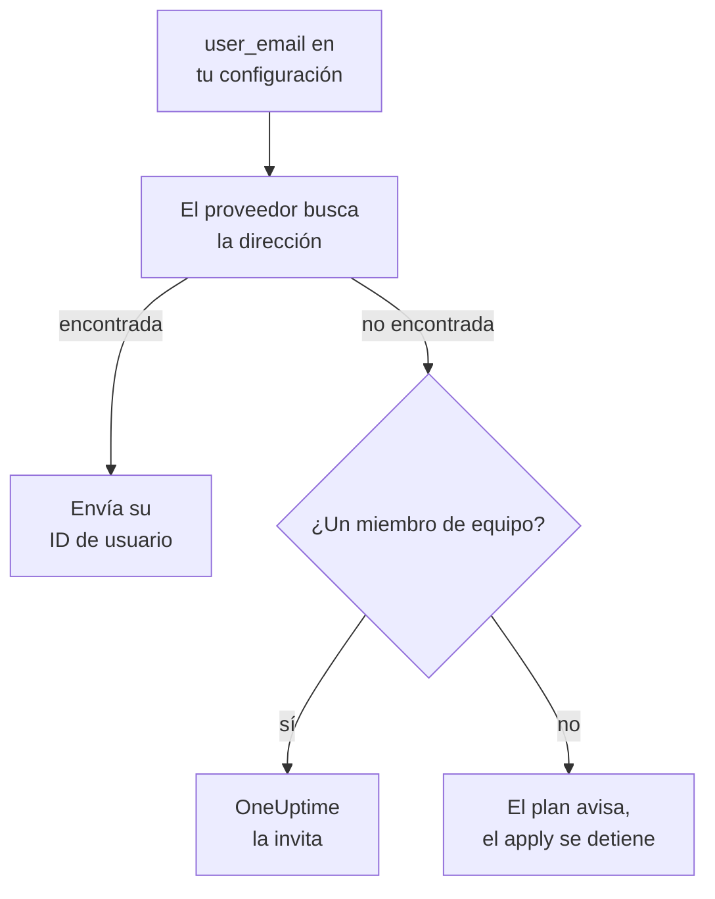

# Personas y equipos

Guarda en tu configuración de Terraform quién está en tu proyecto: los equipos y sus miembros, quién está de guardia y quién es dueño de qué. Nombra a cada persona por su dirección de correo: el proveedor la encuentra e invita a quien sea nuevo en el proyecto.

:::cards
- [Nombrar a las personas por su correo](#nombrar-a-las-personas-por-su-correo): El atributo junto a cada ID de usuario.
- [Incorporar a alguien](#incorporar-a-alguien): Invita a alguien y dale un equipo, guardias y algo de lo que ser dueño.
- [Dar de baja a alguien](#dar-de-baja-a-alguien): Quita a alguien, y lo que OneUptime quita con esa persona.
- [Importar los miembros que ya tienes](#importar-los-miembros-que-ya-tienes): Por su equipo y su dirección.
:::

## Cómo funciona

El proveedor busca la dirección entre las personas del proyecto de la clave de API: sus miembros y las personas invitadas a él. Envía a la API el ID de la persona que encuentra. Un miembro de equipo nombrado por una dirección que nadie tiene en el proyecto invita a esa dirección en su lugar.



Solo se busca en el propio proyecto de la clave de API. Nunca se encuentra a nadie de fuera, y el proveedor no puede saber si una dirección tiene una cuenta en otro sitio.

## Antes de empezar

- **Una clave de API que pueda leer los equipos del proyecto.** El proveedor encuentra a las personas a través de ellos.
- **Para añadir a alguien nuevo, una clave que pueda invitar a personas.** Consulta [Invitar a personas](/docs/permissions/inviting-people).

## Nombrar a las personas por su correo

Todo recurso que nombra a una persona acepta su dirección de correo junto a su ID de usuario. Indica uno de los dos:

| ID de usuario | Dirección de correo |
| --- | --- |
| `user_id` | `user_email` |
| `owner_users` | `owner_user_emails` |
| `assigned_to_user_id` | `assigned_to_user_email` |
| `override_user_id` | `override_user_email` |

La dirección se encuentra sin importar mayúsculas y minúsculas, y se guarda en el state tal como la escribiste. El ID de usuario se rellena, para que otros recursos puedan referirse a él.

## Incorporar a alguien

Esta configuración añade a Alice, que es nueva en el proyecto, a un equipo, le da guardias desde su primer día y hace a Bob, que ya está en el proyecto, dueño de un monitor:

```hcl title="people.tf"
resource "oneuptime_team" "sre" {
  name        = "SRE"
  description = "Site reliability engineering"
}

# New to the project: OneUptime invites her.
resource "oneuptime_team_member" "alice" {
  team_id    = oneuptime_team.sre.id
  user_email = "alice@example.com"
}

resource "oneuptime_on_call_policy_schedule" "weekly" {
  name     = "SRE weekly"
  timezone = "UTC"
}

resource "oneuptime_on_call_schedule_layer" "weekly" {
  on_call_duty_policy_schedule_id = oneuptime_on_call_policy_schedule.weekly.id
  name                            = "Weekly"
  starts_at                       = "2030-01-07T09:00:00Z"
  hand_off_time                   = "2030-01-14T09:00:00Z"
}

# Named through her membership, so she is invited first.
resource "oneuptime_on_call_schedule_layer_user" "alice" {
  on_call_duty_policy_schedule_id       = oneuptime_on_call_policy_schedule.weekly.id
  on_call_duty_policy_schedule_layer_id = oneuptime_on_call_schedule_layer.weekly.id
  user_id                               = oneuptime_team_member.alice.user_id
}

resource "oneuptime_monitor" "api" {
  name         = "Public API"
  monitor_type = "Manual"
}

# In the project already: named by his address.
resource "oneuptime_monitor_user_owner" "api" {
  monitor_id = oneuptime_monitor.api.id
  user_email = "bob@example.com"
}
```

`terraform apply` invita a Alice por correo, como lo hace una invitación desde el panel. OneUptime le crea una cuenta si no tiene una. `has_accepted_invitation` sigue en `false` hasta que acepta, y que acepte no es ningún cambio en el plan. Quien ya está en el proyecto entra en un equipo nuevo al instante.

Para poner de guardia a alguien que esta configuración invita, o hacerlo dueño, refiérete a su membresía con `user_id = oneuptime_team_member.<name>.user_id`: así Terraform lo invita antes de nombrarlo en cualquier otro lugar. Una dirección que nadie tiene en el proyecto es un aviso en el plan y un error en el apply.

## Encontrar a alguien

La fuente de datos `oneuptime_user` busca a alguien por `email`, `name` o `id`, y lee su ID de usuario, su nombre, si se ha unido y los equipos en los que está:

```hcl
data "oneuptime_user" "alice" {
  email = "alice@example.com"
}

output "alice_teams" {
  value = data.oneuptime_user.alice.team_ids
}
```

## Dar de baja a alguien

Quita las membresías de la persona de tu configuración y aplícala. Fuera de su último equipo del proyecto, queda fuera del proyecto, y OneUptime la quita de todos los calendarios de guardia, reglas de escalado y sustituciones, y de lo que tiene a su cargo: de todo, salvo los incidentes, alertas y eventos de mantenimiento que ya terminaron. Quita en el mismo cambio los bloques que la nombran, o el siguiente plan los vuelve a crear para alguien que ya no está en el proyecto.

Su cuenta de OneUptime sigue siendo suya: solo deja el proyecto. Un equipo que debe conservar un miembro no permite perder al último que ha aceptado.

## Importar los miembros que ya tienes

Ninguna pantalla muestra el ID de una membresía, así que impórtala por el ID de su equipo y la dirección de la persona:

```bash
terraform import oneuptime_team_member.alice 6b1d1c2e-4f3a-4b5c-8d6e-7f8091a2b3c4/alice@example.com
```

La dirección se queda tal como la escribiste, así que escríbela como en tu configuración. El propio ID de la membresía también la importa, y entonces la dirección se lee de OneUptime, en minúsculas.

## Cuando alguien cambia su dirección

Una persona que cambia su dirección en OneUptime sigue siendo la misma persona para Terraform: nada cambia hasta que escribes la nueva dirección, y entonces solo cambia `user_email`.

## Solución de problemas

:::details El plan dice que una dirección aún no está en este proyecto
Nadie en el proyecto, ni invitado a él, tiene esa dirección. Invita primero a la persona con un `oneuptime_team_member`. Si esa membresía está en la misma configuración, refiérete a ella con `user_id = oneuptime_team_member.<name>.user_id` en lugar de la dirección. Si cambió su dirección en OneUptime, usa la nueva.
:::

:::details El apply dice que el usuario ya ha sido invitado a este equipo
La persona ya está en el equipo. Importa esa membresía en lugar de crearla, como en [Importar los miembros que ya tienes](#importar-los-miembros-que-ya-tienes).
:::

## Próximos pasos

:::cards
- [Importar recursos](/docs/terraform/importing-resources): Pon el resto de tu proyecto bajo Terraform.
- [Invitar a personas](/docs/permissions/inviting-people): Cómo funcionan las invitaciones en OneUptime.
- [Ejemplos](/docs/terraform/examples): Configuraciones listas para usar con los recursos habituales.
:::
