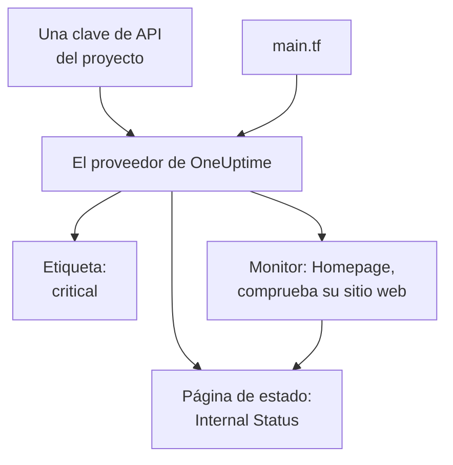

# Inicio rápido

Esta guía le lleva de cero a un proyecto de OneUptime gestionado por Terraform en unos diez minutos. Crea una clave de API, dirige Terraform a su proyecto y aplica una etiqueta, un monitor que comprueba su sitio web y una página de estado privada que lo muestra. Después cambia uno de ellos y lo limpia todo.

:::cards
- [Antes de empezar](#antes-de-empezar): Terraform, un proyecto y un plan con claves de API.
- [Crear sus primeros recursos](#crear-sus-primeros-recursos): De una clave de API a un plan aplicado, en seis pasos.
- [Cambiar un recurso](#cambiar-un-recurso): Editar la configuración, planificar y aplicar.
- [Solución de problemas](#solución-de-problemas): Los errores en los que puede detenerse una primera ejecución.
:::



## Antes de empezar

- **Terraform 1.5 o posterior, u OpenTofu 1.6 o posterior.** Con OpenTofu, ejecute `tofu` dondequiera que esta guía ejecuta `terraform`.
- **Un proyecto de OneUptime** en [oneuptime.com](https://oneuptime.com) o en su propia instancia de OneUptime, en el que pueda crear claves de API.
- **En OneUptime Cloud, el plan Growth o superior.** Las claves de API de un proyecto solo funcionan con él.

## Crear sus primeros recursos

:::steps
### Crear una clave de API del proyecto

En el panel de OneUptime, abra **Ajustes del proyecto → Avanzado → Claves de API** y haga clic en **Crear Clave de API**. Dele un **Nombre**, como `terraform`, y en **Acceso** elija **Administrador del proyecto**: Terraform crea, lee, cambia y elimina cada tipo de registro que gestiona, y **Administrador del proyecto** puede hacer todo eso. Para una clave más limitada, elija **Elegir los permisos más tarde** y añada en la página de la clave solo los permisos que necesite.

La clave caduca dentro de un año. Para elegir otra fecha, abra **Más campos** antes de crearla, o cambie la fecha más tarde en la página de la clave. Una vez creada la clave, se abre su página: copie la **Clave de API** de la tarjeta **Detalles de la clave de API**.

### Poner la clave a disposición de Terraform

Ponga la clave en la variable de entorno `ONEUPTIME_API_KEY` de la shell en la que ejecuta Terraform, para que nunca acabe en un archivo:

:::tabs
@tab Linux
```bash
export ONEUPTIME_API_KEY="<your-api-key>"
```
@tab macOS
```bash
export ONEUPTIME_API_KEY="<your-api-key>"
```
@tab Windows
```powershell
$env:ONEUPTIME_API_KEY = "<your-api-key>"
```
:::

### Dirigir Terraform a OneUptime

Cree una carpeta vacía y, dentro, un archivo llamado `main.tf`:

```hcl title="main.tf"
terraform {
  required_providers {
    oneuptime = {
      source  = "oneuptime/oneuptime"
      version = "{{TERRAFORM_PROVIDER_VERSION}}"
    }
  }
}

provider "oneuptime" {
  # The API key comes from ONEUPTIME_API_KEY.
  # On a self-hosted OneUptime, add your OneUptime's address:
  # oneuptime_url = "https://oneuptime.example.com"
}
```

En una instancia de OneUptime autoalojada, lea la [Configuración autoalojada](/docs/terraform/self-hosted) antes de elegir una versión del proveedor.

### Describir sus recursos

Añada estos bloques a `main.tf`. Leen dos de los estados de monitor con los que empieza cada proyecto y crean una etiqueta, un monitor que comprueba `https://example.com` cada cinco minutos (ponga ahí su propio sitio web) y una página de estado privada que muestra el monitor:

```hcl title="main.tf"
data "oneuptime_monitor_status" "operational" {
  name = "Operational"
}

data "oneuptime_monitor_status" "offline" {
  name = "Offline"
}

resource "oneuptime_label" "critical" {
  name        = "critical"
  description = "Resources that page on-call when down"
  color       = "#FF5733"
}

resource "oneuptime_monitor" "homepage" {
  name                = "Homepage"
  description         = "Checks that the homepage responds"
  monitor_type        = "Website"
  monitoring_interval = "*/5 * * * *"
  labels              = [oneuptime_label.critical.id]

  monitor_steps = [{
    monitor_destination      = "https://example.com"
    monitor_destination_type = "URL"
    request_type             = "GET"

    criteria = [
      {
        name                  = "Offline"
        description           = "The homepage does not respond"
        filter_condition      = "Any"
        change_monitor_status = true
        monitor_status_id     = data.oneuptime_monitor_status.offline.id

        filters = [
          {
            check_on    = "Is Online"
            filter_type = "False"
          }
        ]
      },
      {
        name                  = "Online"
        description           = "The homepage responds"
        filter_condition      = "All"
        change_monitor_status = true
        monitor_status_id     = data.oneuptime_monitor_status.operational.id

        filters = [
          {
            check_on    = "Is Online"
            filter_type = "True"
          }
        ]
      }
    ]
  }]
}

resource "oneuptime_status_page" "internal" {
  name                  = "Internal Status"
  description           = "Status of our internal services"
  page_title            = "Service Status"
  is_public_status_page = false
}

resource "oneuptime_status_page_resource" "homepage" {
  status_page_id = oneuptime_status_page.internal.id
  monitor_id     = oneuptime_monitor.homepage.id
  display_name   = "Homepage"
}

output "monitor_id" {
  value = oneuptime_monitor.homepage.id
}
```

Los `monitor_steps` del monitor dicen qué comprueba y qué significa cada resultado: tras cada comprobación, el primer criterio que coincide fija su estado. [Pasos del monitor](/docs/terraform/monitor-steps) explica cada parte.

### Planificar y aplicar

:::tabs
@tab Terraform
```bash
terraform init
terraform plan
terraform apply
```
@tab OpenTofu
```bash
tofu init
tofu plan
tofu apply
```
:::

`init` descarga el proveedor. El plan termina con `Plan: 4 to add, 0 to change, 0 to destroy.` Escriba `yes` para aplicarlo; cuando termina, Terraform muestra el ID del nuevo monitor.

### Comprobar el panel

En el panel de OneUptime:

- **Monitores** lista `Homepage`, con la etiqueta `critical`. Su primera comprobación llega en pocos minutos.
- **Páginas de estado** lista `Internal Status`, que muestra `Homepage`.
- **Ajustes del proyecto → Básico → Etiquetas** lista `critical`, en el color que indicó.

Ejecute `terraform plan` otra vez. Responde `No changes.`: OneUptime tiene exactamente lo que dice la configuración.
:::

## Cambiar un recurso

Cambie la configuración, no el panel. Ponga el `color` de la etiqueta a `"#2ECC71"` en `main.tf` y luego planifique y aplique:

```bash
terraform plan
terraform apply
```

El plan termina con `Plan: 0 to add, 1 to change, 0 to destroy.`: la etiqueta se cambia en el sitio. Un cambio que alguien haga en el panel a un recurso que gestiona Terraform aparece en el siguiente plan, y aplicarlo restablece lo que dice la configuración.

## Limpiar

Si era una prueba, elimine lo que creó la configuración:

```bash
terraform destroy
```

Esto elimina la etiqueta, el monitor, la página de estado y su recurso. Los dos estados de monitor se quedan: las fuentes de datos solo los leen.

## Solución de problemas

:::details Mensaje «Missing API Key»
El proveedor no encontró ninguna clave de API. Exporte `ONEUPTIME_API_KEY` en la shell en la que ejecuta Terraform, o indique `api_key` en el bloque del proveedor, y vuelva a ejecutar el comando.
:::

:::details Mensaje «the OneUptime API returned status 400: Invalid API Key»
La clave está mal escrita, caducada o eliminada, o pertenece a otra instancia de OneUptime distinta de la que indica `oneuptime_url`. Copie de nuevo la clave desde su página, o cree una nueva.
:::

:::details Mensaje «the OneUptime API returned status 402: API keys need the Growth plan»
En OneUptime Cloud, las claves de API de un proyecto solo funcionan con el plan Growth o superior. Mejore el plan del proyecto en **Ajustes del proyecto → Facturación y facturas → Facturación**, y la misma clave vuelve a funcionar.
:::

:::details Mensaje «the OneUptime API returned status 422: You do not have permissions to create Monitor»
La clave no tiene permiso para ese tipo de registro. En la página de la clave, dele **Administrador del proyecto**, o el permiso que nombra el mensaje.
:::

:::details Mensaje «No monitor status matches {name = "Offline"}»
Los estados de monitor de su proyecto tienen otros nombres. Use los nombres que ve en **Monitores → Ajustes → Estado del monitor**, o busque el estado por `is_offline_state = true`.
:::

## Próximos pasos

:::cards
- [Guía completa](/docs/terraform/complete-guide): Autenticación, estructura del proyecto, fuentes de datos, estado y actualizaciones.
- [Pasos del monitor](/docs/terraform/monitor-steps): Decidir qué comprueba un monitor y qué significa cada resultado.
- [Ejemplos](/docs/terraform/examples): Configuraciones listas para usar para los recursos habituales.
- [Importar recursos](/docs/terraform/importing-resources): Poner bajo Terraform lo que creó en el panel.
:::
