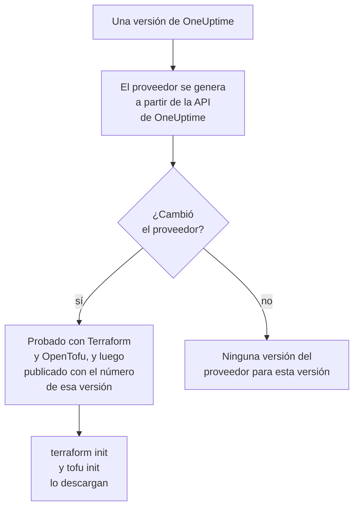

# Uso del registro

El proveedor de OneUptime se publica en el [Terraform Registry](https://registry.terraform.io/providers/oneuptime/oneuptime) y en el [OpenTofu Registry](https://search.opentofu.org/provider/oneuptime/oneuptime/latest). `terraform init` y `tofu init` lo descargan de ahí: no hay nada que instalar a mano. Esta página explica qué se publica, cómo se numeran las versiones y cómo pasar a una más nueva.

:::cards
- [Qué se publica](#qué-se-publica): El proveedor para cada plataforma, su referencia y sus versiones.
- [Cómo se numeran las versiones](#cómo-se-numeran-las-versiones): La versión de un proveedor es la versión de OneUptime que lo publicó.
- [El archivo de bloqueo](#el-archivo-de-bloqueo): La versión y las sumas de comprobación que instala cada máquina.
- [Pasar a una versión más nueva](#pasar-a-una-versión-más-nueva): Lea qué cambió, descárguela y planifique.
:::

## Qué se publica

Cada versión de OneUptime genera el proveedor a partir de la propia API de OneUptime. Cuando el proveedor cambió, la versión lo publica, con el número de esa versión, una vez que ha superado sus pruebas de extremo a extremo con Terraform y con OpenTofu:



| Qué | Dónde |
| --- | --- |
| El proveedor, para Linux, macOS, Windows, FreeBSD, OpenBSD y Solaris | Lo descargan `terraform init` y `tofu init`, con sumas de comprobación que firma OneUptime |
| La referencia de cada recurso y fuente de datos, con cada uno de sus atributos | La documentación del registro, agrupada por producto: monitores, páginas de estado, incidentes, guardias y los demás |
| Una guía para usar el proveedor con OpenTofu | Las guías del registro |
| Cada versión, la más nueva primero | La lista de versiones del registro |

La referencia indica qué es cada atributo. Estos documentos muestran cómo usarlos juntos: empiece por la [Visión general de Terraform](/docs/terraform/index).

## Cómo se numeran las versiones

La versión de un proveedor es la de la versión de OneUptime que lo publicó: el proveedor {{TERRAFORM_PROVIDER_MAJOR}}.0.20 llegó con OneUptime {{TERRAFORM_PROVIDER_MAJOR}}.0.20. Una versión cuyo proveedor no cambió no publica ninguno, así que las versiones tienen huecos, y una restricción que nombra una sola versión exacta puede nombrar una versión que no existe. Escriba en su lugar un rango:

| Usted usa | Restricción | Terraform instala |
| --- | --- | --- |
| OneUptime Cloud | `{{TERRAFORM_PROVIDER_VERSION}}` | El proveedor {{TERRAFORM_PROVIDER_MAJOR}}.x más reciente |
| Un OneUptime autoalojado | Un rango que termine en la versión de su OneUptime, como `>= {{TERRAFORM_PROVIDER_MAJOR}}.0, <= {{TERRAFORM_PROVIDER_MAJOR}}.0.40` | El proveedor más reciente que no sea más nuevo que su OneUptime |

En un OneUptime autoalojado, un proveedor más nuevo que su OneUptime puede enviar ajustes que su OneUptime aún no tiene: [Configuración autoalojada](/docs/terraform/self-hosted#elegir-la-versión-del-proveedor) muestra cómo escribir su rango.

```hcl title="main.tf"
terraform {
  required_providers {
    oneuptime = {
      source  = "oneuptime/oneuptime"
      version = "{{TERRAFORM_PROVIDER_VERSION}}"
    }
  }
}
```

La dirección de origen no nombra ningún registro: Terraform la lee del Terraform Registry, y OpenTofu del OpenTofu Registry, que publican las mismas versiones.

## El archivo de bloqueo

`terraform init` registra la versión que eligió, y las sumas de comprobación de sus descargas, en `.terraform.lock.hcl`. Confirme ese archivo: cada máquina y cada ejecución de CI instalan entonces exactamente esa versión, hasta que elija otra. Las sumas de comprobación cubren cada plataforma que publica el registro, así que un archivo de bloqueo sirve igual a las máquinas con Linux, macOS y Windows.

```hcl title=".terraform.lock.hcl"
provider "registry.terraform.io/oneuptime/oneuptime" {
  version     = "{{TERRAFORM_PROVIDER_MAJOR}}.0.20"
  constraints = "{{TERRAFORM_PROVIDER_VERSION}}"
  hashes = [
    "h1:...",
    "zh:...",
  ]
}
```

El archivo de bloqueo nombra el registro. OpenTofu escribe `registry.opentofu.org/oneuptime/oneuptime` donde Terraform escribe `registry.terraform.io/oneuptime/oneuptime`, así que cambiar de motor cambia el archivo de bloqueo: `init` sustituye la entrada, y le pide que confirme el cambio.

## Pasar a una versión más nueva

:::steps
### Leer qué cambió

[Las versiones de OneUptime](https://github.com/OneUptime/oneuptime/releases) dicen qué cambió cada versión, incluido el proveedor. [Las versiones del proveedor](https://github.com/OneUptime/terraform-provider-oneuptime/releases) enlazan a los cambios desde la anterior.

### Descargarla

```bash
terraform init -upgrade
```

`init -upgrade` toma la versión más reciente que permite su restricción, la imprime y actualiza `.terraform.lock.hcl`. La restricción `{{TERRAFORM_PROVIDER_VERSION}}` toma cada versión {{TERRAFORM_PROVIDER_MAJOR}}.x; una nueva versión principal necesita una nueva restricción.

### Planificar antes de aplicar

Ejecute `terraform plan`, y aplique solo cuando esté vacío o muestre los cambios que espera. Confirme el archivo de bloqueo actualizado.
:::

En un OneUptime autoalojado, actualice primero OneUptime, y luego suba el final del rango del proveedor.

## Dónde está el código

El proveedor se genera a partir de la API de OneUptime en el [repositorio principal de OneUptime](https://github.com/OneUptime/oneuptime), y cada versión se construye a partir de la versión que la publicó. Su propio repositorio, [OneUptime/terraform-provider-oneuptime](https://github.com/OneUptime/terraform-provider-oneuptime), guarda lo que escribió el generador, así que los cambios se hacen en el repositorio principal: notifique los problemas, también los de la documentación, en [github.com/OneUptime/oneuptime/issues](https://github.com/OneUptime/oneuptime/issues).

## Próximos pasos

:::cards
- [Configuración autoalojada](/docs/terraform/self-hosted): El rango de versiones para su propio OneUptime, y un espejo para las máquinas sin conexión.
- [OpenTofu](/docs/terraform/opentofu): El mismo proveedor y la misma configuración, con `tofu`.
- [Guía completa](/docs/terraform/complete-guide): Autenticación, organización del proyecto, fuentes de datos, estado y actualizaciones.
- [Solución de problemas](/docs/terraform/troubleshooting): Errores comunes y cómo solucionarlos.
:::
