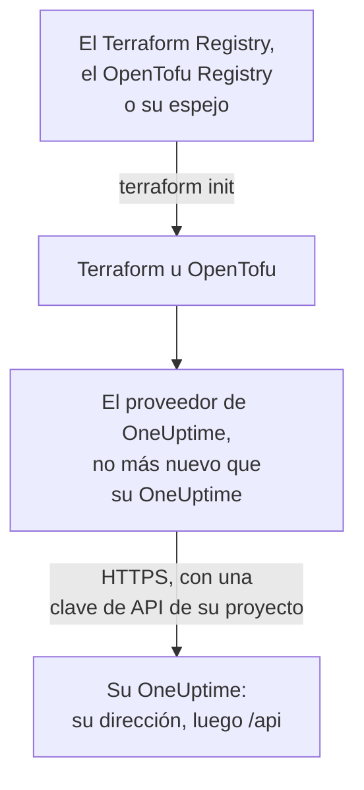

# Configuración autoalojada

El proveedor funciona con su propio OneUptime igual que con OneUptime Cloud: los mismos recursos, los mismos atributos y las mismas claves de API del proyecto. Lo que le toca definir: la dirección de su OneUptime, la versión del proveedor que le corresponde y, donde los necesite, un espejo para las máquinas sin acceso a internet y la confianza en una autoridad de certificación privada.

:::cards
- [Apuntar el proveedor a su OneUptime](#apuntar-el-proveedor-a-su-oneuptime): Su dirección, y una clave de API de su proyecto.
- [Elegir la versión del proveedor](#elegir-la-versión-del-proveedor): El proveedor más reciente que no sea más nuevo que su OneUptime.
- [Sin acceso a internet](#sin-acceso-a-internet): Replique el proveedor en su red.
- [TLS y certificados](#tls-y-certificados): Una autoridad de certificación privada, proxies y HTTP sin cifrar.
:::



## Apuntar el proveedor a su OneUptime

Defina `oneuptime_url` con la dirección en la que abre el panel: el esquema y el host, sin ruta. El proveedor añade `https://` cuando la dirección no tiene esquema, y `/api` al final, así que `https://oneuptime.example.com` envía cada petición a `https://oneuptime.example.com/api`.

```hcl title="main.tf"
terraform {
  required_providers {
    oneuptime = {
      source  = "oneuptime/oneuptime"
      version = "{{TERRAFORM_PROVIDER_MATCHING}}"
    }
  }
}

provider "oneuptime" {
  oneuptime_url = "https://oneuptime.example.com"
  # The API key comes from the ONEUPTIME_API_KEY environment variable.
}
```

La dirección puede venir en su lugar de la variable de entorno `ONEUPTIME_URL`, de modo que una configuración puede apuntar a varias instalaciones:

```bash
export ONEUPTIME_URL="https://oneuptime.example.com"
export ONEUPTIME_API_KEY="<your-api-key>"
```

La dirección es el host en el que se sirve su instalación: `HOST` y `HTTP_PROTOCOL` en `config.env` con Docker Compose, y `host` y `httpProtocol` en los valores del chart de Helm.

La clave es una clave de API del proyecto que gestiona, creada en el panel de su OneUptime en **Ajustes del proyecto → Avanzado → Claves de API**, como en OneUptime Cloud. La clave de API maestra de un OneUptime autoalojado no pertenece a ningún proyecto, así que una creación hecha con ella falla con `ProjectId required`.

> [!TIP]
> Su OneUptime escribe este bloque por usted. Abra cualquier recurso o lista en el panel, y luego **Desarrolladores** y **Terraform** en su menú lateral: el bloque del proveedor que muestra tiene la dirección de su OneUptime, y un rango de versiones que le corresponde.

## Elegir la versión del proveedor

Use el proveedor publicado más reciente que no sea más nuevo que su OneUptime. Las versiones del proveedor siguen a las de OneUptime: una versión de OneUptime que cambia el proveedor lo publica con su propio número de versión, y un proveedor más nuevo que su OneUptime puede enviar ajustes que su OneUptime aún no tiene.

Así que escriba un rango que termine en la versión de su OneUptime, como hace el panel. El bloque de arriba toma `{{TERRAFORM_PROVIDER_MATCHING}}`, el rango para el OneUptime del que vienen estos documentos: cuando los lee en su propio OneUptime, ese rango es el suyo. Si no, escriba su propia versión:

:::steps
### Averiguar la versión de su OneUptime

Pregúntesela a su OneUptime:

```bash
curl https://oneuptime.example.com/version
```

La respuesta es JSON, como `{"version":"{{TERRAFORM_PROVIDER_MAJOR}}.0.40","commit":"..."}`. Como administrador maestro, también puede abrir la etiqueta de la edición en la cabecera del panel de administración: consulte [Averiguar su versión actual](/docs/installation/upgrading#averigüe-su-versión-actual).

### Escribirla en el rango

El rango empieza en la versión principal y termina en la suya. Para un OneUptime {{TERRAFORM_PROVIDER_MAJOR}}.0.40:

```hcl title="main.tf"
terraform {
  required_providers {
    oneuptime = {
      source  = "oneuptime/oneuptime"
      version = ">= {{TERRAFORM_PROVIDER_MAJOR}}.0, <= {{TERRAFORM_PROVIDER_MAJOR}}.0.40"
    }
  }
}
```

Terraform toma el proveedor más reciente del rango. Una versión de OneUptime que no cambió el proveedor no publica ninguno, y el rango salta las versiones que no existen.

### Descargar el proveedor

Ejecute `terraform init`. Imprime la versión que instaló y la registra en `.terraform.lock.hcl`.
:::

Al actualizar, actualice primero OneUptime. Después suba el final del rango a su nueva versión, y ejecute `terraform init -upgrade`.

## Sin acceso a internet

Cuando las máquinas que ejecutan Terraform no pueden llegar al registro, copie el proveedor una vez a su red, y apunte Terraform a la copia.

:::steps
### Replicar el proveedor

En una máquina con acceso a internet, en una carpeta con su configuración, descargue el proveedor para cada plataforma que ejecuten sus máquinas. Sin `-platform`, el comando descarga el proveedor solo para su propia plataforma:

:::tabs
@tab Terraform
```bash
terraform providers mirror -platform=linux_amd64 -platform=darwin_arm64 /srv/terraform-mirror
```
@tab OpenTofu
```bash
tofu providers mirror -platform=linux_amd64 -platform=darwin_arm64 /srv/terraform-mirror
```
:::

La carpeta guarda el proveedor bajo la dirección del registro, como `registry.terraform.io/oneuptime/oneuptime/`. Cópiela a su red.

### Apuntar Terraform al espejo

Escriba un archivo de configuración de la CLI que instale el proveedor de OneUptime desde la carpeta, y todo lo demás como de costumbre:

:::tabs
@tab Terraform
```hcl title="mirror.tfrc"
provider_installation {
  filesystem_mirror {
    path    = "/srv/terraform-mirror"
    include = ["registry.terraform.io/oneuptime/oneuptime"]
  }
  direct {
    exclude = ["registry.terraform.io/oneuptime/oneuptime"]
  }
}
```
@tab OpenTofu
```hcl title="mirror.tfrc"
provider_installation {
  filesystem_mirror {
    path    = "/srv/terraform-mirror"
    include = ["registry.opentofu.org/oneuptime/oneuptime"]
  }
  direct {
    exclude = ["registry.opentofu.org/oneuptime/oneuptime"]
  }
}
```
:::

Nómbrelo en `TF_CLI_CONFIG_FILE`, que leen tanto Terraform como OpenTofu: `export TF_CLI_CONFIG_FILE=/etc/terraform/mirror.tfrc`.

### Inicializar

Ejecute `terraform init`: instala el proveedor desde el espejo. Advierte de que el archivo de bloqueo ahora solo tiene sumas de comprobación para esta plataforma. Para registrarlas para cada plataforma, ejecute `terraform providers lock` con las mismas opciones `-platform` en la máquina con acceso a internet, y confirme `.terraform.lock.hcl` junto con su configuración.
:::

Vuelva a replicar cada vez que suba el rango de versiones.

## TLS y certificados

El proveedor comprueba el certificado de su OneUptime contra el almacén de confianza de la máquina que ejecuta Terraform, y no hay ningún ajuste para saltarse la comprobación. Cuando el certificado procede de una autoridad de certificación privada, añada esa autoridad al almacén de confianza de cada máquina y runner de CI que ejecute Terraform:

:::tabs
@tab Debian / Ubuntu
```bash
sudo cp my-ca.crt /usr/local/share/ca-certificates/
sudo update-ca-certificates
```
@tab RHEL / Fedora
```bash
sudo cp my-ca.crt /etc/pki/ca-trust/source/anchors/
sudo update-ca-trust
```
:::

En Linux, donde no pueda cambiar el almacén de confianza, como en un contenedor de CI, defina `SSL_CERT_FILE` con un archivo que contenga su autoridad y las públicas. En macOS y Windows, añada la autoridad al almacén de certificados del sistema.

- **Proxies.** El proveedor envía sus peticiones a través del proxy de `HTTPS_PROXY`, salvo a los hosts de `NO_PROXY`. Un proxy inverso delante de OneUptime debe dejar pasar sin cambios cada ruta `/api` y la cabecera `APIKey`.
- **HTTP sin cifrar.** Una dirección `http://` funciona, para una instalación de prueba. La clave de API viaja con cada petición, así que use HTTPS para todo lo demás.

## Solución de problemas

:::details Mensaje «x509: certificate signed by unknown authority»
La máquina que ejecuta Terraform no confía en el certificado de su OneUptime: añada su autoridad de certificación como muestra [TLS y certificados](#tls-y-certificados).
:::

:::details Mensaje «invalid character '<' looking for beginning of value»
Respondió una página web en lugar de la API: `oneuptime_url` tiene una ruta, o respondió un proxy. Defínalo solo con la dirección de su OneUptime.
:::

:::details Mensaje «no available releases match the given constraints»
Ningún proveedor publicado encaja con la restricción de versión, por ejemplo una que nombra una sola versión que OneUptime nunca publicó. Escriba un rango, como muestra [Elegir la versión del proveedor](#elegir-la-versión-del-proveedor).
:::

:::details Mensaje «ProjectId required»
La clave es la clave de API maestra, que no pertenece a ningún proyecto. Cree una clave de API del proyecto, en **Ajustes del proyecto → Avanzado → Claves de API**.
:::

[Solución de problemas](/docs/terraform/troubleshooting) tiene los demás errores, y lo que significa cada uno.

## Próximos pasos

:::cards
- [Inicio rápido](/docs/terraform/quick-start): Cree una clave de API y aplique sus primeros recursos.
- [Uso del registro](/docs/terraform/registry): Dónde se publica el proveedor, y cómo se numeran las versiones.
- [Solución de problemas](/docs/terraform/troubleshooting): Errores comunes y cómo solucionarlos.
- [Actualización](/docs/installation/upgrading): Actualice su OneUptime, antes de subir el rango del proveedor.
:::
