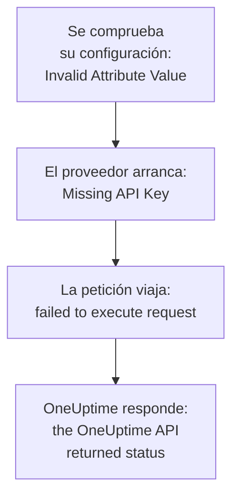

# Solución de problemas

Busque en la tabla de abajo el mensaje que imprimió Terraform, o lo que vio que ocurría: cada fila lleva a su solución. Las secciones que siguen a la tabla explican cada error, agrupadas según de dónde viene.

:::cards
- [Encuentre su error](#encuentre-su-error): Cada mensaje y síntoma de esta página, con su solución.
- [Claves de API, permisos y planes](#claves-de-api-permisos-y-planes): Cuando OneUptime rechaza la clave del proveedor.
- [Planes que no se estabilizan](#planes-que-no-se-estabilizan): Cambios que vuelven, y recursos que salen del estado.
- [Conectarse a un OneUptime autoalojado](#conectarse-a-un-oneuptime-autoalojado): La dirección, los certificados y los proxies.
:::

## Encuentre su error

| Mensaje o síntoma | Qué hacer |
| --- | --- |
| `Missing API Key` | Dé al proveedor su clave: consulte [`Missing API Key` o `Invalid API Key`](#missing-api-key-o-invalid-api-key) |
| `Invalid API Key` | Copie la clave de nuevo, o cree una nueva: consulte [`Missing API Key` o `Invalid API Key`](#missing-api-key-o-invalid-api-key) |
| `ProjectId required` | Use una clave de API del proyecto, no una clave maestra: consulte [`ProjectId required`](#projectid-required) |
| `You do not have permissions to create Monitor` | Dé a la clave el permiso que nombra el mensaje: consulte [A la clave le falta un permiso](#a-la-clave-le-falta-un-permiso) |
| `API keys need the Growth plan` | Devuelva el proyecto al plan Growth: consulte [Pago requerido](#pago-requerido) |
| `402` para un recurso o un ajuste | Mejore el plan, o deje el ajuste en su valor predeterminado: consulte [Pago requerido](#pago-requerido) |
| `This project has been blocked` | Pida a un administrador maestro que desbloquee el proyecto: consulte [Un proyecto bloqueado](#un-proyecto-bloqueado) |
| `references records that are not in this project` | Use el ID de un registro de su propio proyecto: consulte [ID de otro proyecto](#id-de-otro-proyecto) |
| `Not Found` o `Ambiguous Match` de una fuente de datos | Corrija los argumentos de la búsqueda: consulte [Búsquedas que no encuentran ninguno o encuentran varios](#búsquedas-que-no-encuentran-ninguno-o-encuentran-varios) |
| `Cannot import non-existent remote object` | Compruebe el ID y los permisos de la clave: consulte [Importar recursos](/docs/terraform/importing-resources#solución-de-problemas) |
| `Provider produced inconsistent result after apply` | Actualice el proveedor: consulte [Resultado incoherente tras el apply](#resultado-incoherente-tras-el-apply) |
| Un plan crea un recurso que usted no añadió | La clave ya no puede leerlo, y OneUptime respondió `404`: devuelva a la clave el acceso de lectura y luego importe el recurso con `terraform import`: consulte [Un recurso sale del estado, y el siguiente apply lo vuelve a crear](#un-recurso-sale-del-estado-y-el-siguiente-apply-lo-vuelve-a-crear) |
| Un `priority` o un `order` cambia tras el apply | Dé a cada uno un número que no tenga ningún otro: consulte [Una prioridad o un orden que se mueve](#una-prioridad-o-un-orden-que-se-mueve) |
| `Invalid Configuration for Read-Only Attribute` | Quite el atributo de la configuración: consulte [Atributos de solo lectura](#atributos-de-solo-lectura) |
| `has been renamed to` | Cambie el nombre del tipo de recurso, con un bloque `moved`: consulte [Un tipo de recurso renombrado](#un-tipo-de-recurso-renombrado) |
| Un monitor creado con Terraform nunca muestra sus comprobaciones | Actualice OneUptime: consulte [Monitores creados antes de los ID de pasos](#monitores-creados-antes-de-los-id-de-pasos) |
| `must contain at least 1 elements` | Omita el atributo en lugar de dejarlo vacío: consulte [Valores vacíos](#valores-vacíos) |
| JSON del panel en un archivo `.tf` | Escríbalo como HCL: consulte [JSON del panel](#json-del-panel) |
| `no available releases match the given constraints` | Use un rango de versiones, no una sola versión exacta: consulte [Una versión que nunca se publicó](#una-versión-que-nunca-se-publicó) |
| `x509: certificate signed by unknown authority` | Confíe en su autoridad de certificación: consulte [Certificados](#certificados) |
| `invalid character '<' looking for beginning of value` | Apunte `oneuptime_url` a su propio OneUptime: consulte [Una página web en lugar de la API](#una-página-web-en-lugar-de-la-api) |
| `connection refused` o `Client.Timeout exceeded` | Compruebe la dirección, la red y cualquier proxy: consulte [Conexiones que fallan](#conexiones-que-fallan) |

## Cómo leer un error

Un error nombra el paso que falló, y su mensaje dice de dónde vino:



- Un error que llega antes de cualquier petición, como `Invalid Attribute Value`, trata de su configuración: el proveedor la comprueba antes de hablar con OneUptime.
- `failed to execute request` significa que la petición nunca obtuvo respuesta: consulte [Conectarse a un OneUptime autoalojado](#conectarse-a-un-oneuptime-autoalojado).
- `the OneUptime API returned status` es la respuesta de OneUptime: el estado y el mensaje que lo sigue dicen qué rechazó OneUptime.

El proveedor nombra lo que estaba haciendo: `Unable to create monitor` y `Unable to update monitor` para un cambio, y `Unable to parse label response` cuando lee un recurso. Una lectura que OneUptime rechaza se notifica con el resumen `Parse Error`, pero el mensaje que lo sigue es la respuesta de OneUptime, no un problema de análisis.

## Claves de API, permisos y planes

### `Missing API Key` o `Invalid API Key`

`Missing API Key` detiene el proveedor antes de que haga ninguna petición: no están definidos ni `api_key` en el bloque del proveedor ni la variable de entorno `ONEUPTIME_API_KEY`. Exporte la variable en el shell donde ejecuta Terraform, o pase la clave en una variable marcada como `sensitive`.

`Invalid API Key` es la respuesta de OneUptime a una clave que no conoce: una mal escrita, caducada o eliminada, o una de otro OneUptime distinto del que indica `oneuptime_url`. Copie de nuevo la clave desde su página en **Ajustes del proyecto → Avanzado → Claves de API**, o cree una nueva.

### `ProjectId required`

El proveedor necesita una clave de API del proyecto que gestiona: de ahí viene el proyecto. La clave de API maestra de un OneUptime autoalojado no pertenece a ningún proyecto, así que toda creación hecha con ella falla con `ProjectId required`. Cree una clave de API del proyecto, como en [Crear una clave de API del proyecto](/docs/terraform/quick-start#crear-una-clave-de-api-del-proyecto), y úsela en su lugar.

### A la clave le falta un permiso

`You do not have permissions to create Monitor` y los mensajes parecidos llegan con el estado `422`: la clave no puede hacer eso con ese tipo de registro. Nombran los permisos que lo permitirían. Abra la página de la clave en **Ajustes del proyecto → Avanzado → Claves de API** y dele uno de ellos, o **Administrador del proyecto**. Una importación solo necesita el permiso de lectura.

### Pago requerido

- **402 Payment Required en cada petición** — `API keys need the Growth plan...`: en OneUptime Cloud, el proyecto está por debajo de **Growth**, y las claves de API de un proyecto - incluida la del proveedor - dejan de funcionar por debajo de él. Se rechaza cada llamada que hace el proveedor, también `terraform plan`, hasta que el proyecto vuelva a Growth; entonces la misma clave vuelve a funcionar, sin nada que cambiar en su configuración. Mejore el plan en **Ajustes del proyecto → Facturación y facturas → Facturación**, o gestione el proyecto en el panel mientras tanto. Consulte [Claves de API y SCIM por debajo de su plan](/docs/api-reference/api-reference#claves-de-api-y-scim-por-debajo-de-su-plan).
- **402 Payment Required** — ha alcanzado un límite de su plan de OneUptime, o la configuración activa un ajuste que su plan no incluye (una página de estado privada, informes por correo electrónico, un panel público, una lista de IP permitidas...), tanto si `terraform apply` crea el recurso con él como si lo cambia después. Terraform muestra el mensaje de OneUptime tal cual. Mejore el plan, o recorte la configuración.

Devolver uno de esos ajustes a su valor predeterminado, es decir, desactivar la función, funciona en cualquier plan, así que una configuración que desactiva funciones de pago se aplica tras terminar una prueba o al bajar de plan.

Lo mismo vale para los recursos que vende su plan y que un proyecto conserva tras bajar de plan - proveedores de SSO, conexiones SCIM, claves de API, calendarios de guardia, y reglas y resúmenes de Slack y Microsoft Teams: por debajo del plan (mientras el proyecto siga en Growth, que necesita la propia clave de API del proveedor), los que el proyecto ya tiene todavía se pueden leer (así funcionan `terraform plan` e `import`), eliminar (así se aplica quitarlos de la configuración, o `terraform destroy`) y desactivar donde tienen un atributo `is_enabled`. Crearlos, cambiarlos o volver a activarlos sigue respondiendo 402.

Otros recursos que vende su plan, como las plantillas, los campos personalizados y los grupos de monitores, siguen necesitando el plan para leerse, así que un plan que los refresca responde 402; aun así se pueden eliminar, por ejemplo con `terraform destroy -refresh=false`.

Los permisos de una clave de API no se eliminan uno a uno por debajo de Growth, ya que eliminar un permiso de bloqueo daría a la clave más acceso: ejecute `terraform state rm` sobre los recursos de permiso, luego destruya la clave, y sus permisos se van con ella.

### Un proyecto bloqueado

`This project has been blocked. Please contact your administrator.` llega con el estado `403`: un administrador maestro bloqueó el proyecto, y hasta que lo desbloquee, nadie salvo un administrador maestro actúa en él, tampoco las claves de API del proyecto.

## Registros y búsquedas

### ID de otro proyecto

Cada ID que nombra un recurso - las etiquetas de un monitor, la página de estado de un grupo de página de estado, el sitio de un dispositivo de red, los equipos de una regla de escalado - debe ser un registro del proyecto al que pertenece su clave de API. El ID de un registro de otro proyecto, un ID que no existe y el ID de un registro que la clave no puede leer reciben todos la misma respuesta, que nombra el campo y el ID:

```text
This network device references records that are not in this project: Network Site "…". Please pick values from this project and try again.
```

Suele significar que se copió un ID de la configuración o del estado de otro proyecto, o que el registro se eliminó fuera de Terraform. Haga referencia al registro mediante su recurso o una fuente de datos en la misma configuración (`oneuptime_label.critical.id`) en lugar de un ID literal, y vuelva a aplicar. Quien se nombre como usuario debe ser miembro del proyecto.

### Búsquedas que no encuentran ninguno o encuentran varios

Una fuente de datos encuentra exactamente un registro, o detiene el plan. `Not Found` dice que ningún registro tiene el `id`, o que ninguno coincide con los argumentos que definió; `Ambiguous Match` dice que coinciden varios. Corrija los argumentos, defina más para reducir la búsqueda a uno, o busque el registro por su `id`. [Leer lo que ya existe](/docs/terraform/complete-guide#leer-lo-que-ya-existe) tiene las reglas.

## Planes que no se estabilizan

### Resultado incoherente tras el apply

`Provider produced inconsistent result after apply` significa que el proveedor devolvió valores distintos de los que planificó. Los proveedores antiguos lo hacían con valores que calcula el servidor: los valores predeterminados que el servidor añade dentro de `monitor_steps`, marcas de tiempo que el servidor escribía de otra forma, valores envueltos como `probe_version`, y atributos que el servidor mantiene al día, como cuándo recibió por última vez su latido un monitor de peticiones entrantes. También leían un número decimal como null cuando la API lo enviaba como texto, así que cada apply de una regla de color de barra de página de estado fallaba en `uptime_percent_greater_than_or_equal_to`. Los proveedores actuales gestionan todo esto: las marcas de tiempo se comparan como instantes, las listas de etiquetas son conjuntos, los números se leen tal como los escribió, y un atributo que no definió conserva su valor planificado hasta que el siguiente refresco lee el del servidor.

:::steps
1. Actualice el proveedor: mantenga `version = "{{TERRAFORM_PROVIDER_VERSION}}"` en el requisito del proveedor, y ejecute `terraform init -upgrade`.
2. Vuelva a aplicar. Un recurso que el apply fallido dejó marcado como tainted se sustituye una vez, y después los planes quedan vacíos. Para conservar el recurso tal como está, quite primero la marca por su dirección: `terraform untaint oneuptime_status_page_history_chart_bar_color.operational`.
:::

Si un proveedor actual sigue fallando así, notifíquelo en [github.com/OneUptime/oneuptime/issues](https://github.com/OneUptime/oneuptime/issues), con la versión del proveedor, el tipo de recurso, el bloque `resource` más pequeño que falla, y el error completo. El error nombra el atributo cuyo valor cambió, que es lo más útil que puede enviar.

### Un recurso sale del estado, y el siguiente apply lo vuelve a crear

Una lectura por ID responde `404` tanto para un registro que no existe como para uno que la clave de API no puede leer: la API no dice nada de un registro que no le muestra. Terraform toma un `404` al refrescar como un recurso eliminado fuera de Terraform. Lo quita del estado, y el siguiente `terraform apply` lo vuelve a crear, junto al que sigue ahí.

Eso ocurre cuando la clave que gestiona un recurso ya no puede leerlo: su permiso de lectura se limitó a etiquetas que el recurso no lleva, o a los recursos que poseen sus equipos, o un bloqueo le quita el recurso - o cambiaron las etiquetas o los propietarios del recurso.

**Antes de planificar:**

- Dé a la clave un permiso de lectura para cada tipo de recurso que gestiona que alcance a cada recurso que gestiona: con el alcance **Todos**, o limitado a etiquetas que llevan esos recursos. Los permisos de actualización y eliminación de una clave solo alcanzan lo que puede leer.
- Lea el plan antes de aplicarlo: un recurso previsto para crearse que usted no añadió es uno que la clave ya no puede leer.

**Cuando el estado ya ha perdido un recurso:** devuelva a la clave su acceso de lectura, y luego [importe](/docs/terraform/importing-resources) el recurso en lugar de aplicar, para que Terraform adopte el que existe en vez de crear un segundo. Si ya se creó una copia, elimine la que no quiera.

### Una prioridad o un orden que se mueve

Los estados de monitor, los estados y severidades de incidentes y alertas, y las demás listas que ordena en el panel, tienen cada número una sola vez. Un número que no tiene ningún otro se conserva tal como se escribió. Un número que otro ya tiene se toma, y los que están en medio bajan un puesto, como hace un arrastre en el panel. Así, dos de ellos configurados con el mismo número intercambian sus puestos en cada apply.

Dé a cada uno su propio número con huecos entre ellos, como `101`, `102` y `103`, y reordene los que gestiona Terraform en Terraform, no arrastrándolos en el panel.

### Atributos de solo lectura

`Invalid Configuration for Read-Only Attribute` detiene el plan cuando una configuración define un atributo que solo escribe OneUptime. Quién creó un registro, y quién lo archivó, lo resolvió o lo reconoció, se registra a partir de la petición: la persona que inició sesión, y nadie para una petición hecha con una clave de API, que es como inicia sesión Terraform. Por eso `created_by_user_id`, y cualquier otro atributo que termine en `_by_user_id`, se puede leer de un recurso o de una fuente de datos, pero no definir. Lo mismo ocurre con `archived_at`: definir `is_archived` registra cuándo se archivó el recurso, y volver a aplicarlo sin cambios conserva esa hora. Quite el atributo del bloque del recurso; nada más cambia en el recurso.

### Un tipo de recurso renombrado

`has been renamed to` avisa de que un tipo de recurso tiene un nombre nuevo. Los tipos de recurso mantienen ahora enteras palabras como IoT y vCenter: `oneuptime_iot_fleet` y `oneuptime_vcenter`, donde los proveedores antiguos las separaban (`oneuptime_io_t_fleet`, `oneuptime_v_center`). Los nombres antiguos siguen funcionando como alias obsoletos. Para cambiar sin sustituir nada, cambie el nombre del recurso en su configuración e indique a Terraform que se movió:

```hcl
resource "oneuptime_iot_fleet" "factory" {
  name = "Factory floor"
}

moved {
  from = oneuptime_io_t_fleet.factory
  to   = oneuptime_iot_fleet.factory
}
```

Entonces `terraform plan` muestra el movimiento y ningún otro cambio. Mover entre tipos de recurso necesita Terraform 1.8 o posterior, u OpenTofu 1.12 o posterior; con una versión más antigua, conserve el nombre antiguo, que sigue funcionando. Las fuentes de datos se renombraron igual: cambie el nombre, y nada más.

### Monitores creados antes de los ID de pasos

Los ID dentro de los pasos de un monitor - de cada paso, criterio, y plantilla de incidente y de alerta - los da el servidor. Las versiones antiguas de OneUptime solo daban ID a los criterios, y uno nuevo en cada escritura, así que un monitor escrito mediante la API, como lo era cada monitor que creaba el proveedor, se guardaba con un paso sin ID. Sus sondas seguían comprobándolo y su estado seguía cambiando, pero la página del monitor no encontraba sus comprobaciones, sus incidentes no podían resolverse solos, y cada `terraform apply` que cambiaba `monitor_steps` desligaba los incidentes abiertos de sus criterios.

El OneUptime actual da a cada uno de ellos un ID al crearlo, los conserva en cada apply, y completa los que faltan en los monitores existentes al actualizarse. Nada cambia en su configuración: sigue sin haber ID que escribir. Un incidente que el comportamiento antiguo dejó abierto se cierra en la siguiente recuperación del monitor, siempre que siga existiendo el criterio que lo abrió; uno cuyo criterio sustituyó un apply anterior hay que resolverlo una vez a mano.

## Configuración que el proveedor rechaza

### Valores vacíos

El proveedor rechaza una lista, un mapa o un texto vacíos en `monitor_steps` y sus partes, como `monitor_steps = []`, `request_headers = {}` o `request_body = ""`:

```text
Attribute monitor_steps list must contain at least 1 elements, got: 0
```

Omita en su lugar el atributo: un atributo que no está es un atributo no definido. [Pasos del monitor](/docs/terraform/monitor-steps) indica qué acepta cada parte.

### JSON del panel

El JSON que el panel y la API muestran para un recurso es lo que envía la API, no configuración de Terraform: en Terraform los nombres de atributo son snake_case, los valores se escriben de otra forma, y muchos campos son del servidor. Pegado en un archivo `.tf`, no funciona.

- Para adoptar el recurso, [impórtelo](/docs/terraform/importing-resources): la página **Terraform** del panel escribe la configuración por usted.
- Para escribir uno nuevo, parta de los [Ejemplos](/docs/terraform/examples).
- Para los pasos de un monitor, escriba el atributo tipado `monitor_steps` que describe [Pasos del monitor](/docs/terraform/monitor-steps): quite los envoltorios `{_type, value}`, escriba las claves camelCase en snake_case, y omita cada `id`.

## Versiones y el registro

### Una versión que nunca se publicó

`no available releases match the given constraints` significa que ninguna versión publicada encaja con la restricción de versión. No todas las versiones de OneUptime publican un proveedor: una versión cuyo proveedor no cambió no publica ninguno, así que una restricción que nombra una sola versión exacta puede nombrar una versión que no existe. Use en su lugar un rango:

```hcl
terraform {
  required_providers {
    oneuptime = {
      source  = "oneuptime/oneuptime"
      version = "{{TERRAFORM_PROVIDER_VERSION}}"
    }
  }
}
```

En un OneUptime autoalojado, limite el rango a la versión de su OneUptime, como muestra [Configuración autoalojada](/docs/terraform/self-hosted#elegir-la-versión-del-proveedor). [Uso del registro](/docs/terraform/registry#cómo-se-numeran-las-versiones) explica cómo se numeran las versiones.

## Conectarse a un OneUptime autoalojado

### Certificados

`x509: certificate signed by unknown authority` significa que la máquina que ejecuta Terraform no confía en el certificado que presenta su OneUptime, normalmente uno de una autoridad de certificación privada. El proveedor lo comprueba contra el almacén de confianza de esa máquina. Añada allí su autoridad de certificación, en cada máquina y runner de CI que ejecute Terraform: consulte [TLS y certificados](/docs/terraform/self-hosted#tls-y-certificados). No hay ningún ajuste para saltarse la comprobación.

### Una página web en lugar de la API

`invalid character '<' looking for beginning of value` significa que respondió una página web donde el proveedor esperaba la API: `oneuptime_url` tiene una ruta tras el host, como `/dashboard`, o respondió en su lugar un proxy delante de OneUptime. Defina `oneuptime_url` solo con la dirección de su OneUptime, como `https://oneuptime.example.com`: el proveedor añade `/api` por sí mismo.

### Conexiones que fallan

`failed to execute request` con `connection refused`, `no such host` o `Client.Timeout exceeded` significa que no volvió ninguna respuesta. Compruebe que la dirección y el puerto sean correctos y alcanzables desde donde se ejecuta Terraform, y defina `HTTPS_PROXY` si la máquina llega a internet a través de un proxy. El proveedor espera hasta 60 segundos cada respuesta. Intenta una lectura o una eliminación hasta tres veces cuando no llega respuesta, o la respuesta es `429`, `502`, `503` o `504`, pero nunca una creación o un cambio: si una creación falla así, mire en el panel antes de volver a aplicar, por si llegó a crearse.

## Obtener más detalle

El proveedor escribe sus advertencias en el registro de Terraform. Ejecute el comando con `TF_LOG_PROVIDER=WARN` para verlas, y con `TF_LOG_PATH` para guardarlas en un archivo:

```bash
TF_LOG_PROVIDER=WARN TF_LOG_PATH=terraform.log terraform plan
```

`OneUptime rejected a column in the select; dropping it and retrying` nombra una columna que OneUptime no quiso enviar a la clave del proveedor, normalmente por falta de un permiso. Ese atributo queda vacío en el estado, así que puede aparecer como un cambio en cada plan.

## ¿Sigue atascado?

Abra una incidencia en [github.com/OneUptime/oneuptime/issues](https://github.com/OneUptime/oneuptime/issues) con la versión del proveedor (`terraform version` la imprime tras `init`), el bloque del recurso y el error completo. El proveedor se genera a partir del código de OneUptime, así que sus incidencias se llevan en el repositorio principal.

## Próximos pasos

:::cards
- [Importar recursos](/docs/terraform/importing-resources): Adopte lo que creó en el panel, y corrija los errores de importación.
- [Configuración autoalojada](/docs/terraform/self-hosted): La dirección, la versión y los certificados de su propio OneUptime.
- [Guía completa](/docs/terraform/complete-guide): Autenticación, fuentes de datos, estado y actualizaciones.
- [Pasos del monitor](/docs/terraform/monitor-steps): Cada atributo de las comprobaciones de un monitor.
:::
