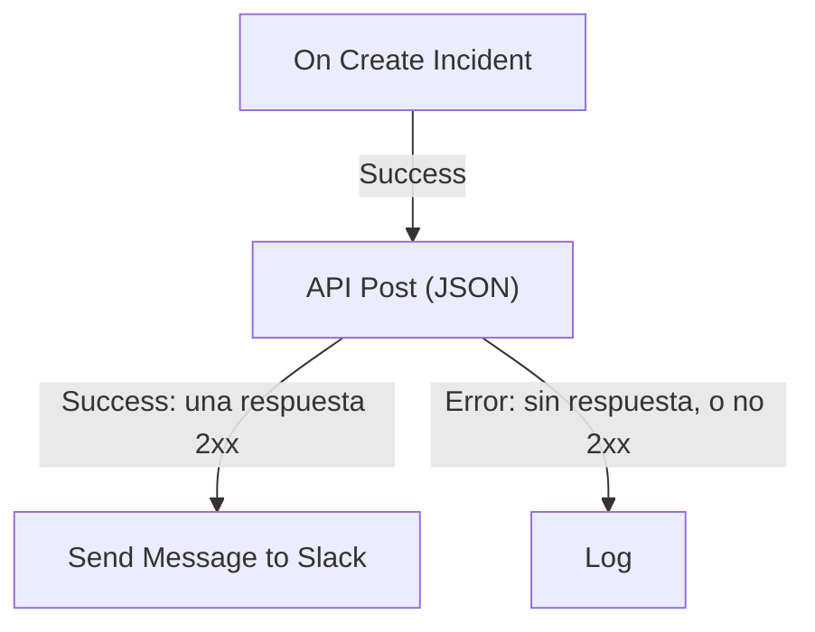

# Componentes de flujo de trabajo

Los componentes son los bloques que añades después del disparador. Cada uno hace una sola cosa — envía un mensaje, llama a una API, comprueba una condición, cambia un registro de OneUptime — y después toma una de sus salidas hacia los bloques conectados a ella. Esta página es el catálogo: lo que necesita cada bloque, lo que devuelve y cuándo toma cada salida.

Rara vez la necesitarás abierta mientras construyes. Los ajustes de cada bloque terminan con **Cómo se usa**: qué hace el bloque, los pasos para configurarlo, un ejemplo construido a partir de tu propio flujo de trabajo y los errores más habituales. Para añadir y conectar bloques, consulta [Crear un flujo de trabajo](/docs/workflows/authoring).

:::cards
- [Enviar un mensaje](#slack): Slack, Microsoft Teams, Discord, Telegram, IRC, Mattermost y correo electrónico.
- [Llamar a una API](#api): Envía una solicitud a cualquier API HTTP y lee la respuesta.
- [Añadir lógica](#conditions): Ramifica según un valor, transforma datos, espera o registra.
- [Trabajar con registros de OneUptime](#componentes-de-datos-de-oneuptime): Busca, crea, actualiza y elimina monitores, incidentes y más.
:::

## ¿Qué componente debo usar?

| Para…                                                         | Usa                                                               |
| ------------------------------------------------------------- | ----------------------------------------------------------------- |
| Publicar en una herramienta de chat                           | [Slack](#slack), [Microsoft Teams](#microsoft-teams), [Discord](#discord), [Telegram](#telegram), [IRC](#irc) o [Mattermost](#mattermost) |
| Enviar un correo a través de tu propio servidor de correo     | [Email](#email)                                                   |
| Avisar a una persona, a un equipo o a quien esté de guardia | [Paging](#paging) |
| Llamar a cualquier otra API o a tu propio servicio            | [API](#api)                                                       |
| Resumir, clasificar o redactar texto                          | [Generate Text with AI](#generate-text-with-ai)                   |
| Tomar un camino u otro según un valor                         | [Conditions](#conditions)                                         |
| Tomar uno de varios caminos según un valor                    | [Switch / Case](#switch-case)                                     |
| Seguir solo cuando unas líneas de JavaScript lo digan | [Check With JavaScript](#check-with-javascript) |
| Transformar datos entre dos bloques                           | [JSON](#json) o [Custom Code](#custom-code)                       |
| Esperar antes del bloque siguiente                            | [Sleep](#sleep)                                                   |
| Iniciar otro flujo de trabajo                                 | [Execute Workflow](#execute-workflow)                             |
| Leer o cambiar incidentes, monitores y otros registros        | [Componentes de datos de OneUptime](#componentes-de-datos-de-oneuptime)  |
| Abrir, reconocer y resolver incidentes o alertas por los problemas de otra herramienta | [Incidentes y alertas de otras herramientas](#incidentes-y-alertas-de-otras-herramientas) |
| Reconocer o cerrar un problema de Zabbix | [Zabbix](#zabbix) |

Un bloque dedicado es mejor que uno genérico: el bloque de Slack conoce los límites de Slack, y un bloque de registros conoce los campos del registro, así que obtienes errores y registros más claros que con un bloque **API** que haga el mismo trabajo.

## Cómo funciona cada bloque

Un bloque se ejecuta cuando el bloque anterior toma la salida conectada a él. Lee sus ajustes, hace su trabajo y después toma una de sus salidas. Solo los bloques conectados a esa salida se ejecutan a continuación.



- Los **Ajustes** son lo que rellenas. Los ajustes marcados **(Opcional)** pueden dejarse vacíos. Los ajustes menos usados están plegados en **Más campos**.
- Las **Salidas** son los puntos del borde inferior. La mayoría de los bloques tienen **Success** y **Error**; [Conditions](#conditions) tiene **Yes** y **No**, y [Switch / Case](#switch-case) tiene una por cada uno de sus casos, además de **Default**.
- Los **Retornos** son los valores que un bloque pasa a los bloques posteriores, como el **Response Body** de una API. Un bloque posterior lee uno con `{{local.components.<block ID>.returnValues.<value ID>}}`; el botón **{ }** de un ajuste lo inserta por ti. Consulta [Variables](/docs/workflows/variables#salidas-de-componentes-datos-de-bloques-anteriores).

Un bloque que toma **Error** pasa el fallo a los bloques conectados a **Error**, y la ejecución sigue ahí. Si no hay nada conectado a **Error**, la ejecución falla: lo demás que estaba haciendo sigue en marcha, después termina con el estado **Error**, y la entrada del bloque en los **Pasos** de la ejecución dice por qué. En cambio, un ajuste obligatorio vacío, o un ajuste que nunca puede funcionar, detiene la ejecución con un error.

## API

Haz una solicitud HTTP a cualquier URL. Hay un bloque por método: **API Get (JSON)**, **API Post (JSON)**, **API Put (JSON)**, **API Patch (JSON)** y **API Delete (JSON)**.

| Ajuste              | Qué hace                                                                                                                             |
| ------------------- | ------------------------------------------------------------------------------------------------------------------------------------ |
| **URL**             | La dirección a la que llamar, `http` o `https`.                                                                                      |
| **Request Body**    | El JSON que enviar. Normalmente solo lo necesitan las solicitudes `POST`, `PUT` y `PATCH`.                                           |
| **Request Headers** | Las cabeceras que enviar, como una clave de API. En **Más campos**. Sus valores se ocultan en el registro de la ejecución.            |

| Salida      | Cuándo                                                                                         |
| ----------- | ---------------------------------------------------------------------------------------------- |
| **Success** | El servidor respondió con un estado 2xx.                                                       |
| **Error**   | La solicitud falló: no se pudo llegar al servidor, o respondió con cualquier otro estado.      |

En ambos casos, el bloque devuelve **Response Status**, **Response Headers** y **Response Body**, además de **Error** con el motivo cuando falló. Lee un campo de una respuesta JSON añadiendo su nombre a la referencia, como en `{{local.components.api-get-1.returnValues.response-body.id}}`.

Las redirecciones no se siguen, así que apunta el bloque a la dirección que responde. Las solicitudes salen de OneUptime: una URL que se resuelve a una dirección de red privada se rechaza a menos que un administrador autoalojado la permita, y la ejecución se detiene con el motivo. Consulta [Acceso de red saliente](/docs/workflows/configuration#acceso-de-red-saliente).

**API Get By ID (JSON)** lee un elemento por un ID que llegó de otra parte, como la clave de incidencia que envió un webhook. Pon `{id}` en su **URL** donde va el ID, como en `https://your-domain.atlassian.net/rest/api/3/issue/{id}`, y el ID en **ID**. El bloque solo coloca el ID cuando es un ID simple, de como mucho 200 letras, dígitos, guiones y guiones bajos, y aun así lo codifica con porcentajes: cualquier otra cosa, como `x/../users`, toma **Error** antes de enviar ninguna solicitud, de modo que un texto de fuera no puede llevar la solicitud a otro sitio. Por lo demás funciona como **API Get (JSON)** y devuelve los mismos valores.

## AI

### Generate Text with AI

Genera una respuesta de texto a partir de un prompt y un contexto JSON opcional. El bloque usa el proveedor de LLM predeterminado del proyecto, o el proveedor global de la instalación cuando el proyecto no tiene ninguno. Los proveedores se configuran de forma centralizada en **Ajustes del proyecto → IA → Proveedores de LLM**; sus claves y endpoints nunca son ajustes del bloque.

| Ajuste                    | Qué hace                                                                                                                                                          |
| ------------------------- | ----------------------------------------------------------------------------------------------------------------------------------------------------------------- |
| **System Instructions**   | Indicaciones opcionales sobre el papel, el tono y las restricciones del modelo.                                                                                  |
| **Prompt**                | La tarea. Se envía exactamente como la escribes, así que el Markdown sirve, y puede incluir variables y valores de bloques anteriores.                           |
| **Context**               | JSON opcional que envías deliberadamente. Se añade después de un marcador explícito de fin de mensaje y se trata como datos no fiables.                          |
| **Temperature**           | En **Más campos**. La variación, de `0` a `1`; el valor predeterminado es `0.2`, para una automatización predecible. Los modelos actuales de Claude, Opus 4.7 y posteriores y todos los modelos Claude 5, eligen su propio muestreo: OneUptime omite **Temperature** en sus solicitudes, así que no tiene ningún efecto en ellos. |
| **Maximum Output Tokens** | En **Más campos**. De `1` a `4096`; el valor predeterminado es `1024`.                                                                                           |

System Instructions, Prompt y el Context serializado están limitados en conjunto a 50.000 caracteres. Una imagen incrustada en ellos en base64, como la captura de pantalla de un monitor sintético en la descripción de un incidente, se sustituye por una nota breve como `[image omitted: PNG, 340 KB]` antes de medirlos, porque el modelo lee texto, no imágenes. El registro de la ejecución dice qué se omitió. La solicitud al proveedor dura como máximo 60 segundos y se intenta una sola vez. Como máximo pueden ejecutarse a la vez tres solicitudes de IA de flujos de trabajo por proyecto.

Devuelve **Response** (el texto generado), **Provider** y **Model** (lo que respondió), **Total Tokens** y **Completion Tokens** (el uso que informó el proveedor), **LLM Log ID** (la entrada de la llamada en los registros de IA) y **Error**.

Conecta **Success** a los bloques que usan la respuesta, y **Error** a una alternativa: los fallos de validación, acceso, proveedor, presupuesto, facturación y tiempo de espera lo toman todos. El bloque no envía herramientas, así que el modelo no puede consultar OneUptime, llamar a API ni cambiar datos por su cuenta.

> [!WARNING]
> La salida del modelo es texto no fiable. Revísala antes de que llegue a los clientes, y nunca dejes que solo un texto libre de la IA decida una acción destructiva. Consulta [Componentes de IA](/docs/workflows/configuration#componentes-de-ia) para ver qué se envía al proveedor, qué se registra y cuánto cuesta.

## Slack

Publica un mensaje en un canal de Slack a través de un webhook entrante.

| Ajuste                         | Qué hace                                                                                                                                                                                                     |
| ------------------------------ | ------------------------------------------------------------------------------------------------------------------------------------------------------------------------------------------------------------ |
| **Slack Incoming Webhook URL** | El webhook del canal en el que publicar. Debe empezar por `https://hooks.slack.com/services/`. La guía de Slack para [crear uno](https://api.slack.com/messaging/webhooks) lleva un par de minutos.            |
| **Message Text**               | El texto que enviar. Se envía exactamente como lo escribes, así que usa el formato propio de Slack: `*bold*`, `_italic_`, `~strikethrough~` y `<https://example.com|a link>`. Un texto más largo que una sección de Slack (3.000 caracteres) se envía en varias; a partir de diez secciones se corta y termina con "… (truncated — see OneUptime for the full text)". |

**Success** salta cuando Slack aceptó el mensaje y **Error** cuando lo rechazó, con el motivo de Slack en **Error**. Estos bloques publican a través del webhook de sus ajustes, no de la conexión de Slack de tu proyecto.

## Microsoft Teams

Publica un mensaje en un canal de Microsoft Teams. El bloque se llama **Send Message to Teams**.

| Ajuste                         | Qué hace                                                                                                                                                                                                                                       |
| ------------------------------ | ---------------------------------------------------------------------------------------------------------------------------------------------------------------------------------------------------------------------------------------------- |
| **Teams Incoming Webhook URL** | El webhook del canal en el que publicar, una URL `https` en `office.com`, `office365.com`, `logic.azure.com` o `environment.api.powerplatform.com`. La guía de Microsoft muestra cómo [crear uno con Workflows de Teams](https://support.microsoft.com/en-us/teams/apps-service/create-incoming-webhooks-with-workflows-for-microsoft-teams). |
| **Message Text**               | El texto que enviar. Un mensaje más grande de lo que admite un webhook entrante (unos 12.000 caracteres, medidos tal como se envían) se corta y termina con "… (truncated — see OneUptime for the full text)".                                    |

## Discord

Publica un mensaje en un canal de Discord a través de un webhook entrante.

| Ajuste                           | Qué hace                                                                                                                                           |
| -------------------------------- | -------------------------------------------------------------------------------------------------------------------------------------------------- |
| **Discord Incoming Webhook URL** | El webhook del canal, una URL `https` en `discord.com` o `discordapp.com`.                                                                         |
| **Message Text**                 | El texto que enviar. Un mensaje de más de 2.000 caracteres, el límite de Discord, se corta y termina con "… (truncated — see OneUptime for the full text)". |

## Telegram

Envía un mensaje a un chat de Telegram con un bot.

| Ajuste                 | Qué hace                                                                                                                                           |
| ---------------------- | -------------------------------------------------------------------------------------------------------------------------------------------------- |
| **Telegram Bot Token** | El token que BotFather dio a tu bot, como `123456789:ABCdef…`. Un token con cualquier otra forma detiene la ejecución, sin que el token se escriba en el registro. |
| **Chat ID**            | El chat en el que publicar: su ID, o el `@username` de un canal. Añade primero el bot al grupo o al canal. Para escribir a una persona, esta debe haber iniciado un chat con el bot. |
| **Message Text**       | El texto que enviar. Un mensaje de más de 4.096 caracteres, el límite de Telegram, se corta y termina con "… (truncated — see OneUptime for the full text)". |

Cuando Telegram rechaza el mensaje, **Error** salta con el motivo de Telegram.

## IRC

Publica un mensaje en un canal de IRC de cualquier red de IRC: Libera.Chat, OFTC o un servidor propio. IRC no tiene webhooks, así que el bloque se conecta él mismo al servidor, entra en el canal, envía el mensaje y se va.

| Ajuste           | Qué hace                                                                                                                                                                                                                                           |
| ---------------- | -------------------------------------------------------------------------------------------------------------------------------------------------------------------------------------------------------------------------------------------------- |
| **IRC Server**   | El nombre de host del servidor, como `irc.libera.chat`. Solo el nombre: sin `ircs://` y sin puerto.                                                                                                                                                |
| **Channel**      | El canal en el que publicar, como `#ops`. Tiene que ser un canal: un apodo escrito aquí se rechaza en lugar de recibir un mensaje privado.                                                                                                          |
| **Message Text** | El texto que enviar. Cada línea sale como un mensaje de IRC propio, y una línea larga se divide para que quepa. Un mensaje se envía como máximo en 15 líneas de IRC: uno más largo se recorta, y su última línea lo indica. IRC no tiene Markdown, así que el texto se envía tal cual; los códigos de formato propios de IRC, como la negrita y los colores, funcionan. |

En **Más campos**:

| Ajuste                                   | Qué hace                                                                                                                                                                                                           |
| ---------------------------------------- | ------------------------------------------------------------------------------------------------------------------------------------------------------------------------------------------------------------------ |
| **Nickname**                             | Quién envía el mensaje. Por defecto `OneUptime`. Si el apodo está ocupado, el bloque lo prueba con un guion bajo o un número añadido, y después con uno en lugar de sus últimos caracteres, para un servidor que no admite un apodo más largo. |
| **Port**                                 | El puerto del servidor. Por defecto `6697`, o `6667` con **Disable TLS** activado.                                                                                                                                 |
| **Disable TLS**                          | El bloque se conecta por TLS y comprueba el certificado del servidor. Actívalo solo para un servidor que no ofrezca TLS; cualquier contraseña se envía entonces sin cifrar. Para confiar en un certificado de tu propia autoridad de certificación, una instalación autoalojada define `NODE_EXTRA_CA_CERTS` en su lugar. |
| **Channel Key**                          | La clave de un canal que la tenga (modo `+k`).                                                                                                                                                                     |
| **Send Without Joining**                 | Publica sin entrar en el canal, para que el canal no vea al bloque llegar e irse. Solo funciona donde el canal acepta mensajes de fuera (sin modo `+n`).                                                           |
| **Server Password**                      | Una contraseña que el servidor o tu bouncer piden al conectar.                                                                                                                                                    |
| **SASL Username** y **SASL Password**    | Inicia sesión en tu cuenta en las redes que usan SASL, como Libera.Chat, que lo exige para las conexiones desde algunas direcciones de nube y de VPN. Rellena los dos o ninguno.                                     |

**Success** salta cuando el servidor ha aceptado todas las líneas. El bloque lo comprueba pidiendo al servidor que responda a un ping después de la última línea: un servidor responde en orden, así que cualquier rechazo del mensaje llega antes. Un bouncer como ZNC responde él mismo al ping, así que el bloque escucha un segundo más para recibir la respuesta de la red que hay detrás.

**Error** salta cuando no se puede llegar al servidor, o este rechaza la conexión, el apodo, una contraseña o el canal, o rechaza el mensaje. Transmite el motivo, con las propias palabras del servidor cuando las dio. En cambio, un **IRC Server**, un **Channel** o un **Message Text** que falte, o un ajuste que nunca podría funcionar, detiene la ejecución.

Cada ejecución del bloque es una conexión propia, y las redes de IRC limitan la frecuencia con que una misma dirección puede conectarse: una ráfaga de mensajes puede rechazarse con un motivo como "Reconnecting too fast", y toma **Error** como cualquier otro rechazo. Para un flujo de trabajo que puede saltar muchas veces por minuto, reúne lo que tenga que decir en un solo mensaje, o envíalo a través de un servidor propio.

Guarda las contraseñas en [variables globales secretas](/docs/workflows/variables#variables-globales) y usa la variable en el ajuste; se ocultan en los registros de ejecución en cualquier caso. Las conexiones a direcciones de loopback (`localhost`, `127.0.0.1`), de enlace local y de metadatos de la nube se rechazan. En OneUptime Cloud, un servidor en una dirección de red privada, o un nombre que se resuelve a una, también se rechaza. Las instalaciones autoalojadas pueden llegar a un servidor de IRC de su propia red, a menos que `DATA_SOURCE_BLOCK_PRIVATE_ADDRESSES` esté definido como `true`.

## Mattermost

Publica un mensaje en un canal de Mattermost a través de un webhook entrante, en Mattermost Cloud o en un servidor propio.

| Ajuste                              | Qué hace                                                                                                                                                                                                                                                                           |
| ----------------------------------- | ---------------------------------------------------------------------------------------------------------------------------------------------------------------------------------------------------------------------------------------------------------------------------------- |
| **Mattermost Incoming Webhook URL** | El webhook por el que publicar, tal como lo muestra Mattermost en Integrations, Incoming Webhooks: la dirección del servidor, después `/hooks/` y el ID del webhook. La guía de Mattermost muestra cómo [crear uno](https://docs.mattermost.com/developers/integrate/webhooks/incoming). |
| **Message Text**                    | El texto que enviar. Se envía exactamente como lo escribes, y Mattermost interpreta Markdown: `**bold**`, `_italic_`, enlaces, tablas y emojis como `:rotating_light:`. Una publicación de Mattermost admite 16.383 caracteres: un mensaje más largo se corta para que quepa y termina con "… (truncated — see OneUptime for the full text)". |

En **Más campos**:

| Ajuste       | Qué hace                                                                                                                                                                                                      |
| ------------ | ------------------------------------------------------------------------------------------------------------------------------------------------------------------------------------------------------------- |
| **Channel**  | Publica en otro sitio que no sea el canal del propio webhook: el nombre del canal tal como aparece en su URL, como `town-square`, o `@` y un nombre de usuario para un mensaje directo. Un webhook fijado a su canal rechaza cualquier otro. |
| **Username** | El nombre con el que publicar. Mattermost solo lo usa donde un administrador del sistema permite a las integraciones cambiar los nombres de usuario.                                                          |
| **Icon URL** | La imagen con la que publicar, una dirección `https`. Mattermost solo la usa donde un administrador del sistema permite a las integraciones cambiar los iconos de la imagen de perfil.                        |

**Success** salta cuando Mattermost aceptó el mensaje. **Error** salta cuando no se puede llegar al servidor o Mattermost rechaza el mensaje, y transmite el motivo de Mattermost. En cambio, un **Mattermost Incoming Webhook URL** o un **Message Text** que falte, una URL que no sea la de un webhook entrante, o un ajuste que nunca podría funcionar, detiene la ejecución.

Guarda la URL del webhook en una [variable global secreta](/docs/workflows/variables#variables-globales): cualquiera que la tenga puede publicar en el canal. Se oculta en los registros de ejecución en cualquier caso. El mensaje sale de OneUptime y las redirecciones no se siguen. Un webhook en una dirección de loopback (`localhost`, `127.0.0.1`), de enlace local o de metadatos de la nube se rechaza, y también uno en una dirección de red privada, a menos que un administrador autoalojado lo permita con `ALLOW_PRIVATE_NETWORK_WEBHOOKS` o `PRIVATE_NETWORK_WEBHOOK_ALLOWLIST`. Consulta [Acceso a red privada](/docs/self-hosted/private-network-access).

## Email

Envía un correo a través de un servidor SMTP que indicas en el bloque. El bloque se llama **Send Email**.

| Ajuste                                  | Qué hace                                                                                              |
| --------------------------------------- | ----------------------------------------------------------------------------------------------------- |
| **From Email**                          | El remitente, por ejemplo `Alerts <alerts@company.com>`.                                              |
| **To Email**                            | La dirección del destinatario. Separa varias direcciones con comas o puntos y comas.                  |
| **Subject**                             | El asunto.                                                                                            |
| **Email Body**                          | El mensaje, enviado como HTML.                                                                        |
| **SMTP HOST** y **SMTP Port**           | El servidor de correo al que conectarse.                                                              |
| **SMTP Username** y **SMTP Password**   | Opcionales. Rellena los dos o ninguno.                                                                |
| **Use Implicit TLS**                    | Actívalo para TLS implícito, normalmente en el puerto 465. Déjalo desactivado para STARTTLS, normalmente en el puerto 587. |

**Success** salta cuando el servidor SMTP aceptó el mensaje. **Error** salta cuando se rechaza el host SMTP, no se puede llegar al servidor o este rechaza el mensaje, y transmite el mensaje de error. En cambio, un **To Email**, un **From Email**, un **SMTP HOST** o un **SMTP Port** que falte detiene la ejecución.

El bloque se conecta directamente al servidor de sus ajustes. No usa los ajustes de [SMTP](/docs/emails/smtp) de tu proyecto ni el propio servidor de correo de OneUptime, y los correos que envía no aparecen en los registros de notificaciones. Para comprobar lo que hizo, mira las [Ejecuciones](/docs/workflows/runs-and-logs) del flujo de trabajo.

Las conexiones a direcciones de loopback (`localhost`, `127.0.0.1`), de enlace local y de metadatos de la nube se rechazan. En OneUptime Cloud, un host SMTP en una dirección de red privada, o un nombre que se resuelve a una, también se rechaza. Las instalaciones autoalojadas pueden llegar a un servidor de correo de su propia red, a menos que `DATA_SOURCE_BLOCK_PRIVATE_ADDRESSES` esté definido como `true`. Un host rechazado toma la salida **Error**, y no se envía nada.

## Paging

Avisa a personas desde un flujo de trabajo: cada una recibe una llamada, un SMS, una notificación push o un correo, según indiquen sus propias reglas de guardia, hasta que alguien reconoce el aviso. Hay un bloque para cada forma de decir a quién avisar. En el panel **Añadir componente**, busca `page`.

| Bloque                      | A quién avisa |
| --------------------------- | ------------- |
| **Page Users**              | A las personas que nombras. |
| **Page a Team**             | A todos los miembros de un equipo. |
| **Page Whoever Is On Call** | A quien esté de guardia en una programación de guardia cuando se ejecuta el bloque. |
| **Page an On-Call Policy**  | A una política de guardia, que avisa siguiendo sus reglas de escalado y se repite como esté configurada. |

Los tres primeros avisan a la vez a todos los que nombran, y a nadie más después. Para un escalado, usa **Page an On-Call Policy**.

Para avisar solo cuando algo se cumple, pon [If / Else](#conditions) delante del bloque y conéctale la salida que debe avisar. Con más de dos caminos, [Switch / Case](#switch-case) toma un camino para cada valor, y cada camino puede avisar a otra persona.

```mermaid title="Avisar a quien esté de guardia, pero solo en incidentes críticos"
flowchart TB
    trigger["On Create Incident"] -->|"Success"| check["If / Else"]
    check -->|"Yes"| page["Page Whoever Is On Call"]
```

Al crear un flujo de trabajo, las plantillas de **De guardia** tienen este ya preparado, y otro que avisa según la gravedad con **Switch / Case**. El diálogo **Crear un flujo de trabajo** pregunta a quién avisa cada bloque de aviso de una plantilla, así que el flujo de trabajo se abre con eso ya elegido. Un bloque de aviso que añades en el Constructor dice **Haz clic para configurar** hasta que eliges a quién avisa.

| Ajuste | Qué hace |
| ------ | -------- |
| **Users**, **Teams**, **On-Call Schedules** o **On-Call Policies** | A quién avisar: cada bloque tiene el que corresponde a su nombre. Elige por nombre, o pulsa **{ }** al final de la fila para añadir un valor de un bloque anterior. Un valor puede contener un ID o varios y, en **Users**, una dirección de correo. |
| **Page About** | De qué trata el aviso: **A new alert**, **An incident** o **An alert**. Reconocer el aviso también lo reconoce. |
| **Title** y **Message** | Para una alerta nueva. OneUptime crea una alerta con ellos, y se queda entre tus alertas como cualquier otra. |
| **Incident ID** o **Alert ID** | Para un incidente o una alerta que ya existe, normalmente aquel con el que empezó el flujo de trabajo: `{{local.components.incident-on-create-1.returnValues.model._id}}`. |
| **Severity** | Para una alerta nueva, en **Más campos**. Decide cuáles de las reglas de guardia de cada persona le avisan. Si se deja vacía, es la más grave del proyecto. |

Un bloque añadido a un flujo de trabajo que empieza con un incidente o una alerta ya está configurado para avisar sobre ese registro, así que solo pregunta a quién avisar.

**Success** se ejecuta en cuanto se avisa al menos a una persona, o se ha iniciado una política. **Error** se ejecuta cuando no se avisó a nadie, y el valor **Error** del bloque dice por qué, por ejemplo que no hay nadie de guardia en la programación. **Summary** dice en una frase a quién se avisó y a quién se dejó fuera, lista para publicarla en un canal, y **Paged Users** enumera a las personas avisadas.

A quien está ausente no se le avisa: se avisa en su lugar a quien su sustitución de usuario nombra para cubrirle. Un aviso nombra como máximo 100 personas, equipos y programaciones. Consulta [Cómo se localiza a cada persona](/docs/on-call/escalation-rules#cómo-se-localiza-a-cada-persona).

Un aviso sin política de guardia detrás aparece junto a las ejecuciones de las políticas como **Aviso directo**: en los registros de guardia del incidente o de la alerta, en su feed y su canal de Slack o Microsoft Teams, y en los registros de cada persona avisada. Sigue abierto 30 minutos, y después mientras sigan saliendo avisos. Si para entonces nadie lo ha reconocido, termina sin avisar a nadie más.

> [!WARNING]
> **Ejecutar flujo de trabajo** avisa a personas de verdad, esté el flujo de trabajo activado o no, y **Ejecutar solo este paso** también. Ponte a ti mismo mientras pruebas.

## Custom Code

Ejecuta unas pocas líneas de JavaScript cuando los demás bloques no pueden hacer lo que necesitas. El bloque se llama **Run Custom JavaScript**.

| Ajuste              | Qué hace                                                                                                                             |
| ------------------- | ------------------------------------------------------------------------------------------------------------------------------------ |
| **JavaScript Code** | Tu código. Lo que devuelva con `return` se convierte en el **Value** del bloque. Puede usar `await`.                                |
| **Arguments**       | Un objeto JSON de valores que pasar al código, que los lee como `args`. Pon aquí las variables y los valores de bloques anteriores; el propio código no puede leerlos. |

```json title="Arguments"
{ "title": "{{local.components.incident-on-create-1.returnValues.model.title}}" }
```

```javascript title="JavaScript Code"
const words = args.title.split(" ");

return {
  shortTitle: words.slice(0, 5).join(" "),
  wordCount: words.length,
};
```

Un bloque posterior lee el título corto como `{{local.components.javascript-1.returnValues.returnValue.shortTitle}}`.

El código se ejecuta en un sandbox con `args`, `console.log` (que escribe en el registro de la ejecución), `axios` para solicitudes HTTP, `crypto` y `sleep`. No tiene sistema de archivos ni proceso, y sus solicitudes se someten a las mismas reglas de direcciones que el bloque API. Tiene 5 segundos por defecto; una instalación autoalojada lo cambia con `WORKFLOW_SCRIPT_TIMEOUT_IN_MS`.

**Success** salta con el **Value** devuelto, y **Error** cuando el código lanza una excepción o se queda sin tiempo, con el mensaje en **Error**. Para scripts más pesados, usa un [Runbook](/docs/runbooks/index) en su lugar.

## Check With JavaScript

Ejecuta unas líneas de JavaScript y toma **Yes** o **No** según lo que devuelvan: un bloque [Custom Code](#custom-code) y un [If / Else](#conditions) detrás, en un solo bloque. Úsalo cuando una sola comparación no basta para decidir, por ejemplo para leer lo que envió otra herramienta y saltarte lo que el flujo de trabajo debe dejar estar.

| Ajuste              | Qué hace |
| ------------------- | -------- |
| **JavaScript Code** | Tu código. `return true` toma **Yes**. Para pasar también valores, devuelve un objeto con `proceed: true`, los valores y un `reason`. |
| **Arguments**       | Un objeto JSON de valores que pasar al código, que los lee como `args`, igual que en **Run Custom JavaScript**. |

```javascript title="JavaScript Code"
if (args.environment !== "production") {
  return { proceed: false, reason: "Not production, so nothing was sent." };
}

return { proceed: true, title: args.title.toUpperCase() };
```

Solo `true`, o un objeto cuyo `proceed` sea `true`, toma **Yes**: cualquier otra cosa toma **No**, incluso un número o un texto. El bloque devuelve **Value**, lo que devolvió el código, que un bloque posterior lee como `{{local.components.javascript-check-1.returnValues.returnValue.title}}`, y **Reason**, el `reason` del código o lo que devolvió, en una frase, que la pestaña **Pasos** de la ejecución muestra junto a la salida tomada.

El código se ejecuta como lo ejecuta **Run Custom JavaScript**: en el mismo sandbox, con los mismos `args`, `console.log` y `axios`, y con el mismo límite de tiempo. Cuando lanza una excepción o se queda sin tiempo, el bloque toma **Error**.

## JSON

Convierte entre texto y JSON, o combina dos objetos JSON.

| Bloque           | Recibe                                   | Devuelve                                                                                                   |
| ---------------- | ---------------------------------------- | ---------------------------------------------------------------------------------------------------------- |
| **JSON to Text** | **JSON**, un objeto                      | **Text**: el objeto como cadena. Útil cuando el bloque siguiente espera texto.                             |
| **Text to JSON** | **Text**, que puede ocupar varias líneas | **JSON**: el objeto analizado, para que puedas leer sus campos. Úsalo con JSON que llegó como texto.      |
| **Merge JSON**   | **JSON 1** y **JSON 2**                  | **JSON**: un objeto con las claves de ambos. Cuando los dos tienen una clave, gana **JSON 2**.             |

**Text to JSON** toma **Error** cuando el texto no es JSON. Una entrada que falte, o una entrada de **Merge JSON** que no sea un objeto, detiene la ejecución.

## Conditions

Ramifica según una comparación. En el panel **Añadir componente**, este bloque se llama **If / Else**, en **Populares**. Para elegir entre más de dos caminos, usa [Switch / Case](#switch-case).

Sus ajustes se leen como una frase: **Si** *valor que comprobar* *comparación* *valor con el que comparar*, continúa por **Yes**, si no, por **No**. Debajo de los ajustes, la condición se lee en palabras, para que veas que dice lo que quieres. En el lienzo, el bloque también muestra su condición, por ejemplo *Si environment is equal to “production”*.

| Ajuste             | Qué hace                                                                                                                                 |
| ------------------ | ---------------------------------------------------------------------------------------------------------------------------------------- |
| **Valor que comprobar** | Normalmente un valor de un bloque anterior. Pulsa **{ }** en el cuadro para elegir uno, o escribe `{{`.                                   |
| **Comparación**     | Cómo comparar, en palabras. Las comparaciones aparecen más abajo.                                                                        |
| **Comparar con**   | Con qué comparar, escrito o elegido de la misma forma. **está vacío**, **no está vacío**, **es verdadero** e **es falso** no lo usan.         |
| **Comparar como**  | Plegado bajo la comparación: **Text**, **Número** o **Verdadero / Falso**. Elige **Text** para ordenar fechas escritas `2026-10-01`, o **Número** para que `200` y `200.0` sean iguales. |

Las comparaciones:

- **es igual a** e **no es igual a**;
- para texto: **contiene**, **no contiene**, **comienza con** y **termina con**;
- para números: **es mayor que**, **es mayor o igual que**, **es menor que** e **es menor o igual que**;
- **está vacío** y **no está vacío**, que comprueban si el valor está presente;
- **es verdadero** e **es falso**.

Las comparaciones de números comparan números y las de texto comparan texto, así que rara vez necesitas **Comparar como**. Cómo se comparan los valores:

- Como texto, las mayúsculas cuentan: `Error` no es `error`.
- Como números, un texto que no es un número cuenta como `0`. Los ajustes señalan un valor escrito así.
- Como verdadero o falso, solo `true` cuenta como verdadero.
- **está vacío** se cumple con la ausencia de valor, un texto en blanco, una lista o un objeto vacío, o un valor que el bloque anterior no tenía, como un campo que el webhook no envió. `0` y `false` son valores, así que no están vacíos.

**Yes** se ejecuta cuando se cumple la condición y **No** cuando no. Los bloques configurados antes de que los ajustes tuvieran estos nombres se ejecutan exactamente igual que antes. Ya no se ofrece una opción antigua: comparar un valor como **Nulo** o **Indefinido**, que ignoraba lo que contenía el valor. Un bloque que todavía la usa lo indica al abrirlo; elige **está vacío** para comprobar si falta un valor.

## Switch / Case

Toma uno de varios caminos según un valor. En el panel **Añadir componente**, este bloque se llama **Switch / Case**, en **Populares**.

Compara un valor con cada uno de sus casos por turno, desde arriba, y continúa por el primer caso que coincide, o por **Default** si ninguno coincide. Solo se ejecuta un camino: un valor que coincide con dos casos toma el primero.

| Ajuste             | Qué hace |
| ------------------ | -------- |
| **Valor que comprobar** | El valor con el que se compara cada caso, normalmente de un bloque anterior. Pulsa **{ }** en el cuadro para elegir uno, o escribe `{{`. |
| **Cases**          | Una comparación y un valor para cada camino, comprobados desde arriba. Pulsa **Añadir caso** para añadir otro, y arrastra un caso por su asa para moverlo. Un bloque admite como máximo 25 casos. |

Cada caso es una salida en el lienzo, con el nombre de su valor: un caso que pregunta **es igual a** `production` es la salida *production*, y uno que pregunta **es mayor que** `500` es *is greater than 500*. **Default** es siempre la última salida. Conecta cada salida a lo que deba ejecutarse a continuación.

Un caso coincide exactamente cuando un [If / Else](#conditions) con la misma comparación y el mismo valor tomaría **Yes**: las comparaciones son las mismas, y los valores se comparan de la misma forma. **Comparar como** está plegado bajo los casos, con una opción para cada caso.

Cuando quitas un caso que tiene una conexión, los ajustes indican a qué bloques llevaba, y **Restaurar** devuelve el caso. Al guardar se elimina la conexión junto con el caso. Las comprobaciones del Constructor señalan un caso sin nada conectado y un caso que nunca se toma porque uno de arriba pregunta lo mismo.

Una ejecución que toma una salida sin nada conectado, **Default** incluida, termina ahí sin error. La pestaña **Pasos** de la ejecución indica qué caso coincidió y por qué, por ejemplo *Case 2 matched: the value is equal to “staging”. Case 1 did not.*

## Sleep

Pausa la ejecución antes del bloque siguiente, para dar a otro sistema un momento para ponerse al día o para hacer un seguimiento más tarde.

**Days**, **Hours**, **Minutes** y **Seconds** se suman. La espera más larga es de 30 días: una más larga se recorta a 30 días, y el registro de la ejecución lo indica.

Mientras espera, la ejecución se aparta con el estado **Esperando** y se retoma cuando se cumple el tiempo, así que una espera larga no bloquea nada. Una ejecución cuyo flujo de trabajo se desactivó o se archivó mientras tanto se cancela al despertar. Una ejecución de prueba, iniciada mientras el flujo de trabajo estaba desactivado, no se cancela por estarlo.

## Log

Escribe un valor en el registro de la ejecución. No cambia nada más, lo que lo convierte en la forma más fácil de ver qué contenía un valor.

**Value** es lo que escribir. Puede ocupar varias líneas e incluir valores de bloques anteriores, como `{{local.components.webhook-1.returnValues.request-body}}`. El bloque toma **Out** cuando termina.

## Execute Workflow

Inicia otro flujo de trabajo del mismo proyecto. Tu flujo de trabajo continúa sin esperar a que el otro termine.

| Ajuste        | Qué hace                                                                                                                                  |
| ------------- | ----------------------------------------------------------------------------------------------------------------------------------------- |
| **Workflow**  | El flujo de trabajo que iniciar. Debe estar habilitado y, para recibir argumentos, tener un disparador **Manual**.                        |
| **Arguments** | El JSON que pasar. El disparador Manual del otro flujo de trabajo pasa cada clave como un valor propio: con `{"customerId": "42"}`, lee `{{local.components.manual-1.returnValues.customerId}}`. |

**Out** salta en cuanto el otro flujo de trabajo queda en cola. **Error** salta cuando no puede: no se encuentra, está desactivado o archivado, o iniciarlo crearía un bucle.

Úsalo para compartir lógica común: construye una vez un flujo de trabajo «publicar en el canal del incidente» e inícialo desde todos los flujos de trabajo que lo necesiten. Una cadena de flujos de trabajo que se inician unos a otros no puede volver sobre sí misma y tiene como máximo 10 niveles. Consulta [Configuración y seguridad](/docs/workflows/configuration#límite-al-llamar-a-otros-flujos-de-trabajo).

## Incidentes y alertas de otras herramientas

Mantén un incidente, o una alerta, por cada problema del que te avisa otra herramienta, emparejado por el ID propio que esa herramienta le da. **Incident From Another Tool** y **Alert From Another Tool** son la base de las plantillas de Zabbix, Huntress, Jira y Dynamics 365, y funcionan con cualquier herramienta que pueda llamar al [disparador Webhook](/docs/workflows/triggers#webhook) de un flujo de trabajo. En el panel **Añadir componente**, están en **From Other Tools**.

Cada ejecución le pasa al bloque un evento: **What Happened**, y **Outside ID**, el ID del problema en la herramienta. El bloque busca el registro que guarda ese ID y hace lo que dice **What Happened**:

| What Happened | Qué hace el bloque |
| ------------- | ------------------ |
| `open`, `problem`, `firing`, `triggered` o `created` | Abre un incidente, o crea una alerta, a partir de **Title**, **Description** y **Severity**, salvo que un registro ya guarde el ID. |
| `acknowledge` o `acknowledged` | Pasa el registro a tu primer estado reconocido, con **Note** como motivo en su historial. |
| `resolve`, `resolved`, `recovery`, `ok` o `closed` | Pasa el registro a tu primer estado resuelto, con **Note** como motivo en su historial. |
| `note`, `update` o `comment` | Añade **Note** al registro como nota privada. |
| El nombre de uno de tus estados | Pasa el registro a ese estado. Escribe `state:` delante de un nombre que sea una de estas palabras, como `state: Open`. |

| Salida | Cuándo |
| ------ | ------ |
| **Opened**, o **Created** en el bloque de alertas | Abrió un registro nuevo. Conecta aquí un bloque de aviso, para que solo avise un problema nuevo. |
| **Updated** | Cambió el estado del registro, o añadió la nota. |
| **Unchanged** | No había nada que hacer: ningún registro guarda el ID, el registro ya está en ese estado o más allá, o **What Happened** está vacío. |
| **Error** | No pudo leer ni cambiar el registro. Si no hay nada conectado aquí, la ejecución falla. |

Un registro solo avanza, y uno resuelto ya no se mueve, así que cuando las dos herramientas lo cambian, ninguna deshace lo que hizo la otra. Guarda el ID en un campo personalizado, `externalId` salvo que **Outside ID Field** nombre otro, y solo se escribe ese campo, así que los demás campos personalizados del registro conservan su valor. Un ID que guarda un registro nunca se vuelve a abrir, aunque ese registro ya esté resuelto: usa un ID nuevo para cada problema, como lo es un ID de evento de Zabbix o un número de informe de Huntress. Para actuar en cambio sobre un registro por su propio ID, como hacen las plantillas de Jira con el ID que llevan las etiquetas de una incidencia, ponlo en **Incident ID** o **Alert ID**.

**Severity** nombra una de tus gravedades por su nombre o su ID, sin distinguir mayúsculas, o por el lugar que ocupa entre ellas: `most severe`, `middle` o `least severe`. Así se reparten los niveles propios de una herramienta entre las gravedades que tú mismo nombraste. Si se deja vacío, o no nombra ninguna, es tu gravedad más alta, y el registro de la ejecución lo dice. Un incidente nuevo se mantiene fuera de tus páginas de estado, y sus suscriptores no reciben aviso, porque el texto de otra herramienta está escrito para los usuarios de esa herramienta: activa **Show On Status Pages** para mostrarlo.

En **Más campos**, **Reason** es el motivo en el historial del registro cuando cambia de estado, y **Note** se añade entonces a su lado como nota privada, para una herramienta que dice algo al reconocer o resolver. **Custom Fields** da a un registro nuevo más campos personalizados, como un objeto JSON, **Labels** los ID de sus etiquetas, separados por comas, y **Recursos afectados** los recursos de los que trata, como en **Create One Incident**. **Note Instead Of Resolving** añade la nota y deja que tu equipo resuelva el registro. El bloque devuelve **Summary**, lo que hizo en una frase, y el registro, así que un bloque posterior lee su ID como `{{local.components.incident-from-another-tool-1.returnValues.record._id}}`.

## Zabbix

Reconoce o cierra un problema en Zabbix, o añádele un mensaje, a través de la API de Zabbix. El bloque se llama **Update Zabbix Problem**, y las [plantillas de Zabbix](/docs/integrations/zabbix) lo usan para devolver a Zabbix lo que pasa en OneUptime.

| Ajuste | Qué hace |
| ------ | -------- |
| **Zabbix URL** | La dirección en la que abres Zabbix, como `https://zabbix.example.com`. Las solicitudes van a su `api_jsonrpc.php`. |
| **API Token** | Un token de API de un usuario de Zabbix que pueda reconocer, comentar y cerrar problemas. Guárdalo en una variable secreta. |
| **Event ID** | El ID de evento del problema, normalmente el que un incidente o una alerta guarda en sus campos personalizados. |
| **What To Do** | `acknowledge`, `close` o `message`. Si se deja vacío, Zabbix no se actualiza. |
| **Message** | Lo que Zabbix guarda en el problema, como mucho 2048 caracteres: un mensaje más largo se recorta. |
| **Zabbix 6.0** | En **Más campos**. Zabbix 6.0 lee el token del cuerpo de la solicitud, no de su cabecera `Authorization`: actívalo para esa versión, y desactívalo al actualizar, porque Zabbix 7.2 y posteriores rechazan un token en el cuerpo. |

Para reconocer o cerrar, el bloque lee primero el problema. Un problema que Zabbix ya resolvió, o que ya reconoció cuando eso es todo lo que pides, se deja como está, y el bloque toma **Unchanged**, igual que con un problema que Zabbix no tiene o que el usuario del token no puede ver. Un problema cuyo disparador no permite cerrar problemas a mano se reconoce en su lugar, y su mensaje dice que sigue abierto hasta que Zabbix vea que se recupera.

**Updated** salta cuando Zabbix aceptó la actualización, y **Error** cuando no se pudo llegar a Zabbix o la rechazó, con el motivo de Zabbix: Zabbix responde a una solicitud rechazada con un estado de éxito, así que el bloque lee lo que respondió Zabbix en lugar de su estado. Devuelve **Summary**, lo que hizo en una frase.

## Componentes de datos de OneUptime

Para cada tipo de registro de OneUptime (monitores, incidentes, alertas, páginas de estado, políticas de guardia y muchos más), el panel **Añadir componente** tiene estos componentes: en **Recursos de OneUptime**, haz clic en el tipo de registro (**Explorar todos los recursos** tiene los que no se muestran), o busca por el nombre del tipo. Cada título se genera a partir del tipo de registro, así que el conjunto de Monitor dice:

| Componente               | Qué hace                                                                       |
| ------------------------ | ------------------------------------------------------------------------------ |
| **Find One Monitor**     | Lee un registro que coincide con la consulta.                                  |
| **Find Many Monitors**   | Lee una lista de registros que coinciden con la consulta.                      |
| **Create One Monitor**   | Añade un registro a partir de un objeto JSON.                                  |
| **Create Many Monitors** | Añade varios registros a partir de un array JSON.                              |
| **Update One Monitor**   | Aplica los datos que escribir a un registro coincidente.                       |
| **Update Many Monitors** | Aplica los datos que escribir a los registros coincidentes, hasta **Limit**.   |
| **Delete One Monitor**   | Elimina un registro coincidente.                                               |
| **Delete Many Monitors** | Elimina los registros coincidentes, hasta **Limit**.                           |

El mismo conjunto te da cuatro disparadores: **On Create Monitor**, **On Update Monitor**, **On Create or Update Monitor** y **On Delete Monitor**. Consulta [Disparadores](/docs/workflows/triggers#disparadores-de-eventos-de-oneuptime).

Un tipo solo ofrece los componentes que permite su modelo. Un tipo de solo lectura tiene los dos componentes Find y nada más, así que, si no encuentras **Delete One Monitor** en el panel, ese tipo no lo permite.

Así es como un flujo de trabajo lee y cambia los datos de OneUptime. Por ejemplo, un webhook de tu herramienta de CI puede usar **Create One Incident** para abrir un incidente con los detalles del fallo.

Estos componentes actúan como Project Admin del proyecto del flujo de trabajo: lo que un Project Admin no puede hacer, o lo que tu plan no incluye, se rechaza, y el registro de la ejecución dice por qué. Consulta [Qué pueden hacer los pasos de un flujo de trabajo](/docs/workflows/configuration#qué-pueden-hacer-los-pasos-de-un-flujo-de-trabajo).

### Declarar un incidente a partir de una plantilla

**Create One Incident** puede declarar el incidente a partir de una de tus [plantillas de incidente](/docs/incidents/settings#plantillas-de-incidente): elígela en **Incident Template**, el primer ajuste del paso. La plantilla rellena todos los campos que **JSON Object** deja fuera — el título, la descripción, la gravedad, el estado inicial, los monitores y otros recursos, las políticas de guardia, las etiquetas, las páginas de estado y los campos personalizados — y sus propietarios pasan a ser los propietarios del incidente. Todo lo que definas en **JSON Object** prevalece sobre la plantilla, estado incluido, así que con una plantilla elegida **JSON Object** solo necesita lo que deba ser distinto, y puede quedar vacío.

El incidente guarda la plantilla de la que se declaró en `createdIncidentTemplateId`. Esa columna la define OneUptime: un paso que la envía en **JSON Object** se rechaza, y su registro de ejecución te remite a **Incident Template**. Una plantilla de otro proyecto, o una que se eliminó, hace que el paso tome su salida **Error**, y en un plan que no incluye plantillas de incidente el paso se rechaza indicando el plan que necesita. Consulta [Cómo se aplica una plantilla](/docs/incidents/settings#cómo-se-aplica-una-plantilla).

### Vincular los recursos de los que trata

**Create One Incident** y **Create One Alert** tienen un ajuste **Recursos afectados**: los hosts, dispositivos de red, clústeres, bases de datos o servicios de los que trata el registro, por nombre, dirección o ID, separados por comas — escritos a mano o tomados de un paso anterior, como el host que nombra una alerta llegada de otra herramienta. Cada entrada se busca en todos los tipos de recurso que puede contener el registro, como valor completo y sin distinguir mayúsculas: por nombre, un dispositivo de red también por la dirección en la que se sondea o por su nombre DNS, un host por el nombre que informa su agente o por una de sus direcciones IP, y un recurso en la nube por el ID de su proveedor. Cada recurso con el que coincide una entrada se vincula, junto a lo que ya vinculan **JSON Object** y la plantilla, hasta 50 a partir de las 25 primeras entradas.

Una entrada que no coincide con nada no detiene el paso: el registro se crea igualmente, y el registro de la ejecución indica qué vinculó cada entrada y cuáles no coincidieron con nada. Los recursos archivados no se vinculan. Los monitores no se buscan: nómbralos en **JSON Object** (`monitors` en un incidente, `monitorId` en una alerta), porque vincular un monitor a un incidente pausa su supervisión.

## Trabajar con registros

Cada campo de un componente de datos se basa en los nombres de **columna** del propio registro: los mismos nombres que usa la API, no las etiquetas del formulario del panel. La columna de ID es `_id`. La forma `id` se acepta como alias en cualquier sitio donde puedas escribir un nombre de columna, pero `_id` es lo que devuelve un registro, así que es lo que debes leer a la salida:

```json
{ "_id": "00000000-0000-0000-0000-000000000000" }
```

**Query** decide sobre qué registros actúa el componente. Las claves son columnas y los valores, lo que debe coincidir:

```json
{ "monitorType": "Website", "isEnabled": true }
```

Una consulta siempre se limita al proyecto en el que se ejecuta el flujo de trabajo. No puedes llegar a los registros de otro proyecto, y no necesitas añadir tú mismo el proyecto a la consulta.

**JSON Object** en Create One, **JSON Array** en Create Many y **Data (JSON Object)** en los componentes Update llevan los campos que escribir, con las mismas claves:

```json
{ "name": "Checkout API", "monitorType": "Website" }
```

Una clave que no es una columna se ignora en lugar de rechazarse — el registro de la ejecución nombra las que descartó, así que míralo cuando un campo no llegue. **Fields to pass on**, en los componentes Find y en los disparadores, se elige de una lista; su **Editar como JSON** muestra las mismas claves de columna con valores `true`: `{"_id": true, "name": true}`.

Los **campos personalizados** son una sola columna, `customFields`, que guarda el valor de cada campo personalizado con el nombre del campo. Los componentes Update solo cambian los campos personalizados que nombras, y todos los demás conservan su valor:

```json
{ "customFields": { "Notification Count": 1 } }
```

define **Notification Count** y deja los demás campos personalizados del registro como estaban. Pon un campo personalizado a `null` para vaciarlo, o pon el propio `customFields` a `null` para vaciarlos todos. Dos flujos de trabajo que actualizan a la vez campos personalizados distintos del mismo registro se aplican los dos. Esto vale solo para los componentes Update: la API de OneUptime escribe `customFields` completo, así que una solicitud a ella debe llevar todos los campos personalizados que quieras conservar.

Rara vez escribes estas claves tú mismo. En los ajustes del componente, **Añadir un campo** (o **Añadir una condición** en una consulta) muestra las columnas del modelo por su nombre, con el tipo de valor que admite cada una. Búscalas por nombre, por clave de columna o por lo que hace el campo, y pulsa **Intro** para añadir la mejor coincidencia. En una creación, aparecen primero los campos sin los que no se puede crear el registro, después los campos principales del modelo (los que rellena por ti si los omites) y después todo lo demás.

Los campos que OneUptime rellena por sí mismo no se ofrecen al escribir un registro: el `_id` del registro, **Creado en**, **Actualizado en**, **Creado por el usuario**, los slugs, los números de registro y los estados de notificación. Quién creó, archivó o resolvió un registro, y cuándo, nunca lo define un flujo de trabajo: un registro que crea un flujo de trabajo no tiene creador, un valor que un flujo de trabajo envía para uno de esos campos junto a otros campos se ignora, y un Update que no envía nada más falla con un mensaje que los nombra. Una actualización solo ofrece los campos que pueden cambiar después de que exista un registro. Una consulta sí ofrece el ID, las marcas de tiempo y **Creado por el usuario**, porque son útiles para filtrar. **Eliminado el** no se ofrece en ningún sitio: los registros se eliminan del todo, así que siempre está vacío.

**Skip** y **Limit** son dos campos numéricos de Find Many, Update Many y Delete Many, en **Más campos**: `Skip: 0` con `Limit: 100` toma las cien primeras coincidencias. **Limit** vale `10` por defecto, y en Update Many y Delete Many limita cuántos registros se escriben de verdad, no solo cuántos se devuelven. Así que `Items Deleted: 10` significa que se eliminaron diez registros, no que coincidieran diez. Sube **Limit** cuando quieras cambiar más de diez.

Delete One y Delete Many por consulta nunca vacían un historial. En los eventos de estado de un monitor, y en los historiales de estados de incidentes, alertas, mantenimientos programados y episodios, nunca eliminan el estado actual de un registro, y conservan cada evento de estado de un monitor que cubre parte de los últimos 90 días, para que una página de estado nunca muestre un monitor en gris. El registro de la ejecución dice cuántos se conservaron. Para eliminar un evento concreto, consúltalo por su `_id`.

**Success** y **Error** indican si la consulta se ejecutó, no lo que encontró. Una consulta que no coincide con nada devuelve `0` y sale igualmente por **Success**: eso no es un fallo. Para ramificar según si algo coincidió, lee el recuento devuelto en un bloque **If / Else**.

## Siguientes pasos

:::cards
- [Variables](/docs/workflows/variables): Pasa valores entre bloques y mantén los secretos fuera de ellos.
- [Ejecuciones](/docs/workflows/runs-and-logs): Mira lo que cada bloque recibió y devolvió en una ejecución.
- [Configuración y seguridad](/docs/workflows/configuration): Límites, permisos y lo que pueden hacer los pasos.
:::
