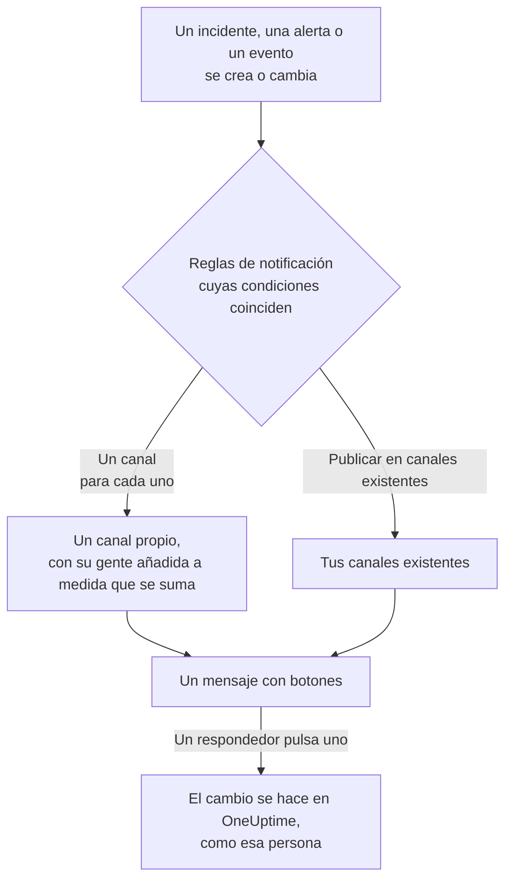

# Mattermost

Conecta OneUptime con tu servidor de Mattermost para publicar en tus canales los incidentes, alertas, episodios, mantenimientos programados, monitores y novedades de guardia, dar a cada incidente un canal propio y dejar que los respondedores reconozcan, resuelvan, añadan notas y cambien el estado sin salir de Mattermost.

:::cards
- [Conectar Mattermost](#conectar-mattermost): Crea una cuenta de bot para OneUptime y luego conecta el proyecto con su token.
- [Conectar tu propia cuenta](#conectar-tu-propia-cuenta-de-mattermost): Vincula tu cuenta de Mattermost a tu cuenta de OneUptime.
- [Reglas de notificación](#reglas-de-notificación): Decide qué eventos se publican dónde, y cuáles tienen un canal propio.
- [Actuar desde Mattermost](#actuar-sobre-incidentes-alertas-y-eventos-desde-mattermost): Los botones de los mensajes de OneUptime.
- [Red y autoalojamiento](#red-y-autoalojamiento): Lo que cada servidor debe poder alcanzar.
:::

## Cómo funciona

Dos conexiones lo hacen posible:

- **La conexión del proyecto**, hecha una vez: una cuenta de bot en tu servidor de Mattermost, en el equipo en el que publica OneUptime. Publica los mensajes, crea los canales y añade a las personas a ellos.
- **La conexión propia de cada persona**: su cuenta de Mattermost vinculada a su cuenta de OneUptime. Los botones actúan como esa persona, con sus permisos en el proyecto.

Un equipo de Mattermost puede estar conectado a más de un proyecto, como producción y staging. Un botón actúa en el proyecto del registro del que trata su mensaje.

## Antes de empezar

- **Un rol que pueda conectar el proyecto:** **Propietario del proyecto**, **Administrador del proyecto** o **Miembro del proyecto**. Desconectar requiere **Propietario del proyecto** o **Administrador del proyecto**.
- **Un servidor de Mattermost** en el que puedas crear una cuenta de bot, o un administrador de Mattermost que pueda crearla por ti. Funcionan tanto Mattermost Cloud como Mattermost autoalojado.
- **El plan Growth en OneUptime Cloud** para las reglas de notificación y los resúmenes.

Para Mattermost no hay que configurar nada en el propio servidor de OneUptime: cada proyecto aporta su propio servidor de Mattermost y su propia cuenta de bot.

## Conectar Mattermost

:::steps
### Crear una cuenta de bot en Mattermost

En Mattermost, abre **System Console** > **Integrations** > **Bot Accounts** y comprueba que **Enable Bot Account Creation** está activado. Luego ve a **Integrations** > **Bot Accounts** > **Add Bot Account**, llámala `oneuptime` y guarda. Mattermost muestra el token de acceso del bot una sola vez: cópialo.

### Añadir el bot a tu equipo

Añade el bot al equipo en el que OneUptime debe publicar, como añadirías a una persona: **Main Menu** > **Invite People**, e invita a `@oneuptime`. OneUptime crea canales y publica solo en ese equipo.

### Conectar el proyecto

En OneUptime, ve a **Ajustes del proyecto** > **Espacio de trabajo** > **Mattermost** y haz clic en **Conectar con Mattermost**. Introduce la dirección de tu servidor, como `https://chat.example.com`, y el token de acceso del bot. OneUptime comprueba el token con tu servidor antes de guardar nada. Si el bot está en más de un equipo, OneUptime te pregunta en cuál publicar. Mientras no haya ningún espacio de trabajo conectado, la sección **Espacio de trabajo** de los menús Incidentes, Alertas, Mantenimiento programado, Monitores y Guardia contiene **Conectar un espacio de trabajo**, que también lleva aquí.

### Añadir una regla de notificación

Ve a **Incidentes** > **Espacio de trabajo** > **Mattermost** y crea una regla. Por ejemplo, una que cree un canal de Mattermost para cada incidente nuevo con todos los que trabajan en él. Consulta [Reglas de notificación](#reglas-de-notificación).
:::

El token de acceso del bot se guarda solo en el servidor de OneUptime, cifrado junto con los demás secretos del proyecto, y no se vuelve a mostrar nunca. La dirección del servidor, el equipo y el nombre de usuario del bot se muestran a todos en el proyecto, en la página de ajustes de Mattermost.

Un proyecto está conectado a un solo equipo de Mattermost. Para moverlo a otro equipo, o a otro servidor, desconéctalo primero: **Ajustes del proyecto** > **Espacio de trabajo** > **Mattermost**, y luego **⋯** > **Desconectar Mattermost**. Al desconectarlo se desconecta también la cuenta de Mattermost de cada miembro, y se quitan sus métodos de notificación de Mattermost y las reglas de guardia que los usan. Tus reglas de notificación y resúmenes se conservan para cuando vuelvas a conectar.

## Conectar tu propia cuenta de Mattermost

Mattermost no tiene un inicio de sesión al que OneUptime pueda enviarte, así que el bot de OneUptime envía en su lugar a tu cuenta de Mattermost un mensaje directo con un enlace:

:::steps
1. Ve a **Ajustes de usuario** > **Espacio de trabajo** > **Mattermost**. OneUptime busca la cuenta de Mattermost con tu dirección de correo electrónico. Si encuentra una, haz clic en **Enviar enlace a @your-username**. Si no, haz clic en **Enviarme un enlace** e introduce tu nombre de usuario de Mattermost.
2. Abre en Mattermost el mensaje directo del bot de OneUptime y haz clic en **Connect my account**.
3. El enlace abre OneUptime, que conecta tu cuenta.
:::

Abre el enlace en el mismo navegador en el que lo pediste: solo funciona allí, solo una vez y solo durante 15 minutos. Eso demuestra que quien lo pidió tiene las dos cuentas, así que nadie puede conectar la cuenta de Mattermost de otra persona. Si no pediste ningún enlace, ignóralo: no se conecta nada hasta que se abre en el navegador que lo pidió.

La conexión de tu cuenta pertenece a este proyecto. En otro proyecto conectado al mismo equipo de Mattermost, conéctala también allí.

## Recibir avisos en Mattermost

Para recibir avisos por mensaje directo cuando estás de guardia, añade Mattermost como uno de tus métodos de notificación:

:::steps
1. Conecta tu propia cuenta de Mattermost (consulta [Conectar tu propia cuenta de Mattermost](#conectar-tu-propia-cuenta-de-mattermost)).
2. Ve a **Ajustes de usuario** > **Métodos de notificación**, abre la pestaña **Aplicaciones del espacio de trabajo** y haz clic en **Añadir cuenta de Mattermost**.
3. Haz clic en **Enviar mensaje de prueba** en su fila. El mensaje llega como mensaje directo del bot del proyecto.
:::

Al añadirlo, entra de inmediato en tus reglas de guardia, así que a partir de entonces los avisos te llegan en Mattermost. Cambia qué avisos recibe en **Ajustes de usuario** > **Reglas de guardia**. Cada aviso lleva un enlace para reconocerlo y otro para escalarlo. Al desconectar tu cuenta de Mattermost se quitan este método y las reglas de guardia que lo usan.

## Reglas de notificación

Una regla de notificación indica qué eventos se publican en Mattermost, y dónde. Cada producto tiene sus propias reglas, en **Espacio de trabajo** > **Mattermost** de su menú: **Incidentes** (con **Episodios de incidente** y una pestaña **Resumen**), **Alertas** (con **Episodios de alerta** y **Resumen**), **Mantenimiento programado**, **Monitores**, **Guardia** y **Eventos de seguridad**. Funcionan como las de Slack: consulta [Reglas de notificación](/docs/workspace-connections/slack#reglas-de-notificación) para las condiciones, los destinos y quién se une a un canal.

Un canal que crea una regla lleva el nombre de su registro: el incidente INC-42 recibe `inc-42`. Mattermost admite letras minúsculas, números, `-` y `_`, hasta 64 caracteres, empezando y terminando con una letra o un número, y el formulario de la regla muestra el nombre mientras escribes. Si ya existe un canal con ese nombre, como uno archivado, OneUptime añade `-2`, `-3` y así sucesivamente. Un incidente, una alerta o un episodio privado recibe un canal privado.

Para publicar en un canal existente, introduce su nombre tal como aparece en su dirección, como `incidents` para `chat.example.com/team/channels/incidents`, o su nombre visible. OneUptime se une por sí mismo a un canal público la primera vez que publica en él. Añade el bot a un canal privado en Mattermost antes de que una regla publique en él.

Las personas se unen al canal de una regla mediante la cuenta de Mattermost que conectaron, o si no, mediante la cuenta de Mattermost que tiene su dirección de correo electrónico, cuando tu servidor muestra las direcciones de correo al bot (**System Console** > **Site Configuration** > **Users and Teams** > **Show Email Address**). OneUptime nombra a quienes no pudo añadir en un solo mensaje en el canal, con un enlace para conectar su cuenta.

Un incidente, una alerta, un episodio o un evento de mantenimiento programado con un canal propio tiene **Abrir en Mattermost** en la cabecera de su página en OneUptime, junto a sus botones de estado. Abre ese canal en una pestaña nueva, en tu servidor de Mattermost. Un registro con dos canales propios los lista a ambos bajo el botón. Un registro que también tiene canales en Slack o Microsoft Teams tiene en su lugar un único botón **Abrir canal**, que los lista todos. Los canales existentes en los que publican tus reglas no se ofrecen.

**Probar regla** en la fila de una regla publica un mensaje de prueba de esa regla en los canales que nombra, como hace para Slack.

Los mensajes de OneUptime no notifican a nadie con lo que citan: un nombre o una descripción que contiene `@channel`, `@here` o `@someone` se muestra tal como está escrito, y no avisa a nadie.

## Actuar sobre incidentes, alertas y eventos desde Mattermost

Los mensajes de OneUptime llevan botones, y un menú **More actions** para lo que menos gente necesita. Cada uno actúa como tú, con tus permisos en el proyecto, y responde en un mensaje que solo tú ves.

| Registro | Botones y menú |
| --- | --- |
| **Incidente** | **Acknowledge**, **Resolve**, **Add Note** y, en el menú, **Change Severity** y **Change State** |
| **Alerta** | **Acknowledge**, **Resolve**, **Add Note**, **Change State**, **Execute On-Call Policy** |
| **Episodio de incidente, episodio de alerta** | **Acknowledge**, **Resolve**, **Add Note**, **Change State**, **Execute On-Call Policy** |
| **Mantenimiento programado** | **Mark as Ongoing**, **Mark as Complete**, **Add Note**, **Change State** |

**Add Note**, **Change State**, **Change Severity** y **Execute On-Call Policy** abren un formulario en Mattermost. Una nota sobre un incidente o un evento de mantenimiento programado puede ser pública, mostrada en la página de estado, o privada; una nota sobre un incidente privado es siempre privada, y sobre una alerta, siempre privada también. Cada mensaje tiene además un enlace que abre su registro en OneUptime, para todo lo demás.

Si tu cuenta de Mattermost aún no está conectada, un botón te lo dice, con un enlace a **Ajustes de usuario** > **Espacio de trabajo** > **Mattermost**. Conecta tu cuenta y vuelve a pulsar el botón.

Cada pulsación queda registrada en **Ajustes del proyecto** > **Notificaciones** > **Registros de notificación**, en la pestaña **Espacio de trabajo**, junto con quién pulsó el botón.

## Red y autoalojamiento

Dos servidores se comunican entre sí:

- **OneUptime llama a tu servidor de Mattermost**, para publicar, crear canales y añadir personas. En OneUptime Cloud, tu servidor de Mattermost debe ser accesible desde internet. Un OneUptime autoalojado puede llegar a un servidor de Mattermost en una red privada una vez que su operador permite las direcciones privadas con `ALLOW_PRIVATE_NETWORK_WEBHOOKS` o `PRIVATE_NETWORK_WEBHOOK_ALLOWLIST`. OneUptime nunca llama a una dirección de su propia máquina ni a una dirección de metadatos de la nube, y nunca sigue una redirección.
- **Tu servidor de Mattermost llama a OneUptime** cuando alguien pulsa un botón o envía un formulario: `https://<your OneUptime>/api/mattermost/interactive` y `/api/mattermost/dialog`. Si la dirección de OneUptime es privada, añade su host a **System Console** > **Environment** > **Developer** > **Allow untrusted internal connections to** en Mattermost, o los botones no funcionarán.

Cada botón que publica OneUptime lleva una firma, que se comprueba al pulsarlo, para el equipo de Mattermost en el que se publicó: una pulsación que OneUptime no firmó, o una enviada desde otro equipo, no hace nada.

## Solución de problemas

| Lo que ves | Qué hacer |
| --- | --- |
| **Mattermost did not accept the access token** | Vuelve a copiar el token del bot. Mattermost solo lo muestra una vez: crea uno nuevo en **Integrations** > **Bot Accounts** si hace falta. |
| **The bot account is not a member of any team** | Añade el bot a tu equipo en Mattermost y vuelve a conectar el proyecto. |
| **OneUptime could not reach the Mattermost server** | Comprueba la dirección, y que OneUptime puede llegar a ella. Consulta [Red y autoalojamiento](#red-y-autoalojamiento). |
| **The bot is not a member of the private Mattermost channel** | Añade el bot al canal en Mattermost. |
| Un botón no hace nada, o Mattermost dice que no pudo completar la acción | Mattermost no puede llegar a OneUptime. Consulta [Red y autoalojamiento](#red-y-autoalojamiento). |
| No llega ningún mensaje directo con tu enlace | Comprueba el nombre de usuario, y que el bot está en un equipo en el que estás tú. |
