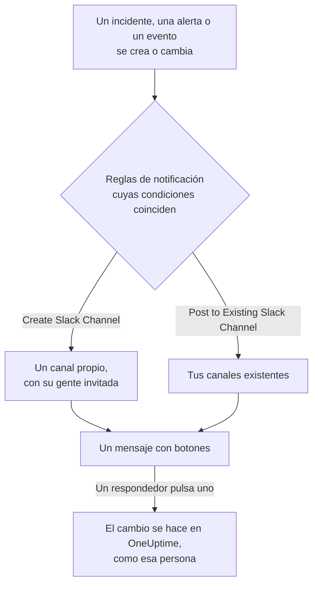

# Slack

Conecta OneUptime con Slack para publicar en tus canales los incidentes, alertas, episodios, mantenimientos programados, monitores y novedades de guardia, dar a cada incidente un canal propio y dejar que los respondedores actúen sin salir de Slack: reconocer, resolver, añadir notas, avisar a la guardia y declarar incidentes.

:::cards
- [Conectar Slack](#conectar-slack): Instala OneUptime en tu espacio de trabajo y luego vincula tu propia cuenta.
- [Reglas de notificación](#reglas-de-notificación): Decide qué eventos se publican dónde, y cuáles tienen un canal propio.
- [El comando /oneuptime](#el-comando-oneuptime): Declara incidentes, programa mantenimientos, mira quién está de guardia y pregunta a la IA.
- [Grupos de usuarios de guardia](#grupos-de-usuarios-de-guardia): Mantén un grupo de usuarios igual a quienes están de guardia, y avísalo.
- [Actuar sobre incidentes, alertas y eventos desde Slack](#actuar-sobre-incidentes-alertas-y-eventos-desde-slack): Los botones de los mensajes de OneUptime.
:::

## Cómo funciona

Dos conexiones lo hacen posible:

- **La conexión del proyecto**, hecha una vez: la app de OneUptime instalada en tu espacio de trabajo de Slack. Publica los mensajes, crea los canales e invita a las personas.
- **La conexión propia de cada persona**: su cuenta de Slack vinculada a su cuenta de OneUptime. Los botones, los comandos y las reacciones con emoji actúan como esa persona, con sus permisos en el proyecto.

## Antes de empezar

- **Un rol que pueda conectar el proyecto:** **Project Owner**, **Project Admin** o **Project Member**. Desinstalar la app requiere **Project Owner** o **Project Admin**.
- **Un espacio de trabajo de Slack** donde puedas instalar apps.
- **El plan Growth en OneUptime Cloud** para las reglas de notificación y los resúmenes. Consulta [Reglas de notificación por debajo del plan Growth](#reglas-de-notificación-por-debajo-del-plan-growth).
- **En un servidor autoalojado,** antes una app de Slack configurada para él. Consulta [Integración con Slack](/docs/self-hosted/slack-integration).

## Conectar Slack

:::steps
### Instalar OneUptime en tu espacio de trabajo de Slack

Ve a **Ajustes del proyecto** > **Espacio de trabajo** > **Slack** y haz clic en **Conectar con Slack**. Elige el espacio de trabajo y autoriza a OneUptime. Slack te devuelve a la misma página, que ahora nombra el espacio de trabajo al que está conectado el proyecto. Mientras no haya ningún espacio de trabajo conectado, la sección **Espacio de trabajo** de los menús Incidentes, Alertas, Mantenimiento programado, Monitores y Guardia contiene **Conectar Slack o Teams**, que también lleva aquí.

### Conectar tu propia cuenta de Slack

Instalar la app vincula la cuenta de quien la instaló. Todos los demás vinculan su propia cuenta de Slack en **Ajustes de usuario** > **Espacio de trabajo** > **Slack** con **Connect my account with Slack**, para actuar sobre los incidentes y recibir mensajes directos como ellos mismos. Esa sección aparece en cuanto el proyecto está conectado a Slack.

### Añadir una regla de notificación

Ve a **Incidentes** > **Espacio de trabajo** > **Slack**. La sección **Espacio de trabajo** solo lista los espacios de chat que tu proyecto ha conectado, así que **Slack** aparece ahí en cuanto está conectado. Crea una regla, por ejemplo una que cree un canal de Slack para cada incidente nuevo e invite a los propietarios del incidente. Consulta [Reglas de notificación](#reglas-de-notificación).

### Probar la regla

Haz clic en **Probar regla** en la fila de la regla. Llega un mensaje de prueba a los canales que nombra la regla. Consulta [Probar una regla](#probar-una-regla).
:::

## Reglas de notificación

Una regla de notificación indica qué eventos se publican en Slack, y dónde. Cada producto tiene sus propias reglas, en **Espacio de trabajo** > **Slack** de su menú:

| Producto | Pestañas de su página **Slack** |
| --- | --- |
| **Incidentes** | **Incidentes**, **Episodios de incidente**, **Resumen** |
| **Alertas** | **Alertas**, **Episodios de alerta**, **Resumen** |
| **Mantenimiento programado** | Una lista de reglas |
| **Monitores** | Una lista de reglas |
| **Guardia** | Una lista de reglas |

Crear una regla recorre cuatro pasos:

| Paso | Lo que defines |
| --- | --- |
| **Básico** | **Nombre de la regla** y **Descripción de la regla**. |
| **Condiciones** | Para qué eventos se dispara la regla, por ejemplo por gravedad, estado, etiqueta, monitor o palabras del título. Sin condiciones, se dispara para cada evento. Con dos o más, **Condición de coincidencia** indica si deben coincidir todas o basta con una. |
| **Destino** | Dónde publica: **Post to Existing Slack Channel** con los nombres de los canales, **Create Slack Channel** con el nombre del canal nuevo y a quién se invita, o ambos. |
| **Videollamada** | Solo incidentes y alertas: iniciar una llamada para cada uno. Consulta [Videollamadas](/docs/workspace-connections/video-calls). |

Un canal que crea la regla lleva el nombre de su registro: el incidente INC-42 recibe `inc-42`, la alerta ALT-7 recibe `alt-7` y, en un proyecto sin prefijos de número, el incidente 42 recibe `incident-42`. El texto de **Prefijo del nombre del canal** va delante, así que `prod-` da `prod-inc-42`, y el formulario muestra el nombre mientras escribes. En un evento de mantenimiento programado, el prefijo sustituye a su prefijo de número: SM-5 recibe `sm-5`, y `maint-` da `maint-5`. Slack admite letras minúsculas, números, `-` y `_`, hasta 80 caracteres. Si ya existe un canal con ese nombre, como el de otro proyecto o uno archivado, OneUptime añade `-2`, `-3` y así sucesivamente.

Solo un canal creado recibe a las personas que invita la regla: los propietarios del registro, los equipos y usuarios elegidos y, para incidentes y alertas, las personas de guardia a medida que se les avisa. Un incidente, una alerta o un episodio privado recibe un canal privado. Cada actualización posterior del registro — un cambio de estado, una nota, un nuevo propietario — se publica en sus canales y en los canales existentes que nombran sus reglas. Un incidente, una alerta o un episodio creado ya resuelto no recibe canal propio; su mensaje de creación igualmente va a los canales que nombran tus reglas. Consulta [Declarado ya reconocido o resuelto](/docs/incidents/declaring-incidents#declarado-ya-reconocido-o-resuelto).

Un incidente, una alerta, un episodio o un evento de mantenimiento programado con un canal propio tiene **Abrir en Slack** en la cabecera de su página en OneUptime, junto a sus botones de estado. Abre ese canal en una pestaña nueva, en la aplicación de Slack o en el navegador. Un registro con dos canales propios los lista a ambos bajo el botón. Un registro con canales tanto en Slack como en Microsoft Teams tiene en su lugar un único botón **Abrir canal**, que los lista todos. Los canales existentes en los que publican tus reglas no se ofrecen.

Un canal sigue siendo legible: cada evento se publica una vez, y el primer estado de un registro va en el mensaje que anuncia el registro, no en un mensaje aparte. Una ejecución de una política de guardia es un solo mensaje que se edita a medida que la ejecución escala: a quién se avisó, cuántas veces y cómo, a quién no y por qué, y quién lo reconoció. Solo se publica un mensaje nuevo cuando alguien tiene que actuar: una regla de escalado no llegó a nadie, o la ejecución terminó sin que nadie lo reconociera. A alguien cuya cuenta de Slack no está conectada a OneUptime no se le puede añadir a un canal; OneUptime lo dice una vez por canal, en un solo mensaje que los nombra a todos y se edita cuando la lista crece. Envíales el enlace **Connect Slack account** de ese mensaje para que conecten su cuenta en un solo paso. Que se avisó a los propietarios del registro o a los suscriptores de la página de estado queda en su feed en OneUptime.

**Ajustes del proyecto** > **Espacio de trabajo** > **Slack** lista los canales que OneUptime ve, con **Enviar prueba** junto a cada uno. OneUptime se une por sí mismo a un canal público la primera vez que publica en él. Un canal privado solo aparece en la lista, y solo puede recibir publicaciones, después de invitar a la app de OneUptime en Slack.

## Probar una regla

**Probar regla** en la fila de una regla publica un mensaje de prueba de esa regla en los canales que nombra, para que lo veas llegar. Si la regla crea un canal para cada evento, la prueba también crea uno e invita a las personas de la regla.

Como **Enviar prueba** junto a un canal en **Ajustes del proyecto** > **Espacio de trabajo** > **Slack**, necesita permiso para crear reglas de notificación: **Project Owner**, **Project Admin**, **Project Member**, **Settings Admin**, **Settings Member**, o **Create Workspace Notification Rule** y **Read Workspace Notification Rule** en un rol personalizado. Para alguien que solo puede ver las reglas, como un **Viewer**, **Probar regla** está bloqueado, y su descripción emergente dice lo que hace falta; la API rechaza su prueba con "You do not have permission to send test notifications in this project." En OneUptime Cloud, probar una regla requiere el plan **Growth**, igual que añadir una.

En OneUptime Cloud, **Enviar prueba** junto a un canal también requiere el plan **Growth**, porque publicar en un canal es lo que hacen las reglas y los resúmenes. **Enviar prueba ahora** en un resumen necesita permiso para crear resúmenes (**Create Workspace Notification Summary** y **Read Workspace Notification Summary** en un rol personalizado) y, en OneUptime Cloud, el plan **Growth**; para cualquier otra persona está bloqueado, y su descripción emergente dice lo que hace falta. Un cliente MCP conectado con acceso de solo lectura no puede enviar ninguna prueba.

## Resúmenes

La pestaña **Resumen** de **Incidentes** > **Espacio de trabajo** > **Slack** (y de **Alertas**) publica un resumen periódico en los canales que nombres: cuántos incidentes o alertas hubo, qué tan rápido se reconocieron y resolvieron, y una lista con enlaces. Un resumen nuevo sale cada semana y cubre los últimos 7 días. Deja **Enviar el primer informe a las** vacío y el primero sale a las 09:00 al comienzo de la semana, el día o el mes siguiente; el formulario dice cuándo.

Un resumen sale según el reloj de su **Zona horaria**, que empieza en la tuya. Mantiene allí su hora del día todo el año: uno configurado para las 09:00 en Berlín sigue saliendo a las 09:00 en Berlín después del cambio de horario de verano, y las fechas de su mensaje también son las de Berlín. Mediante la API, envía `timezone` como nombre de zona horaria IANA, como `Europe/Berlin`. Un resumen creado sin zona horaria toma la del perfil de quien lo creó, o UTC cuando lo crea una clave de API.

El formulario de un resumen tiene cuatro pasos: **Información básica** (su nombre y los canales), **Programación**, **Contenido** (**Qué incluir**) y **Filtros** (qué incidentes o alertas cuenta).

## Reglas de notificación por debajo del plan Growth

En OneUptime Cloud, las reglas de notificación y los resúmenes están en el plan **Growth** y superiores. Un proyecto por debajo conserva las reglas y los resúmenes que ya tiene, y siguen publicando en Slack. Por eso la página **Slack** de cada producto (Incidentes, Alertas, Mantenimiento programado, Guardia, Monitores) muestra la nota del plan con ellos debajo (**Reglas de notificación aún configuradas**, **Resúmenes aún configurados**): elimina una regla, o desactiva o elimina un resumen. Añadir o cambiar reglas y resúmenes requiere **Growth**.

## Recibir avisos en Slack

Para recibir avisos por mensaje directo cuando estás de guardia, añade Slack como uno de tus métodos de notificación:

:::steps
1. Conecta tu propia cuenta de Slack (consulta [Conectar Slack](#conectar-slack)).
2. Ve a **Ajustes de usuario** > **Métodos de notificación**, abre la pestaña **Workspace Apps** y haz clic en **Añadir cuenta de Slack**.
3. Haz clic en **Enviar mensaje de prueba** en su fila. El mensaje llega a tus mensajes directos de Slack.
:::

Al añadirlo, entra de inmediato en tus reglas de guardia, así que a partir de entonces los avisos te llegan en Slack. Cambia qué avisos recibe en **Ajustes de usuario** > **Reglas de guardia**.

## Guardar mensajes como notas

Reacciona a un mensaje en el canal de un incidente, una alerta, un episodio o un evento de mantenimiento programado, y OneUptime lo guarda como nota en ese registro y lo confirma con una respuesta en el hilo:

| Reacción | Se guarda como |
| --- | --- |
| 📌 Un emoji de chincheta, o el propio **Pin to channel** de Slack | Una nota privada, visible solo para tu equipo |
| 📢 Un emoji de megáfono o altavoz | Una nota pública, mostrada en la página de estado. Solo incidentes y eventos de mantenimiento programado. |

La nota conserva el mensaje tal como lo mostraba Slack: su formato, sus enlaces y su código, las personas y los canales que menciona por su nombre, y sus archivos e imágenes como enlaces a ellos. Una nota pública deja fuera los archivos y las imágenes, ya que solo se abren para tu equipo.

Son las palabras de quien escribió el mensaje: su nombre de OneUptime si su cuenta de Slack está conectada y, si no, el nombre que muestra Slack. Una nota privada se coloca en la cronología en el momento en que se publicó el mensaje, por mucho después que se guarde. Una nota pública se coloca cuando se guarda, que es cuando la muestra la página de estado. La cronología dice quién la guardó. La nota no se vuelve a publicar en el canal, donde el mensaje ya está.

La nota se guarda como tú, con tus permisos. Si tu cuenta de Slack aún no está conectada, OneUptime te pide que la conectes, en un mensaje que solo ves tú, con un botón que guarda el mensaje en cuanto lo hagas. Un mensaje se guarda solo una vez, reaccione quien reaccione.

## El comando /oneuptime

OneUptime tiene un solo comando en Slack, `/oneuptime`. La palabra que escribes después indica qué hacer; cualquier otra cosa después es una pregunta para OneUptime AI.

| Comando | Qué hace |
| --- | --- |
| `/oneuptime help` | Lista los comandos, con ejemplos. |
| `/oneuptime incident [title or number]` | Abre el formulario de incidente, con el título rellenado. El número de un incidente, como `42` o `INC-42`, muestra en cambio ese incidente: consulta [Actuar sobre un incidente desde Slack](#actuar-sobre-un-incidente-desde-slack). |
| `/oneuptime maintenance [title]` | Abre el formulario de mantenimiento programado, con el título rellenado. |
| `/oneuptime oncall` | Lista quién está de guardia ahora mismo en cada programación de guardia que puedes ver, hasta cuándo y quién va después. |
| `/oneuptime page [who] [message]` | Avisa a las personas que mencionas con @ sobre tu mensaje, o abre un formulario para elegir a quién avisar. Consulta [Avisar a alguien desde Slack](#avisar-a-alguien-desde-slack). |
| `/oneuptime ask [question]`, o cualquier pregunta | OneUptime AI responde sobre tus registros, trazas, métricas, incidentes y monitores. |

Las respuestas a `help` y `oncall` son mensajes que solo ves tú, debajo del comando. Una primera palabra que parece un comando mal escrito, como `incidnet`, recibe el comando al que se parece, no una respuesta de OneUptime AI. Los formularios de incidentes y mantenimientos actúan como tú: consulta [Crear incidentes y mantenimientos desde Slack](#crear-incidentes-y-mantenimientos-desde-slack).

> [!NOTE]
> `/oneuptime incident` y `/oneuptime maintenance` sustituyen a `/incident` y `/maintenance`, que podían chocar con comandos del mismo nombre de otras apps de Slack. Una app de Slack creada a partir de un manifiesto anterior los conserva, y abren los mismos formularios, hasta que se actualiza: consulta [Apps creadas a partir de un manifiesto antiguo](/docs/self-hosted/slack-integration#apps-creadas-a-partir-de-un-manifiesto-antiguo).

## El inicio de OneUptime en Slack

Abre OneUptime en **Apps**, en la barra lateral de Slack: su pestaña **Home** muestra lo que pasa en el proyecto, tal como puedes verlo, y se vuelve a leer cada vez que la abres.

- **Tu guardia.** Las programaciones de guardia en las que estás de guardia ahora, y hasta cuándo, o si no tu próximo turno.
- **Lo que está abierto.** Los incidentes y alertas abiertos más recientes que puedes leer, cada uno con un enlace a su página en OneUptime.
- **Sus botones.** **Declare incident**, **Schedule maintenance** y **Page someone** abren los mismos formularios que `/oneuptime incident`, `/oneuptime maintenance` y `/oneuptime page`, y **Who's on call** responde como `/oneuptime oncall`.

El inicio lee como tú, así que necesita tu propia cuenta de Slack conectada. Mientras no lo esté, el inicio muestra un botón **Connect Slack account**, y te muestra tu inicio en cuanto la hayas conectado.

Cuando alguien añade OneUptime a un canal, publica allí un saludo: cómo hacerle una pregunta y dónde añadir una regla de notificación que publique en el canal. La primera vez que abres su pestaña **Messages**, te da allí la bienvenida: qué hace en Slack y cómo empezar.

## Preguntar a OneUptime AI desde Slack

Pregunta por tus registros, trazas, métricas, incidentes y monitores en lenguaje natural. Menciona a OneUptime con @ en un canal, o envíale un mensaje directo, y responde en el hilo. `/oneuptime ask which monitors are down?` publica su respuesta en el canal. Ambos requieren tu propia cuenta de Slack conectada y la IA activada para el proyecto. Las respuestas en Slack solo leen: para cambiar algo, usa los botones. Consulta [Preguntar a la IA](/docs/ai/ask-ai).

OneUptime solo responde a lo que va dirigido a él.

- **En tu propia conversación, basta con responder.** Una pregunta que haces en un canal, no en un hilo, inicia una conversación en el hilo que queda debajo: responde allí para seguir preguntando sin volver a mencionar a OneUptime, y cualquier otra persona se une mencionándolo.
- **En cualquier otro hilo, menciona a OneUptime.** Debajo del mensaje de un incidente, por ejemplo, menciónalo cada vez: lo que las personas se escriben entre sí allí no recibe respuesta.
- **Si tu cuenta de Slack no está conectada.** OneUptime te pide una vez en cada conversación que la conectes, en un mensaje que solo tú ves, con un botón **Connect Slack account**.

## Crear incidentes y mantenimientos desde Slack

`/oneuptime incident` y `/oneuptime maintenance` abren un formulario que rellenas y envías como tú mismo: como la cuenta de OneUptime a la que está conectada tu cuenta de Slack (consulta [Conectar Slack](#conectar-slack)), con los permisos de esa cuenta en el proyecto. Si tu cuenta de Slack no está conectada, o tu cuenta de OneUptime ya no es miembro del proyecto, OneUptime te dice qué hacer donde ejecutaste el comando, en un mensaje que solo tú ves, y no se abre ningún formulario. Los atajos **Create New Incident** y **Create Scheduled Event** abren los mismos formularios.

- **Quién puede usarlos.** Las personas que pueden declarar un incidente o crear un evento de mantenimiento programado en OneUptime: **Project Owner**, **Project Admin**, **Project Member**, **Incident Admin** e **Incident Member** para un incidente (**Create Incident** en un rol personalizado), y **Scheduled Maintenance Admin** y **Scheduled Maintenance Member** para un evento (**Create Scheduled Maintenance**). A cualquier otra persona se le avisa donde lo ejecutó, y no se abre ningún formulario.
- **Qué ofrece un formulario.** Cada lista — gravedades, monitores, estados de monitor, políticas de guardia y etiquetas — contiene lo que puedes leer, igual que la misma lista en OneUptime: con un rol limitado a algunas etiquetas, los monitores y las políticas de guardia que llevan esas etiquetas. Una lista que no puedes leer en absoluto se omite del formulario. Las políticas de guardia archivadas nunca se ofrecen.
- **Qué puede nombrar un formulario.** El incidente o el evento se crea con tus propios permisos y se te atribuye. Un monitor, una política de guardia, una etiqueta, una gravedad o un estado que no puedes leer, o uno de otro proyecto, se rechaza como uno que el proyecto no tiene, incluso desde un formulario abierto antes de que cambiara tu acceso, y no se crea nada. OneUptime te dice por qué en el canal, en un mensaje que solo tú ves.

**Execute On-Call Policy** en un incidente, una alerta o un episodio funciona igual: necesita permiso para ejecutar una política de guardia (**Project Owner**, **Project Admin**, **Project Member**, **On-Call Admin** y **On-Call Member**, o **Create On-Call Duty Policy Execution Log** en un rol personalizado) y para leer ese incidente, alerta o episodio, y ofrece las políticas de guardia activas que puedes leer.

## Avisar a alguien desde Slack

`/oneuptime page @nawaz The checkout API is throwing 500s` avisa a Nawaz de inmediato. OneUptime crea una alerta cuyo título es tu mensaje, y cada persona que mencionas con @ recibe una llamada, un SMS, una notificación push o un correo electrónico, según sus propias reglas de guardia, hasta que alguien reconoce la alerta.

- **A quién se avisa de inmediato.** A las personas que mencionas con @, y a quienes están de guardia en las programaciones que sigue un grupo de usuarios que mencionas con @ (consulta [Grupos de usuarios de guardia](#grupos-de-usuarios-de-guardia)), cuando un mensaje las sigue. OneUptime identifica a una persona por la cuenta de OneUptime a la que está conectada su cuenta de Slack, o si no, por la dirección de correo electrónico que Slack tiene de ella. Nunca se avisa a nadie de fuera del proyecto.
- **Todo lo demás abre un formulario.** Sin nadie mencionado con @, sin mensaje, con `@here`, con un grupo de usuarios que no sigue ninguna programación de guardia que puedas ver, o con una persona que OneUptime no puede identificar, se abre el formulario **Page someone** con lo que escribiste ya rellenado, y dice a quién no pudo elegir. Elige personas, un equipo, una programación de guardia, que avisa a quien esté de guardia en ella ahora, o una política de guardia, que avisa mediante sus reglas de escalado, y envíalo. Un nombre que escribes primero, como en `/oneuptime page Primary The disk is full`, elige la programación, el equipo o la política con ese nombre.
- **Dónde se muestra.** El canal muestra el aviso como un solo mensaje, que se mantiene al día: a quién se avisó y cómo, y quién lo reconoció. Donde OneUptime no puede publicar, como en un canal privado al que no se le ha invitado, un mensaje que solo tú ves dice a quién se avisó, con un enlace a la alerta.
- **Quién puede avisar.** Quien pueda tanto ejecutar una política de guardia como crear una alerta: **Project Owner**, **Project Admin** y **Project Member**, o **On-Call Member** junto con **Alert Member** (**Create On-Call Duty Policy Execution Log** y **Create Alert** en un rol personalizado). Avisar directamente a personas, a un equipo o a una programación, sin una política de guardia detrás del aviso, requiere además acceso a todas las políticas de guardia del proyecto. A cualquier otra persona se le indica donde ejecutó el comando, y no se avisa a nadie.

## Grupos de usuarios de guardia

Mantén un grupo de usuarios de Slack, como `@payments-oncall`, igual a quienes están de guardia en una o varias programaciones de guardia, para que cualquiera pueda mencionarlo con @ y llegar a ellos. OneUptime cambia los miembros del grupo en cada relevo y cada sustitución, y lo comprueba cada 15 minutos.

:::steps
### Conectar un grupo de usuarios a una programación

Abre la programación en **Guardia** > **Programaciones de guardia**. En su tarjeta **Grupos de usuarios de Slack**, haz clic en **Conectar grupo de usuarios** y elige uno de los grupos de usuarios de tu espacio de trabajo, o **Crear un grupo de usuarios nuevo** con un nombre y un identificador. Sus miembros se sustituyen al instante por quienes están de guardia.

### Conectarlo también a la programación secundaria

Para un grupo que tenga a la guardia principal y a la secundaria, conecta el mismo grupo en la página de la programación secundaria. Un grupo puede seguir cualquier número de programaciones.
:::

- **Qué muestra la tarjeta.** Quién está ahora en cada grupo, las otras programaciones que sigue y si está **Al día**. Quien está de guardia pero no puede entrar en el grupo aparece con el motivo: OneUptime encuentra a una persona por su cuenta de Slack conectada, o si no, por la dirección de correo electrónico que Slack tiene de ella, y Slack deja a los invitados fuera de los grupos de usuarios.
- **Nadie de guardia.** Slack no puede mantener un grupo de usuarios vacío, así que OneUptime desactiva el grupo hasta que alguien esté de guardia, y luego lo vuelve a activar.
- **Avisar al grupo.** `/oneuptime page @payments-oncall The checkout API is down` avisa a quienes están de guardia en las programaciones que sigue el grupo. Consulta [Avisar a alguien desde Slack](#avisar-a-alguien-desde-slack).
- **Qué necesita Slack.** Los grupos de usuarios están en los planes de pago de Slack, y un espacio de trabajo puede dejar que solo sus propietarios y administradores los cambien: la tarjeta dice cuál de los dos, y qué hacer. Si Slack se conectó antes de que OneUptime pudiera mantener grupos de usuarios, vuelve a conectarlo una vez en **Ajustes del proyecto** > **Espacio de trabajo** > **Slack**.
- **Quién puede conectar uno.** Los roles que pueden editar programaciones: **Project Owner**, **Project Admin**, **Project Member**, **On-Call Admin** y **On-Call Member**, o **Edit On-Call Duty Policy Schedule** en un rol personalizado. En OneUptime Cloud, conectar uno requiere el plan **Growth**.
- **Desconectar.** OneUptime deja de cambiar el grupo. El grupo y sus miembros se quedan en Slack tal como están.

## Actuar sobre un incidente desde Slack

El mensaje de un incidente tiene cuatro botones, **Acknowledge Incident**, **Resolve Incident**, **Add Note** y **View Incident**, y el resto en su menú, el botón de tres puntos que va después:

| Elemento del menú | Qué hace |
| --- | --- |
| **Change Severity** | Establece la gravedad del incidente. |
| **Change Incident State** | Pasa el incidente a un estado posterior. |
| **Assign Role** | Da a alguien un rol en el incidente, como **Incident Commander**. Un rol para una sola persona pasa a esa persona. |
| **Page Someone** | Avisa a personas, a un equipo, a quien esté de guardia en una programación o a una política de guardia sobre el incidente, hasta que alguien lo reconozca. |
| **Edit Custom Fields** | Establece los campos personalizados del incidente, cada uno rellenado con lo que tiene el incidente. Un campo que se deja vacío se borra. |

`/oneuptime incident 42` muestra el incidente 42, con estos botones y su menú, en un mensaje que solo ves tú. Escribe el número como lo muestra OneUptime: `42`, `#42` o `INC-42`. En el canal propio de un incidente, `/oneuptime incident` sin nada más muestra ese incidente.

- **Quién puede usarlos.** Las personas que pueden hacer el mismo cambio en OneUptime. **Change Severity** y **Edit Custom Fields** necesitan permiso para editar el incidente: **Project Owner**, **Project Admin**, **Project Member**, **Incident Admin** e **Incident Member**, o **Edit Incident** en un rol personalizado. **Assign Role** necesita **Create Incident Member**, y **Delete Incident Member** para pasar un rol de una sola persona. **Page Someone** necesita lo mismo que **Execute On-Call Policy**. A cualquier otra persona se le dice por qué, y no se abre ningún formulario.
- **Qué ofrecen los formularios.** Lo que puedes leer en el proyecto. Un campo personalizado copiado del monitor del incidente queda fuera, porque se volvería a copiar, y un formulario admite 40 campos: edita el resto en OneUptime.
- **Qué pasa.** El formulario se cierra y el cambio se hace como tú, como en OneUptime: el feed del incidente, y con él los canales del incidente, dicen qué cambió, cada campo personalizado con su nuevo valor. Un valor que no encaja en su campo, como texto para un número, se indica debajo del campo, y el formulario sigue abierto. **Page Someone** dice a quién se avisó, o por qué no se avisó a nadie; un incidente que ya está resuelto no avisa a nadie.
- **Mensajes publicados antes del menú.** Conservan su botón **Execute On-Call Policy**, y sigue funcionando: **Page Someone** también avisa a una política de guardia. Las alertas y los episodios conservan el suyo.

## Actuar sobre incidentes, alertas y eventos desde Slack

Los botones de los mensajes de OneUptime en Slack también actúan como tú: como la cuenta de OneUptime a la que está conectada tu cuenta de Slack, con los permisos de esa cuenta en el proyecto. **Acknowledge**, **Resolve**, **Change State**, **Add Note** y **Execute On-Call Policy** en un incidente, una alerta o un episodio, y **Mark as Ongoing**, **Mark as Complete**, **Change State** y **Add Note** en un evento de mantenimiento programado, hacen cada uno el cambio que hace la misma acción en OneUptime, y se te atribuye allí: la línea de tiempo de estados y el feed del registro muestran que cambiaste su estado, y la nota es tuya. Una nota guardada desde un mensaje con una reacción con emoji se publica del mismo modo.

- **Quién puede usarlos.** Las personas que pueden hacer el mismo cambio en OneUptime. Reconocer, resolver o cambiar el estado de un incidente necesita permiso para cambiar su estado: **Project Owner**, **Project Admin**, **Project Member**, **Incident Admin** e **Incident Member**, o **Create Incident State Timeline** en un rol personalizado. Una alerta, un episodio o un evento de mantenimiento programado necesita el mismo permiso para su propio tipo (**Create Alert State Timeline**, por ejemplo), y una nota necesita permiso para publicar ese tipo de nota. A cualquier otra persona se le avisa, y nada cambia.
- **Qué registros.** Los que puedes leer, como en OneUptime: con un rol limitado a algunas etiquetas, los incidentes, alertas, episodios y eventos que las llevan. Un botón en cualquier otro registro, o en uno de otro proyecto, recibe como respuesta que el registro "was not found in this project, or you do not have access to it.", y nada cambia. En OneUptime Cloud, un cambio que el plan del proyecto no incluye se rechaza indicando el plan que necesita.
- **Qué ofrece Change State.** Los estados que puedes leer y a los que el registro puede pasar a continuación, en el orden del proyecto: ninguno anterior al estado en que está, tanto para un episodio como para un incidente, una alerta o un evento de mantenimiento programado, ya que un cambio de estado nunca hace subir un registro en su lista (consulta [El orden es una restricción real, no una preferencia de visualización](/docs/incidents/states-and-severities#el-orden-es-una-restricción-real-no-una-preferencia-de-visualización)). Si no puedes leer ninguno, se te dice "No incident states are available to you in this project. Ask a project admin for access to them."; si el registro está en el último estado que puede alcanzar, se te dice "There is no later state to move this incident to." Ninguno de los dos abre un formulario vacío.
- **Dónde recibes la respuesta.** Debajo del mensaje que tiene el botón, en un mensaje que solo tú ves; por mensaje directo solo si Slack lo rechaza. Un botón pulsado demasiado tarde dice quién llegó primero, y cuándo, por ejemplo "Incident INC-2 was already acknowledged by Simon Lee at 6:07 PM."
- **Si tu cuenta de Slack no está conectada.** La respuesta te pide conectarla, con un botón **Connect Slack account**. El botón abre tus propios ajustes de Slack en OneUptime y conecta tu cuenta en un solo paso, después de que inicies sesión en OneUptime si hace falta. Después, OneUptime termina lo que pulsaste, como tú, y responde debajo del mismo mensaje; para un botón que abre un formulario, o un comando, te pide que lo pulses o lo ejecutes de nuevo. El botón funciona una vez, durante 30 minutos, y solo para la cuenta de Slack que lo pulsó: con la sesión de Slack de otra persona, no conecta nada.

## Desconectar

- **Desconectar** desvincula solo tu propia cuenta de Slack, y elimina con ella tu método de notificación de Slack.
- **Desinstalar OneUptime de Slack**, en **Ajustes del proyecto** > **Espacio de trabajo** > **Slack**, desconecta el proyecto. OneUptime deja de publicar en Slack, y los menús **Espacio de trabajo** dejan de listarlo. Las reglas de notificación y los resúmenes se conservan para cuando vuelvas a conectar.

> [!WARNING]
> Desinstalar también desvincula la cuenta de Slack de cada miembro del proyecto, y elimina los métodos de notificación de Slack y las reglas de guardia que los usaban. Quienes recibían avisos en Slack los reciben en sus otros métodos de notificación hasta que vuelvan a añadir Slack.

## Tus datos de Slack

OneUptime lee de Slack solo lo que necesitan estas funciones, con los permisos que concedes al instalarlo:

- **Mensajes dirigidos a OneUptime.** Un mensaje que lo menciona con @, uno que le envías en un mensaje directo y tus respuestas en una conversación con él, junto con los mensajes anteriores de ese hilo o mensaje directo, para que OneUptime AI pueda responder. Slack también le envía los demás mensajes de los canales y mensajes directos de grupo en los que está; OneUptime ni los responde ni los guarda.
- **Mensajes que guardas como notas.** Un mensaje al que reaccionas con 📌 o 📢, o que fijas, en el canal de un incidente, una alerta, un episodio o un evento de mantenimiento programado, guardado como nota en ese registro con el nombre de su autor.
- **Nombres de canales y personas.** Los canales en los que puede publicar, para que puedas elegirlos, y los nombres de las personas, para mostrar quién escribió o hizo algo.
- **Direcciones de correo electrónico.** La dirección de correo electrónico que Slack tiene de una persona, para asociar su cuenta de Slack con su cuenta de OneUptime cuando no la ha conectado: para avisarla o para ponerla en un grupo de usuarios de guardia.
- **Grupos de usuarios.** Los grupos de usuarios de tu espacio de trabajo, para elegir uno para una programación de guardia, y las personas de uno que conectes, para mantenerlo igual a quienes están de guardia.

Lo que OneUptime guarda de todo ello — el nombre del espacio de trabajo, sus canales, las cuentas de Slack que conecta la gente, las notas y los grupos de usuarios — se almacena con tu proyecto. La [Política de privacidad](https://oneuptime.com/legal/privacy) explica cómo trata OneUptime tus datos.

## Solución de problemas

:::details Una regla no publica nada
Comprueba las condiciones de la regla con **Probar regla**: si la prueba llega, las condiciones de la regla no coincidieron con el evento. Si no llega, la página de Slack muestra por qué. Para un canal privado, invita primero a la app de OneUptime al canal en Slack. Cada mensaje que publica OneUptime, y cada uno que Slack rechazó, aparece en **Ajustes del proyecto** > **Notificaciones** > **Registros de notificación**, en la pestaña **Espacio de trabajo**.
:::

:::details Slack no se conectó
Cuando Slack te devuelve sin conexión, la página desde la que empezaste dice **Slack no se conectó**, y una frase dice por qué: te falta el permiso, el enlace ya se usó o caducó, iniciaste sesión en otro espacio de trabajo, o el servidor no está configurado para Slack. Consulta [La conexión no terminó](/docs/self-hosted/slack-integration#la-conexión-no-terminó) para cada frase y qué hacer.
:::

:::details Un botón o un comando dice que mi cuenta de Slack no está conectada
Pulsa **Connect Slack account** en esa respuesta para conectarla en un solo paso, o vincúlala en **Ajustes de usuario** > **Espacio de trabajo** > **Slack** con **Connect my account with Slack**. Si ya no eres miembro del proyecto, OneUptime lo dice en su lugar, y no actúa en nada por ti.
:::

:::details OneUptime no responde a una respuesta en un hilo
Una respuesta sin mención solo se contesta en tu propia conversación con OneUptime AI: el hilo que queda debajo de una pregunta que le hiciste en un canal. En cualquier otro hilo, como el que queda debajo del mensaje de un incidente, menciona a OneUptime con @. Si tu cuenta de Slack no está conectada, OneUptime te pide que la conectes una vez en cada conversación, no en cada mensaje: pulsa **Connect Slack account** en ese mensaje, o vincúlala en **Ajustes de usuario** > **Espacio de trabajo** > **Slack**. Consulta [Preguntar a OneUptime AI desde Slack](#preguntar-a-oneuptime-ai-desde-slack).
:::

:::details Las notificaciones llegan, pero los botones y los comandos no hacen nada
En un servidor autoalojado, Slack debe poder llegar a OneUptime para los botones, los formularios y los comandos; las notificaciones solo necesitan acceso saliente. Consulta [Acceso de red para despliegues autoalojados](/docs/self-hosted/slack-integration#acceso-de-red-para-despliegues-autoalojados).
:::

## Próximos pasos

:::cards
- [Microsoft Teams](/docs/workspace-connections/microsoft-teams): Las mismas notificaciones y acciones en Microsoft Teams.
- [Videollamadas](/docs/workspace-connections/video-calls): Da a cada incidente una llamada, publicada con sus novedades.
- [Integración con Slack](/docs/self-hosted/slack-integration): Configurar la app de Slack en un servidor autoalojado.
- [Declarar un incidente](/docs/incidents/declaring-incidents): Todas las formas en que empieza un incidente, y lo que se ejecuta entonces.
:::
