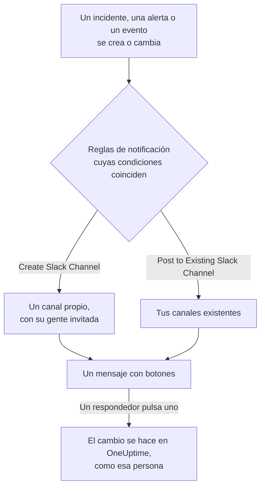

# Slack

Conecta OneUptime con Slack para publicar en tus canales los incidentes, alertas, episodios, mantenimientos programados, monitores y novedades de guardia, dar a cada incidente un canal propio y dejar que los respondedores actúen sin salir de Slack: reconocer, resolver, añadir notas, avisar a la guardia y declarar incidentes.

:::cards
- [Conectar Slack](#conectar-slack): Instala OneUptime en tu espacio de trabajo y luego vincula tu propia cuenta.
- [Reglas de notificación](#reglas-de-notificación): Decide qué eventos se publican dónde, y cuáles tienen un canal propio.
- [Crear incidentes y mantenimientos desde Slack](#crear-incidentes-y-mantenimientos-desde-slack): `/incident` y `/maintenance`, como tú mismo.
- [Actuar sobre incidentes, alertas y eventos desde Slack](#actuar-sobre-incidentes-alertas-y-eventos-desde-slack): Los botones de los mensajes de OneUptime.
:::

## Cómo funciona

Dos conexiones lo hacen posible:

- **La conexión del proyecto**, hecha una vez: la app de OneUptime instalada en tu espacio de trabajo de Slack. Publica los mensajes, crea los canales e invita a las personas.
- **La conexión propia de cada persona**: su cuenta de Slack vinculada a su cuenta de OneUptime. Los botones, los comandos y las reacciones con emoji actúan como esa persona, con sus permisos en el proyecto.

## Antes de empezar

- **Un rol que pueda conectar el proyecto:** **Project Owner**, **Project Admin** o **Project Member**. Desinstalar la app requiere **Project Owner** o **Project Admin**.
- **Un espacio de trabajo de Slack** donde puedas instalar apps.
- **El plan Growth en OneUptime Cloud** para las reglas de notificación y los resúmenes. Consulta [Reglas de notificación por debajo del plan Growth](#reglas-de-notificación-por-debajo-del-plan-growth).
- **En un servidor autoalojado,** antes una app de Slack configurada para él. Consulta [Integración con Slack](/docs/self-hosted/slack-integration).

## Conectar Slack

:::steps
### Instalar OneUptime en tu espacio de trabajo de Slack

Ve a **Ajustes del proyecto** > **Espacio de trabajo** > **Slack** y haz clic en **Conectar con Slack**. Elige el espacio de trabajo y autoriza a OneUptime. Slack te devuelve a la misma página, que ahora nombra el espacio de trabajo al que está conectado el proyecto. Mientras no haya ningún espacio de trabajo conectado, la sección **Espacio de trabajo** de los menús Incidentes, Alertas, Mantenimiento programado, Monitores y Guardia contiene **Conectar Slack o Teams**, que también lleva aquí.

### Conectar tu propia cuenta de Slack

Instalar la app vincula la cuenta de quien la instaló. Todos los demás vinculan su propia cuenta de Slack en **Ajustes de usuario** > **Espacio de trabajo** > **Slack** con **Connect my account with Slack**, para actuar sobre los incidentes y recibir mensajes directos como ellos mismos. Esa sección aparece en cuanto el proyecto está conectado a Slack.

### Añadir una regla de notificación

Ve a **Incidentes** > **Espacio de trabajo** > **Slack**. La sección **Espacio de trabajo** solo lista los espacios de chat que tu proyecto ha conectado, así que **Slack** aparece ahí en cuanto está conectado. Crea una regla, por ejemplo una que cree un canal de Slack para cada incidente nuevo e invite a los propietarios del incidente. Consulta [Reglas de notificación](#reglas-de-notificación).

### Probar la regla

Haz clic en **Probar regla** en la fila de la regla. Llega un mensaje de prueba a los canales que nombra la regla. Consulta [Probar una regla](#probar-una-regla).
:::

## Reglas de notificación

Una regla de notificación indica qué eventos se publican en Slack, y dónde. Cada producto tiene sus propias reglas, en **Espacio de trabajo** > **Slack** de su menú:

| Producto | Pestañas de su página **Slack** |
| --- | --- |
| **Incidentes** | **Incidentes**, **Episodios de incidente**, **Resumen** |
| **Alertas** | **Alertas**, **Episodios de alerta**, **Resumen** |
| **Mantenimiento programado** | Una lista de reglas |
| **Monitores** | Una lista de reglas |
| **Guardia** | Una lista de reglas |

Crear una regla recorre cuatro pasos:

| Paso | Lo que defines |
| --- | --- |
| **Básico** | **Nombre de la regla** y **Descripción de la regla**. |
| **Condiciones** | Para qué eventos se dispara la regla, por ejemplo por gravedad, estado, etiqueta, monitor o palabras del título. Sin condiciones, se dispara para cada evento. Con dos o más, **Condición de coincidencia** indica si deben coincidir todas o basta con una. |
| **Destino** | Dónde publica: **Post to Existing Slack Channel** con los nombres de los canales, **Create Slack Channel** con el nombre del canal nuevo y a quién se invita, o ambos. |
| **Videollamada** | Solo incidentes y alertas: iniciar una llamada para cada uno. Consulta [Videollamadas](/docs/workspace-connections/video-calls). |

Un canal que crea la regla se nombra con **New Slack Channel Name** seguido del número del registro, como `oneuptime-incident-42`, y solo un canal creado recibe a las personas que invita la regla: los propietarios del registro, los equipos y usuarios elegidos y, para incidentes y alertas, las personas de guardia a medida que se les avisa. Un incidente, una alerta o un episodio privado recibe un canal privado. Cada actualización posterior del registro — un cambio de estado, una nota, un nuevo propietario — se publica en sus canales y en los canales existentes que nombran sus reglas. Un incidente, una alerta o un episodio creado ya resuelto no recibe canal propio; su mensaje de creación igualmente va a los canales que nombran tus reglas. Consulta [Declarado ya reconocido o resuelto](/docs/incidents/declaring-incidents#declarado-ya-reconocido-o-resuelto).

**Ajustes del proyecto** > **Espacio de trabajo** > **Slack** lista los canales que OneUptime ve, con **Enviar prueba** junto a cada uno. OneUptime se une por sí mismo a un canal público la primera vez que publica en él. Un canal privado solo aparece en la lista, y solo puede recibir publicaciones, después de invitar a la app de OneUptime en Slack.

## Probar una regla

**Probar regla** en la fila de una regla publica un mensaje de prueba de esa regla en los canales que nombra, para que lo veas llegar. Si la regla crea un canal para cada evento, la prueba también crea uno e invita a las personas de la regla.

Como **Enviar prueba** junto a un canal en **Ajustes del proyecto** > **Espacio de trabajo** > **Slack**, necesita permiso para crear reglas de notificación: **Project Owner**, **Project Admin**, **Project Member**, **Settings Admin**, **Settings Member**, o **Create Workspace Notification Rule** y **Read Workspace Notification Rule** en un rol personalizado. Para alguien que solo puede ver las reglas, como un **Viewer**, **Probar regla** está bloqueado, y su descripción emergente dice lo que hace falta; la API rechaza su prueba con "You do not have permission to send test notifications in this project." En OneUptime Cloud, probar una regla requiere el plan **Growth**, igual que añadir una.

En OneUptime Cloud, **Enviar prueba** junto a un canal también requiere el plan **Growth**, porque publicar en un canal es lo que hacen las reglas y los resúmenes. **Enviar prueba ahora** en un resumen necesita permiso para crear resúmenes (**Create Workspace Notification Summary** y **Read Workspace Notification Summary** en un rol personalizado) y, en OneUptime Cloud, el plan **Growth**; para cualquier otra persona está bloqueado, y su descripción emergente dice lo que hace falta. Un cliente MCP conectado con acceso de solo lectura no puede enviar ninguna prueba.

## Resúmenes

La pestaña **Resumen** de **Incidentes** > **Espacio de trabajo** > **Slack** (y de **Alertas**) publica un resumen periódico en los canales que nombres: cuántos incidentes o alertas hubo, qué tan rápido se reconocieron y resolvieron, y una lista con enlaces. Un resumen nuevo sale cada semana y cubre los últimos 7 días. Deja **Enviar el primer informe a las** vacío y el primero sale a las 09:00 al comienzo de la semana, el día o el mes siguiente; el formulario dice cuándo.

Un resumen sale según el reloj de su **Zona horaria**, que empieza en la tuya. Mantiene allí su hora del día todo el año: uno configurado para las 09:00 en Berlín sigue saliendo a las 09:00 en Berlín después del cambio de horario de verano, y las fechas de su mensaje también son las de Berlín. Mediante la API, envía `timezone` como nombre de zona horaria IANA, como `Europe/Berlin`. Un resumen creado sin zona horaria toma la del perfil de quien lo creó, o UTC cuando lo crea una clave de API.

El formulario de un resumen tiene cuatro pasos: **Información básica** (su nombre y los canales), **Programación**, **Contenido** (**Qué incluir**) y **Filtros** (qué incidentes o alertas cuenta).

## Reglas de notificación por debajo del plan Growth

En OneUptime Cloud, las reglas de notificación y los resúmenes están en el plan **Growth** y superiores. Un proyecto por debajo conserva las reglas y los resúmenes que ya tiene, y siguen publicando en Slack. Por eso la página **Slack** de cada producto (Incidentes, Alertas, Mantenimiento programado, Guardia, Monitores) muestra la nota del plan con ellos debajo (**Reglas de notificación aún configuradas**, **Resúmenes aún configurados**): elimina una regla, o desactiva o elimina un resumen. Añadir o cambiar reglas y resúmenes requiere **Growth**.

## Recibir avisos en Slack

Para recibir avisos por mensaje directo cuando estás de guardia, añade Slack como uno de tus métodos de notificación:

:::steps
1. Conecta tu propia cuenta de Slack (consulta [Conectar Slack](#conectar-slack)).
2. Ve a **Ajustes de usuario** > **Métodos de notificación**, abre la pestaña **Workspace Apps** y haz clic en **Añadir cuenta de Slack**.
3. Haz clic en **Enviar mensaje de prueba** en su fila. El mensaje llega a tus mensajes directos de Slack.
:::

Al añadirlo, entra de inmediato en tus reglas de guardia, así que a partir de entonces los avisos te llegan en Slack. Cambia qué avisos recibe en **Ajustes de usuario** > **Reglas de guardia**.

## Guardar mensajes como notas

Reacciona a un mensaje en el canal de un incidente, una alerta, un episodio o un evento de mantenimiento programado, y OneUptime lo guarda como nota en ese registro y lo confirma con una respuesta en el hilo:

| Reacción | Se guarda como |
| --- | --- |
| 📌 Un emoji de chincheta, o el propio **Pin to channel** de Slack | Una nota privada, visible solo para tu equipo |
| 📢 Un emoji de megáfono o altavoz | Una nota pública, mostrada en la página de estado. Solo incidentes y eventos de mantenimiento programado. |

La nota se guarda como tú, con tus permisos, así que tu propia cuenta de Slack debe estar conectada. Un mensaje se guarda solo una vez, reaccione quien reaccione.

## Preguntar a OneUptime AI desde Slack

Pregunta por tus registros, trazas, métricas, incidentes y monitores en lenguaje natural. Menciona a OneUptime con @ en un canal, o envíale un mensaje directo, y responde en el hilo; responde allí para seguir preguntando. `/oneuptime ask which monitors are down?` publica su respuesta en el canal. Ambos requieren tu propia cuenta de Slack conectada y la IA activada para el proyecto. Las respuestas en Slack solo leen: para cambiar algo, usa los botones. Consulta [Preguntar a la IA](/docs/ai/ask-ai).

## Crear incidentes y mantenimientos desde Slack

`/incident` y `/maintenance` abren un formulario que rellenas y envías como tú mismo: como la cuenta de OneUptime a la que está conectada tu cuenta de Slack (consulta [Conectar Slack](#conectar-slack)), con los permisos de esa cuenta en el proyecto. Si tu cuenta de Slack no está conectada, o tu cuenta de OneUptime ya no es miembro del proyecto, OneUptime te dice por mensaje directo qué hacer, y no se abre ningún formulario. Los atajos **Create New Incident** y **Create Scheduled Event** abren los mismos formularios.

- **Quién puede usarlos.** Las personas que pueden declarar un incidente o crear un evento de mantenimiento programado en OneUptime: **Project Owner**, **Project Admin**, **Project Member**, **Incident Admin** e **Incident Member** para un incidente (**Create Incident** en un rol personalizado), y **Scheduled Maintenance Admin** y **Scheduled Maintenance Member** para un evento (**Create Scheduled Maintenance**). A cualquier otra persona se le avisa por mensaje directo, y no se abre ningún formulario.
- **Qué ofrece un formulario.** Cada lista — gravedades, monitores, estados de monitor, políticas de guardia y etiquetas — contiene lo que puedes leer, igual que la misma lista en OneUptime: con un rol limitado a algunas etiquetas, los monitores y las políticas de guardia que llevan esas etiquetas. Una lista que no puedes leer en absoluto se omite del formulario. Las políticas de guardia archivadas nunca se ofrecen.
- **Qué puede nombrar un formulario.** El incidente o el evento se crea con tus propios permisos y se te atribuye. Un monitor, una política de guardia, una etiqueta, una gravedad o un estado que no puedes leer, o uno de otro proyecto, se rechaza como uno que el proyecto no tiene, incluso desde un formulario abierto antes de que cambiara tu acceso, y no se crea nada. OneUptime te dice por qué en un mensaje directo.

**Execute On-Call Policy** en un incidente, una alerta o un episodio funciona igual: necesita permiso para ejecutar una política de guardia (**Project Owner**, **Project Admin**, **Project Member**, **On-Call Admin** y **On-Call Member**, o **Create On-Call Duty Policy Execution Log** en un rol personalizado) y para leer ese incidente, alerta o episodio, y ofrece las políticas de guardia activas que puedes leer.

## Actuar sobre incidentes, alertas y eventos desde Slack

Los botones de los mensajes de OneUptime en Slack también actúan como tú: como la cuenta de OneUptime a la que está conectada tu cuenta de Slack, con los permisos de esa cuenta en el proyecto. **Acknowledge**, **Resolve**, **Change State**, **Add Note** y **Execute On-Call Policy** en un incidente, una alerta o un episodio, y **Mark as Ongoing**, **Mark as Complete**, **Change State** y **Add Note** en un evento de mantenimiento programado, hacen cada uno el cambio que hace la misma acción en OneUptime, y se te atribuye allí: la línea de tiempo de estados y el feed del registro muestran que cambiaste su estado, y la nota es tuya. Una nota guardada desde un mensaje con una reacción con emoji se publica del mismo modo.

- **Quién puede usarlos.** Las personas que pueden hacer el mismo cambio en OneUptime. Reconocer, resolver o cambiar el estado de un incidente necesita permiso para cambiar su estado: **Project Owner**, **Project Admin**, **Project Member**, **Incident Admin** e **Incident Member**, o **Create Incident State Timeline** en un rol personalizado. Una alerta, un episodio o un evento de mantenimiento programado necesita el mismo permiso para su propio tipo (**Create Alert State Timeline**, por ejemplo), y una nota necesita permiso para publicar ese tipo de nota. A cualquier otra persona se le avisa por mensaje directo, y nada cambia.
- **Qué registros.** Los que puedes leer, como en OneUptime: con un rol limitado a algunas etiquetas, los incidentes, alertas, episodios y eventos que las llevan. Un botón en cualquier otro registro, o en uno de otro proyecto, recibe como respuesta que el registro "was not found in this project, or you do not have access to it.", y nada cambia. En OneUptime Cloud, un cambio que el plan del proyecto no incluye se rechaza indicando el plan que necesita.
- **Qué ofrece Change State.** Los estados que puedes leer y a los que el registro puede pasar a continuación, en el orden del proyecto: ninguno anterior al estado en que está, tanto para un episodio como para un incidente, una alerta o un evento de mantenimiento programado, ya que un cambio de estado nunca hace subir un registro en su lista (consulta [El orden es una restricción real, no una preferencia de visualización](/docs/incidents/states-and-severities#el-orden-es-una-restricción-real-no-una-preferencia-de-visualización)). Si no puedes leer ninguno, se te dice "No incident states are available to you in this project. Ask a project admin for access to them."; si el registro está en el último estado que puede alcanzar, se te dice "There is no later state to move this incident to." Ninguno de los dos abre un formulario vacío.

## Desconectar

- **Desconectar** desvincula solo tu propia cuenta de Slack, y elimina con ella tu método de notificación de Slack.
- **Desinstalar OneUptime de Slack**, en **Ajustes del proyecto** > **Espacio de trabajo** > **Slack**, desconecta el proyecto. OneUptime deja de publicar en Slack, y los menús **Espacio de trabajo** dejan de listarlo. Las reglas de notificación y los resúmenes se conservan para cuando vuelvas a conectar.

> [!WARNING]
> Desinstalar también desvincula la cuenta de Slack de cada miembro del proyecto, y elimina los métodos de notificación de Slack y las reglas de guardia que los usaban. Quienes recibían avisos en Slack los reciben en sus otros métodos de notificación hasta que vuelvan a añadir Slack.

## Solución de problemas

:::details Una regla no publica nada
Comprueba las condiciones de la regla con **Probar regla**: si la prueba llega, las condiciones de la regla no coincidieron con el evento. Si no llega, la página de Slack muestra por qué. Para un canal privado, invita primero a la app de OneUptime al canal en Slack. Cada mensaje que publica OneUptime, y cada uno que Slack rechazó, aparece en **Ajustes del proyecto** > **Notificaciones** > **Registros de notificación**, en la pestaña **Espacio de trabajo**.
:::

:::details Slack no se conectó
Cuando Slack te devuelve sin conexión, la página desde la que empezaste dice **Slack no se conectó**, y una frase dice por qué: te falta el permiso, el enlace ya se usó o caducó, iniciaste sesión en otro espacio de trabajo, o el servidor no está configurado para Slack. Consulta [La conexión no terminó](/docs/self-hosted/slack-integration#la-conexión-no-terminó) para cada frase y qué hacer.
:::

:::details Un botón o un comando dice que mi cuenta de Slack no está conectada
Vincúlala en **Ajustes de usuario** > **Espacio de trabajo** > **Slack** con **Connect my account with Slack**. Si ya no eres miembro del proyecto, OneUptime lo dice en su lugar, y no actúa en nada por ti.
:::

:::details Las notificaciones llegan, pero los botones y los comandos no hacen nada
En un servidor autoalojado, Slack debe poder llegar a OneUptime para los botones, los formularios y los comandos; las notificaciones solo necesitan acceso saliente. Consulta [Acceso de red para despliegues autoalojados](/docs/self-hosted/slack-integration#acceso-de-red-para-despliegues-autoalojados).
:::

## Próximos pasos

:::cards
- [Microsoft Teams](/docs/workspace-connections/microsoft-teams): Las mismas notificaciones y acciones en Microsoft Teams.
- [Videollamadas](/docs/workspace-connections/video-calls): Da a cada incidente una llamada, publicada con sus novedades.
- [Integración con Slack](/docs/self-hosted/slack-integration): Configurar la app de Slack en un servidor autoalojado.
- [Declarar un incidente](/docs/incidents/declaring-incidents): Todas las formas en que empieza un incidente, y lo que se ejecuta entonces.
:::
