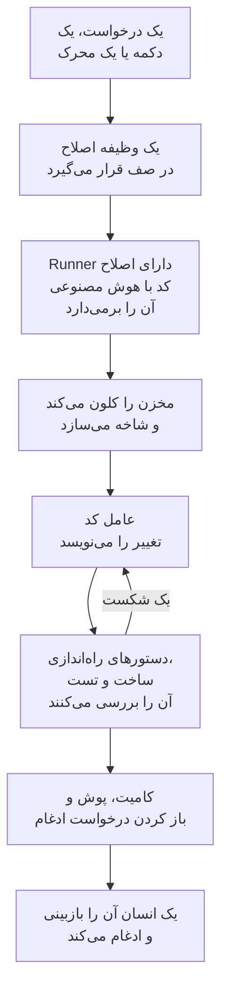

# کد

کد جایی است که از OneUptime AI می‌خواهید در مخزن‌هایتان کار کند، همان‌طور که از یک عامل کدنویسی می‌خواهید: یک باگ را رفع کند، تست بنویسد، کد را توضیح دهد، تغییری بدهد. کد با مخزن‌های متصل شما باز می‌شود؛ صفحهٔ هر مخزن وظایف آن و کادری را دارد که درخواستتان را در آن می‌نویسید؛ صفحهٔ هر وظیفه گفت‌وگویی است که می‌توانید در آن پاسخ دهید. OneUptime خودش هم از استثناها، ترِیس‌ها و بررسی‌ها وظیفه شروع می‌کند. یک [Runner](/docs/runbooks/agents) مخزن را کلون می‌کند، تغییر را روی یک شاخه تازه می‌نویسد، آن را می‌سازد و تست می‌کند و یک درخواست ادغام باز می‌کند. هر کدام را یک انسان بازبینی و ادغام می‌کند: Runner می‌تواند شاخه‌ها را push کند و درخواست ادغام باز کند، نه بیشتر.

:::cards
- [درخواست از هوش مصنوعی در یک مخزن](#درخواست-از-هوش-مصنوعی-در-یک-مخزن): درخواستی به زبان خودتان، با زمینه‌ای که لازم دارد.
- [گفت‌وگوی یک وظیفه](#گفتوگوی-یک-وظیفه): هوش مصنوعی چه کرد، چه چیزی را تغییر داد، و پاسخ شما.
- [یک اجرای اصلاح چگونه پیش می‌رود](#یک-اجرای-اصلاح-چگونه-پیش-میرود): از یک کلیک تا یک درخواست ادغام، گام به گام.
- [وظایف اصلاح از کجا شروع می‌شوند](#وظایف-اصلاح-از-کجا-شروع-میشوند): وظایفی که OneUptime شروع می‌کند، و کاری که هر درخواست ادغام انجام می‌دهد.
- [پیش از شروع](#پیش-از-شروع): یک مدل، یک مخزن متصل و یک Runner.
- [وقتی اصلاح شکست می‌خورد](#وقتی-اصلاح-شکست-میخورد): چه بر سر اجرایی می‌آید که خطا می‌دهد، گیر می‌کند یا منتظر می‌ماند.
:::

> [!TIP]
> این کار را از GitHub هم می‌توانید شروع کنید. در یک issue یا درخواست ادغام از OneUptime GitHub App نام ببرید تا همان‌جا پیاده‌سازی، بازنگری یا بازبینی کند: [GitHub App](/docs/ai/github-app) را ببینید. همان عامل، همان Runner و همان بودجه‌هاست؛ فقط محرک فرق دارد.

## درخواست از هوش مصنوعی در یک مخزن

:::steps
### یک مخزن را باز کنید

**محصولات** > **کد** را باز کنید. مخزن‌های پروژه آن‌جا فهرست شده‌اند، هر کدام با وظایفی که هوش مصنوعی روی آن‌ها کار می‌کند، وظایفی که منتظر شما هستند و درخواست‌های ادغام باز آن. اگر هنوز مخزنی نباشد، **اتصال GitHub** را پیشنهاد می‌کند ([پیش از شروع](#پیش-از-شروع) را ببینید).

### بگویید چه می‌خواهید

در صفحهٔ مخزن، تغییر، باگ یا پرسش را به زبان خودتان بنویسید. مخزنی که هنوز وظیفه‌ای ندارد، زیر **این‌ها را امتحان کنید** چند نمونه پیشنهاد می‌دهد.

### زمینه بیفزایید

روی **افزودن زمینه** کلیک کنید تا آنچه هوش مصنوعی لازم دارد به آن بدهید: یک فایل یا پوشه از مخزن، یک یادداشت، یک پیوند یا رکوردی از پروژه. OneUptime هر رکورد را هنگام فرستادن درخواست، با مجوزهای شما می‌خواند و آنچه را به هوش مصنوعی داده شد نگه می‌دارد.

### وظیفه را شروع کنید

روی **شروع وظیفه** کلیک کنید یا Enter را بزنید. صفحهٔ وظیفه باز می‌شود و کار هوش مصنوعی همان‌طور که انجام می‌شود آن‌جا نمایش داده می‌شود.
:::

| زمینه | آنچه هوش مصنوعی می‌گیرد |
| --- | --- |
| **فایل یا پوشه** | مسیری در مخزن، که هوش مصنوعی اول آن را می‌خواند. |
| **یادداشت** | متنی که جای‌گذاری می‌کنید: یک خطا، یک مشخصات، یک خط لاگ. |
| **پیوند** | یک نشانی وب، به‌عنوان مرجع. |
| **حادثه** یا **هشدار** | وضعیت، توضیح و علت ریشه‌ای آن، همان‌طور که هنگام فرستادن درخواست هستند. |
| **استثنا** | پیام و رد پشتهٔ آن. |
| **مانیتور** | نوع، وضعیت و توضیح آن. |
| **ترِیس** | spanهای آن: نام‌ها، زمان‌ها و خطاهایشان. |
| **لاگ‌ها** | تازه‌ترین ۲۰ خط لاگ که عبارت جست‌وجوی شما را دارند، از ساعت، روز یا هفتهٔ گذشته. |

هر درخواست حداکثر ۱۰ مورد زمینه دارد. توکن‌ها، کلیدها، گذرواژه‌ها و نشانی‌های ایمیل در آنچه OneUptime می‌خواند، پیش از آنکه هوش مصنوعی آن‌ها را ببیند پوشانده می‌شوند، همان‌طور که در هر جایی که OneUptime AI داده‌های شما را می‌خواند.

## گفت‌وگوی یک وظیفه

صفحهٔ هر وظیفه یک گفت‌وگو است: آنچه خواسته شد و زمینه‌ای که افزوده شد، سپس نوبت هوش مصنوعی – گام‌هایی که برمی‌دارد، همان‌طور که برمی‌دارد (فایل‌هایی که خواند و ویرایش کرد، آنچه جست‌وجو کرد، دستورهایی که اجرا کرد)، پاسخش، فایل‌هایی که تغییر داد با diff آن‌ها، و درخواست ادغام. بالای صفحه می‌گوید وظیفه در چه وضعی است:

| وضعیت | معنای آن |
| --- | --- |
| **در صف** | منتظر است تا یک Runner آن را بردارد. |
| **در حال کار…** | هوش مصنوعی روی آن کار می‌کند. **توقف** آن را متوقف می‌کند؛ آنچه push کرده روی شاخه می‌ماند. |
| **در انتظار شما** | هوش مصنوعی پرسشی پرسیده است. در کادر پایین به آن پاسخ دهید. |
| **انجام شد** | هوش مصنوعی کارش را تمام کرد: پاسخش، و درخواست ادغام اگر کد را تغییر داده باشد. |
| **ناموفق** | این نوبت نتوانست تمام شود و دلیلش را می‌گوید. **تلاش دوباره** همان را دوباره می‌خواهد. |
| **متوقف‌شده** | کسی آن را متوقف کرد. **تلاش دوباره** همان را دوباره می‌خواهد. |

برای ادامه، در کادر پایین بنویسید: به هوش مصنوعی پاسخ دهید، زمینه بیفزایید یا تغییر بخواهید. هر پاسخ نوبت بعدی همان وظیفه است: تا وقتی درخواست ادغام باز است، روی همان شاخه کار می‌کند و به همان درخواست ادغام push می‌کند. هر وظیفه در هر زمان یک نوبت دارد، پس تا هوش مصنوعی کار می‌کند کادر منتظر می‌ماند. **لاگ** هر نوبت ثبت کلمه‌به‌کلمهٔ کاری است که در آن انجام شد.

هر کسی که بتواند مخزنی را بخواند، وظایف آن را هم می‌خواند. درخواست از هوش مصنوعی، پاسخ دادن و متوقف کردن یک وظیفه به مجوز ویرایش مخزن نیاز دارد، و دیدن diff یک تغییر هم همین‌طور: بقیه می‌بینند کدام فایل‌ها تغییر کرده‌اند. وظایفی که OneUptime خودش شروع می‌کند (پایین‌تر) هم در مخزنشان هستند، به‌صورت گفت‌وگوهایی که می‌توانید در آن‌ها پاسخ دهید.

## یک اجرای اصلاح چگونه پیش می‌رود



1. در یک مخزن روی **شروع وظیفه** کلیک می‌کنید، یا روی یک استثنای حل‌نشده روی **Fix with AI**، یا دکمه یا محرک دیگری وظیفه‌ای را شروع می‌کند ([وظایف اصلاح از کجا شروع می‌شوند](#وظایف-اصلاح-از-کجا-شروع-میشوند) را ببینید).
2. وظیفه در صف مخزن خودش قرار می‌گیرد و Runnerی که مخزن انتخاب کرده آن را برمی‌دارد: یکی از Runnerهای شما، یا وقتی هیچ‌کدام را انتخاب نکرده باشد، یک Runner سراسری (ببینید [انتخاب Runner مخزن](#انتخاب-runner-مخزن)).
3. Runner زمینه وظیفه را می‌گیرد. برای یک درخواست، این زمینه واژه‌های آن، زمینهٔ افزوده‌شده و گفت‌وگوی تا این‌جا است؛ برای یک استثنا، نوع، پیام و رد پشته آن.
4. مخزن را در فضای کاری خودش کلون می‌کند و یک شاخه می‌سازد. نام اصلاح یک استثنا `oneuptime-fix-exception-` است و پس از آن نخستین نویسه‌های شناسه اجرا می‌آید. یک پاسخ به‌جای آن روی شاخهٔ درخواست ادغام باز وظیفه کار می‌کند.
5. یک عامل کد که با ارائه‌دهنده LLM پروژه شما کار می‌کند، کد را می‌خواند و تغییر را می‌نویسد. فراخوانی‌های LLM را سرور OneUptime انجام می‌دهد، بنابراین Runner هرگز کلید API ارائه‌دهنده شما را ندارد و هر فراخوانی اندازه‌گیری و در لاگ‌های هوش مصنوعی فهرست می‌شود.
6. اگر مخزن دستورهای راستی‌آزمایی داشته باشد، Runner خودتان پیش از کامیت کردن هر چیزی تغییر را می‌سازد و تست می‌کند و شکست را برای ترمیم به عامل کد برمی‌گرداند ([راستی‌آزمایی پیش از درخواست ادغام](#راستیآزمایی-پیش-از-درخواست-ادغام) را ببینید).
7. Runner کامیت می‌کند، شاخه را push می‌کند، درخواست ادغام را باز می‌کند (برای یک درخواست، فقط اگر کد را تغییر داده باشد) و فضای کاری را پاک می‌کند.

صفحه‌ای که وظیفه از آن شروع شد، وضعیت زنده آن را نشان می‌دهد. هر وظیفه در مخزن خودش زیر **محصولات** > **کد** فهرست شده است: صفحهٔ آن گفت‌وگوی آن است، و **لاگ** هر نوبت برای هر فایلی که Runner خواند یا نوشت و هر دستوری که اجرا کرد یک خط دارد.

هر اجرا در بودجه‌هایی می‌ماند که سرور اعمال می‌کند: حداکثر **۴۰ فراخوانی LLM** و **۱۰۰٬۰۰۰ توکن خروجی**. اجرایی که به یکی از آن‌ها برسد، به جای چرخیدن در حلقه، با خلاصه‌ای از کار انجام‌شده تا آن لحظه تمام می‌شود. اجراهای اصلاح در محدودیت‌های روزانه هوش مصنوعی پروژه هم شمرده می‌شوند، اگر پروژه آن‌ها را تعیین کرده باشد.

## وظایف اصلاح از کجا شروع می‌شوند

| کجا | کلیک | درخواست ادغام |
| --- | --- | --- |
| صفحه **AI Assistance** یک استثنا | **Fix with AI** | باگ پشت استثنا را اصلاح می‌کند. |
| صفحه **AI Assistance** یک استثنا | **Generate Regression Test** | تستی اضافه می‌کند که استثنا را بازتولید می‌کند و تا اصلاح باگ شکست می‌خورد. |
| صفحه **AI Assistance** یک استثنا | **بهبود مدیریت خطا** | برای خطایی مورد انتظار، مثل ورودی نامعتبر: داده‌های کاربر را از پیام بیرون می‌برد، ورودی را زودتر اعتبارسنجی می‌کند و خطا را رسیدگی‌شده علامت می‌زند، بدون تغییر رفتار. |
| کارت **AI Investigation** یک حادثه یا هشدار | **Open Fix PR from this analysis** | علت ریشه‌ای را که بررسی منتشر کرد اصلاح می‌کند ([اصلاح خودکار کد از بررسی‌ها](#اصلاح-خودکار-کد-از-بررسیها) را ببینید). |
| یک ترِیس | **Fix performance with AI** | الگوی کندی را که در ترِیس پیدا شده اصلاح می‌کند، مثل کوئری‌های N+1 یا یک span کند غالب. |
| صفحه **لاگ‌ها** در یک سرویس | **بهبود لاگ‌گیری** | لاگ‌های سرویس را ساختاریافته، با شدت درست و پیوندخورده به ترِیس‌هایش می‌کند، بدون تغییر رفتار. |
| صفحه **ترِیس‌ها** در یک سرویس | **بهبود ترِیسینگ** | هر جا ردیابی سرویس کم است، span و ویژگی اضافه می‌کند، بدون تغییر رفتار. |

برای باز کردن صفحه **AI Assistance** یک استثنا، استثنا را زیر **محصولات** > **مشاهده‌پذیری** > **استثناها** باز کنید و در منوی کناری آن **AI Assistance** را انتخاب کنید. استثنای حل‌شده یا بایگانی‌شده را باید اول حل‌نشده علامت بزنید.

OneUptime AI خودش هم وظایف اصلاح را شروع می‌کند: از بررسی‌ای که یک تغییر کد پیدا می‌کند، از بررسی‌ای که به دلیل نبود تله‌متری بی‌نتیجه تمام می‌شود، و از AI Insights درباره استثناها و ترِیس‌های کند. هر کدام کلید خودش را دارد؛ [اصلاح خودکار کد](/docs/ai/ai-sre#اصلاح-خودکار-کد) را ببینید.

## راستی‌آزمایی پیش از درخواست ادغام

یک مخزن می‌تواند تا سه دستور راستی‌آزمایی در صفحه **تنظیمات** خود در کد داشته باشد:

| دستور | نمونه | زمان اجرا |
| --- | --- | --- |
| **Setup Command** | `npm ci` | اول، برای نصب وابستگی‌ها. |
| **Build Command** | `npm run build` | پس از راه‌اندازی. |
| **Test Command** | `npm test` | آخر. |

وقتی یکی از آن‌ها تعیین شده باشد، هر اجرای اصلاح پیش از باز شدن درخواست ادغام، تغییر خود را بررسی می‌کند:

1. وقتی کار عامل کد تمام می‌شود، دستورها به ترتیب در ریشه مخزن، روی Runner، در فضای کاری کلون‌شده اجرا می‌شوند. هر کدام تا ۱۵ دقیقه وقت دارد و با `CI=true` اجرا می‌شود تا هیچ چیز منتظر ورودی نماند؛ نخستین شکست، دور را متوقف می‌کند.
2. در صورت شکست، انتهای خروجی دستورِ شکست‌خورده به‌عنوان یک وظیفه ترمیم به همان عامل کد برمی‌گردد، با این دستور که به جای تضعیف یا رد کردن تست‌ها، تغییر خودش را درست کند، و دستورها دوباره اجرا می‌شوند. حداکثر **۲** بار برای ترمیم تلاش می‌کند. این تلاش‌ها بودجه LLM اجرا را به اشتراک می‌گذارند و ویرایش‌هایشان در همان کامیتِ اصلاح قرار می‌گیرد.
3. نتیجه، یعنی موفق، ناموفق یا ردشده (بدون دستور تعیین‌شده، یا یک Runner سراسری)، در بخش Verification توضیح درخواست ادغام نوشته و روی درخواست ادغام وظیفه ثبت می‌شود.

تغییری که هنوز در راستی‌آزمایی رد می‌شود دور انداخته نمی‌شود: درخواست ادغام به هر حال باز می‌شود، با بخش "Verification failed" که به‌وضوح علامت خورده، نام دستور شکست‌خورده را می‌آورد و با خروجی آن تمام می‌شود. کار حفظ می‌شود و بازبین تصمیم می‌گیرد. مخزنی که هیچ دستوری برایش تعیین نشده، به جای القای یک ساخت سبز، ردشده گزارش می‌شود.

دستورها تنظیمات مخزن هستند که تیم شما می‌نویسد و روی Runner خودتان اجرا می‌شوند: همان مدل اعتماد گام‌های Bash یک رانبوک. هوش مصنوعی هرگز آن‌ها را نمی‌نویسد یا تغییر نمی‌دهد. Runner سراسری، که OneUptime برای همه پروژه‌ها اجرا می‌کند، هرگز آن‌ها را اجرا نمی‌کند: روی یک Runner سراسری، اصلاح نوشته و برای بازبینی باز می‌شود، راستی‌آزمایی ردشده گزارش می‌شود و CI خود مخزن شما تغییر را بررسی می‌کند. برای اینکه اصلاح‌ها پیش از باز شدن درخواست ادغام ساخته و تست شوند، [یک Runner از آن خودتان اجرا کنید](#اجرای-یک-runner-از-آن-خودتان).

## پیش از شروع

یک وظیفه به سه چیز نیاز دارد. صفحهٔ یک مخزن در کد و صفحه **AI Assistance** استثنا پیش از پیشنهاد شروع، هر سه را بررسی می‌کنند و می‌گویند چه چیزی کم است.

| چه | OneUptime Cloud | خودمیزبان |
| --- | --- | --- |
| یک ارائه‌دهنده LLM | چیزی برای راه‌اندازی نیست: پروژه‌ای که ارائه‌دهنده خودش را ندارد از ارائه‌دهنده سراسری استفاده می‌کند که هزینه‌اش از اعتبار هوش مصنوعی پروژه پرداخت می‌شود. ارائه‌دهنده خودتان، زیر **تنظیمات پروژه** > **هوش مصنوعی** > **ارائه‌دهندگان LLM**، مقدم است. | متغیرهای محیطی `GLOBAL_LLM_PROVIDER_*` را یک بار روی سرور تعیین کنید، یا یک ارائه‌دهنده به پروژه اضافه کنید. |
| مخزنی که از طریق GitHub App متصل شده | **محصولات** > **کد**، سپس **اتصال GitHub**. اگر اپ از پیش روی حساب GitHub نصب شده است، به‌جای آن روی **اتصال یک نصب موجود** کلیک کنید: نصب دوباره آن را متصل نمی‌کند. به طرح Growth نیاز دارد. | همین، وقتی نمونه شما یک GitHub App داشته باشد ([یکپارچه‌سازی GitHub](/docs/self-hosted/github-integration) را ببینید). |
| یک Runner که اصلاح کد با هوش مصنوعی را اجرا می‌کند | چیزی برای اجرا نیست: مخزنی که هیچ Runnerی انتخاب نکند، روی Runnerهای سراسری OneUptime کار می‌کند. | سرویس `runner` در Docker Compose، یا Runner چارت Helm (`runner.enabled`، به‌طور پیش‌فرض روشن)، خودش را ثبت می‌کند و در هر مخزنی که Runnerی انتخاب نکند اصلاح کد با هوش مصنوعی را اجرا می‌کند. |

روی یک نمونه خودمیزبان، ارائه‌دهنده سراسری یک بلوک از `config.env` (Docker Compose) یا مقادیر Helm شماست. برای یک Ollama خودمیزبان:

```bash
GLOBAL_LLM_PROVIDER_TYPE=Ollama
# An address the OneUptime server can reach, never localhost.
GLOBAL_LLM_PROVIDER_BASE_URL=http://ollama:11434
GLOBAL_LLM_PROVIDER_MODEL_NAME=llama3.1
# No GLOBAL_LLM_PROVIDER_API_KEY needed — Ollama is keyless.
```

هر ارائه‌دهنده پشتیبانی‌شده‌ای کار می‌کند: برای همه آن‌ها و هر متغیر محیطی، [ارائه‌دهندگان LLM](/docs/ai/llm-provider) را ببینید.

لازم نیست مخزن‌ها را به سرویس‌ها نگاشت کنید. وقتی وظیفه‌ای شروع می‌شود، OneUptime مخزن را با تطبیق مسیرهای فایل در رد پشته استثنا با مخزن‌های متصل شما پیدا می‌کند. اگر هیچ‌کدام مطابقت نداشته باشد، به مخزنی با نامی مانند نام سرویس برمی‌گردد و سپس، اگر پروژه فقط یک مخزن داشته باشد، به همان مخزن. صفحه **AI Assistance** نشان می‌دهد کدام مخزن را پیدا کرده است.

### انتخاب Runner مخزن

هر مخزن Runnerی را انتخاب می‌کند که هوش مصنوعی روی آن در مخزن کار می‌کند: در صفحه **تنظیمات** آن در کد، روی **ویرایش تنظیمات** کلیک کنید و در گام **Runner** یکی را انتخاب کنید. مخزنی که هیچ‌کدام را انتخاب نکند، روی **Runner سراسری** کار می‌کند که OneUptime برای همه پروژه‌ها اجرا می‌کند.

| Runner | با یک وظیفه چه می‌کند |
| --- | --- |
| **Runner سراسری** | تغییر را می‌نویسد و درخواست ادغام را باز می‌کند، بدون دستورهای راه‌اندازی، ساخت و تست شما: CI خود مخزن شما تغییر را بررسی می‌کند. |
| یکی از Runnerهای شما | دستورهای راه‌اندازی، ساخت و تست شما را هم روی میزبانی که در اختیار شماست اجرا می‌کند. |

فقط Runnerی که یک مخزن انتخاب کرده وظیفه‌های آن و یک توکن برای آن را می‌گیرد. در پروژه‌ای که **استفاده از Runnerهای سراسری** را زیر **رانبوک‌ها** > **Runnerها** خاموش کند، هر مخزن به یکی از Runnerهای خود پروژه نیاز دارد. صفحه هر Runner مخزن‌هایی را که آن را انتخاب کرده‌اند فهرست می‌کند.

### اجرای یک Runner از آن خودتان

برای اجرای یک Runner در جای دیگر، مثلاً روی ماشینی نزدیک به مخزن‌هایتان:

:::steps
### Runner را بسازید

یک Runner زیر **رانبوک‌ها** > **Runnerها** بسازید و در ردیف آن روی **نمایش دستورالعمل‌های راه‌اندازی** کلیک کنید. این دستور کلید مخفی Runner را در خود دارد که فقط Project Owner، Project Admin یا Runbook Admin می‌تواند آن را بخواند. چیزی شبیه این است:

```bash
docker run --name oneuptime-runner --restart unless-stopped \
  -e ONEUPTIME_RUNNER_ID=<runner-id> \
  -e ONEUPTIME_RUNNER_KEY=<runner-key> \
  -e ONEUPTIME_URL=<your-oneuptime-url> \
  -d oneuptime/runner:release
```

### آن را برای مخزن انتخاب کنید

در صفحه **تنظیمات** مخزن در کد، روی **ویرایش تنظیمات** کلیک کنید و در گام **Runner** آن Runner را انتخاب کنید. Runner تغییر را با heartbeat بعدی‌اش، در حدود یک دقیقه، می‌گیرد؛ نیازی به راه‌اندازی دوباره نیست.

### بررسی کنید که وصل می‌شود

Runner ظرف یکی دو دقیقه در صفحه **رانبوک‌ها** > **Runnerها** متصل نشان داده می‌شود. اگر نشد، لاگ کانتینر (`docker logs oneuptime-runner`) را برای خطای اعتبارنامه یا شبکه بخوانید.
:::

هر روشی برای اجرای کانتینر کار می‌کند (Docker Compose، Kubernetes و مانند آن)، به شرطی که این متغیرها را داشته باشد و از طریق HTTPS به نمونه OneUptime شما برسد:

| متغیر | چیست |
| --- | --- |
| `ONEUPTIME_RUNNER_ID` | شناسه Runner، از داشبورد. |
| `ONEUPTIME_RUNNER_KEY` | کلید مخفی Runner. |
| `ONEUPTIME_URL` | نشانی نمونه OneUptime شما (`https://oneuptime.com` در OneUptime Cloud). |

> [!NOTE]
> پیش از OneUptime 12، اصلاح کد با هوش مصنوعی روی یک مؤلفه جداگانه AI Agent اجرا می‌شد (ایمیج `oneuptime/ai-agent` با متغیرهای `AI_AGENT_*`). این مؤلفه در Runner ادغام شده است: اگر هنوز یکی را اجرا می‌کنید، [راهنمای ارتقای v11 به v12](/docs/installation/upgrading) می‌گوید چگونه آن را جایگزین کنید.

## اصلاح خودکار کد از بررسی‌ها

وقتی یک [بررسی هوش مصنوعی](/docs/ai/ai-sre) تحلیل علت ریشه‌ای را روی یک حادثه یا هشدار منتشر می‌کند و طبقه‌بندی دقیق آن تغییری در کد را توصیه می‌کند، کارت بررسی **Open Fix PR from this analysis** را پیشنهاد می‌دهد: یک وظیفه اصلاح که کل زمینه‌اش همان تحلیل منتشرشده است. این دکمه وقتی پنهان است که راه‌حل عملیاتی، فقط مربوط به زیرساخت، بیرونی، یک رد مورد انتظار، خطای کاربر یا بی‌نتیجه باشد. تا وقتی کلید **باز کردن Pull Request اصلاحی وقتی بررسی تغییری در کد پیدا می‌کند** روشن است، اصلاح‌های واجد شرایط بدون کلیک انجام می‌شوند. این کلید بخشی از اصلاح است: زیر **اصلاح خودکار حوادث تازه** در **حوادث** > **هوش مصنوعی** > **تنظیمات** قرار دارد (و زیر **اصلاح خودکار هشدارهای تازه** در **هشدارها** > **هوش مصنوعی** > **تنظیمات**)، با روشن شدن اصلاح روشن می‌شود و فقط تا وقتی اصلاح روشن است درخواست ادغام باز می‌کند. هر دو در آغاز خاموش‌اند، برای پروژه‌های تازه هم.

تا وقتی روشن است، بررسی‌ای که با یک علت ریشه‌ای مطمئن و مستند پایان می‌یابد که یک تغییر کد می‌تواند آن را اصلاح کند، همان وظیفه اصلاحی را در صف می‌گذارد که دکمه می‌سازد. این تصمیم یک طبقه‌بندی محدود است که سرور آن را بررسی می‌کند، نه الگویی که با متن تحلیل تطبیق داده شود: فقط یک حکم مثبت برای اصلاح کد، درخواست ادغام باز می‌کند. نبود شواهد، راه‌حلی بیرون از کد و طبقه‌بندی ناموفق، همگی به انجام ندادن هیچ کاری ختم می‌شوند.

همه چیزهای دیگر مثل دکمه است:

- درخواست ادغام آماده بازبینی باز می‌شود، بر پایه تحلیل منتشرشده نوشته می‌شود و به مخزنی متصل از طریق GitHub App و یک Runner آنلاین برای کار در آن نیاز دارد: همان که مخزن انتخاب کرده، یا یک Runner سراسری.
- در محدودیت روزانه وظایف اصلاح آن سیگنال (**Daily Incident AI Fix Task Limit** یا **Daily Alert AI Fix Task Limit**، زیر **تنظیمات بیشتر** در صفحه تنظیمات هوش مصنوعی آن) و در سقف درخواست‌های ادغام باز مخزن شمرده می‌شود، اگر هر کدام تعیین شده باشد. اگر تعیین نشده باشند، هیچ‌کدام چیزی را محدود نمی‌کند.
- هر محرک اول به دنبال وظیفه اصلاحی می‌گردد که برای همان حادثه یا هشدار از قبل در صف است یا در حال اجراست، بنابراین یک محرک خودکار و یک کلیک معمولاً یک وظیفه می‌شوند، نه دو درخواست ادغام. این بررسی یک خواندن پیش از نوشتن است، نه یک قفل، پس دو محرک در دقیقاً همان لحظه هنوز ممکن است هر دو عبور کنند.
- اجرا را سیستم می‌نویسد، به نام کسی ثبت نمی‌شود و هیچ چیز خودبه‌خود ادغام نمی‌شود.

## وقتی اصلاح شکست می‌خورد

:::details اجرا خطا می‌دهد
اصلاح اعمال نشد، مخزن در دسترس نبود یا فراخوانی LLM شکست خورد. گفت‌وگوی وظیفه، و صفحه‌ای که وظیفه از آن شروع شد، دلیل را نشان می‌دهند و تلاش دوباره را پیشنهاد می‌کنند. **لاگ** آن نوبت، لاگ کامل اجرا را دارد.
:::

:::details Runner در میانه یک اجرا متوقف می‌شود
اجرایی که heartbeat آن بیش از ۱۲ دقیقه خاموش مانده، با خطا ناموفق می‌شود. هرگز خودبه‌خود دوباره در صف قرار نمی‌گیرد، چون ممکن است Runner بخشی از یک شاخه اصلاح را پیش‌تر push کرده باشد؛ آن را دوباره از همان جایی شروع کنید که شروعش کردید.
:::

:::details هیچ Runnerی وظیفه را برنمی‌دارد
وظیفه‌ای که بیش از ۳۰ دقیقه منتظر بماند در حالی که Runnerی که باید آن را بردارد متصل نیست - همان که مخزنش انتخاب کرده، یا یک Runner سراسری برای مخزنی که هیچ‌کدام را انتخاب نکرده - با پیامی که می‌گوید کدام، شکست می‌خورد، تا هرگز برای همیشه در حال اجرا نشان داده نشود. وقتی یک Runner آنلاین ولی مشغول است، وظایف در صف منتظر نوبت خود می‌مانند. Runnerی که از کد قدیمی‌تر است هرگز درخواستی از کد نمی‌گیرد: Runnerی را که خودتان اجرا می‌کنید همراه با سرور به‌روز کنید.
:::

## حریم خصوصی

کلون مخزن شما در یک فضای کاری درون کانتینر Runner قرار دارد و وقتی اجرا تمام شود، چه موفق چه ناموفق، پاک می‌شود. Runner هرگز کلید API ارائه‌دهنده LLM شما را ندارد: سرور OneUptime فراخوانی‌های LLM را برای آن انجام می‌دهد. OneUptime مخزن شما را نگه نمی‌دارد و روی کد شما آموزش نمی‌بیند. لاگ وظیفه ۳۰۰ نویسه نخست خروجی هر گام را نگه می‌دارد تا بتوانید ببینید Runner چه کرد، و این می‌تواند تکه‌هایی از کد را در بر بگیرد. یک Runner خودمیزبان را با ارائه‌دهنده LLM خودتان (از جمله Ollama محلی) اجرا کنید تا کد شما هرگز زیرساختتان را ترک نکند.

## در نقشه راه

برنامه‌ریزی‌شده و **امروز در دسترس نیست**:

- **پشتیبانی از GitLab.** مخزن‌ها فقط از طریق GitHub App متصل می‌شوند.
- **تله‌متری بیشتر در یک اصلاح.** وارد کردن ترِیس‌ها، لاگ‌ها و متریک‌های پیرامون یک استثنا به اصلاح آن، فراتر از رد پشته.

## گام‌های بعدی

:::cards
- [GitHub App](/docs/ai/github-app): از خود GitHub یک تغییر، بازنگری یا بازبینی بخواهید.
- [AI SRE](/docs/ai/ai-sre): بررسی‌هایی که وظایف اصلاح می‌توانند تحلیل‌هایشان را به درخواست ادغام تبدیل کنند.
- [عامل‌های رانبوک](/docs/runbooks/agents): کارگری که هر اجرای اصلاح را انجام می‌دهد.
:::
