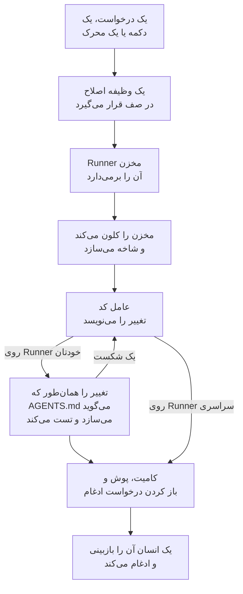

# کد

کد جایی است که از OneUptime AI می‌خواهید در مخزن‌هایتان کار کند، همان‌طور که از یک عامل کدنویسی می‌خواهید: یک باگ را رفع کند، تست بنویسد، کد را توضیح دهد، تغییری بدهد. کد با کادری باز می‌شود که درخواستتان را در آن می‌نویسید، با مخزن و شاخه‌ای که در آن انتخاب می‌شوند و همهٔ وظایف زیر آن؛ صفحهٔ هر وظیفه گفت‌وگویی است که می‌توانید در آن پاسخ دهید. OneUptime خودش هم از استثناها، ترِیس‌ها و بررسی‌ها وظیفه شروع می‌کند. یک [Runner](/docs/runbooks/agents) مخزن را کلون می‌کند، تغییر را روی یک شاخه تازه می‌نویسد، آن را می‌سازد و تست می‌کند و یک درخواست ادغام باز می‌کند. هر کدام را یک انسان بازبینی و ادغام می‌کند: Runner می‌تواند شاخه‌ها را push کند و درخواست ادغام باز کند، نه بیشتر.

:::cards
- [درخواست از هوش مصنوعی در یک مخزن](#درخواست-از-هوش-مصنوعی-در-یک-مخزن): درخواستی به زبان خودتان، با زمینه‌ای که لازم دارد.
- [گفت‌وگوی یک وظیفه](#گفتوگوی-یک-وظیفه): هوش مصنوعی چه کرد، چه چیزی را تغییر داد، و پاسخ شما.
- [یک اجرای اصلاح چگونه پیش می‌رود](#یک-اجرای-اصلاح-چگونه-پیش-میرود): از یک کلیک تا یک درخواست ادغام، گام به گام.
- [وظایف اصلاح از کجا شروع می‌شوند](#وظایف-اصلاح-از-کجا-شروع-میشوند): وظایفی که OneUptime شروع می‌کند، و کاری که هر درخواست ادغام انجام می‌دهد.
- [تله‌متری محیط عملیاتی در یک اصلاح](#تلهمتری-محیط-عملیاتی-در-یک-اصلاح): آنچه یک اصلاح هنگام نوشتن تغییر از محیط عملیاتی می‌خواند.
- [بازبینی عملیاتی درخواست‌های ادغام](#بازبینی-عملیاتی-درخواستهای-ادغام): آنچه محیط عملیاتی دربارهٔ کدی که هر درخواست ادغام تغییر می‌دهد می‌گوید.
- [اتصال یک مخزن](#اتصال-یک-مخزن): GitHub، GitLab، Forgejo یا Gitea، یا هر سرور Git.
- [پیش از شروع](#پیش-از-شروع): یک مدل، یک مخزن متصل و یک Runner.
- [وقتی اصلاح شکست می‌خورد](#وقتی-اصلاح-شکست-میخورد): چه بر سر اجرایی می‌آید که خطا می‌دهد، گیر می‌کند یا منتظر می‌ماند.
:::

> [!TIP]
> این کار را از GitHub هم می‌توانید شروع کنید. در یک issue یا درخواست ادغام از OneUptime GitHub App نام ببرید تا همان‌جا پیاده‌سازی، بازنگری یا بازبینی کند: [GitHub App](/docs/ai/github-app) را ببینید. همان عامل، همان Runner و همان بودجه‌هاست؛ فقط محرک فرق دارد.

## درخواست از هوش مصنوعی در یک مخزن

:::steps
### کد را باز کنید

**محصولات** > **کد** را باز کنید. کد با **هوش مصنوعی چه کاری انجام دهد؟** باز می‌شود: کادری که درخواستتان را در آن می‌نویسید، با همهٔ وظایف زیر آن، تازه‌ترین‌ها اول. اگر هنوز مخزنی نباشد، به‌جای آن **اتصال GitHub** را پیشنهاد می‌کند و زیر آن GitLab، Forgejo یا Gitea و هر سرور Git را ([اتصال یک مخزن](#اتصال-یک-مخزن) را ببینید). **مخازن** در منوی کناری، مخزن‌هایی را فهرست می‌کند که هوش مصنوعی می‌تواند در آن‌ها کار کند، و آن‌هایی را که OneUptime دیگر به آن‌ها دسترسی ندارد زیر **متصل نیست** جمع می‌کند. صفحهٔ هر مخزن همان کادر را برای آن مخزن دارد.

### مخزن و شاخه را انتخاب کنید

کادر با مخزنی شروع می‌شود که آخرین بار انتخاب کردید. مخزن دیگری را در ردیف پایین آن انتخاب کنید و کنارش شاخه‌ای را که وظیفه از آن شروع می‌شود: تا وقتی شاخهٔ دیگری انتخاب نکنید، شاخهٔ اصلی مخزن است که با **پیش‌فرض** مشخص شده. هوش مصنوعی شاخهٔ خودش را از شاخهٔ انتخابی شما می‌سازد و درخواست ادغامش را به همان باز می‌کند.

### بگویید چه می‌خواهید

تغییر، باگ یا پرسش را به زبان خودتان بنویسید. تا وقتی چیزی خواسته نشده، کد زیر **این‌ها را امتحان کنید** چند نمونه پیشنهاد می‌دهد.

### زمینه بیفزایید

روی **افزودن زمینه** کلیک کنید تا آنچه هوش مصنوعی لازم دارد به آن بدهید: یک فایل یا پوشه از مخزن، یک یادداشت، یک پیوند یا رکوردی از پروژه. OneUptime هر رکورد را هنگام فرستادن درخواست، با مجوزهای شما می‌خواند و آنچه را به هوش مصنوعی داده شد نگه می‌دارد.

### وظیفه را شروع کنید

روی **شروع وظیفه** کلیک کنید یا Enter را بزنید. صفحهٔ وظیفه باز می‌شود و کار هوش مصنوعی همان‌طور که انجام می‌شود آن‌جا نمایش داده می‌شود.
:::

| زمینه | آنچه هوش مصنوعی می‌گیرد |
| --- | --- |
| **فایل یا پوشه** | مسیری در مخزن، که هوش مصنوعی اول آن را می‌خواند. |
| **یادداشت** | متنی که جای‌گذاری می‌کنید: یک خطا، یک مشخصات، یک خط لاگ. |
| **پیوند** | یک نشانی وب، به‌عنوان مرجع. |
| **حادثه** یا **هشدار** | وضعیت، توضیح و علت ریشه‌ای آن، همان‌طور که هنگام فرستادن درخواست هستند. |
| **استثنا** | پیام و رد پشتهٔ آن. |
| **مانیتور** | نوع، وضعیت و توضیح آن. |
| **ترِیس** | spanهای آن: نام‌ها، زمان‌ها و خطاهایشان. |
| **لاگ‌ها** | تازه‌ترین ۲۰ خط لاگ که عبارت جست‌وجوی شما را دارند، از ساعت، روز یا هفتهٔ گذشته. |
| **پروفایل کارایی** | زمان یک تابع در پروفایل‌های سرویسش کجا می‌رود: چه چیزی آن را فراخوانی می‌کند، خودش چه چیزی را فراخوانی می‌کند و داغ‌ترین خط‌هایش. |

هر درخواست حداکثر ۱۰ مورد زمینه دارد. توکن‌ها، کلیدها، گذرواژه‌ها و نشانی‌های ایمیل در آنچه OneUptime می‌خواند، پیش از آنکه هوش مصنوعی آن‌ها را ببیند پوشانده می‌شوند، همان‌طور که در هر جایی که OneUptime AI داده‌های شما را می‌خواند.

## گفت‌وگوی یک وظیفه

صفحهٔ هر وظیفه یک گفت‌وگو است: آنچه خواسته شد و زمینه‌ای که افزوده شد، سپس نوبت هوش مصنوعی – گام‌هایی که برمی‌دارد، همان‌طور که برمی‌دارد (فایل‌هایی که خواند و ویرایش کرد، آنچه جست‌وجو کرد، دستورهایی که اجرا کرد)، پاسخش، فایل‌هایی که تغییر داد با diff آن‌ها، و درخواست ادغام. بالای صفحه می‌گوید وظیفه کجا کار می‌کند (مخزنش و شاخه‌ای که از آن شروع شد)، چند خط را تغییر داد، با دکمه‌ای به درخواست ادغامش، و وظیفه در چه وضعی است:

| وضعیت | معنای آن |
| --- | --- |
| **در صف** | منتظر است تا یک Runner آن را بردارد. |
| **در حال کار…** | هوش مصنوعی روی آن کار می‌کند. **توقف** آن را متوقف می‌کند؛ آنچه push کرده روی شاخه می‌ماند. |
| **در انتظار شما** | هوش مصنوعی پرسشی پرسیده است. در کادر پایین به آن پاسخ دهید. |
| **انجام شد** | هوش مصنوعی کارش را تمام کرد: پاسخش، و درخواست ادغام اگر کد را تغییر داده باشد. |
| **ناموفق** | این نوبت نتوانست تمام شود و دلیلش را می‌گوید. **تلاش دوباره** همان را دوباره می‌خواهد. |
| **متوقف‌شده** | کسی آن را متوقف کرد. **تلاش دوباره** همان را دوباره می‌خواهد. |

برای ادامه، در کادر پایین بنویسید که هنگام پیمایش گفت‌وگو در دید می‌ماند: به هوش مصنوعی پاسخ دهید، زمینه بیفزایید یا تغییر بخواهید. هر پاسخ نوبت بعدی همان وظیفه است: تا وقتی درخواست ادغام باز است، روی همان شاخه کار می‌کند و به همان درخواست ادغام push می‌کند. هر وظیفه در هر زمان یک نوبت دارد، پس تا هوش مصنوعی کار می‌کند کادر منتظر می‌ماند. **لاگ** هر نوبت ثبت کلمه‌به‌کلمهٔ کاری است که در آن انجام شد. در وظیفه‌ای با بیش از یک نوبت، یک انتخابگر در بالای صفحهٔ **لاگ** میان نوبت‌هایش جابه‌جا می‌شود.

هر کسی که بتواند مخزنی را بخواند، وظایف آن را هم می‌خواند. درخواست از هوش مصنوعی، پاسخ دادن و متوقف کردن یک وظیفه به مجوز ویرایش مخزن نیاز دارد، و دیدن diff یک تغییر هم همین‌طور: بقیه می‌بینند کدام فایل‌ها تغییر کرده‌اند. وظایفی که OneUptime خودش شروع می‌کند (پایین‌تر) هم در مخزنشان هستند، به‌صورت گفت‌وگوهایی که می‌توانید در آن‌ها پاسخ دهید.

## یک اجرای اصلاح چگونه پیش می‌رود



1. در کد روی **شروع وظیفه** کلیک می‌کنید، یا روی یک استثنای حل‌نشده روی **رفع با هوش مصنوعی**، یا دکمه یا محرک دیگری وظیفه‌ای را شروع می‌کند ([وظایف اصلاح از کجا شروع می‌شوند](#وظایف-اصلاح-از-کجا-شروع-میشوند) را ببینید).
2. وظیفه در صف مخزن خودش قرار می‌گیرد و Runnerی که مخزن روی آن کار می‌کند آن را برمی‌دارد: همان که انتخاب کرده، وگرنه Runner پیش‌فرض پروژه، وگرنه یک Runner سراسری (ببینید [انتخاب Runner مخزن](#انتخاب-runner-مخزن)).
3. Runner زمینه وظیفه را می‌گیرد. برای یک درخواست، این زمینه واژه‌های آن، زمینهٔ افزوده‌شده و گفت‌وگوی تا این‌جا است؛ برای یک استثنا، نوع، پیام و رد پشته آن.
4. مخزن را در فضای کاری خودش کلون می‌کند و یک شاخه می‌سازد. نام اصلاح یک استثنا `oneuptime-fix-exception-` است و پس از آن نخستین نویسه‌های شناسه اجرا می‌آید. یک درخواست از شاخه‌ای شروع می‌شود که هنگام پرسیدن انتخاب شد، و درخواست ادغامش به همان شاخه باز می‌شود. یک پاسخ به‌جای آن روی شاخهٔ درخواست ادغام باز وظیفه کار می‌کند.
5. یک عامل کد که با ارائه‌دهنده LLM پروژه شما کار می‌کند، کد را می‌خواند و تغییر را می‌نویسد. فراخوانی‌های LLM را سرور OneUptime انجام می‌دهد، بنابراین Runner هرگز کلید API ارائه‌دهنده شما را ندارد و هر فراخوانی اندازه‌گیری و در لاگ‌های هوش مصنوعی فهرست می‌شود. اصلاح یک استثنا، یک ترِیس کند یا یک حادثه، در حین کار محیط عملیاتی را هم می‌خواند: استثناها، ترِیس‌ها، لاگ‌ها و متریک‌های سرویس‌های مخزن ([تله‌متری محیط عملیاتی در یک اصلاح](#تلهمتری-محیط-عملیاتی-در-یک-اصلاح) را ببینید).
6. روی Runner خودتان، عامل کد پیش از کامیت شدن هر چیزی، تغییرش را همان‌طور که `AGENTS.md` مخزن می‌گوید می‌سازد و تست می‌کند، و آنچه را شکست بخورد ترمیم می‌کند ([راستی‌آزمایی پیش از درخواست ادغام](#راستیآزمایی-پیش-از-درخواست-ادغام) را ببینید).
7. Runner کامیت می‌کند، شاخه را push می‌کند، درخواست ادغام را باز می‌کند (برای یک درخواست، فقط اگر کد را تغییر داده باشد) و فضای کاری را پاک می‌کند.

صفحه‌ای که وظیفه از آن شروع شد، وضعیت زنده آن را نشان می‌دهد. هر وظیفه در مخزن خودش زیر **محصولات** > **کد** فهرست شده است: صفحهٔ آن گفت‌وگوی آن است، و **لاگ** هر نوبت برای هر فایلی که Runner خواند یا نوشت و هر دستوری که اجرا کرد یک خط دارد.

هر اجرا در بودجه‌هایی می‌ماند که سرور اعمال می‌کند: حداکثر **۴۰ فراخوانی LLM** و **۱۰۰٬۰۰۰ توکن خروجی**. پرس‌وجوهای یک اجرا از تله‌متری محیط عملیاتی هم جزو همان ۴۰ فراخوانی شمرده می‌شوند. اجرایی که به یکی از آن‌ها برسد، به جای چرخیدن در حلقه، با خلاصه‌ای از کار انجام‌شده تا آن لحظه تمام می‌شود. اجراهای اصلاح در محدودیت‌های روزانه هوش مصنوعی پروژه هم شمرده می‌شوند، اگر پروژه آن‌ها را تعیین کرده باشد.

## وظایف اصلاح از کجا شروع می‌شوند

| کجا | کلیک | درخواست ادغام |
| --- | --- | --- |
| صفحه **AI Assistance** یک استثنا | **رفع با هوش مصنوعی** | باگ پشت استثنا را اصلاح می‌کند. |
| صفحه **AI Assistance** یک استثنا | **Generate Regression Test** | تستی اضافه می‌کند که استثنا را بازتولید می‌کند و تا اصلاح باگ شکست می‌خورد. |
| صفحه **AI Assistance** یک استثنا | **بهبود مدیریت خطا** | برای خطایی مورد انتظار، مثل ورودی نامعتبر: داده‌های کاربر را از پیام بیرون می‌برد، ورودی را زودتر اعتبارسنجی می‌کند و خطا را رسیدگی‌شده علامت می‌زند، بدون تغییر رفتار. |
| گام **رفع مشکل** در کارت **OneUptime AI** یک حادثه یا هشدار | **باز کردن Pull Request اصلاحی** | علت ریشه‌ای را که بررسی منتشر کرد اصلاح می‌کند ([اصلاح خودکار کد از بررسی‌ها](#اصلاح-خودکار-کد-از-بررسیها) را ببینید). |
| ترِیسی که ارزش اصلاح دارد | **رفع کارایی با هوش مصنوعی** | الگوی کندی را که دکمه نام می‌برد اصلاح می‌کند، مثل یک کوئری N+1 یا فراخوانی‌هایی که می‌توانستند هم‌زمان اجرا شوند. |
| صفحه **لاگ‌ها** در یک سرویس | **بهبود لاگ‌گیری** | لاگ‌های سرویس را ساختاریافته، با شدت درست و پیوندخورده به ترِیس‌هایش می‌کند، بدون تغییر رفتار. |
| صفحه **ترِیس‌ها** در یک سرویس | **بهبود ترِیسینگ** | هر جا ردیابی سرویس کم است، span و ویژگی اضافه می‌کند، بدون تغییر رفتار. |
| یک تابع در **پروفایل‌های کارایی** | **رفع با هوش مصنوعی** | با پروفایل تابع به‌عنوان شاهد، کاری می‌کند که تابع همان کار را با زمان یا حافظهٔ کمتر انجام دهد. |

این دکمه‌ها فقط جایی ظاهر می‌شوند که بتوانند وظیفه‌ای را آغاز کنند. وقتی هوش مصنوعی برای پروژه خاموش است، هیچ‌کدام ظاهر نمی‌شود و منوی کناری یک استثنا **AI Assistance** ندارد. **بهبود لاگ‌گیری** و **بهبود ترِیسینگ** وقتی ظاهر می‌شوند که یک مخزن متصل باشد و چیزی، مانند طرح، اعتبار تمام‌شدهٔ هوش مصنوعی یا نبودِ Runner آنلاین، مانع کار هوش مصنوعی در آن نشود، و **رفع کارایی با هوش مصنوعی** فقط روی ترِیسی که ارزش اصلاح دارد ([کاوشگر ترِیس](/docs/telemetry/traces-explorer) را ببینید). دکمهٔ **رفع با هوش مصنوعی** یک تابع فقط روی کد خود برنامه نشان داده می‌شود که دست‌کم ۵٪ از زمان یا حافظهٔ پروفایل را می‌گیرد، یا سهمش نسبت به بازه‌ای که با آن مقایسه می‌شود ۳ واحد یا بیشتر رشد کرده است ([پروفایل‌گیری پیوسته](/docs/telemetry/profiles) را ببینید).

برای باز کردن صفحه **AI Assistance** یک استثنا، استثنا را زیر **محصولات** > **مشاهده‌پذیری** > **استثناها** باز کنید و در منوی کناری آن **AI Assistance** را انتخاب کنید. استثنای حل‌شده یا بایگانی‌شده را باید اول حل‌نشده علامت بزنید.

OneUptime AI خودش هم وظایف اصلاح را شروع می‌کند: از بررسی‌ای که یک تغییر کد پیدا می‌کند، از بررسی‌ای که به دلیل نبود تله‌متری بی‌نتیجه تمام می‌شود، و از AI Insights درباره استثناها و ترِیس‌های کند. هر کدام کلید خودش را دارد؛ [اصلاح خودکار کد](/docs/ai/ai-sre#اصلاح-خودکار-کد) را ببینید.

## تله‌متری محیط عملیاتی در یک اصلاح

OneUptime آنچه را کد شما در محیط عملیاتی انجام می‌دهد در اختیار دارد، پس یک اصلاح لازم نیست فقط با یک رد پشته کار کند. عامل کد در حین کار می‌تواند تله‌متری محیط عملیاتیِ سرویس‌هایی را پرس‌وجو کند که این مخزن به آن‌ها تعلق دارد:

| آنچه می‌خواند | برای چه |
| --- | --- |
| **استثناها** | گروه‌های استثنایی که در فایل‌های مشخص یا یک تابع پرتاب شده‌اند: چند بار در روزهای اخیر، از کدام نسخهٔ انتشار، و ترِیس یک رخداد اخیر. |
| **ترِیس‌ها** | پروفایل تأخیر و خطای یک نقطهٔ پایانی یا عملیات، و spanهای یک ترِیس. |
| **لاگ‌ها** | خط‌های لاگ یک سرویس، بر اساس زمان، شدت، متن یا ترِیس. |
| **متریک‌ها** | متریکی که یک سرویس گزارش می‌کند، در طول زمان؛ بدون نام، متریک‌هایی که گزارش می‌کند. |
| **حوادث** | حوادثی که بر سرویس‌ها اثر گذاشته‌اند، یا یک اصلاح OneUptime در این مخزن برایشان باز شده است، همراه با علت ریشه‌ای و گزارش پس از حادثهٔ آن‌ها. |
| **استقرارها** | استقرارهای اخیر و دیگر تغییرهای سرویس‌ها، هر کدام با حکم OneUptime دربارهٔ اینکه آیا به سرویس خودش آسیب زده است یا نه. |

| وظیفه | آنچه بررسی می‌کند |
| --- | --- |
| **رفع با هوش مصنوعی** روی یک استثنا | اینکه اکنون چند بار پرتاب می‌شود و از کدام نسخهٔ انتشار، لاگ‌ها و ترِیس یکی از رخدادهایش. |
| **رفع کارایی با هوش مصنوعی** | اینکه عملیات در همهٔ ترِیس‌هایش چقدر پرکار و چقدر کند است، نه فقط در ترِیسی که تحلیل شد. اگر عملیات دیگر کند نباشد، چیزی را تغییر نمی‌دهد. |
| **باز کردن Pull Request اصلاحی**، و اصلاح‌هایی که خودکار از بررسی‌ها باز می‌شوند | استقرارهای پیش از حادثه، خطاها، لاگ‌ها و عملیات‌های کند آن، و اینکه آیا این علت پیش‌تر هم رخ داده است. |
| `@oneuptime review` از GitHub | آنچه محیط عملیاتی دربارهٔ کد تغییرکرده می‌گوید ([بازبینی با زمینهٔ محیط عملیاتی](/docs/ai/github-app#بازبینی-با-زمینهٔ-محیط-عملیاتی) را ببینید). |

توضیح درخواست ادغام می‌گوید عامل چه چیزهایی را پرس‌وجو کرد و نتیجه چه نشان داد. وظایف دیگر، مانند تست‌های رگرسیون و بهبود لاگ‌گیری یا ترِیسینگ، محیط عملیاتی را پرس‌وجو نمی‌کنند.

اینکه عامل چه چیزی را می‌تواند بخواند، سرور OneUptime از روی خود وظیفه تعیین می‌کند:

- **فقط خواندنی.** پرس‌وجوها روی سرور OneUptime اجرا می‌شوند، هرگز روی Runner، که هیچ اعتبارنامه‌ای برای خواندن تله‌متری ندارد. هیچ کاری که انجام می‌دهند نمی‌تواند پروژهٔ شما را تغییر دهد.
- **همین پروژه، و فقط سرویس‌هایی که این مخزن به آن‌ها تعلق دارد.** لازم نیست آن‌ها را نگاشت کنید: این‌ها سرویس‌هایی هستند که OneUptime این مخزن را برایشان پیدا می‌کند، همان‌طور که مخزن یک اصلاح را پیدا می‌کند - رد پشتهٔ استثناهایشان از فایل‌های آن می‌گذرد، نامی مانند نام آن دارند، یا این مخزن تنها مخزن پروژه است. تله‌متری سرویس دیگری را نمی‌توان خواند.
- **بدون حوادث خصوصی**، و توکن‌ها، کلیدها، گذرواژه‌ها و نشانی‌های ایمیل پیش از آنکه عامل نتیجه‌ای را ببیند پوشانده می‌شوند، همان‌طور که در هر جایی که OneUptime AI داده‌های شما را می‌خواند.
- **محدود.** حداکثر **۱۲** پرس‌وجو در هر اجرا، که هر کدام جزو ۴۰ فراخوانی اجرا شمرده می‌شود.

وقتی هیچ سرویسی به مخزن نگاشت نشود، وظیفه مانند گذشته بدون تله‌متری محیط عملیاتی اجرا می‌شود.

## بازبینی عملیاتی درخواست‌های ادغام

OneUptime می‌داند کد شما در محیط عملیاتی چه می‌کند، پس می‌تواند یک درخواست ادغام را با چیزی بازبینی کند که هیچ‌کس با خواندن diff نمی‌بیند. **بازبینی Pull Requestها بر اساس محیط عملیاتی** را زیر **تنظیمات بیشتر** در صفحهٔ **تنظیمات** یک مخزن در کد روشن کنید تا هر درخواست ادغامی که کسی با دسترسی نوشتن باز می‌کند یا به آن push می‌کند، یک دیدگاه بگیرد که می‌گوید محیط عملیاتی دربارهٔ کدی که تغییر می‌دهد چه نشان می‌دهد. این دیدگاه با هر push در همان جا به‌روز می‌شود، و صفحهٔ **بازبینی‌های عملیاتی** مخزن در کد هر بازبینی را همراه با **بازبینی دوباره** نگه می‌دارد.

این بازبینی در مخازن GitHub، GitLab، Forgejo و Gitea کار می‌کند. GitHub وقتی یک درخواست ادغام باز می‌شود یا تغییر می‌کند به OneUptime خبر می‌دهد؛ یک مخزن GitLab، Forgejo یا Gitea هر دقیقه با توکن دسترسی‌اش خوانده می‌شود تا درخواست‌های ادغامی که تغییر کرده‌اند پیدا شوند. در GitLab همهٔ واژه‌ها واژه‌های GitLab است: Merge Request، و نام کلید **بازبینی Merge Requestها بر اساس محیط عملیاتی** است.

| آنچه می‌خواند | از کدی که درخواست ادغام تغییر می‌دهد |
| --- | --- |
| **استثناها** | استثناهایی که در 7 روز گذشته در خط‌ها، تابع‌ها و فایل‌های تغییریافته رخ داده‌اند، با علامت‌گذاری موارد تازه و مدیریت‌نشده. |
| **عملیات** | عملیات ردیابی‌شده‌ای که در ساعت گذشته کد تغییریافته را اجرا کرده‌اند: spanها، خطاها و p95 آن‌ها. |
| **تابع‌های پرهزینه** | تابع‌های کد تغییریافته که در ساعت گذشته سهمی از پروفایل‌های سرویس‌ها دارند. |
| **حوادث** | حوادث 30 روز گذشتهٔ سرویس‌ها که هنوز باز هستند، یا علت ریشه‌ای یا گزارش پس از حادثهٔ آن‌ها به کد تغییریافته اشاره می‌کند. هرگز یک حادثهٔ خصوصی. |
| **استقرارها** | استقرارهای 7 روز گذشتهٔ سرویس‌ها که OneUptime به افت کارایی در آن‌ها مشکوک است. |

وقتی محیط عملیاتی چیزی نشان می‌دهد، OneUptime AI آن را کنار diff می‌خواند و **نکته‌هایی که باید زیر نظر داشت** را اضافه می‌کند: چند نکتهٔ کوتاه که هر کدام بر پایهٔ واقعیت‌هاست. این خواندن با ارائه‌دهنده پیش‌فرض LLM پروژه انجام می‌شود، مگر اینکه **ارائه‌دهنده LLM بازبینی عملیاتی** زیر **تنظیمات بیشتر** در صفحهٔ **تنظیمات** مخزن، ارائه‌دهندهٔ دیگری از پروژه یا یک ارائه‌دهندهٔ سراسری را انتخاب کند. این کار فقط تا وقتی هوش مصنوعی برای پروژه روشن است اجرا می‌شود، حداکثر 10 بار در روز برای یک درخواست ادغام و 100 بار برای یک مخزن، و مثل هر فراخوانی هوش مصنوعی شمرده می‌شود؛ واقعیت‌ها هر بار بدون آن خوانده می‌شوند. وقتی محیط عملیاتی چیزی دربارهٔ تغییر نشان ندهد، OneUptime دیدگاهی منتشر نمی‌کند.

- **فقط آمار کلی.** دیدگاه فقط شمارش‌ها، مدت‌زمان‌ها و نام کدها را دارد: هرگز پیام یک استثنا، خطی از لاگ، عنوان یک حادثه یا داده‌های شخصی.
- **مخزن‌های عمومی یک پیوند می‌گیرند.** هر کسی می‌تواند درخواست‌های ادغام یک مخزن عمومی را بخواند، پس آنجا دیدگاه فقط به بازبینی در OneUptime پیوند می‌دهد که فقط اعضای پروژه می‌توانند بازش کنند. **دیدگاه بازبینی عملیاتی** زیر **تنظیمات بیشتر** در صفحهٔ **تنظیمات** مخزن می‌تواند همه جا **فقط پیوندی به بازبینی** را منتشر کند، یا **خود بازبینی، حتی در مخزن عمومی** را.
- **مشارکت‌کنندگان بیرونی نمی‌توانند آن را شروع کنند.** یک درخواست ادغام فقط وقتی خودبه‌خود بازبینی می‌شود که نویسنده‌اش، و هر کسی که به آن push کرده، بتوانند در مخزن بنویسند؛ در GitLab، Forgejo و Gitea فقط درخواستی که از شاخه‌ای از خود مخزن باشد. درخواست هر کس دیگر - یک مشارکت‌کنندهٔ بیرونی، یک fork، یک بات - وقتی بازبینی می‌شود که کسی با دسترسی نوشتن آن را بخواهد: **بازبینی یک Pull Request** در صفحهٔ **بازبینی‌های عملیاتی** مخزن شماره‌اش را می‌گیرد، و در GitHub نوشتن `@oneuptime production review` روی آن هم همین کار را می‌کند. **بازبینی دوباره** در صفحهٔ یک بازبینی، آن را دوباره درخواست می‌کند.
- **توکن دیدگاه می‌گذارد.** در GitLab، Forgejo و Gitea دیدگاه با توکن دسترسی مخزن، به نام حساب آن، منتشر می‌شود. توکن Forgejo یا Gitea برای این کار به دسترسی نوشتن در Issueها نیاز دارد. وقتی سرور دیدگاه را رد کند - توکنی بدون این دسترسی، یا گفتگویی قفل‌شده - بازبینی فقط در کد می‌ماند، و صفحه‌اش همین را می‌گوید.
- **فقط خواندنی.** بازبینی چیزی را کلون نمی‌کند و چیزی از درخواست ادغام را اجرا نمی‌کند. diff و عنوان آن برای OneUptime AI داده هستند، هرگز دستور نیستند: هوش مصنوعی هیچ ابزاری ندارد، و آنچه می‌نویسد به‌صورت متن در دیدگاه قرار می‌گیرد.

در GitHub، هر بازبینی یک چک هم به آخرین کامیت درخواست ادغام اضافه می‌کند، **OneUptime production review**، با عنوان **Something in production is worth a look** یا، وقتی محیط عملیاتی چیزی نشان ندهد، **Nothing in production runs through these changes**، همراه با خود بازبینی یا پیوند آن. این چک هرگز درخواست ادغامی را ناموفق نمی‌کند: با neutral یا success تمام می‌شود، پس هیچ قاعدهٔ شاخه‌ای منتظرش نمی‌ماند. برای آن، مجوز **Checks** در GitHub App باید **Read & write** باشد ([مجوزها را تنظیم کنید](/docs/self-hosted/github-integration#مجوزها-را-تنظیم-کنید) را ببینید)؛ بدون آن، بازبینی فقط دیدگاه را منتشر می‌کند.

این کلید برای مخزن‌هایی که از این به بعد از طریق GitHub App یا یک اتصال GitLab، Forgejo یا Gitea متصل می‌شوند روشن است. مخزنی که پیش از پیدایش آن متصل شده، آن را خاموش نگه می‌دارد تا وقتی خودتان روشنش کنید.

## راستی‌آزمایی پیش از درخواست ادغام

یک مخزن در یک `AGENTS.md` در ریشه‌اش، فایلی که عامل‌های کدنویسی می‌خوانند، می‌گوید چگونه ساخته و تست می‌شود. عامل کد پیش از آنکه چیزی را تغییر دهد، `AGENTS.md` مخزن (یا `CLAUDE.md` آن، وقتی `AGENTS.md` ندارد) را از شاخه‌ای که وظیفه از آن شروع می‌شود می‌خواند و همان‌طور که می‌گوید کار می‌کند. اگر هیچ‌کدام نباشد، روش کار را از `CONTRIBUTING.md` مخزن، README، اسکریپت‌های بسته، `Makefile` یا گردش‌کارهای CI یاد می‌گیرد. در OneUptime چیزی برای راه‌اندازی نیست.

| جایی که هوش مصنوعی کار می‌کند | کاری که با ساخت و تست‌های مخزن می‌کند |
| --- | --- |
| یکی از Runnerهای شما | تغییرش را پیش از باز شدن درخواست ادغام می‌سازد و تست می‌کند، آنچه را شکست بخورد اصلاح می‌کند و دوباره بررسی می‌کند، و در خلاصه‌اش می‌گوید کدام بررسی‌ها را اجرا کرده است. هر دستوری که اجرا می‌کند ۲ دقیقه وقت دارد، یا تا ۱۰ دقیقه برای نصب، ساخت یا مجموعه تستی کند، بدون اعتبارنامه‌های خود Runner در محیطش. |
| **Runner سراسری** | هیچ دستوری اجرا نمی‌کند: تغییر را می‌نویسد و درخواست ادغام را باز می‌کند، و CI خود مخزن شما آن را بررسی می‌کند. |

هیچ چیزی از درخواست ادغامی که از یک fork می‌آید هرگز به‌عنوان دستورالعمل‌های مخزن خوانده نمی‌شود: بازنگری چنین درخواست ادغامی را رد می‌کند، و بازبینی شاخهٔ پایه را می‌خواند.

### دستورهای تعیین‌شده روی یک مخزن

کد دیگر دستورهای راه‌اندازی، ساخت و تست را نمی‌پرسد، اما مخزنی که آن‌ها را دارد، چه از قبل و چه از طریق API یا Terraform تعیین شده باشند، نگهشان می‌دارد. آن‌ها به‌صورت فقط‌خواندنی روی کارت **فرمان‌های ساخت و آزمون**، زیر **تنظیمات بیشتر** در صفحه **تنظیمات** مخزن نشان داده می‌شوند، و **حذف فرمان‌ها** هر سه را حذف می‌کند. تا وقتی یکی از آن‌ها تعیین شده باشد، هر اجرای اصلاح روی Runner خودتان پیش از باز شدن درخواست ادغام، تغییر خود را با آن‌ها هم بررسی می‌کند:

1. وقتی کار عامل کد تمام می‌شود، دستورها به ترتیب در ریشه مخزن، روی Runner، در فضای کاری کلون‌شده اجرا می‌شوند. هر کدام تا ۱۵ دقیقه وقت دارد و با `CI=true` اجرا می‌شود تا هیچ چیز منتظر ورودی نماند؛ نخستین شکست، دور را متوقف می‌کند.
2. در صورت شکست، انتهای خروجی دستورِ شکست‌خورده به‌عنوان یک وظیفه ترمیم به همان عامل کد برمی‌گردد، با این دستور که به جای تضعیف یا رد کردن تست‌ها، تغییر خودش را درست کند، و دستورها دوباره اجرا می‌شوند. حداکثر **۲** بار برای ترمیم تلاش می‌کند. این تلاش‌ها بودجه LLM اجرا را به اشتراک می‌گذارند و ویرایش‌هایشان در همان کامیتِ اصلاح قرار می‌گیرد.
3. نتیجه، یعنی موفق، ناموفق یا ردشده (بدون دستور تعیین‌شده، یا یک Runner سراسری)، در بخش Verification توضیح درخواست ادغام نوشته و روی درخواست ادغام وظیفه ثبت می‌شود.

تغییری که هنوز در راستی‌آزمایی رد می‌شود دور انداخته نمی‌شود: درخواست ادغام به هر حال باز می‌شود، با بخش "Verification failed" که به‌وضوح علامت خورده، نام دستور شکست‌خورده را می‌آورد و با خروجی آن تمام می‌شود. کار حفظ می‌شود و بازبین تصمیم می‌گیرد. مخزنی که هیچ دستوری برایش تعیین نشده، به جای القای یک ساخت سبز، ردشده گزارش می‌شود.

دستورها تنظیمات مخزن هستند که تیم شما می‌نویسد و روی Runner خودتان اجرا می‌شوند: همان مدل اعتماد گام‌های Bash یک رانبوک. هوش مصنوعی هرگز آن‌ها را نمی‌نویسد یا تغییر نمی‌دهد. Runner سراسری، که OneUptime برای همه پروژه‌ها اجرا می‌کند، هرگز آن‌ها را اجرا نمی‌کند: روی یک Runner سراسری، اصلاح نوشته و برای بازبینی باز می‌شود، راستی‌آزمایی ردشده گزارش می‌شود و CI خود مخزن شما تغییر را بررسی می‌کند. برای اینکه اصلاح‌ها پیش از باز شدن درخواست ادغام ساخته و تست شوند، [یک Runner از آن خودتان اجرا کنید](#اجرای-یک-runner-از-آن-خودتان).

## پس از ادغام یک اصلاح

ادغام یک اصلاح تا اجرا نشود چیزی را برطرف نمی‌کند. همین که یک Pull Request اصلاحی ادغام شود، OneUptime منتظر استقرار ثبت‌شده‌ای می‌ماند که آن را در خود داشته باشد (ببینید [استقرارها و تغییرها](/docs/telemetry/change-events)) و در آن استقرار آنچه را اصلاح برایش بود زیر نظر می‌گیرد. Pull Request وظیفه در Code می‌گوید نتیجه چه شد، و صفحه **AI Assistance** استثنا، گزارش‌های هوش مصنوعی حادثه و بینش هوش مصنوعی‌ای که اصلاح از آن آمد نیز می‌گویند:

| اصلاحِ | آنچه زیر نظر است | جواب داد | جواب نداد |
| --- | --- | --- | --- |
| یک استثنا | اینکه استثنا دوباره رخ دهد | **در محیط عملیاتی برطرف شد** | **پس از اصلاح همچنان رخ می‌دهد** |
| یک ردیابی کند یا بینش تأخیر | p99 عملیاتی که اصلاح نام می‌برد | **در محیط عملیاتی سریع‌تر شد** | **پس از اصلاح همچنان کند است** |
| علت ریشه‌ای یک حادثه یا هشدار | اینکه مانیتور آن مورد دیگری برانگیزد | **در محیط عملیاتی برطرف شد** | **پس از اصلاح دوباره رخ داد** |
| تله‌متری، لاگ‌گیری یا ردیابی گم‌شده | آنچه اصلاح می‌افزاید، و باقی تله‌متری سرویس | **در محیط عملیاتی دریافت می‌شود** | **پس از اصلاح تله‌متری متوقف شد** |

تا وقتی استقراری آن را نرسانده، اصلاح **ادغام‌شده، در انتظار استقرار** نشان می‌دهد و در مدتی که زیر نظر است **مستقرشده، در حال پایش در محیط عملیاتی**. اصلاحی که هیچ استقرار ثبت‌شده‌ای تا ۱۴ روز آن را در خود نداشته باشد، یا محیط عملیاتی نتواند درباره‌اش چیزی بگوید، **در محیط عملیاتی راستی‌آزمایی نشد** نشان می‌دهد. قواعد در [اصلاح خودکار کد](/docs/ai/ai-sre#اصلاح-خودکار-کد) آمده است. آزمون رگرسیون، رسیدگی بهتر به خطا، بازبینی و درخواست در Code زیر نظر گرفته نمی‌شوند: محیط عملیاتی نمی‌تواند نشان دهد آن‌ها چه چیزی را تغییر می‌دهند.

## اتصال یک مخزن

**مخازن** را در منوی کناری کد باز کنید و روی **اتصال مخازن** کلیک کنید: کد می‌پرسد کد شما کجاست و هر جا را به روش خودش متصل می‌کند. کاری که هوش مصنوعی در یک مخزن انجام می‌دهد به جای آن مخزن بستگی دارد:

| کد کجاست | چگونه متصل می‌شود | هوش مصنوعی آنجا چه می‌کند |
| --- | --- | --- |
| **GitHub** | OneUptime GitHub App، که روی مخزن‌هایی که خودش انتخاب می‌کند نصب می‌شود. | همهٔ آنچه این صفحه می‌گوید، همراه با فرمان‌ها از GitHub ([GitHub App](/docs/ai/github-app) را ببینید) و یک چک روی هر [بازبینی عملیاتی](#بازبینی-عملیاتی-درخواستهای-ادغام). |
| **GitLab**، روی GitLab.com یا GitLab خودتان | یک توکن دسترسی: توکن شخصی، گروهی یا پروژه‌ای با دامنه‌های `api` و `write_repository` و دست‌کم نقش Developer. | وظایف و اصلاح‌ها، هر تغییر در یک Merge Request؛ [بازبینی‌های عملیاتی](#بازبینی-عملیاتی-درخواستهای-ادغام)؛ انتخاب شاخه؛ کدی که یک ردپای پشته یا یک پروفایل از آن می‌گذرد؛ کامیت‌های یک استقرار؛ اینکه اصلاحی ادغام شده یا نه، و آنچه محیط عملیاتی پس از انتشار نشان داد. |
| **Forgejo یا Gitea**، روی Codeberg یا سرور خودتان | یک توکن دسترسی با دسترسی خواندن و نوشتن به مخازن و Issueها و دسترسی خواندن به کاربر. | همان کار GitLab، هر تغییر در یک Pull Request. |
| **هر سرور Git**، از طریق HTTPS | نشانی‌ای که مخزن را با آن کلون می‌کنید، یک نام کاربری، و یک گذرواژه یا توکن دسترسی که بتواند مخزن را بخواند و به آن push کند. | هوش مصنوعی مخزن را کلون می‌کند و هر تغییر را به یک شاخهٔ تازه push می‌کند و در پاسخش نام آن را می‌گوید: Pull Request را شما باز می‌کنید. روی Bitbucket و Azure DevOps به جایی پیوند می‌دهد که آن را باز می‌کنید. |

فرمان‌ها از نظرها به GitHub App نیاز دارند، پس فعلاً فقط در مخازن GitHub کار می‌کنند، و **تنظیمات** مخزن هم همین را می‌گوید. سرور Git درخواست ادغام ندارد، پس بازبینی عملیاتی هم ندارد.

برای GitLab، Forgejo یا Gitea، نشانی سرور (GitLab.com و Codeberg از پیش پر شده‌اند) و توکن را وارد کنید، سپس مخزن‌هایی را که باید متصل شوند انتخاب کنید: فهرست فقط مخزن‌هایی را نشان می‌دهد که توکن می‌تواند به آن‌ها push کند، و بعداً برای اتصال مخزن‌های بیشتر هم می‌توان همان توکن را به کار برد. OneUptime هر توکن را پیش از نگه داشتن با سرورش بررسی می‌کند، آن را رمزگذاری‌شده نگه می‌دارد و دیگر هرگز نشانش نمی‌دهد. **تنظیمات** مخزن سرور، حساب و آخرین نویسه‌های توکن را همراه با **جایگزینی توکن دسترسی** نشان می‌دهد. وقتی سرور توکنی منقضی یا لغوشده را رد کند، مخزن‌هایش **توکن رد شد** را نشان می‌دهند و هوش مصنوعی دیگر در آن‌ها کار نمی‌کند، تا وقتی که جایگزینی توکن هر مخزنی را که از آن استفاده می‌کند دوباره متصل کند. در مخزن GitLab، تنظیمات مثل خود GitLab از Merge Request می‌گویند: **Merge Requestها**، **Merge Requestهای اصلاحی هوش مصنوعی** و **حداکثر Merge Requestهای اصلاحی باز**.

### سرور Git در یک شبکهٔ خصوصی

OneUptime Cloud فقط به سرورهای Git روی اینترنت دسترسی دارد و هرگز به نشانی خصوصی، loopback یا link-local دسترسی پیدا نمی‌کند. سروری را که فقط شبکهٔ شما به آن دسترسی دارد به‌عنوان **هر سرور Git** متصل کنید: کد می‌گوید به آن دسترسی ندارد، و **به هر حال متصل کن** آن را برای یکی از Runnerهای خودتان در آن شبکه متصل می‌کند. آن Runner را روی کارت **Runner** مخزن انتخاب کنید ([انتخاب Runner مخزن](#انتخاب-runner-مخزن) را ببینید). یک Runner سراسری هرگز در آن کار نمی‌کند، و OneUptime روی سرور چیزی از آن نمی‌خواند، پس انتخاب شاخه فقط شاخهٔ اصلی آن را پیشنهاد می‌کند. OneUptime خودمیزبان و Runner سراسری آن به سرورهای Git شبکهٔ خودش دسترسی دارند.

## پیش از شروع

یک وظیفه به سه چیز نیاز دارد. کادر درخواست کد و صفحه **AI Assistance** استثنا پیش از پیشنهاد شروع، هر سه را بررسی می‌کنند و می‌گویند چه چیزی کم است.

| چه | OneUptime Cloud | خودمیزبان |
| --- | --- | --- |
| یک ارائه‌دهنده LLM | چیزی برای راه‌اندازی نیست: پروژه‌ای که ارائه‌دهنده خودش را ندارد از ارائه‌دهنده سراسری استفاده می‌کند که هزینه‌اش از اعتبار هوش مصنوعی پروژه پرداخت می‌شود. ارائه‌دهنده خودتان، زیر **تنظیمات پروژه** > **هوش مصنوعی** > **ارائه‌دهندگان LLM**، مقدم است. | متغیرهای محیطی `GLOBAL_LLM_PROVIDER_*` را یک بار روی سرور تعیین کنید، یا یک ارائه‌دهنده به پروژه اضافه کنید. |
| مخزنی که از طریق GitHub App متصل شده | **محصولات** > **کد**، سپس **اتصال GitHub**. اگر اپ از پیش روی حساب GitHub نصب شده است، به‌جای آن روی **اتصال یک نصب موجود** کلیک کنید: نصب دوباره آن را متصل نمی‌کند. به طرح Growth نیاز دارد. | همین، وقتی نمونه شما یک GitHub App داشته باشد ([یکپارچه‌سازی GitHub](/docs/self-hosted/github-integration) را ببینید). |
| یا مخزنی روی GitLab، Forgejo یا Gitea، یا هر سرور Git | **مخازن** در کد، سپس **اتصال مخازن** ([اتصال یک مخزن](#اتصال-یک-مخزن) را ببینید). به طرح Growth نیاز دارد. | همین، بدون GitHub App برای راه‌اندازی. |
| یک Runner که اصلاح کد با هوش مصنوعی را اجرا می‌کند | چیزی برای اجرا نیست: مخزنی که هیچ Runnerی انتخاب نکند، روی Runner پیش‌فرض پروژه کار می‌کند، یا اگر نباشد، روی Runnerهای سراسری OneUptime. | چیزی برای اجرا نیست: Runner سراسری همراه (`global-runner` در Docker Compose، `globalRunner` در چارت Helm، به‌طور پیش‌فرض روشن) و هر Runner سراسری که یک مدیر اصلی اضافه کند، در هر مخزنی که روی یک Runner سراسری کار کند اصلاح کد با هوش مصنوعی را اجرا می‌کنند. |

روی یک نمونه خودمیزبان، ارائه‌دهنده سراسری یک بلوک از `config.env` (Docker Compose) یا مقادیر Helm شماست. برای یک Ollama خودمیزبان:

```bash
GLOBAL_LLM_PROVIDER_TYPE=Ollama
# An address the OneUptime server can reach, never localhost.
GLOBAL_LLM_PROVIDER_BASE_URL=http://ollama:11434
GLOBAL_LLM_PROVIDER_MODEL_NAME=llama3.1
# No GLOBAL_LLM_PROVIDER_API_KEY needed — Ollama is keyless.
```

هر ارائه‌دهنده پشتیبانی‌شده‌ای کار می‌کند: برای همه آن‌ها و هر متغیر محیطی، [ارائه‌دهندگان LLM](/docs/ai/llm-provider) را ببینید.

لازم نیست مخزن‌ها را به سرویس‌ها نگاشت کنید. وقتی وظیفه‌ای شروع می‌شود، OneUptime مخزن را با تطبیق مسیرهای فایل در رد پشته استثنا با مخزن‌های متصل شما پیدا می‌کند. اگر هیچ‌کدام مطابقت نداشته باشد، به مخزنی با نامی مانند نام سرویس برمی‌گردد و سپس، اگر پروژه فقط یک مخزن داشته باشد، به همان مخزن. صفحه **AI Assistance** نشان می‌دهد کدام مخزن را پیدا کرده است.

### انتخاب Runner مخزن

هر مخزن Runnerی را انتخاب می‌کند که هوش مصنوعی روی آن در مخزن کار می‌کند: در صفحه **تنظیمات** آن در کد، **تنظیمات بیشتر** را باز کنید، روی **ویرایش** در کارت **Runner** کلیک کنید و یکی را انتخاب کنید. مخزنی که هیچ‌کدام را انتخاب نکند، روی [Runner پیش‌فرض](/docs/runbooks/agents#runner-پیشفرض-پروژه) پروژه کار می‌کند، یعنی گزینهٔ اول با نشان **پیش‌فرض پروژه**، و وقتی Runner دیگری پیش‌فرض شود همراه آن جابه‌جا می‌شود. در پروژه‌ای بدون Runner پیش‌فرض، روی **Runner سراسری** کار می‌کند که OneUptime برای همه پروژه‌ها اجرا می‌کند. برای اینکه مخزنی روی **Runner سراسری** بماند در حالی که پروژه Runner پیش‌فرض دارد، آن را انتخاب کنید.

| Runner | با یک وظیفه چه می‌کند |
| --- | --- |
| **Runner سراسری** | تغییر را می‌نویسد و درخواست ادغام را باز می‌کند، بی‌آنکه آن را بسازد یا تست کند: CI خود مخزن شما تغییر را بررسی می‌کند. |
| یکی از Runnerهای شما | تغییر را همچنین همان‌طور که `AGENTS.md` مخزن می‌گوید، روی میزبانی که در اختیار شماست، می‌سازد و تست می‌کند. |

فقط Runnerی که یک مخزن روی آن کار می‌کند وظیفه‌های آن و یک توکن برای آن را می‌گیرد. در پروژه‌ای که **استفاده از Runnerهای سراسری** را زیر **رانبوک‌ها** > **Runnerها** خاموش کند، هر مخزن به یکی از Runnerهای خود پروژه نیاز دارد: همان که انتخاب کرده، یا Runner پیش‌فرض پروژه. صفحه هر Runner مخزن‌هایی را که روی آن کار می‌کنند فهرست می‌کند.

### اجرای یک Runner از آن خودتان

برای اجرای یک Runner در جای دیگر، مثلاً روی ماشینی نزدیک به مخزن‌هایتان:

:::steps
### Runner را بسازید

یک Runner زیر **رانبوک‌ها** > **Runnerها** بسازید و در ردیف آن روی **نمایش دستورالعمل‌های راه‌اندازی** کلیک کنید. این دستور کلید مخفی Runner را در خود دارد که فقط Project Owner، Project Admin یا Runbook Admin می‌تواند آن را بخواند. چیزی شبیه این است:

```bash
docker run --name oneuptime-runner --restart unless-stopped \
  -e ONEUPTIME_RUNNER_ID=<runner-id> \
  -e ONEUPTIME_RUNNER_KEY=<runner-key> \
  -e ONEUPTIME_URL=<your-oneuptime-url> \
  -d oneuptime/runner:release
```

### آن را برای مخزن انتخاب کنید

در صفحه **تنظیمات** مخزن در کد، **تنظیمات بیشتر** را باز کنید، روی **ویرایش** در کارت **Runner** کلیک کنید و آن Runner را انتخاب کنید. Runner تغییر را با heartbeat بعدی‌اش، در حدود یک دقیقه، می‌گیرد؛ نیازی به راه‌اندازی دوباره نیست.

### بررسی کنید که وصل می‌شود

Runner ظرف یکی دو دقیقه در صفحه **رانبوک‌ها** > **Runnerها** متصل نشان داده می‌شود. اگر نشد، لاگ کانتینر (`docker logs oneuptime-runner`) را برای خطای اعتبارنامه یا شبکه بخوانید.
:::

هر روشی برای اجرای کانتینر کار می‌کند (Docker Compose، Kubernetes و مانند آن)، به شرطی که این متغیرها را داشته باشد و از طریق HTTPS به نمونه OneUptime شما برسد:

| متغیر | چیست |
| --- | --- |
| `ONEUPTIME_RUNNER_ID` | شناسه Runner، از داشبورد. |
| `ONEUPTIME_RUNNER_KEY` | کلید مخفی Runner. |
| `ONEUPTIME_URL` | نشانی نمونه OneUptime شما (`https://oneuptime.com` در OneUptime Cloud). |

> [!NOTE]
> پیش از OneUptime 12، اصلاح کد با هوش مصنوعی روی یک مؤلفه جداگانه AI Agent اجرا می‌شد (ایمیج `oneuptime/ai-agent` با متغیرهای `AI_AGENT_*`). این مؤلفه در Runner ادغام شده است: اگر هنوز یکی را اجرا می‌کنید، [راهنمای ارتقای v11 به v12](/docs/installation/upgrading) می‌گوید چگونه آن را جایگزین کنید.

## اصلاح خودکار کد از بررسی‌ها

وقتی یک [بررسی هوش مصنوعی](/docs/ai/ai-sre) تحلیل علت ریشه‌ای را روی یک حادثه یا هشدار منتشر می‌کند و طبقه‌بندی دقیق آن تغییری در کد را توصیه می‌کند، گام **رفع مشکل** در کارت **OneUptime AI** آن، **باز کردن Pull Request اصلاحی** را پیشنهاد می‌دهد: یک وظیفه اصلاح که کل زمینه‌اش همان تحلیل منتشرشده است. این گزینه وقتی پیشنهاد نمی‌شود که راه‌حل عملیاتی، فقط مربوط به زیرساخت، بیرونی، یک رد مورد انتظار، خطای کاربر یا بی‌نتیجه باشد. تا وقتی **اصلاح خودکار حوادث تازه** در **حوادث** > **هوش مصنوعی** > **تنظیمات** روشن است (و **اصلاح خودکار هشدارهای تازه** در **هشدارها** > **هوش مصنوعی** > **تنظیمات**)، اصلاح‌های واجد شرایط بدون کلیک انجام می‌شوند. اصلاح در آغاز خاموش است، برای پروژه‌های تازه هم. بدون قاعدهٔ هوش مصنوعی، هر اصلاح واجد شرایط باز می‌شود؛ با قواعد فقط برای موردی که با یک قاعده مطابقت دارد، وقتی **pull requestهای اصلاح** در آن قاعده روشن باشد (در قاعدهٔ تازه روشن است)، و فقط در مخازن کدی که آن قاعده نام می‌برد.

تا وقتی اصلاح روشن است، بررسی‌ای که با یک علت ریشه‌ای مطمئن و مستند پایان می‌یابد که یک تغییر کد می‌تواند آن را اصلاح کند، همان وظیفه اصلاحی را در صف می‌گذارد که دکمه می‌سازد. این تصمیم یک طبقه‌بندی محدود است که سرور آن را بررسی می‌کند، نه الگویی که با متن تحلیل تطبیق داده شود: فقط یک حکم مثبت برای اصلاح کد، درخواست ادغام باز می‌کند. نبود شواهد، راه‌حلی بیرون از کد و طبقه‌بندی ناموفق، همگی به انجام ندادن هیچ کاری ختم می‌شوند.

همه چیزهای دیگر مثل دکمه است:

- درخواست ادغام آماده بازبینی باز می‌شود، بر پایه تحلیل منتشرشده نوشته می‌شود و به مخزنی متصل (اگر قواعد مطابق مخزنی نام ببرند، یکی از همان‌ها) و یک Runner آنلاین برای کار در آن نیاز دارد: همان که مخزن انتخاب کرده، یا یک Runner سراسری.
- در محدودیت روزانه وظایف اصلاح آن سیگنال (**Daily Incident AI Fix Task Limit** یا **Daily Alert AI Fix Task Limit**، زیر **تنظیمات بیشتر** در صفحه تنظیمات هوش مصنوعی آن) و در سقف درخواست‌های ادغام باز مخزن شمرده می‌شود، اگر هر کدام تعیین شده باشد. اگر تعیین نشده باشند، هیچ‌کدام چیزی را محدود نمی‌کند.
- هر محرک اول به دنبال وظیفه اصلاحی می‌گردد که برای همان حادثه یا هشدار از قبل در صف است یا در حال اجراست، بنابراین یک محرک خودکار و یک کلیک معمولاً یک وظیفه می‌شوند، نه دو درخواست ادغام. این بررسی یک خواندن پیش از نوشتن است، نه یک قفل، پس دو محرک در دقیقاً همان لحظه هنوز ممکن است هر دو عبور کنند.
- اجرا را سیستم می‌نویسد، به نام کسی ثبت نمی‌شود و هیچ چیز خودبه‌خود ادغام نمی‌شود.

## وقتی اصلاح شکست می‌خورد

:::details اجرا خطا می‌دهد
اصلاح اعمال نشد، مخزن یا شاخه‌ای که درخواست از آن شروع شد در دسترس نبود یا فراخوانی LLM شکست خورد. گفت‌وگوی وظیفه، و صفحه‌ای که وظیفه از آن شروع شد، دلیل را نشان می‌دهند و تلاش دوباره را پیشنهاد می‌کنند. **لاگ** آن نوبت، لاگ کامل اجرا را دارد.
:::

:::details Runner در میانه یک اجرا متوقف می‌شود
اجرایی که heartbeat آن بیش از ۱۲ دقیقه خاموش مانده، با خطا ناموفق می‌شود. هرگز خودبه‌خود دوباره در صف قرار نمی‌گیرد، چون ممکن است Runner بخشی از یک شاخه اصلاح را پیش‌تر push کرده باشد؛ آن را دوباره از همان جایی شروع کنید که شروعش کردید. دستوری که عامل کد اجرا می‌کند تا وقتی در حال اجراست heartbeat را زنده نگه می‌دارد، پس یک ساخت یا مجموعه تست طولانی با Runnerی که متوقف شده اشتباه گرفته نمی‌شود.
:::

:::details هیچ Runnerی وظیفه را برنمی‌دارد
وظیفه‌ای که بیش از ۳۰ دقیقه منتظر بماند در حالی که Runnerی که باید آن را بردارد متصل نیست - همان که مخزنش انتخاب کرده، Runner پیش‌فرض پروژه برای مخزنی که هیچ‌کدام را انتخاب نکرده، یا یک Runner سراسری - با پیامی که می‌گوید کدام، شکست می‌خورد، تا هرگز برای همیشه در حال اجرا نشان داده نشود. وقتی یک Runner آنلاین ولی مشغول است، وظایف در صف منتظر نوبت خود می‌مانند. Runnerی که از کد قدیمی‌تر است هرگز درخواستی از کد نمی‌گیرد: Runnerی را که خودتان اجرا می‌کنید همراه با سرور به‌روز کنید.
:::

## حریم خصوصی

کلون مخزن شما در یک فضای کاری درون کانتینر Runner قرار دارد و وقتی اجرا تمام شود، چه موفق چه ناموفق، پاک می‌شود. Runner هرگز کلید API ارائه‌دهنده LLM شما را ندارد: سرور OneUptime فراخوانی‌های LLM را برای آن انجام می‌دهد و پرس‌وجوهای تله‌متری محیط عملیاتی را هم اجرا می‌کند. OneUptime مخزن شما را نگه نمی‌دارد و روی کد شما آموزش نمی‌بیند. لاگ وظیفه ۳۰۰ نویسه نخست خروجی هر گام را نگه می‌دارد تا بتوانید ببینید Runner چه کرد، و این می‌تواند تکه‌هایی از کد را در بر بگیرد. یک Runner خودمیزبان را با ارائه‌دهنده LLM خودتان (از جمله Ollama محلی) اجرا کنید تا کد شما هرگز زیرساختتان را ترک نکند.

## گام‌های بعدی

:::cards
- [GitHub App](/docs/ai/github-app): از خود GitHub یک تغییر، بازنگری یا بازبینی بخواهید.
- [AI SRE](/docs/ai/ai-sre): بررسی‌هایی که وظایف اصلاح می‌توانند تحلیل‌هایشان را به درخواست ادغام تبدیل کنند.
- [عامل‌های رانبوک](/docs/runbooks/agents): کارگری که هر اجرای اصلاح را انجام می‌دهد.
:::
