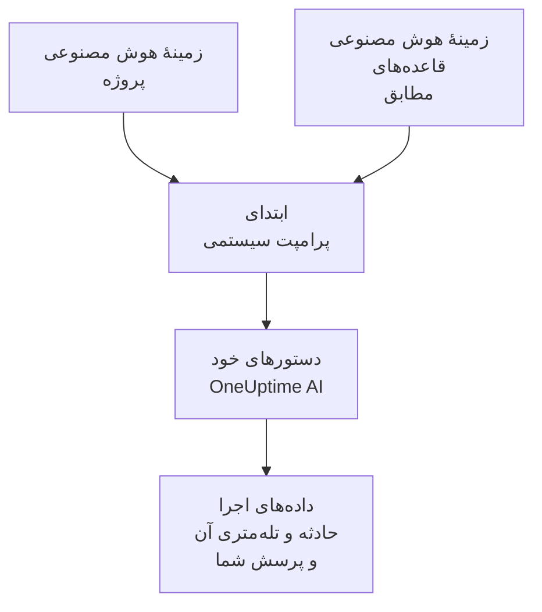

# زمینهٔ هوش مصنوعی

زمینهٔ هوش مصنوعی چیزی است که تیم شما دربارهٔ سیستم‌های خودتان برای OneUptime AI می‌نویسد: این سیستم‌ها چگونه به هم وصل‌اند، هر نشانه با کیست، لاگ‌ها کجا هستند و تیم شما چه واژه‌هایی به کار می‌برد. OneUptime AI آن را در هر بررسی، هر اصلاح، هر پیش‌نویس گزارش پس از حادثه و هر گفتگوی پرسش از هوش مصنوعی پیش از هر چیز دیگری می‌خواند، پس از همان چیزی شروع می‌کند که تیم شما از قبل می‌داند.

:::cards
- [نوشتن زمینهٔ هوش مصنوعی](#نوشتن-زمینهٔ-هوش-مصنوعی): یک کارت در تنظیمات هوش مصنوعی پروژه.
- [یادداشت‌های خود یک قاعدهٔ هوش مصنوعی](#یادداشتهای-خود-یک-قاعدهٔ-هوش-مصنوعی): یادداشت‌هایی دربارهٔ آنچه یک قاعده با آن مطابقت دارد.
- [چه چیزی آن را می‌خواند](#چه-چیزی-آن-را-میخواند): قابلیت‌هایی که آن را می‌خوانند، و آن‌هایی که نمی‌خوانند.
- [یک اجرا چه خواند](#یک-اجرا-چه-خواند): هر اجرا یادداشت‌هایی را که گرفته است نشان می‌دهد.
:::

## چگونه کار می‌کند

OneUptime AI زمینهٔ هوش مصنوعی را در همان ابتدای پرامپت سیستمی خود می‌گذارد، پیش از دستورهای خودش و داده‌های اجرا: اول یادداشت‌های پروژه، سپس یادداشت‌های قاعده‌های هوش مصنوعی مطابق. آن‌ها را به‌عنوان دانش زمینه‌ای تیم شما می‌خواند. این یادداشت‌ها گواه آنچه همین حالا رخ می‌دهد نیستند، و هرگز قاعده‌های خود OneUptime AI را تغییر نمی‌دهند.

چون یادداشت‌ها اول می‌آیند و از یک اجرا تا اجرای بعدی یکسان می‌مانند، بخشی از ابتدای پرامپت هستند که ارائه‌دهندگان در حافظهٔ نهان نگه می‌دارند. در Anthropic، OneUptime پرامپت سیستمی را برای نگه‌داری در حافظهٔ نهان علامت می‌زند؛ OpenAI، Azure OpenAI و دیگر ارائه‌دهندگانی که ابتدای تکراری یک پرامپت را در حافظهٔ نهان نگه می‌دارند، این کار را خودشان انجام می‌دهند. یادداشت‌هایی که تغییر نکرده‌اند، هزینهٔ کمتری برای خواندن دوباره دارند.

## نوشتن زمینهٔ هوش مصنوعی

:::steps
### باز کردن AI Features
**تنظیمات پروژه** > **هوش مصنوعی** > **AI Features** را باز کنید. کارت **زمینهٔ هوش مصنوعی** زیر **فعال کردن هوش مصنوعی** است.

### نوشتن یادداشت‌ها
روی **افزودن زمینهٔ هوش مصنوعی** کلیک کنید، یا وقتی یادداشتی هست روی **ویرایش**. با Markdown بنویسید، یا روی **شروع با یک طرح کلی** کلیک کنید تا برای هر نوع یادداشت یک عنوان داشته باشید.

### ذخیرهٔ آن‌ها
روی **ذخیره تغییرات** کلیک کنید. کارت یادداشت‌ها را نشان می‌دهد، اینکه چقدر بلندند، و اینکه یک مدل آن‌ها را تقریباً چند توکن می‌خواند.
:::

چیزی را بنویسید که به کسی که تازه به تیم آمده است می‌گفتید:

| نوع یادداشت | برای نمونه |
| --- | --- |
| سیستم‌های شما چگونه به هم وصل‌اند | `checkout-api` صفحهٔ پرداخت را ارائه می‌دهد و به `payments-db` وابسته است. |
| هر نشانه با کیست | خطای 502 در صفحهٔ پرداخت با تیم پرداخت است: اول `payments-db` را بررسی کنید. |
| لاگ‌ها کجا هستند | لاگ‌های پرداخت در Loki زیر `app=checkout` هستند. |
| واژه‌های تیم شما | PSP یعنی ارائه‌دهندهٔ خدمات پرداخت ما. |

> [!WARNING]
> رازها را ننویسید: هر کسی که بتواند ببیند یک اجرای هوش مصنوعی چه کرده است، می‌تواند یادداشت‌هایی را که آن اجرا گرفته است بخواند.

## یادداشت‌های خود یک قاعدهٔ هوش مصنوعی

یک قاعدهٔ هوش مصنوعی می‌تواند یادداشت‌های خودش را دربارهٔ حادثه‌ها یا هشدارهایی داشته باشد که با آن مطابقت دارند: سرویس‌های یک محصول، مالکان آن‌ها، و جای لاگ‌هایشان. آن‌ها را در **زمینهٔ هوش مصنوعی** قاعده بنویسید، زیر **فیلدهای بیشتر**، بعد از **ارائه‌دهنده LLM**. قاعده‌ای که هر بار فقط ران‌بوک‌هایش را اجرا می‌کند چیزی از OneUptime AI نمی‌پرسد، پس زمینهٔ هوش مصنوعی‌ای برای نوشتن ندارد.

- یک بررسی یادداشت‌های پروژه را می‌خواند، سپس یادداشت‌های هر قاعدهٔ هوش مصنوعی فعالی را که بررسی می‌کند و با حادثه یا هشدار مطابقت دارد، به ترتیب نام قاعده‌ها.
- یک اصلاح یادداشت‌های پروژه را می‌خواند، سپس یادداشت‌های قاعدهٔ خودش را.
- گفتگو دربارهٔ یک حادثه یا هشدار همان یادداشت‌هایی را می‌خواند که بررسی آن می‌خواند.

## چه چیزی آن را می‌خواند

| قابلیت | چه چیزی می‌خواند |
| --- | --- |
| بررسی‌های AI SRE، و بازبینی دوبارهٔ آن‌ها وقتی هشداری تازه باز می‌شود | یادداشت‌های پروژه، و یادداشت‌های قاعده‌های هوش مصنوعی مطابق |
| اصلاح‌هایی که یک قاعدهٔ هوش مصنوعی آغاز می‌کند: طرح‌ها، فرمان‌ها و سرورهای MCP آن‌ها | یادداشت‌های پروژه، و یادداشت‌های آن قاعده |
| پرسش از هوش مصنوعی، و گفتگو دربارهٔ یک حادثه یا هشدار | یادداشت‌های پروژه؛ در یک حادثه یا هشدار، یادداشت‌های قاعده‌های هوش مصنوعی مطابق هم |
| پاسخ‌ها در Slack و Microsoft Teams | یادداشت‌های پروژه |
| پیش‌نویس‌های گزارش پس از حادثه، برای حادثه‌ها و اپیزودها | یادداشت‌های پروژه |
| تریاژ AI Insights و بررسی اولیهٔ پرونده‌های امنیتی | یادداشت‌های پروژه |

فراخوانی‌هایی که فقط آنچه را می‌گیرند بازنویسی یا ارزیابی می‌کنند آن را نمی‌خوانند: پیش‌نویس یادداشت‌ها و یادداشت‌های عمومی، خلاصهٔ تماس‌ها، خلاصه، میزان اطمینان و نمرهٔ یک بررسی، و عنوان یک گفتگو. پرامپت‌هایی هم که افراد خودشان می‌نویسند آن را نمی‌خوانند، مانند گام هوش مصنوعی یک گردش کار یا یک ران‌بوک.

## محدودیت‌ها

| چه چیزی | حداکثر |
| --- | --- |
| زمینهٔ هوش مصنوعی پروژه | 20,000 نویسه |
| زمینهٔ هوش مصنوعی یک قاعدهٔ هوش مصنوعی | 5,000 نویسه |
| همهٔ زمینهٔ هوش مصنوعی‌ای که یک اجرا می‌خواند | 30,000 نویسه |

فرم نویسه‌ها را هنگام تایپ می‌شمارد و ذخیرهٔ بیش از محدودیت را رد می‌کند، و API هم همین‌طور. یک اجرا اول یادداشت‌های پروژه را می‌خواند، سپس یادداشت‌های هر قاعدهٔ مطابق را به ترتیب نامشان. قاعده‌ای که یادداشت‌هایش اجرا را از 30,000 نویسه فراتر می‌برد به‌طور کامل کنار گذاشته می‌شود، و فعالیت اجرا این را می‌گوید.

تعداد توکن‌ها یک برآورد است: اندازهٔ یادداشت‌ها به بایت UTF-8 تقسیم بر 4، گردشده به بالا. هر مدل توکن‌ها را به روش خودش می‌شمارد، پس شمارش یک ارائه‌دهنده ممکن است فرق کند، بیش از همه برای متنی که به انگلیسی نیست.

## یک اجرا چه خواند

هر اجرا یادداشت‌هایی را که خوانده است کلمه به کلمه ثبت می‌کند. فعالیت آن **زمینهٔ هوش مصنوعی پروژه خوانده شد** را نشان می‌دهد، یا اینکه یادداشت‌های چند قاعدهٔ هوش مصنوعی را هم خوانده است، همراه با تعداد تقریبی توکن‌ها. **مشاهده** یادداشت‌ها را همان‌طور که اجرا خوانده است باز می‌کند: اول یادداشت‌های پروژه، سپس یادداشت‌های هر قاعده زیر نام آن، حتی پس از آنکه تغییر کرده باشند. وقتی یادداشت‌های یک قاعده به دلیل محدودیت اجرا کنار گذاشته شده باشند، یک هشدار این را می‌گوید.

## چه کسی می‌تواند آن را تغییر دهد

- **Project Owner** و **Project Admin** می‌توانند زمینهٔ هوش مصنوعی پروژه را تغییر دهند. **Project Member**، **Viewer** و **Read Project** می‌توانند آن را بخوانند.
- یادداشت‌های یک قاعدهٔ هوش مصنوعی بخشی از قاعده‌اند: هر کسی که بتواند قاعده را تغییر دهد، می‌تواند آن‌ها را هم تغییر دهد.
- یادداشت‌ها فقط برای پروژهٔ خودشان خوانده می‌شوند: هیچ اجرایی زمینهٔ هوش مصنوعی پروژهٔ دیگری را نمی‌خواند.

از راه API یا Terraform، یادداشت‌های پروژه همان `aiContext` پروژه‌اند، و یادداشت‌های یک قاعدهٔ هوش مصنوعی همان `aiContext` خود آن قاعده.

## گام‌های بعدی

:::cards
- [AI SRE](/docs/ai/ai-sre): بگذارید OneUptime AI هر حادثه و هشدار تازه را بررسی کند.
- [پرسش از هوش مصنوعی](/docs/ai/ask-ai): در یک گفتگو دربارهٔ داده‌های پروژهٔ خود بپرسید.
- [ارائه‌دهندگان LLM](/docs/ai/llm-provider): مدلی را که یادداشت‌ها را می‌خواند انتخاب کنید.
:::
