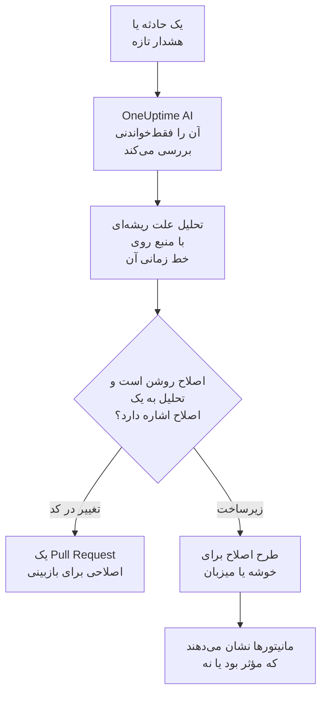
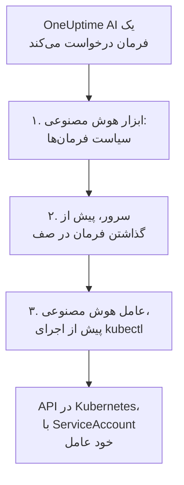

# AI SRE

OneUptime AI مهندس قابلیت اطمینان سایت (SRE) مبتنی بر هوش مصنوعی شماست. به‌محض اینکه حادثه یا هشدار تازه‌ای اعلام شود، به کار می‌افتد، آن را با تله‌متری خود شما بررسی می‌کند — لاگ‌ها، متریک‌ها، ردیابی‌ها، استثناها، مانیتورها و تغییرات اخیر — و یک تحلیل علت ریشه‌ای با منبع را روی خط زمانی حادثه یا هشدار منتشر می‌کند، معمولاً پیش از آنکه مهندس آنکال خواندن اعلان را تمام کند.

هر ادعای تحلیل منبعی دارد که مستقیماً به همان داده‌ای پیوند می‌دهد که آن را پشتیبانی می‌کند، و خود بررسی **کاملاً فقط‌خواندنی** است: OneUptime AI هنگام بررسی هرگز نمی‌تواند چیزی را در پروژهٔ شما تغییر دهد.

:::cards
- [چگونه کار می‌کند](#چگونه-کار-میکند): از یک حادثهٔ تازه تا تحلیلی با منبع، و تا یک اصلاح، اگر اجازه دهید.
- [روشن کردن بررسی‌های هوش مصنوعی](#روشن-کردن-بررسیهای-هوش-مصنوعی): کلیدها، و آنچه نیاز دارند.
- [دسترسی به خوشه — بگذارید OneUptime AI دستور kubectl را اجرا کند](#دسترسی-به-خوشه-بگذارید-oneuptime-ai-دستور-kubectl-را-اجرا-کند): بررسی و اصلاح، درون Kubernetes.
- [کنترل‌های هزینه](#کنترلهای-هزینه): محدودیت‌هایی برای حادثه‌ها، برای هشدارها و برای کل پروژه.
:::

## چگونه کار می‌کند

OneUptime AI برای هر حادثه یا هشدار تازه سه کار انجام می‌دهد و هر کدام کلید خودش را دارد:

- **بررسی می‌کند** (به‌طور پیش‌فرض روشن). تله‌متری شما، و خوشه‌ها و میزبان‌هایی را که یک عامل هوش مصنوعی روی آن‌ها اجرا می‌شود، می‌خواند و یک تحلیل علت ریشه‌ای با منبع منتشر می‌کند. بررسی هیچ چیزی را تغییر نمی‌دهد.
- **اصلاح می‌کند** (به‌طور پیش‌فرض خاموش). وقتی اصلاح روشن باشد، یک تحلیل مطمئن به یک اصلاح تبدیل می‌شود: یک Pull Request برای تغییری در کد شما، یا طرحی از فرمان‌ها برای یک خوشه یا میزبان، که همان‌طور اجرا می‌شود که عامل هوش مصنوعی آن خوشه یا میزبان اجازه می‌دهد.
- **یاد می‌گیرد.** صفحه‌های AI Insights می‌گویند چه چیزی مدام خراب می‌شود، که از همهٔ آنچه ثبت شده به دست آمده است.



تحلیلی که هیچ علتی پیدا نکند بی‌صدا منتشر می‌شود، بی‌آنکه کسی خبر شود (ببینید [حالت بی‌صدا](#حالت-بیصدا))، و بدون علت هیچ چیزی اصلاح نمی‌شود.

## بررسی چه چیزی منتشر می‌کند

وقتی بررسی تمام می‌شود، OneUptime AI یک تحلیل علت ریشه‌ای با این بخش‌ها منتشر می‌کند:

- **Summary** — یک یا دو جمله که مهندسِ خبرشده می‌تواند در پنج ثانیه بخواند.
- **Most likely root cause** — فرضیه، فقط با همان اطمینانی که شواهد پشتیبانی می‌کنند، و هر ادعای واقعی با منبع. اگر تله‌متری کافی نباشد، هوش مصنوعی صریحاً همین را می‌گوید و به‌جای حدس زدن فهرستی از آنچه بررسی کرده ارائه می‌دهد.
- **Evidence** — یافته‌های کلیدی که فرضیه را تأیید یا رد می‌کنند، هر کدام با منبع.
- **Suggested next steps** — اقدام‌های مشخص برای مهندس آنکال.

برای حادثه‌ها، تحلیل در فید حادثه **و** به‌صورت یادداشت داخلی حادثه (جایی که پاسخ‌دهندگان همکاری می‌کنند) منتشر می‌شود. برای هشدارها، در فید هشدار منتشر می‌شود.

تا وقتی بررسی در جریان است، صفحهٔ حادثه یا هشدار یک پنل زندهٔ **AI Investigation** نشان می‌دهد که هر گام را روایت می‌کند — کدام ابزارها اجرا شدند، چه یافتند و چقدر طول کشیدند — تا بتوانید فکر کردنش را تماشا کنید. اگر بررسی شکست بخورد، پنل به‌جای یک جای خالی و بی‌صدا، دلیل شکست را نشان می‌دهد.

بررسی تا وقتی تمام نشده ادامه می‌یابد: **هیچ محدودیت زمانی ندارد** و بودجهٔ پرس‌وجوی کوچکی هم ندارد، پس می‌تواند هر پرس‌وجو و هر فرمان kubectl یا زیرساختی را که لازم دارد اجرا کند. خروجی طولانی یک فرمان (یک `kubectl describe node` از گره‌ای پرمشغله، لاگ‌های یک پاد) هرگز کوتاه نمی‌شود — OneUptime AI آن را صفحه به صفحه می‌خواند. اگر توقف قطعی می‌خواهید، برای هر نوع سیگنال یک **محدودیت زمانی بررسی** تعیین کنید (ببینید **کنترل‌های هزینه** در پایین).

## یک بررسی چه چیزهایی را می‌خواند

یک بررسی از حادثه یا هشدار و از زیرساختی که به آن پیوند دارد آغاز می‌شود: میزبان‌ها، میزبان‌های Docker و Podman، خوشه‌های Kubernetes، پایگاه‌های داده و سرویس‌هایی که مانیتورهای آن زیر نظر دارند. یک مانیتور وب‌سایت، API یا مصنوعی چیزی را زیر نظر دارد که آن را زیر **مانیتور** > **نمای کلی** > **منابع پیوندشده** به آن پیوند می‌دهید، پس آن را به میزبان‌هایی پیوند دهید که آنچه را بررسی می‌کند ارائه می‌دهند تا هر بررسی حادثه‌های آن از همان‌جا آغاز شود. پیش از همهٔ این‌ها، بررسی [زمینهٔ هوش مصنوعی](/docs/ai/ai-context) پروژه را می‌خواند: آنچه تیم شما دربارهٔ سیستم‌های خودتان برای OneUptime AI نوشته است، همراه با یادداشت‌های قاعده‌های هوش مصنوعی مطابق.

- هشدارهای روی آن زیرساخت که در ۳۰ دقیقهٔ پیش از حادثه باز شده‌اند یا هنوز باز هستند، از تازه‌ترین، مانند هشدار مصرف بالای CPU میزبانی که پشت یک وب‌سایت کند است. هشدارهای خصوصی کنار گذاشته می‌شوند.
- متریک‌های خود زیرساخت، همان‌طور که آدم‌ها آن‌ها را می‌خوانند. متریک‌های میزبان مانند `system.cpu.utilization` و `system.memory.utilization` برای هر وضعیت یک بار گزارش می‌شوند و جمع وضعیت‌ها ۱۰۰٪ است، پس یک میانگین روی همهٔ آن‌ها چیزی نمی‌گوید. OneUptime AI آن‌ها را وضعیت به وضعیت می‌خواند (CPU مشغول یعنی user به‌علاوهٔ system)، و هر متریکی را به تفکیک کانتینر، نقطهٔ اتصال یا هر ویژگی دیگری.
- کانتینرهای یک میزبان Docker یا Podman: پرکارترین‌ها از نظر CPU، حافظه یا راه‌اندازی دوباره، و آن‌هایی که دیگر گزارش نمی‌دهند. کانتینر متوقف‌شده به جای صفر هیچ چیزی نمی‌فرستد، پس اعداد کل میزبان آن را پنهان می‌کنند.
- تغییرهایی که در ۲ ساعت پیش از حادثه یا هشدار ثبت شده‌اند — استقرارها، به‌روزرسانی‌های تدریجی Kubernetes، تغییرهای پیکربندی و اصلاح‌هایی که OneUptime اجرا کرده است — و اینکه تله‌متری سرویس‌هایش کدام‌یک از آن‌ها را مشکوک می‌کند: سرویسی که درست پس از یک تغییر به‌طور محسوسی بدتر شده است. [استقرارها و تغییرها](/docs/telemetry/change-events) را ببینید.

فعالیت بررسی در کارت **AI Investigation** می‌گوید چند هشدار باز یا تازه را خوانده و روی کدام منابع.

### بررسی دوباره وقتی هشدار تازه‌ای باز می‌شود

یک بررسی همان لحظه‌ای آغاز می‌شود که حادثه اعلام می‌شود، و هشدار میزبانی که به چند دقیقه متریک نیاز دارد ممکن است پس از آن باز شود. وقتی ظرف ۳۰ دقیقه پس از حادثه، پس از آنکه بررسی آن را خوانده است، هشداری روی زیرساخت پیوندشدهٔ حادثه باز شود و حادثه هنوز باز باشد، OneUptime AI یک بار دیگر حادثه را با آن هشدار در دست بررسی می‌کند. تحلیل تازه با **Checked again** و هشداری که باعث بررسی شد آغاز می‌شود، و فعالیت آن هم همین را می‌گوید. اگر یک قاعدهٔ هوش مصنوعی OneUptime AI را پیش از بررسی حادثه منتظر نگه داشته باشد، این دقیقه‌ها به‌جای آن از زمانی شمرده می‌شوند که بررسی‌اش تمام شد (ببینید [انتظار پیش از بررسی](#انتظار-پیش-از-بررسی)).

این کار برای هر حادثه حداکثر یک بار انجام می‌شود، با همان کلیدها و محدودیت‌های یک بررسی تازه: **فعال کردن هوش مصنوعی**، _بررسی حوادث تازه_، اعتبار هوش مصنوعی، و محدودیت‌های روزانه و هم‌زمانی. چیزی برای روشن کردن نیست. یک بررسی پیگیری هرگز اصلاح خودکار را دوباره اجرا نمی‌کند و خودش هم هرگز پیگیری نمی‌شود، و بررسی یک هشدار دوباره بررسی نمی‌شود.

## دربارهٔ حادثه با OneUptime AI گفت‌وگو کنید

کارت **AI Investigation** با یک گفت‌وگو تمام می‌شود — **Ask OneUptime AI** — که میان همهٔ کسانی که می‌توانند حادثه یا هشدار را ببینند مشترک است. هر چه بالاتر از آن رخ داده باشد، یک کارت است: زیر یک گزارش پرسش‌های پیگیری می‌پرسید، و وقتی هیچ بررسی خودکاری اجرا نشده باشد (یا پیش از گزارش متوقف شده باشد) نخستین پیشنهاد **What is the root cause?** است که OneUptime AI را وادار می‌کند در همان لحظه بررسی کند.

- **پرسش‌های پیگیری بپرسید** — «کدام پادها بیشترین حافظه را مصرف می‌کنند؟»، «درست پیش از شروع این مشکل چه چیزی تغییر کرد؟»، «آیا چیز دیگری هم تحت تأثیر است؟». OneUptime AI بر پایهٔ گزارش خودش جلو می‌رود، دادهٔ تازه پرس‌وجو می‌کند (و جایی که دسترسی دارد، روی خوشه‌ها و منابعی که شما اجازهٔ دیدنشان را دارید، فرمان‌های فقط‌خواندنی kubectl یا زیرساختی اجرا می‌کند) و برای هر ادعا منبع می‌آورد.
- **از آن بخواهید کاری انجام دهد** — «این حادثه را تأیید کن»، «یک به‌روزرسانی وضعیت منتشر کن که در حال بررسی هستیم»، «آنکالِ پایگاه داده را خبر کن»، «شدت را بالا ببر». همان کنش‌های پرسش از هوش مصنوعی را به کار می‌برد و همیشه **با دسترسی‌های خود شما** عمل می‌کند، پس هرگز نمی‌تواند بیش از آنچه شما می‌توانید انجام دهد.
- **انتخاب کنید چگونه عمل کند** با کلید داخل کادر پیام، که کنارش می‌گوید حالت انتخاب‌شده چه معنایی دارد: _Auto-run_ (پیش‌فرض — برای درخواستی روشن بی‌درنگ عمل می‌کند)، _Ask to act_ (نخست یک کارت تأیید نشان می‌دهد که هر کسی روی حادثه می‌تواند آن را تأیید یا رد کند) یا _فقط‌خواندنی_.
- **یک رشتهٔ مشترک.** هر پرسش نشان می‌دهد چه کسی آن را پرسیده، همه همان گفت‌وگو را زنده می‌بینند و هر کسی می‌تواند پاسخی را که در حال نوشته شدن است متوقف کند. نمودارها و جدول‌های یک پاسخ به کسی نشان داده می‌شوند که پرسیده است؛ بقیه پاسخ با منبع را می‌بینند. هر پاسخ **منابع** خود را فهرست می‌کند، و منبعی که صفحهٔ خودش را دارد (لاگ‌ها، متریک‌ها، یک مانیتور) آن صفحه را باز می‌کند. یک رشتهٔ طولانی روی تازه‌ترین پیام‌هایش باز می‌شود، با دکمه‌ای بالای آن‌ها (برای نمونه **Show 6 earlier messages**) که بقیه را برمی‌گرداند.

حادثه یا هشداری که OneUptime AI نه بررسی کرد و نه اصلاح، چون هوش مصنوعی برای آن خاموش بود — برای پروژه خاموش بود، _بررسی حوادث تازه_ (یا کلید متناظر هشدارها) هنگام ایجادش خاموش بود، هیچ قاعدهٔ هوش مصنوعی‌ای که بررسی می‌کند با آن منطبق نبود، یا شدتش کمتر از حداقل بود — به‌جای آن کارتی یک‌خطی می‌گیرد: **بررسی هوش مصنوعی خاموش است** (یا تا وقتی هوش مصنوعی برای پروژه خاموش است، **هوش مصنوعی برای این پروژه خاموش است**؛ و پس از روشن شدن دوباره، **بررسی هوش مصنوعی خاموش بود**) و دلیلش. پیکان آن، **کارهایی که می‌توانید انجام دهید**، آنچه را باید روشن کرد باز می‌کند، با پیوندی به جایی که تغییر می‌کند برای کسانی که اجازهٔ تغییرش را دارند، و اینکه چه کسی می‌تواند آن را تغییر دهد برای بقیه؛ تغییر فقط برای حوادث و هشدارهای جدید اعمال می‌شود، نه برای این یکی. تا وقتی هوش مصنوعی روشن است، **Ask OneUptime AI** روی خط گفت‌وگو را باز می‌کند، و گفت‌وگویی که کسی از قبل شروع کرده خودبه‌خود زیر خط نمایش داده می‌شود. آن وقت کارت **رفع مشکل** نمایش داده نمی‌شود: خط می‌گوید چرا چیزی اصلاح نشد.

## روشن کردن بررسی‌های هوش مصنوعی

بررسی‌های خودکار **برای پروژه‌های تازه به‌طور پیش‌فرض روشن هستند**. پیش‌نویس‌های گزارش پس از حادثه و AI Insights هم همین‌طور. اصلاح خاموش آغاز می‌شود، و Pull Requestهایی که بخشی از آن هستند فقط تا وقتی اصلاح روشن است باز می‌شوند (ببینید [اصلاح خودکار کد](#اصلاح-خودکار-کد)). پروژه‌ای که پیش از این پیش‌فرض ساخته شده تنظیم خودش را نگه می‌دارد؛ بررسی‌ها را مانند گام ۳ روشن کنید، یا با **روشن کردن** در صفحهٔ **عامل هوش مصنوعی** هر خوشهٔ Kubernetes (Project Owner یا Project Admin). برای بررسی یا تغییر آن‌ها:

:::steps
1. **یک ارائه‌دهندهٔ LLM پیکربندی کنید.** نصب‌های خودمیزبان کلید خودشان را به کار می‌برند (یا با Ollama محلی کاملاً جدا از شبکه اجرا می‌شوند) — ببینید [ارائه‌دهندگان LLM](/docs/ai/llm-provider). کاربران OneUptime Cloud می‌توانند از ارائه‌دهندهٔ سراسری ازپیش‌پیکربندی‌شده استفاده کنند که به‌صورت توکن‌های اندازه‌گیری‌شدهٔ هوش مصنوعی صورت‌حساب می‌شود، پس پروژه به اعتبار هوش مصنوعی نیاز دارد: مالک پروژه یا کسی با **Manage Billing** آن را در **تنظیمات پروژه** > **هوش مصنوعی** > **اعتبار هوش مصنوعی** اضافه می‌کند، جایی که **شارژ خودکار** نمی‌گذارد تمام شود.
2. **مطمئن شوید هوش مصنوعی برای پروژه فعال است** (به‌طور پیش‌فرض فعال است): **فعال کردن هوش مصنوعی** در **تنظیمات پروژه** > **هوش مصنوعی** > **AI Features**.
3. **برای هر نوع سیگنال انتخاب کنید** (در پروژه‌های تازه هر دو روشن‌اند):
   - حادثه‌ها: **حوادث** > **هوش مصنوعی** > **تنظیمات** — _بررسی حوادث تازه_ را روشن کنید.
   - هشدارها: **هشدارها** > **هوش مصنوعی** > **تنظیمات** — _بررسی هشدارهای تازه_ را روشن کنید.
:::

هر رفتار هوش مصنوعی در این صفحه‌ها کلیدی است که به‌محض تغییر ذخیره می‌شود؛ دکمهٔ ذخیره‌ای وجود ندارد. صفحهٔ حادثه سه کلید دارد، زیر **کارهایی که OneUptime AI انجام می‌دهد**: _بررسی حوادث تازه_، _اصلاح خودکار حوادث تازه_ و _نوشتن پیش‌نویس گزارش پس از حادثه هنگام حل شدن حادثه_. صفحهٔ هشدار همین‌ها را دارد، بدون گزارش پس از حادثه. _اصلاح خودکار حوادث تازه_ (و _اصلاح خودکار هشدارهای تازه_) حتی برای پروژه‌های تازه **خاموش** آغاز می‌شود: این کلید به OneUptime AI اجازه می‌دهد زیرساخت شما را تغییر دهد، پس خود پروژه آن را روشن می‌کند — ببینید [کدام حادثه‌ها بررسی و اصلاح می‌شوند](#کدام-حادثهها-بررسی-و-اصلاح-میشوند). Pull Requestهایی که باز می‌کند، یعنی اصلاحی برای کد شما و تله‌متری‌ای که بررسی کم داشت، بخشی از آن هستند و هر قاعدهٔ هوش مصنوعی آن‌ها را تعیین می‌کند: بدون قاعده هر دو باز می‌شوند، و یک قاعده می‌تواند هر کدام را در **فیلدهای بیشتر** خاموش کند (ببینید [اصلاح خودکار کد](#اصلاح-خودکار-کد)). Project Ownerها و Project Adminها می‌توانند آن‌ها را تغییر دهند؛ برای بقیه هر کلید قفل است و می‌گوید به کدام دسترسی نیاز دارد.

این صفحه‌ها دو چیز را فقط وقتی درست باشند می‌گویند. اگر **فعال کردن هوش مصنوعی** خاموش باشد، هیچ چیزی در آن‌ها اجرا نمی‌شود و صفحه این را در بالا می‌گوید، همراه با خود کلید فعال کردن هوش مصنوعی برای کسانی که می‌توانند تغییرش دهند (Project Ownerها، و هر کسی با Manage Billing)؛ به بقیه گفته می‌شود چه کسی می‌تواند. اگر پروژه هیچ ارائه‌دهندهٔ LLM قابل استفاده برای OneUptime AI نداشته باشد — اصلاً هیچ، یا ارائه‌دهندگانی دارد اما هیچ‌کدام پیش‌فرض نیست — صفحه این را هم می‌گوید، با پیوندی به **تنظیمات پروژه** > **هوش مصنوعی** > **ارائه‌دهندگان LLM**. در OneUptime Cloud ارائه‌دهندهٔ سراسری هم به حساب می‌آید، پس آنجا چیزی گفته نمی‌شود.

حادثه‌ها و هشدارها جداگانه پیکربندی می‌شوند، پس می‌توانید به هر نوع سیگنال سقف هم‌زمانی، بودجهٔ روزانهٔ توکن، بودجهٔ وظیفه‌های اصلاح و قواعد خاص خودش را بدهید. هیچ‌کدام از این محدودیت‌ها تا وقتی تعیینشان نکنید اعمال نمی‌شوند — آن‌ها زیر **تنظیمات بیشتر** در پایین هر صفحه جمع شده‌اند؛ ببینید **کنترل‌های هزینه** در پایین. تغییر یک تنظیم هوش مصنوعی هشدار، تنظیم متناظر حادثه را تغییر نمی‌دهد و برعکس.

اصلاح بر پایهٔ بررسی‌ها ساخته شده است: تا وقتی **اصلاح خودکار حوادث تازه** (یا کلید متناظر هشدارها) روشن است، بررسی‌ای که با اطمینان تغییری در کد مخزن تشخیص می‌دهد خودکار یک Pull Request اصلاحی باز می‌کند — ببینید **اصلاح خودکار کد** در پایین.

## دسترسی به خوشه — بگذارید OneUptime AI دستور kubectl را اجرا کند

به‌طور پیش‌فرض، بررسی فقط می‌تواند از تله‌متری‌ای استفاده کند که عامل‌های شما می‌فرستند. برای یک سیگنال Kubernetes این اغلب کافی نیست: «پادهایی که در Pending گیر کرده‌اند» یک مشکل زمان‌بندی است که با describe کردن پاد و خواندن رویدادهایش تشخیص داده می‌شود، نه با نگاه به یک متریک. **عامل هوش مصنوعی Kubernetes** به OneUptime AI اجازه می‌دهد دقیقاً همین کار را بکند — و اگر اجازه دهید، آنچه را پیدا می‌کند اصلاح کند.

صفحهٔ هر خوشه در منوی کناری‌اش یک بخش **هوش مصنوعی** دارد:

- **عامل** — صفحهٔ **عامل هوش مصنوعی** خوشه: اینکه عامل متصل است یا نه، هوش مصنوعی روی خوشه چه کاری مجاز است بکند، و هر چه نیاز به توجه دارد، هر کدام با گامی که حلش می‌کند. همین توضیح روی پنل بررسی حادثه هم ظاهر می‌شود، وقتی هوش مصنوعی ناچار بوده فقط با دادهٔ OneUptime بررسی کند.
- **بینش‌ها** — صفحهٔ **بینش‌های هوش مصنوعی** خوشه: آنچه OneUptime AI دربارهٔ خوشه فهمیده است — چه چیزی مدام خراب می‌شود و چرا، و برای آن چه باید کرد (ببینید [آنچه هوش مصنوعی روی یک خوشه آموخت](#آنچه-هوش-مصنوعی-روی-یک-خوشه-آموخت)).
- **لاگ‌ها** — صفحهٔ **گزارش‌های هوش مصنوعی** خوشه: هر کاری که OneUptime AI روی خوشه انجام داده، تازه‌ترین در ابتدا (ببینید [هر کاری که هوش مصنوعی روی یک خوشه انجام داد](#هر-کاری-که-هوش-مصنوعی-روی-یک-خوشه-انجام-داد)).

**نمای کلی** خوشه با یک کارت **عامل هوش مصنوعی** تمام می‌شود که صفحهٔ عامل هوش مصنوعی را خلاصه می‌کند: اینکه عامل متصل است یا نه، اینکه **بررسی با kubectl** روشن است یا نه، اصلاح‌ها چگونه اجرا می‌شوند (**خاموش**، **درخواست تأیید**، **خودکار** یا **رد شدن از تأیید**) و چه چیزی نیاز به توجه دارد، با پیوندی به صفحهٔ عامل هوش مصنوعی، جایی که این‌ها تغییر می‌کنند.

### عامل هوش مصنوعی Kubernetes — به‌طور پیش‌فرض روشن، فقط‌خواندنی

چارت [عامل Kubernetes در OneUptime](/docs/telemetry/kubernetes-agent) به‌طور پیش‌فرض عامل هوش مصنوعی Kubernetes را اجرا می‌کند: یک پاد کوچک (`component=ai-agent`، ایمیج `oneuptime/kubernetes-ai-agent`) با یک ServiceAccount **فقط‌خواندنی**. با همان کلید API که چارت از قبل به کار می‌برد متصل می‌شود، پس در داشبورد چیزی برای راه‌اندازی نیست: ظرف یک دقیقه صفحهٔ عامل هوش مصنوعی خوشه آن را **متصل** نشان می‌دهد و **بررسی با kubectl** روشن است — مگر آنکه کسی از قبل آنجا تنظیمات هوش مصنوعی خوشه را انتخاب کرده باشد، که همان‌طور که هستند نگه داشته می‌شوند.

روی عاملی که پیش از وجود عامل هوش مصنوعی Kubernetes نصب شده، نخست فهرست چارت‌ها را تازه کنید و سپس ارتقا دهید:

```bash
helm repo update
helm upgrade kubernetes-agent oneuptime/kubernetes-agent \
  --namespace oneuptime-agent --reset-then-reuse-values \
  --set aiAgent.enabled=true
```

`kubernetes-agent` و `oneuptime-agent` همان نام انتشار و namespace هستند که دستورالعمل نصب داشبورد به کار می‌برد؛ اگر عامل را با نام‌های دیگری نصب کرده‌اید، نام‌های خودتان را به کار ببرید (`helm list -A | grep kubernetes-agent` آن‌ها را نشان می‌دهد). بدون `helm repo update`، Helm ممکن است همان چارتی را که از آن نصب کرده‌اید پیدا کند، که `aiAgent` را نمی‌شناسد و با `Additional property aiAgent is not allowed` شکست می‌خورد. در OneUptime خودمیزبان، OneUptime را پیش از چارت ارتقا دهید — ببینید [ارتقای عامل](/docs/telemetry/kubernetes-agent#بهروزرسانی-عامل). برای اجرای چارت بدون عامل هوش مصنوعی، `--set aiAgent.enabled=false` را بدهید.

**آزمایش اتصال** در منوی **⋯** کنار وضعیت عامل در صفحهٔ عامل هوش مصنوعی، `kubectl version` و `kubectl auth can-i --list` را از طریق عامل اجرا می‌کند و نتیجه‌ها را نشان می‌دهد: به چه چیزی دسترسی دارد و چه کاری مجاز است بکند. اگر صفحه بگوید عامل متصل نیست، لاگ آن را با `kubectl logs -n oneuptime-agent -l component=ai-agent --tail=100` بخوانید. کلیدی که **نام سرویس سنجاق‌شده** دارد نمی‌تواند عامل را ثبت کند — به چارت کلیدی بدون آن بدهید. وقتی سرور ثبتی را رد می‌کند، لاگ می‌گوید آیا این رد خودبه‌خود برطرف می‌شود (پاد قبلی عامل که هنوز گزارش می‌دهد، یا Runner قدیمی درون خوشه که در حین ارتقا هنوز در حال خاموش شدن است) یا چه چیزی باید تغییر کند. **بازنشانی عامل** در همان منو، پس از تأیید شما، کلید عامل را از یاد سرور می‌برد؛ پاد ظرف چند دقیقه خودش دوباره متصل می‌شود.

عامل هوش مصنوعی Kubernetes یک Runner نیست و هرگز زیر رانبوک‌ها > Runnerها ظاهر نمی‌شود. همیشه فقط ServiceAccount خودش را به کار می‌برد، پس OneUptime هرگز اعتبارنامه‌ای به آن نمی‌دهد، هرگز به‌عنوان میزبان Bash/SSH برای رانبوک‌ها به کار نمی‌رود و هرگز به‌عنوان Runner فرمانِ یک قاعدهٔ هوش مصنوعی پذیرفته نمی‌شود.

### کارهای مجاز هوش مصنوعی — تعیین‌شده به‌دست عامل

اینکه OneUptime AI روی یک خوشه چه کاری مجاز است بکند، همان‌جا که عامل اجرا می‌شود، در چارت، با دو مقدار تعیین می‌شود:

- `aiAgent.investigation` — `true`: هوش مصنوعی هنگام بررسی می‌تواند kubectl فقط‌خواندنی را روی خوشه اجرا کند. `false`: همچنان بررسی می‌کند، با داده‌ای که OneUptime از قبل دارد.
- `aiAgent.fixes` — هوش مصنوعی چگونه اصلاحی را اعمال می‌کند: `off`، `ask-for-approval`، `automatic` یا `bypass-approval` (ببینید [اصلاح‌ها چگونه کار می‌کنند](#اصلاحها-چگونه-کار-میکنند)). هر سطحی جز `off` به عامل هوش مصنوعی دسترسی نوشتن می‌دهد؛ با `off` هیچ دسترسی ندارد و خودش هر نوشتنی را رد می‌کند.

عامل هوش مصنوعی هر دو را در هر heartbeat به OneUptime گزارش می‌دهد و OneUptime آن‌ها را روی خوشه اعمال می‌کند. **کارهای مجاز هوش مصنوعی** در صفحهٔ عامل هوش مصنوعی خوشه آن‌ها را نشان می‌دهد — **روشن** و سطح اصلاح، سبز هر وقت روشن باشند — بی‌آنکه بتوان آنجا تغییرشان داد؛ **تغییر** هر گزینه را همراه با همان `helm upgrade` دقیقی که آن را تعیین می‌کند نشان می‌دهد. تغییری که در جای دیگری انجام شود — صفحهٔ عامل هوش مصنوعی، API یا Terraform — تا وقتی عامل آن‌ها را تعیین می‌کند رد می‌شود.

انتشاری که هیچ‌کدام از دو مقدار را تعیین نکند، می‌گذارد عامل پیش‌فرض‌های خودش را به کار ببرد (بررسی روشن؛ اصلاح‌ها خاموش، یا ask-for-approval با `aiAgent.remediation.enabled=true` قدیمی‌تر). OneUptime این پیش‌فرض‌ها را فقط روی خوشه‌ای اعمال می‌کند که هیچ‌کس تنظیمات هوش مصنوعی‌اش را در صفحهٔ عامل هوش مصنوعی آن انتخاب نکرده باشد: تنظیماتی که آنجا انتخاب شده‌اند همان‌طور که هستند نگه داشته می‌شوند، و صفحه فرمانی را نشان می‌دهد که آن‌ها را به چارت منتقل می‌کند. خوشه‌ای هم که عامل هوش مصنوعی‌اش قدیمی‌تر از آن است که آن‌ها را گزارش دهد همین‌طور است — ارتقای چارت با این دو مقدار آن‌ها را منتقل می‌کند.

### بگذارید هوش مصنوعی آنچه را پیدا می‌کند اصلاح کند

اصلاح‌ها تا وقتی با `aiAgent.fixes` روشنشان نکنید خاموش‌اند، و این کار به عامل هوش مصنوعی دسترسی نوشتن هم می‌دهد — بهتر است فقط در namespaceهایی که هوش مصنوعی مجاز به اصلاحشان است و با عملیات گره خاموش:

```bash
helm repo update
helm upgrade kubernetes-agent oneuptime/kubernetes-agent \
  --namespace oneuptime-agent --reset-then-reuse-values \
  --set aiAgent.enabled=true \
  --set aiAgent.investigation=true \
  --set aiAgent.fixes=ask-for-approval \
  --set "aiAgent.remediation.namespaces={web,api}" \
  --set aiAgent.remediation.nodeOperations=false
```

یا برای کل خوشه:

```bash
helm repo update
helm upgrade kubernetes-agent oneuptime/kubernetes-agent \
  --namespace oneuptime-agent --reset-then-reuse-values \
  --set aiAgent.enabled=true \
  --set aiAgent.investigation=true \
  --set aiAgent.fixes=ask-for-approval \
  --set-json 'aiAgent.remediation.namespaces=[]'
```

به‌جای `{web,api}` namespaceهایی را بگذارید که هوش مصنوعی مجاز به اصلاحشان است. هر namespace فهرست باید از قبل وجود داشته باشد: چارت در هر کدام یک RoleBinding می‌سازد و هرگز namespace نمی‌سازد، پس نبودِ یکی کل نصب یا ارتقا — از جمله collector — را با `namespaces "api" not found` شکست می‌دهد. نخست آن را بسازید یا از فهرست بردارید؛ پیش از حذف یک namespace آن را از فهرست بردارید. اگر در ارتقا این پرچم را نگذارید، فهرست ذخیره‌شده در انتشار حفظ می‌شود، پس برای بازگشت به کل خوشه، همان‌طور که فرمان دوم انجام می‌دهد، `--set-json 'aiAgent.remediation.namespaces=[]'` (Helm 3.10+) را بدهید — نه `={}` را، که Helm آن را یک نام خالی می‌خواند و چارت ردش می‌کند. `--set aiAgent.remediation.namespaces=null` یک فهرست ذخیره‌شده را زیر `--reuse-values` بازنشانی نمی‌کند: Helm فهرست ذخیره‌شده را نگه می‌دارد. `aiAgent.remediation.nodeOperations=false` اصلاح‌ها را از گره‌ها دور نگه می‌دارد؛ آن را `true` کنید تا هوش مصنوعی بتواند گره‌ها را cordon، uncordon و drain کند و روی آن‌ها taint بگذارد (drain، taint یا patch یک گره همچنان منتظر یک انسان می‌ماند).

برای خودمختاری بیشتر به‌جای `ask-for-approval` از `automatic` یا `bypass-approval` استفاده کنید، و برای خاموش کردن دوبارهٔ اصلاح‌ها از `--set aiAgent.fixes=off`، که دسترسی نوشتن را هم برمی‌دارد. اصلاح‌ها به دو کلید پروژه هم نیاز دارند. **اصلاح خودکار حوادث تازه** (در **حوادث** > **هوش مصنوعی** > **تنظیمات**) و **اصلاح خودکار هشدارهای تازه** (در **هشدارها** > **هوش مصنوعی** > **تنظیمات**) خاموش آغاز می‌شوند: تا یکی از آن‌ها روشن نشود، هیچ چیز تازه‌ای از آن نوع اصلاح نمی‌شود. **فعال کردن هوش مصنوعی** (**تنظیمات پروژه** > **هوش مصنوعی** > **AI Features**) روشن است مگر آنکه کسی خاموشش کرده باشد؛ این کلید کل هوش مصنوعی پروژه را خاموش می‌کند، هر چه پیکربندی یک عامل بگوید.

### اصلاح‌های یک خوشه روی کدام حادثه‌ها عمل می‌کنند

تا وقتی **اصلاح خودکار حوادث تازه** روشن است و هیچ قاعدهٔ هوش مصنوعی‌ای تنظیم نشده، OneUptime AI هر حادثهٔ تازه‌ای را که خوشه به آن پیوند دارد، در حالتی که صفحهٔ عامل هوش مصنوعی آن تعیین می‌کند، اصلاح می‌کند — و برای هشدارها هم با **اصلاح خودکار هشدارهای تازه** همین‌طور. با وجود قواعد، فقط حادثه‌هایی را اصلاح می‌کند که قاعده‌ای که با OneUptime AI اصلاح می‌کند با آن‌ها مطابقت دارد (ببینید [کدام حادثه‌ها بررسی و اصلاح می‌شوند](#کدام-حادثهها-بررسی-و-اصلاح-میشوند)). به آنچه به آن پیوند ندارد دست نمی‌زند — هر قدر هم علت آشکارا در خوشه باشد. یک حادثه یا هشدار در این حالت‌ها به یک خوشه پیوند دارد:

- تله‌متری‌ای که از آن برخاسته، نام خوشه را دارد (یک مانیتور متریک، لاگ یا ردیابی روی داده‌های خوشه)؛
- مانیتور آن یک مانیتور Kubernetes آن خوشه است؛
- مانیتور آن زیر **مانیتور** > **نمای کلی** > **منابع پیوندشده** به خوشه پیوند داده شده است — راهی برای پیوند دادن یک مانیتور وب‌سایت، API یا مصنوعی به خوشه‌ای که آنچه را بررسی می‌کند ارائه می‌دهد؛
- پرسش از هوش مصنوعی آن را در صفحهٔ خوشه اعلام کرده یا وقتی از آن خواسته شد، آن را به خوشه پیوند داده است؛
- کسی هنگام اعلام آن، خوشه را زیر **سایر منابع تحت تأثیر** انتخاب کرده است (انتخاب یک مانیتور پیوندشده آن را خودکار آنجا اضافه می‌کند).

هر حادثه و هشدار روی کارت **رفع مشکل** خود می‌گوید که آیا به یک خوشه پیوند داشته و اصلاح‌های خوشه چه کردند؛ ببینید [رفع خودکار مشکل چه کرد](#رفع-خودکار-مشکل-چه-کرد). همین برای یک منبع زیرساخت و عامل هوش مصنوعی آن هم برقرار است.

### چه کسی می‌تواند آن را تغییر دهد

تا وقتی عامل هوش مصنوعی Kubernetes بررسی و اصلاح‌ها را تعیین می‌کند، کسی آن‌ها را تغییر می‌دهد که بتواند مقدارهای چارت را روی خوشه تغییر دهد؛ OneUptime تغییری را که در جای دیگری انجام شود رد می‌کند. قواعد زیر برای آنچه در OneUptime می‌ماند — فهرست مجاز kubectl، و اتصال به Runner قبلی درون خوشه — و برای بررسی و اصلاح‌ها روی خوشه‌ای که تنظیماتش هنوز در OneUptime تعیین می‌شوند برقرارند (ببینید [کارهای مجاز هوش مصنوعی — تعیین‌شده به‌دست عامل](#کارهای-مجاز-هوش-مصنوعی-تعیینشده-بهدست-عامل)).

روشن کردن اصلاح‌ها — هر تغییری از **خاموش** به حالت دیگر — و شل‌تر کردنشان — رفتن به **خودکار** یا **رد شدن از تأیید**، نوشتن فهرست مجاز kubectl، یا متصل کردن یک Runner — به یک Project Owner، یک Project Admin یا دسترسی **Edit AI Rule** نیاز دارد، یعنی همان کسانی که می‌توانند یک قاعدهٔ هوش مصنوعی بسازند که بدون پرسیدن اصلاح می‌کند. **بازنشانی عامل** به همان کسانی نیاز دارد که اصلاح‌ها را روشن می‌کنند. سخت‌تر کردنشان — **خاموش**، بازگشت به **درخواست تأیید**، پاک کردن فهرست مجاز یا اتصال Runner — برای هر کسی که بتواند خوشه را ویرایش کند آزاد است، و **آزمایش اتصال** و تأیید اصلاحی که OneUptime AI برای آن خوشه پیشنهاد می‌کند هم همین‌طور. همهٔ این‌ها به دسترسی ویرایش همان خوشه نیاز دارند: دسترسی‌ای که به برخی برچسب‌ها، یا به خوشه‌هایی که شما یا تیم‌هایتان مالکشان هستید، محدود است فقط به همان خوشه‌ها می‌رسد، و مدخل مسدودی با برچسب، خوشه‌هایی را که آن برچسب‌ها را دارند برمی‌دارد.

### بررسی چه چیزی را می‌تواند اجرا کند

با داشتن دسترسی، بررسی از طریق عامل هوش مصنوعی kubectl **فقط‌خواندنی** اجرا می‌کند — `get`، `describe`، `logs`، `events`، `top`، `rollout status/history`، `auth can-i` — هر تعداد فرمان که لازم داشته باشد، و برای هر فرمان مانند هر شاهد دیگری منبع می‌آورد. خروجی هرگز کوتاه نمی‌شود: عامل تا یک مگابایت از آن را نگه می‌دارد و OneUptime AI خروجی طولانی را صفحه به صفحه می‌خواند. سه بررسی مستقل آن را فقط‌خواندنی نگه می‌دارند: سیاستی که هر فرمان را رده‌بندی می‌کند، سروری که از گذاشتن هر چیز دیگری در صف برای یک بررسی خودداری می‌کند، و عامل هوش مصنوعی که پیش از اجرای kubectl همان سیاست را دوباره بررسی می‌کند. «فقط‌خواندنی — هیچ چیزی در سیستم‌های شما تغییر نکرد» به‌معنای واقعی کلمه درست می‌ماند.



### اصلاح‌ها چگونه کار می‌کنند

**اصلاحات** در صفحهٔ عامل هوش مصنوعی چهار تنظیم دارد (`aiAgent.fixes` چارت: `off`، `ask-for-approval`، `automatic`، `bypass-approval`):

- **خاموش** — هوش مصنوعی فقط بررسی می‌کند.
- **درخواست تأیید** — پس از تحلیل علت ریشه‌ای، OneUptime AI با kubectl عیب‌یابی می‌کند و کوچک‌ترین طرح kubectl را که به علت می‌پردازد می‌سازد، برای نمونه `kubectl rollout restart deployment/web -n web`. طرح همراه با دلیل، اثر مورد انتظار و بازگردانی‌اش روی حادثه ظاهر می‌شود؛ یک انسان با یک کلیک آن را تأیید می‌کند و OneUptime دقیقاً همان فرمان‌ها را اجرا می‌کند. اگر مانیتورها بهبود نیابند، بازگردانی اجرا می‌شود و OneUptime AI یک طرح دیگر می‌سازد — باز هم برای تأیید — با تلاش ناموفق پیش چشم، تا راه دیگری برود یا بگوید یک انسان باید به چه چیزی نگاه کند.
- **خودکار** — تغییرات امن خودشان اجرا می‌شوند؛ یک تغییر پرخطرتر هرگز. وقتی دور فقط اصلاح‌های پرخطرتر پیدا کرده باشد، با پیشنهاد دقیقاً همان‌ها برای تأیید با یک کلیک تمام می‌شود. وقتی یک اصلاح امن را هم اجرا کرده باشد، اصلاح پرخطرتر در تحلیل می‌ماند و فقط اگر راستی‌آزمایی نشان دهد اصلاح امن مانیتورها را بهبود نداده، به‌دست دور پیگیری پیشنهاد می‌شود که درخواست تأیید می‌کند. شکل یک فرمان پرخطرتر را در صفحهٔ عامل هوش مصنوعی به فهرست مجاز اضافه کنید تا آن هم خودش اجرا شود. حالت خودکار همچنین سیگنال را وقتی راستی‌آزمایی بهبود مانیتورها را تأیید کند حل‌شده می‌کند، و یک قطع‌کنندهٔ مدار دارد که سقفش سه اصلاح بی‌نظارت برای هر خوشه در هر ساعت است: فراتر از آن، یا تا وقتی دور بی‌نظارت دیگری از OneUptime AI هنوز در حال تغییر یا راستی‌آزمایی همان خوشه است، یک دور طرحش را به‌جای اجرا برای تأیید پیشنهاد می‌کند.
- **رد شدن از تأیید** — هوش مصنوعی نمی‌پرسد. هر تغییری که سیاست اجازه دهد، از جمله تغییرات پرخطرتر، خودش اجرا می‌شود، و دور پیگیری پس از یک راستی‌آزمایی ناموفق هم همین‌طور؛ سیگنال به‌محض اینکه راستی‌آزمایی بهبود را تأیید کند خودش حل‌شده می‌شود. آنچه در هر حالتی به یک انسان نیاز دارد (پایین‌تر) همچنان منتظر یک انسان می‌ماند. یک دور همچنین در این حالت‌ها طرحش را به‌جای اجرا برای تأیید پیشنهاد می‌کند و دلیلش را روی حادثه می‌گوید:
  - قطع‌کنندهٔ مدار ساعتی (سه اصلاح بی‌نظارت برای هر خوشه در هر ساعت) عمل کرده است، یا نمی‌توان آن را بررسی کرد؛
  - دور بی‌نظارت دیگری از OneUptime AI هنوز در حال تغییر همان خوشه است، یا هنوز در حال راستی‌آزمایی اصلاحی روی آن است — هشدار و حادثهٔ یک مانیتور نمونهٔ رایج آن است — یا نمی‌توان این را بررسی کرد؛
  - این دورِ پیگیری پس از اصلاحی است که بازگردانی‌اش کامل نشده است.

**نخست، بازگردانی.** وقتی OneUptime یک به‌روزرسانی تدریجی Kubernetes روی خوشه را برای حادثه مشکوک علامت زده باشد (ببینید [استقرارها و تغییرها](/docs/telemetry/change-events))، OneUptime AI پیش از هر اصلاح دیگری بازگرداندن آن را امتحان می‌کند. OneUptime فرمان `kubectl rollout undo` را از روی تغییر ثبت‌شده می‌سازد، هرگز از روی آنچه مدل می‌نویسد، و این فرمان مانند هر تغییر امن دیگری در حالتِ خوشه اجرا می‌شود یا منتظر تأیید می‌ماند. اگر Deployment پس از آن به‌روزرسانی تدریجی دوباره تغییر کرده باشد، پیشنهاد نمی‌شود، چون در آن صورت undo تغییر بعدی را برمی‌گرداند.

**workloadهایی که Argo CD، Flux یا Helm اعلامشان می‌کنند.** بسیاری از خوشه‌ها workloadهای خود را در git اعلام می‌کنند و می‌گذارند Argo CD یا Flux آن را اعمال کند، یا آن‌ها را با Helm نصب می‌کنند، و تغییری که با kubectl در چیزی که آنجا اعلام شده بدهید ماندگار نیست: وقتی self-heal برای Application روشن باشد، Argo CD آن را در چند ثانیه برمی‌گرداند (وگرنه در همگام‌سازی بعدی)، Flux در تطبیق (reconciliation) بعدی‌اش و یک انتشار Helm در ارتقای بعدی‌اش. بنابراین پیش از آنکه OneUptime AI یک تغییر kubectl را اجرا یا پیشنهاد کند، OneUptime با kubectl فقط‌خواندنی و از طریق عامل هوش مصنوعی خوشه، شیئی را که تغییر عوض می‌کند (برای یک ReplicaSet، Deployment آن) و اینکه چه کسی آن را اعلام کرده است می‌خواند: Argo CD (حاشیه‌نویسی `argocd.argoproj.io/tracking-id`، برچسب `argocd.argoproj.io/instance` یا مدیر فیلد آن)، Flux (برچسب‌های `kustomize.toolkit.fluxcd.io/*` یا `helm.toolkit.fluxcd.io/*`) یا یک انتشار Helm (حاشیه‌نویسی `meta.helm.sh/release-name` یا برچسب `app.kubernetes.io/managed-by: Helm`). تغییری که Argo CD یا Flux برمی‌گرداند — `rollout undo` (از جمله «نخست، بازگردانی»)، `scale` (وقتی git تعداد رونوشت‌ها را تعیین کرده باشد)، `set image/env/resources`، `patch`، حذف یک workload — در هیچ حالتی، از جمله «رد شدن از تأیید» و فهرست مجاز، هرگز خودش اجرا نمی‌شود: به‌عنوان **اصلاح موقت** برای تأیید با یک کلیک پیشنهاد می‌شود، و برنامه اصلاح ماندگار را نام می‌برد، یعنی همان تغییر در git (مانیفست، values در Helm یا overlay در Kustomize که workload از آن ساخته می‌شود). Argo CD و Helm به چیزی که git اعلامش نمی‌کند، مانند یک `rollout restart`، یک `rollout pause` یا یک حاشیه‌نویسی افزوده‌شده، دست نمی‌زنند، پس چنین تغییری همان‌طور که حالت خوشه می‌گوید اجرا می‌شود. یک Kustomization در Flux حتی همین را هم در تطبیق بعدی‌اش حذف می‌کند، پس آنجا یک توقف (pause)، یک برچسب یا یک حاشیه‌نویسی هم اصلاحی موقت است. با Flux یک راه‌اندازی دوباره همچنان همان‌طور که حالت می‌گوید اجرا می‌شود: وقتی Flux حاشیه‌نویسی آن را حذف می‌کند، پادها یک بار دیگر از نو راه‌اندازی می‌شوند، اما راه‌اندازی دوباره خنثی نمی‌شود. حذف یک پاد خراب، هر کس که workload را اعلام کرده باشد، همان‌طور که حالت می‌گوید اجرا می‌شود: git هرگز یک پاد را اعلام نمی‌کند و ReplicaSet آن جایگزینش می‌کند. یک انتشار Helm تغییر را تنها در ارتقای بعدی‌اش برمی‌گرداند، پس آنجا هم تغییر همان‌طور که حالت خوشه می‌گوید اجرا می‌شود و برنامه می‌گوید که موقت است.

**راستی‌آزمایی اصلاحی را که برگردانده شده تشخیص می‌دهد.** OneUptime شیئی را که یک اصلاح kubectl تغییر می‌دهد درست پیش و درست پس از اجرای آن می‌خواند، و تا وقتی پنجرهٔ راستی‌آزمایی باز است هر چند دقیقه یک بار دوباره می‌خواند. اصلاحی که دوباره روی مقدارهای قدیمی‌اش باشد (برگردانده‌شده به دست Argo CD، Flux، یک ارتقای Helm، یک اپراتور یا یک مقیاس‌دهندهٔ خودکار) بی‌درنگ راستی‌آزمایی را ناموفق می‌کند، و یادداشت می‌گوید چه کسی آن را برگردانده و تغییر ماندگار کجا باید انجام شود. بازگردانی آن اجرا نمی‌شود: خوشه پیش‌تر آن را خنثی کرده است، و خنثی کردن دوباره ممکن است اصلاح را دوباره اعمال کند. تغییری که Argo CD یا Flux برمی‌گرداند در پایان پنجره‌اش سنجیده می‌شود، نه به‌محض اینکه مانیتورها بهبود یابند. یک راه‌اندازی دوباره چیزی برای زیر نظر گرفتن باقی نمی‌گذارد: پادهای آن جایگزین شده‌اند، هر اتفاقی هم که بعداً برای حاشیه‌نویسی‌اش بیفتد.

یک تغییر **امن** دقیقاً یک شیء نام‌دار را تحت تأثیر قرار می‌دهد: `rollout restart/undo/pause/resume`، `scale` (به هر مقداری جز ۰)، حذف یک پاد نام‌دار، `cordon`/`uncordon`، و `label`/`annotate` روی یک Pod، Deployment، StatefulSet، DaemonSet، ReplicaSet، Job یا CronJob نام‌دار با یک کلید معمولی (نه یک کلید رزرو‌شده مانند `*.kubernetes.io/…` یا `*.k8s.io/…`). هر چیز دیگری که سیاست اجازه دهد **پرخطرتر** است: همان فعل‌ها روی یک نوع بدون نام (`rollout restart deployment`)، روی چند شیء، با یک انتخاب‌گر یا با `--all`؛ `scale` به ۰؛ حذف یک job؛ `taint`؛ `drain`؛ `patch`؛ `set image/env/resources`؛ `create`؛ حذف با `--force`؛ و برچسب‌ها یا حاشیه‌نویسی‌ها روی هر نوع دیگری یا با یک کلید رزرو‌شده.

برخی مرزها در **هر** حالتی، از جمله رد شدن از تأیید، برقرارند و هیچ مدخلی در فهرست مجاز آن‌ها را تغییر نمی‌دهد:

- نوشتن در **kube-system**، **kube-public** یا **kube-node-lease** همیشه به یک انسان نیاز دارد. یک منبع سفارشی بر اساس namespaceی که در آن نوشته می‌شود سنجیده می‌شود، حتی اگر نامش شبیه یک نوع داخلی در سطح خوشه باشد (`nodes.example.com`، `namespaces.example.com`).
- یک `drain`، یک `taint` یا یک `patch` روی گره همیشه به یک انسان نیاز دارد. drain کردن یک گره پادها را در هر namespace بیرون می‌کند — از جمله سه namespace بالا و namespace خود عامل — و یک taint از نوع `NoExecute` هم آن‌ها را بیرون می‌کند، چه `kubectl taint` آن را بگذارد و چه یک `patch` روی گره.
- عامل هوش مصنوعی هرگز چیزی را در namespace خودش تغییر نمی‌دهد — اصلاحی در آنجا می‌توانست عامل Kubernetes یا خود عامل هوش مصنوعی را به صفر برساند — و نه چیزی بیرون از namespaceهایی که چارتش اجازهٔ نوشتن در آن‌ها را می‌دهد (`aiAgent.remediation.namespaces`)، و نه یک گره را وقتی چارتش عملیات گره را خاموش کرده باشد (`aiAgent.remediation.nodeOperations=false`). OneUptime این محدوده را از آنچه عامل هوش مصنوعی گزارش می‌دهد می‌خواند و چنین اصلاحی را هم وقتی OneUptime AI پیشنهادش می‌کند و هم وقتی کسی تأییدش می‌کند رد می‌کند، پس هرگز به‌صورت یک اصلاح ناموفق به عامل هوش مصنوعی نمی‌رسد؛ عامل هوش مصنوعی هم پیش از اجرای `kubectl` آن را رد می‌کند.
- فرمان‌های مخرب (پایین‌تر) هرگز اجرا نمی‌شوند، حتی با تأیید یک انسان.

فهرست مجاز حالت خودکار کلمه به کلمه با فرمان تجزیه‌شده مقایسه می‌شود، نه به‌صورت متن آزاد: `*` دقیقاً جای یک کلمه را می‌گیرد (یک ایمیج، یک نام)، هرگز جای شیءهای اضافی، پرچم‌ها یا یک `-n` دوم را، و هر پرچمی که فرمان به کار می‌برد باید در مدخل نوشته شده باشد. `kubectl set image deployment/web * -n web` اجازهٔ یک ایمیج تازه برای `web` در `web` را می‌دهد و نه هیچ چیز دیگری. یک مدخل باید فعلش را — و زیرفرمان `rollout`، `set` یا `create` را — کامل بنویسد، نه آنکه به‌جایش `*` بگذارد، و پس از `kubectl` اختیاری ابتدایی باید بیش از یک کلمه داشته باشد؛ مدخلی که این قواعد را بشکند، مانند `scale` یا `kubectl *`، هرگز نمی‌تواند تغییری را از پیش تأیید کند و هنگام ذخیره رد می‌شود.

:::details فرمان‌هایی که هرگز اجرا نمی‌شوند، و یک فرمان چگونه خوانده می‌شود
برخی فرمان‌ها **هرگز** اجرا نمی‌شوند، در هر حالتی و حتی با تأیید انسان. سیاست فرمان‌ها آن‌ها را رد می‌کند و این سیاست سه بار اعمال می‌شود — به‌دست ابزار سرور، به‌دست گلوگاهی که سرور در آن فرمان‌ها را در صف می‌گذارد، و به‌دست عامل هوش مصنوعی پیش از اجرای `kubectl`: `exec`، `attach`، `cp`، `port-forward`، `proxy`، `debug`، `run`، `edit`، `apply`، `replace`، `diff`، افزونه‌های kubectl و هر فعل دیگری که در فهرستش نیست، هر ورودی از فایل (`-f`، `-k`) یا قالب خروجی‌ای که فایل می‌خواند (`-o jsonpath-file=`، `-o go-template-file=`، `-o custom-columns-file=`، `--template`، و یک `-o jsonpath`/`go-template`/`custom-columns` تنها بدون قالب درون‌خطی‌اش)، پرچم‌های اعتبارنامه، جعل هویت (`--as`، `--as-group`، `--as-uid`، `--as-user-extra`)، انتخاب خوشه، `--kuberc`، API خام و ثبت مفصل لاگ، شیءهای Secret با **هر** فعلی — OneUptime AI هرگز یک Secret را نمی‌خواند، تغییر نمی‌دهد، حذف نمی‌کند یا نمی‌سازد، و `create secret`، `create token` و `set env --resolve` هم همراه آن‌ها رد می‌شوند — هر چیزی که RBAC اعطا کند (`create role`، `create clusterrole`، `create rolebinding`، `create clusterrolebinding`، `set subject`)، `certificate approve`، `set serviceaccount`، `create deployment`، `create cronjob` یا `create job` با `--image` (`create job --from=cronjob/…` یک تغییر پرخطرتر باقی می‌ماند)، `expose --overrides` یا `--override-type` (بازنویسی می‌تواند kubectl را وادار کند به‌جای یک Service، یک Job، یک ClusterRoleBinding یا هر نوع شیء دیگری بسازد)، بدنهٔ `patch`ی که JSON نباشد (kubectl آن را YAML می‌خواند، که برچسب‌هایش می‌توانند فیلدی بنویسند که هیچ بررسی‌ای نمی‌بیند)، patchهایی که ServiceAccount، volumeها یا تنظیمات امنیتی یک قالب پاد را تغییر دهند (از جمله پورت‌های میزبان، انصراف از namespace کاربری `hostUsers` و کلاس زمان اجرا `runtimeClassName`)، patchهایی که به‌جای تعیین فیلدها در یک قالب پاد، بخش کاملی از آن را جایگزین کنند (یک strategic-merge با `$patch: replace`، یک merge patch که کل فهرست `containers` را تعیین کند، یا یک JSON patch که مشخصات پاد را جایگزین یا حذف کند) — که آن تنظیمات را بی‌آنکه نامشان را بیاورد کنار می‌گذارد — یک برچسب یا حاشیه‌نویسی روی شیءهای Namespace که با `--all` یا یک انتخاب‌گر به‌جای نام انتخاب شده باشند، هر نوشتنی — `patch`، `label`، `annotate`، `set` — روی شیءهای RBAC، CustomResourceDefinitionها، APIServiceها، پیکربندی‌های webhook پذیرش یا سیاست‌های پذیرش، نوشتن‌ها با `--all-namespaces`، `delete --all`، و حذف namespaceها، گره‌ها، volumeها، CRDها یا نقش‌های خوشه. پرچم‌ها همان‌طور تجزیه می‌شوند که kubectl تجزیه‌شان می‌کند، پس یک پرچم یا نوع ممنوع نمی‌تواند پشت دیگری پنهان شود: پرچم‌های کوتاهِ ترکیب‌شده حرف به حرف جدا می‌شوند (`-As` شناسایی می‌شود)، پرچم‌هایی با مقدار اختیاری (`--cascade`، `--dry-run`، `--validate`) هرگز کلمهٔ بعدی را نمی‌بلعند، و هر پرچمی جز `-n`/`--namespace`، `--request-timeout` و `--match-server-version` باید پس از فعل بیاید (و پس از زیرفرمان `rollout`، `set`، `create`، `auth`، `cluster-info` و `top`)، چون kubectl پیش از تجزیهٔ پرچم‌ها فرمان را انتخاب می‌کند. عامل هوش مصنوعی kubectl ثابت‌شدهٔ خودش (v1.36.5) را همراه دارد و kuberc را خاموش می‌کند، پس یک فایل kuberc نمی‌تواند پس از بررسی سیاست، پیش‌فرض یا نام مستعاری به یک فرمان اضافه کند. به هر فرمان یک kubeconfig خصوصی برای ServiceAccount خودش می‌دهد که به فایل توکن سوارشده اشاره می‌کند، هرگز رونوشتی از توکن.
:::

### RBAC عامل هوش مصنوعی چه چیزی را محدود می‌کند و چه چیزی را نه

:::details RBAC چارت چه چیزی اعطا می‌کند
RBAC چارت لایه‌ای جدا از سیاست است و محدود می‌کند که عامل هوش مصنوعی **کجا** می‌تواند بنویسد، نه اینکه یک نوشتن چه می‌تواند بکند. دسترسی فقط‌خواندنی (get/list/watch، لاگ‌های پاد) در سطح کل خوشه اعطا می‌شود. `aiAgent.remediation.enabled` روی Deploymentها، StatefulSetها، DaemonSetها، ReplicaSetها و زیرمنبع scale آن‌ها، Jobها، CronJobها، Podها و HPAها patch/update اضافه می‌کند؛ روی Jobها و HPAها create؛ و فقط روی Podها و Jobها delete. `aiAgent.remediation.nodeOperations` (به‌طور پیش‌فرض روشن) در سطح کل خوشه روی گره‌ها cordon، uncordon، taint و drain اضافه می‌کند؛ آن را `false` کنید تا چارت هیچ RBAC گره‌ای اعطا نکند و این را به عامل هوش مصنوعی بگوید (`ONEUPTIME_KUBECTL_ALLOW_NODE_OPERATIONS=false`)، که سپس پیش از اجرای kubectl، cordon، uncordon، drain، taint و label/annotate/patch روی گره را رد می‌کند — و چون عامل هوش مصنوعی این کلید را گزارش می‌دهد، OneUptime چنین اصلاحی را از همان وقت پیشنهاد یا تأیید رد می‌کند. هرگز Secretها، `exec`، `attach`، `port-forward`، توکن‌های ServiceAccount، جعل هویت، CRDها یا نوشتن RBAC را اعطا نمی‌کند، پس حذف هر نوع دیگری، یا گذاشتن برچسب روی یک Service، ConfigMap، Ingress، Namespace یا PVC، در سرور API با `Forbidden` شکست می‌خورد، حتی وقتی یک انسان تأییدش کرده باشد. این دو لایه رونوشت یکدیگر نیستند: برای RBAC، `apply`، `edit`، `replace`، نوشتن‌ها با `--all-namespaces` و `delete --all` فراخوانی‌های معمولی patch، update و delete هستند، و فقط سیاست جلویشان را می‌گیرد.
:::

:::warning دسترسی نوشتن به چه معناست
با این حال روشن باشید که این دسترسی نوشتن به چه معناست: **patch/update روی workloadها، پادها و CronJobها، و create روی Jobها، در یک namespace برابر است با اجرای هر ایمیجی به‌عنوان هر ServiceAccountی در آن namespace و خواندن Secretهای آن.** یک قالب پاد می‌تواند هر ایمیج، ServiceAccount و volume از نوع Secret را نام ببرد، و RBAC فعلی به شکل «patch، اما نه قالب پاد» ندارد — اینکه هیچ قاعده‌ای `exec` یا Secretها را نام نمی‌برد این را تغییر نمی‌دهد. به همین دلیل سیاست تغییرِ ServiceAccount، تنظیمات امنیتی، volumeها، فرمان یا اتصال Secretهایی را که یک پاد با آن اجرا می‌شود رد می‌کند (patchهای امنیتی قالب پاد، patchهایی که مشخصات پاد یا کل فهرست `containers` را جایگزین می‌کنند، `set serviceaccount`، `create … --image`، `expose --overrides`، بدنه‌های patch غیر JSON)، به همین دلیل namespaceهای محافظت‌شده همیشه به یک انسان نیاز دارند، و به همین دلیل `aiAgent.remediation.namespaces` وجود دارد. سیاست تغییر یک ایمیج را رد **نمی‌کند**: `set image`، یا patch یک فیلد ایمیج، یک تغییر پرخطرتر است — ایمیج تازه با ServiceAccount خود workload و با Secretهای آن اجرا می‌شود — که یک انسان تأییدش می‌کند، مگر آنکه خوشه از تأییدها رد شود یا فهرست مجازش آن فرمان را نام ببرد. بدون `aiAgent.remediation.namespaces`، نقش نوشتن در سطح کل خوشه متصل می‌شود — از جمله kube-system، kube-public، kube-node-lease و namespace خود عامل، چون RBAC نمی‌تواند namespaceها را از یک اتصال در سطح کل خوشه کنار بگذارد — و آنجا سیاست و عامل هوش مصنوعی خط را نگه می‌دارند، نه RBAC. با آن، چارت نقش را دقیقاً در namespaceهایی که فهرست می‌کنید متصل می‌کند، OneUptime نوشتن در هر جای دیگری را هنگام پیشنهاد یا تأیید رد می‌کند، و عامل هوش مصنوعی پیش از اجرای kubectl دوباره ردش می‌کند.
:::

### آنچه هوش مصنوعی روی یک خوشه آموخت

صفحهٔ **بینش‌های هوش مصنوعی** خوشه (هوش مصنوعی > بینش‌ها) به شما می‌گوید از ۳۰ روز گذشته چه چیزی دربارهٔ خوشه ارزش دانستن دارد — نه سابقه‌ای از کارهای هوش مصنوعی، بلکه آنچه فهمیده است:

- **آنچه OneUptime AI یافت** — چند موردی که بیشترین اهمیت را دارند، مهم‌ترین در ابتدا، هر کدام با حادثه‌ها و هشدارهای پشت آن و یک گام بعدی:
  - مشکلی که مدام برمی‌گردد: چند بار (هر حادثه و هشداری که برانگیخته شمرده می‌شود، بررسی شده یا نه) و چه سهمی از کل است، آیا این هفته تازه است یا در حال بدتر شدن، ساعتی از روز که معمولاً شروع می‌شود (در منطقهٔ زمانی خود شما)، بخش‌هایی از خوشه که تحت تأثیر قرار می‌دهد، آنچه تازه‌ترین بررسی یافت و نخستین گامی که گزارشش پیشنهاد می‌کند؛
  - اصلاحی که مشکلش را حل نکرد، و اصلاح‌هایی که منتظر تأیید شما هستند؛
  - خطری که پیش از خبر دادن به کسی شناسایی شد: یک [بینش](#بینشها-شناسایی-پیشدستانه) باز با شدت High یا Medium دربارهٔ تله‌متری خود خوشه؛
  - گره، پاد، namespace یا workloadی که پشت چند مشکل متفاوت است، با پیوند به صفحهٔ خودش در خوشه؛
  - آنچه هوش مصنوعی خودش اصلاح کرد و اینکه اصلاح پایدار ماند یا نه، و — وقتی تیم شما همهٔ اصلاح‌های پیشنهادی هوش مصنوعی را تأیید کرده باشد — اینکه هوش مصنوعی می‌توانست چنین اصلاح‌هایی را خودش اعمال کند؛
  - مشکلی که مدام برمی‌گشت و پس از یک اصلاح متوقف شد.

  وقتی هیچ چیز برجسته نیست، صفحه همین را می‌گوید.
- **مشکلات دیگر** — هر چیز دیگری که هوش مصنوعی بررسی کرد، دسته‌بندی‌شده بر اساس آنچه برانگیخته‌شان (یک مانیتور یک مشکل است، هر چند پاد یا گره که برایشان فعال شده باشد)، پرتکرارترین در ابتدا: چند بار، کدام namespaceها، workloadها، پادها یا گره‌ها را تحت تأثیر قرار می‌دهند، آنچه تازه‌ترین بررسی یافت و پیشنهاد می‌کند، چه بر سر اصلاح‌های پیشنهادی هوش مصنوعی آمد، و تیم شما و ارزیاب دربارهٔ یافته‌ها چه گفتند. مشکلی که بیش از یک بار پیش آمده با **تکرارشونده**، **جدید در این هفته** یا **در حال بدتر شدن** علامت می‌خورد.
- **جایی که مشکلات رخ می‌دهند** — بخش‌هایی از خوشه که بیشتر از همه پیش آمدند، و در چند مشکل متفاوت.
- **شناسایی‌شده پیش از خبر دادن به کسی** — بینش‌های باز دیگری که آشکارسازها دربارهٔ تله‌متری خود خوشه ثبت کرده‌اند.
- **آنچه OneUptime AI اینجا انجام داد** — پانویس: چند بررسی، اصلاح و فرمان بود و چند تا از آن‌ها شکست خوردند، بررسی‌ها در هر روز، اصلاح‌های پیشنهادی هوش مصنوعی به کجا رسیدند و آیا اصلاح‌های اعمال‌شده مشکل را حل کردند، و چه چیزی در کار خود هوش مصنوعی اشتباه پیش رفت (بررسی‌های ناموفق، فرمان‌هایی که عامل هرگز برنداشت، یافته‌هایی که تیم شما رد کرد)، هر کدام با جایی که باید نگاه کرد.

وقتی **فعال کردن هوش مصنوعی** برای پروژه خاموش باشد، یا هیچ ارائه‌دهندهٔ LLM قابل استفاده برای OneUptime AI وجود نداشته باشد، صفحه این را در بالا می‌گوید: هیچ چیز تازه‌ای بررسی نمی‌شود، پس هیچ چیز تازه‌ای هم نمایش داده نمی‌شود.

همه‌چیز در صفحه از آنچه OneUptime از قبل ثبت کرده می‌آید — حادثه‌ها و هشدارها، بررسی‌هایشان و نتیجه‌گیری‌های آن‌ها، داوری‌ها دربارهٔ آن‌ها، اصلاح‌ها و فرمان‌ها — و برای ساختن آن هیچ مدلی فراخوانی نمی‌شود: کلماتی که از خود هوش مصنوعی‌اند (یک یافته، یک گام پیشنهادی) به‌دست همان بررسی‌ای نوشته شده‌اند که آن‌ها را یافت، و به‌عنوان سخن همان بررسی نمایش داده می‌شوند. هر کسی که بتواند خوشه را ببیند می‌تواند صفحه را ببیند، و صفحه فقط حادثه‌ها و هشدارهایی را نام می‌برد که آن شخص مجاز به خواندنشان است.

### هر کاری که هوش مصنوعی روی یک خوشه انجام داد

صفحهٔ **گزارش‌های هوش مصنوعی** خوشه (هوش مصنوعی > لاگ‌ها) سابقهٔ هر کاری است که OneUptime AI آنجا انجام داده، تازه‌ترین در ابتدا: هر بررسی با حادثه یا هشدار و خلاصه‌اش، هر اصلاحی که پیشنهاد یا اجرا کرده با وضعیتش، و هر فرمان kubectl — بررسی یا اصلاح — با خود فرمان، وضعیتش و زمان اجرایش. خلاصهٔ یک بررسی TL;DR آن است یا، وقتی نتوان TL;DR نوشت، خلاصه‌ای که گزارشش با آن آغاز می‌شود. این صفحه پیش‌تر AI Insights نام داشت؛ نشانک نشانی قدیمی‌اش اکنون صفحهٔ AI Insights را باز می‌کند که به اینجا پیوند می‌دهد.

### از طریق Runner قبلی درون خوشه

خوشه‌هایی که با یک چارت قدیمی‌تر (`aiAccess.enabled=true`) راه‌اندازی شده‌اند، تا وقتی چارت ارتقا نیابد، از طریق Runner قبلی درون خوشه به OneUptime AI می‌رسند. ارتقا آن Runner را با عامل هوش مصنوعی Kubernetes جایگزین می‌کند و تنظیماتش را منتقل می‌کند — ببینید [ارتقای عامل](/docs/telemetry/kubernetes-agent#بهروزرسانی-عامل).

Runnerی بیرون از خوشه دیگر به آن نمی‌رسد: این کار را با یک اعتبارنامهٔ رانبوک Kubernetes می‌کرد، و اعتبارنامه‌های رانبوک حذف شده‌اند. خوشه‌ای که چارت عامل Kubernetes را اجرا نمی‌کند، با نصب آن kubectl را برای OneUptime AI فراهم می‌کند: عامل هوش مصنوعی Kubernetes همین چارت راه ورود است.

## دسترسی به زیرساخت — Docker، Podman، Swarm، Proxmox، VMware، Ceph، پایگاه‌های داده و میزبان‌ها

همین نوع دسترسی برای بقیهٔ زیرساخت شما هم وجود دارد. یک عامل هوش مصنوعی منبع (ایمیج `oneuptime/resource-ai-agent`) کنار collector یک میزبان Docker یا Podman، یک خوشهٔ Docker Swarm، یک خوشهٔ Proxmox، یک VMware vCenter، یک خوشهٔ Ceph یا یک سرور پایگاه داده — یا به‌تنهایی روی یک میزبان Linux — اجرا می‌شود و به OneUptime AI اجازه می‌دهد هنگام بررسی آنجا فرمان‌های فقط‌خواندنی اجرا کند (`docker logs`، `pvesh get`، `govc vm.info`، `ceph health detail`، فهرستی ثابت از عیب‌یابی‌های پایگاه داده، `systemctl status`، `journalctl`، …) و، فقط وقتی عامل را با `ONEUPTIME_AI_ALLOW_WRITES=true` و یک سطح اصلاح (`ONEUPTIME_AI_FIXES`) راه بیندازید، اصلاح‌ها را با همان چهار حالت و همان سه بررسیِ یک خوشهٔ Kubernetes اعمال کند. مانند یک خوشه، اینکه هوش مصنوعی روی چنین منبعی چه کاری مجاز است بکند همان‌جا که عاملش اجرا می‌شود تعیین می‌شود (`ONEUPTIME_AI_INVESTIGATION`، `ONEUPTIME_AI_FIXES`) و در صفحهٔ عامل هوش مصنوعی آن به‌صورت فقط‌خواندنی نمایش داده می‌شود. هر منبعی از این دست همان صفحه‌های **عامل هوش مصنوعی**، **بینش‌ها** و **لاگ‌ها** را دارد. یک حساب ابری (یک حساب AWS، یک اشتراک Azure یا یک پروژهٔ Google Cloud) برای بررسی شدن به هیچ عاملی نیاز ندارد، چون OneUptime آن را از راه اتصال فقط‌خواندنی‌اش به‌صورت زنده می‌خواند، و اصلاح‌هایش را از یک عامل هوش مصنوعی ابری می‌گیرد که یک فرمان از صفحهٔ حساب آن را در خود حساب راه‌اندازی می‌کند. برای نحوهٔ نصبشان، آنچه هر کدام می‌تواند اجرا کند و مدل امنیتی‌شان، ببینید [عامل‌های هوش مصنوعی زیرساخت](/docs/ai/infrastructure-ai-agents).

## حالت بی‌صدا

بررسی‌ای که نمی‌تواند علتی تعیین کند، تحلیلش را روی خط زمانی منتشر می‌کند **بدون** اینکه به فضای کاری Slack/Teams شما یا آنکال خبر دهد. یک پاسخِ بی‌نتیجه هرگز نباید کسی را خبر کند — تحلیل آنجاست وقتی کسی نگاه کند، اما کسی برای «بی‌نتیجه» بیدار نمی‌شود. تحلیل‌های مطمئن طبق معمول به فضای کاری خبر می‌دهند.

اینکه یک تحلیل مطمئن به حساب بیاید یا نه را سیگنالی تعیین می‌کند که سرور راستی‌آزمایی کرده است، نه آنچه متن تحلیل می‌گوید: بررسی‌ای که هیچ شاهدی گرد نیاورده (هیچ پرس‌وجوی موفق تله‌متری، هیچ منبعی) همیشه بی‌نتیجه به حساب می‌آید، و در غیر این صورت یک بررسی جداگانه و محدودشده تحلیل را رده‌بندی می‌کند. اگر خود این بررسی شکست بخورد، OneUptime AI به سمت خبر دادن خطا می‌کند — حالت بی‌صدا با صدای بلندتر شکست می‌خورد، هرگز بی‌صدا.

## اصلاح خودکار کد

تحلیل مطمئنی که تغییری در کد مخزن پیشنهاد می‌کند می‌تواند یک گام فراتر از خبر دادن برود: اصلاح را باز می‌کند. Pull Requestهای اصلاحی بخشی از اصلاح هستند: فقط تا وقتی **اصلاح خودکار حوادث تازه** (در **حوادث** > **هوش مصنوعی** > **تنظیمات**) یا **اصلاح خودکار هشدارهای تازه** (در **هشدارها** > **هوش مصنوعی** > **تنظیمات**) روشن است باز می‌شوند، و اصلاح حتی برای پروژه‌های تازه **خاموش** آغاز می‌شود. بدون قاعدهٔ هوش مصنوعی، برای هر بررسی واجد شرایط باز می‌شوند؛ با قواعد، هر قاعده برای موارد مطابق با خودش تصمیم می‌گیرد، با **pull requestهای اصلاح** در **فیلدهای بیشتر** که برای قاعدهٔ تازه روشن است. تا وقتی پروژه یک مخزن متصل و یک Runner با قابلیت اصلاح کد نداشته باشد، چیزی باز نمی‌شود. بررسی واجد شرایط همان وظیفهٔ اصلاحی را که دکمهٔ **Open Fix PR from this analysis** در پنل بررسی می‌سازد، خودکار در صف می‌گذارد: یک وظیفهٔ عامل هوش مصنوعی که تحلیل منتشرشده را به یک Pull Request آمادهٔ بازبینی تبدیل می‌کند. دکمه همان توصیه را به کار می‌برد و برای تحلیل‌هایی که راه‌حلشان عملیاتی، فقط زیرساختی، بیرونی، یک رد مورد انتظار، خطای کاربر یا بی‌نتیجه است پنهان است.

**pull requestهای تله‌متری**، کنار آن در **فیلدهای بیشتر** یک قاعده و برای قاعدهٔ تازه آن هم روشن، برای بررسی‌هایی است که بی‌نتیجه تمام می‌شوند چون لاگ‌ها، ردیابی‌ها یا متریک‌هایی که لازم داشتند وجود نداشت: OneUptime AI یک Pull Request باز می‌کند که آن ابزارگذاری را به مسیرهای کد مربوط اضافه می‌کند، تا تیم شما بازبینی‌اش کند. به یک مخزن متصل نیاز دارند ([اتصال یک مخزن](/docs/ai/ai-agent#اتصال-یک-مخزن) را ببینید)، و آن‌ها هم فقط تا وقتی اصلاح روشن است باز می‌شوند.

یک Pull Request تا وقتی تیم شما آن را ادغام نکند هیچ چیزی را تغییر نمی‌دهد، اما اصلاح کاری بیش از باز کردن آن‌ها انجام می‌دهد. برای گرفتن Pull Requestها بی‌آنکه OneUptime AI خوشه‌ها یا میزبان‌های شما را تغییر دهد، اصلاح را روشن کنید، **اصلاحات** را در صفحهٔ **عامل هوش مصنوعی** هر خوشهٔ Kubernetes و هر میزبان خاموش نگه دارید (خاموش پیش‌فرض آن‌هاست) و هیچ قاعدهٔ هوش مصنوعی‌ای اضافه نکنید: با اصلاحِ روشن و بدون قاعده، OneUptime AI فقط جایی اصلاح می‌کند که یک صفحهٔ عامل هوش مصنوعی اجازه دهد. وقتی قواعد تنظیم شده باشند، Pull Request فقط برای حادثه (یا هشداری) باز می‌شود که با یک قاعده مطابقت دارد، وقتی آن Pull Request در قاعدهٔ مطابق روشن باشد، و فقط در مخازن کدی که قواعد مطابق نام می‌برند؛ قاعدهٔ مطابقی که هیچ مخزنی را نام نبرد، همه مخازن متصل را مجاز می‌کند.

از طریق API یا Terraform، اصلاح فیلد `enableAutomaticIncidentRemediation` پروژه است (برای هشدارها `enableAutomaticAlertRemediation`)، و هر قاعدهٔ هوش مصنوعی `openCodeFixPullRequests` و `openTelemetryPullRequests` را دارد که هر دو `true` هستند مگر آنکه تعیینشان کنید، و `codeRepositories` را که خالی بودنش یعنی همه مخازن متصل. فیلدهای پروژه که پیش‌تر این دو Pull Request را نگه می‌داشتند دیگر وجود ندارند؛ ببینید [یادداشت ارتقا](/docs/installation/upgrading#سوئیچهای-pull-request-به-قواعد-رفع-خودکار-مشکل-منتقل-شدند).

همان رده‌بندی محدودشده و راستی‌آزمایی‌شده به‌دست سرور که دربارهٔ اطمینان تصمیم می‌گیرد، دربارهٔ اینکه آیا تغییری در مخزن مناسب است هم تصمیم می‌گیرد. فقط یک رده‌بندی مثبت به‌عنوان اصلاح کد، Pull Request را پیشنهاد یا خودکار باز می‌کند. بررسی‌ای که هیچ شاهد راستی‌آزمایی‌شده‌ای گرد نیاورده، راه‌حلی غیر از کد پیشنهاد می‌کند یا رده‌بندی‌اش شکست خورده، هرگز Pull Request باز نمی‌کند — ساخت PR همیشه به سمت هیچ کاری نکردن شکست می‌خورد. همهٔ موارد دیگر مانند دکمهٔ دستی است: Pull Request آمادهٔ بازبینی باز می‌شود، به یک مخزن متصل و یک Runner با قابلیت اصلاح کد نیاز دارد، وقتی هر کدام تعیین شده باشد در محدودیت روزانهٔ وظیفه‌های اصلاحِ آن نوع سیگنال و در سقف PRهای باز مخزن شمرده می‌شود، و برای هر حادثه یا هشدار در هر لحظه حداکثر یک وظیفهٔ اصلاح می‌تواند فعال باشد. خود بررسی فقط‌خواندنی می‌ماند — اصلاح به‌صورت یک وظیفهٔ عامل جداگانه با ثبت کامل لاگ اجرا می‌شود. برای نحوهٔ کار Pull Requestهای اصلاحی، از جمله راستی‌آزمایی ساخت و آزمون که پیش از باز شدن هر Pull Request اجرا می‌شود، ببینید [کد](/docs/ai/ai-agent).

**راستی‌آزمایی‌شده در محیط عملیاتی.** ادغام یک اصلاح استثنا را برطرف نمی‌کند؛ اجرای آن برطرف می‌کند. وقتی یک اصلاح هوش مصنوعی برای یک استثنا ادغام شد، OneUptime منتظر یک استقرار ثبت‌شده از سرویسِ آن استثنا می‌ماند که کامیت اصلاح را در خود داشته باشد (ببینید [استقرارها و تغییرها](/docs/telemetry/change-events))، و سپس استثنا را در همان استقرار زیر نظر می‌گیرد. اگر استثنا دوباره رخ دهد، اصلاح با وضعیت **پس از اصلاح همچنان رخ می‌دهد** علامت‌گذاری می‌شود و استثنا دوباره باز می‌شود. اگر دست‌کم یک روز رخ ندهد، و آن‌قدر طولانی که با نرخ آن در هفتهٔ پیش از اصلاح دست‌کم ۳ بار رخ می‌داد، اصلاح با وضعیت **در محیط عملیاتی برطرف شد** علامت‌گذاری می‌شود و استثنا برطرف‌شده می‌شود. اصلاحی که هیچ استقرار ثبت‌شده‌ای ظرف ۱۴ روز آن را در خود نداشته باشد، یا استثنایی آن‌قدر نادر که ۷ روزِ بی‌رخداد معنایی برایش نداشته باشد، با وضعیت **در محیط عملیاتی راستی‌آزمایی نشد** علامت‌گذاری می‌شود. وظیفهٔ اصلاحیِ استثنا نشان می‌دهد کدام‌یک.

**اصلاح‌های دیگر بر اساس آنچه برطرف می‌کنند سنجیده می‌شوند.** اصلاحِ یک ردیابی کند یا یک بینش تأخیر، اصلاحِ علت ریشه‌ای که یک بررسی یافته، و بهبود تله‌متری منتظر همان استقرار می‌مانند و سپس بر اساس اینکه برای چه بوده‌اند سنجیده می‌شوند:

- **یک عملیات کند** — p99 آن در اصلاحِ مستقرشده در برابر هفته پیش از ادغام، وقتی اصلاح یک روز روی دست‌کم ۱۰۰ span اجرا شده باشد؛ اگر تله‌متری سرویس نسخه استقرار را گزارش کند، در همان نسخه خوانده می‌شود. دست‌کم یک‌پنجم سریع‌تر یعنی **در محیط عملیاتی سریع‌تر شد** و بینش تأخیری که اصلاح را خواسته بود بسته می‌شود؛ اصلاً سریع‌تر نشدن یعنی **پس از اصلاح همچنان کند است** و بینش دوباره نیاز به توجه دارد.
- **علت ریشه‌ای یک حادثه یا هشدار** — مانیتوری که آن را برانگیخت. هر حادثه یا هشداری که پس از استقرار برانگیزد یعنی **پس از اصلاح دوباره رخ داد** و در فید هر دو ثبت می‌شود؛ یک روز آرام، و آن‌قدر طولانی که با نرخ آن در ۳۰ روز پیش از اصلاح باید ۳ مورد برانگیخته بود، یعنی **در محیط عملیاتی برطرف شد** و در فید حادثه بررسی‌شده ثبت می‌شود. تا وقتی یکی از حادثه‌های آن باز بماند، مانیتور حادثه دیگری برنمی‌انگیزد، پس آن زمان شمرده نمی‌شود.
- **تله‌متری، لاگ‌گیری یا ردیابی گم‌شده** — آنچه تغییرات اصلاح می‌افزایند و در هفته پیش از ادغام نبود: نام یک span، کلید یک ویژگی، پیام یک لاگ. همین که چیزی از آن از اصلاحِ مستقرشده برسد، یا سرویسی که span یا لاگی نمی‌فرستاد شروع به فرستادن کند، و اصلاح یک روز اجرا شده باشد، یعنی **در محیط عملیاتی دریافت می‌شود**؛ سرویسی که پیوسته span یا لاگ می‌فرستاد و پس از استقرار هیچ‌چیز نمی‌فرستد یعنی **پس از اصلاح تله‌متری متوقف شد**.

اصلاحی که تا ۷ روز پس از استقرارش (۱۴ روز برای علت ریشه‌ای یک حادثه) نمی‌توان درباره‌اش چیزی گفت، یعنی **در محیط عملیاتی راستی‌آزمایی نشد**. Code حکم هر Pull Request اصلاحی را نشان می‌دهد و گزارش‌های هوش مصنوعی حادثه و بینشی که اصلاح را خواسته بود نیز نشان می‌دهند.

## کدام حادثه‌ها بررسی و اصلاح می‌شوند

دو کلید در صفحهٔ تنظیمات هوش مصنوعی هر نوع سیگنال تعیین می‌کنند OneUptime AI خودش با یک حادثهٔ تازه چه کند: _بررسی حوادث تازه_ (به‌طور پیش‌فرض روشن) و _اصلاح خودکار حوادث تازه_ (به‌طور پیش‌فرض خاموش)؛ هشدارها جفت خودشان را دارند. **قواعد هوش مصنوعی** که زیر **تنظیمات بیشتر** در همان صفحه جمع شده‌اند، هر دو را محدودتر می‌کنند: OneUptime AI روی کدام حوادث تازه کار کند و با هر کدام چه کند. بیشتر پروژه‌ها به هیچ‌کدام نیاز ندارند.

- بدون قاعده، OneUptime AI هر حادثهٔ تازه را بی‌درنگ بررسی می‌کند و تا وقتی _اصلاح خودکار حوادث تازه_ روشن است، هر کدام را روی خوشه‌های Kubernetes و میزبان‌هایی که به آن‌ها پیوند دارد، در حالتی که صفحهٔ عامل هوش مصنوعی هر کدام تعیین می‌کند، اصلاح می‌کند و می‌تواند رانبوک مناسب پروژه را برگزیند و آن را برای تأیید شما پیشنهاد دهد.
- با قواعد، OneUptime AI فقط حادثه‌هایی را بررسی می‌کند که دست‌کم با یک قاعدهٔ فعال مطابقت داشته باشند، و فقط آن‌هایی را اصلاح می‌کند که قاعده‌ای که اصلاح می‌کند با آن‌ها مطابقت دارد، هر کدام به روشی که قواعد مطابقش می‌گویند. بقیه این را می‌گویند: حادثه‌ای بیرون از قواعد روی کارت **AI Investigation** خود (**This incident was outside the AI rules that investigate at creation**)، جایی که همچنان می‌توانید دربارهٔ آن از OneUptime AI بپرسید، و حادثه‌ای که فقط قواعدی که اصلاح نمی‌کنند با آن مطابقت داشتند، روی کارت **رفع مشکل** خود. قواعدی که نتوان آن‌ها را خواند هرگز جلوی بررسی را نمی‌گیرند: حادثه طوری بررسی می‌شود که گویی قاعده‌ای وجود ندارد. وقتی همه قواعد فعال **اصلاح نکن** بگویند، هیچ چیز اصلاح نمی‌شود و _اصلاح خودکار حوادث تازه_ این را زیر کلیدش می‌گوید.

یک قاعدهٔ هوش مصنوعی سه پرسش مطرح می‌کند، هر کدام در یک گام:

1. **تطبیق** — با کدام حادثه‌ها مطابقت دارد: **همه حادثه‌ها**، که قاعده تازه با آن آغاز می‌شود، یا **فقط آن دسته از حادثه‌ها که با شرط‌ها مطابقت دارند** روی مانیتورها، شدت‌ها، برچسب‌ها، برچسب‌های مانیتور، عنوان و توضیح، همان شرط‌های دیگر قواعد حادثه و هشدار پروژه.
2. **بررسی** — OneUptime AI چه زمانی آنچه را با قاعده مطابقت دارد بررسی می‌کند: **بی‌درنگ**، یا **فقط اگر پس از یک انتظار هنوز باز باشد** (ببینید [انتظار پیش از بررسی](#انتظار-پیش-از-بررسی)).
3. **اصلاح** — OneUptime AI پس از بررسی چه می‌کند. **اصلاح نکن**: آنچه را می‌یابد منتشر می‌کند و چیزی را تغییر نمی‌دهد. **پرسیدن پیش از اصلاح**: تا وقتی کسی اصلاح را با یک کلیک تأیید نکند هیچ چیزی اجرا نمی‌شود. **اصلاح بدون پرسیدن**: OneUptime AI هر جا که تنظیمات عامل هوش مصنوعی اجازه دهد فوراً اصلاح می‌کند — خوشه یا میزبانی که روی درخواست تأیید تنظیم شده همچنان می‌پرسد — و رانبوک‌هایی را که برگزیده‌اید آغاز می‌کند. قاعدهٔ تازه پیش از اصلاح می‌پرسد.

بدون بررسی اصلاحی در کار نیست، پس هر قاعده‌ای که در داشبورد ساخته می‌شود بررسی می‌کند. قاعده‌ای که پیش از یکی شدن دو نوع قاعده یک قاعدهٔ رفع خودکار مشکل بود، یا قاعده‌ای که یک کلاینت API یا Terraform بی‌آنکه بگوید می‌سازد، ممکن است فقط اصلاح کند: ستون **بررسی و اصلاح** آن **بررسی نمی‌کند** را نشان می‌دهد، گام **بررسی** آن همین را می‌گوید، و **بررسی هم بکن** آن را به قاعده‌ای مانند بقیه تبدیل می‌کند. چنین قاعده‌ای هرگز تعیین نمی‌کند کدام حادثه‌ها بررسی شوند: OneUptime AI آنچه را با آن مطابقت دارد وقتی بررسی می‌کند که قاعدهٔ دیگری بررسی کند، یا وقتی هیچ قاعدهٔ فعالی بررسی نکند. قاعده‌ای که نه بررسی می‌کند و نه اصلاح، پذیرفته نمی‌شود.

OneUptime AI از طریق عامل هوش مصنوعی روی خوشه یا میزبانی که حادثه بر آن اثر گذاشته اصلاح می‌کند، اگر رانبوکی از پروژه مناسب باشد با آن، و وقتی اصلاح تغییری در کد شماست با یک Pull Request. آنچه بیشتر قواعد هرگز تغییر نمی‌دهند زیر **فیلدهای بیشتر**، در پایان آخرین گام قاعده، جمع شده است؛ رانبوک‌ها، Runner و دو Pull Request فقط برای قاعده‌ای هستند که اصلاح می‌کند:

- **مخازن کد** — مخازنی که OneUptime AI هنگام بررسی و اصلاح می‌تواند بخواند و در آن‌ها Pull Request باز کند. اگر هیچ‌کدام انتخاب نشود (**همه مخازن متصل**)، می‌تواند از همه مخازن متصل به پروژه استفاده کند.
- **سرورهای MCP** — [سرورهای MCP خارجی](/docs/ai/external-mcp-servers) که OneUptime AI می‌تواند برای قاعده از آن‌ها استفاده کند: هنگام بررسی فقط ابزارهای خواندنی‌شان، و هنگام اصلاح بقیه را هم. اگر هیچ‌کدام انتخاب نشود (**همه سرورهای MCP**)، می‌تواند از همه سرورهای روشن پروژه استفاده کند و هر تغییری که از طریق آن‌ها بدهد منتظر تأیید می‌ماند؛ چند مورد را انتخاب کنید تا فقط از همان‌ها استفاده کند و قاعده‌ای که بدون پرسیدن اصلاح می‌کند، تغییراتشان را خودش اعمال کند.
- **ارائه‌دهنده LLM** — ارائه‌دهندهٔ LLM که OneUptime AI برای قاعده به کار می‌برد: بررسی، و رانبوک‌هایی که انتخاب می‌کند، فرمان‌هایی که می‌نویسد، اصلاح‌هایش از راه سرورهای MCP، Pull Requestهای آن و کار عامل هوش مصنوعی روی خوشه یا میزبان. اگر هیچ‌کدام انتخاب نشود، ارائه‌دهندهٔ پیش‌فرض پروژه است و در غیر این صورت ارائه‌دهندهٔ سراسری (ببینید [یک قاعده از کدام ارائه‌دهندهٔ LLM استفاده می‌کند](#یک-قاعده-از-کدام-ارائهدهندهٔ-llm-استفاده-میکند)). قاعده‌ای که فقط اصلاح می‌کند و روی **هر بار اجرا شوند** تنظیم شده از هوش مصنوعی استفاده نمی‌کند، پس ارائه‌دهنده‌ای ندارد.
- **رانبوک‌ها** — رانبوک‌هایی که OneUptime AI می‌تواند برای قاعده اجرا کند. اگر هیچ کدام انتخاب نشود (**هر رانبوکی**)، می‌تواند هر رانبوک فعال پروژه را برگزیند؛ چند تا را انتخاب کنید تا فقط همان‌ها را اجرا کند. رانبوکی که از میان همه برمی‌گزیند همیشه برای تأیید پیشنهاد می‌شود. رانبوکی که از میان رانبوک‌های خود قاعده برمی‌گزیند، برای قاعده‌ای که بدون پرسیدن اصلاح می‌کند فوراً آغاز می‌شود — مگر اینکه قاعدهٔ مطابق دیگری اول بپرسد، عامل هوش مصنوعی همین حالا حادثه را روی خوشه یا میزبانی اصلاح کند، یا قاعده بیشترین تعداد رانبوکی را که در یک ساعت می‌تواند آغاز کند آغاز کرده باشد.
- **هر بار اجرا شوند** — قاعده هر رانبوکی را که نام می‌برد برای هر حادثه‌ای که با آن مطابقت دارد، هر بار به همان شیوه آغاز می‌کند، به‌جای اینکه OneUptime AI تصمیم بگیرد. این گزینه وقتی نشان داده می‌شود که قاعده رانبوک‌هایی را نام ببرد.
- **Runner** — جایی که OneUptime AI فرمان‌های Bash را برای قاعده اجرا می‌کند. فهرست Runnerهای خود شما و **Runner سراسری** را نشان می‌دهد: قاعدهٔ تازه با Runner پیش‌فرض پروژه که در ابتدای فهرست است آغاز می‌شود، و اگر پروژه پیش‌فرضی نداشته باشد با **Runner سراسری**. Runner سراسری میان همهٔ پروژه‌ها مشترک است و هرگز پوسته اجرا نمی‌کند، پس روی **Runner سراسری** OneUptime AI هیچ فرمان Bash از خودش برای قاعده اجرا نمی‌کند؛ برای اجرای آن‌ها درون شبکهٔ خودتان یکی از Runnerهای خودتان را انتخاب کنید. در پروژه‌ای که از Runnerهای سراسری استفاده نمی‌کند، یا روی سروری که هیچ Runner سراسری اجرا نمی‌کند، این فیلد به جای آن **بدون Runner** را نشان می‌دهد. فرمان‌ها روی خوشهٔ Kubernetes یا میزبان آسیب‌دیده همیشه از طریق عامل هوش مصنوعی آن اجرا می‌شوند، هر چه قاعده انتخاب کند. همین انتخاب یکی از Runnerهای شماست که به OneUptime AI اجازه می‌دهد روی آن فرمان اجرا کند: Runner کلیدی برای این کار ندارد.
- **pull requestهای اصلاح** و **pull requestهای تله‌متری** — اینکه OneUptime AI برای حادثه‌های مطابق با قاعده یک Pull Request اصلاحی باز کند، یا Pull Requestی که تله‌متری گمشده را اضافه می‌کند (ببینید [اصلاح خودکار کد](#اصلاح-خودکار-کد)). برای قاعدهٔ تازه هر دو روشن هستند.

وقتی چند قاعده مطابقت داشته باشند، هر کدام اجرا می‌شود: OneUptime AI حادثه را پس از کوتاه‌ترین انتظارشان یک بار بررسی و یک بار اصلاح می‌کند، و هر قاعده‌ای که رانبوک‌هایش را هر بار اجرا می‌کند آن‌ها را اجرا می‌کند. اگر هر قاعدهٔ مطابقی که با OneUptime AI اصلاح می‌کند پیش از اصلاح بپرسد، هر اصلاح OneUptime AI برای آن حادثه نخست می‌پرسد، و سطر آن روی کارت **رفع مشکل** آن قاعده را نام می‌برد. قاعدهٔ مطابقی که اصلاح نمی‌کند چیزی به اصلاح نمی‌افزاید.

قاعده‌ای که پیش از ساده‌شدن قواعد ذخیره شده، همان کاری را که می‌کرد ادامه می‌دهد. قاعده‌ای که هوش مصنوعی را وادار می‌کرد روی Runnerها فرمان بسازد، یا یکی از رانبوک‌های پروژه را انتخاب کند، به‌صورت **OneUptime AI: فرمان‌ها روی Runnerها** یا **OneUptime AI: یک رانبوک انتخاب می‌کند** نمایش داده می‌شود و همچنان همان کار را می‌کند؛ اصلاح‌های خوشه و میزبان را روشن نمی‌کند و آن‌ها را وادار به پرسیدن نمی‌کند. تنظیمات دیگرش (فهرست مجاز فرمان‌ها، Runnerهای فرمان، پنجرهٔ راستی‌آزمایی) نگه داشته می‌شوند و از طریق API یا Terraform تعیین می‌شوند. هنگام ویرایش، کاری که انجام می‌دهد نمایش داده می‌شود و **اصلاح مانند یک قاعده جدید** آن را مانند یک قاعدهٔ جدید به اصلاح وامی‌دارد و تا وقتی چیز دیگری انتخاب نکنید، اول می‌پرسد.

از راه API، یک قاعدهٔ هوش مصنوعی یک `AutoRemediationRule` در `/api/auto-remediation-rule` است: همان مسیر، دسترسی‌ها و شناسه‌هایی که قواعد رفع خودکار مشکل داشتند. `investigates` و `fixes` می‌گویند چه می‌کند (اگر تنظیمشان نکنید `false` و `true`، پس کلاینت قدیمی‌تر همچنان قواعدی می‌سازد که فقط اصلاح می‌کنند)، و `onlyIfOpenAfterMinutes` انتظار آن است. در Terraform این `oneuptime_ai_rule` است؛ `oneuptime_auto_remediation_rule` همچنان کار می‌کند اما منسوخ است. مسیر و منبع Terraform خود قواعد بررسی دیگر وجود ندارند: ببینید [یادداشت ارتقا](/docs/installation/upgrading#قواعد-بررسی-و-قواعد-رفع-خودکار-مشکل-اکنون-قواعد-هوش-مصنوعی-هستند).

**فرمان‌ها روی Runnerها.** فرمانی که OneUptime AI برای قاعده‌ای که یک **Runner** برمی‌گزیند، یا برای قاعده‌ای که برای ساختن فرمان روی Runnerها ذخیره شده، می‌سازد، یک فرمان Bash است که روی میزبان خودِ آن Runner اجرا می‌شود، با آنچه میزبان اجازهٔ رسیدن به آن را دارد. OneUptime AI دیگر فرمان SSH نمی‌سازد: چنین فرمانی با یک اعتبارنامهٔ رانبوک به میزبان دیگری می‌رسید، و اعتبارنامه‌های رانبوک حذف شده‌اند، پس طرح ذخیره‌شده‌ای که هنوز یکی را در بر دارد تأیید نمی‌شود و هرگز اجرا نمی‌شود. یک فرمان kubectl از طریق عامل هوش مصنوعی Kubernetes خوشه، یا Runner قبلی درون خوشه، با ServiceAccount خودش اجرا می‌شود (ببینید [دسترسی به خوشه](#دسترسی-به-خوشه-بگذارید-oneuptime-ai-دستور-kubectl-را-اجرا-کند)).

### یک قاعده از کدام ارائه‌دهندهٔ LLM استفاده می‌کند

هر قاعدهٔ OneUptime AI — قواعد هوش مصنوعی و قواعد گزارش پس از حادثه — می‌تواند زیر **فیلدهای بیشتر** **ارائه‌دهنده LLM** را انتخاب کند که OneUptime AI برای آنچه قاعده آغاز می‌کند به کار می‌برد: یکی از ارائه‌دهندگان خود پروژه، یا یک ارائه‌دهندهٔ سراسری. بیشتر قواعد هیچ‌کدام را انتخاب نمی‌کنند. آنچه یک قاعده آغاز می‌کند، به این ترتیب از ارائه‌دهنده استفاده می‌کند:

1. ارائه‌دهنده‌ای که قاعده انتخاب می‌کند؛
2. اگر نباشد، ارائه‌دهندهٔ پیش‌فرض پروژه، همان که در **تنظیمات پروژه** > **هوش مصنوعی** > **ارائه‌دهندگان LLM** پیش‌فرض شده است؛
3. اگر پیش‌فرضی هم نباشد، ارائه‌دهندهٔ سراسری.

فیلد خالی نام ارائه‌دهنده‌ای را می‌گوید که جای آن را می‌گیرد، و وقتی بیش از یک ارائه‌دهنده برای انتخاب هست، خط تاشدهٔ **فیلدهای بیشتر** قاعده هم همین را می‌گوید.

- **هر آنچه قاعده آغاز می‌کند.** ارائه‌دهندهٔ یک قاعدهٔ هوش مصنوعی، بررسی را می‌نویسد، همین‌طور بررسی دوباره را وقتی هشدار تازه‌ای باز می‌شود، و ارزیابی را وقتی حادثه حل می‌شود؛ **همین حالا بررسی شود** و درخواست از OneUptime AI برای آغاز یک بررسی هم از آن استفاده می‌کنند. در قاعده‌ای که اصلاح می‌کند، همین ارائه‌دهنده اصلاح‌های قاعده را هم آماده می‌کند و Pull Requestهای آن را باز می‌کند، و دور بعدی یک اصلاح از ارائه‌دهندهٔ دور پیش از خود استفاده می‌کند. ارائه‌دهندهٔ یک قاعدهٔ گزارش پس از حادثه، پیش‌نویس را می‌نویسد و قالب آن را انتخاب می‌کند.
- **چند قاعده.** وقتی چند قاعده که بررسی می‌کنند مطابقت دارند، نخستین آن‌ها به ترتیب نام که ارائه‌دهنده‌ای انتخاب می‌کند تصمیم می‌گیرد. وقتی چند قاعده که اصلاح می‌کنند مطابقت دارند، هر کدام اصلاح‌های خود را با ارائه‌دهندهٔ خود آماده می‌کند، و آنچه میانشان مشترک است — کار عامل هوش مصنوعی روی خوشه یا میزبان، و Pull Requestها — از نخستین آن‌ها به ترتیب نام که ارائه‌دهنده‌ای انتخاب می‌کند استفاده می‌کند. قاعدهٔ مطابقی که هیچ‌کدام را انتخاب نمی‌کند هرگز انتخاب قاعدهٔ دیگری را پنهان نمی‌کند. برای گزارش پس از حادثه، قاعده‌ای که قالب‌ها را تعیین می‌کند ارائه‌دهنده را هم تعیین می‌کند.
- **ارائه‌دهنده‌ای که دیگر نمی‌توان از آن استفاده کرد.** حذف یک ارائه‌دهنده آن را از هر قاعده‌ای که انتخابش کرده بود برمی‌دارد. کاری که پیش از آن در صف قرار گرفته، و ارائه‌دهنده‌ای که پروژه دیگر نمی‌تواند از آن استفاده کند، به ارائه‌دهندهٔ پیش‌فرض پروژه برمی‌گردند و در غیر این صورت به ارائه‌دهندهٔ سراسری. ارائه‌دهندهٔ سراسری‌ای که هزینه‌اش با اعتبار هوش مصنوعی پرداخت می‌شود، فقط به ارائه‌دهندهٔ پیش‌فرض خود پروژه برمی‌گردد، وقتی اعتبار تمام شده باشد یا سقف روزانهٔ هزینهٔ هوش مصنوعی پروژه آن را متوقف کند؛ اگر پروژه پیش‌فرضی از آن خود نداشته باشد، کار متوقف می‌شود.
- **اجرا می‌گوید کدام.** اجرایی که قاعده‌اش ارائه‌دهنده‌ای انتخاب کرده، در فعالیت خود می‌گوید از کدام ارائه‌دهنده استفاده کرد، یا به جای آن از کدام و چرا. پیش‌نویس گزارش پس از حادثه این را در فید حادثه می‌گوید.
- **چه کسی می‌تواند یکی را انتخاب کند.** انتخاب یک ارائه‌دهنده به مجوز خواندن ارائه‌دهندگان LLM پروژه نیاز دارد. نقش سفارشی‌ای که قواعد را ویرایش می‌کند اما هیچ ارائه‌دهنده‌ای را نمی‌خواند، نمی‌تواند یکی را انتخاب کند، و ویرایشی که انجام می‌دهد ارائه‌دهنده‌ای را که قاعده انتخاب کرده نگه می‌دارد.

از راه API یا Terraform، ارائه‌دهندهٔ هر قاعده `llmProviderId` آن است که اگر هیچ‌کدام انتخاب نشود خالی است، و یک اجرای هوش مصنوعی ارائه‌دهنده‌ای را که قاعده‌اش انتخاب کرده در `llmProviderId` خود ثبت می‌کند.

### انتظار پیش از بررسی

بسیاری از حادثه‌ها در چند دقیقه تمام می‌شوند: بررسی‌ای که مدام بالا و پایین می‌رود، استقراری که خودش بهبود پیدا می‌کند. یک قاعدهٔ هوش مصنوعی می‌تواند OneUptime AI را پیش از بررسی حادثه‌هایی که با آن مطابقت دارند منتظر نگه دارد، و فقط آن‌هایی را بررسی کند که وقتی انتظار تمام می‌شود هنوز باز باشند. زیر **زمان بررسی**، هر قاعده یکی از دو گزینه را برمی‌گزیند:

- **بی‌درنگ** — OneUptime AI به محض اعلام حادثه شروع می‌کند. قاعدهٔ تازه با این گزینه آغاز می‌شود، و هر قاعده‌ای که پیش از آنکه قواعد بتوانند منتظر بمانند ذخیره شده، همین را نگه می‌دارد.
- **فقط اگر پس از یک انتظار هنوز باز باشد** — OneUptime AI به اندازهٔ **انتظار (دقیقه)** قاعده منتظر می‌ماند، از ۱ تا ۱۴۴۰ (یک روز)، که از زمان اعلام حادثه شمرده می‌شود. حادثه‌ای که در طول انتظار حل شود بررسی نمی‌شود، و کارت **AI Investigation** آن دلیل را می‌گوید: **Resolved before the investigation started**. در API و Terraform، انتظار همان فیلد `onlyIfOpenAfterMinutes` قاعده است؛ خالی یعنی بدون انتظار.

تا وقتی حادثه منتظر است، کارت **AI Investigation** آن **در انتظار** و زمانی را نشان می‌دهد که OneUptime AI اگر حادثه هنوز باز باشد آن را بررسی می‌کند، و ستون **بررسی و اصلاح** در جدول قواعد می‌گوید هر قاعده کی بررسی می‌کند. کسی که می‌تواند حادثه را ویرایش کند، می‌تواند بررسی را زودتر با **همین حالا بررسی شود** روی کارت شروع کند، یا از OneUptime AI بخواهد آن را شروع کند. بررسی بی‌درنگ آغاز می‌شود، هرچه قواعد، کف شدت یا دورهٔ خنک شدن بگویند، به شرط آنکه هوش مصنوعی روشن باشد، ارائه‌دهندهٔ LLM و اعتبار هوش مصنوعی داشته باشد و به هیچ محدودیتی نرسیده باشد.

- **چند قاعده.** وقتی چند قاعدهٔ فعال مطابقت دارند، کوتاه‌ترین انتظار تصمیم می‌گیرد، و قاعدهٔ مطابقی که بی‌درنگ بررسی می‌کند یعنی بی‌درنگ.
- **تغییرها در طول انتظار.** وقتی شدت، برچسب‌ها، مانیتورها، عنوان یا توضیح حادثه در حالی که منتظر است تغییر کند، انتظار از قواعدی پیروی می‌کند که حادثه در آن زمان با آن‌ها مطابقت دارد: شدتی که قاعده‌اش کمتر منتظر می‌ماند، یا اصلاً منتظر نمی‌ماند، انتظار را زودتر تمام می‌کند.
- **وقتی انتظار تمام می‌شود.** حادثه مانند یک حادثهٔ تازه بررسی می‌شود: کلیدها، قواعد، کف شدت، دورهٔ خنک شدن و محدودیت‌ها. اگر قواعدی که اکنون با آن‌ها مطابقت دارد بیشتر منتظر می‌مانند، تا آن زمان منتظر می‌ماند. اگر دیگر با هیچ قاعده‌ای مطابقت نداشته باشد، یا چیز دیگری جلوی آن را بگیرد، بررسی نمی‌شود، و کارت آن با نشان **تصمیم ثبت‌شده در پایان انتظار** دلیل را می‌گوید.
- **اصلاح منتظر نمی‌ماند.** رفع خودکار مشکل هنگام اعلام حادثه شروع می‌شود، مانند وقتی که هیچ بررسی‌ای در صف گذاشته نمی‌شود، و بررسی پس از انتظار هرگز دوباره آن را شروع نمی‌کند (ببینید [رفع خودکار مشکل منتظر تحلیل می‌ماند](#رفع-خودکار-مشکل-منتظر-تحلیل-میماند)).
- **هشدار تازه پس از آن.** بررسی پیگیری ۳۰ دقیقهٔ خود را از زمانی می‌شمارد که بررسی تمام شد، نه از زمان اعلام حادثه (ببینید [بررسی دوباره وقتی هشدار تازه‌ای باز می‌شود](#بررسی-دوباره-وقتی-هشدار-تازهای-باز-میشود)).

هشدارها هم به همین شکل کار می‌کنند، در **هشدارها** > **هوش مصنوعی** > **تنظیمات**، با شمارش از زمان ساخته شدن هشدار.

## رفع خودکار مشکل منتظر تحلیل می‌ماند

وقتی پروژه حادثه‌ها یا هشدارهای تازه را خودکار اصلاح می‌کند (**اصلاح خودکار حوادث تازه** و **اصلاح خودکار هشدارهای تازه**، با قواعد هوش مصنوعی زیر **تنظیمات بیشتر** در **حوادث** > **هوش مصنوعی** > **تنظیمات** و **هشدارها** > **هوش مصنوعی** > **تنظیمات**)، اصلاح منتظر بررسی می‌ماند — **نخست تحلیل علت ریشه‌ای**:

- وقتی یک حادثه یا هشدار تازه **یک بررسی هوش مصنوعی را در صف می‌گذارد**، رفع خودکار مشکل برای آن حادثه یا هشدار تا وقتی بررسی **به پایان برسد** به تعویق می‌افتد — با هر نتیجهٔ نهایی: تحلیل منتشر شود، اجرا پس از تلاش‌های دوباره‌اش با خطا تمام شود، در صف منقضی شود یا کهنه شود. فقط آن‌گاه قواعد هوش مصنوعی اجرا می‌شوند، پس برنامه‌ریز رفع مشکل همیشه تحلیل علت ریشه‌ای منتشرشده را به‌عنوان ورودی دارد، نه آنکه با آن مسابقه بدهد.
- وقتی **هیچ بررسی‌ای در صف گذاشته نمی‌شود** (بررسی‌ها خاموش‌اند، یا کف شدت، دوره خنک شدن یا بودجه‌ای که تعیین کرده‌اید از آن گذشته است)، رفع مشکل بی‌درنگ هنگام ساخته شدن حادثه یا هشدار اجرا می‌شود، دقیقاً مانند قبل. رفع خودکار مشکل هرگز به روشن بودن مسیر بررسی‌های هوش مصنوعی وابسته نیست.
- وقتی یک قاعدهٔ هوش مصنوعی OneUptime AI را **پیش از بررسی منتظر نگه می‌دارد** (ببینید [انتظار پیش از بررسی](#انتظار-پیش-از-بررسی))، رفع مشکل همراه آن منتظر نمی‌ماند: هنگام ساخته شدن حادثه یا هشدار اجرا می‌شود، مانند وقتی که هیچ بررسی‌ای در صف گذاشته نمی‌شود.
- حادثه یا هشداری که **از همان ابتدا حل‌شده ساخته شده** نه بررسی می‌شود و نه رفع مشکل: پیش از آنکه ثبت شود تمام شده بود. کارت **AI Investigation** آن همین را می‌گوید، و همچنان می‌توانید دربارهٔ آن از OneUptime AI بپرسید. ببینید [اعلام‌شده در حالتِ ازپیش تأییدشده یا حل‌شده](/docs/incidents/declaring-incidents#حادثهای-که-از-پیش-تأییدشده-یا-برطرفشده-اعلام-میشود).

بررسی‌ای که شکست بخورد، منقضی شود یا کهنه شود همچنان رفع مشکل را آزاد می‌کند — تعویق، رفع مشکل را تا روشن شدن نتیجه به تأخیر می‌اندازد؛ هرگز لغوش نمی‌کند.

تا وقتی رفع مشکل منتظر است، کارت **رفع مشکل** حادثه یا هشدار همین را می‌گوید، و پس از پایان بررسی نشان می‌دهد چه پیش آمد.

رفع خودکار مشکل به دو کلید وابسته است. **اصلاح خودکار حوادث تازه** (یا کلید متناظر هشدارها)، که تا وقتی پروژه روشنش نکند خاموش است: وقتی خاموش باشد هیچ حادثه (یا هشدار) تازه‌ای اصلاح نمی‌شود. و **فعال کردن هوش مصنوعی** (**تنظیمات پروژه** > **هوش مصنوعی** > **AI Features**)، کلید اصلی هوش مصنوعی پروژه: وقتی خاموش باشد هیچ قاعدهٔ هوش مصنوعی‌ای اجرا نمی‌شود — حتی قاعده‌ای که بدون هوش مصنوعی یک رانبوک را آغاز می‌کند — و هیچ خوشه یا منبعی اصلاح نمی‌شود.

## رفع خودکار مشکل چه کرد

هر حادثه و هشدار یک کارت **رفع مشکل** دارد که می‌گوید رفع خودکار مشکل با آن چه کرد — از جمله وقتی هیچ کاری نکرد. هر بار که موتور حادثه یا هشدار را ارزیابی می‌کند، برای هر راهی که می‌توان آن را اصلاح کرد یک سطر ثبت می‌کند:

- **هر خوشهٔ Kubernetes که به آن پیوند دارد** — OneUptime AI یک اصلاح را آغاز کرد (و اینکه درخواست تأیید می‌کند یا خودش اجرا می‌شود)؛ اصلاح‌ها روی خوشه خاموش‌اند؛ اصلاح‌ها روشن‌اند اما مسدود شده‌اند، با دلیل و گام بعدی‌ای که صفحهٔ عامل هوش مصنوعی خوشه می‌دهد؛ خوشه از قبل اصلاحی برای آن دارد؛ یا اصلاح نتوانست آغاز شود.
- **هر منبع زیرساختی که به آن پیوند دارد** — همین موارد، و اینکه منبع پیوندشدهٔ دیگری آن یک اصلاح هوش مصنوعی را که یک حادثه می‌گیرد گرفت.
- **قواعد هوش مصنوعی** — با قواعدِ تنظیم‌شده، هیچ‌کدام مطابقت نداشت (و چند تا بررسی شدند) یا فقط قواعدی که اصلاح نمی‌کنند مطابقت داشتند، پس هیچ چیزی اصلاح نشد؛ یا هر قاعدهٔ مطابق چه کرد: حادثه را به OneUptime AI سپرد تا اصلاحش کند (با پرسیدن پیشین یا بدون آن)، یک رانبوک پیشنهاد داد یا آغاز کرد، هوش مصنوعی را وادار کرد فرمان بسازد یا یک رانبوک انتخاب کند، یا نتوانست، و چرا.
- **پروژه** — **اصلاح خودکار حوادث تازه** (یا کلید متناظر هشدارها) خاموش است؛ **فعال کردن هوش مصنوعی** خاموش است، پس هیچ چیزی اجرا نمی‌شود؛ حادثه از قبل بیشترین تعداد اصلاحی را که می‌تواند بگیرد گرفته است؛ یا ارزیابی روی یک خطا متوقف شد.

وقتی حادثه اصلاً به هیچ خوشه و هیچ منبع زیرساختی پیوند ندارد، کارت این را در یک سطر می‌گوید — رایج‌ترین دلیل اینکه هیچ چیزی اصلاح نشد — همراه با کاری که باید کرد: میزبان، خوشه یا پایگاه داده‌ای را که حادثه به آن مربوط است زیر **منابع تحت تأثیر** اضافه کنید تا OneUptime AI تا وقتی حادثه باز است، دوباره تلاش کند، همان‌طور که برای حادثه‌ای تازه می‌کند. حادثه‌ای که مانیتور دارد، پیوندی به هر یک از مانیتورهایش هم می‌گیرد، جایی که می‌توانید آن‌ها را به آنچه پایش می‌کنند پیوند دهید تا حادثهٔ بعدی‌ای که برمی‌انگیزند پیوند داشته باشد. هر سطر به جایی پیوند می‌دهد که آن مورد تغییر می‌کند: صفحهٔ عامل هوش مصنوعی خوشه یا منبع، تنظیمات هوش مصنوعی حادثه (یا هشدار)، جایی که کلید اصلاح و قواعدش هستند، **فعال کردن هوش مصنوعی**، یا ارائه‌دهندگان LLM. حادثه‌ها و هشدارهایی که پیش از ثبت این موارد ساخته شده‌اند، کارت را فقط وقتی نشان می‌دهند که چیزی پیشنهاد شده باشد. وقتی هوش مصنوعی برای حادثه‌ای کاملاً خاموش بود، خط کارت **AI Investigation** می‌گوید چرا چیزی اصلاح نشد، و کارت **رفع مشکل** نمایش داده نمی‌شود.

## نخستین پاسخ از OneUptime AI

یک قاعدهٔ آماده‌به‌کار برای رخداد یا هشدار می‌تواند اجازه دهد OneUptime AI اول فراخوان را بگیرد. در **فیلدهای بیشتر**، برای **این قاعده کی باید فرابخواند؟** گزینهٔ **پس از تلاش OneUptime AI** را انتخاب کنید. وقتی OneUptime AI اجازه دارد مشکلِ یک رخداد یا هشدارِ مطابق را رفع کند، سیاست‌های قاعده منتظر می‌مانند تا هوش مصنوعی بررسی کند، رفع کند و رفعش را بسنجد، حداکثر به اندازهٔ زمانی که در **حداکثر انتظار برای OneUptime AI (دقیقه)** تنظیم شده است: پیش‌فرض ۱۰ دقیقه، از ۱ تا ۳۰. اگر رفعِ هوش مصنوعی تأیید شود، OneUptime AI رکورد را حل می‌کند و کسی فراخوانده نمی‌شود.

در غیر این صورت قاعده بی‌درنگ فرا می‌خواند و فید رکورد دلیلش را می‌گوید: وقتی رکورد را شخصی ساخته باشد، بالاترین شدت پروژه را داشته باشد، در ۵ دقیقهٔ پیش از آن ۳ هشدار و رخداد دیگر یا بیشتر باز شده باشد، OneUptime AI نتواند آن را بررسی کند یا خودکار رفع کند، هیچ مانیتوری به آن پیوند نداشته باشد، یا هیچ کلاستر Kubernetes یا منبع پیوندشده‌ای عامل هوش مصنوعیِ تنظیم‌شده روی **خودکار** یا **رد شدن از تأیید** نداشته باشد.

تا وقتی هوش مصنوعی فراخوانی را نگه داشته، کارت **AI Investigation** می‌گوید فراخوان کی شروع می‌شود، و هر کس بخواهد فوراً شخصی پیگیرش باشد می‌تواند **اکنون فرابخوان** را بزند. هر دقیقه OneUptime هر فراخوانِ نگه‌داشته‌شده را بررسی می‌کند و در این حالت‌ها فوراً فراخوان را با ذکر دلیل شروع می‌کند:

- بررسی شروع نشود، منتظر یک قاعدهٔ هوش مصنوعی بماند یا تمام نشود؛
- هوش مصنوعی رفعی پیدا نکند که خودش اجازهٔ اجرایش را داشته باشد، یا رفعش به تأیید یک شخص نیاز داشته باشد؛
- رفعِ هوش مصنوعی مانیتورها را به حالت عادی برنگرداند؛
- کسی **اکنون فرابخوان** را بزند، رکورد به بالاترین شدت برسد، یا رکوردهای زیادی هم‌زمان باز شوند؛
- هوش مصنوعی یا رفع خودکار خاموش شود، یا قاعده دیگر اجازه ندهد هوش مصنوعی اول پاسخ دهد.

لاگ‌های اجرای سیاست نشان می‌دهند هر نگه‌داشتن چگونه پایان یافت. از راه API یا Terraform، مقدار `whenToPage` قاعده `After OneUptime AI` است و `aiHoldTimeInMinutes` زمان نگه‌داشتن است.

## آنچه OneUptime AI آموخت، و هر کاری که کرد

بخش **هوش مصنوعی** منوهای کناری حوادث و هشدارها روی دو صفحه باز می‌شود که به آنچه OneUptime AI برای آن نوع سیگنال انجام داده نگاهی دوباره می‌اندازند. هیچ‌کدام چیزی را تغییر نمی‌دهند: هر دو فقط آنچه را ثبت شده نشان می‌دهند، و فقط برای حادثه‌ها (یا هشدارهایی) که مجاز به دیدنشان هستید.

- **بینش‌ها** (**حوادث** > **هوش مصنوعی** > **بینش‌ها**، **هشدارها** > **هوش مصنوعی** > **بینش‌ها**) — همان صفحهٔ AI Insights که یک خوشه دارد (ببینید [آنچه هوش مصنوعی روی یک خوشه آموخت](#آنچه-هوش-مصنوعی-روی-یک-خوشه-آموخت))، دربارهٔ حادثه‌ها (یا هشدارهای) ۳۰ روز گذشته، که روی سرور از آنچه ثبت شده به دست آمده است:
  - **آنچه OneUptime AI یافت** — چند موردی که بیشترین اهمیت را دارند، هر کدام با حادثه‌های پشت آن و یک گام بعدی: حادثه‌ای که مدام برمی‌گردد (چند بار و چه سهمی از کل، آیا این هفته تازه است یا در حال بدتر شدن، معمولاً کی آغاز می‌شود، مانیتورهایی که برانگیختندش، آنچه هوش مصنوعی یافت و گامی که پیشنهاد می‌کند)، اصلاحی که کمکی نکرد یا منتظر تأیید است، حادثه‌هایی که هوش مصنوعی بررسی‌شان نکرد و چرا (با راه رسیدن به تنظیمی که این را تعیین می‌کند، برای کسی که می‌تواند تغییرش دهد)، سرویس یا مانیتوری که پشت چند مشکل متفاوت است، آنچه هوش مصنوعی خودش اصلاح کرد، و — وقتی تیم شما همهٔ اصلاح‌های پیشنهادی هوش مصنوعی را تأیید کرده باشد — راهی برای اینکه هوش مصنوعی چنین اصلاح‌هایی را خودش اعمال کند.
  - **مشکلات دیگر** — بقیهٔ آنچه هوش مصنوعی بررسی کرد، دسته‌بندی‌شده بر اساس مانیتوری که برانگیخته‌شان (و وقتی مانیتوری نیست، بر اساس عنوان)، پرتکرارترین در ابتدا: چند بار، مانیتورهای پشت آن‌ها، کدام میزبان‌ها، پادها یا بخش‌های دیگر را تحت تأثیر قرار می‌دهند، آنچه تازه‌ترین بررسی یافت و پیشنهاد می‌کند، چه بر سر اصلاح‌های پیشنهادی هوش مصنوعی آمد، و تیم شما و ارزیابی خودکار دربارهٔ یافته‌ها چه نظری داشتند.
  - **مانیتورهایی که مدام از کار می‌افتند** و **سرویس‌هایی که مدام از کار می‌افتند** — مانیتورهای پشتِ بیشترین حادثه‌های این ۳۰ روز، و سرویس‌هایی که بیشترین حادثه‌ها روی آن‌ها اثر گذاشته، بررسی شده یا نه.
  - **آنچه OneUptime AI اینجا انجام داد** — پانویس: چند بررسی بود و هوش مصنوعی چند تا از حادثه‌های ساخته‌شده در این ۳۰ روز را بررسی کرد، اصلاح‌ها و فرمان‌ها و چند تا از آن‌ها شکست خوردند، بررسی‌ها در هر روز، اصلاح‌ها و Pull Requestهای اصلاحی به کجا رسیدند، و چرا هوش مصنوعی بقیه را بررسی نکرد، با راه رسیدن به تنظیمات هوش مصنوعی‌ای که این را تعیین می‌کنند.

  دیدن عددهای اصلاح به دسترسی خواندن پیشنهادهای رفع خودکار مشکل نیاز دارد؛ بدون آن، این عددها کنار گذاشته می‌شوند، نه اینکه صفر نمایش داده شوند.
- **لاگ‌ها** (**حوادث** > **هوش مصنوعی** > **لاگ‌ها**، **هشدارها** > **هوش مصنوعی** > **لاگ‌ها**) — هر بررسی، اصلاح، Pull Request اصلاحی و فرمان، تازه‌ترین در ابتدا، هر کدام با پیوند به حادثه یا هشدارش. خلاصهٔ یک بررسی TL;DR آن است یا، وقتی نتوان TL;DR نوشت، خلاصه‌ای که گزارشش با آن آغاز می‌شود. آن را به یک نوع فیلتر کنید و برای ورق زدن به عقب از **بارگیری موارد قدیمی‌تر** استفاده کنید. فرمان‌ها به دسترسی خواندن کارهای Runner نیاز دارند و اصلاح‌ها به دسترسی خواندن پیشنهادهای رفع خودکار مشکل؛ صفحه می‌گوید برای نقش شما کدام نوع‌ها را کنار می‌گذارد.

تنظیمات هوش مصنوعی و قواعد هوش مصنوعی پیش‌تر در `…/settings/ai` و `…/settings/auto-remediation-rules` بودند، و قواعد پس از آن در `…/ai/auto-remediation-rules`؛ این نشانی‌ها هنوز کار می‌کنند و **هوش مصنوعی** > **تنظیمات** را باز می‌کنند، جایی که اکنون قواعد هستند، زیر **تنظیمات بیشتر**.

## کنترل‌های هزینه

هر محدودیتی در پایین اختیاری است و هیچ‌کدام تا وقتی تعیینشان نکنید اعمال نمی‌شوند: با بررسی خودکارِ روشن، هر حادثه و هشدار تازه‌ای بررسی می‌شود، شدتش هر چه باشد، و هیچ چیزی تعداد بررسی‌ها یا وظیفه‌های اصلاحی را که اجرا می‌شوند محدود نمی‌کند. حجم هشدارها می‌تواند بسیار بیشتر از حجم حادثه‌ها باشد، پس وقتی سقفی می‌خواهید باید سراغ این کنترل‌ها بروید.

این‌ها زیر **تنظیمات بیشتر** در پایین صفحهٔ تنظیمات هوش مصنوعی هر نوع سیگنال جمع شده‌اند، همراه با قواعد هوش مصنوعی (ببینید [کدام حادثه‌ها بررسی و اصلاح می‌شوند](#کدام-حادثهها-بررسی-و-اصلاح-میشوند)) و، در صفحهٔ حوادث، قواعد گزارش پس از حادثه (ببینید [گزارش خودکار پس از حادثه](#گزارش-خودکار-پس-از-حادثه))، در **حوادث** > **هوش مصنوعی** > **تنظیمات** و **هشدارها** > **هوش مصنوعی** > **تنظیمات**، در سه بخش که هر کدام در یک صفحه ویرایش می‌شوند: **کدام حوادث بررسی می‌شوند** (یا هشدارها: کف شدت و دوره خنک شدن)، **محدودیت‌های بررسی** (سقف هم‌زمانی و محدودیت زمانی) و **محدودیت‌های روزانه** (محدودیت‌های توکن و وظیفهٔ اصلاح). در حالت جمع‌شده، **تنظیمات بیشتر** جدول‌های قواعد و سه بخش را نام می‌برد و می‌گوید پیش‌فرض‌ها چه می‌کنند — هر حادثه (یا هشدار) بررسی می‌شود، شدتش هر چه باشد، تا وقتی اصلاح روشن است هر کدام اصلاح می‌شود، هر حادثهٔ حل‌شده یک پیش‌نویس گزارش پس از حادثه می‌گیرد، و هیچ چیزی میزان کار OneUptime AI را محدود نمی‌کند — و به‌محض تعیین یک قاعده یا محدودیت، جدول یا بخشی را که آن را در خود دارد نشان می‌دهد. در حالت باز، یک کارت است: هر جدول و هر مجموعه از محدودیت‌ها بخشی از آن است، با عنوان و دکمهٔ **ویرایش** یا **ساخت** خودش، که با یک جداکننده از بخش بعدی جدا شده است.

| کنترل | رفتار |
| --- | --- |
| کف شدت | فقط حادثه‌ها یا هشدارهایی با شدتی برابر یا بالاتر از یک کمینه بررسی می‌شوند. تنظیم‌نشده (پیش‌فرض) یعنی **هر شدتی**. |
| دوره خنک شدن بررسی دوباره | حادثه یا هشدار تکراری از مانیتوری که در طول دورهٔ خنک شدن بررسی شده دوباره بررسی نمی‌شود — نخستین تحلیل معتبر می‌ماند. تنظیم‌نشده (پیش‌فرض) یا ۰ یعنی **بدون دوره خنک شدن**: هر حادثه و هشداری بررسی می‌شود. حداکثر ۱۴۴۰ دقیقه (یک روز). |
| سقف هم‌زمانی | چند بررسیِ این نوع سیگنال هم‌زمان اجرا می‌شوند. حادثه‌ها و هشدارها مخزن‌های جداگانه دارند. تنظیم‌نشده (پیش‌فرض) یعنی **بدون محدودیت**: هر بررسی‌ای بی‌درنگ آغاز می‌شود. سقفی که تنظیم کنید دست‌کم ۱ است و بیشینه‌ای ندارد؛ فقط آن‌گاه بررسی‌های در صف منتظر جایگاهی آزاد می‌مانند، و پس از ۳۰ دقیقه منقضی می‌شوند. |
| محدودیت زمانی بررسی | اختیاری. بررسی را پس از این تعداد دقیقه متوقف می‌کند و آنچه یافته را گزارش می‌دهد. تنظیم‌نشده (پیش‌فرض) یعنی **بدون محدودیت زمانی** — بررسی تا وقتی تمام شود ادامه می‌یابد، فقط با یک محافظ در برابر اجرای افسارگسیخته به اندازهٔ ۱۰۰ فراخوانی LLM و ۳۰۰ فراخوانی ابزار. یک بررسیِ کامل‌شده افزون بر این یک فراخوانی بسیار کوچک برای رده‌بندی اطمینان (حداکثر ۲۰ توکن خروجی) خرج می‌کند که اندازه‌گیری و در محدودیت روزانه توکن شمرده می‌شود. |
| محدودیت روزانه توکن | بیشینهٔ اختیاری توکن در هر روز UTC برای کار خودکار هوش مصنوعیِ وابسته به این نوع سیگنال، از جمله بررسی‌ها، رفع مشکل و وظیفه‌های اصلاحی پیگیری. مصرف حادثه‌ها و هشدارها جداگانه شمرده می‌شود. وقتی یک محدودیت پر شود، فقط کار هوش مصنوعیِ آن نوع سیگنال تا روز بعد متوقف می‌شود — گفت‌وگوی تعاملی هوش مصنوعی هرگز مسدود نمی‌شود. تنظیم‌نشده (پیش‌فرض) یعنی **بدون محدودیت**؛ برای مکث آن مسیر **۰** بگذارید. |
| محدودیت روزانه وظیفه رفع | بیشینهٔ تعداد وظیفه‌های اصلاحیِ وابسته به حادثه یا هشدار که در هر روز UTC ساخته می‌شوند. هر نوع سیگنال محدودیت خودش را دارد. تنظیم‌نشده (پیش‌فرض) یعنی **بدون محدودیت**؛ برای مکث وظیفه‌های رفع آن مسیر ۰ بگذارید. |

کار هوش مصنوعی بیرون از حادثه‌ها و هشدارها — تریاژ بینش‌ها، و وظیفه‌های اصلاحی برای استثناها، بینش‌ها و افت کارایی — هیچ تنظیم خاص خودش و هیچ‌کدام از محدودیت‌های جدول را ندارد؛ فقط محدودیت‌های روزانهٔ خود پروژه (پایین‌تر) بر آن اعمال می‌شوند. Pull Requestهای آن در **بیشینه Pull Requestهای باز اصلاحی** یک مخزن، زیر **تنظیمات بیشتر** در صفحهٔ **تنظیمات** مخزن، شمرده می‌شوند: **درخواست‌های ادغام اصلاحی هوش مصنوعی** تا وقتی **یک سقف** را انتخاب نکنید روی **بدون محدودیت** است، و **هیچ‌کدام** درخواست‌های ادغام اصلاحی هوش مصنوعی را در آن مخزن مسدود می‌کند.

### توکن‌ها چگونه شمرده می‌شوند

هر محدودیت توکن در این صفحه توکن‌های یک فراخوانی را بر اساس هزینه‌شان می‌شمارد، و گزارش‌های هوش مصنوعی و، در OneUptime Cloud، اعتبار هوش مصنوعی هم همین‌طور. توکنی که مدل تازه می‌خواند، و هر توکنی که می‌نویسد، یکی شمرده می‌شود. یک بررسی یا یک پاسخ پرسش از هوش مصنوعی از فراخوانی‌های زیادی تشکیل می‌شود و هر فراخوانی کل گفتگو را دوباره می‌فرستد: ارائه‌دهنده بخشی را که قبلاً دیده است از حافظهٔ نهان پرامپت خود، با کسری از قیمت، برمی‌گرداند. توکنی که از آن حافظهٔ نهان خوانده می‌شود یک‌دهم توکن شمرده می‌شود، و توکنی که در آن نوشته می‌شود یک و یک‌چهارم.

گزارش‌های هوش مصنوعی (**تنظیمات پروژه** > **هوش مصنوعی** > **گزارش‌های هوش مصنوعی**) هر فراخوانی را با توکن‌هایی که شمرده می‌شوند فهرست می‌کنند و، زیر آن‌ها، اینکه روی هم چند توکن مصرف کرد و چند تا از آن‌ها از حافظهٔ نهان آمد یا در آن رفت. با Anthropic، از جمله Claude در Microsoft Foundry، OneUptime پرامپت سیستم، ابزارها و گفتگو را برای حافظهٔ نهان علامت می‌زند، تا هر فراخوانی یک بررسی همه‌چیزِ پیش از تازه‌ترین نتیجه‌های ابزارش را از آن بخواند. OpenAI و Azure OpenAI یک پرامپت تکراری را خودشان در حافظهٔ نهان نگه می‌دارند.

### محدودیت‌های روزانهٔ خود پروژه

بالاتر از همهٔ محدودیت‌های جدول، یک پروژه می‌تواند سقفی بگذارد بر آنچه OneUptime AI در یک روز مصرف می‌کند، هر کاری که انجام دهد: پرسش از هوش مصنوعی، بررسی‌ها، پیش‌نویس‌های گزارش پس از حادثه، Pull Requestهای اصلاحی، تریاژ بینش‌ها، گردش‌های کار، رانبوک‌ها، و پرسش‌های Slack یا Microsoft Teams، همه یکسان. این محدودیت‌ها در **تنظیمات پروژه** > **هوش مصنوعی** > **AI Features** هستند، زیر **تنظیمات بیشتر** جمع‌شده، در بخش **محدودیت‌های روزانه** آن:

- **محدودیت روزانهٔ توکن هوش مصنوعی**: بیشترین توکنی که هوش مصنوعی پروژه می‌تواند هر روز، از طریق هر ارائه‌دهندهٔ LLM، مصرف کند.
- **محدودیت روزانهٔ هزینهٔ هوش مصنوعی (USD)**، در OneUptime Cloud: بیشترین اعتبار هوش مصنوعی، به دلار کامل آمریکا، که هوش مصنوعی پروژه می‌تواند هر روز خرج کند. فقط هوش مصنوعی‌ای شمرده می‌شود که از اعتبار هوش مصنوعی پروژه صورت‌حساب می‌شود، پس هرگز هوش مصنوعی‌ای را که روی ارائه‌دهندهٔ LLM خود پروژه اجرا می‌شود متوقف نمی‌کند. نصب‌های خودمیزبان برای هوش مصنوعی صورت‌حساب صادر نمی‌کنند، پس آن را ارائه نمی‌دهند.

تنظیم‌نشده (پیش‌فرض) یعنی **بدون محدودیت**. یک محدودیت عددی صحیح و دست‌کم ۱ است؛ برای خاموش کردن هوش مصنوعی از **فعال کردن هوش مصنوعی** استفاده کنید. یک روز یک روز UTC است، مانند محدودیت‌های حادثه و هشدار: مصرف از نیمه‌شب UTC شمرده می‌شود و شمارش در نیمه‌شب UTC بعدی دوباره آغاز می‌شود. در حالت جمع‌شده، بخش می‌گوید چه چیزی اعمال می‌شود و هوش مصنوعی امروز چقدر مصرف کرده، برای نمونه «حداکثر ۲۰۰٬۰۰۰ توکن در روز. مصرف امروز: ۴۵٬۲۱۰ توکن.» فقط مالک پروژه یا کسی با **Manage Billing** می‌تواند محدودیت‌ها را تغییر دهد: همان کسانی که می‌توانند هوش مصنوعی را خاموش کنند.

وقتی محدودیتی پر شود، کار تازهٔ هوش مصنوعی تا نیمه‌شب UTC متوقف می‌شود. فراخوانی‌ای که در حال اجراست تمام می‌شود، و هر فراخوانی پس از آن با یک جمله رد می‌شود که می‌گوید کدام محدودیت پر شده، چقدر مصرف شده، و چه کسی و کجا می‌تواند آن را تغییر دهد: «A project owner or someone with Manage Billing can raise or remove the limit in Project Settings > AI > AI Features > More settings.» پرسش از هوش مصنوعی، یک دکمهٔ **ساخت با هوش مصنوعی**، یک گردش کار، یک گام رانبوک، و Slack و Microsoft Teams با همین جمله پاسخ می‌دهند، و هر فراخوانی ردشده در گزارش‌های هوش مصنوعی (**تنظیمات پروژه** > **هوش مصنوعی** > **گزارش‌های هوش مصنوعی**) با وضعیت **Budget Exceeded** فهرست می‌شود. بررسی‌های خودکار، پیش‌نویس‌های گزارش پس از حادثه و تریاژ بینش‌ها اصلاً آغاز نمی‌شوند. حادثه یا هشداری که در این فاصله ساخته شود این را در کارت بررسی هوش مصنوعی‌اش می‌گوید، با پیوندی به محدودیت‌ها برای کسانی که می‌توانند تغییرشان دهند. محدودیت‌های روزانهٔ توکنِ حادثه و هشدار زیر محدودیت خود پروژه همچنان اعمال می‌شوند: هوش مصنوعی روی هر کدام که زودتر پر شود متوقف می‌شود.

#### وقتی محدودیتی پر می‌شود

**به مالکان پروژه ایمیل فرستاده می‌شود.** نخستین باری که یک محدودیت در یک روز UTC، OneUptime AI را متوقف می‌کند، هر مالک پروژه یک ایمیل دریافت می‌کند: کدام محدودیت، پروژه امروز چقدر از آن مصرف کرده، کی بازنشانی می‌شود، و پیوندی به **تنظیمات پروژه** > **هوش مصنوعی** > **AI Features**، جایی که می‌توانند آن را بالا ببرند یا بردارند. برای هر محدودیت روزی یک بار می‌آید: محدودیت توکن و محدودیت هزینه هر کدام ایمیل خودشان را می‌فرستند، و آن روز هر قدر هم فراخوانی رد شود چیز بیشتری فرستاده نمی‌شود. این همان ایمیلی است که مالکان دربارهٔ صورت‌حساب دریافت می‌کنند، و مانند آن‌ها در لاگ‌های ایمیل پروژه نمایش داده می‌شود.

**حادثه‌ها و هشدارهایی که از آن‌ها گذشته شد پس از بازنشانی بررسی می‌شوند.** حادثه یا هشداری که چون محدودیتی پر شده بود بررسی نشد، به‌محض اینکه محدودیت دیگر هوش مصنوعی را متوقف نکند بررسی می‌شود: پس از نیمه‌شب UTC، یا به‌محض اینکه یک مالک محدودیت را بالا ببرد یا بردارد. فقط تا وقتی هنوز باز و کمتر از یک روز از عمرش گذشته باشد، و فقط یک بار. تنظیمات همان لحظه اعمال می‌شوند، مانند یک حادثه یا هشدار تازه: تا وقتی فعال کردن هوش مصنوعی یا بررسی خودکار خاموش است، هیچ ارائه‌دهندهٔ LLM یا اعتبار هوش مصنوعی‌ای نیست، یا محدودیت روزانهٔ توکنِ حادثه یا هشدار پر شده است، همچنان منتظر می‌ماند؛ کف شدت و دوره خنک شدن هنوز می‌توانند از آن بگذرند، و در آن صورت کارتش دلیل را می‌گوید. رکوردی که در این فاصله حل شده، یا کسی در این فاصله از OneUptime AI خواسته بررسی‌اش کند، دوباره بررسی نمی‌شود. هر پنج دقیقه چند مورد برداشته می‌شوند، تازه‌ترین‌ها در ابتدا، و فقط تا وقتی صف بررسی پروژه چیز دیگری در انتظار نداشته باشد، تا حادثه‌ها و هشدارهای تازه در اولویت باشند؛ اگر محدودیت دوباره پر شود، بقیه منتظر بازنشانی بعدی می‌مانند.

### وقتی اعتبار هوش مصنوعی تمام می‌شود

در OneUptime Cloud، هزینهٔ OneUptime AI روی ارائه‌دهندهٔ سراسری از اعتبار هوش مصنوعی پروژه پرداخت می‌شود، در **تنظیمات پروژه** > **هوش مصنوعی** > **اعتبار هوش مصنوعی**. اینکه وقتی تمام شود چه رخ می‌دهد به **شارژ خودکار** در همان صفحه بستگی دارد:

- **شارژ خودکار روشن**: فراخوانی هوش مصنوعی‌ای که نخستین بار اعتبار را تمام‌شده می‌یابد، مبلغی را که شارژ خودکار روی آن تنظیم شده اضافه می‌کند، از کارت پروژه برداشت می‌کند و سپس اجرا می‌شود. فراخوانی‌هایی که در همان لحظه می‌رسند فقط یک بار از کارت برداشت می‌کنند. روشن کردن شارژ خودکار وقتی اعتبار زیر آستانهٔ آن است آن را بی‌درنگ اضافه می‌کند، همان‌طور که شارژ خودکار موجودی پیامک و تماس انجام می‌دهد.
- **شارژ خودکار خاموش**: OneUptime AI متوقف می‌شود. هر فراخوانی هوش مصنوعی رد می‌شود و گفته می‌شود چه کسی و کجا می‌تواند اعتبار اضافه کند: «A project owner or someone with Manage Billing can add AI credits in Project Settings > AI > AI Credits.» هر فراخوانی ردشده در گزارش‌های هوش مصنوعی (**تنظیمات پروژه** > **هوش مصنوعی** > **گزارش‌های هوش مصنوعی**) با وضعیت **Insufficient Balance** فهرست می‌شود. بررسی‌های خودکار و پیش‌نویس‌های گزارش پس از حادثه آغاز نمی‌شوند، و صفحه‌های عامل هوش مصنوعی و کد می‌گویند اعتبار هوش مصنوعی پروژه تمام شده است.
- **شارژ خودکار نتوانست از کارت برداشت کند** (هیچ روش پرداختی نیست، یا کارت رد شد): OneUptime AI به همان شیوه متوقف می‌شود، و مالکان ایمیلی دریافت می‌کنند که می‌گوید شارژ شکست خورد. شارژ خودکار یک ساعت بعد دوباره از کارت برداشت را امتحان می‌کند. افزودن دستی اعتبار، یا ذخیرهٔ دوبارهٔ شارژ خودکار، بی‌درنگ امتحان می‌کند. تا آن موقع **اعتبار هوش مصنوعی** این را در بالا به هر کسی که بازش کند می‌گوید: از مالک پروژه یا کسی با **Manage Billing** خواسته می‌شود روش پرداخت را بررسی کند یا اعتبار اضافه کند، و به بقیه گفته می‌شود چه کسی می‌تواند.

**به مالکان پروژه ایمیل فرستاده می‌شود**، نخستین باری که OneUptime AI به‌دلیل کمبود اعتبار متوقف می‌شود: وقتی فراخوانی‌ای که آخرین اعتبار را خرج می‌کند تمام شود، یا وقتی یک فراخوانی هوش مصنوعی رد یا یک بررسی کنار گذاشته شود. ایمیل می‌گوید چه باید کرد و به **اعتبار هوش مصنوعی** پیوند می‌دهد. هر بار که اعتبار تمام شود یک بار می‌آید؛ پس از افزودن اعتبار، دفعهٔ بعد که تمام شود ایمیل دیگری فرستاده می‌شود.

## اعتماد و ایمنی

- **همیشه فقط‌خواندنی.** بررسی‌های خودکار با مجموعه‌ای گزیده از ابزارهای فقط‌خواندنی اجرا می‌شوند (پرس‌وجوهای متریک، لاگ، ردیابی، استثنا و تغییر — از جمله `baseline_anomaly` که یک متریک را با بازهٔ عادی آموخته‌شده‌اش برای هر ساعت از هفته می‌سنجد). هوش مصنوعی نمی‌تواند از درون یک بررسی چیزی را تأیید، حل، خبر یا دگرگون کند.
- **منبع‌ها در سمت سرور ساخته می‌شوند**، از فراخوانی‌های ابزاری که واقعاً اجرا شده‌اند — مدل نمی‌تواند برای داده‌ای که هرگز نخوانده منبعی جعل کند.
- **ردپای ممیزی کامل.** هر بررسی به‌صورت یک اجرای هوش مصنوعی با ردپای مرتبی از رویدادها (هر فراخوانی LLM و هر فراخوانی ابزار) ثبت می‌شود، و هر فراخوانی LLM در صفحهٔ گزارش‌های هوش مصنوعی (**تنظیمات پروژه** > **هوش مصنوعی** > **گزارش‌های هوش مصنوعی**) با تعداد توکن و هزینه اندازه‌گیری می‌شود.
- **رازها پوشانده می‌شوند**، از نتیجه‌های ابزار، پیش از آنکه چیزی به LLM فرستاده شود (توکن‌ها، اعتبارنامه‌ها، الگوهای کلید).
- **تصویرها از آنچه مدل می‌خواند بیرون گذاشته می‌شوند.** تصویری که در متن یک حادثه یا هشدار جاسازی شده - تصویر صفحهٔ یک مانیتور مصنوعی در توضیح، عکسی که در یک یادداشت چسبانده شده - صدها کیلوبایت base64 است که مدل نمی‌تواند بخواند و در هر فراخوانی هزینه‌اش حساب می‌شد. به‌جایش یادداشتی کوتاه گذاشته می‌شود، مانند `[image omitted: JPEG, 340 KB]`، و فعالیت بررسی می‌گوید چه چیزی کنار گذاشته شد. توضیح، علت ریشه‌ای یا یادداشتی بلندتر از ۴٬۰۰۰ نویسه هم به همین شیوه کوتاه می‌شود و با یادداشتی تمام می‌شود که می‌گوید چقدر از آن مانده است (۱۶٬۰۰۰ نویسه در یک پیش‌نویس گزارش پس از حادثه یا یادداشت). افراد همچنان همهٔ تصویرها را می‌بینند: فقط آنچه مدل می‌خواند تغییر می‌کند.
- **خودمیزبان = بدون خروج داده به هیچ شخص ثالث.** با ارائه‌دهندهٔ LLM خودتان (از جمله Ollama محلی)، تله‌متری هرگز زیرساخت شما را ترک نمی‌کند.
- **آنچه می‌نویسد روی هیچ چیز اثری ندارد.** OneUptime AI از تله‌متری شما می‌نویسد، و تله‌متری می‌تواند متنی داشته باشد که برای هدایت آن نوشته شده است. Markdown آن هر جا برود - گزارش در فید و یادداشت داخلی، یک پیش‌نویس گزارش پس از حادثه، یادداشت‌ها، به‌روزرسانی‌های وضعیت و توضیح‌های حادثه‌ای که می‌نویسد، و پاسخ‌هایش در Slack و Microsoft Teams - عنوان‌ها، فهرست‌ها، جدول‌ها و کدش را نگه می‌دارد، اما یک اشارهٔ Slack مانند `<!channel>` در آن به هیچ‌کس خبر نمی‌دهد، یک تصویر به‌صورت پیوند نمایش داده می‌شود، یک پیوند کلمات و نشانی‌اش را همان‌طور که نوشته شده‌اند نشان می‌دهد (یک نشانی خالی پیوندی می‌ماند که نشان می‌دهد به کجا می‌رود)، و یک برچسب HTML به‌صورت متن نمایش داده می‌شود.

## گزارش خودکار پس از حادثه

جدا از بررسی‌ها، OneUptime AI می‌تواند هنگام حل شدن یک حادثه خودکار پیش‌نویس گزارش پس از حادثه را بنویسد. این کلید جداگانهٔ خودش را دارد — **نوشتن پیش‌نویس گزارش پس از حادثه هنگام حل شدن حادثه**، در صفحهٔ تنظیمات هوش مصنوعی حادثه (**حوادث** > **هوش مصنوعی** > **تنظیمات**) — پس می‌توانید بدون نوشتن پیش‌نویس بررسی کنید، یا بدون بررسی پیش‌نویس بنویسید. **برای پروژه‌های تازه به‌طور پیش‌فرض روشن است**؛ پروژه‌ای که پیش از این پیش‌فرض ساخته شده تنظیم خودش را نگه می‌دارد. پیش‌نویس هرگز روی یادداشت گزارش پس از حادثهٔ موجود نوشته نمی‌شود، و در گزارشی که **انتشار در صفحه وضعیت** برایش از قبل روشن است نوشته نمی‌شود: آنجا بدون بازبینی به صفحهٔ وضعیت می‌رفت و به مشترکان خبر داده می‌شد. این پیش‌نویس با ارائه‌دهندهٔ LLM پروژه نوشته می‌شود، یا با ارائه‌دهنده‌ای که قاعدهٔ مطابق گزارش پس از حادثه انتخاب می‌کند (ببینید [یک قاعده از کدام ارائه‌دهندهٔ LLM استفاده می‌کند](#یک-قاعده-از-کدام-ارائهدهندهٔ-llm-استفاده-میکند))، و برای بازبینی انسانی در زبانهٔ گزارش پس از حادثهٔ حادثه ظاهر می‌شود.

**قواعد گزارش پس از حادثه**، جمع‌شده زیر **تنظیمات بیشتر** در همان صفحه، تعیین می‌کنند کدام حادثه‌های حل‌شده پیش‌نویس بگیرند و پیش‌نویس از کدام قالب‌های گزارش پس از حادثه می‌تواند پیروی کند. بدون قاعده، هر حادثهٔ حل‌شده یک پیش‌نویس با ساختار استاندارد OneUptime AI می‌گیرد. با قواعد، نخستین قاعدهٔ فعالی که با حادثه مطابقت دارد، از بالای فهرست، تصمیم می‌گیرد؛ حادثه‌ای که هیچ قاعده‌ای با آن مطابقت ندارد پیش‌نویسی نمی‌گیرد، و تا وقتی قواعد خوانده نشوند هیچ حادثه‌ای پیش‌نویس نمی‌گیرد. [انتخاب اینکه کدام حادثه‌ها پیش‌نویس بگیرند، و قالب آن](/docs/incidents/postmortems#انتخاب-اینکه-کدام-حادثهها-پیشنویس-بگیرند-و-قالب-آن) را ببینید.

## بینش‌ها — شناسایی پیش‌دستانه

بررسی‌ها به حادثه‌ها و هشدارها واکنش نشان می‌دهند. **بینش‌های هوش مصنوعی** پیش از آنکه کسی خبر شود مراقب مشکلات‌اند: هر ۱۵ دقیقه آشکارسازهای قطعی تله‌متری شما را برای دردسری می‌کاوند که (هنوز) هیچ مانیتوری را فعال نکرده است. **هیچ هوش مصنوعی‌ای در حلقهٔ پایش** نیست — آشکارسازها بررسی‌های آماری با آستانه‌های ثابت‌اند، پس بخشِ همیشه‌روشن این قابلیت هیچ توکنی خرج نمی‌کند و نمی‌تواند یافته‌ای را از خودش بسازد. آستانه‌ها عمداً محافظه‌کارانه‌اند: یک بینش یعنی چیزی واقعاً جابه‌جا شده، نه اینکه عددی کمی لرزیده است.

آنچه آشکارسازها پایش می‌کنند:

| آشکارساز | کی فعال می‌شود | شدت |
| ------------------------- | ------------------------------------------------------------------------------------------------------------------------------------------------------------------------------------------------------------------------------------------------------------------------------------------ | ------------------------------------------------------------------------------------------------------- |
| استثناهای تازه | استثنایی که نخستین بار در ۲۴ ساعت گذشته دیده شده، تاکنون ۳+ بار رخ داده است | Medium؛ با ۵۰+ رخداد High |
| جهش استثناها | استثنایی شناخته‌شده در ساعت گذشته به ۱۰+ رخداد می‌جهد، با ۵×+ نرخ ساعتی عادی‌اش — از جمله استثنایی که مدت‌ها خاموش بوده و دوباره بیدار می‌شود | Medium؛ با ۱۰× High |
| جهش لاگ‌های خطا | حجم لاگ‌های Error/Fatal کل پروژه در ساعت گذشته به ۱۰۰+ می‌رسد، با ۳×+ میانگین ساعتی روز قبل؛ بینش سرویس‌هایی را که بیشترین سهم را دارند نام می‌برد | Medium؛ با ۱۰× High |
| افت تأخیر ردیابی‌ها | تأخیر p99 یک سرویس در ساعت گذشته دست‌کم ۱ ثانیه و ۲×+ p99 آن در ۲۴ ساعت پیش از آن است، با ترافیک کافی برای معنادار بودن. آشکارساز در یک ردیابی کند نمونه کاوش می‌کند و آنچه یافته — الگوهای پرس‌وجوی N+1، spanهای کند غالب — را به‌عنوان شاهد روی بینش ثبت می‌کند | Medium؛ با ۴× High |
| رانش متریک | میانگین یک متریک در این هفته نسبت به همان متریک در هفتهٔ گذشته ۵۰%+ جابه‌جا شده است | همیشه Low — جهت رانش چیزی دربارهٔ بد بودن تغییر نمی‌گوید، پس رانش هرگز خودکار اصلاح نمی‌شود |
| افت پس از استقرار | یک سرویس در ۳۰ دقیقهٔ پس از یک استقرار ثبت‌شده به‌طور محسوسی بدتر از ۳۰ دقیقهٔ پیش از آن شده است، با همان آستانه‌هایی که یک بررسی با آن‌ها تغییری را مشکوک می‌شمارد (ببینید [استقرارها و تغییرها](/docs/telemetry/change-events)). بینش آن استقرار را نام می‌برد: نسخه‌اش، کامیتش و آنچه جابه‌جا شد | Medium؛ وقتی دو سیگنال جابه‌جا شده باشند یا یک‌دهم spanها ناموفق بوده باشند High |

هر یافته در یک صندوق ورودی آرام به یک **بینش** تبدیل می‌شود — **محصولات** > **هوش مصنوعی** > **Insights** در داشبورد. صندوق ورودی با آنچه باید اول دید آغاز می‌شود: یافتهٔ بازی که بیشترین اهمیت را دارد (شدیدترین، تازه‌ترین دیده‌شده) همراه با نتیجهٔ تریاژ آن، سرویسی که پشت بیشتر یافته‌های باز است وقتی یکی برجسته باشد، و اینکه چند تا این هفته تازه‌اند. بینش‌ها **هرگز کسی را خبر نمی‌کنند و هرگز حادثه باز نمی‌کنند**؛ منتظر می‌مانند تا کسی نگاه کند. یک یافتهٔ تکرارشونده بینش موجودش را تازه می‌کند (آخرین بار دیده‌شده، تعداد رخدادها) به‌جای آنکه موارد تکراری انباشته کند، یافته‌ای که می‌بندید ۷ روز از صندوق ورودی شما بیرون می‌ماند، و هر پویش برای هر پروژه حداکثر ۱۰ بینش تازه ثبت می‌کند.

وقتی یک ارائه‌دهندهٔ LLM پیکربندی شده باشد، هر بینش تازه یک **تحلیل تریاژ** هم می‌گیرد: یک بررسی هوش مصنوعیِ فقط‌خواندنی و با منبع — همان موتور، همان ردپای ممیزی و همان بودجهٔ هر اجرا که بررسی‌های خودکار دارند — که علت ریشه‌ای محتمل، شعاع اثر و آن یک اقدام بعدیِ ارزشمند را ارزیابی می‌کند. تریاژ بینش‌ها به هیچ حادثه یا هشداری وابسته نیست، پس هرگز بودجهٔ توکن حادثه یا هشدار را مصرف نمی‌کند. نتیجه در صفحهٔ بینش ذخیره می‌شود. بدون ارائه‌دهنده همچنان بینش‌ها را می‌گیرید؛ فقط تریاژ هوش مصنوعی انجام نمی‌شود.

به‌صورت اختیاری، OneUptime AI می‌تواند برای نوع‌هایی از بینش که قوی‌ترین شواهد را دارند یک **Pull Request اصلاحی** هم باز کند: استثناهای تازه و جهش‌یافته (از طریق خط لولهٔ موجود اصلاح استثنا) و افت تأخیر ردیابی‌ها (بر پایهٔ شواهد spanهای ثبت‌شده روی بینش). جهش لاگ‌های خطا، رانش متریک و افت پس از استقرار هرگز خودکار اصلاح نمی‌شوند. هر PR اصلاحی خودکار آمادهٔ بازبینی باز می‌شود و به بازبینی انسانی نیاز دارد — ادغام خودکار وجود ندارد. کار هوش مصنوعی بیرون از حادثه‌ها و هشدارها هیچ محدودیت روزانهٔ وظیفهٔ اصلاحی ندارد، پس تنها سقفی که این Pull Requestها با آن روبه‌رو می‌شوند سقف PRهای باز مخزن است، اگر یکی تعیین کنید. تا وقتی بخش هوش مصنوعیِ خودِ استثناها روشن است، استثناهای تازه و جهش‌یافته به‌جای آن همان‌جا بررسی و اصلاح می‌شوند، همان‌طور که قواعد هوش مصنوعی آن می‌گویند: [ردیابی استثناها](/docs/telemetry/exceptions#یافتن-و-اصلاح-استثناهای-تازه-و-رو-به-افزایش-با-هوش-مصنوعی) را ببینید.

هر سه تنظیم **برای پروژه‌های تازه به‌طور پیش‌فرض روشن هستند** (پروژه‌ای که پیش از این پیش‌فرض ساخته شده تنظیم خودش را نگه می‌دارد)، در **محصولات** > **هوش مصنوعی** > **Insights** > **تنظیمات**. هر کدام کلیدی است که به‌محض تغییر ذخیره می‌شود:

1. **پایش تله‌متری برای یافتن مشکلات** — حلقهٔ پایش، صندوق ورودی و تریاژ را روشن می‌کند.
2. **باز کردن Pull Request اصلاحی وقتی یک بینش به کد شما اشاره می‌کند** — ساخت وظیفه‌های اصلاحی را برای بینش‌های واجد شرایط روشن می‌کند. این به همان راه‌اندازی‌ای نیاز دارد که جریان دستی «Fix with AI»: یک مخزن متصل و یک ارائه‌دهندهٔ LLM.
3. **بایگانی استثناهای مورد انتظار** — گروه‌های استثنایی که تریاژ آن‌ها را ردهای مورد انتظار رده‌بندی می‌کند (ورودهای ردشده، محدودیت‌های طرح، اسکنرهایی که اعتبارسنجی عمدی را فعال می‌کنند) بایگانی می‌شوند تا دیگر حل‌نشده نمایش داده نشوند. خطاهای کاربر و وضعیت‌های زیرساخت هرگز بایگانی نمی‌شوند، و می‌توانید یک گروه بایگانی‌شده را از زبانهٔ **بایگانی‌شده** برگردانید.

با **فعال کردن هوش مصنوعی** خاموش، بینش‌ها همچنان یافته می‌شوند (آشکارسازها از هوش مصنوعی استفاده نمی‌کنند)، اما هیچ‌کدام تریاژ، بایگانی یا اصلاح نمی‌شوند؛ صفحهٔ تنظیمات این را در بالا می‌گوید. بدون ارائه‌دهندهٔ LLM قابل استفاده برای OneUptime AI، می‌گوید که بینش‌ها تریاژ نمی‌شوند.

هر بینش دکمه‌های **تأیید** و **بستن** دارد — حتی وقتی روی یافته کاری نمی‌کنید از آن‌ها استفاده کنید. رأی‌های تأیید/بستن شما همان چیزی است که دقت هر آشکارساز با آن سنجیده می‌شود، و همین دقتِ سنجیده تعیین می‌کند کدام نوع‌های بینش با گذشت زمان خودکارسازی بیشتری به دست می‌آورند. بستن همچنین همان یافته را تا ۷ روز آینده از صندوق ورودی شما بیرون نگه می‌دارد.

## نیازمندی‌ها و محدودیت‌ها

- یک ارائه‌دهندهٔ LLM باید پیکربندی شده باشد (ویژهٔ پروژه یا ارائه‌دهندهٔ سراسری ابری).
- بررسی‌ها فقط برای حادثه‌ها و هشدارهای **تازه ساخته‌شده** آغاز می‌شوند — روشن کردن کلیدها سیگنال‌های گذشته را بررسی نمی‌کند.
- بررسی `baseline_anomaly` پیش از آنکه خط‌مبناهای ساعت‌به‌ساعت هفته‌اش قابل اتکا شوند، به حدود دو هفته سابقهٔ متریک نیاز دارد؛ پیش از آن، به‌جای حدس زدن «insufficient baseline data» گزارش می‌دهد.
- در OneUptime Cloud با ارائه‌دهندهٔ سراسری، بررسی‌ها توکن‌های اندازه‌گیری‌شدهٔ هوش مصنوعی مصرف می‌کنند (ببینید **تنظیمات پروژه** > **هوش مصنوعی** > **اعتبار هوش مصنوعی**). برای مصرف بدون اندازه‌گیری، کلید ارائه‌دهندهٔ خودتان را بیاورید، یا با یک محدودیت روزانهٔ هزینهٔ هوش مصنوعی (تنظیمات پروژه > هوش مصنوعی > AI Features > تنظیمات بیشتر) سقفی بر آنچه هوش مصنوعی هر روز می‌تواند خرج کند بگذارید.

## رفع اشکال

:::details یک حادثه بررسی نشد
کارت **AI Investigation** آن دلیل را می‌گوید: هوش مصنوعی برای پروژه خاموش است، هیچ ارائه‌دهندهٔ LLM یا اعتبار هوش مصنوعی‌ای نیست، محدودیتی پر شده است، حادثه بیرون از قواعد هوش مصنوعی یا زیر کف شدت بود، مانیتور آن در طول دورهٔ خنک شدن بررسی شده بود، از همان ابتدا حل‌شده ساخته شد، یا در طول انتظار یک قاعدهٔ هوش مصنوعی حل شد. تا وقتی قاعده‌ای OneUptime AI را منتظر نگه می‌دارد، کارت به‌جای آن می‌گوید کی بررسی می‌کند. روی کارت از OneUptime AI بخواهید اکنون آن را بررسی کند. وقتی هوش مصنوعی برای حادثه خاموش بود و چیزی هم اصلاح نشد، کارت یک خط است: **کارهایی که می‌توانید انجام دهید** را روی آن باز کنید تا ببینید چه چیزی را باید روشن کرد.
:::

:::details تحلیل می‌گوید نتوانست علتی پیدا کند
بررسی شواهد بسیار کمی یافت: می‌گوید چه چیزی را بررسی کرد. مطمئن شوید سرویس لاگ‌ها، ردیابی‌ها یا متریک‌هایی را که علت در آن‌ها پیدا می‌شد می‌فرستد، و به خوشه یا میزبان یک عامل هوش مصنوعی بدهید تا OneUptime AI بتواند درونش را ببیند. تا وقتی اصلاح روشن است، OneUptime AI یک Pull Request باز می‌کند که آنچه را کم بود اضافه می‌کند، مگر آنکه قواعد هوش مصنوعیِ مطابق **pull requestهای تله‌متری** را خاموش کنند.
:::

:::details هیچ چیزی اصلاح نشد
کارت **رفع مشکل** حادثه برای هر راهی که می‌شد آن را اصلاح کرد یک سطر دارد، با دلیل اینکه چرا نشد و پیوندی به جایی که آن تغییر می‌کند: اصلاح خاموش، هیچ خوشه یا میزبانی به حادثه پیوند ندارد، اصلاح‌ها در صفحهٔ عامل هوش مصنوعی خاموش‌اند، یا هیچ قاعدهٔ هوش مصنوعی‌ای مطابقت نداشت. وقتی هوش مصنوعی برای حادثه کاملاً خاموش بود، به‌جای آن خط کارت **AI Investigation** این را می‌گوید.
:::

:::details OneUptime AI برای امروز از کار ایستاد
یک محدودیت روزانه یا اعتبار هوش مصنوعی تمام شد. پیام رد می‌گوید کدام، و چه کسی می‌تواند آن را تغییر دهد؛ ببینید [کنترل‌های هزینه](#کنترلهای-هزینه).
:::

## گام‌های بعدی

:::cards
- [عامل‌های هوش مصنوعی زیرساخت](/docs/ai/infrastructure-ai-agents): بگذارید OneUptime AI درون Docker، Proxmox، VMware، Ceph، پایگاه‌های داده و میزبان‌ها را ببیند.
- [کد](/docs/ai/ai-agent): یک Pull Request اصلاحی چگونه نوشته و بررسی می‌شود.
- [پرسش از هوش مصنوعی](/docs/ai/ask-ai): از هر صفحه‌ای دربارهٔ هر چیزی در پروژه‌تان بپرسید.
:::
