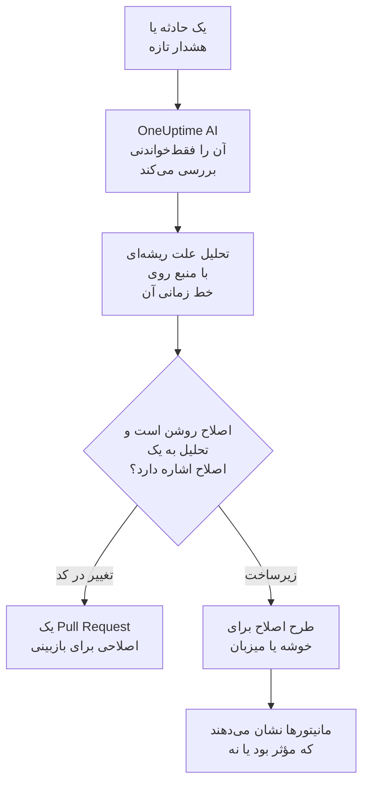
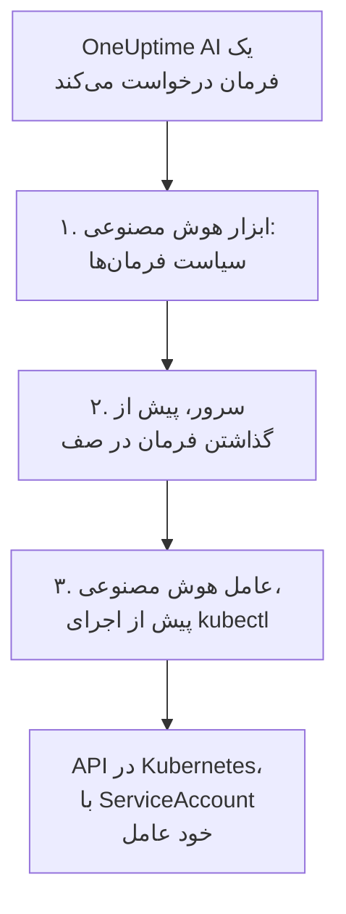

# AI SRE

OneUptime AI مهندس قابلیت اطمینان سایت (SRE) مبتنی بر هوش مصنوعی شماست. به‌محض اینکه حادثه یا هشدار تازه‌ای اعلام شود، به کار می‌افتد، آن را با تله‌متری خود شما بررسی می‌کند — لاگ‌ها، متریک‌ها، ردیابی‌ها، استثناها، مانیتورها و تغییرات اخیر — و یک تحلیل علت ریشه‌ای با منبع را روی خط زمانی حادثه یا هشدار منتشر می‌کند، معمولاً پیش از آنکه مهندس آنکال خواندن اعلان را تمام کند.

هر ادعای تحلیل منبعی دارد که مستقیماً به همان داده‌ای پیوند می‌دهد که آن را پشتیبانی می‌کند، و خود بررسی **کاملاً فقط‌خواندنی** است: OneUptime AI هنگام بررسی هرگز نمی‌تواند چیزی را در پروژهٔ شما تغییر دهد.

:::cards
- [چگونه کار می‌کند](#چگونه-کار-میکند): از یک حادثهٔ تازه تا تحلیلی با منبع، و تا یک اصلاح، اگر اجازه دهید.
- [روشن کردن بررسی‌های هوش مصنوعی](#روشن-کردن-بررسیهای-هوش-مصنوعی): کلیدها، و آنچه نیاز دارند.
- [دسترسی به خوشه — بگذارید OneUptime AI دستور kubectl را اجرا کند](#دسترسی-به-خوشه-بگذارید-oneuptime-ai-دستور-kubectl-را-اجرا-کند): بررسی و اصلاح، درون Kubernetes.
- [کنترل‌های هزینه](#کنترلهای-هزینه): محدودیت‌هایی برای حادثه‌ها، برای هشدارها و برای کل پروژه.
:::

## چگونه کار می‌کند

OneUptime AI برای هر حادثه یا هشدار تازه سه کار انجام می‌دهد و هر کدام کلید خودش را دارد:

- **بررسی می‌کند** (به‌طور پیش‌فرض روشن). تله‌متری شما، و خوشه‌ها و میزبان‌هایی را که یک عامل هوش مصنوعی روی آن‌ها اجرا می‌شود، می‌خواند و یک تحلیل علت ریشه‌ای با منبع منتشر می‌کند. بررسی هیچ چیزی را تغییر نمی‌دهد.
- **اصلاح می‌کند** (به‌طور پیش‌فرض خاموش). وقتی اصلاح روشن باشد، یک تحلیل مطمئن به یک اصلاح تبدیل می‌شود: یک Pull Request برای تغییری در کد شما، یا طرحی از فرمان‌ها برای یک خوشه یا میزبان، که همان‌طور اجرا می‌شود که عامل هوش مصنوعی آن خوشه یا میزبان اجازه می‌دهد.
- **یاد می‌گیرد.** صفحه‌های AI Insights می‌گویند چه چیزی مدام خراب می‌شود، که از همهٔ آنچه ثبت شده به دست آمده است.



تحلیلی که هیچ علتی پیدا نکند بی‌صدا منتشر می‌شود، بی‌آنکه کسی خبر شود (ببینید [حالت بی‌صدا](#حالت-بیصدا))، و بدون علت هیچ چیزی اصلاح نمی‌شود.

## بررسی چه چیزی منتشر می‌کند

وقتی بررسی تمام می‌شود، OneUptime AI یک تحلیل علت ریشه‌ای با این بخش‌ها منتشر می‌کند:

- **Summary** — یک یا دو جمله که مهندسِ خبرشده می‌تواند در پنج ثانیه بخواند.
- **Most likely root cause** — فرضیه، فقط با همان اطمینانی که شواهد پشتیبانی می‌کنند، و هر ادعای واقعی با منبع. اگر تله‌متری کافی نباشد، هوش مصنوعی صریحاً همین را می‌گوید و به‌جای حدس زدن فهرستی از آنچه بررسی کرده ارائه می‌دهد.
- **Evidence** — یافته‌های کلیدی که فرضیه را تأیید یا رد می‌کنند، هر کدام با منبع.
- **Suggested next steps** — اقدام‌های مشخص برای مهندس آنکال.

برای حادثه‌ها، تحلیل در فید حادثه **و** به‌صورت یادداشت داخلی حادثه (جایی که پاسخ‌دهندگان همکاری می‌کنند) منتشر می‌شود. برای هشدارها، در فید هشدار منتشر می‌شود.

تا وقتی بررسی در جریان است، صفحهٔ حادثه یا هشدار یک پنل زندهٔ **AI Investigation** نشان می‌دهد که هر گام را روایت می‌کند — کدام ابزارها اجرا شدند، چه یافتند و چقدر طول کشیدند — تا بتوانید فکر کردنش را تماشا کنید. اگر بررسی شکست بخورد، پنل به‌جای یک جای خالی و بی‌صدا، دلیل شکست را نشان می‌دهد.

بررسی تا وقتی تمام نشده ادامه می‌یابد: **هیچ محدودیت زمانی ندارد** و بودجهٔ پرس‌وجوی کوچکی هم ندارد، پس می‌تواند هر پرس‌وجو و هر فرمان kubectl یا زیرساختی را که لازم دارد اجرا کند. خروجی طولانی یک فرمان (یک `kubectl describe node` از گره‌ای پرمشغله، لاگ‌های یک پاد) هرگز کوتاه نمی‌شود — OneUptime AI آن را صفحه به صفحه می‌خواند. اگر توقف قطعی می‌خواهید، برای هر نوع سیگنال یک **محدودیت زمانی بررسی** تعیین کنید (ببینید **کنترل‌های هزینه** در پایین).

## یک بررسی چه چیزهایی را می‌خواند

یک بررسی از حادثه یا هشدار و از زیرساختی که به آن پیوند دارد آغاز می‌شود: میزبان‌ها، میزبان‌های Docker و Podman، خوشه‌های Kubernetes، پایگاه‌های داده و سرویس‌هایی که مانیتورهای آن زیر نظر دارند. یک مانیتور وب‌سایت، API یا مصنوعی چیزی را زیر نظر دارد که آن را زیر **مانیتور** > **نمای کلی** > **منابع پیوندشده** به آن پیوند می‌دهید، پس آن را به میزبان‌هایی پیوند دهید که آنچه را بررسی می‌کند ارائه می‌دهند تا هر بررسی حادثه‌های آن از همان‌جا آغاز شود.

- هشدارهای روی آن زیرساخت که در ۳۰ دقیقهٔ پیش از حادثه باز شده‌اند یا هنوز باز هستند، از تازه‌ترین، مانند هشدار مصرف بالای CPU میزبانی که پشت یک وب‌سایت کند است. هشدارهای خصوصی کنار گذاشته می‌شوند.
- متریک‌های خود زیرساخت، همان‌طور که آدم‌ها آن‌ها را می‌خوانند. متریک‌های میزبان مانند `system.cpu.utilization` و `system.memory.utilization` برای هر وضعیت یک بار گزارش می‌شوند و جمع وضعیت‌ها ۱۰۰٪ است، پس یک میانگین روی همهٔ آن‌ها چیزی نمی‌گوید. OneUptime AI آن‌ها را وضعیت به وضعیت می‌خواند (CPU مشغول یعنی user به‌علاوهٔ system)، و هر متریکی را به تفکیک کانتینر، نقطهٔ اتصال یا هر ویژگی دیگری.
- کانتینرهای یک میزبان Docker یا Podman: پرکارترین‌ها از نظر CPU، حافظه یا راه‌اندازی دوباره، و آن‌هایی که دیگر گزارش نمی‌دهند. کانتینر متوقف‌شده به جای صفر هیچ چیزی نمی‌فرستد، پس اعداد کل میزبان آن را پنهان می‌کنند.
- تغییرهایی که در ۲ ساعت پیش از حادثه یا هشدار ثبت شده‌اند — استقرارها، به‌روزرسانی‌های تدریجی Kubernetes، تغییرهای پیکربندی و اصلاح‌هایی که OneUptime اجرا کرده است — و اینکه تله‌متری سرویس‌هایش کدام‌یک از آن‌ها را مشکوک می‌کند: سرویسی که درست پس از یک تغییر به‌طور محسوسی بدتر شده است. [استقرارها و تغییرها](/docs/telemetry/change-events) را ببینید.

فعالیت بررسی در کارت **AI Investigation** می‌گوید چند هشدار باز یا تازه را خوانده و روی کدام منابع.

### بررسی دوباره وقتی هشدار تازه‌ای باز می‌شود

یک بررسی همان لحظه‌ای آغاز می‌شود که حادثه اعلام می‌شود، و هشدار میزبانی که به چند دقیقه متریک نیاز دارد ممکن است پس از آن باز شود. وقتی ظرف ۳۰ دقیقه پس از حادثه، پس از آنکه بررسی آن را خوانده است، هشداری روی زیرساخت پیوندشدهٔ حادثه باز شود و حادثه هنوز باز باشد، OneUptime AI یک بار دیگر حادثه را با آن هشدار در دست بررسی می‌کند. تحلیل تازه با **Checked again** و هشداری که باعث بررسی شد آغاز می‌شود، و فعالیت آن هم همین را می‌گوید.

این کار برای هر حادثه حداکثر یک بار انجام می‌شود، با همان کلیدها و محدودیت‌های یک بررسی تازه: **فعال کردن هوش مصنوعی**، _بررسی حوادث تازه_، اعتبار هوش مصنوعی، و محدودیت‌های روزانه و هم‌زمانی. چیزی برای روشن کردن نیست. یک بررسی پیگیری هرگز اصلاح خودکار را دوباره اجرا نمی‌کند و خودش هم هرگز پیگیری نمی‌شود، و بررسی یک هشدار دوباره بررسی نمی‌شود.

## دربارهٔ حادثه با OneUptime AI گفت‌وگو کنید

کارت **AI Investigation** با یک گفت‌وگو تمام می‌شود — **Ask OneUptime AI** — که میان همهٔ کسانی که می‌توانند حادثه یا هشدار را ببینند مشترک است. هر چه بالاتر از آن رخ داده باشد، یک کارت است: زیر یک گزارش پرسش‌های پیگیری می‌پرسید، و وقتی هیچ بررسی خودکاری اجرا نشده باشد (یا پیش از گزارش متوقف شده باشد) نخستین پیشنهاد **What is the root cause?** است که OneUptime AI را وادار می‌کند در همان لحظه بررسی کند.

- **پرسش‌های پیگیری بپرسید** — «کدام پادها بیشترین حافظه را مصرف می‌کنند؟»، «درست پیش از شروع این مشکل چه چیزی تغییر کرد؟»، «آیا چیز دیگری هم تحت تأثیر است؟». OneUptime AI بر پایهٔ گزارش خودش جلو می‌رود، دادهٔ تازه پرس‌وجو می‌کند (و جایی که دسترسی دارد، روی خوشه‌ها و منابعی که شما اجازهٔ دیدنشان را دارید، فرمان‌های فقط‌خواندنی kubectl یا زیرساختی اجرا می‌کند) و برای هر ادعا منبع می‌آورد.
- **از آن بخواهید کاری انجام دهد** — «این حادثه را تأیید کن»، «یک به‌روزرسانی وضعیت منتشر کن که در حال بررسی هستیم»، «آنکالِ پایگاه داده را خبر کن»، «شدت را بالا ببر». همان کنش‌های پرسش از هوش مصنوعی را به کار می‌برد و همیشه **با دسترسی‌های خود شما** عمل می‌کند، پس هرگز نمی‌تواند بیش از آنچه شما می‌توانید انجام دهد.
- **انتخاب کنید چگونه عمل کند** با کلید داخل کادر پیام، که کنارش می‌گوید حالت انتخاب‌شده چه معنایی دارد: _Auto-run_ (پیش‌فرض — برای درخواستی روشن بی‌درنگ عمل می‌کند)، _Ask to act_ (نخست یک کارت تأیید نشان می‌دهد که هر کسی روی حادثه می‌تواند آن را تأیید یا رد کند) یا _فقط‌خواندنی_.
- **یک رشتهٔ مشترک.** هر پرسش نشان می‌دهد چه کسی آن را پرسیده، همه همان گفت‌وگو را زنده می‌بینند و هر کسی می‌تواند پاسخی را که در حال نوشته شدن است متوقف کند. نمودارها و جدول‌های یک پاسخ به کسی نشان داده می‌شوند که پرسیده است؛ بقیه پاسخ با منبع را می‌بینند. هر پاسخ **منابع** خود را فهرست می‌کند، و منبعی که صفحهٔ خودش را دارد (لاگ‌ها، متریک‌ها، یک مانیتور) آن صفحه را باز می‌کند. یک رشتهٔ طولانی روی تازه‌ترین پیام‌هایش باز می‌شود، با دکمه‌ای بالای آن‌ها (برای نمونه **Show 6 earlier messages**) که بقیه را برمی‌گرداند.

## روشن کردن بررسی‌های هوش مصنوعی

بررسی‌های خودکار **برای پروژه‌های تازه به‌طور پیش‌فرض روشن هستند**. پیش‌نویس‌های گزارش پس از حادثه و AI Insights هم همین‌طور. اصلاح خاموش آغاز می‌شود، و Pull Requestهایی هم که بخشی از آن هستند (ببینید [اصلاح خودکار کد](#اصلاح-خودکار-کد)). پروژه‌ای که پیش از این پیش‌فرض ساخته شده تنظیم خودش را نگه می‌دارد؛ بررسی‌ها را مانند گام ۳ روشن کنید، یا با **روشن کردن** در صفحهٔ **عامل هوش مصنوعی** هر خوشهٔ Kubernetes (Project Owner یا Project Admin). برای بررسی یا تغییر آن‌ها:

:::steps
1. **یک ارائه‌دهندهٔ LLM پیکربندی کنید.** نصب‌های خودمیزبان کلید خودشان را به کار می‌برند (یا با Ollama محلی کاملاً جدا از شبکه اجرا می‌شوند) — ببینید [ارائه‌دهندگان LLM](/docs/ai/llm-provider). کاربران OneUptime Cloud می‌توانند از ارائه‌دهندهٔ سراسری ازپیش‌پیکربندی‌شده استفاده کنند که به‌صورت توکن‌های اندازه‌گیری‌شدهٔ هوش مصنوعی صورت‌حساب می‌شود، پس پروژه به اعتبار هوش مصنوعی نیاز دارد: مالک پروژه یا کسی با **Manage Billing** آن را در **تنظیمات پروژه** > **هوش مصنوعی** > **اعتبار هوش مصنوعی** اضافه می‌کند، جایی که **شارژ خودکار** نمی‌گذارد تمام شود.
2. **مطمئن شوید هوش مصنوعی برای پروژه فعال است** (به‌طور پیش‌فرض فعال است): **فعال کردن هوش مصنوعی** در **تنظیمات پروژه** > **هوش مصنوعی** > **AI Features**.
3. **برای هر نوع سیگنال انتخاب کنید** (در پروژه‌های تازه هر دو روشن‌اند):
   - حادثه‌ها: **حوادث** > **هوش مصنوعی** > **تنظیمات** — _بررسی حوادث تازه_ را روشن کنید.
   - هشدارها: **هشدارها** > **هوش مصنوعی** > **تنظیمات** — _بررسی هشدارهای تازه_ را روشن کنید.
:::

هر رفتار هوش مصنوعی در این صفحه‌ها کلیدی است که به‌محض تغییر ذخیره می‌شود؛ دکمهٔ ذخیره‌ای وجود ندارد. صفحهٔ حادثه سه کلید دارد، زیر **کارهایی که OneUptime AI انجام می‌دهد**: _بررسی حوادث تازه_، _اصلاح خودکار حوادث تازه_ و _نوشتن پیش‌نویس گزارش پس از حادثه هنگام حل شدن حادثه_. صفحهٔ هشدار همین‌ها را دارد، بدون گزارش پس از حادثه. _اصلاح خودکار حوادث تازه_ (و _اصلاح خودکار هشدارهای تازه_) حتی برای پروژه‌های تازه **خاموش** آغاز می‌شود: این کلید به OneUptime AI اجازه می‌دهد زیرساخت شما را تغییر دهد، پس خود پروژه آن را روشن می‌کند — ببینید [کدام حادثه‌ها بررسی و اصلاح می‌شوند](#کدام-حادثهها-بررسی-و-اصلاح-میشوند). دو کلید دیگر بخشی از آن هستند و تا وقتی روشن است زیرش نمایش داده می‌شوند: _باز کردن Pull Request اصلاحی وقتی بررسی تغییری در کد پیدا می‌کند_ و _باز کردن Pull Requestی که تله‌متری گمشده را اضافه می‌کند_. روشن کردن اصلاح هر دو را روشن می‌کند و خاموش کردنش هر دو را خاموش؛ تا وقتی روشن است، هر کدام را که نمی‌خواهید خاموش کنید. Project Ownerها و Project Adminها می‌توانند آن‌ها را تغییر دهند؛ برای بقیه هر کلید قفل است و می‌گوید به کدام دسترسی نیاز دارد.

این صفحه‌ها دو چیز را فقط وقتی درست باشند می‌گویند. اگر **فعال کردن هوش مصنوعی** خاموش باشد، هیچ چیزی در آن‌ها اجرا نمی‌شود و صفحه این را در بالا می‌گوید، همراه با خود کلید فعال کردن هوش مصنوعی برای کسانی که می‌توانند تغییرش دهند (Project Ownerها، و هر کسی با Manage Billing)؛ به بقیه گفته می‌شود چه کسی می‌تواند. اگر پروژه هیچ ارائه‌دهندهٔ LLM قابل استفاده برای OneUptime AI نداشته باشد — اصلاً هیچ، یا ارائه‌دهندگانی دارد اما هیچ‌کدام پیش‌فرض نیست — صفحه این را هم می‌گوید، با پیوندی به **تنظیمات پروژه** > **هوش مصنوعی** > **ارائه‌دهندگان LLM**. در OneUptime Cloud ارائه‌دهندهٔ سراسری هم به حساب می‌آید، پس آنجا چیزی گفته نمی‌شود.

حادثه‌ها و هشدارها جداگانه پیکربندی می‌شوند، پس می‌توانید به هر نوع سیگنال سقف هم‌زمانی، بودجهٔ روزانهٔ توکن، بودجهٔ وظیفه‌های اصلاح و سیاست Pull Requestهای پیگیری خاص خودش را بدهید. هیچ‌کدام از این محدودیت‌ها تا وقتی تعیینشان نکنید اعمال نمی‌شوند — آن‌ها زیر **تنظیمات بیشتر** در پایین هر صفحه جمع شده‌اند؛ ببینید **کنترل‌های هزینه** در پایین. تغییر یک تنظیم هوش مصنوعی هشدار، تنظیم متناظر حادثه را تغییر نمی‌دهد و برعکس.

اصلاح بر پایهٔ بررسی‌ها ساخته شده است: تا وقتی **اصلاح خودکار حوادث تازه** (یا کلید متناظر هشدارها) روشن است، **باز کردن Pull Request اصلاحی وقتی بررسی تغییری در کد پیدا می‌کند** به بررسی‌ای که با اطمینان تغییری در کد مخزن تشخیص می‌دهد اجازه می‌دهد خودکار یک Pull Request اصلاحی باز کند — ببینید **اصلاح خودکار کد** در پایین.

## دسترسی به خوشه — بگذارید OneUptime AI دستور kubectl را اجرا کند

به‌طور پیش‌فرض، بررسی فقط می‌تواند از تله‌متری‌ای استفاده کند که عامل‌های شما می‌فرستند. برای یک سیگنال Kubernetes این اغلب کافی نیست: «پادهایی که در Pending گیر کرده‌اند» یک مشکل زمان‌بندی است که با describe کردن پاد و خواندن رویدادهایش تشخیص داده می‌شود، نه با نگاه به یک متریک. **عامل هوش مصنوعی Kubernetes** به OneUptime AI اجازه می‌دهد دقیقاً همین کار را بکند — و اگر اجازه دهید، آنچه را پیدا می‌کند اصلاح کند.

صفحهٔ هر خوشه در منوی کناری‌اش یک بخش **هوش مصنوعی** دارد:

- **عامل** — صفحهٔ **عامل هوش مصنوعی** خوشه: اینکه عامل متصل است یا نه، هوش مصنوعی روی خوشه چه کاری مجاز است بکند، و هر چه نیاز به توجه دارد، هر کدام با گامی که حلش می‌کند. همین توضیح روی پنل بررسی حادثه هم ظاهر می‌شود، وقتی هوش مصنوعی ناچار بوده فقط با دادهٔ OneUptime بررسی کند.
- **بینش‌ها** — صفحهٔ **AI Insights** خوشه: آنچه OneUptime AI دربارهٔ خوشه فهمیده است — چه چیزی مدام خراب می‌شود و چرا، و برای آن چه باید کرد (ببینید [آنچه هوش مصنوعی روی یک خوشه آموخت](#آنچه-هوش-مصنوعی-روی-یک-خوشه-آموخت)).
- **لاگ‌ها** — صفحهٔ **گزارش‌های هوش مصنوعی** خوشه: هر کاری که OneUptime AI روی خوشه انجام داده، تازه‌ترین در ابتدا (ببینید [هر کاری که هوش مصنوعی روی یک خوشه انجام داد](#هر-کاری-که-هوش-مصنوعی-روی-یک-خوشه-انجام-داد)).

**نمای کلی** خوشه با یک کارت **عامل هوش مصنوعی** تمام می‌شود که صفحهٔ عامل هوش مصنوعی را خلاصه می‌کند: اینکه عامل متصل است یا نه، اینکه **بررسی با kubectl** روشن است یا نه، اصلاح‌ها چگونه اجرا می‌شوند (**خاموش**، **درخواست تأیید**، **خودکار** یا **رد شدن از تأیید**) و چه چیزی نیاز به توجه دارد، با پیوندی به صفحهٔ عامل هوش مصنوعی، جایی که این‌ها تغییر می‌کنند.

### عامل هوش مصنوعی Kubernetes — به‌طور پیش‌فرض روشن، فقط‌خواندنی

چارت [عامل Kubernetes در OneUptime](/docs/telemetry/kubernetes-agent) به‌طور پیش‌فرض عامل هوش مصنوعی Kubernetes را اجرا می‌کند: یک پاد کوچک (`component=ai-agent`، ایمیج `oneuptime/kubernetes-ai-agent`) با یک ServiceAccount **فقط‌خواندنی**. با همان کلید API که چارت از قبل به کار می‌برد متصل می‌شود، پس در داشبورد چیزی برای راه‌اندازی نیست: ظرف یک دقیقه صفحهٔ عامل هوش مصنوعی خوشه آن را **متصل** نشان می‌دهد و **بررسی با kubectl** روشن است — مگر آنکه کسی از قبل آنجا تنظیمات هوش مصنوعی خوشه را انتخاب کرده باشد، که همان‌طور که هستند نگه داشته می‌شوند.

روی عاملی که پیش از وجود عامل هوش مصنوعی Kubernetes نصب شده، نخست فهرست چارت‌ها را تازه کنید و سپس ارتقا دهید:

```bash
helm repo update
helm upgrade kubernetes-agent oneuptime/kubernetes-agent \
  --namespace oneuptime-agent --reset-then-reuse-values \
  --set aiAgent.enabled=true
```

`kubernetes-agent` و `oneuptime-agent` همان نام انتشار و namespace هستند که دستورالعمل نصب داشبورد به کار می‌برد؛ اگر عامل را با نام‌های دیگری نصب کرده‌اید، نام‌های خودتان را به کار ببرید (`helm list -A | grep kubernetes-agent` آن‌ها را نشان می‌دهد). بدون `helm repo update`، Helm ممکن است همان چارتی را که از آن نصب کرده‌اید پیدا کند، که `aiAgent` را نمی‌شناسد و با `Additional property aiAgent is not allowed` شکست می‌خورد. در OneUptime خودمیزبان، OneUptime را پیش از چارت ارتقا دهید — ببینید [ارتقای عامل](/docs/telemetry/kubernetes-agent#بهروزرسانی-عامل). برای اجرای چارت بدون عامل هوش مصنوعی، `--set aiAgent.enabled=false` را بدهید.

**آزمایش اتصال** در منوی **⋯** کنار وضعیت عامل در صفحهٔ عامل هوش مصنوعی، `kubectl version` و `kubectl auth can-i --list` را از طریق عامل اجرا می‌کند و نتیجه‌ها را نشان می‌دهد: به چه چیزی دسترسی دارد و چه کاری مجاز است بکند. اگر صفحه بگوید عامل متصل نیست، لاگ آن را با `kubectl logs -n oneuptime-agent -l component=ai-agent --tail=100` بخوانید. کلیدی که **Pinned Service Name** دارد نمی‌تواند عامل را ثبت کند — به چارت کلیدی بدون آن بدهید. وقتی سرور ثبتی را رد می‌کند، لاگ می‌گوید آیا این رد خودبه‌خود برطرف می‌شود (پاد قبلی عامل که هنوز گزارش می‌دهد، یا Runner قدیمی درون خوشه که در حین ارتقا هنوز در حال خاموش شدن است) یا چه چیزی باید تغییر کند. **بازنشانی عامل** در همان منو، پس از تأیید شما، کلید عامل را از یاد سرور می‌برد؛ پاد ظرف چند دقیقه خودش دوباره متصل می‌شود.

عامل هوش مصنوعی Kubernetes یک Runner نیست و هرگز زیر رانبوک‌ها > Runnerها ظاهر نمی‌شود. همیشه فقط ServiceAccount خودش را به کار می‌برد، پس OneUptime هرگز اعتبارنامه‌ای به آن نمی‌دهد، هرگز به‌عنوان میزبان Bash/SSH برای رانبوک‌ها به کار نمی‌رود و هرگز به‌عنوان Runner فرمانِ یک قاعدهٔ رفع خودکار مشکل پذیرفته نمی‌شود.

### کارهای مجاز هوش مصنوعی — تعیین‌شده به‌دست عامل

اینکه OneUptime AI روی یک خوشه چه کاری مجاز است بکند، همان‌جا که عامل اجرا می‌شود، در چارت، با دو مقدار تعیین می‌شود:

- `aiAgent.investigation` — `true`: هوش مصنوعی هنگام بررسی می‌تواند kubectl فقط‌خواندنی را روی خوشه اجرا کند. `false`: همچنان بررسی می‌کند، با داده‌ای که OneUptime از قبل دارد.
- `aiAgent.fixes` — هوش مصنوعی چگونه اصلاحی را اعمال می‌کند: `off`، `ask-for-approval`، `automatic` یا `bypass-approval` (ببینید [اصلاح‌ها چگونه کار می‌کنند](#اصلاحها-چگونه-کار-میکنند)). هر سطحی جز `off` به عامل هوش مصنوعی دسترسی نوشتن می‌دهد؛ با `off` هیچ دسترسی ندارد و خودش هر نوشتنی را رد می‌کند.

عامل هوش مصنوعی هر دو را در هر heartbeat به OneUptime گزارش می‌دهد و OneUptime آن‌ها را روی خوشه اعمال می‌کند. **کارهای مجاز هوش مصنوعی** در صفحهٔ عامل هوش مصنوعی خوشه آن‌ها را نشان می‌دهد — **روشن** و سطح اصلاح، سبز هر وقت روشن باشند — بی‌آنکه بتوان آنجا تغییرشان داد؛ **تغییر** هر گزینه را همراه با همان `helm upgrade` دقیقی که آن را تعیین می‌کند نشان می‌دهد. تغییری که در جای دیگری انجام شود — صفحهٔ عامل هوش مصنوعی، API یا Terraform — تا وقتی عامل آن‌ها را تعیین می‌کند رد می‌شود.

انتشاری که هیچ‌کدام از دو مقدار را تعیین نکند، می‌گذارد عامل پیش‌فرض‌های خودش را به کار ببرد (بررسی روشن؛ اصلاح‌ها خاموش، یا ask-for-approval با `aiAgent.remediation.enabled=true` قدیمی‌تر). OneUptime این پیش‌فرض‌ها را فقط روی خوشه‌ای اعمال می‌کند که هیچ‌کس تنظیمات هوش مصنوعی‌اش را در صفحهٔ عامل هوش مصنوعی آن انتخاب نکرده باشد: تنظیماتی که آنجا انتخاب شده‌اند همان‌طور که هستند نگه داشته می‌شوند، و صفحه فرمانی را نشان می‌دهد که آن‌ها را به چارت منتقل می‌کند. خوشه‌ای هم که عامل هوش مصنوعی‌اش قدیمی‌تر از آن است که آن‌ها را گزارش دهد همین‌طور است — ارتقای چارت با این دو مقدار آن‌ها را منتقل می‌کند.

### بگذارید هوش مصنوعی آنچه را پیدا می‌کند اصلاح کند

اصلاح‌ها تا وقتی با `aiAgent.fixes` روشنشان نکنید خاموش‌اند، و این کار به عامل هوش مصنوعی دسترسی نوشتن هم می‌دهد — بهتر است فقط در namespaceهایی که هوش مصنوعی مجاز به اصلاحشان است و با عملیات گره خاموش:

```bash
helm repo update
helm upgrade kubernetes-agent oneuptime/kubernetes-agent \
  --namespace oneuptime-agent --reset-then-reuse-values \
  --set aiAgent.enabled=true \
  --set aiAgent.investigation=true \
  --set aiAgent.fixes=ask-for-approval \
  --set "aiAgent.remediation.namespaces={web,api}" \
  --set aiAgent.remediation.nodeOperations=false
```

یا برای کل خوشه:

```bash
helm repo update
helm upgrade kubernetes-agent oneuptime/kubernetes-agent \
  --namespace oneuptime-agent --reset-then-reuse-values \
  --set aiAgent.enabled=true \
  --set aiAgent.investigation=true \
  --set aiAgent.fixes=ask-for-approval \
  --set-json 'aiAgent.remediation.namespaces=[]'
```

به‌جای `{web,api}` namespaceهایی را بگذارید که هوش مصنوعی مجاز به اصلاحشان است. هر namespace فهرست باید از قبل وجود داشته باشد: چارت در هر کدام یک RoleBinding می‌سازد و هرگز namespace نمی‌سازد، پس نبودِ یکی کل نصب یا ارتقا — از جمله collector — را با `namespaces "api" not found` شکست می‌دهد. نخست آن را بسازید یا از فهرست بردارید؛ پیش از حذف یک namespace آن را از فهرست بردارید. اگر در ارتقا این پرچم را نگذارید، فهرست ذخیره‌شده در انتشار حفظ می‌شود، پس برای بازگشت به کل خوشه، همان‌طور که فرمان دوم انجام می‌دهد، `--set-json 'aiAgent.remediation.namespaces=[]'` (Helm 3.10+) را بدهید — نه `={}` را، که Helm آن را یک نام خالی می‌خواند و چارت ردش می‌کند. `--set aiAgent.remediation.namespaces=null` یک فهرست ذخیره‌شده را زیر `--reuse-values` بازنشانی نمی‌کند: Helm فهرست ذخیره‌شده را نگه می‌دارد. `aiAgent.remediation.nodeOperations=false` اصلاح‌ها را از گره‌ها دور نگه می‌دارد؛ آن را `true` کنید تا هوش مصنوعی بتواند گره‌ها را cordon، uncordon و drain کند و روی آن‌ها taint بگذارد (drain، taint یا patch یک گره همچنان منتظر یک انسان می‌ماند).

برای خودمختاری بیشتر به‌جای `ask-for-approval` از `automatic` یا `bypass-approval` استفاده کنید، و برای خاموش کردن دوبارهٔ اصلاح‌ها از `--set aiAgent.fixes=off`، که دسترسی نوشتن را هم برمی‌دارد. اصلاح‌ها به دو کلید پروژه هم نیاز دارند. **اصلاح خودکار حوادث تازه** (در **حوادث** > **هوش مصنوعی** > **تنظیمات**) و **اصلاح خودکار هشدارهای تازه** (در **هشدارها** > **هوش مصنوعی** > **تنظیمات**) خاموش آغاز می‌شوند: تا یکی از آن‌ها روشن نشود، هیچ چیز تازه‌ای از آن نوع اصلاح نمی‌شود. **فعال کردن هوش مصنوعی** (**تنظیمات پروژه** > **هوش مصنوعی** > **AI Features**) روشن است مگر آنکه کسی خاموشش کرده باشد؛ این کلید کل هوش مصنوعی پروژه را خاموش می‌کند، هر چه پیکربندی یک عامل بگوید.

### اصلاح‌های یک خوشه روی کدام حادثه‌ها عمل می‌کنند

تا وقتی **اصلاح خودکار حوادث تازه** روشن است و هیچ قاعدهٔ رفع خودکار مشکلی تنظیم نشده، OneUptime AI هر حادثهٔ تازه‌ای را که خوشه به آن پیوند دارد، در حالتی که صفحهٔ عامل هوش مصنوعی آن تعیین می‌کند، اصلاح می‌کند — و برای هشدارها هم با **اصلاح خودکار هشدارهای تازه** همین‌طور. با وجود قواعد، فقط حادثه‌هایی را اصلاح می‌کند که قاعده‌ای که با OneUptime AI اصلاح می‌کند با آن‌ها مطابقت دارد (ببینید [کدام حادثه‌ها بررسی و اصلاح می‌شوند](#کدام-حادثهها-بررسی-و-اصلاح-میشوند)). به آنچه به آن پیوند ندارد دست نمی‌زند — هر قدر هم علت آشکارا در خوشه باشد. یک حادثه یا هشدار در این حالت‌ها به یک خوشه پیوند دارد:

- تله‌متری‌ای که از آن برخاسته، نام خوشه را دارد (یک مانیتور متریک، لاگ یا ردیابی روی داده‌های خوشه)؛
- مانیتور آن یک مانیتور Kubernetes آن خوشه است؛
- مانیتور آن زیر **مانیتور** > **نمای کلی** > **منابع پیوندشده** به خوشه پیوند داده شده است — راهی برای پیوند دادن یک مانیتور وب‌سایت، API یا مصنوعی به خوشه‌ای که آنچه را بررسی می‌کند ارائه می‌دهد؛
- کسی هنگام اعلام آن، خوشه را زیر **سایر منابع تحت تأثیر** انتخاب کرده است (انتخاب یک مانیتور پیوندشده آن را خودکار آنجا اضافه می‌کند).

هر حادثه و هشدار روی کارت **رفع مشکل** خود می‌گوید که آیا به یک خوشه پیوند داشته و اصلاح‌های خوشه چه کردند؛ ببینید [رفع خودکار مشکل چه کرد](#رفع-خودکار-مشکل-چه-کرد). همین برای یک منبع زیرساخت و عامل هوش مصنوعی آن هم برقرار است.

### چه کسی می‌تواند آن را تغییر دهد

تا وقتی عامل هوش مصنوعی Kubernetes بررسی و اصلاح‌ها را تعیین می‌کند، کسی آن‌ها را تغییر می‌دهد که بتواند مقدارهای چارت را روی خوشه تغییر دهد؛ OneUptime تغییری را که در جای دیگری انجام شود رد می‌کند. قواعد زیر برای آنچه در OneUptime می‌ماند — فهرست مجاز kubectl، و اتصال Runner و اعتبارنامه — و برای بررسی و اصلاح‌ها روی خوشه‌ای که تنظیماتش هنوز در OneUptime تعیین می‌شوند برقرارند (ببینید [کارهای مجاز هوش مصنوعی — تعیین‌شده به‌دست عامل](#کارهای-مجاز-هوش-مصنوعی-تعیینشده-بهدست-عامل)).

روشن کردن اصلاح‌ها — هر تغییری از **خاموش** به حالت دیگر — و شل‌تر کردنشان — رفتن به **خودکار** یا **رد شدن از تأیید**، نوشتن فهرست مجاز kubectl، متصل کردن یک Runner یا اعتبارنامه، یا برداشتن این اتصال از خوشه‌ای که عامل هوش مصنوعی Kubernetes دارد — به یک Project Owner، یک Project Admin یا دسترسی **Edit Auto Remediation Rule** نیاز دارد، یعنی همان کسانی که می‌توانند یک قاعدهٔ رفع مشکل کاملاً خودکار بسازند. متصل کردن اعتبارنامه به دسترسی **Read Runbook Credential** هم نیاز دارد، مگر آنکه Project Owner یا Project Admin باشید. **بازنشانی عامل** به همان کسانی نیاز دارد که اصلاح‌ها را روشن می‌کنند. سخت‌تر کردنشان — **خاموش**، بازگشت به **درخواست تأیید**، پاک کردن فهرست مجاز — برای هر کسی که بتواند خوشه را ویرایش کند آزاد است، و **آزمایش اتصال** و تأیید اصلاحی که OneUptime AI برای آن خوشه پیشنهاد می‌کند هم همین‌طور. همهٔ این‌ها به دسترسی ویرایش همان خوشه نیاز دارند: دسترسی‌ای که به برخی برچسب‌ها، یا به خوشه‌هایی که شما یا تیم‌هایتان مالکشان هستید، محدود است فقط به همان خوشه‌ها می‌رسد، و مدخل مسدودی با برچسب، خوشه‌هایی را که آن برچسب‌ها را دارند برمی‌دارد.

### بررسی چه چیزی را می‌تواند اجرا کند

با داشتن دسترسی، بررسی از طریق عامل هوش مصنوعی kubectl **فقط‌خواندنی** اجرا می‌کند — `get`، `describe`، `logs`، `events`، `top`، `rollout status/history`، `auth can-i` — هر تعداد فرمان که لازم داشته باشد، و برای هر فرمان مانند هر شاهد دیگری منبع می‌آورد. خروجی هرگز کوتاه نمی‌شود: عامل تا یک مگابایت از آن را نگه می‌دارد و OneUptime AI خروجی طولانی را صفحه به صفحه می‌خواند. سه بررسی مستقل آن را فقط‌خواندنی نگه می‌دارند: سیاستی که هر فرمان را رده‌بندی می‌کند، سروری که از گذاشتن هر چیز دیگری در صف برای یک بررسی خودداری می‌کند، و عامل هوش مصنوعی که پیش از اجرای kubectl همان سیاست را دوباره بررسی می‌کند. «فقط‌خواندنی — هیچ چیزی در سیستم‌های شما تغییر نکرد» به‌معنای واقعی کلمه درست می‌ماند.



### اصلاح‌ها چگونه کار می‌کنند

**اصلاحات** در صفحهٔ عامل هوش مصنوعی چهار تنظیم دارد (`aiAgent.fixes` چارت: `off`، `ask-for-approval`، `automatic`، `bypass-approval`):

- **خاموش** — هوش مصنوعی فقط بررسی می‌کند.
- **درخواست تأیید** — پس از تحلیل علت ریشه‌ای، OneUptime AI با kubectl عیب‌یابی می‌کند و کوچک‌ترین طرح kubectl را که به علت می‌پردازد می‌سازد، برای نمونه `kubectl rollout restart deployment/web -n web`. طرح همراه با دلیل، اثر مورد انتظار و بازگردانی‌اش روی حادثه ظاهر می‌شود؛ یک انسان با یک کلیک آن را تأیید می‌کند و OneUptime دقیقاً همان فرمان‌ها را اجرا می‌کند. اگر مانیتورها بهبود نیابند، بازگردانی اجرا می‌شود و OneUptime AI یک طرح دیگر می‌سازد — باز هم برای تأیید — با تلاش ناموفق پیش چشم، تا راه دیگری برود یا بگوید یک انسان باید به چه چیزی نگاه کند.
- **خودکار** — تغییرات امن خودشان اجرا می‌شوند؛ یک تغییر پرخطرتر هرگز. وقتی دور فقط اصلاح‌های پرخطرتر پیدا کرده باشد، با پیشنهاد دقیقاً همان‌ها برای تأیید با یک کلیک تمام می‌شود. وقتی یک اصلاح امن را هم اجرا کرده باشد، اصلاح پرخطرتر در تحلیل می‌ماند و فقط اگر راستی‌آزمایی نشان دهد اصلاح امن مانیتورها را بهبود نداده، به‌دست دور پیگیری پیشنهاد می‌شود که درخواست تأیید می‌کند. شکل یک فرمان پرخطرتر را در صفحهٔ عامل هوش مصنوعی به فهرست مجاز اضافه کنید تا آن هم خودش اجرا شود. حالت خودکار همچنین سیگنال را وقتی راستی‌آزمایی بهبود مانیتورها را تأیید کند حل‌شده می‌کند، و یک قطع‌کنندهٔ مدار دارد که سقفش سه اصلاح بی‌نظارت برای هر خوشه در هر ساعت است: فراتر از آن، یا تا وقتی دور بی‌نظارت دیگری از OneUptime AI هنوز در حال تغییر یا راستی‌آزمایی همان خوشه است، یک دور طرحش را به‌جای اجرا برای تأیید پیشنهاد می‌کند.
- **رد شدن از تأیید** — هوش مصنوعی نمی‌پرسد. هر تغییری که سیاست اجازه دهد، از جمله تغییرات پرخطرتر، خودش اجرا می‌شود، و دور پیگیری پس از یک راستی‌آزمایی ناموفق هم همین‌طور؛ سیگنال به‌محض اینکه راستی‌آزمایی بهبود را تأیید کند خودش حل‌شده می‌شود. آنچه در هر حالتی به یک انسان نیاز دارد (پایین‌تر) همچنان منتظر یک انسان می‌ماند. یک دور همچنین در این حالت‌ها طرحش را به‌جای اجرا برای تأیید پیشنهاد می‌کند و دلیلش را روی حادثه می‌گوید:
  - قطع‌کنندهٔ مدار ساعتی (سه اصلاح بی‌نظارت برای هر خوشه در هر ساعت) عمل کرده است، یا نمی‌توان آن را بررسی کرد؛
  - دور بی‌نظارت دیگری از OneUptime AI هنوز در حال تغییر همان خوشه است، یا هنوز در حال راستی‌آزمایی اصلاحی روی آن است — هشدار و حادثهٔ یک مانیتور نمونهٔ رایج آن است — یا نمی‌توان این را بررسی کرد؛
  - این دورِ پیگیری پس از اصلاحی است که بازگردانی‌اش کامل نشده است.

**نخست، بازگردانی.** وقتی OneUptime یک به‌روزرسانی تدریجی Kubernetes روی خوشه را برای حادثه مشکوک علامت زده باشد (ببینید [استقرارها و تغییرها](/docs/telemetry/change-events))، OneUptime AI پیش از هر اصلاح دیگری بازگرداندن آن را امتحان می‌کند. OneUptime فرمان `kubectl rollout undo` را از روی تغییر ثبت‌شده می‌سازد، هرگز از روی آنچه مدل می‌نویسد، و این فرمان مانند هر تغییر امن دیگری در حالتِ خوشه اجرا می‌شود یا منتظر تأیید می‌ماند. اگر Deployment پس از آن به‌روزرسانی تدریجی دوباره تغییر کرده باشد، پیشنهاد نمی‌شود، چون در آن صورت undo تغییر بعدی را برمی‌گرداند.

یک تغییر **امن** دقیقاً یک شیء نام‌دار را تحت تأثیر قرار می‌دهد: `rollout restart/undo/pause/resume`، `scale` (به هر مقداری جز ۰)، حذف یک پاد نام‌دار، `cordon`/`uncordon`، و `label`/`annotate` روی یک Pod، Deployment، StatefulSet، DaemonSet، ReplicaSet، Job یا CronJob نام‌دار با یک کلید معمولی (نه یک کلید رزرو‌شده مانند `*.kubernetes.io/…` یا `*.k8s.io/…`). هر چیز دیگری که سیاست اجازه دهد **پرخطرتر** است: همان فعل‌ها روی یک نوع بدون نام (`rollout restart deployment`)، روی چند شیء، با یک انتخاب‌گر یا با `--all`؛ `scale` به ۰؛ حذف یک job؛ `taint`؛ `drain`؛ `patch`؛ `set image/env/resources`؛ `create`؛ حذف با `--force`؛ و برچسب‌ها یا حاشیه‌نویسی‌ها روی هر نوع دیگری یا با یک کلید رزرو‌شده.

برخی مرزها در **هر** حالتی، از جمله رد شدن از تأیید، برقرارند و هیچ مدخلی در فهرست مجاز آن‌ها را تغییر نمی‌دهد:

- نوشتن در **kube-system**، **kube-public** یا **kube-node-lease** همیشه به یک انسان نیاز دارد. یک منبع سفارشی بر اساس namespaceی که در آن نوشته می‌شود سنجیده می‌شود، حتی اگر نامش شبیه یک نوع داخلی در سطح خوشه باشد (`nodes.example.com`، `namespaces.example.com`).
- یک `drain`، یک `taint` یا یک `patch` روی گره همیشه به یک انسان نیاز دارد. drain کردن یک گره پادها را در هر namespace بیرون می‌کند — از جمله سه namespace بالا و namespace خود عامل — و یک taint از نوع `NoExecute` هم آن‌ها را بیرون می‌کند، چه `kubectl taint` آن را بگذارد و چه یک `patch` روی گره.
- عامل هوش مصنوعی هرگز چیزی را در namespace خودش تغییر نمی‌دهد — اصلاحی در آنجا می‌توانست عامل Kubernetes یا خود عامل هوش مصنوعی را به صفر برساند — و نه چیزی بیرون از namespaceهایی که چارتش اجازهٔ نوشتن در آن‌ها را می‌دهد (`aiAgent.remediation.namespaces`)، و نه یک گره را وقتی چارتش عملیات گره را خاموش کرده باشد (`aiAgent.remediation.nodeOperations=false`). OneUptime این محدوده را از آنچه عامل هوش مصنوعی گزارش می‌دهد می‌خواند و چنین اصلاحی را هم وقتی OneUptime AI پیشنهادش می‌کند و هم وقتی کسی تأییدش می‌کند رد می‌کند، پس هرگز به‌صورت یک اصلاح ناموفق به عامل هوش مصنوعی نمی‌رسد؛ عامل هوش مصنوعی هم پیش از اجرای `kubectl` آن را رد می‌کند.
- فرمان‌های مخرب (پایین‌تر) هرگز اجرا نمی‌شوند، حتی با تأیید یک انسان.

فهرست مجاز حالت خودکار کلمه به کلمه با فرمان تجزیه‌شده مقایسه می‌شود، نه به‌صورت متن آزاد: `*` دقیقاً جای یک کلمه را می‌گیرد (یک ایمیج، یک نام)، هرگز جای شیءهای اضافی، پرچم‌ها یا یک `-n` دوم را، و هر پرچمی که فرمان به کار می‌برد باید در مدخل نوشته شده باشد. `kubectl set image deployment/web * -n web` اجازهٔ یک ایمیج تازه برای `web` در `web` را می‌دهد و نه هیچ چیز دیگری. یک مدخل باید فعلش را — و زیرفرمان `rollout`، `set` یا `create` را — کامل بنویسد، نه آنکه به‌جایش `*` بگذارد، و پس از `kubectl` اختیاری ابتدایی باید بیش از یک کلمه داشته باشد؛ مدخلی که این قواعد را بشکند، مانند `scale` یا `kubectl *`، هرگز نمی‌تواند تغییری را از پیش تأیید کند و هنگام ذخیره رد می‌شود.

:::details فرمان‌هایی که هرگز اجرا نمی‌شوند، و یک فرمان چگونه خوانده می‌شود
برخی فرمان‌ها **هرگز** اجرا نمی‌شوند، در هر حالتی و حتی با تأیید انسان. سیاست فرمان‌ها آن‌ها را رد می‌کند و این سیاست سه بار اعمال می‌شود — به‌دست ابزار سرور، به‌دست گلوگاهی که سرور در آن فرمان‌ها را در صف می‌گذارد، و به‌دست عامل هوش مصنوعی پیش از اجرای `kubectl`: `exec`، `attach`، `cp`، `port-forward`، `proxy`، `debug`، `run`، `edit`، `apply`، `replace`، `diff`، افزونه‌های kubectl و هر فعل دیگری که در فهرستش نیست، هر ورودی از فایل (`-f`، `-k`) یا قالب خروجی‌ای که فایل می‌خواند (`-o jsonpath-file=`، `-o go-template-file=`، `-o custom-columns-file=`، `--template`، و یک `-o jsonpath`/`go-template`/`custom-columns` تنها بدون قالب درون‌خطی‌اش)، پرچم‌های اعتبارنامه، جعل هویت (`--as`، `--as-group`، `--as-uid`، `--as-user-extra`)، انتخاب خوشه، `--kuberc`، API خام و ثبت مفصل لاگ، شیءهای Secret با **هر** فعلی — OneUptime AI هرگز یک Secret را نمی‌خواند، تغییر نمی‌دهد، حذف نمی‌کند یا نمی‌سازد، و `create secret`، `create token` و `set env --resolve` هم همراه آن‌ها رد می‌شوند — هر چیزی که RBAC اعطا کند (`create role`، `create clusterrole`، `create rolebinding`، `create clusterrolebinding`، `set subject`)، `certificate approve`، `set serviceaccount`، `create deployment`، `create cronjob` یا `create job` با `--image` (`create job --from=cronjob/…` یک تغییر پرخطرتر باقی می‌ماند)، `expose --overrides` یا `--override-type` (بازنویسی می‌تواند kubectl را وادار کند به‌جای یک Service، یک Job، یک ClusterRoleBinding یا هر نوع شیء دیگری بسازد)، بدنهٔ `patch`ی که JSON نباشد (kubectl آن را YAML می‌خواند، که برچسب‌هایش می‌توانند فیلدی بنویسند که هیچ بررسی‌ای نمی‌بیند)، patchهایی که ServiceAccount، volumeها یا تنظیمات امنیتی یک قالب پاد را تغییر دهند (از جمله پورت‌های میزبان، انصراف از namespace کاربری `hostUsers` و کلاس زمان اجرا `runtimeClassName`)، patchهایی که به‌جای تعیین فیلدها در یک قالب پاد، بخش کاملی از آن را جایگزین کنند (یک strategic-merge با `$patch: replace`، یک merge patch که کل فهرست `containers` را تعیین کند، یا یک JSON patch که مشخصات پاد را جایگزین یا حذف کند) — که آن تنظیمات را بی‌آنکه نامشان را بیاورد کنار می‌گذارد — یک برچسب یا حاشیه‌نویسی روی شیءهای Namespace که با `--all` یا یک انتخاب‌گر به‌جای نام انتخاب شده باشند، هر نوشتنی — `patch`، `label`، `annotate`، `set` — روی شیءهای RBAC، CustomResourceDefinitionها، APIServiceها، پیکربندی‌های webhook پذیرش یا سیاست‌های پذیرش، نوشتن‌ها با `--all-namespaces`، `delete --all`، و حذف namespaceها، گره‌ها، volumeها، CRDها یا نقش‌های خوشه. پرچم‌ها همان‌طور تجزیه می‌شوند که kubectl تجزیه‌شان می‌کند، پس یک پرچم یا نوع ممنوع نمی‌تواند پشت دیگری پنهان شود: پرچم‌های کوتاهِ ترکیب‌شده حرف به حرف جدا می‌شوند (`-As` شناسایی می‌شود)، پرچم‌هایی با مقدار اختیاری (`--cascade`، `--dry-run`، `--validate`) هرگز کلمهٔ بعدی را نمی‌بلعند، و هر پرچمی جز `-n`/`--namespace`، `--request-timeout` و `--match-server-version` باید پس از فعل بیاید (و پس از زیرفرمان `rollout`، `set`، `create`، `auth`، `cluster-info` و `top`)، چون kubectl پیش از تجزیهٔ پرچم‌ها فرمان را انتخاب می‌کند. عامل هوش مصنوعی kubectl ثابت‌شدهٔ خودش (v1.36.5) را همراه دارد و kuberc را خاموش می‌کند، پس یک فایل kuberc نمی‌تواند پس از بررسی سیاست، پیش‌فرض یا نام مستعاری به یک فرمان اضافه کند. به هر فرمان یک kubeconfig خصوصی برای ServiceAccount خودش می‌دهد که به فایل توکن سوارشده اشاره می‌کند، هرگز رونوشتی از توکن.
:::

### RBAC عامل هوش مصنوعی چه چیزی را محدود می‌کند و چه چیزی را نه

:::details RBAC چارت چه چیزی اعطا می‌کند
RBAC چارت لایه‌ای جدا از سیاست است و محدود می‌کند که عامل هوش مصنوعی **کجا** می‌تواند بنویسد، نه اینکه یک نوشتن چه می‌تواند بکند. دسترسی فقط‌خواندنی (get/list/watch، لاگ‌های پاد) در سطح کل خوشه اعطا می‌شود. `aiAgent.remediation.enabled` روی Deploymentها، StatefulSetها، DaemonSetها، ReplicaSetها و زیرمنبع scale آن‌ها، Jobها، CronJobها، Podها و HPAها patch/update اضافه می‌کند؛ روی Jobها و HPAها create؛ و فقط روی Podها و Jobها delete. `aiAgent.remediation.nodeOperations` (به‌طور پیش‌فرض روشن) در سطح کل خوشه روی گره‌ها cordon، uncordon، taint و drain اضافه می‌کند؛ آن را `false` کنید تا چارت هیچ RBAC گره‌ای اعطا نکند و این را به عامل هوش مصنوعی بگوید (`ONEUPTIME_KUBECTL_ALLOW_NODE_OPERATIONS=false`)، که سپس پیش از اجرای kubectl، cordon، uncordon، drain، taint و label/annotate/patch روی گره را رد می‌کند — و چون عامل هوش مصنوعی این کلید را گزارش می‌دهد، OneUptime چنین اصلاحی را از همان وقت پیشنهاد یا تأیید رد می‌کند. هرگز Secretها، `exec`، `attach`، `port-forward`، توکن‌های ServiceAccount، جعل هویت، CRDها یا نوشتن RBAC را اعطا نمی‌کند، پس حذف هر نوع دیگری، یا گذاشتن برچسب روی یک Service، ConfigMap، Ingress، Namespace یا PVC، در سرور API با `Forbidden` شکست می‌خورد، حتی وقتی یک انسان تأییدش کرده باشد. این دو لایه رونوشت یکدیگر نیستند: برای RBAC، `apply`، `edit`، `replace`، نوشتن‌ها با `--all-namespaces` و `delete --all` فراخوانی‌های معمولی patch، update و delete هستند، و فقط سیاست جلویشان را می‌گیرد.
:::

:::warning دسترسی نوشتن به چه معناست
با این حال روشن باشید که این دسترسی نوشتن به چه معناست: **patch/update روی workloadها، پادها و CronJobها، و create روی Jobها، در یک namespace برابر است با اجرای هر ایمیجی به‌عنوان هر ServiceAccountی در آن namespace و خواندن Secretهای آن.** یک قالب پاد می‌تواند هر ایمیج، ServiceAccount و volume از نوع Secret را نام ببرد، و RBAC فعلی به شکل «patch، اما نه قالب پاد» ندارد — اینکه هیچ قاعده‌ای `exec` یا Secretها را نام نمی‌برد این را تغییر نمی‌دهد. به همین دلیل سیاست تغییرِ ServiceAccount، تنظیمات امنیتی، volumeها، فرمان یا اتصال Secretهایی را که یک پاد با آن اجرا می‌شود رد می‌کند (patchهای امنیتی قالب پاد، patchهایی که مشخصات پاد یا کل فهرست `containers` را جایگزین می‌کنند، `set serviceaccount`، `create … --image`، `expose --overrides`، بدنه‌های patch غیر JSON)، به همین دلیل namespaceهای محافظت‌شده همیشه به یک انسان نیاز دارند، و به همین دلیل `aiAgent.remediation.namespaces` وجود دارد. سیاست تغییر یک ایمیج را رد **نمی‌کند**: `set image`، یا patch یک فیلد ایمیج، یک تغییر پرخطرتر است — ایمیج تازه با ServiceAccount خود workload و با Secretهای آن اجرا می‌شود — که یک انسان تأییدش می‌کند، مگر آنکه خوشه از تأییدها رد شود یا فهرست مجازش آن فرمان را نام ببرد. بدون `aiAgent.remediation.namespaces`، نقش نوشتن در سطح کل خوشه متصل می‌شود — از جمله kube-system، kube-public، kube-node-lease و namespace خود عامل، چون RBAC نمی‌تواند namespaceها را از یک اتصال در سطح کل خوشه کنار بگذارد — و آنجا سیاست و عامل هوش مصنوعی خط را نگه می‌دارند، نه RBAC. با آن، چارت نقش را دقیقاً در namespaceهایی که فهرست می‌کنید متصل می‌کند، OneUptime نوشتن در هر جای دیگری را هنگام پیشنهاد یا تأیید رد می‌کند، و عامل هوش مصنوعی پیش از اجرای kubectl دوباره ردش می‌کند.
:::

### آنچه هوش مصنوعی روی یک خوشه آموخت

صفحهٔ **AI Insights** خوشه (هوش مصنوعی > بینش‌ها) به شما می‌گوید از ۳۰ روز گذشته چه چیزی دربارهٔ خوشه ارزش دانستن دارد — نه سابقه‌ای از کارهای هوش مصنوعی، بلکه آنچه فهمیده است:

- **آنچه OneUptime AI یافت** — چند موردی که بیشترین اهمیت را دارند، مهم‌ترین در ابتدا، هر کدام با حادثه‌ها و هشدارهای پشت آن و یک گام بعدی:
  - مشکلی که مدام برمی‌گردد: چند بار (هر حادثه و هشداری که برانگیخته شمرده می‌شود، بررسی شده یا نه) و چه سهمی از کل است، آیا این هفته تازه است یا در حال بدتر شدن، ساعتی از روز که معمولاً شروع می‌شود (در منطقهٔ زمانی خود شما)، بخش‌هایی از خوشه که تحت تأثیر قرار می‌دهد، آنچه تازه‌ترین بررسی یافت و نخستین گامی که گزارشش پیشنهاد می‌کند؛
  - اصلاحی که مشکلش را حل نکرد، و اصلاح‌هایی که منتظر تأیید شما هستند؛
  - خطری که پیش از خبر دادن به کسی شناسایی شد: یک [بینش](#بینشها-شناسایی-پیشدستانه) باز با شدت High یا Medium دربارهٔ تله‌متری خود خوشه؛
  - گره، پاد، namespace یا workloadی که پشت چند مشکل متفاوت است، با پیوند به صفحهٔ خودش در خوشه؛
  - آنچه هوش مصنوعی خودش اصلاح کرد و اینکه اصلاح پایدار ماند یا نه، و — وقتی تیم شما همهٔ اصلاح‌های پیشنهادی هوش مصنوعی را تأیید کرده باشد — اینکه هوش مصنوعی می‌توانست چنین اصلاح‌هایی را خودش اعمال کند؛
  - مشکلی که مدام برمی‌گشت و پس از یک اصلاح متوقف شد.

  وقتی هیچ چیز برجسته نیست، صفحه همین را می‌گوید.
- **مشکلات دیگر** — هر چیز دیگری که هوش مصنوعی بررسی کرد، دسته‌بندی‌شده بر اساس آنچه برانگیخته‌شان (یک مانیتور یک مشکل است، هر چند پاد یا گره که برایشان فعال شده باشد)، پرتکرارترین در ابتدا: چند بار، کدام namespaceها، workloadها، پادها یا گره‌ها را تحت تأثیر قرار می‌دهند، آنچه تازه‌ترین بررسی یافت و پیشنهاد می‌کند، چه بر سر اصلاح‌های پیشنهادی هوش مصنوعی آمد، و تیم شما و ارزیاب دربارهٔ یافته‌ها چه گفتند. مشکلی که بیش از یک بار پیش آمده با **تکرارشونده**، **جدید در این هفته** یا **در حال بدتر شدن** علامت می‌خورد.
- **جایی که مشکلات رخ می‌دهند** — بخش‌هایی از خوشه که بیشتر از همه پیش آمدند، و در چند مشکل متفاوت.
- **شناسایی‌شده پیش از خبر دادن به کسی** — بینش‌های باز دیگری که آشکارسازها دربارهٔ تله‌متری خود خوشه ثبت کرده‌اند.
- **آنچه OneUptime AI اینجا انجام داد** — پانویس: چند بررسی، اصلاح و فرمان بود و چند تا از آن‌ها شکست خوردند، بررسی‌ها در هر روز، اصلاح‌های پیشنهادی هوش مصنوعی به کجا رسیدند و آیا اصلاح‌های اعمال‌شده مشکل را حل کردند، و چه چیزی در کار خود هوش مصنوعی اشتباه پیش رفت (بررسی‌های ناموفق، فرمان‌هایی که عامل هرگز برنداشت، یافته‌هایی که تیم شما رد کرد)، هر کدام با جایی که باید نگاه کرد.

وقتی **فعال کردن هوش مصنوعی** برای پروژه خاموش باشد، یا هیچ ارائه‌دهندهٔ LLM قابل استفاده برای OneUptime AI وجود نداشته باشد، صفحه این را در بالا می‌گوید: هیچ چیز تازه‌ای بررسی نمی‌شود، پس هیچ چیز تازه‌ای هم نمایش داده نمی‌شود.

همه‌چیز در صفحه از آنچه OneUptime از قبل ثبت کرده می‌آید — حادثه‌ها و هشدارها، بررسی‌هایشان و نتیجه‌گیری‌های آن‌ها، داوری‌ها دربارهٔ آن‌ها، اصلاح‌ها و فرمان‌ها — و برای ساختن آن هیچ مدلی فراخوانی نمی‌شود: کلماتی که از خود هوش مصنوعی‌اند (یک یافته، یک گام پیشنهادی) به‌دست همان بررسی‌ای نوشته شده‌اند که آن‌ها را یافت، و به‌عنوان سخن همان بررسی نمایش داده می‌شوند. هر کسی که بتواند خوشه را ببیند می‌تواند صفحه را ببیند، و صفحه فقط حادثه‌ها و هشدارهایی را نام می‌برد که آن شخص مجاز به خواندنشان است.

### هر کاری که هوش مصنوعی روی یک خوشه انجام داد

صفحهٔ **گزارش‌های هوش مصنوعی** خوشه (هوش مصنوعی > لاگ‌ها) سابقهٔ هر کاری است که OneUptime AI آنجا انجام داده، تازه‌ترین در ابتدا: هر بررسی با حادثه یا هشدار و خلاصه‌اش، هر اصلاحی که پیشنهاد یا اجرا کرده با وضعیتش، و هر فرمان kubectl — بررسی یا اصلاح — با خود فرمان، وضعیتش و زمان اجرایش. خلاصهٔ یک بررسی TL;DR آن است یا، وقتی نتوان TL;DR نوشت، خلاصه‌ای که گزارشش با آن آغاز می‌شود. این صفحه پیش‌تر AI Insights نام داشت؛ نشانک نشانی قدیمی‌اش اکنون صفحهٔ AI Insights را باز می‌کند که به اینجا پیوند می‌دهد.

### به‌جای آن از طریق یک Runner (پیشرفته)

خوشه‌ای که چارت را اجرا نمی‌کند — خوشه‌ای که تله‌متری Kubernetes را به روش دیگری می‌فرستد — می‌تواند از طریق یک Runner که خودتان اجرا می‌کنید (رانبوک‌ها > Runnerها) دسترسی kubectl به OneUptime AI بدهد. Runner و یک اعتبارنامهٔ Kubernetes (نشانی سرور API + توکن ServiceAccount، زیر **رانبوک‌ها** > **Runnerها** > **دسترسی هوش مصنوعی**) را با API یا Terraform به خوشه متصل کنید (**AI Access Runner** و **AI Access Credential** خوشه)، و **دستورهای رفع مشکل با هوش مصنوعی را اجرا می‌کند** را برای آن Runner روشن کنید. اصلاح‌ها از طریق یک Runner به همان کلیدهای پروژه نیاز دارند که اصلاح‌ها از طریق عامل هوش مصنوعی: **فعال کردن هوش مصنوعی**، و **اصلاح خودکار حوادث تازه** (یا کلید متناظر هشدارها). برای محدود کردن جایی که چنین Runnerی می‌تواند بنویسد، آن را با `ONEUPTIME_KUBECTL_WRITE_NAMESPACES` راه بیندازید (و برای دور نگه داشتن اصلاح‌ها از گره‌ها، با `ONEUPTIME_KUBECTL_ALLOW_NODE_OPERATIONS=false`): Runner این محدودیت‌ها را گزارش می‌دهد، پس OneUptime اصلاحی بیرون از آن‌ها را هنگام پیشنهاد یا تأیید، پیش از رسیدن به Runner، رد می‌کند و Runner دوباره ردش می‌کند. خوشه‌ای که به یک Runner متصل است حتی وقتی عامل هوش مصنوعی Kubernetes نصب شده باشد همچنان از آن استفاده می‌کند؛ در این حالت صفحهٔ عامل هوش مصنوعی نشان می‌دهد از کدام Runner و اعتبارنامه عبور می‌کند و، به‌محض اتصال عامل هوش مصنوعی، **جابه‌جایی به عامل هوش مصنوعی** را در منوی **⋯** کنار وضعیت عامل پیشنهاد می‌دهد.

خوشه‌هایی که با یک چارت قدیمی‌تر (`aiAccess.enabled=true`) راه‌اندازی شده‌اند، تا وقتی چارت ارتقا نیابد، از طریق Runner قبلی درون خوشه به OneUptime AI می‌رسند. ارتقا آن Runner را با عامل هوش مصنوعی Kubernetes جایگزین می‌کند و تنظیماتش را منتقل می‌کند — ببینید [ارتقای عامل](/docs/telemetry/kubernetes-agent#بهروزرسانی-عامل).

## دسترسی به زیرساخت — Docker، Podman، Swarm، Proxmox، VMware، Ceph، پایگاه‌های داده و میزبان‌ها

همین نوع دسترسی برای بقیهٔ زیرساخت شما هم وجود دارد. یک عامل هوش مصنوعی منبع (ایمیج `oneuptime/resource-ai-agent`) کنار collector یک میزبان Docker یا Podman، یک خوشهٔ Docker Swarm، یک خوشهٔ Proxmox، یک VMware vCenter، یک خوشهٔ Ceph یا یک سرور پایگاه داده — یا به‌تنهایی روی یک میزبان Linux — اجرا می‌شود و به OneUptime AI اجازه می‌دهد هنگام بررسی آنجا فرمان‌های فقط‌خواندنی اجرا کند (`docker logs`، `pvesh get`، `govc vm.info`، `ceph health detail`، فهرستی ثابت از عیب‌یابی‌های پایگاه داده، `systemctl status`، `journalctl`، …) و، فقط وقتی عامل را با `ONEUPTIME_AI_ALLOW_WRITES=true` و یک سطح اصلاح (`ONEUPTIME_AI_FIXES`) راه بیندازید، اصلاح‌ها را با همان چهار حالت و همان سه بررسیِ یک خوشهٔ Kubernetes اعمال کند. مانند یک خوشه، اینکه هوش مصنوعی روی چنین منبعی چه کاری مجاز است بکند همان‌جا که عاملش اجرا می‌شود تعیین می‌شود (`ONEUPTIME_AI_INVESTIGATION`، `ONEUPTIME_AI_FIXES`) و در صفحهٔ عامل هوش مصنوعی آن به‌صورت فقط‌خواندنی نمایش داده می‌شود. هر منبعی از این دست همان صفحه‌های **عامل هوش مصنوعی**، **بینش‌ها** و **لاگ‌ها** را دارد. برای نحوهٔ نصبشان، آنچه هر کدام می‌تواند اجرا کند و مدل امنیتی‌شان، ببینید [عامل‌های هوش مصنوعی زیرساخت](/docs/ai/infrastructure-ai-agents).

## حالت بی‌صدا

بررسی‌ای که نمی‌تواند علتی تعیین کند، تحلیلش را روی خط زمانی منتشر می‌کند **بدون** اینکه به فضای کاری Slack/Teams شما یا آنکال خبر دهد. یک پاسخِ بی‌نتیجه هرگز نباید کسی را خبر کند — تحلیل آنجاست وقتی کسی نگاه کند، اما کسی برای «بی‌نتیجه» بیدار نمی‌شود. تحلیل‌های مطمئن طبق معمول به فضای کاری خبر می‌دهند.

اینکه یک تحلیل مطمئن به حساب بیاید یا نه را سیگنالی تعیین می‌کند که سرور راستی‌آزمایی کرده است، نه آنچه متن تحلیل می‌گوید: بررسی‌ای که هیچ شاهدی گرد نیاورده (هیچ پرس‌وجوی موفق تله‌متری، هیچ منبعی) همیشه بی‌نتیجه به حساب می‌آید، و در غیر این صورت یک بررسی جداگانه و محدودشده تحلیل را رده‌بندی می‌کند. اگر خود این بررسی شکست بخورد، OneUptime AI به سمت خبر دادن خطا می‌کند — حالت بی‌صدا با صدای بلندتر شکست می‌خورد، هرگز بی‌صدا.

## اصلاح خودکار کد

تحلیل مطمئنی که تغییری در کد مخزن پیشنهاد می‌کند می‌تواند یک گام فراتر از خبر دادن برود: اصلاح را باز می‌کند. کلید **باز کردن Pull Request اصلاحی وقتی بررسی تغییری در کد پیدا می‌کند** بخشی از اصلاح است: زیر **اصلاح خودکار حوادث تازه** در **حوادث** > **هوش مصنوعی** > **تنظیمات** و زیر **اصلاح خودکار هشدارهای تازه** در **هشدارها** > **هوش مصنوعی** > **تنظیمات** قرار دارد، و فقط تا وقتی آن کلید روشن است Pull Request باز می‌کند. هر دو حتی برای پروژه‌های تازه **خاموش** آغاز می‌شوند؛ روشن کردن اصلاح آن را روشن می‌کند و خاموش کردن اصلاح آن را خاموش. تا وقتی پروژه یک مخزن متصل از طریق GitHub App و یک Runner با قابلیت اصلاح کد نداشته باشد، چیزی باز نمی‌شود. نوع سیگنالی که این تنظیم برایش فعال است، همان وظیفهٔ اصلاحی را که دکمهٔ **Open Fix PR from this analysis** در پنل بررسی می‌سازد، خودکار در صف می‌گذارد: یک وظیفهٔ عامل هوش مصنوعی که تحلیل منتشرشده را به یک Pull Request آمادهٔ بازبینی تبدیل می‌کند. دکمه همان توصیه را به کار می‌برد و برای تحلیل‌هایی که راه‌حلشان عملیاتی، فقط زیرساختی، بیرونی، یک رد مورد انتظار، خطای کاربر یا بی‌نتیجه است پنهان است.

کلید دومی زیر اصلاح، **باز کردن Pull Requestی که تله‌متری گمشده را اضافه می‌کند**، برای بررسی‌هایی است که بی‌نتیجه تمام می‌شوند چون لاگ‌ها، ردیابی‌ها یا متریک‌هایی که لازم داشتند وجود نداشت: OneUptime AI یک Pull Request باز می‌کند که آن ابزارگذاری را به مسیرهای کد مربوط اضافه می‌کند، تا تیم شما بازبینی‌اش کند. به یک مخزن متصل از طریق GitHub App نیاز دارد، و آن هم همراه اصلاح روشن و خاموش می‌شود.

یک Pull Request تا وقتی تیم شما آن را ادغام نکند هیچ چیزی را تغییر نمی‌دهد، اما اصلاح کاری بیش از باز کردن آن‌ها انجام می‌دهد. برای گرفتن Pull Requestها بی‌آنکه OneUptime AI خوشه‌ها یا میزبان‌های شما را تغییر دهد، اصلاح را روشن کنید، **اصلاحات** را در صفحهٔ **عامل هوش مصنوعی** هر خوشهٔ Kubernetes و هر میزبان خاموش نگه دارید (خاموش پیش‌فرض آن‌هاست) و هیچ قاعدهٔ رفع خودکار مشکلی اضافه نکنید: با اصلاحِ روشن و بدون قاعده، OneUptime AI فقط جایی اصلاح می‌کند که یک صفحهٔ عامل هوش مصنوعی اجازه دهد. قواعد رفع خودکار مشکل آن اصلاح‌ها و رانبوک‌ها را محدود می‌کنند، نه Pull Requestها را: تا وقتی اصلاح روشن است، هر بررسی‌ای که واجد شرایط باشد می‌تواند یکی باز کند.

از طریق API یا Terraform این سه فیلدهای جداگانهٔ پروژه‌اند و سرور همان چیزی را که می‌نویسید ذخیره می‌کند: `enableAutomaticIncidentRemediation` اصلاح را روشن می‌کند، و Pull Requestها فقط تا وقتی باز می‌شوند که این روشن باشد و فیلد خودشان هم روشن باشد — `enableAutomaticIncidentCodeFixes` و `enableIncidentInstrumentationFixTasks` (برای هشدارها `enableAutomaticAlertRemediation`، `enableAutomaticAlertCodeFixes` و `enableAlertInstrumentationFixTasks`). سرور هیچ‌کدام را خودش روشن یا خاموش نمی‌کند، پس برای روشن کردن اصلاح همراه Pull Requestهایش، هر سه را در یک درخواست تعیین کنید.

همان رده‌بندی محدودشده و راستی‌آزمایی‌شده به‌دست سرور که دربارهٔ اطمینان تصمیم می‌گیرد، دربارهٔ اینکه آیا تغییری در مخزن مناسب است هم تصمیم می‌گیرد. فقط یک رده‌بندی مثبت به‌عنوان اصلاح کد، Pull Request را پیشنهاد یا خودکار باز می‌کند. بررسی‌ای که هیچ شاهد راستی‌آزمایی‌شده‌ای گرد نیاورده، راه‌حلی غیر از کد پیشنهاد می‌کند یا رده‌بندی‌اش شکست خورده، هرگز Pull Request باز نمی‌کند — ساخت PR همیشه به سمت هیچ کاری نکردن شکست می‌خورد. همهٔ موارد دیگر مانند دکمهٔ دستی است: Pull Request آمادهٔ بازبینی باز می‌شود، به یک مخزن متصل از طریق GitHub App و یک Runner با قابلیت اصلاح کد نیاز دارد، وقتی هر کدام تعیین شده باشد در محدودیت روزانهٔ وظیفه‌های اصلاحِ آن نوع سیگنال و در سقف PRهای باز مخزن شمرده می‌شود، و برای هر حادثه یا هشدار در هر لحظه حداکثر یک وظیفهٔ اصلاح می‌تواند فعال باشد. خود بررسی فقط‌خواندنی می‌ماند — اصلاح به‌صورت یک وظیفهٔ عامل جداگانه با ثبت کامل لاگ اجرا می‌شود. برای نحوهٔ کار Pull Requestهای اصلاحی، از جمله راستی‌آزمایی ساخت و آزمون که پیش از باز شدن هر Pull Request اجرا می‌شود، ببینید [کد](/docs/ai/ai-agent).

**راستی‌آزمایی‌شده در محیط عملیاتی.** ادغام یک اصلاح استثنا را برطرف نمی‌کند؛ اجرای آن برطرف می‌کند. وقتی یک اصلاح هوش مصنوعی برای یک استثنا ادغام شد، OneUptime منتظر یک استقرار ثبت‌شده از سرویسِ آن استثنا می‌ماند که کامیت اصلاح را در خود داشته باشد (ببینید [استقرارها و تغییرها](/docs/telemetry/change-events))، و سپس استثنا را در همان استقرار زیر نظر می‌گیرد. اگر استثنا دوباره رخ دهد، اصلاح با وضعیت **پس از اصلاح همچنان رخ می‌دهد** علامت‌گذاری می‌شود و استثنا دوباره باز می‌شود. اگر دست‌کم یک روز رخ ندهد، و آن‌قدر طولانی که با نرخ آن در هفتهٔ پیش از اصلاح دست‌کم ۳ بار رخ می‌داد، اصلاح با وضعیت **در محیط عملیاتی برطرف شد** علامت‌گذاری می‌شود و استثنا برطرف‌شده می‌شود. اصلاحی که هیچ استقرار ثبت‌شده‌ای ظرف ۱۴ روز آن را در خود نداشته باشد، یا استثنایی آن‌قدر نادر که ۷ روزِ بی‌رخداد معنایی برایش نداشته باشد، با وضعیت **در محیط عملیاتی راستی‌آزمایی نشد** علامت‌گذاری می‌شود. وظیفهٔ اصلاحیِ استثنا نشان می‌دهد کدام‌یک.

## کدام حادثه‌ها بررسی و اصلاح می‌شوند

دو کلید در صفحهٔ تنظیمات هوش مصنوعی هر نوع سیگنال تعیین می‌کنند OneUptime AI خودش با یک حادثهٔ تازه چه کند: _بررسی حوادث تازه_ (به‌طور پیش‌فرض روشن) و _اصلاح خودکار حوادث تازه_ (به‌طور پیش‌فرض خاموش)؛ هشدارها جفت خودشان را دارند. قواعدی که زیر **تنظیمات بیشتر** در همان صفحه جمع شده‌اند، هر کدام را محدودتر می‌کنند. بیشتر پروژه‌ها به هیچ‌کدام نیاز ندارند.

- **قواعد بررسی** — کدام حادثه‌های تازه بررسی می‌شوند. بدون قاعده همه بررسی می‌شوند. با قواعد فقط حادثه‌هایی بررسی می‌شوند که دست‌کم با یک قاعدهٔ فعال مطابقت داشته باشند؛ بقیه این را روی کارت **AI Investigation** خود می‌گویند (**This incident was outside the investigation rules at creation**)، و همچنان می‌توانید دربارهٔ آن‌ها از OneUptime AI بپرسید. یک قاعده یک نام و شرط‌هایش است. قواعدی که نتوان آن‌ها را خواند هرگز جلوی بررسی را نمی‌گیرند: حادثه طوری بررسی می‌شود که گویی قاعده‌ای وجود ندارد.
- **قواعد رفع خودکار مشکل** — تا وقتی _اصلاح خودکار حوادث تازه_ روشن است، کدام حادثه‌های تازه و چگونه اصلاح می‌شوند. بدون قاعده، OneUptime AI هر حادثهٔ تازه را روی خوشه‌های Kubernetes و میزبان‌هایی که به آن‌ها پیوند دارد، در حالتی که صفحهٔ عامل هوش مصنوعی هر کدام تعیین می‌کند، اصلاح می‌کند. با قواعد، فقط حادثه‌هایی اصلاح می‌شوند که دست‌کم با یک قاعدهٔ فعال مطابقت داشته باشند، هر کدام به روشی که قواعد مطابقش می‌گویند.

یک قاعدهٔ رفع خودکار مشکل سه پرسش مطرح می‌کند:

1. **شرط‌ها** — با کدام حادثه‌ها مطابقت دارد: **همه حادثه‌ها**، که قاعده تازه با آن آغاز می‌شود، یا **فقط آن دسته از حادثه‌ها که با شرط‌ها مطابقت دارند** روی مانیتورها، شدت‌ها، برچسب‌ها، برچسب‌های مانیتور، عنوان و توضیح، همان شرط‌های دیگر قواعد حادثه و هشدار پروژه.
2. **روش اصلاح** — **OneUptime AI** حادثه را از طریق عامل هوش مصنوعی روی خوشه یا میزبانی که تحت تأثیر قرار می‌دهد اصلاح می‌کند؛ **رانبوک‌ها** رانبوک‌هایی را که قاعده نام می‌برد، هر بار به همان شیوه، اجرا می‌کند.
3. **تأیید** — **پرسیدن پیش از اصلاح**: تا وقتی کسی اصلاح را با یک کلیک تأیید نکند هیچ چیزی اجرا نمی‌شود. **اصلاح بدون پرسیدن**: رانبوک‌ها بی‌درنگ آغاز می‌شوند، و OneUptime AI هر جا که تنظیمات عامل هوش مصنوعی اجازه دهد بدون تأیید اصلاح می‌کند — خوشه یا میزبانی که روی درخواست تأیید تنظیم شده همچنان می‌پرسد.

وقتی چند قاعده مطابقت داشته باشند، هر کدام اجرا می‌شود: OneUptime AI حادثه را یک بار اصلاح می‌کند و هر قاعدهٔ رانبوک رانبوک‌هایش را اجرا می‌کند. اگر هر قاعدهٔ OneUptime AI مطابق پیش از اصلاح بپرسد، هر اصلاح OneUptime AI برای آن حادثه نخست می‌پرسد، و سطر آن روی کارت **رفع مشکل** آن قاعده را نام می‌برد.

قاعده‌ای که پیش از ساده‌شدن قواعد ذخیره شده، همان کاری را که می‌کرد ادامه می‌دهد. قاعده‌ای که هوش مصنوعی را وادار می‌کرد روی Runnerها فرمان بسازد، یا یکی از رانبوک‌های پروژه را انتخاب کند، به‌صورت **OneUptime AI: فرمان‌ها روی Runnerها** یا **OneUptime AI: یک رانبوک انتخاب می‌کند** نمایش داده می‌شود و همچنان همان کار را می‌کند؛ اصلاح‌های خوشه و میزبان را روشن نمی‌کند و آن‌ها را وادار به پرسیدن نمی‌کند. تنظیمات دیگرش (فهرست مجاز فرمان‌ها، Runnerهای فرمان، پنجرهٔ راستی‌آزمایی) نگه داشته می‌شوند و از طریق API یا Terraform تعیین می‌شوند.

**فرمان‌ها روی Runnerها و اعتبارنامه‌هایی که با آن‌ها اجرا می‌شوند.** فرمان SSHی که OneUptime AI برای چنین قاعده‌ای می‌سازد روی میزبانی اجرا می‌شود که با یکی از اعتبارنامه‌های اختصاص‌یافته به Runner به آن می‌رسد - همانی که OneUptime AI برگزید. تأیید یک طرح با فرمان SSH آن انتخاب را تأیید می‌کند، پس به دسترسی خواندن اعتبارنامه‌های رانبوک نیاز دارد (**Read Runbook Credential**، یا بودن Project Owner یا Project Admin)؛ بدون آن، تأیید رد می‌شود و گفته می‌شود چه کسی می‌تواند طرح را تأیید کند، و هیچ چیزی اجرا نمی‌شود. اجازه دادن به چنین قاعده‌ای که فرمان‌هایش را بدون پرسیدن اجرا کند - **اصلاح بدون پرسیدن**، با یک فهرست مجاز فرمان‌ها - به همان دسترسی نیاز دارد وقتی یک ذخیره این را روشن کند - از جمله روشن کردن چنین قاعده‌ای - یا الگوها یا Runnerهایی به فهرست مجاز اضافه کند، فهرست مجاز هر طور که نوشته شده باشد؛ محدودتر کردن قاعده، یا خاموش کردن این، به آن نیاز ندارد. روشن کردن **دستورهای رفع مشکل با هوش مصنوعی را اجرا می‌کند** برای Runnerی که اعتبارنامه‌های SSH دارد به همان دسترسی نیاز دارد، چون قاعده‌ای که هیچ Runnerی را نام نبرد به هر Runnerی که فرمان‌های OneUptime AI را اجرا می‌کند می‌رسد. اختصاص دادن یک اعتبارنامهٔ SSH به Runnerی که فرمان‌های OneUptime AI را اجرا می‌کند - ساختن اعتبارنامه با آن Runner، یا افزودن Runner به آن - هم به آن نیاز دارد، تا یک اعتبارنامهٔ SSH فقط از راه کسی که مجاز به خواندنش است به چنین Runnerی برسد، هر کدام که اول ذخیره شود، اعتبارنامه یا کلید (ببینید [Runnerهایی که فرمان‌های OneUptime AI را اجرا می‌کنند](/docs/runbooks/credentials#runnerهایی-که-دستورهای-oneuptime-ai-را-اجرا-میکنند)). یک گام گردش کار هرگز با عمل کردن به‌عنوان Project Admin این دسترسی را قرض نمی‌گیرد: شخصی که این دسترسی را دارد باید این تغییرات را انجام دهد. یک فرمان kubectl با اعتبارنامه‌ای اجرا می‌شود که در صفحهٔ **عامل هوش مصنوعی** به خوشه‌اش متصل شده است، و فقط کسی می‌تواند آن را متصل کند که مجاز به خواندن اعتبارنامه‌های رانبوک باشد (ببینید [چه کسی می‌تواند آن را تغییر دهد](#چه-کسی-میتواند-آن-را-تغییر-دهد))، پس تأیید آن به چیز بیشتری نیاز ندارد.

## رفع خودکار مشکل منتظر تحلیل می‌ماند

وقتی پروژه حادثه‌ها یا هشدارهای تازه را خودکار اصلاح می‌کند (**اصلاح خودکار حوادث تازه** و **اصلاح خودکار هشدارهای تازه**، با قواعد رفع خودکار مشکل زیر **تنظیمات بیشتر** در **حوادث** > **هوش مصنوعی** > **تنظیمات** و **هشدارها** > **هوش مصنوعی** > **تنظیمات**)، اصلاح منتظر بررسی می‌ماند — **نخست تحلیل علت ریشه‌ای**:

- وقتی یک حادثه یا هشدار تازه **یک بررسی هوش مصنوعی را در صف می‌گذارد**، رفع خودکار مشکل برای آن حادثه یا هشدار تا وقتی بررسی **به پایان برسد** به تعویق می‌افتد — با هر نتیجهٔ نهایی: تحلیل منتشر شود، اجرا پس از تلاش‌های دوباره‌اش با خطا تمام شود، در صف منقضی شود یا کهنه شود. فقط آن‌گاه قواعد رفع مشکل اجرا می‌شوند، پس برنامه‌ریز رفع مشکل همیشه تحلیل علت ریشه‌ای منتشرشده را به‌عنوان ورودی دارد، نه آنکه با آن مسابقه بدهد.
- وقتی **هیچ بررسی‌ای در صف گذاشته نمی‌شود** (بررسی‌ها خاموش‌اند، یا کف شدت، دوره خنک شدن یا بودجه‌ای که تعیین کرده‌اید از آن گذشته است)، رفع مشکل بی‌درنگ هنگام ساخته شدن حادثه یا هشدار اجرا می‌شود، دقیقاً مانند قبل. رفع خودکار مشکل هرگز به روشن بودن مسیر بررسی‌های هوش مصنوعی وابسته نیست.
- حادثه یا هشداری که **از همان ابتدا حل‌شده ساخته شده** نه بررسی می‌شود و نه رفع مشکل: پیش از آنکه ثبت شود تمام شده بود. کارت **AI Investigation** آن همین را می‌گوید، و همچنان می‌توانید دربارهٔ آن از OneUptime AI بپرسید. ببینید [اعلام‌شده در حالتِ ازپیش تأییدشده یا حل‌شده](/docs/incidents/declaring-incidents#حادثهای-که-از-پیش-تأییدشده-یا-برطرفشده-اعلام-میشود).

بررسی‌ای که شکست بخورد، منقضی شود یا کهنه شود همچنان رفع مشکل را آزاد می‌کند — تعویق، رفع مشکل را تا روشن شدن نتیجه به تأخیر می‌اندازد؛ هرگز لغوش نمی‌کند.

تا وقتی رفع مشکل منتظر است، کارت **رفع مشکل** حادثه یا هشدار همین را می‌گوید، و پس از پایان بررسی نشان می‌دهد چه پیش آمد.

رفع خودکار مشکل به دو کلید وابسته است. **اصلاح خودکار حوادث تازه** (یا کلید متناظر هشدارها)، که تا وقتی پروژه روشنش نکند خاموش است: وقتی خاموش باشد هیچ حادثه (یا هشدار) تازه‌ای اصلاح نمی‌شود. و **فعال کردن هوش مصنوعی** (**تنظیمات پروژه** > **هوش مصنوعی** > **AI Features**)، کلید اصلی هوش مصنوعی پروژه: وقتی خاموش باشد هیچ قاعدهٔ رفع خودکار مشکلی اجرا نمی‌شود — حتی قاعده‌ای که بدون هوش مصنوعی یک رانبوک را آغاز می‌کند — و هیچ خوشه یا منبعی اصلاح نمی‌شود.

## رفع خودکار مشکل چه کرد

هر حادثه و هشدار یک کارت **رفع مشکل** دارد که می‌گوید رفع خودکار مشکل با آن چه کرد — از جمله وقتی هیچ کاری نکرد. هر بار که موتور حادثه یا هشدار را ارزیابی می‌کند، برای هر راهی که می‌توان آن را اصلاح کرد یک سطر ثبت می‌کند:

- **هر خوشهٔ Kubernetes که به آن پیوند دارد** — OneUptime AI یک اصلاح را آغاز کرد (و اینکه درخواست تأیید می‌کند یا خودش اجرا می‌شود)؛ اصلاح‌ها روی خوشه خاموش‌اند؛ اصلاح‌ها روشن‌اند اما مسدود شده‌اند، با دلیل و گام بعدی‌ای که صفحهٔ عامل هوش مصنوعی خوشه می‌دهد؛ خوشه از قبل اصلاحی برای آن دارد؛ یا اصلاح نتوانست آغاز شود.
- **هر منبع زیرساختی که به آن پیوند دارد** — همین موارد، و اینکه منبع پیوندشدهٔ دیگری آن یک اصلاح هوش مصنوعی را که یک حادثه می‌گیرد گرفت.
- **قواعد رفع خودکار مشکل** — با قواعدِ تنظیم‌شده، هیچ‌کدام مطابقت نداشت (و چند تا بررسی شدند)، پس هیچ چیزی اصلاح نشد؛ یا هر قاعدهٔ مطابق چه کرد: حادثه را به OneUptime AI سپرد تا اصلاحش کند (با پرسیدن پیشین یا بدون آن)، یک رانبوک پیشنهاد داد یا آغاز کرد، هوش مصنوعی را وادار کرد فرمان بسازد یا یک رانبوک انتخاب کند، یا نتوانست، و چرا.
- **پروژه** — **اصلاح خودکار حوادث تازه** (یا کلید متناظر هشدارها) خاموش است؛ **فعال کردن هوش مصنوعی** خاموش است، پس هیچ چیزی اجرا نمی‌شود؛ حادثه از قبل بیشترین تعداد اصلاحی را که می‌تواند بگیرد گرفته است؛ یا ارزیابی روی یک خطا متوقف شد.

وقتی حادثه اصلاً به هیچ خوشه و هیچ منبع زیرساختی پیوند ندارد، کارت این را در یک سطر می‌گوید — رایج‌ترین دلیل اینکه هیچ چیزی اصلاح نشد — با پیوندی به هر یک از مانیتورهایش، جایی که می‌توانید آن‌ها را به آنچه پایش می‌کنند پیوند دهید تا حادثهٔ بعدی‌ای که برمی‌انگیزند پیوند داشته باشد. هر سطر به جایی پیوند می‌دهد که آن مورد تغییر می‌کند: صفحهٔ عامل هوش مصنوعی خوشه یا منبع، تنظیمات هوش مصنوعی حادثه (یا هشدار)، جایی که کلید اصلاح و قواعدش هستند، **فعال کردن هوش مصنوعی**، یا ارائه‌دهندگان LLM. حادثه‌ها و هشدارهایی که پیش از ثبت این موارد ساخته شده‌اند، کارت را فقط وقتی نشان می‌دهند که چیزی پیشنهاد شده باشد.

## آنچه OneUptime AI آموخت، و هر کاری که کرد

بخش **هوش مصنوعی** منوهای کناری حوادث و هشدارها روی دو صفحه باز می‌شود که به آنچه OneUptime AI برای آن نوع سیگنال انجام داده نگاهی دوباره می‌اندازند. هیچ‌کدام چیزی را تغییر نمی‌دهند: هر دو فقط آنچه را ثبت شده نشان می‌دهند، و فقط برای حادثه‌ها (یا هشدارهایی) که مجاز به دیدنشان هستید.

- **بینش‌ها** (**حوادث** > **هوش مصنوعی** > **بینش‌ها**، **هشدارها** > **هوش مصنوعی** > **بینش‌ها**) — همان صفحهٔ AI Insights که یک خوشه دارد (ببینید [آنچه هوش مصنوعی روی یک خوشه آموخت](#آنچه-هوش-مصنوعی-روی-یک-خوشه-آموخت))، دربارهٔ حادثه‌ها (یا هشدارهای) ۳۰ روز گذشته، که روی سرور از آنچه ثبت شده به دست آمده است:
  - **آنچه OneUptime AI یافت** — چند موردی که بیشترین اهمیت را دارند، هر کدام با حادثه‌های پشت آن و یک گام بعدی: حادثه‌ای که مدام برمی‌گردد (چند بار و چه سهمی از کل، آیا این هفته تازه است یا در حال بدتر شدن، معمولاً کی آغاز می‌شود، مانیتورهایی که برانگیختندش، آنچه هوش مصنوعی یافت و گامی که پیشنهاد می‌کند)، اصلاحی که کمکی نکرد یا منتظر تأیید است، حادثه‌هایی که هوش مصنوعی بررسی‌شان نکرد و چرا (با راه رسیدن به تنظیمی که این را تعیین می‌کند، برای کسی که می‌تواند تغییرش دهد)، سرویس یا مانیتوری که پشت چند مشکل متفاوت است، آنچه هوش مصنوعی خودش اصلاح کرد، و — وقتی تیم شما همهٔ اصلاح‌های پیشنهادی هوش مصنوعی را تأیید کرده باشد — راهی برای اینکه هوش مصنوعی چنین اصلاح‌هایی را خودش اعمال کند.
  - **مشکلات دیگر** — بقیهٔ آنچه هوش مصنوعی بررسی کرد، دسته‌بندی‌شده بر اساس مانیتوری که برانگیخته‌شان (و وقتی مانیتوری نیست، بر اساس عنوان)، پرتکرارترین در ابتدا: چند بار، مانیتورهای پشت آن‌ها، کدام میزبان‌ها، پادها یا بخش‌های دیگر را تحت تأثیر قرار می‌دهند، آنچه تازه‌ترین بررسی یافت و پیشنهاد می‌کند، چه بر سر اصلاح‌های پیشنهادی هوش مصنوعی آمد، و تیم شما و ارزیابی خودکار دربارهٔ یافته‌ها چه نظری داشتند.
  - **مانیتورهایی که مدام از کار می‌افتند** و **سرویس‌هایی که مدام از کار می‌افتند** — مانیتورهای پشتِ بیشترین حادثه‌های این ۳۰ روز، و سرویس‌هایی که بیشترین حادثه‌ها روی آن‌ها اثر گذاشته، بررسی شده یا نه.
  - **آنچه OneUptime AI اینجا انجام داد** — پانویس: چند بررسی بود و هوش مصنوعی چند تا از حادثه‌های ساخته‌شده در این ۳۰ روز را بررسی کرد، اصلاح‌ها و فرمان‌ها و چند تا از آن‌ها شکست خوردند، بررسی‌ها در هر روز، اصلاح‌ها و Pull Requestهای اصلاحی به کجا رسیدند، و چرا هوش مصنوعی بقیه را بررسی نکرد، با راه رسیدن به تنظیمات هوش مصنوعی‌ای که این را تعیین می‌کنند.

  دیدن عددهای اصلاح به دسترسی خواندن پیشنهادهای رفع خودکار مشکل نیاز دارد؛ بدون آن، این عددها کنار گذاشته می‌شوند، نه اینکه صفر نمایش داده شوند.
- **لاگ‌ها** (**حوادث** > **هوش مصنوعی** > **لاگ‌ها**، **هشدارها** > **هوش مصنوعی** > **لاگ‌ها**) — هر بررسی، اصلاح، Pull Request اصلاحی و فرمان، تازه‌ترین در ابتدا، هر کدام با پیوند به حادثه یا هشدارش. خلاصهٔ یک بررسی TL;DR آن است یا، وقتی نتوان TL;DR نوشت، خلاصه‌ای که گزارشش با آن آغاز می‌شود. آن را به یک نوع فیلتر کنید و برای ورق زدن به عقب از **بارگیری موارد قدیمی‌تر** استفاده کنید. فرمان‌ها به دسترسی خواندن کارهای Runner نیاز دارند و اصلاح‌ها به دسترسی خواندن پیشنهادهای رفع خودکار مشکل؛ صفحه می‌گوید برای نقش شما کدام نوع‌ها را کنار می‌گذارد.

تنظیمات هوش مصنوعی و قواعد رفع خودکار مشکل پیش‌تر در `…/settings/ai` و `…/settings/auto-remediation-rules` بودند، و قواعد پس از آن در `…/ai/auto-remediation-rules`؛ این نشانی‌ها هنوز کار می‌کنند و **هوش مصنوعی** > **تنظیمات** را باز می‌کنند، جایی که اکنون قواعد هستند، زیر **تنظیمات بیشتر**.

## کنترل‌های هزینه

هر محدودیتی در پایین اختیاری است و هیچ‌کدام تا وقتی تعیینشان نکنید اعمال نمی‌شوند: با بررسی خودکارِ روشن، هر حادثه و هشدار تازه‌ای بررسی می‌شود، شدتش هر چه باشد، و هیچ چیزی تعداد بررسی‌ها یا وظیفه‌های اصلاحی را که اجرا می‌شوند محدود نمی‌کند. حجم هشدارها می‌تواند بسیار بیشتر از حجم حادثه‌ها باشد، پس وقتی سقفی می‌خواهید باید سراغ این کنترل‌ها بروید.

این‌ها زیر **تنظیمات بیشتر** در پایین صفحهٔ تنظیمات هوش مصنوعی هر نوع سیگنال جمع شده‌اند، همراه با قواعد بررسی و قواعد رفع خودکار مشکل (ببینید [کدام حادثه‌ها بررسی و اصلاح می‌شوند](#کدام-حادثهها-بررسی-و-اصلاح-میشوند)) و، در صفحهٔ حوادث، قواعد گزارش پس از حادثه (ببینید [گزارش خودکار پس از حادثه](#گزارش-خودکار-پس-از-حادثه))، در **حوادث** > **هوش مصنوعی** > **تنظیمات** و **هشدارها** > **هوش مصنوعی** > **تنظیمات**، در سه بخش که هر کدام در یک صفحه ویرایش می‌شوند: **کدام حوادث بررسی می‌شوند** (یا هشدارها: کف شدت و دوره خنک شدن)، **محدودیت‌های بررسی** (سقف هم‌زمانی و محدودیت زمانی) و **محدودیت‌های روزانه** (محدودیت‌های توکن و وظیفهٔ اصلاح). در حالت جمع‌شده، **تنظیمات بیشتر** جدول‌های قواعد و سه بخش را نام می‌برد (در صفحهٔ حوادث، چهار مورد از آن‌ها و تعداد بقیه) و می‌گوید پیش‌فرض‌ها چه می‌کنند — هر حادثه (یا هشدار) بررسی می‌شود، شدتش هر چه باشد، تا وقتی اصلاح روشن است هر کدام اصلاح می‌شود، هر حادثهٔ حل‌شده یک پیش‌نویس گزارش پس از حادثه می‌گیرد، و هیچ چیزی میزان کار OneUptime AI را محدود نمی‌کند — و به‌محض تعیین یک قاعده یا محدودیت، جدول یا بخشی را که آن را در خود دارد نشان می‌دهد. در حالت باز، یک کارت است: هر جدول و هر مجموعه از محدودیت‌ها بخشی از آن است، با عنوان و دکمهٔ **ویرایش** یا **ساخت** خودش، که با یک جداکننده از بخش بعدی جدا شده است.

| کنترل | رفتار |
| --- | --- |
| کف شدت | فقط حادثه‌ها یا هشدارهایی با شدتی برابر یا بالاتر از یک کمینه بررسی می‌شوند. تنظیم‌نشده (پیش‌فرض) یعنی **هر شدتی**. |
| دوره خنک شدن بررسی دوباره | حادثه یا هشدار تکراری از مانیتوری که در طول دورهٔ خنک شدن بررسی شده دوباره بررسی نمی‌شود — نخستین تحلیل معتبر می‌ماند. تنظیم‌نشده (پیش‌فرض) یا ۰ یعنی **بدون دوره خنک شدن**: هر حادثه و هشداری بررسی می‌شود. حداکثر ۱۴۴۰ دقیقه (یک روز). |
| سقف هم‌زمانی | چند بررسیِ این نوع سیگنال هم‌زمان اجرا می‌شوند. حادثه‌ها و هشدارها مخزن‌های جداگانه دارند. تنظیم‌نشده (پیش‌فرض) یعنی **بدون محدودیت**: هر بررسی‌ای بی‌درنگ آغاز می‌شود. سقفی که تنظیم کنید دست‌کم ۱ است و بیشینه‌ای ندارد؛ فقط آن‌گاه بررسی‌های در صف منتظر جایگاهی آزاد می‌مانند، و پس از ۳۰ دقیقه منقضی می‌شوند. |
| محدودیت زمانی بررسی | اختیاری. بررسی را پس از این تعداد دقیقه متوقف می‌کند و آنچه یافته را گزارش می‌دهد. تنظیم‌نشده (پیش‌فرض) یعنی **بدون محدودیت زمانی** — بررسی تا وقتی تمام شود ادامه می‌یابد، فقط با یک محافظ در برابر اجرای افسارگسیخته به اندازهٔ ۱۰۰ فراخوانی LLM و ۳۰۰ فراخوانی ابزار. یک بررسیِ کامل‌شده افزون بر این یک فراخوانی بسیار کوچک برای رده‌بندی اطمینان (حداکثر ۲۰ توکن خروجی) خرج می‌کند که اندازه‌گیری و در محدودیت روزانه توکن شمرده می‌شود. |
| محدودیت روزانه توکن | بیشینهٔ اختیاری توکن در هر روز UTC برای کار خودکار هوش مصنوعیِ وابسته به این نوع سیگنال، از جمله بررسی‌ها، رفع مشکل و وظیفه‌های اصلاحی پیگیری. مصرف حادثه‌ها و هشدارها جداگانه شمرده می‌شود. وقتی یک محدودیت پر شود، فقط کار هوش مصنوعیِ آن نوع سیگنال تا روز بعد متوقف می‌شود — گفت‌وگوی تعاملی هوش مصنوعی هرگز مسدود نمی‌شود. تنظیم‌نشده (پیش‌فرض) یعنی **بدون محدودیت**؛ برای مکث آن مسیر **۰** بگذارید. |
| محدودیت روزانه وظیفه رفع | بیشینهٔ تعداد وظیفه‌های اصلاحیِ وابسته به حادثه یا هشدار که در هر روز UTC ساخته می‌شوند. هر نوع سیگنال محدودیت خودش را دارد. تنظیم‌نشده (پیش‌فرض) یعنی **بدون محدودیت**؛ برای مکث وظیفه‌های رفع آن مسیر ۰ بگذارید. |

کار هوش مصنوعی بیرون از حادثه‌ها و هشدارها — تریاژ بینش‌ها، و وظیفه‌های اصلاحی برای استثناها، بینش‌ها و افت کارایی — هیچ تنظیم خاص خودش و هیچ‌کدام از محدودیت‌های جدول را ندارد؛ فقط محدودیت‌های روزانهٔ خود پروژه (پایین‌تر) بر آن اعمال می‌شوند. Pull Requestهای آن، به‌محض اینکه **Max Open Fix Pull Requests** یک مخزن را (در صفحهٔ **تنظیمات** مخزن) تعیین کنید، در آن شمرده می‌شوند؛ تنظیم‌نشده یعنی بدون سقف، و ۰ Pull Requestهای اصلاحی هوش مصنوعی را برای آن مخزن مسدود می‌کند.

### محدودیت‌های روزانهٔ خود پروژه

بالاتر از همهٔ محدودیت‌های جدول، یک پروژه می‌تواند سقفی بگذارد بر آنچه OneUptime AI در یک روز مصرف می‌کند، هر کاری که انجام دهد: پرسش از هوش مصنوعی، بررسی‌ها، پیش‌نویس‌های گزارش پس از حادثه، Pull Requestهای اصلاحی، تریاژ بینش‌ها، گردش‌های کار، رانبوک‌ها، و پرسش‌های Slack یا Microsoft Teams، همه یکسان. این محدودیت‌ها در **تنظیمات پروژه** > **هوش مصنوعی** > **AI Features** هستند، زیر **تنظیمات بیشتر** جمع‌شده، در بخش **محدودیت‌های روزانه** آن:

- **محدودیت روزانهٔ توکن هوش مصنوعی**: بیشترین توکنی که هوش مصنوعی پروژه می‌تواند هر روز، از طریق هر ارائه‌دهندهٔ LLM، مصرف کند.
- **محدودیت روزانهٔ هزینهٔ هوش مصنوعی (USD)**، در OneUptime Cloud: بیشترین اعتبار هوش مصنوعی، به دلار کامل آمریکا، که هوش مصنوعی پروژه می‌تواند هر روز خرج کند. فقط هوش مصنوعی‌ای شمرده می‌شود که از اعتبار هوش مصنوعی پروژه صورت‌حساب می‌شود، پس هرگز هوش مصنوعی‌ای را که روی ارائه‌دهندهٔ LLM خود پروژه اجرا می‌شود متوقف نمی‌کند. نصب‌های خودمیزبان برای هوش مصنوعی صورت‌حساب صادر نمی‌کنند، پس آن را ارائه نمی‌دهند.

تنظیم‌نشده (پیش‌فرض) یعنی **بدون محدودیت**. یک محدودیت عددی صحیح و دست‌کم ۱ است؛ برای خاموش کردن هوش مصنوعی از **فعال کردن هوش مصنوعی** استفاده کنید. یک روز یک روز UTC است، مانند محدودیت‌های حادثه و هشدار: مصرف از نیمه‌شب UTC شمرده می‌شود و شمارش در نیمه‌شب UTC بعدی دوباره آغاز می‌شود. در حالت جمع‌شده، بخش می‌گوید چه چیزی اعمال می‌شود و هوش مصنوعی امروز چقدر مصرف کرده، برای نمونه «حداکثر ۲۰۰٬۰۰۰ توکن در روز. مصرف امروز: ۴۵٬۲۱۰ توکن.» فقط مالک پروژه یا کسی با **Manage Billing** می‌تواند محدودیت‌ها را تغییر دهد: همان کسانی که می‌توانند هوش مصنوعی را خاموش کنند.

وقتی محدودیتی پر شود، کار تازهٔ هوش مصنوعی تا نیمه‌شب UTC متوقف می‌شود. فراخوانی‌ای که در حال اجراست تمام می‌شود، و هر فراخوانی پس از آن با یک جمله رد می‌شود که می‌گوید کدام محدودیت پر شده، چقدر مصرف شده، و چه کسی و کجا می‌تواند آن را تغییر دهد: «A project owner or someone with Manage Billing can raise or remove the limit in Project Settings > AI > AI Features > More settings.» پرسش از هوش مصنوعی، یک دکمهٔ **ساخت با هوش مصنوعی**، یک گردش کار، یک گام رانبوک، و Slack و Microsoft Teams با همین جمله پاسخ می‌دهند، و هر فراخوانی ردشده در گزارش‌های هوش مصنوعی (**تنظیمات پروژه** > **هوش مصنوعی** > **گزارش‌های هوش مصنوعی**) با وضعیت **Budget Exceeded** فهرست می‌شود. بررسی‌های خودکار، پیش‌نویس‌های گزارش پس از حادثه و تریاژ بینش‌ها اصلاً آغاز نمی‌شوند. حادثه یا هشداری که در این فاصله ساخته شود این را در کارت بررسی هوش مصنوعی‌اش می‌گوید، با پیوندی به محدودیت‌ها برای کسانی که می‌توانند تغییرشان دهند. محدودیت‌های روزانهٔ توکنِ حادثه و هشدار زیر محدودیت خود پروژه همچنان اعمال می‌شوند: هوش مصنوعی روی هر کدام که زودتر پر شود متوقف می‌شود.

#### وقتی محدودیتی پر می‌شود

**به مالکان پروژه ایمیل فرستاده می‌شود.** نخستین باری که یک محدودیت در یک روز UTC، OneUptime AI را متوقف می‌کند، هر مالک پروژه یک ایمیل دریافت می‌کند: کدام محدودیت، پروژه امروز چقدر از آن مصرف کرده، کی بازنشانی می‌شود، و پیوندی به **تنظیمات پروژه** > **هوش مصنوعی** > **AI Features**، جایی که می‌توانند آن را بالا ببرند یا بردارند. برای هر محدودیت روزی یک بار می‌آید: محدودیت توکن و محدودیت هزینه هر کدام ایمیل خودشان را می‌فرستند، و آن روز هر قدر هم فراخوانی رد شود چیز بیشتری فرستاده نمی‌شود. این همان ایمیلی است که مالکان دربارهٔ صورت‌حساب دریافت می‌کنند، و مانند آن‌ها در لاگ‌های ایمیل پروژه نمایش داده می‌شود.

**حادثه‌ها و هشدارهایی که از آن‌ها گذشته شد پس از بازنشانی بررسی می‌شوند.** حادثه یا هشداری که چون محدودیتی پر شده بود بررسی نشد، به‌محض اینکه محدودیت دیگر هوش مصنوعی را متوقف نکند بررسی می‌شود: پس از نیمه‌شب UTC، یا به‌محض اینکه یک مالک محدودیت را بالا ببرد یا بردارد. فقط تا وقتی هنوز باز و کمتر از یک روز از عمرش گذشته باشد، و فقط یک بار. تنظیمات همان لحظه اعمال می‌شوند، مانند یک حادثه یا هشدار تازه: تا وقتی فعال کردن هوش مصنوعی یا بررسی خودکار خاموش است، هیچ ارائه‌دهندهٔ LLM یا اعتبار هوش مصنوعی‌ای نیست، یا محدودیت روزانهٔ توکنِ حادثه یا هشدار پر شده است، همچنان منتظر می‌ماند؛ کف شدت و دوره خنک شدن هنوز می‌توانند از آن بگذرند، و در آن صورت کارتش دلیل را می‌گوید. رکوردی که در این فاصله حل شده، یا کسی در این فاصله از OneUptime AI خواسته بررسی‌اش کند، دوباره بررسی نمی‌شود. هر پنج دقیقه چند مورد برداشته می‌شوند، تازه‌ترین‌ها در ابتدا، و فقط تا وقتی صف بررسی پروژه چیز دیگری در انتظار نداشته باشد، تا حادثه‌ها و هشدارهای تازه در اولویت باشند؛ اگر محدودیت دوباره پر شود، بقیه منتظر بازنشانی بعدی می‌مانند.

### وقتی اعتبار هوش مصنوعی تمام می‌شود

در OneUptime Cloud، هزینهٔ OneUptime AI روی ارائه‌دهندهٔ سراسری از اعتبار هوش مصنوعی پروژه پرداخت می‌شود، در **تنظیمات پروژه** > **هوش مصنوعی** > **اعتبار هوش مصنوعی**. اینکه وقتی تمام شود چه رخ می‌دهد به **شارژ خودکار** در همان صفحه بستگی دارد:

- **شارژ خودکار روشن**: فراخوانی هوش مصنوعی‌ای که نخستین بار اعتبار را تمام‌شده می‌یابد، مبلغی را که شارژ خودکار روی آن تنظیم شده اضافه می‌کند، از کارت پروژه برداشت می‌کند و سپس اجرا می‌شود. فراخوانی‌هایی که در همان لحظه می‌رسند فقط یک بار از کارت برداشت می‌کنند. روشن کردن شارژ خودکار وقتی اعتبار زیر آستانهٔ آن است آن را بی‌درنگ اضافه می‌کند، همان‌طور که شارژ خودکار موجودی پیامک و تماس انجام می‌دهد.
- **شارژ خودکار خاموش**: OneUptime AI متوقف می‌شود. هر فراخوانی هوش مصنوعی رد می‌شود و گفته می‌شود چه کسی و کجا می‌تواند اعتبار اضافه کند: «A project owner or someone with Manage Billing can add AI credits in Project Settings > AI > AI Credits.» هر فراخوانی ردشده در گزارش‌های هوش مصنوعی (**تنظیمات پروژه** > **هوش مصنوعی** > **گزارش‌های هوش مصنوعی**) با وضعیت **Insufficient Balance** فهرست می‌شود. بررسی‌های خودکار و پیش‌نویس‌های گزارش پس از حادثه آغاز نمی‌شوند، و صفحه‌های عامل هوش مصنوعی و کد می‌گویند اعتبار هوش مصنوعی پروژه تمام شده است.
- **شارژ خودکار نتوانست از کارت برداشت کند** (هیچ روش پرداختی نیست، یا کارت رد شد): OneUptime AI به همان شیوه متوقف می‌شود، و مالکان ایمیلی دریافت می‌کنند که می‌گوید شارژ شکست خورد. شارژ خودکار یک ساعت بعد دوباره از کارت برداشت را امتحان می‌کند. افزودن دستی اعتبار، یا ذخیرهٔ دوبارهٔ شارژ خودکار، بی‌درنگ امتحان می‌کند. تا آن موقع **اعتبار هوش مصنوعی** این را در بالا به هر کسی که بازش کند می‌گوید: از مالک پروژه یا کسی با **Manage Billing** خواسته می‌شود روش پرداخت را بررسی کند یا اعتبار اضافه کند، و به بقیه گفته می‌شود چه کسی می‌تواند.

**به مالکان پروژه ایمیل فرستاده می‌شود**، نخستین باری که OneUptime AI به‌دلیل کمبود اعتبار متوقف می‌شود: وقتی فراخوانی‌ای که آخرین اعتبار را خرج می‌کند تمام شود، یا وقتی یک فراخوانی هوش مصنوعی رد یا یک بررسی کنار گذاشته شود. ایمیل می‌گوید چه باید کرد و به **اعتبار هوش مصنوعی** پیوند می‌دهد. هر بار که اعتبار تمام شود یک بار می‌آید؛ پس از افزودن اعتبار، دفعهٔ بعد که تمام شود ایمیل دیگری فرستاده می‌شود.

## اعتماد و ایمنی

- **همیشه فقط‌خواندنی.** بررسی‌های خودکار با مجموعه‌ای گزیده از ابزارهای فقط‌خواندنی اجرا می‌شوند (پرس‌وجوهای متریک، لاگ، ردیابی، استثنا و تغییر — از جمله `baseline_anomaly` که یک متریک را با بازهٔ عادی آموخته‌شده‌اش برای هر ساعت از هفته می‌سنجد). هوش مصنوعی نمی‌تواند از درون یک بررسی چیزی را تأیید، حل، خبر یا دگرگون کند.
- **منبع‌ها در سمت سرور ساخته می‌شوند**، از فراخوانی‌های ابزاری که واقعاً اجرا شده‌اند — مدل نمی‌تواند برای داده‌ای که هرگز نخوانده منبعی جعل کند.
- **ردپای ممیزی کامل.** هر بررسی به‌صورت یک اجرای هوش مصنوعی با ردپای مرتبی از رویدادها (هر فراخوانی LLM و هر فراخوانی ابزار) ثبت می‌شود، و هر فراخوانی LLM در صفحهٔ گزارش‌های هوش مصنوعی (**تنظیمات پروژه** > **هوش مصنوعی** > **گزارش‌های هوش مصنوعی**) با تعداد توکن و هزینه اندازه‌گیری می‌شود.
- **رازها پوشانده می‌شوند**، از نتیجه‌های ابزار، پیش از آنکه چیزی به LLM فرستاده شود (توکن‌ها، اعتبارنامه‌ها، الگوهای کلید).
- **تصویرها از آنچه مدل می‌خواند بیرون گذاشته می‌شوند.** تصویری که در متن یک حادثه یا هشدار جاسازی شده - تصویر صفحهٔ یک مانیتور مصنوعی در توضیح، عکسی که در یک یادداشت چسبانده شده - صدها کیلوبایت base64 است که مدل نمی‌تواند بخواند و در هر فراخوانی هزینه‌اش حساب می‌شد. به‌جایش یادداشتی کوتاه گذاشته می‌شود، مانند `[image omitted: JPEG, 340 KB]`، و فعالیت بررسی می‌گوید چه چیزی کنار گذاشته شد. توضیح، علت ریشه‌ای یا یادداشتی بلندتر از ۴٬۰۰۰ نویسه هم به همین شیوه کوتاه می‌شود و با یادداشتی تمام می‌شود که می‌گوید چقدر از آن مانده است (۱۶٬۰۰۰ نویسه در یک پیش‌نویس گزارش پس از حادثه یا یادداشت). افراد همچنان همهٔ تصویرها را می‌بینند: فقط آنچه مدل می‌خواند تغییر می‌کند.
- **خودمیزبان = بدون خروج داده به هیچ شخص ثالث.** با ارائه‌دهندهٔ LLM خودتان (از جمله Ollama محلی)، تله‌متری هرگز زیرساخت شما را ترک نمی‌کند.
- **آنچه می‌نویسد روی هیچ چیز اثری ندارد.** OneUptime AI از تله‌متری شما می‌نویسد، و تله‌متری می‌تواند متنی داشته باشد که برای هدایت آن نوشته شده است. Markdown آن هر جا برود - گزارش در فید و یادداشت داخلی، یک پیش‌نویس گزارش پس از حادثه، یادداشت‌ها، به‌روزرسانی‌های وضعیت و توضیح‌های حادثه‌ای که می‌نویسد، و پاسخ‌هایش در Slack و Microsoft Teams - عنوان‌ها، فهرست‌ها، جدول‌ها و کدش را نگه می‌دارد، اما یک اشارهٔ Slack مانند `<!channel>` در آن به هیچ‌کس خبر نمی‌دهد، یک تصویر به‌صورت پیوند نمایش داده می‌شود، یک پیوند کلمات و نشانی‌اش را همان‌طور که نوشته شده‌اند نشان می‌دهد (یک نشانی خالی پیوندی می‌ماند که نشان می‌دهد به کجا می‌رود)، و یک برچسب HTML به‌صورت متن نمایش داده می‌شود.

## گزارش خودکار پس از حادثه

جدا از بررسی‌ها، OneUptime AI می‌تواند هنگام حل شدن یک حادثه خودکار پیش‌نویس گزارش پس از حادثه را بنویسد. این کلید جداگانهٔ خودش را دارد — **نوشتن پیش‌نویس گزارش پس از حادثه هنگام حل شدن حادثه**، در صفحهٔ تنظیمات هوش مصنوعی حادثه (**حوادث** > **هوش مصنوعی** > **تنظیمات**) — پس می‌توانید بدون نوشتن پیش‌نویس بررسی کنید، یا بدون بررسی پیش‌نویس بنویسید. **برای پروژه‌های تازه به‌طور پیش‌فرض روشن است**؛ پروژه‌ای که پیش از این پیش‌فرض ساخته شده تنظیم خودش را نگه می‌دارد. پیش‌نویس هرگز روی یادداشت گزارش پس از حادثهٔ موجود نوشته نمی‌شود، و در گزارشی که **انتشار در صفحه وضعیت** برایش از قبل روشن است نوشته نمی‌شود: آنجا بدون بازبینی به صفحهٔ وضعیت می‌رفت و به مشترکان خبر داده می‌شد. این کار از همان ارائه‌دهندهٔ LLM استفاده می‌کند و برای بازبینی انسانی در زبانهٔ گزارش پس از حادثهٔ حادثه ظاهر می‌شود.

**قواعد گزارش پس از حادثه**، جمع‌شده زیر **تنظیمات بیشتر** در همان صفحه، تعیین می‌کنند کدام حادثه‌های حل‌شده پیش‌نویس بگیرند و پیش‌نویس از کدام قالب‌های گزارش پس از حادثه می‌تواند پیروی کند. بدون قاعده، هر حادثهٔ حل‌شده یک پیش‌نویس با ساختار استاندارد OneUptime AI می‌گیرد. با قواعد، نخستین قاعدهٔ فعالی که با حادثه مطابقت دارد، از بالای فهرست، تصمیم می‌گیرد؛ حادثه‌ای که هیچ قاعده‌ای با آن مطابقت ندارد پیش‌نویسی نمی‌گیرد، و تا وقتی قواعد خوانده نشوند هیچ حادثه‌ای پیش‌نویس نمی‌گیرد. [انتخاب اینکه کدام حادثه‌ها پیش‌نویس بگیرند، و قالب آن](/docs/incidents/postmortems#انتخاب-اینکه-کدام-حادثهها-پیشنویس-بگیرند-و-قالب-آن) را ببینید.

## بینش‌ها — شناسایی پیش‌دستانه

بررسی‌ها به حادثه‌ها و هشدارها واکنش نشان می‌دهند. **AI Insights** پیش از آنکه کسی خبر شود مراقب مشکلات‌اند: هر ۱۵ دقیقه آشکارسازهای قطعی تله‌متری شما را برای دردسری می‌کاوند که (هنوز) هیچ مانیتوری را فعال نکرده است. **هیچ هوش مصنوعی‌ای در حلقهٔ پایش** نیست — آشکارسازها بررسی‌های آماری با آستانه‌های ثابت‌اند، پس بخشِ همیشه‌روشن این قابلیت هیچ توکنی خرج نمی‌کند و نمی‌تواند یافته‌ای را از خودش بسازد. آستانه‌ها عمداً محافظه‌کارانه‌اند: یک بینش یعنی چیزی واقعاً جابه‌جا شده، نه اینکه عددی کمی لرزیده است.

آنچه آشکارسازها پایش می‌کنند:

| آشکارساز | کی فعال می‌شود | شدت |
| ------------------------- | ------------------------------------------------------------------------------------------------------------------------------------------------------------------------------------------------------------------------------------------------------------------------------------------ | ------------------------------------------------------------------------------------------------------- |
| استثناهای تازه | استثنایی که نخستین بار در ۲۴ ساعت گذشته دیده شده، تاکنون ۳+ بار رخ داده است | Medium؛ با ۵۰+ رخداد High |
| جهش استثناها | استثنایی شناخته‌شده در ساعت گذشته به ۱۰+ رخداد می‌جهد، با ۵×+ نرخ ساعتی عادی‌اش — از جمله استثنایی که مدت‌ها خاموش بوده و دوباره بیدار می‌شود | Medium؛ با ۱۰× High |
| جهش لاگ‌های خطا | حجم لاگ‌های Error/Fatal کل پروژه در ساعت گذشته به ۱۰۰+ می‌رسد، با ۳×+ میانگین ساعتی روز قبل؛ بینش سرویس‌هایی را که بیشترین سهم را دارند نام می‌برد | Medium؛ با ۱۰× High |
| افت تأخیر ردیابی‌ها | تأخیر p99 یک سرویس در ساعت گذشته دست‌کم ۱ ثانیه و ۲×+ p99 آن در ۲۴ ساعت پیش از آن است، با ترافیک کافی برای معنادار بودن. آشکارساز در یک ردیابی کند نمونه کاوش می‌کند و آنچه یافته — الگوهای پرس‌وجوی N+1، spanهای کند غالب — را به‌عنوان شاهد روی بینش ثبت می‌کند | Medium؛ با ۴× High |
| رانش متریک | میانگین یک متریک در این هفته نسبت به همان متریک در هفتهٔ گذشته ۵۰%+ جابه‌جا شده است | همیشه Low — جهت رانش چیزی دربارهٔ بد بودن تغییر نمی‌گوید، پس رانش هرگز خودکار اصلاح نمی‌شود |
| افت پس از استقرار | یک سرویس در ۳۰ دقیقهٔ پس از یک استقرار ثبت‌شده به‌طور محسوسی بدتر از ۳۰ دقیقهٔ پیش از آن شده است، با همان آستانه‌هایی که یک بررسی با آن‌ها تغییری را مشکوک می‌شمارد (ببینید [استقرارها و تغییرها](/docs/telemetry/change-events)). بینش آن استقرار را نام می‌برد: نسخه‌اش، کامیتش و آنچه جابه‌جا شد | Medium؛ وقتی دو سیگنال جابه‌جا شده باشند یا یک‌دهم spanها ناموفق بوده باشند High |

هر یافته در یک صندوق ورودی آرام به یک **بینش** تبدیل می‌شود — **محصولات** > **هوش مصنوعی** > **Insights** در داشبورد. صندوق ورودی با آنچه باید اول دید آغاز می‌شود: یافتهٔ بازی که بیشترین اهمیت را دارد (شدیدترین، تازه‌ترین دیده‌شده) همراه با نتیجهٔ تریاژ آن، سرویسی که پشت بیشتر یافته‌های باز است وقتی یکی برجسته باشد، و اینکه چند تا این هفته تازه‌اند. بینش‌ها **هرگز کسی را خبر نمی‌کنند و هرگز حادثه باز نمی‌کنند**؛ منتظر می‌مانند تا کسی نگاه کند. یک یافتهٔ تکرارشونده بینش موجودش را تازه می‌کند (آخرین بار دیده‌شده، تعداد رخدادها) به‌جای آنکه موارد تکراری انباشته کند، یافته‌ای که می‌بندید ۷ روز از صندوق ورودی شما بیرون می‌ماند، و هر پویش برای هر پروژه حداکثر ۱۰ بینش تازه ثبت می‌کند.

وقتی یک ارائه‌دهندهٔ LLM پیکربندی شده باشد، هر بینش تازه یک **تحلیل تریاژ** هم می‌گیرد: یک بررسی هوش مصنوعیِ فقط‌خواندنی و با منبع — همان موتور، همان ردپای ممیزی و همان بودجهٔ هر اجرا که بررسی‌های خودکار دارند — که علت ریشه‌ای محتمل، شعاع اثر و آن یک اقدام بعدیِ ارزشمند را ارزیابی می‌کند. تریاژ بینش‌ها به هیچ حادثه یا هشداری وابسته نیست، پس هرگز بودجهٔ توکن حادثه یا هشدار را مصرف نمی‌کند. نتیجه در صفحهٔ بینش ذخیره می‌شود. بدون ارائه‌دهنده همچنان بینش‌ها را می‌گیرید؛ فقط تریاژ هوش مصنوعی انجام نمی‌شود.

به‌صورت اختیاری، OneUptime AI می‌تواند برای نوع‌هایی از بینش که قوی‌ترین شواهد را دارند یک **Pull Request اصلاحی** هم باز کند: استثناهای تازه و جهش‌یافته (از طریق خط لولهٔ موجود اصلاح استثنا) و افت تأخیر ردیابی‌ها (بر پایهٔ شواهد spanهای ثبت‌شده روی بینش). جهش لاگ‌های خطا، رانش متریک و افت پس از استقرار هرگز خودکار اصلاح نمی‌شوند. هر PR اصلاحی خودکار آمادهٔ بازبینی باز می‌شود و به بازبینی انسانی نیاز دارد — ادغام خودکار وجود ندارد. کار هوش مصنوعی بیرون از حادثه‌ها و هشدارها هیچ محدودیت روزانهٔ وظیفهٔ اصلاحی ندارد، پس تنها سقفی که این Pull Requestها با آن روبه‌رو می‌شوند سقف PRهای باز مخزن است، اگر یکی تعیین کنید.

هر سه تنظیم **برای پروژه‌های تازه به‌طور پیش‌فرض روشن هستند** (پروژه‌ای که پیش از این پیش‌فرض ساخته شده تنظیم خودش را نگه می‌دارد)، در **محصولات** > **هوش مصنوعی** > **Insights** > **تنظیمات**. هر کدام کلیدی است که به‌محض تغییر ذخیره می‌شود:

1. **پایش تله‌متری برای یافتن مشکلات** — حلقهٔ پایش، صندوق ورودی و تریاژ را روشن می‌کند.
2. **باز کردن Pull Request اصلاحی وقتی یک بینش به کد شما اشاره می‌کند** — ساخت وظیفه‌های اصلاحی را برای بینش‌های واجد شرایط روشن می‌کند. این به همان راه‌اندازی‌ای نیاز دارد که جریان دستی «Fix with AI»: یک مخزن متصل از طریق GitHub App و یک ارائه‌دهندهٔ LLM.
3. **بایگانی استثناهای مورد انتظار** — گروه‌های استثنایی که تریاژ آن‌ها را ردهای مورد انتظار رده‌بندی می‌کند (ورودهای ردشده، محدودیت‌های طرح، اسکنرهایی که اعتبارسنجی عمدی را فعال می‌کنند) بایگانی می‌شوند تا دیگر حل‌نشده نمایش داده نشوند. خطاهای کاربر و وضعیت‌های زیرساخت هرگز بایگانی نمی‌شوند، و می‌توانید یک گروه بایگانی‌شده را از زبانهٔ **بایگانی‌شده** برگردانید.

با **فعال کردن هوش مصنوعی** خاموش، بینش‌ها همچنان یافته می‌شوند (آشکارسازها از هوش مصنوعی استفاده نمی‌کنند)، اما هیچ‌کدام تریاژ، بایگانی یا اصلاح نمی‌شوند؛ صفحهٔ تنظیمات این را در بالا می‌گوید. بدون ارائه‌دهندهٔ LLM قابل استفاده برای OneUptime AI، می‌گوید که بینش‌ها تریاژ نمی‌شوند.

هر بینش دکمه‌های **تأیید** و **بستن** دارد — حتی وقتی روی یافته کاری نمی‌کنید از آن‌ها استفاده کنید. رأی‌های تأیید/بستن شما همان چیزی است که دقت هر آشکارساز با آن سنجیده می‌شود، و همین دقتِ سنجیده تعیین می‌کند کدام نوع‌های بینش با گذشت زمان خودکارسازی بیشتری به دست می‌آورند. بستن همچنین همان یافته را تا ۷ روز آینده از صندوق ورودی شما بیرون نگه می‌دارد.

## نیازمندی‌ها و محدودیت‌ها

- یک ارائه‌دهندهٔ LLM باید پیکربندی شده باشد (ویژهٔ پروژه یا ارائه‌دهندهٔ سراسری ابری).
- بررسی‌ها فقط برای حادثه‌ها و هشدارهای **تازه ساخته‌شده** آغاز می‌شوند — روشن کردن کلیدها سیگنال‌های گذشته را بررسی نمی‌کند.
- بررسی `baseline_anomaly` پیش از آنکه خط‌مبناهای ساعت‌به‌ساعت هفته‌اش قابل اتکا شوند، به حدود دو هفته سابقهٔ متریک نیاز دارد؛ پیش از آن، به‌جای حدس زدن «insufficient baseline data» گزارش می‌دهد.
- در OneUptime Cloud با ارائه‌دهندهٔ سراسری، بررسی‌ها توکن‌های اندازه‌گیری‌شدهٔ هوش مصنوعی مصرف می‌کنند (ببینید **تنظیمات پروژه** > **هوش مصنوعی** > **اعتبار هوش مصنوعی**). برای مصرف بدون اندازه‌گیری، کلید ارائه‌دهندهٔ خودتان را بیاورید، یا با یک محدودیت روزانهٔ هزینهٔ هوش مصنوعی (تنظیمات پروژه > هوش مصنوعی > AI Features > تنظیمات بیشتر) سقفی بر آنچه هوش مصنوعی هر روز می‌تواند خرج کند بگذارید.

## رفع اشکال

:::details یک حادثه بررسی نشد
کارت **AI Investigation** آن دلیل را می‌گوید: هوش مصنوعی برای پروژه خاموش است، هیچ ارائه‌دهندهٔ LLM یا اعتبار هوش مصنوعی‌ای نیست، محدودیتی پر شده است، حادثه بیرون از قواعد بررسی یا زیر کف شدت بود، مانیتور آن در طول دورهٔ خنک شدن بررسی شده بود، یا از همان ابتدا حل‌شده ساخته شد. روی کارت از OneUptime AI بخواهید اکنون آن را بررسی کند.
:::

:::details تحلیل می‌گوید نتوانست علتی پیدا کند
بررسی شواهد بسیار کمی یافت: می‌گوید چه چیزی را بررسی کرد. مطمئن شوید سرویس لاگ‌ها، ردیابی‌ها یا متریک‌هایی را که علت در آن‌ها پیدا می‌شد می‌فرستد، و به خوشه یا میزبان یک عامل هوش مصنوعی بدهید تا OneUptime AI بتواند درونش را ببیند. با روشن بودن **باز کردن Pull Requestی که تله‌متری گمشده را اضافه می‌کند**، OneUptime AI یک Pull Request باز می‌کند که آنچه را کم بود اضافه می‌کند.
:::

:::details هیچ چیزی اصلاح نشد
کارت **رفع مشکل** حادثه برای هر راهی که می‌شد آن را اصلاح کرد یک سطر دارد، با دلیل اینکه چرا نشد و پیوندی به جایی که آن تغییر می‌کند: اصلاح خاموش، هیچ خوشه یا میزبانی به حادثه پیوند ندارد، اصلاح‌ها در صفحهٔ عامل هوش مصنوعی خاموش‌اند، یا هیچ قاعدهٔ رفع خودکار مشکلی مطابقت نداشت.
:::

:::details OneUptime AI برای امروز از کار ایستاد
یک محدودیت روزانه یا اعتبار هوش مصنوعی تمام شد. پیام رد می‌گوید کدام، و چه کسی می‌تواند آن را تغییر دهد؛ ببینید [کنترل‌های هزینه](#کنترلهای-هزینه).
:::

## گام‌های بعدی

:::cards
- [عامل‌های هوش مصنوعی زیرساخت](/docs/ai/infrastructure-ai-agents): بگذارید OneUptime AI درون Docker، Proxmox، VMware، Ceph، پایگاه‌های داده و میزبان‌ها را ببیند.
- [کد](/docs/ai/ai-agent): یک Pull Request اصلاحی چگونه نوشته و بررسی می‌شود.
- [پرسش از هوش مصنوعی](/docs/ai/ask-ai): از هر صفحه‌ای دربارهٔ هر چیزی در پروژه‌تان بپرسید.
:::
