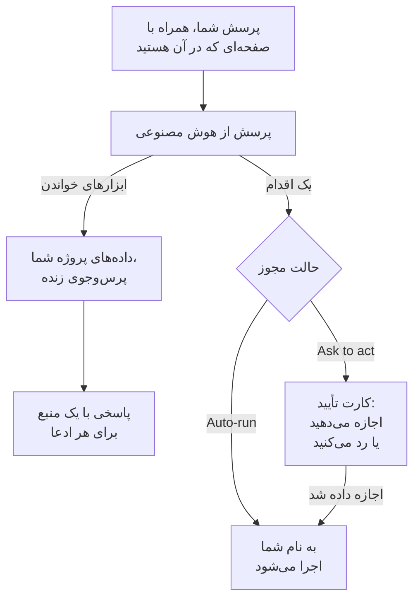

# پرسش از هوش مصنوعی

پرسش از هوش مصنوعی گفتگوی OneUptime روی داده‌های پروژه شماست. درباره لاگ‌ها، ترِیس‌ها، متریک‌ها، استثناها، حوادث، هشدارها، مانیتورها، کشیک آنکال، صفحات وضعیت، SLOها، رانبوک‌ها یا گردش‌های کاری بپرسید: پروژه شما را زنده پرس‌وجو می‌کند، برای هر ادعا منبعی می‌آورد و هر وقت اجازه بدهید، به جای شما اقدام می‌کند.

:::cards
- [باز کردن پرسش از هوش مصنوعی](#باز-کردن-پرسش-از-هوش-مصنوعی): از سرصفحه، صفحه‌کلید، یک نمودار یا منوی محصولات.
- [چه چیزی را می‌بیند](#چه-چیزی-را-میبیند): داده‌هایی که برای پاسخ دادن به شما می‌خواند.
- [اقدام‌ها و حالت‌های مجوز](#اقدامها-و-حالتهای-مجوز): انتخاب کنید که آیا اجازه اقدام دارد و کی پیش از آن می‌پرسد.
- [اقدام‌ها به نام شما انجام می‌شوند](#اقدامها-به-نام-شما-انجام-میشوند): مجوزهای شما، نام شما روی هر تغییر.
:::

## پرسش از هوش مصنوعی چطور پاسخ می‌دهد

پرسش از هوش مصنوعی فقط از آنچه ابزارهایش برمی‌گردانند پاسخ می‌دهد: به جای پاسخ دادن از حافظه، روی پروژه شما پرس‌وجو اجرا می‌کند. هر واقعیت در یک پاسخ برچسب منبعی دارد که پرس‌وجوی پشت آن را نشان می‌دهد و داده‌ای را که خوانده باز می‌کند. وقتی از آن می‌خواهید چیزی را تغییر دهد، حالت مجوز گفتگو تعیین می‌کند که آیا اول از شما بپرسد یا نه. پیش از پرسش شما، [زمینهٔ هوش مصنوعی](/docs/ai/ai-context) پروژه را می‌خواند: آنچه تیم شما دربارهٔ سیستم‌های خودتان برای OneUptime AI نوشته است.

در حالت **فقط‌خواندنی** هیچ اقدامی به مدل پیشنهاد نمی‌شود، پس گفتگو فقط می‌خواند.

## باز کردن پرسش از هوش مصنوعی

| کجا | چطور |
| --- | --- |
| هر صفحه‌ای | در سرصفحه روی **پرسش از هوش مصنوعی** کلیک کنید، یا `Ctrl` + `I` را بزنید (`Cmd` + `I` در مک). وقتی در یک کادر متن یا ویرایشگر تایپ می‌کنید، این کلیدها همان میان‌بر حروف کج ویرایشگر می‌مانند. |
| پالت فرمان | `Ctrl` + `K` را بزنید (`Cmd` + `K` در مک) و **پرسش از هوش مصنوعی** را انتخاب کنید. |
| یک الگوی خطا در لاگ‌ها، یا یافته‌های یک نمودار | روی **Explain with AI** کلیک کنید: پرسش از هوش مصنوعی با شواهد به شکل پرسشی باز می‌شود که می‌توانید پیش از فرستادن ویرایشش کنید. |
| منوی محصولات | **محصولات** > **هوش مصنوعی** > **گفتگو** را باز کنید. پرسش از هوش مصنوعی روی صفحه‌ای که در آن بودید باز می‌شود. هر گفتگو نشانی خودش را دارد، پس می‌توانید نشانکش کنید و بعداً به آن برگردید. |

پرسش از هوش مصنوعی وسط صفحه‌نمایش، روی صفحه‌ای که در آن بودید باز می‌شود و در گوشی کل صفحه را پر می‌کند. برای برگشتن به صفحه، `Esc` را بزنید یا کنار آن کلیک کنید. گفتگو همان‌جا که رهایش کردید می‌ماند: برای ادامه، پرسش از هوش مصنوعی را دوباره باز کنید. اگر وقتی هنوز پاسخ می‌دهد آن را ببندید، یک یادآور در گوشه می‌گوید پاسخ کی آماده است و آن را باز می‌کند.

روی یک حادثه یا هشدار، کارت **AI Investigation** گفتگوی خودش را دارد، **Ask OneUptime AI**، که همه کسانی که آن حادثه یا هشدار را می‌بینند در آن شریک‌اند: [گفتگو با OneUptime AI درباره حادثه](/docs/ai/ai-sre#دربارهٔ-حادثه-با-oneuptime-ai-گفتوگو-کنید) را ببینید.

## چه چیزی را می‌بیند

پرسش از هوش مصنوعی پروژه شما را با مجوزهای خود شما می‌خواند، پس همان چیزی را می‌بیند که شما اجازه دیدنش را دارید و نه بیشتر.

| حوزه | آنچه پرسش از هوش مصنوعی می‌خواند |
| --- | --- |
| تله‌متری | جستجو و هیستوگرام لاگ‌ها، تجمیع ترِیس‌ها و درخت اسپن‌ها، متریک‌ها، استثناها، رویدادهای امنیتی، پایش کاربران واقعی و Web Vitals، تغییرات اخیر، و بررسی ناهنجاری در برابر خط‌های پایه آموخته‌شده. |
| زیرساخت | میزبان‌ها، Docker، Podman، Kubernetes، Docker Swarm، Proxmox، VMware vCenter، Ceph، آرایه‌های ذخیره‌سازی، توابع بدون سرور، محیط‌های ابری، ناوگان‌های IoT و دستگاه‌های شبکه: آنچه در موجودی هست، وضعیت اتصال گزارش‌شده‌شان، روند متریک‌ها، شمار لاگ‌ها بر پایه شدت و خلاصه عملیات ترِیس‌ها. یک پرس‌وجو تله‌متری‌ای را که یک سرویس را نام می‌برد همان‌قدر در بر می‌گیرد که تله‌متری‌ای را که یک منبع زیرساخت را نام می‌برد. |
| پاسخ به حادثه | حوادث و هشدارها، با پالایه وضعیت («همین حالا چه چیزی فعال است؟»)، خط زمانی فعالیتشان (تغییرات وضعیت، یادداشت‌های داخلی و عمومی، فید) و مالکانشان، و جستجو در حوادث گذشته برای به‌کار گرفتن دوباره شیوه حلشان. |
| کشیک آنکال | اینکه چه کسی همین حالا کشیک است، سیاست‌ها و زنجیره‌های تشدید، و اینکه فراخوان‌های اخیر تحویل و تأیید شده‌اند یا نه. |
| کار خود هوش مصنوعی | نتایج بررسی‌های AI SRE و AI Insights، تا «هوش مصنوعی چه یافت؟» از تحلیل منتشرشده پاسخ داده شود، نه اینکه دوباره از نو به دست آید. |
| پلتفرم | مانیتورها (با پالایه وضعیت)، تعمیر و نگهداری زمان‌بندی‌شده، صفحات وضعیت و اطلاعیه‌هایشان، SLOها، رانبوک‌ها، اجراهای گردش کاری، سلامت پروب‌ها، تیم‌ها، و کد مخزن‌های وصل‌شده. |

## زمینه صفحه

پرسش از هوش مصنوعی می‌داند از کدام صفحه بازش کرده‌اید. روی صفحه یک حادثه، «چرا این اتفاق افتاد؟» یعنی همان حادثه: بخش نوشتن برچسبی با موضوع صفحه نشان می‌دهد و پرسش‌هایی که پیشنهاد می‌دهد مال همان صفحه است. برای پرسیدن درباره کل پروژه، برچسب را بردارید و به همان روش دوباره اضافه‌اش کنید. پرسش از هوش مصنوعی را روی صفحه دیگری باز کنید تا زمینه دنبالتان بیاید. گفتگو موضوع نخستش را روی سرور هم به خاطر می‌سپارد، پس پرسشی که چند روز بعد می‌آید هنوز «این حادثه» را درست می‌فهمد.

فهرست‌های زیرساخت و صفحه‌های منابع، پرسش‌هایی برای نوع منبعی که می‌بینید پیشنهاد می‌کنند. یک خوشه Kubernetes را باز کنید و بپرسید «کدام متریک‌ها در ۲۴ ساعت گذشته تغییر کرده‌اند؟»، یا یک میزبان Docker را باز کنید و بپرسید «شدت لاگ‌ها و خطاهای ترِیس شش ساعت گذشته را خلاصه کن.» پیوندهای شواهد به صفحه منبع برمی‌گردند. خواندن‌ها مجوزهای شما برای پروژه، منابع و تله‌متری را رعایت می‌کنند، محدودیت‌های مالکیت و برچسب هم.

در صفحه یک زیرمجموعه، زمینه پاد، کانتینر، ماشین مجازی، فرایند یا زیرمجموعه دیگری را هم که انتخاب کرده‌اید ثبت می‌کند. ابزارهای زیرساخت تله‌متری منبع بالادست را می‌خوانند؛ نمی‌توانند یک زیرمجموعه را فقط از روی نامش اندازه بگیرند. پرسش از هوش مصنوعی همین را می‌گوید و فضای نامی از Kubernetes را که صفحه نمی‌دهد حدس نمی‌زند. وضعیت اتصال، سلامت یک بار کاری نیست، و نبود تله‌متری به معنای سالم بودن یک منبع نیست.

## فرمان‌ها روی زیرساخت شما

وقتی پرسش از هوش مصنوعی در صفحهٔ منبعی باز شود که عامل هوش مصنوعی‌اش متصل است (یک میزبان، یک میزبان Docker یا Podman، یک خوشهٔ Docker Swarm، یک خوشهٔ Proxmox، یک VMware vCenter، یک خوشهٔ Ceph، یک سرور پایگاه داده یا یک خوشهٔ Kubernetes)، هر وقت بخواهید از طریق همان عامل روی آن فرمان اجرا می‌کند: «`uptime` را روی این میزبان اجرا کن» یا «۱۰۰ خط آخر `journalctl -u nginx` را نشان بده». پاسخش همان چیزی است که برگشته، با ارجاع، مثل هر شاهد دیگری. وقتی روی یک حادثه یا هشدار باز شود، به منابع مرتبط با آن می‌رسد.

- فقط فرمان‌های فقط‌خواندنی‌ای را اجرا می‌کند که یک بررسی هوش مصنوعی اجازه دارد روی آن نوع منبع اجرا کند (نگاه کنید به [عامل‌های هوش مصنوعی زیرساخت](/docs/ai/infrastructure-ai-agents))، برای هر پاسخ حداکثر ۳۰ فرمان از طریق هر نوع عامل، و در هر حالت مجوزی، OneUptime و سپس دوباره خود عامل آن‌ها را بررسی می‌کنند. تغییری از طریق عامل، مثل راه‌اندازی دوبارهٔ یک سرویس، هرگز از پرسش از هوش مصنوعی اجرا نمی‌شود: به‌جای آن، فرمان دقیق را به شما می‌دهد، و عامل فقط وقتی تغییری اعمال می‌کند که OneUptime AI یک حادثه یا هشدار را برطرف کند، طبق تنظیمات اصلاح خود منبع. اقدام‌های خود پرسش از هوش مصنوعی، مثل اجرای یک رانبوک، از حالت مجوز گفتگو پیروی می‌کنند، همان‌طور که در ادامه آمده است.
- فقط به منابعی می‌رسد که شما اجازهٔ دیدنشان را دارید، و فقط تا وقتی که بررسی هوش مصنوعی برای آن منبع روشن است.
- وقتی نتواند آنجا فرمانی اجرا کند (هیچ عاملی متصل نیست، عامل آفلاین است یا بررسی هوش مصنوعی برای آن منبع خاموش است)، همین را همراه با آنچه باید تغییر کند می‌گوید، و به‌جای آن از داده‌های پروژهٔ شما پاسخ می‌دهد.

## اقدام‌ها و حالت‌های مجوز

هر گفتگو یک حالت مجوز دارد که آن را در بخش نوشتن، کنار کادری که در آن تایپ می‌کنید، انتخاب می‌کنید:

| حالت | چه رخ می‌دهد |
| --- | --- |
| **پرسش پیش از اقدام** | پیش‌فرض. پرسش از هوش مصنوعی هر اقدام را روی یک کارت تأیید پیشنهاد می‌کند، و تا برای آن **اجازه دادن** یا **رد شدن** را انتخاب نکنید، یا **رد کردن همه** را، هیچ چیز اجرا نمی‌شود. |
| **اجرای خودکار** | اقدام‌ها به محض اینکه مدل درخواستشان کند اجرا می‌شوند، همچنان محدود به آنچه نقش شما اجازه دارد. با احتیاط از آن استفاده کنید. |
| **فقط‌خواندنی** | هیچ اقدامی به مدل پیشنهاد نمی‌شود: پرسش از هوش مصنوعی فقط می‌تواند بخواند. |

آنچه پرسش از هوش مصنوعی وقتی حالتی اجازه بدهد می‌تواند انجام دهد:

- ایجاد یک حادثه یا هشدار، تأیید یا حل حوادث و هشدارها، و تغییر شدت یک حادثه.
- پیوند دادن یک حادثه یا هشدار به زیرساخت و سرویس‌هایی که به آن مربوط است. حادثه یا هشداری که در صفحهٔ یک منبع، مثلاً صفحهٔ یک میزبان، ایجاد می‌کند به همان منبع پیوند داده می‌شود و کارت تأیید نام می‌برد که هر اقدام چه چیزی را پیوند می‌دهد. OneUptime AI آنچه را که یک حادثه یا هشدار به آن پیوند داده شده است بررسی و اصلاح می‌کند.
- گذاشتن یک یادداشت داخلی روی یک حادثه یا هشدار. یادداشت‌های داخلی هرگز روی صفحه وضعیت نمایش داده نمی‌شوند.
- انتشار یک به‌روزرسانی عمومی وضعیت روی یک حادثه. این اقدامی جداست، چون به مشترکان صفحه وضعیت خبر می‌دهد.
- فراخوان یک سیاست کشیک، اجرای یک رانبوک، یا آغاز یک بررسی هوش مصنوعی برای یک حادثه یا هشدار.
- پیشنهاد یک تغییر کد: کامیت در یک شاخه تازه از یک مخزن وصل‌شده و باز کردن یک pull request. هرگز در شاخه پیش‌فرض یا شاخه‌ای محافظت‌شده نمی‌نویسد، پس همچنان یک نفر تغییر را ادغام می‌کند.

وقتی کاربران تحت تأثیر قرار گرفته‌اند حادثه بخواهید، و وقتی چیزی اول به توجه تیم شما نیاز دارد، مثلاً حافظهٔ میزبانی که مدام بالا می‌رود، هشدار بخواهید. هر دو یک بار ایجاد می‌شوند و چیزی را زیر نظر ندارند: برای اینکه هر بار حافظهٔ یک میزبان از ۷۵٪ بالاتر رفت هشدار بگیرید، یک [مانیتور میزبان](/docs/monitor/host-monitor#الگوهای-هشدار-آماده) از قالب حافظه‌اش بسازید، با ۷۵٪ به‌عنوان آستانه. پرسش از هوش مصنوعی نمی‌تواند مانیتور بسازد. اگر از آن بخواهید، همین را می‌گوید، مقدار فعلی را بررسی می‌کند و اگر از حد گذشته باشد پیشنهاد می‌دهد هشداری ایجاد کند.

## اقدام‌ها به نام شما انجام می‌شوند

هر اقدامی که پرسش از هوش مصنوعی انجام می‌دهد به نام شما انجام می‌شود: همان تغییری را می‌دهد که داشبورد برای همان اقدام می‌دهد، با مجوزهای خود شما در پروژه، و تغییر به نام شما ثبت می‌شود. تأیید یک حادثه از گفتگو همان تغییر وضعیتی را می‌سازد که پنل وضعیت حادثه، پس خط زمانی و فید حادثه نشان می‌دهند که شما وضعیتش را تغییر داده‌اید. فراخوانی که از گفتگو فرستاده شود، شما را به عنوان آغازکننده‌اش نشان می‌دهد.

- **آنچه هر اقدام لازم دارد.** همان مجوزی که داشبورد برای همان تغییر می‌خواهد. ایجاد یک حادثه یا هشدار به مجوز ایجاد آن نیاز دارد: نقشی که اجازهٔ آن را دارد، یا **Create Incident** یا **Create Alert** در یک نقش سفارشی. تأیید یا حل یک حادثه به مجوز تغییر وضعیت آن نیاز دارد: **مالک پروژه**، **مدیر پروژه**، **عضو پروژه**، **مدیر حوادث** و **عضو حوادث**، یا **Create Incident State Timeline** در یک نقش سفارشی؛ یک هشدار همان مجوز را برای هشدارها می‌خواهد (**Create Alert State Timeline**). فراخوان یک سیاست کشیک به مجوز اجرای آن نیاز دارد (**Create On-Call Duty Policy Execution Log**)، و اجرای یک رانبوک به مجوز آغاز اجراهای رانبوک: نقشی که رانبوک‌ها را اجرا می‌کند، برای رانبوک‌هایی که برچسب‌هایش به آن‌ها می‌رسد، یا **Create Runbook Execution** در یک نقش سفارشی، که به همه رانبوک‌های پروژه می‌رسد. تغییر شدت یک حادثه، آغاز یک بررسی هوش مصنوعی برای یک حادثه یا هشدار، و نوشتن کد در یک مخزن وصل‌شده به مجوز تغییر همان حادثه، هشدار یا مخزن نیاز دارد. اقدامی که اجازه‌اش را ندارید رد می‌شود، و هوش مصنوعی به شما می‌گوید به کدام مجوز نیاز دارد. وقتی مجوز را دارید اما تیمی که عضوش هستید آن را مسدود کرده، هوش مصنوعی همین را می‌گوید: مسدودسازی روی برخی برچسب‌ها آن اقدام را در پرسش از هوش مصنوعی برای همه رکوردها رد می‌کند، نه فقط برای رکوردهایی که آن برچسب‌ها را دارند.
- **کدام رکوردها.** همان‌هایی که اجازه تغییرشان را دارید، مثل همه جای OneUptime: با نقشی که به برخی برچسب‌ها یا به رکوردهای خودتان محدود است، اقدام روی هر رکورد دیگری چیزی را تغییر نمی‌دهد. یک رانبوک فقط وقتی اجرا می‌شود که مجوز شما برای آغاز اجراهای رانبوک به آن برسد. در OneUptime Cloud، اقدامی که طرح پروژه شامل آن نمی‌شود، با نام طرحی که لازم دارد رد می‌شود.
- **وقتی اقدامی رد می‌شود.** هیچ چیز تغییر نمی‌کند، و هوش مصنوعی روشن به شما می‌گوید که اقدام انجام نشد و چرا، به جای اینکه دوباره امتحانش کند.
- **Slack، Microsoft Teams و بررسی‌های هوش مصنوعی.** پاسخ‌های هوش مصنوعی در Slack و Microsoft Teams، و بررسی‌های خودکار هوش مصنوعی، فقط می‌خوانند: هیچ‌یک از این اقدام‌ها را انجام نمی‌دهند. برای اقدام از Slack یا Microsoft Teams، از دکمه‌های پیام‌های OneUptime استفاده کنید، که آن‌ها هم به نام شما اقدام می‌کنند ([Slack](/docs/workspace-connections/slack#اقدام-روی-حوادث-هشدارها-و-رویدادها-از-slack) و [Microsoft Teams](/docs/workspace-connections/microsoft-teams#اقدام-روی-حوادث-هشدارها-و-رویدادها-از-microsoft-teams) را ببینید).

## هدایت یک گفتگو

- **متوقفش کنید.** وقتی پرسش از هوش مصنوعی کار می‌کند، دکمه فرستادن به دکمه توقف تبدیل می‌شود. هر وقت خواستید یک اجرا را متوقف کنید و بی‌درنگ چیز دیگری بپرسید.
- **کارش را دنبال کنید.** وقتی پاسخ می‌دهد، یک خط می‌گوید الان چه می‌کند، مثلاً جست‌وجو در لاگ‌ها. برای دیدن هر گام، روی شمار گام‌ها در کنارش کلیک کنید.
- **مدل را انتخاب کنید.** وقتی پروژه شما می‌تواند از بیش از یک ارائه‌دهنده LLM استفاده کند، انتخابگر ارائه‌دهنده در بخش نوشتن، ارائه‌دهندگان LLM پروژه شما و ارائه‌دهندگان سراسری را فهرست می‌کند و پیش‌فرض را نشان‌دار می‌کند. گفتگوی تازه از پیش‌فرض استفاده می‌کند.
- **به یک پاسخ امتیاز دهید.** **پاسخ خوب** و **پاسخ ضعیف** همراه پیام ذخیره می‌شوند، تا کیفیت پاسخ‌ها در طول زمان سنجیده شود.
- **هزینه را ببینید.** زیر هر پاسخ، منابعش به پرس‌وجوهایی که اجرا کرده باز می‌شوند، و منابع تازه‌ترین پاسخ همچنین می‌گویند چند پرس‌وجو اجرا کرده، توکن‌هایش و هزینه‌اش. هر برچسب منبع در یک پاسخ داده پشتش را باز می‌کند.
- **یک نسخه نگه دارید.** **دانلود گفتگو** رشته گفتگو را با **دانلود به صورت Markdown** ذخیره می‌کند، برای خواندن یا گذاشتن در یک تیکت، یا با **دانلود به صورت PDF**، برای دادن به کسی.
- **از همان‌جا که ماندید ادامه دهید.** **همه گفتگوها**، در سرصفحه پرسش از هوش مصنوعی، گفتگوهای شما را از تازه‌ترین فهرست می‌کند تا دوباره بازشان کنید یا حذفشان کنید. شروع یک گفتگوی تازه سه گفتگوی آخر را نشان می‌دهد.

## پیش‌نیازها

- **یک ارائه‌دهنده LLM.** پرسش از هوش مصنوعی از ارائه‌دهنده LLM پیش‌فرض پروژه استفاده می‌کند ([ارائه‌دهندگان LLM](/docs/ai/llm-provider) را ببینید). در OneUptime Cloud بی‌هیچ تنظیمی با ارائه‌دهنده سراسری کار می‌کند که هزینه‌اش از اعتبار هوش مصنوعی پروژه پرداخت می‌شود؛ یک نصب خودمیزبان یک ارائه‌دهنده یا متغیرهای محیطی ارائه‌دهنده سراسری را تنظیم می‌کند. پاسخ‌ها به اندازه مدل خوب‌اند: یک مدل کوچک خودمیزبان بدون فراخوانی قابل اعتماد ابزار، پاسخ‌های ضعیفی می‌دهد.
- **طرح Growth، در OneUptime Cloud.** پروژه‌ای با طرح پایین‌تر می‌بیند که هوش مصنوعی در طرحش نیست، همراه پیوندی به **تنظیمات پروژه** > **صورت‌حساب و فاکتورها** > **صورت‌حساب**.
- **هوش مصنوعی روشن برای پروژه.** **فعال کردن هوش مصنوعی**، در **تنظیمات پروژه** > **هوش مصنوعی** > **AI Features**، همه قابلیت‌های هوش مصنوعی پروژه را خاموش می‌کند، پرسش از هوش مصنوعی هم. روشن است مگر کسی خاموشش کرده باشد.

پرسش از هوش مصنوعی وقتی پروژه محدودیت‌های روزانه هوش مصنوعی خودش را تعیین کند، جزو آن‌ها حساب می‌شود (تنظیمات پروژه > هوش مصنوعی > AI Features > تنظیمات بیشتر): وقتی یکی به حد برسد، پرسش از هوش مصنوعی جمله‌ای نشان می‌دهد که می‌گوید کدام محدودیت رسیده، اینکه OneUptime AI نیمه‌شب UTC دوباره آغاز می‌کند و چه کسی می‌تواند محدودیت را بالا ببرد یا بردارد. مالکان پروژه نخستین باری که هر روز محدودیتی به حد می‌رسد ایمیل می‌گیرند. محدودیت‌های روزانه حوادث و هشدارها هرگز پرسش از هوش مصنوعی را متوقف نمی‌کنند. [محدودیت‌های روزانه خود پروژه](/docs/ai/ai-sre#محدودیتهای-روزانهٔ-خود-پروژه) را ببینید.

## عیب‌یابی

:::details پرسش از هوش مصنوعی می‌گوید هوش مصنوعی در دسترس نیست
پرسش از هوش مصنوعی پیش از آنکه تایپ کنید دلیلش را می‌گوید: طرح پروژه شامل هوش مصنوعی نیست، **فعال کردن هوش مصنوعی** خاموش است، یا پروژه ارائه‌دهنده LLM ندارد. هر اطلاعیه به صفحه‌ای پیوند دارد که آن را تغییر می‌دهد.
:::

:::details اقدامی رد شد
پرسش از هوش مصنوعی می‌گوید آن اقدام به کدام مجوز نیاز دارد، یا کدام تیم آن را مسدود کرده. از کسی که اجازه این تغییر را دارد بخواهید، یا از یک مالک پروژه بخواهید آن مجوز را به نقش شما بدهد. هیچ چیز تغییر نکرده است.
:::

:::details پاسخ‌ها مبهم‌اند یا هرگز از داده استفاده نمی‌کنند
مدل پشت ارائه‌دهنده را بررسی کنید. پرسش از هوش مصنوعی به مدلی نیاز دارد که ابزارها را قابل اعتماد فرا بخواند؛ مدل‌های محلی کوچک اغلب بی‌آنکه حتی یک پرس‌وجو اجرا کنند پاسخ می‌دهند. [ارائه‌دهندگان LLM](/docs/ai/llm-provider) را ببینید.
:::

## گام‌های بعدی

:::cards
- [AI SRE](/docs/ai/ai-sre): بگذارید OneUptime AI هر حادثه و هشدار تازه را بررسی کند.
- [ارائه‌دهندگان LLM](/docs/ai/llm-provider): مدلی را که پرسش از هوش مصنوعی و دیگر قابلیت‌های هوش مصنوعی استفاده می‌کنند انتخاب کنید.
- [سرور MCP](/docs/ai/mcp-server): به جای آن، از Claude، Cursor یا VS Code درباره OneUptime بپرسید.
:::
