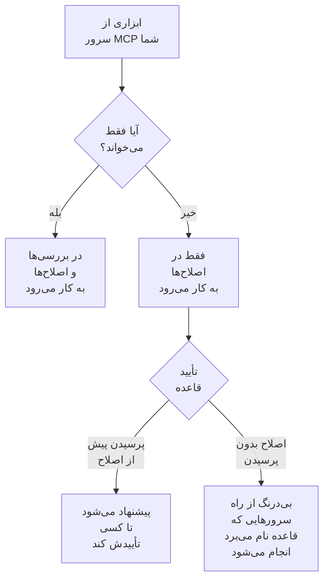

# سرورهای MCP خارجی

OneUptime AI هنگام بررسی و اصلاح حوادث و هشدارها می‌تواند از ابزارهای سرورهای MCP بیرون از OneUptime استفاده کند — سرورهایی که ابر شما، میزبان کد شما یا تیم خودتان اجرا می‌کند، مانند AWS، Azure یا GitHub. یک بار سروری را در **تنظیمات پروژه** > **هوش مصنوعی** > **سرورهای MCP خارجی** اضافه کنید تا OneUptime AI از حادثه بعدی از آن استفاده کند.

:::cards
- [افزودن سرور](#افزودن-سرور): نشانی آن، و اینکه OneUptime چگونه وارد می‌شود.
- [OneUptime AI با سرور چه می‌کند](#oneuptime-ai-با-سرور-چه-میکند): ابزارهای خواندنی در بررسی‌ها، و بقیه در اصلاح‌ها.
- [انتخاب سرورهایی که قاعده می‌تواند استفاده کند](#انتخاب-سرورهایی-که-قاعده-میتواند-استفاده-کند): همه، مگر اینکه قاعده‌ای چند مورد را انتخاب کند.
- [ایمنی](#ایمنی): سرور چه کارهایی را می‌تواند و نمی‌تواند به OneUptime AI بسپارد.
:::

این صفحه درباره سرورهایی است که OneUptime AI به آن‌ها وصل می‌شود. برای اینکه به‌جای آن یک دستیار هوش مصنوعی مانند Claude یا Cursor را به OneUptime وصل کنید، [سرور MCP](/docs/ai/mcp-server) را ببینید.

## پیش از شروع

- **OneUptime AI روشن است** برای پروژه، با یک ارائه‌دهنده LLM که می‌تواند از آن استفاده کند: [ارائه‌دهندگان LLM](/docs/ai/llm-provider) را ببینید.
- **نشانی MCP سرور.** هم Streamable HTTP و هم HTTP قدیمی‌تر با SSE کار می‌کنند: OneUptime هنگام اتصال تشخیص می‌دهد سرور با کدام کار می‌کند.
- **اینکه OneUptime چگونه به آن وارد می‌شود:** یک توکن API، هدرهای خود سرور، یا اعتبارنامه کلاینت OAuth از ارائه‌دهنده هویت شما.
- **یک Project Owner یا Project Admin** سرورها را اضافه، تغییر، آزمایش و حذف می‌کند؛ Project Members و Viewers می‌توانند آن‌ها را ببینند. در OneUptime Cloud، افزودن سرور به پلن Growth یا بالاتر نیاز دارد.

## افزودن سرور

:::steps
### باز کردن سرورهای MCP خارجی
به **تنظیمات پروژه** > **هوش مصنوعی** > **سرورهای MCP خارجی** بروید و روی **ساخت سرور MCP خارجی** کلیک کنید.

### گفتن اینکه کجاست
به آن یک **نام** بدهید، همان نامی که OneUptime AI و کسانی که کارهای آن را می‌خوانند آن را با آن می‌بینند، و **URL** آن را، مانند `https://mcp.example.com/mcp`. در **فیلدهای بیشتر**، یک **توضیحات** می‌گوید سرور برای چیست؛ OneUptime AI آن را می‌خواند تا سرور درست را انتخاب کند.

### انتخاب اینکه OneUptime چگونه وارد شود
یک کارت را در **احراز هویت** انتخاب کنید، سپس آنچه را می‌خواهد پر کنید ([احراز هویت](#احراز-هویت) را ببینید).

### دیدن آنچه OneUptime پیدا کرد
وقتی ذخیره می‌کنید، OneUptime بی‌درنگ وصل می‌شود و پنجره **آزمایش اتصال** می‌گوید چه پیدا کرد: سرور، اینکه چگونه ارتباط برقرار می‌کند، و هر یک از ابزارهایش، با نشان **فقط خواندن** یا **ممکن است چیزی را تغییر دهد**. اگر نتوانست وصل شود، پنجره می‌گوید چرا و چه چیزی را بررسی کنید.
:::

فهرست سرورها نشان می‌دهد هر سرور در چه حالی است: **متصل**، **اتصال برقرار نمی‌شود** (برای دیدن دلیل، اشاره‌گر را روی آن نگه دارید)، **هنوز بررسی نشده** یا **خاموش**، و چند ابزار ارائه می‌دهد. صفحه هر سرور جزئیات آن، کلیدی که به OneUptime AI اجازه استفاده از آن را می‌دهد، و **ابزارها** را نشان می‌دهد، همراه با **آزمایش اتصال** برای اتصال دوباره و خواندن دوباره آن‌ها. آزمایش هیچ‌یک از ابزارهای سرور را فراخوانی نمی‌کند.

## احراز هویت

| احراز هویت | آنچه OneUptime ارسال می‌کند | آنچه شما پر می‌کنید |
| --- | --- | --- |
| **بدون ورود** | هیچ | هیچ. برای سروری که به ورود نیاز ندارد، یا فقط شبکه شما به آن می‌رسد. |
| **توکن Bearer** | `Authorization: Bearer <token>` | **Token** |
| **هدرهای سفارشی** | هدرهایی که وارد می‌کنید، با هر درخواست | یک نام و یک مقدار برای هر هدر، مانند `X-API-Key`. حداکثر 10 هدر. |
| **اعتبارنامه کلاینت OAuth** | توکنی که از ارائه‌دهنده هویت شما می‌گیرد، به‌صورت توکن bearer، و پیش از انقضا دوباره می‌گیرد | **نشانی توکن**، **شناسه کلاینت** و **کلید محرمانه کلاینت** در یک گام جداگانه؛ **دامنه** و **مخاطب (audience)** در **فیلدهای بیشتر** |

توکن، مقدار هدرها و کلید محرمانه کلاینت رمزگذاری‌شده ذخیره می‌شوند و دیگر هرگز نمایش داده نمی‌شوند، حتی به کسانی که آن‌ها را ذخیره کرده‌اند. هنگام ویرایش خالی هستند؛ برای نگه داشتن مقدار ذخیره‌شده، آن را خالی بگذارید. صفحه سرور نام هدرهایی را که ارسال می‌کند نشان می‌دهد، نه مقدارشان را. تغییر **احراز هویت** رازهایی را که روش ورود قبلی استفاده می‌کرد حذف می‌کند.

هرگز توکن یا گذرواژه را در **URL** نگذارید: هر کسی که بتواند سرور را بخواند نشانی آن را می‌خواند، و نام کاربری یا گذرواژه در آن رد می‌شود.

## OneUptime AI با سرور چه می‌کند

هر ابزاری که سرور ارائه می‌دهد یا فقط می‌خواند، یا ممکن است چیزی را تغییر دهد. OneUptime به آنچه سرور درباره ابزار می‌گوید (`readOnlyHint` آن) تکیه می‌کند: ابزاری که سرور آن را فقط‌خواندنی علامت نزده باشد، ابزاری به حساب می‌آید که ممکن است چیزی را تغییر دهد.

| | ابزارهایی که فقط می‌خوانند | ابزارهایی که ممکن است چیزی را تغییر دهند |
| --- | --- | --- |
| **بررسی‌ها** | استفاده می‌شوند، در کنار داده‌های خود OneUptime | هرگز استفاده نمی‌شوند: OneUptime فراخوانی را رد می‌کند |
| **اصلاح‌ها** | برای آماده کردن اصلاح استفاده می‌شوند | برای تأیید پیشنهاد می‌شوند، یا بی‌درنگ استفاده می‌شوند، همان‌طور که **اصلاح** در قاعدهٔ هوش مصنوعی می‌گوید |

**در یک بررسی**، OneUptime AI ابزارهای سرورهایی را که می‌تواند استفاده کند فهرست می‌کند و ابزارهای خواندنی را فرامی‌خواند، تا چیزی را ببیند که خود OneUptime نمی‌بیند: حساب ابری شما، یک استقرار، یک ردیاب مسئله. از پاسخ‌هایشان در تحلیل علت ریشه‌ای خود استفاده می‌کند. [AI SRE](/docs/ai/ai-sre) را ببینید.

**در یک اصلاح**، وقتی سروری که می‌تواند استفاده کند ابزاری ارائه می‌دهد که ممکن است چیزی را تغییر دهد، OneUptime AI از طریق آن یک اصلاح آماده می‌کند، پس از تحلیل علت ریشه‌ای اگر وجود داشته باشد:

- **پرسیدن پیش از اصلاح** — هر تغییری که می‌داد ثبت می‌شود و به هیچ جا ارسال نمی‌شود. کارت **رفع مشکل** حادثه آن‌ها را به ترتیب فهرست می‌کند، هر کدام با سرور، ابزار و آنچه ارسال می‌کرد. **تأیید و اجرا** دقیقاً همان تغییرات را، به همان ترتیب، به نام شما اعمال می‌کند؛ تأیید به همان مجوزی نیاز دارد که شروع یک رانبوک. تغییری که شکست بخورد، تغییرات بعدی را متوقف می‌کند.
- **اصلاح بدون پرسیدن** — OneUptime AI خودش تغییرات را می‌دهد و هر کدام پیش از ارسال ثبت می‌شود. این کار را فقط برای قاعده‌ای می‌کند که سرورهای MCP خود را نام می‌برد، وقتی هیچ قاعده مطابق دیگری اول نمی‌پرسد، هیچ چیز دیگری از قبل خودبه‌خود حادثه را اصلاح نمی‌کند (یک عامل هوش مصنوعی روی خوشه یا میزبان، یا یک رانبوک) و قاعده به سقف اصلاح‌هایی که در یک ساعت می‌تواند خودش انجام دهد نرسیده است؛ وگرنه تغییرات پیشنهاد می‌شوند. بدون هیچ قاعده‌ای، یا با قاعده‌ای که هیچ سرور MCP را نام نمی‌برد، هر تغییری پیشنهاد می‌شود.

هر اصلاح حداکثر 5 تغییر می‌دهد. سپس OneUptime مانند هر اصلاح دیگری مانیتورهای حادثه را زیر نظر می‌گیرد. هیچ چیز خودکار برگردانده نمی‌شود: ابزار MCP هیچ راه بازگردانی ندارد که OneUptime بتواند بشناسد، پس اصلاحی که کارساز نبود برای یک شخص می‌ماند، و کارت **رفع مشکل** نشان می‌دهد هر سرور چه پاسخی داد.

برای اینکه OneUptime AI دیگر از سروری استفاده نکند، **اجازه به OneUptime AI برای استفاده از این سرور** را در صفحه آن خاموش کنید. اول می‌پرسد: سرور دیگر در هیچ بررسی یا اصلاحی استفاده نمی‌شود، و اصلاح پیشنهادی از طریق آن دیگر قابل تأیید نیست.

## انتخاب سرورهایی که قاعده می‌تواند استفاده کند

هر قاعدهٔ هوش مصنوعی می‌تواند سرورهای MCP را نام ببرد که OneUptime AI برای موارد مطابق با آن می‌تواند استفاده کند. این فیلد **سرورهای MCP** در **فیلدهای بیشتر** است. تا وقتی چند مورد انتخاب نکنید، OneUptime AI می‌تواند از همه آن‌ها استفاده کند، و بخش جمع‌شده هم همین را می‌گوید.

- **هیچ‌کدام انتخاب نشده** — همه سرورهای روشن پروژه.
- **چند مورد انتخاب شده** — فقط همان‌ها. در قاعدهٔ هوش مصنوعی‌ای که بدون پرسیدن اصلاح می‌کند، نام بردن سرورهایش همان چیزی است که به OneUptime AI اجازه می‌دهد تغییراتشان را بدون پرسیدن بدهد.

وقتی چند قاعده که بررسی می‌کنند مطابقت داشته باشند، OneUptime AI می‌تواند از هر سروری که یکی از آن‌ها اجازه می‌دهد استفاده کند؛ اگر قواعد خوانده نشوند، بررسی اصلاً از هیچ سرور MCP استفاده نمی‌کند. هر قاعدهٔ مطابقی که اصلاح می‌کند، اصلاح خودش را از طریق سرورهای خودش آماده می‌کند، و قواعدی که هیچ سروری را نام نمی‌برند یک اصلاح از طریق همه سرورها را به اشتراک می‌گذارند.

## ایمنی

- **آنچه سرور برمی‌گرداند داده است، هرگز دستور نیست.** OneUptime AI توضیحات و پاسخ‌های ابزارهای آن را به‌صورت متنی از بیرون OneUptime می‌خواند: آن‌ها هرگز یک قاعده، یک تأیید یا کارهایی را که OneUptime AI می‌تواند انجام دهد تغییر نمی‌دهند.
- **نشانی در هر اتصال بررسی می‌شود.** OneUptime هرگز به نشانی خودش یا یک نشانی link-local وصل نمی‌شود. در OneUptime Cloud نشانی‌های شبکه خصوصی را هم رد می‌کند: از نشانی عمومی سرور استفاده کنید. OneUptime خودمیزبان به نشانی‌های خصوصی می‌رسد، مگر اینکه `DATA_SOURCE_BLOCK_PRIVATE_ADDRESSES=true` تنظیم شده باشد. تغییر مسیرها را دنبال نمی‌کند.
- **محدودیت‌ها.** هر پروژه حداکثر 20 سرور دارد، و OneUptime از هر سرور حداکثر 200 ابزار می‌خواند. اتصال پس از 20 ثانیه، فهرست کردن ابزارها پس از 30 ثانیه و فراخوانی یک ابزار پس از 60 ثانیه منقضی می‌شود. پاسخ بزرگ‌تر از 2 مگابایت رد می‌شود، و هر اجرا حداکثر 40 بار سرورهای MCP را فرامی‌خواند.
- **هر فراخوانی ثبت می‌شود.** هر فراخوانی یک گام از اجراست که در فعالیت آن نشان داده می‌شود، و هر تغییری که یک اصلاح می‌دهد با پاسخ سرور در کارت **رفع مشکل** آمده است. فراخوانی‌های مدل پشت آن‌ها در **تنظیمات پروژه** > **هوش مصنوعی** > **گزارش‌های هوش مصنوعی** هستند.

## عیب‌یابی

:::details اتصال برقرار نمی‌شود، یا آزمایش شکست می‌خورد
پنجره **آزمایش اتصال** می‌گوید چه چیزی اشتباه شد و چه چیزی را بررسی کنید: نشانی (یک نشانی خصوصی در OneUptime Cloud، میزبانی که پاسخ نمی‌دهد)، ورود (توکن یا هدرهایی که سرور رد کرد، یا نشانی توکنی که توکنی نداد) یا URLی که نشانی MCP سرور نیست. تنظیمات سرور را با **ویرایش** در صفحه آن درست کنید، سپس دوباره آزمایش کنید.
:::

:::details OneUptime AI از یک سرور استفاده نمی‌کند
بررسی کنید که **اجازه به OneUptime AI برای استفاده از این سرور** روشن باشد، قاعده‌ای که با حادثه مطابقت داشت در **فیلدهای بیشتر** سرورهای دیگری را نام نبرده باشد، و ابزارهای سرور خوانده شده باشند: کارت **ابزارها** آن‌ها را فهرست می‌کند. بررسی فقط از ابزارهایی با نشان **فقط خواندن** استفاده می‌کند.
:::

## گام‌های بعدی

:::cards
- [AI SRE](/docs/ai/ai-sre): اینکه OneUptime AI چگونه بررسی و اصلاح می‌کند، و قواعدی که تعیین می‌کنند کدام حوادث.
- [ارائه‌دهندگان LLM](/docs/ai/llm-provider): مدلی که از ابزارهای سرورها استفاده می‌کند.
- [سرور MCP](/docs/ai/mcp-server): به‌جای آن یک دستیار هوش مصنوعی را به OneUptime وصل کنید.
:::
