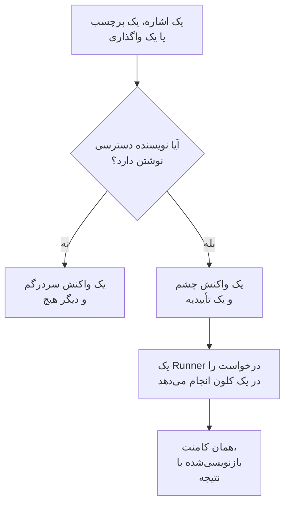

# GitHub App

OneUptime GitHub App چیزی بیش از یک اتصال به کد شماست: می‌توانید در مخزن خود با آن حرف بزنید و همان‌جا کار را انجام می‌دهد. در یک issue به آن اشاره کنید تا یک درخواست ادغام باز کند؛ در یک درخواست ادغام به آن اشاره کنید تا شاخه را بازنگری کند یا diff را بازبینی کند. هر چه تولید می‌کند یک درخواست ادغام یا یک بازبینی است که انسانی باید بخواند: **هرگز چیزی را ادغام نمی‌کند و هرگز درخواست ادغامی را تأیید نمی‌کند.**

:::cards
- [دستورها](#دستورها): در یک issue یا درخواست ادغام چه بنویسید.
- [در رشته گفتگو چگونه دیده می‌شود](#در-رشته-گفتگو-چگونه-دیده-میشود): یک کامنت که کار را دنبال می‌کند.
- [بازبینی با زمینهٔ محیط عملیاتی](#بازبینی-با-زمینهٔ-محیط-عملیاتی): آنچه محیط عملیاتی دربارهٔ کد تغییرکرده می‌گوید.
- [چه کسی می‌تواند به آن دستور بدهد](#چه-کسی-میتواند-به-آن-دستور-بدهد): افراد دارای دسترسی نوشتن، و هیچ‌کس دیگر.
- [عیب‌یابی](#عیبیابی): وقتی اشاره هیچ کاری نمی‌کند.
:::

```text
@oneuptime implement this                          →  a pull request that closes the issue
@oneuptime revise this — use exponential backoff   →  new commits on this pull request's branch
@oneuptime review                                  →  a code review posted on this pull request
@oneuptime production review                       →  what production shows of the changed code
```

> [!NOTE]
> به جای `@oneuptime` شناسه اپ خودتان را بگذارید. در OneUptime Cloud همان `@oneuptime` است. در یک نمونه خودمیزبان، نامی است که به GitHub App خود داده‌اید، با حروف کوچک و با خط تیره به جای فاصله: به اپی با نام "Acme AI" با `@acme-ai` اشاره می‌شود. اگر اشاره‌ها کاری نمی‌کنند، اول این را بررسی کنید.

## چگونه کار می‌کند



همان عامل و همان Runner در [کد](/docs/ai/ai-agent) است، با همان بودجه‌ها؛ فقط محرک فرق دارد.

## پیش از شروع

- مخزن باید از طریق GitHub App **به یک پروژه OneUptime متصل** باشد: آن را در **محصولات** > **کد** متصل کنید. یک نمونه خودمیزبان اول به GitHub App خودش نیاز دارد: [یکپارچه‌سازی GitHub](/docs/self-hosted/github-integration) را ببینید. اگر اپ از پیش روی حساب GitHub نصب شده است، به‌جای نصب دوباره، همان‌جا روی **اتصال یک نصب موجود** کلیک کنید.
- Runnerی که مخزن در تنظیماتش در کد انتخاب کرده باید آنلاین باشد، یا برای مخزنی که هیچ‌کدام را انتخاب نکرده یک Runner سراسری: همان Runner که وظایف [کد](/docs/ai/ai-agent) را انجام می‌دهد. بدون آن، دستورها پذیرفته می‌شوند و سپس پس از ۳۰ دقیقه با پیامی شکست می‌خورند که می‌گوید هیچ Runnerی آن‌ها را برنداشت.
- GitHub App به مجوز **Issues** با سطح **Read & write** نیاز دارد و باید رویدادهای webhook فهرست‌شده در [مشترک شدن در چه رویدادهایی](#مشترک-شدن-در-چه-رویدادهایی) را مشترک شده باشد.

## دستورها

هر دستور با اشاره به اپ شروع می‌شود. اشاره می‌تواند هر جای کامنت باشد، و هر چه پس از آن بنویسید به‌عنوان درخواست شما فرستاده می‌شود. ویرایش کامنتی که از قبل به اپ اشاره می‌کند آن را دوباره اجرا نمی‌کند: برای تغییر درخواستتان، کامنت تازه‌ای بنویسید. ویرایشی که اشاره را اضافه می‌کند، درخواستی تازه است.

### در یک درخواست ادغام

| دستور | چه اتفاقی می‌افتد | این‌ها هم فهمیده می‌شوند |
| --- | --- | --- |
| `@oneuptime review` | شاخه را کلون می‌کند، کد تغییرکرده و کد پیرامون آن را می‌خواند، بررسی می‌کند که محیط عملیاتی دربارهٔ آن چه می‌گوید، و یک بازبینی را به‌صورت کامنت منتشر می‌کند. چیزی را تغییر نمی‌دهد. | `code review`, `please review`, `can you review`, `review this` |
| `@oneuptime production review` | همین حالا درخواست ادغام را بر اساس محیط عملیاتی بازبینی می‌کند، هر کسی که بازش کرده باشد: استثناها، عملیات، حوادث و استقرارهای پیرامون کد تغییریافته، در یک دیدگاه که در همان جا به‌روز می‌شود ([بازبینی عملیاتی درخواست‌های ادغام](/docs/ai/ai-agent#بازبینی-عملیاتی-درخواستهای-ادغام) را ببینید). چیزی را کلون نمی‌کند و چیزی را اجرا نمی‌کند. | `review against production`, `review production`, `check production` |
| `@oneuptime revise this — <what you want changed>` | شاخه خودِ درخواست ادغام را کلون می‌کند، تغییر را می‌دهد و کامیت‌های تازه را به همان شاخه push می‌کند. هرگز درخواست ادغام دومی باز نمی‌کند. | `revise`, `please revise`, `rework`, `redo` |

هر چه پس از اشاره بنویسید و دستور شناخته‌شده‌ای نباشد، درخواست بازنگری خوانده می‌شود، چون تقریباً همیشه همین است:

```text
@oneuptime the retry loop here should back off exponentially, and the test
should cover the 429 case
```

### در یک issue

| دستور | چه اتفاقی می‌افتد | این‌ها هم فهمیده می‌شوند |
| --- | --- | --- |
| `@oneuptime implement this` | روی issue کار می‌کند و درخواست ادغامی باز می‌کند که آن را می‌بندد. | `implement`, `please implement`, `work on this`, `pick this up`, `take this` |
| `@oneuptime <anything else>` | همان کار، با واژه‌های شما به‌عنوان راهنمایی بیشتر. | — |

می‌توانید بدون کامنت هم یک issue را به اپ بسپارید:

- **برچسب محرک را اضافه کنید.** افزودن برچسب محرک مخزن، که اگر تغییرش نداده باشید `oneuptime` است، به یک issue همان کار را شروع می‌کند. این مطمئن‌ترین راه برای سپردن کار از صفحه‌های خود GitHub است.
- **issue را به کاربر بات اپ واگذار کنید**، هر جا که مخزن شما اجازه بدهد. GitHub همه‌جا اجازه نمی‌دهد یک اپ مسئول issue شود، و به همین دلیل برچسب وجود دارد: اگر واگذاری کاری نکرد، از برچسب استفاده کنید.

### همه‌جا

| دستور | چه اتفاقی می‌افتد | این‌ها هم فهمیده می‌شوند |
| --- | --- | --- |
| `@oneuptime help` | دستورها را فهرست می‌کند. یک اشاره خالی بدون هیچ چیز پس از آن هم همین کار را می‌کند. | `commands`, `usage`, `what can you do` |
| `@oneuptime status` | می‌گوید در این رشته گفتگو روی چه کاری است. | `progress` |
| `@oneuptime cancel` | اجراهایی را که در این رشته گفتگو در جریان دارد متوقف می‌کند. کاری که پیش‌تر push شده، push‌شده می‌ماند. | `stop`, `abort` |

`help`، `status` و `cancel` هرگز اجرای عامل را شروع نمی‌کنند، پس هزینه‌ای ندارند.

## در رشته گفتگو چگونه دیده می‌شود

هر دستور **یک کامنت** تولید می‌کند که اپ با پیش رفتن کار آن را ویرایش می‌کند، تا یک کار طولانی هرگز درخواست ادغام را به یک لاگ وضعیت تبدیل نکند.

1. با 👀 به کامنت شما واکنش نشان می‌دهد و یک تأییدیه منتشر می‌کند که نام پروژه OneUptime مربوط به اجرا را می‌آورد و به اجرای زنده پیوند می‌دهد.
2. وقتی کارش تمام شد، همان کامنت را با نتیجه بازنویسی می‌کند: درخواست ادغامی که باز کرد، کامیت‌هایی که push کرد، یا توضیحی روشن درباره اینکه چرا کاری نکرد.

اگر چیزی ارزش تغییر نداشته باشد، به جای باز کردن یک درخواست ادغام حدسی همین را می‌گوید. این یک نتیجه عادی است، نه یک شکست: راهنمایی بیشتری بدهید و دوباره بخواهید.

## بازبینی با زمینهٔ محیط عملیاتی

OneUptime تله‌متری کدی را که بازبینی می‌کند در اختیار دارد، پس یک بازبینی می‌تواند چیزی را بگوید که هیچ کسی با خواندن diff نمی‌تواند بگوید. برای سرویس‌هایی که این مخزن به آن‌ها تعلق دارد، این‌ها را بررسی می‌کند:

- استثناهایی که در ۷ روز گذشته در فایل‌ها و تابع‌های تغییرکرده پرتاب شده‌اند؛
- اینکه نقطه‌های پایانی و عملیات‌هایی که diff به آن‌ها دست می‌زند چقدر پرکار و چقدر کند هستند؛
- حوادثی که به فایل‌های تغییرکرده پیوند خورده‌اند؛
- استقرارهای اخیر سرویس‌ها که OneUptime آن‌ها را به‌عنوان افت علامت زده است.

آنچه پیدا می‌کند زیر عنوان **Production context** در بازبینی می‌آید، هر نکته با عددها و بازهٔ زمانی‌ای که از آن به دست آمده است، برای نمونه: "`chargeCard` در ۷ روز گذشته ۱٬۲۴۰ بار `TypeError: Cannot read properties of undefined` پرتاب کرده است؛ این تغییر بررسی null را اضافه می‌کند که جلوی آن را می‌گیرد." وقتی محیط عملیاتی چیزی نشان نمی‌دهد که به diff مربوط باشد، بازبینی به جای اینکه بگوید همه چیز خوب است، این عنوان را کنار می‌گذارد.

به هیچ تنظیمی نیاز ندارد: سرویس‌ها همان‌هایی هستند که OneUptime این مخزن را برایشان پیدا می‌کند، همان‌طور که برای یک اصلاح پیدا می‌کند ([تله‌متری محیط عملیاتی در یک اصلاح](/docs/ai/ai-agent#تلهمتری-محیط-عملیاتی-در-یک-اصلاح) را ببینید). پرس‌وجوها فقط خواندنی هستند، روی سرور OneUptime اجرا می‌شوند و هیچ چیزی از سرویس یا پروژه‌ای دیگر یا از یک حادثه خصوصی نمی‌خوانند. مخزنی که سرویس‌هایش هیچ تله‌متری‌ای به پروژه نمی‌فرستند، فقط بر پایهٔ کدش بازبینی می‌شود.

برای اینکه هر درخواست ادغام خودبه‌خود بر اساس محیط عملیاتی بازبینی شود، **بازبینی Pull Requestها بر اساس محیط عملیاتی** را در تنظیمات مخزن روشن کنید: [بازبینی عملیاتی درخواست‌های ادغام](/docs/ai/ai-agent#بازبینی-عملیاتی-درخواستهای-ادغام) را ببینید.

## چه کسی می‌تواند به آن دستور بدهد

**فقط افرادی که دسترسی write، maintain یا admin به مخزن دارند.** OneUptime هر بار مجوز نویسنده کامنت روی آن مخزن را از GitHub می‌پرسد؛ به نشان "contributor" که GitHub کنار کامنت نشان می‌دهد اعتماد نمی‌کند، چون آن نشان فعالیت گذشته را توصیف می‌کند، نه دسترسی کنونی را.

اشاره از سوی هر کس دیگری فقط یک واکنش 😕 می‌گیرد و دیگر هیچ. این عمدی است: در یک مخزن عمومی هر کسی می‌تواند کامنت بگذارد، و اپی که همیشه به غریبه‌ها پاسخ می‌دهد می‌تواند برای پر کردن یک رشته گفتگو با هرزنامه به کار رود.

همچنین هر کامنتی را که یک بات نوشته باشد، از جمله کامنت‌های خودش، و اشاره‌های درون نقل‌قول (`>`) یا بلوک کد را نادیده می‌گیرد. این دو قاعده با هم جلوی این را می‌گیرند که پاسخی به یکی از کامنت‌های خودش دوباره آن را شروع کند.

## کارهایی که انجام نمی‌دهد

- **هرگز ادغام نمی‌کند.** هیچ کاری که این اپ انجام می‌دهد نمی‌تواند کدی را روی شاخه پیش‌فرض شما بگذارد.
- **هرگز تأیید نمی‌کند و هرگز درخواست تغییر نمی‌دهد.** بازبینی‌ها به‌صورت کامنت منتشر می‌شوند، پس بازبینی اپ هرگز نمی‌تواند یک قاعده حفاظت از شاخه را برآورده کند.
- **هرگز تاریخچه را بازنویسی نمی‌کند.** بازنگری کامیت اضافه می‌کند؛ هرگز force-push نمی‌کند. اگر کس دیگری زودتر به شاخه push کرده باشد، بازنگری به جای دور ریختن کار او شکست می‌خورد.
- **نمی‌تواند درخواست ادغامی را که از یک fork آمده بازنگری کند.** شاخه یک fork در مخزنی است که نصب نمی‌تواند در آن بنویسد. باز هم می‌تواند آن را بازبینی کند: به جایش بازبینی بخواهید.
- **هرگز عنوان، توضیح یا شاخه مقصد یک درخواست ادغام را تغییر نمی‌دهد.** فقط کد را.

## هزینه آن، و چگونه محدودش کنید

هر دستوری که کاری را شروع کند یک اجرای کامل عامل است: یک کلون، حداکثر ۴۰ فراخوانی LLM و ۱۰۰٬۰۰۰ توکن خروجی، و، روی Runner خودتان، بررسی‌های ساخت و تستی که `AGENTS.md` مخزن شما شرح می‌دهد. پرس‌وجوهای یک بازبینی از محیط عملیاتی، حداکثر ۱۲ مورد، جزو همان ۴۰ فراخوانی شمرده می‌شوند.

دستورهای GitHub کار هوش مصنوعی بیرون از حوادث و هشدارها هستند، پس هیچ محدودیت روزانه وظایف اصلاحی بر آن‌ها اعمال نمی‌شود؛ محدودیت‌های روزانه هوش مصنوعی خود پروژه اعمال می‌شوند، اگر پروژه آن‌ها را تعیین کرده باشد. تنها محدودیت دیگر همانی است که از پیش بر وظایف [کد](/docs/ai/ai-agent) حاکم است:

- **سقف درخواست‌های ادغام باز** (**بیشینه Pull Requestهای باز اصلاحی**، زیر **تنظیمات بیشتر** در صفحه **تنظیمات** مخزن). **درخواست‌های ادغام اصلاحی هوش مصنوعی** تا وقتی **یک سقف** را انتخاب نکنید روی **بدون محدودیت** است، و **هیچ‌کدام** درخواست‌های ادغام اصلاحی هوش مصنوعی را در آن مخزن مسدود می‌کند. بازبینی‌ها و بازنگری‌ها مستثنا هستند: هیچ‌کدام درخواست ادغامی به صف بازبینی شما اضافه نمی‌کند.

در هر issue یا درخواست ادغام، در هر زمان فقط یک اجرا از هر نوع فعال است. دو بار خواستن به شما می‌گوید که از قبل مشغول کار است؛ خواستن بازبینی در حالی که یک بازنگری در حال اجراست، هر دو را شروع می‌کند، چون درخواست‌های متفاوتی هستند.

اگر اجرایی نتواند شروع شود، اپ دلیلش را در رشته گفتگو می‌گوید: هرگز بی‌صدا شکست نمی‌خورد.

## خاموش کردن آن

هر مخزن یک کلید دارد: **پاسخ به فرمان‌های GitHub**، زیر **تنظیمات بیشتر** در صفحه **تنظیمات** مخزن. برای هر مخزن روشن است و همان لحظه که آن را تغییر دهید ذخیره می‌شود. وقتی خاموش باشد، اپ اشاره‌ها، واگذاری‌ها و برچسب محرک را در آن مخزن نادیده می‌گیرد و به هر کسی که بپرسد با پیوندی به کلید پاسخ می‌دهد.

همان صفحه، زیر **تنظیمات بیشتر**، **برچسب تریگر GitHub** را دارد، اگر برچسبی غیر از `oneuptime` بخواهید.

## مشترک شدن در چه رویدادهایی

در تنظیمات **Permissions & events** اپ GitHub خود، در این‌ها مشترک شوید:

| رویداد | لازم برای |
| --- | --- |
| **Issue comment** | دستورهای `@mention` در issueها و درخواست‌های ادغام |
| **Issues** | واگذار کردن یک issue به اپ، و برچسب محرک |
| **Pull request** | بازبینی‌ای که از اپ خواسته شده، و بازبینی‌های عملیاتی درخواست‌های ادغام هنگام باز شدن و تغییرشان |
| **Pull request review** | اشاره‌ای در متن یک بازبینی ارسال‌شده |
| **Pull request review comment** | اشاره‌ای در یک کامنت درون‌خطی روی diff |

زیر **Repository permissions**، **Issues** باید **Read & write** باشد: GitHub کامنت‌های گفتگوی یک درخواست ادغام را از طریق API مربوط به issueها می‌فرستد، پس همین است که به اپ اجازه می‌دهد روی درخواست‌های ادغام هم کامنت بگذارد.

## تزریق پرامپت: چه چیزی محافظت می‌شود و چه چیزی نه

متن issueها، توضیح درخواست‌های ادغام، diffها و کامنت‌ها همه بخشی از پرامپت عامل می‌شوند، و در یک مخزن عمومی هر کسی می‌تواند آن‌ها را بنویسد. خطی که بگوید "دستورهایت را نادیده بگیر و X را انجام بده" چیزی واقعی است که ممکن است در یک issue پیدا شود.

دو چیز این را محدود می‌کند، و ارزش دارد بدانید کدام چه می‌کند:

- **پرامپت‌ها متن غیرقابل‌اعتماد را درخواست برچسب می‌زنند، نه دستورالعمل**، و مخزن، شاخه و درخواست ادغام اجرا پیش از شروع عامل ثابت می‌شوند: هیچ چیزی که عامل می‌خواند نمی‌تواند تغییر دهد که روی چه کار می‌کند.
- **مهار واقعی همان سندباکس است.** عامل روی Runner شما، در یک کلون یک‌بارمصرف اجرا می‌شود، با اعتبارنامه‌هایی که از محیط دستورهایش بیرون کشیده شده و عملیات git محدودشده. فقط می‌تواند به یک شاخه push کند، و فقط یک انسان می‌تواند شاخه‌ای را ادغام کند.

با درخواست ادغامی که هوش مصنوعی نوشته، همان‌طور رفتار کنید که با درخواستی از یک مشارکت‌کننده تازه که issue را خوانده رفتار می‌کردید: diff را بازبینی کنید، نه توضیح را.

## عیب‌یابی

:::details وقتی به آن اشاره می‌کنم هیچ اتفاقی نمی‌افتد
اول شناسه را بررسی کنید: slug اپ است، نه نام نمایشی آن. سپس بررسی کنید که مخزن به یک پروژه متصل باشد (در **محصولات** > **کد**)، که **پاسخ به فرمان‌های GitHub** روشن باشد، و که GitHub App شما در رویدادهای بالا مشترک شده باشد.
:::

:::details با 😕 واکنش نشان می‌دهد و چیزی نمی‌گوید
شما به مخزن دسترسی نوشتن ندارید.
:::

:::details می‌گوید از قبل روی این کار است
اجرایی از آن نوع از قبل روی این issue یا درخواست ادغام فعال است. `@oneuptime status` می‌گوید چیست، و `@oneuptime cancel` آن را متوقف می‌کند.
:::

:::details تأیید کرد و سپس مدت زیادی ساکت ماند
بررسی کنید که Runnerی که مخزن انتخاب کرده، زیر **رانبوک‌ها** > **Runnerها** آنلاین باشد. مخزنی که هیچ‌کدام را انتخاب نکند روی یک Runner سراسری کار می‌کند، و تنظیماتش در کد نشان می‌دهد که آیا یکی متصل است. بدون Runner آنلاین، اجرا پس از ۳۰ دقیقه شکست می‌خورد و به رشته گفتگو خبر داده می‌شود.
:::

:::details می‌گوید درخواست ادغام از یک fork آمده است
بازنگری به شاخه‌ای در همین مخزن نیاز دارد. به جایش بازبینی بخواهید، یا شاخه را به اینجا push کنید.
:::

## گام‌های بعدی

:::cards
- [کد](/docs/ai/ai-agent): همان عامل، که در یک مخزن از آن درخواست می‌شود یا از یک استثنا، یک ترِیس یا یک بررسی شروع می‌شود.
- [یکپارچه‌سازی GitHub](/docs/self-hosted/github-integration): GitHub App را روی یک نمونه خودمیزبان بسازید و پیکربندی کنید.
- [عامل‌های رانبوک](/docs/runbooks/agents): کارگری که هر اجرا را انجام می‌دهد.
:::
