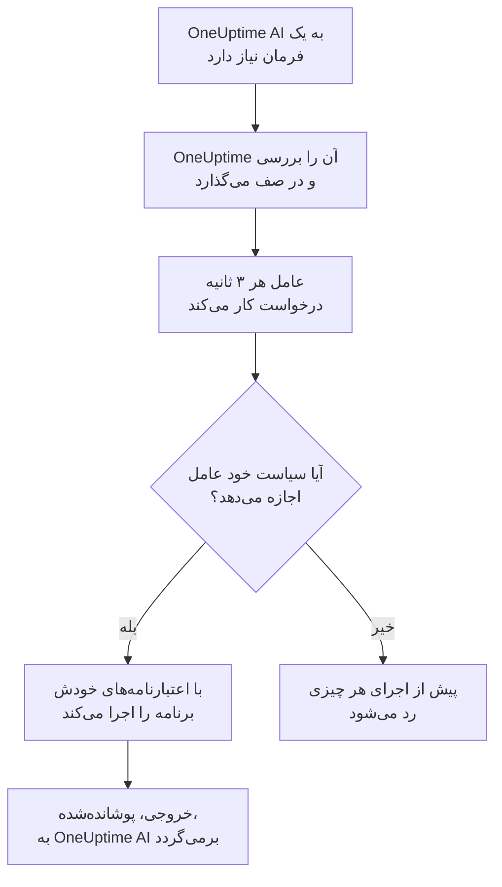

# عامل‌های هوش مصنوعی زیرساخت

OneUptime AI هنگام بررسی یک حادثه یا هشدار می‌تواند به چیزی فراتر از تله‌متری شما نگاه کند. یک عامل کوچک که کنار یکی از منابع شما نصب شده است — یک میزبان Docker یا Podman، یک خوشهٔ Docker Swarm، یک خوشهٔ Proxmox، یک VMware vCenter، یک خوشهٔ Ceph، یک سرور پایگاه داده یا یک میزبان Linux — فرمان‌های فقط‌خواندنی‌ای را که OneUptime AI درخواست می‌کند اجرا می‌کند، مانند `docker logs --tail 200 web`، `pvesh get /cluster/status`، `ceph health detail`، `db long-queries --min-seconds 30` یا `journalctl -u nginx -n 200 --no-pager`، و خروجی را برمی‌گرداند تا تحلیل علت ریشه‌ای به آنچه خود منبع می‌گوید استناد کند. اگر اجازه دهید، همان عامل اصلاح‌ها را هم اعمال می‌کند — راه‌اندازی دوبارهٔ یک کانتینر، روشن کردن یک ماشین مجازی، علامت‌گذاری دوبارهٔ یک OSD به‌عنوان in — که سیاست فرمان‌ها هر کدام را در سطحی قرار می‌دهد و، مگر آنکه طور دیگری انتخاب کنید، نخست یک انسان تأییدش می‌کند. پرسش از هوش مصنوعی هم، وقتی در صفحهٔ منبع باز شود، هر وقت بخواهید همین فرمان‌های فقط‌خواندنی را اجرا می‌کند (نگاه کنید به [پرسش از هوش مصنوعی](/docs/ai/ask-ai)).

یک حساب AWS، یک اشتراک Azure یا یک پروژهٔ Google Cloud برای بررسی شدن به هیچ عاملی نیاز ندارد: OneUptime آن را از راه همان اتصال فقط‌خواندنی‌ای که با آن متصل شده است به‌صورت زنده می‌خواند. فقط اصلاح‌هایش به یک عامل نیاز دارند، عامل هوش مصنوعی ابری، که در خود حساب اجرا می‌شود و با یک فرمان از صفحهٔ حساب راه‌اندازی می‌شود (ببینید [در یک حساب ابری](#در-یک-حساب-ابری)).

این عامل‌ها **عامل‌های هوش مصنوعی منبع** هستند. صفحهٔ داشبورد هر منبع یک بخش **هوش مصنوعی** با سه صفحه دارد:

- **بینش‌ها** — آنچه OneUptime AI در ۳۰ روز گذشته دربارهٔ منبع فهمیده است: مشکلاتی که مدام برمی‌گردند و دلیلشان، همراه با آنچه هوش مصنوعی یافت و گامی که پیشنهاد می‌کند، بخش‌هایی از منبع که پشت بیشتر آن‌ها هستند، اصلاح‌هایی که کمکی نکردند یا منتظر تأییدند، آنچه هوش مصنوعی خودش اصلاح کرد، و خطرهایی که پیش از خبر دادن به کسی شناسایی شدند — و در پانویس، آنچه خود هوش مصنوعی آنجا انجام داد. این صفحه مانند صفحهٔ یک خوشه کار می‌کند — ببینید [آنچه هوش مصنوعی روی یک خوشه آموخت](/docs/ai/ai-sre#آنچه-هوش-مصنوعی-روی-یک-خوشه-آموخت).
- **لاگ‌ها** — هر کاری که OneUptime AI روی منبع انجام داده، تازه‌ترین در ابتدا: هر بررسی با حادثه یا هشدار و خلاصه‌اش، هر اصلاحی که پیشنهاد یا اجرا کرده، و هر فرمانی که از طریق عامل فرستاده است. (نام پیشین این صفحه بینش‌ها بود.)
- **عامل هوش مصنوعی** — اینکه عامل متصل است یا نه، هوش مصنوعی روی منبع چه کاری مجاز است بکند (بررسی، و اینکه اصلاح‌ها چگونه اجرا می‌شوند)، هر چیزی که نیاز به توجه دارد همراه با گامی که آن را برطرف می‌کند، و در منوی **⋯** کنار وضعیت عامل، **آزمایش اتصال** و **بازنشانی عامل**.

**نمای کلی** منبع با یک کارت **عامل هوش مصنوعی** تمام می‌شود که صفحهٔ عامل هوش مصنوعی را خلاصه می‌کند: اینکه عامل متصل است یا نه، بررسی روشن است یا نه، اصلاح‌ها چگونه اجرا می‌شوند (**خاموش**، **درخواست تأیید**، **خودکار** یا **رد شدن از تأیید**) و چه چیزی نیاز به توجه دارد، همراه با پیوندی به صفحهٔ عامل هوش مصنوعی، جایی که این‌ها تغییر می‌کنند.

:::cards
- [منابع پشتیبانی‌شده](#منابع-پشتیبانیشده): یازده نوع منبع، یک ایمیج.
- [نصب یک عامل هوش مصنوعی](#نصب-یک-عامل-هوش-مصنوعی): کنار کالکتوری که از قبل اجرا می‌کنید، روی یک میزبان Linux، یا با یک فرمان در یک حساب ابری.
- [اصلاح‌ها چگونه کار می‌کنند](#اصلاحها-چگونه-کار-میکنند): چه چیزی می‌تواند خودش اجرا شود، چه چیزی منتظر یک انسان می‌ماند، و چه چیزی هرگز اجرا نمی‌شود.
- [مدل امنیتی](#مدل-امنیتی): سه بررسی روی هر فرمان، و هیچ اعتبارنامه‌ای از سوی OneUptime.
:::

## چگونه کار می‌کند

عامل هرگز منتظر اتصالی از سوی OneUptime نمی‌ماند: خودش با OneUptime تماس می‌گیرد، کار درخواست می‌کند، و فقط چیزی را اجرا می‌کند که رونوشت خودش از سیاست فرمان‌ها اجازه می‌دهد، با اعتبارنامه‌هایی که از قبل دارد.



## نسبت آن با عامل هوش مصنوعی Kubernetes

خوشه‌های Kubernetes عامل خودشان را دارند، عامل هوش مصنوعی Kubernetes، که چارت Helm عامل Kubernetes نصبش می‌کند — ببینید [دسترسی به خوشه — بگذارید OneUptime AI دستور kubectl را اجرا کند](/docs/ai/ai-sre#دسترسی-به-خوشه-بگذارید-oneuptime-ai-دستور-kubectl-را-اجرا-کند). هیچ چیزی در این صفحه آن را تغییر نمی‌دهد. عامل‌های هوش مصنوعی منبع از همان طراحی پیروی می‌کنند:

- **همان سطح‌ها و حالت‌ها.** هر فرمان **Read**، **SafeWrite**، **RiskyWrite** یا **Denied** است، و اصلاح‌ها **خاموش**، **درخواست تأیید**، **خودکار** یا **رد شدن از تأیید** هستند، با همان معنایی که روی یک خوشه دارند.
- **همان سه بررسی.** همان سیاست فرمان‌ها را ابزارهای هوش مصنوعی OneUptime اعمال می‌کنند، دوباره وقتی OneUptime فرمان را در صف می‌گذارد، و باز هم عامل پیش از اجرای هر چیزی.
- **همان قاعده دربارهٔ اعتبارنامه‌ها.** عامل فقط از چیزی استفاده می‌کند که محیط و mountهای خودش به آن می‌دهند. OneUptime هرگز اعتبارنامه‌ای برایش نمی‌فرستد.
- **همان پیش‌فرض‌ها.** بررسی‌های هوش مصنوعی به‌طور پیش‌فرض روشن‌اند: یک منبع مانند یک خوشه با بررسی روشن و اصلاح‌های خاموش آغاز می‌شود، پس OneUptime AI به‌محض اتصال عامل با آن بررسی می‌کند، و تا وقتی کسی اجازهٔ اصلاح ندهد هیچ چیزی را تغییر نمی‌دهد (ببینید [اتصال به OneUptime](#اتصال-به-oneuptime)).

آنچه فرق دارد:

- **یک ایمیج برای همهٔ منابع.** `oneuptime/resource-ai-agent` به هر یازده نوع منبع خدمت می‌دهد، و `ONEUPTIME_AI_AGENT_RESOURCE_TYPE` می‌گوید یک عامل به کدام یک خدمت می‌دهد. این عامل کنار کالکتور منبع به‌صورت یک کانتینر دیگر، یا در حساب ابری‌ای که به آن خدمت می‌دهد، اجرا می‌شود، نه از یک چارت Helm.
- **دسترسی نوشتن یک متغیر محیطی است.** فقط `ONEUPTIME_AI_ALLOW_WRITES=true` روی عامل به آن اجازه می‌دهد اصلاحی اعمال کند، و `ONEUPTIME_AI_WRITE_TARGETS` محدود می‌کند که اصلاح‌ها به کدام کانتینرها، سرویس‌ها، ماشین‌های مجازی، OSDها، نشست‌ها یا unitها دست بزنند. روی یک خوشه این کار را RBAC چارت و `aiAgent.remediation.namespaces` انجام می‌دهند.

مانند عامل هوش مصنوعی Kubernetes، یک عامل هوش مصنوعی منبع یک Runner نیست. هرگز زیر رانبوک‌ها > Runnerها ظاهر نمی‌شود، و هرگز به‌عنوان میزبان Bash یا SSH برای رانبوک‌ها به کار نمی‌رود.

## منابع پشتیبانی‌شده

| منبع | `ONEUPTIME_AI_AGENT_RESOURCE_TYPE` | عامل | با این نام ثبت می‌شود (متغیر کالکتور) | اجرا می‌کند | از این راه به منبع می‌رسد |
| -------------------- | ---------------------------------- | --------------------- | ----------------------------------------------------------------------------------------------- | -------------------------------------------------------------------------------------------------------------------------------------------------- | -------------------------------------------------------------------------- |
| میزبان Docker | `docker` | عامل هوش مصنوعی Docker | `DOCKER_HOST_NAME` | `docker` | سوکت Docker، `/var/run/docker.sock` |
| میزبان Podman | `podman` | عامل هوش مصنوعی Podman | `PODMAN_HOST_NAME` | `docker`، از طریق API سازگار با Docker در Podman | سوکت Podman، `/run/podman/podman.sock` |
| خوشهٔ Docker Swarm | `docker-swarm` (یا `swarm`) | عامل هوش مصنوعی Docker Swarm | `DOCKER_SWARM_CLUSTER_NAME` | `docker` | سوکت Docker یک گرهٔ manager |
| خوشهٔ Proxmox | `proxmox` | عامل هوش مصنوعی Proxmox | `PROXMOX_CLUSTER_NAME` | فرمان‌های `pvesh` که به API در Proxmox VE فرستاده می‌شوند (در عامل هیچ فایل اجرایی `pvesh` وجود ندارد) | `https://PVE_HOST:8006/api2/json`، با یک توکن API از Proxmox |
| VMware vCenter | `vmware` (یا `vcenter`) | عامل هوش مصنوعی VMware | `VMWARE_VCENTER_NAME` | `govc` | API در vCenter، با یک کاربر vSphere |
| خوشهٔ Ceph | `ceph` | عامل هوش مصنوعی Ceph | `CEPH_CLUSTER_NAME` | `ceph` | مانیتورها، با یک `ceph.conf` و keyring کلاینت ویژهٔ عامل |
| سرور پایگاه داده | `database` (یا `db`) | عامل هوش مصنوعی پایگاه داده | `DATABASE_SERVER_ID`، یا `DATABASE_SYSTEM` + `DATABASE_SERVER_ADDRESS` + `DATABASE_SERVER_PORT` | `db` — یک عملیات از یک کاتالوگ ثابت تشخیصی، هرگز SQL | درایور خود پایگاه داده، با یک ورود پایگاه داده |
| میزبان | `host` | عامل هوش مصنوعی میزبان | `HOST_NAME` (خالی: نام میزبانِ خود میزبان) | `systemctl`، `journalctl`، `df`، `free`، `uptime`، `ps`، `ss`، `ip`، `dmesg`، `lsblk`، `cat`، `top`، `uname`، `hostnamectl`، `timedatectl`، `kill` | `nsenter` به namespaceهای میزبان، از یک کانتینر دارای امتیاز ویژه |
| حساب AWS | `aws` | عامل هوش مصنوعی ابری | `AWS_ACCOUNT_ID` (خالی: حسابی که در آن اجرا می‌شود) | `cloud` — یک عملیات از یک کاتالوگ ثابت، هرگز یک فرمان `aws` | APIهای AWS، با نقش‌های IAM مخصوص خودش |
| اشتراک Azure | `azure` | عامل هوش مصنوعی ابری | `AZURE_SUBSCRIPTION_ID` (فرمان راه‌اندازی‌اش آن را تنظیم می‌کند) | `cloud` — یک عملیات از یک کاتالوگ ثابت، هرگز یک فرمان `az` | Azure Resource Manager، به‌عنوان هویت مدیریت‌شدهٔ Container App خودش |
| پروژهٔ Google Cloud | `gcp` (یا `google-cloud`) | عامل هوش مصنوعی ابری | `GOOGLE_CLOUD_PROJECT` (خالی: پروژه‌ای که در آن اجرا می‌شود) | `cloud` — یک عملیات از یک کاتالوگ ثابت، هرگز یک فرمان `gcloud` | APIهای Google Cloud، به‌عنوان یک حساب سرویس مخصوص خودش |

سرورهای پایگاه داده: عامل هوش مصنوعی پایگاه داده برای PostgreSQL، MySQL (و MariaDB و Percona Server)، Redis (و Valkey، KeyDB و Dragonfly) و MongoDB ابزار تشخیص دارد. برای هر موتور دیگری هیچ چیزی اجرا نمی‌کند و این را در صفحهٔ عامل هوش مصنوعی پایگاه داده می‌گوید.

**آزمایش اتصال**، در منوی **⋯** کنار وضعیت عامل در صفحهٔ عامل هوش مصنوعی، این فرمان‌های فقط‌خواندنی را از طریق عامل اجرا می‌کند و خروجی‌شان را در کارت عامل نشان می‌دهد:

| منبع | آنچه آزمایش اتصال اجرا می‌کند |
| -------------------- | ---------------------------------------------------- |
| میزبان Docker | `docker version`، `docker info` |
| میزبان Podman | `docker version`، `docker info` |
| خوشهٔ Docker Swarm | `docker version`، `docker node ls` |
| خوشهٔ Proxmox | `pvesh get /version`، `pvesh get /cluster/status` |
| VMware vCenter | `govc about` |
| خوشهٔ Ceph | `ceph health`، `ceph versions` |
| سرور پایگاه داده | `db ping`، `db version` |
| میزبان | `uptime`، `systemctl list-units --failed --no-pager` |
| حساب AWS | `cloud whoami` |
| اشتراک Azure | `cloud whoami` |
| پروژهٔ Google Cloud | `cloud whoami` |

روی یک worker در Docker Swarm، `docker node ls` شکست می‌خورد: عامل هوش مصنوعی Docker Swarm باید روی یک گرهٔ manager اجرا شود. عاملی که روی یک worker راه افتاده تا وقتی گره‌اش manager نشود برای خوشه ثبت نمی‌شود، و نصب‌کنندهٔ Docker Swarm آن را روی گره‌ای که manager نیست کنار می‌گذارد.

روی یک حساب ابری، `cloud whoami` نشان می‌دهد عامل هوش مصنوعی ابری در کدام حساب کار می‌کند و با چه هویتی وارد شده است، آیا مجاز است چیزی را تغییر دهد، چه تغییرهایی می‌تواند بدهد و چه برچسبی را لازم می‌داند، اگر برچسبی لازم باشد.

## نصب یک عامل هوش مصنوعی

همهٔ عامل‌های هوش مصنوعی منبع همان ایمیج `oneuptime/resource-ai-agent:release` هستند. کنار یک کالکتور یا روی یک میزبان، به هیچ تنظیمی در داشبورد نیاز ندارد: به‌محض اجرا، در OneUptime ثبت می‌شود و ظرف یک دقیقه در صفحهٔ عامل هوش مصنوعی منبع ظاهر می‌شود. عامل یک حساب ابری در خود حساب اجرا می‌شود، با یک فرمان که صفحهٔ حساب برایش می‌نویسد (ببینید [در یک حساب ابری](#در-یک-حساب-ابری)).

### کنار یک کالکتور

برای Docker، Podman، Docker Swarm، Proxmox، VMware، Ceph و سرورهای پایگاه داده، عامل کنار کالکتوری اجرا می‌شود که از قبل برای آن منبع به کار می‌برید، و `.env` آن را به اشتراک می‌گذارد: از قبل `ONEUPTIME_URL`، کلید دریافت و نام منبع را دارد. `docker-compose.yml` هر کالکتور عامل را به‌صورت یک سرویس دیگر همراه دارد، و `install.sh` آن، عامل را راه می‌اندازد.

| منبع | کالکتور | سرویس عامل هوش مصنوعی (و کانتینر) | جای راه‌اندازی |
| -------------------- | ----------------------------------------------------------- | --------------------------------- | ------------------------------------------------------------------------------------- |
| میزبان Docker | [عامل Docker](/docs/telemetry/docker-host#عامل-هوش-مصنوعی) | `oneuptime-docker-ai-agent` | `agents/DockerAgent/docker-compose.yml`؛ `install.sh` آن را به‌عنوان کانتینر دوم راه می‌اندازد |
| میزبان Podman | [عامل Podman](/docs/telemetry/podman-host#عامل-هوش-مصنوعی) | `oneuptime-podman-ai-agent` | `agents/PodmanAgent/docker-compose.yml`؛ `install.sh` آن را به‌عنوان کانتینر دوم راه می‌اندازد |
| خوشهٔ Docker Swarm | [عامل Docker Swarm](/docs/telemetry/docker-swarm#عامل-هوش-مصنوعی) | `oneuptime-docker-swarm-ai-agent` | `agents/DockerSwarmAgent/docker-compose.yml`، روی یک گرهٔ manager |
| خوشهٔ Proxmox | [عامل Proxmox](/docs/telemetry/proxmox#عامل-هوش-مصنوعی) | `oneuptime-proxmox-ai-agent` | `agents/ProxmoxAgent/docker-compose.yml` |
| VMware vCenter | [عامل VMware](/docs/telemetry/vmware#عامل-هوش-مصنوعی) | `oneuptime-vmware-ai-agent` | `agents/VMwareAgent/docker-compose.yml` |
| خوشهٔ Ceph | [عامل Ceph](/docs/telemetry/ceph#عامل-هوش-مصنوعی) | `oneuptime-ceph-ai-agent` | `agents/CephAgent/docker-compose.yml`، با کلاینت Ceph ویژهٔ عامل در `./ceph` |
| سرور پایگاه داده | [عامل پایگاه داده](/docs/telemetry/databases#عامل-هوش-مصنوعی) | `oneuptime-database-ai-agent` | `agents/DatabaseAgent/docker-compose.yml` |

کالکتوری که پیش از به وجود آمدن عامل هوش مصنوعی نصب شده، هنوز آن را اجرا نمی‌کند. `install.sh` آن را دوباره اجرا کنید: اکنون عامل هوش مصنوعی را هم راه می‌اندازد (نصب‌کننده‌های Proxmox، VMware، Ceph، پایگاه داده و Docker Swarm نسخهٔ فعلی `docker-compose.yml` را دانلود می‌کنند که سرویس عامل هوش مصنوعی را دارد). اگر فایل‌ها را خودتان مدیریت می‌کنید، سرویس را از `docker-compose.yml` کالکتور به فایل خودتان اضافه کنید و `docker compose up -d` را اجرا کنید. صفحهٔ عامل هوش مصنوعی منبع، سرویس دقیق آن منبع را با نام ازپیش‌پرشده نشان می‌دهد.

بدون نصب‌کننده‌ها، عامل هوش مصنوعی Docker فقط یک `docker run` است:

```bash
docker run -d \
  --name oneuptime-docker-ai-agent \
  --user 0:0 \
  --restart unless-stopped \
  --read-only --tmpfs /tmp \
  -v /var/run/docker.sock:/var/run/docker.sock:ro \
  -e ONEUPTIME_URL="https://oneuptime.com" \
  -e ONEUPTIME_SERVICE_TOKEN="YOUR_TELEMETRY_INGESTION_TOKEN" \
  -e ONEUPTIME_AI_AGENT_RESOURCE_TYPE=docker \
  -e DOCKER_HOST_NAME="my-docker-host" \
  oneuptime/resource-ai-agent:release
```

`DOCKER_HOST_NAME` باید همان نامی باشد که عامل Docker گزارش می‌دهد. نصب‌کننده‌های Docker و Podman برای کنار گذاشتن عامل هوش مصنوعی `--no-ai-agent` (یا `ONEUPTIME_INSTALL_AI_AGENT=false`) را می‌پذیرند، و نصب‌کنندهٔ Docker Swarm هم همین‌طور. برای اینکه بعداً کالکتوری را بدون آن اجرا کنید، سرویس عامل هوش مصنوعی‌اش را از `docker-compose.yml` حذف کنید، یا کانتینرش را با `docker rm -f` پاک کنید.

### عامل هوش مصنوعی میزبان

یک میزبان Linux که از طریق [کالکتور OpenTelemetry روی میزبان](/docs/telemetry/host-otel-collector) گزارش می‌دهد هیچ کانتینر OneUptimeای ندارد که عامل کنارش بنشیند، پس عامل هوش مصنوعی میزبان نصب‌کنندهٔ خودش را دارد (`agents/HostAIAgent`):

```bash
curl -fsSL https://raw.githubusercontent.com/OneUptime/oneuptime/master/agents/HostAIAgent/install.sh -o install.sh
sudo bash install.sh
```

این نصب‌کننده نشانی OneUptime شما، کلید دریافت تله‌متری پروژه و نام میزبان را می‌پرسد، `/opt/oneuptime-host-ai-agent/.env` و `docker-compose.yml` را می‌نویسد، و کانتینر `oneuptime-host-ai-agent` را راه می‌اندازد. برای اجرای آن به‌جایش زیر unit مربوط به systemd با نام `oneuptime-host-ai-agent`، گزینهٔ `--systemd` را اضافه کنید. به Docker (موتور سیستمی، نه Docker بدون root) با افزونهٔ Compose نیاز دارد؛ Podman با دسترسی root هم می‌تواند همان کانتینر را اجرا کند.

عامل هوش مصنوعی میزبان برنامه‌های **خود میزبان** را اجرا می‌کند: هر فرمان به‌صورت `nsenter --target 1 --mount --uts --ipc --net --pid -- PROGRAM ARGS` اجرا می‌شود که وارد namespaceهای فرایند init میزبان می‌شود. این کار به `pid: host`، `privileged: true` و root نیاز دارد — ببینید [سوکت Docker و عامل هوش مصنوعی میزبان روی میزبان root هستند](#سوکت-docker-و-عامل-هوش-مصنوعی-میزبان-روی-میزبان-root-هستند). `HOST_NAME` را خالی بگذارید تا نام میزبانِ ماشین به کار رود، که اگر تغییرش نداده باشید همان چیزی است که کالکتور به‌عنوان `host.name` گزارش می‌دهد؛ در غیر این صورت آن را روی نامی بگذارید که زیر **میزبان‌ها** نمایش داده می‌شود.

### در یک حساب ابری

یک حساب AWS، یک اشتراک Azure یا یک پروژهٔ Google Cloud هیچ کالکتوری ندارد که عاملی کنارش اجرا شود، و OneUptime آن را بدون عامل می‌خواند (ببینید [حساب‌های ابری](#حسابهای-ابری)). عامل هوش مصنوعی ابری آن، که اصلاح‌ها را انجام می‌دهد، در خود حساب اجرا می‌شود و با یک فرمان از صفحهٔ حساب راه‌اندازی می‌شود، بدون هیچ فایل compose و بدون `.env`:

1. زیر ابر > حساب‌ها، حساب را باز کنید و در کارت **عامل هوش مصنوعی** در **نمای کلی** آن، **اجازه به هوش مصنوعی برای رفع مشکلات** را انتخاب کنید.
2. به تنها پرسش، **هوش مصنوعی تا کجا پیش برود؟** پاسخ دهید: **اول از من بپرسد**، که پیش‌فرض است، **اصلاحات** را روی **درخواست تأیید** می‌گذارد، و **مشکلات کم‌خطر را خودش رفع کند** آن را روی **خودکار** می‌گذارد. بقیه در **پیشرفته** است: اینکه هوش مصنوعی چه تغییرهایی می‌تواند بدهد، منابعی که هرگز نباید تغییر دهد، تغییر دادن فقط منابعی که برچسب `oneuptime-ai=allow` دارند، **رد شدن از تأیید**، خواندن لاگ‌های حساب، و متغیرهای عامل برای اجرای آن در جایی دیگر.
3. فرمانی را که نشان می‌دهد در پوستهٔ خود سرویس ابری، در حالی که به همان حساب وارد شده‌اید، اجرا کنید. این فرمان نقش عامل را از روی تغییرهای روشن‌شده می‌نویسد و عامل را راه‌اندازی می‌کند، که خودش ظرف چند دقیقه وصل می‌شود: چیزی برای جای‌گذاری برگشتی نیست. اگر وصل نشود، لاگش می‌گوید چرا (ببینید [لاگ‌ها و وضعیت](#لاگها-و-وضعیت)).

| ابر | کجا اجرایش کنید | آنچه فرمان می‌سازد |
| -------------------- | ------------------ | ------------------------------------------------------------------------------------------------------------------------------------------------------------------------------------------------------------------ |
| حساب AWS | AWS CloudShell | یک پشتهٔ CloudFormation، `oneuptime-ai-agent`، که یک وظیفهٔ ECS Fargate را اجرا می‌کند. نقش وظیفهٔ آن فقط می‌تواند نقش نوشتن `OneUptimeAiAgentWrite` را به خود بگیرد، که مجوزهای تغییرهای روشن‌شده را دارد. |
| اشتراک Azure | Azure Cloud Shell | یک Container App، `oneuptime-ai-agent`، در گروه منابع `oneuptime-ai-agent`. هویت مدیریت‌شدهٔ آن یک نقش سفارشی روی اشتراک دارد، با مجوزهای تغییرهای روشن‌شده. |
| پروژهٔ Google Cloud | Google Cloud Shell | یک سرویس Cloud Run، `oneuptime-ai-agent`، با CPU همیشه تخصیص‌یافته، که به‌عنوان حساب سرویس `oneuptime-ai-agent` اجرا می‌شود، و این حساب سرویس یک نقش سفارشی روی پروژه دارد، با مجوزهای تغییرهای روشن‌شده. |

این فرمان فقط در حسابی کار می‌کند که برایش نوشته شده است: روی AWS در پوسته‌ای که به حساب دیگری وارد شده هیچ چیزی نمی‌سازد، و فرمان‌های Azure و Google Cloud در هر فراخوانی اشتراک یا پروژهٔ خود را نام می‌برند. این فرمان `ONEUPTIME_AI_INVESTIGATION=true`، `ONEUPTIME_AI_FIXES` را بر اساس پاسخ شما، `ONEUPTIME_AI_ALLOW_WRITES=true`، و `ONEUPTIME_AI_CLOUD_ACCOUNT_ID` را روی حسابی که برایش نوشته شده تنظیم می‌کند. عامل به‌عنوان حسابی ثبت می‌شود که ابرش می‌گوید در آن است و هرگز حسابی به OneUptime اضافه نمی‌کند: اگر در حسابی جز حساب فرمانش راه‌اندازی شود، رد می‌شود و حسابی که فرمان برایش نوشته شده در صفحهٔ خود می‌گوید چرا؛ اگر در حسابی راه‌اندازی شود که هیچ اتصالی از پروژه آن را نمی‌خواند، باز هم رد می‌شود و لاگش همین را می‌گوید.

برای تغییر هر چیزی، فرمان را دوباره اجرا کنید: **اجازه به هوش مصنوعی برای رفع مشکلات** را دوباره باز کنید، یا در صفحهٔ **عامل هوش مصنوعی** حساب، **تغییر** را انتخاب کنید و فرمانی را که می‌نویسد اجرا کنید. نقش همیشه فقط تغییرهای روشن‌شده را در خود دارد. بخش **هوش مصنوعی** یک حساب ابری دو صفحه دارد، **عامل هوش مصنوعی** و **لاگ‌ها**، و هزینهٔ عامل در [اتصال یک حساب ابری](/docs/telemetry/cloud-accounts#اجازه-به-هوش-مصنوعی-برای-رفع-مشکلات) آمده است.

### اتصال به OneUptime

عامل با **همان شناسه‌ای که کالکتور گزارش می‌دهد** ثبت می‌شود — `DOCKER_HOST_NAME`، `PROXMOX_CLUSTER_NAME`، `CEPH_CLUSTER_NAME`، … (`ONEUPTIME_AI_AGENT_RESOURCE_NAME` آن را جایگزین می‌کند) — پس دقیقاً به همان منبعی خدمت می‌دهد که تله‌متری کالکتور ساخته است. وقتی OneUptime هنوز منبعی با آن نام ندارد، ثبت آن را می‌سازد، پس نامی متفاوت از نام کالکتور به‌جای خطا یک منبع دوم و خالی به شما می‌دهد. یک پایگاه داده وقتی `DATABASE_SERVER_ID` تنظیم شده باشد با آن ثبت می‌شود، وگرنه با موتور، نشانی و پورتش؛ `DATABASE_SERVER_ID`ای که پایگاه داده‌ای از این پروژه نباشد رد می‌شود.

اگر کالکتور هنوز نام پیش‌فرضش (`docker-host`، `podman-host`، `docker-swarm`، `proxmox-cluster`، `vmware-vcenter`، `ceph`) را به کار می‌برد، هر منبعی که با آن پیش‌فرض نصب شده در OneUptime به یک منبع واحد گزارش می‌دهد، و فرمان‌هایی که برای آن فرستاده می‌شوند می‌توانند به هر کدام از آن‌ها برسند. عامل در لاگ خود دربارهٔ این هشدار می‌دهد؛ به هر منبع، هم روی کالکتور و هم روی عامل، نامی یکتا بدهید.

عامل با کلید دریافت تله‌متری پروژه احراز هویت می‌کند — نخستین مقدار تنظیم‌شده از میان `ONEUPTIME_API_KEY`، `ONEUPTIME_TELEMETRY_INGESTION_KEY` و `ONEUPTIME_SERVICE_TOKEN` که کالکتورها از قبل تنظیمشان می‌کنند — و کلیدی ویژهٔ خودش دریافت می‌کند. همهٔ فراخوانی‌هایش درخواست‌های HTTPS از نوع `POST` به `<ONEUPTIME_URL>/resource-ai-agent-ingest/…` هستند: یک بار هنگام آغاز ثبت می‌شود، هر ۳۰ ثانیه یک heartbeat می‌فرستد (تا ۵ دقیقه پس از آخرین heartbeat آنلاین به حساب می‌آید)، هر ۳ ثانیه کار درخواست می‌کند، و هنگام توقف خارج می‌شود. عامل دومی با همان شناسه تا وقتی عامل نخست آنلاین است رد می‌شود: کانتینری که به‌درستی متوقف شود خارج می‌شود، پس جایگزینش بی‌درنگ پذیرفته می‌شود، و پس از یک crash یا kill، اگر عامل قدیمی از نخستین رد شدن تا ۴۰ ثانیه چیزی نفرستد، جایگزین جای آن را می‌گیرد. اگر پس از ۱۰ دقیقه همچنان رد شود، عامل فعال دیگری از همان شناسه استفاده می‌کند: عامل خطایی ثبت می‌کند که همین را می‌گوید و فقط هر ۵ دقیقه یک بار درخواست می‌کند، تا وقتی به هر منبع نام خودش را بدهید یا عامل دیگر را متوقف کنید. یک پروژه حداکثر ۲۵۰ عامل هوش مصنوعی منبع دارد، و در هر ساعت حداکثر ۳۰ عامل تازه ثبت می‌شوند. وقتی به ۲۵۰ برسد، عامل‌هایی که ۷ روز از آن‌ها خبری نبوده حذف می‌شوند تا جا برای عامل تازه باز شود (منبع تنظیمات هوش مصنوعی‌اش را نگه می‌دارد، و چنین عاملی اگر برگردد به‌سادگی دوباره ثبت می‌شود).

**بررسی** برای هر منبع از ابتدا روشن است، پس OneUptime AI به‌محض اتصال عامل با آن بررسی می‌کند. فراتر از این، اینکه هوش مصنوعی روی منبع چه کاری مجاز است بکند تنظیم خود عامل است (ببینید [کارهای مجاز هوش مصنوعی، تعیین‌شده به‌دست عامل](#کارهای-مجاز-هوش-مصنوعی-تعیینشده-بهدست-عامل)). عاملی که هیچ‌کدام از این دو تنظیم را نام نبرد از پیش‌فرض‌هایش استفاده می‌کند: **بررسی** را برای منبع خودش روشن می‌کند و، اگر اجازهٔ نوشتن بدهد (`ONEUPTIME_AI_ALLOW_WRITES=true`)، **اصلاحات** را روی **درخواست تأیید** می‌گذارد، وگرنه روی **خاموش**. پیش‌فرض‌هایش فقط برای منبعی اعمال می‌شوند که هیچ‌کس تنظیمات هوش مصنوعی‌اش را در صفحهٔ عامل هوش مصنوعی انتخاب نکرده است: تنظیماتی که کسی آنجا ذخیره کرده تا وقتی پیکربندی عامل نامشان را ببرد همان‌طور می‌مانند، پس منبعی که کسی کلید **بررسی** آن را خاموش کرده خاموش می‌ماند. عاملی قدیمی‌تر از این تنظیمات هیچ‌کدام را گزارش نمی‌دهد، و صفحهٔ عامل هوش مصنوعی مانند گذشته آن‌ها را تعیین می‌کند.

**بازنشانی عامل**، در همان منوی **⋯** صفحهٔ عامل هوش مصنوعی، پس از تأیید شما کاری می‌کند که OneUptime کلید عامل را فراموش کند؛ هر کسی که آن را در اختیار داشت بیرون می‌ماند، و عامل واقعی ظرف چند دقیقه دوباره ثبت می‌شود. عامل به سرور OneUptime با نسخه‌ای برابر با ایمیج خودش یا تازه‌تر نیاز دارد.

### کارهای مجاز هوش مصنوعی، تعیین‌شده به‌دست عامل

بررسی و اصلاح‌ها همان‌جا که عامل اجرا می‌شود تعیین می‌شوند — در `.env` که با کالکتور به اشتراک می‌گذارد، یا محیط کانتینرش — و OneUptime از آن‌ها پیروی می‌کند:

| متغیر | پیش‌فرض | چه می‌کند |
| ---------------------------- | ------- | ----------------------------------------------------------------------------------------------------------------------------------------------------------------------------------------------------------------------------------------------------- |
| `ONEUPTIME_AI_INVESTIGATION` | خالی | `true` به هوش مصنوعی اجازه می‌دهد هنگام بررسی فرمان‌های فقط‌خواندنی پایین را اجرا کند؛ `false` آن را به داده‌هایی محدود می‌کند که OneUptime از قبل دارد. خالی: روشن. |
| `ONEUPTIME_AI_FIXES` | خالی | اینکه هوش مصنوعی چگونه می‌تواند یک اصلاح را اعمال کند: `off`، `ask-for-approval`، `automatic` یا `bypass-approval` (ببینید [حالت‌های اصلاح](#حالتهای-اصلاح)). هر حالتی جز `off` به `ONEUPTIME_AI_ALLOW_WRITES=true` هم نیاز دارد، و `off` حتی با آن، عامل را فقط‌خواندنی نگه می‌دارد. خالی: وقتی عامل اجازهٔ نوشتن بدهد `ask-for-approval`، وگرنه `off`. |

برای نمونه، برای اینکه هوش مصنوعی اصلاح‌ها را اعمال کند و یک انسان هر کدام را تأیید کند:

```bash
ONEUPTIME_AI_INVESTIGATION=true
ONEUPTIME_AI_FIXES=ask-for-approval
ONEUPTIME_AI_ALLOW_WRITES=true
```

سپس عامل را دوباره راه بیندازید (`docker compose up -d`، یا برای یک میزبان Docker یا Podman، `install.sh` کالکتور را با این مقدارها دوباره اجرا کنید). عامل هنگام ثبت و با هر heartbeat هر دو را گزارش می‌دهد، و OneUptime بی‌درنگ آن‌ها را روی منبع اعمال می‌کند. سپس صفحهٔ عامل هوش مصنوعی منبع آن‌ها را فقط‌خواندنی نشان می‌دهد: **تغییر** به‌جای ذخیرهٔ چیزی، این خط‌ها را برای گزینه‌ای که انتخاب می‌کنید نشان می‌دهد، و تا وقتی عامل آن‌ها را تعیین می‌کند OneUptime تغییری را که در جای دیگری انجام شود — API، Terraform، یک مدیر ارشد — رد می‌کند. فهرست مجاز فرمان‌ها در صفحه باقی می‌ماند. مقداری که عامل نتواند بخواند آن تنظیم را خاموش نگه می‌دارد، و عامل ثبت می‌کند کدام تنظیم بوده است.

## یک بررسی چه چیزی را می‌تواند اجرا کند

یک بررسی همیشه فقط فرمان‌های **Read** را اجرا می‌کند: آن‌ها به منبع نگاه می‌کنند و هیچ چیزی را تغییر نمی‌دهند. OneUptime AI منابعی را می‌بیند که به حادثه یا هشدار پیوند دارند (از طریق مانیتورها و تله‌متری‌شان، حداکثر ۱۰ منبع برای هر سیگنال) و عامل هوش مصنوعی‌شان متصل (یک حساب ابری به عامل نیاز ندارد) و کلید **بررسی** آن‌ها روشن است، و هر تعداد فرمان که بررسی لازم داشته باشد اجرا می‌کند (تا ۲۰۰ فرمان در هر بررسی، به‌عنوان محافظی در برابر حلقهٔ افسارگسیخته)، و هر کدام مانند هر شاهد دیگری مستند می‌شود. هر فرمان یک برنامه با آرگومان‌هایش است — هرگز از طریق یک shell نیست، پس pipeها، تغییر مسیرها، `;`، `&&`، `$(…)` و `sudo` با پیامی که همین را می‌گوید رد می‌شوند. یک فرمان به‌طور پیش‌فرض ۳۰ ثانیه و حداکثر ۲ دقیقه وقت دارد، و خروجی‌اش روی عامل به ۱۰۲۴ KB محدود است. هیچ بخشی از آن خروجی پیش از رسیدن به OneUptime AI بریده نمی‌شود: خروجی طولانی صفحه به صفحه نشان داده می‌شود — نخست ۴۰٬۰۰۰ نویسهٔ اول، سپس بقیه بنا به درخواست. اگر عاملی فرمانی را برندارد، OneUptime AI تا پایان بررسی دیگر به آن منبع فرمان نمی‌فرستد.

آنچه هر نوع منبع می‌تواند بخواند در پایین آمده است. این همان فهرستی است که به خود هوش مصنوعی داده می‌شود؛ هر چیزی که در آن نباشد رد می‌شود.

### میزبان‌های Docker و Podman

- کانتینرها: `docker ps -a` (همچنین `-q`، `-n`، `-l`، `-s`، `--no-trunc`، `--filter`، `--format json`)، `docker container inspect web`، `docker inspect --type container web`، `docker top web`، `docker port web`، `docker diff web`. مقدارهای متغیرهای محیطی در خروجی inspect پوشانده‌شده برمی‌گردند.
- لاگ‌ها و فعالیت: `docker logs --tail 200 web` یا `docker logs --since 30m web` — یک `--tail` حداکثر ۲۰۰۰ یا یک `--since` الزامی است (بدون `--tail`، `--since` باید مدتی حداکثر ۲۴ ساعته باشد)، و `-f` هرگز مجاز نیست؛ `docker stats --no-stream`؛ `docker events --since 30m --until 0s` (هر دو کران الزامی‌اند و `--until` به‌صورت مدت، پس پنجره همیشه در گذشته بسته می‌شود).
- موتور: `docker info`، `docker version`، `docker system df` (`-v` فقط به‌صورت جدول: `-v --format json` خط فرمان هر مرحلهٔ build را چاپ می‌کند)، `docker images`، `docker image inspect nginx:1.27`، `docker network ls`، `docker network inspect bridge`، `docker volume ls`، `docker volume inspect data`.
- فقط `--format json` (یا `table` برای فهرست‌ها)، هرگز یک قالب Go، و هیچ‌کدام از پرچم‌های سراسری docker (`-H`، `--context`، `--config`، …): آن‌ها CLI را به سمت موتور دیگری می‌برند.

یک میزبان Podman همان CLI یعنی `docker` و همان سیاست را از طریق API سازگار با Docker در Podman اجرا می‌کند.

### خوشه‌های Docker Swarm

- گره‌ها: `docker node ls`، `docker node ps node-1`، `docker node inspect node-1 --pretty`.
- سرویس‌ها: `docker service ls`، `docker service ps web --no-trunc`، `docker service inspect web --pretty` (مقدارهای متغیرهای محیطی پوشانده‌شده برمی‌گردند)، `docker service logs --tail 200 web` (یک `--tail` حداکثر ۲۰۰۰ یا یک `--since` الزامی است — که به‌تنهایی مدتی حداکثر ۲۴ ساعته است — هرگز `-f`).
- stackها: `docker stack ls`، `docker stack ps shop`، `docker stack services shop`.
- موتور خود manager: `docker ps -a`، `docker container inspect web`، `docker logs --tail 200 web`، `docker stats --no-stream`، `docker info`، `docker version`، `docker network ls`، و بقیهٔ فرمان‌های خواندن یک میزبان Docker.

### خوشه‌های Proxmox

در عامل هیچ `pvesh`ای وجود ندارد. یک فرمان با دستور زبان `pvesh` نوشته می‌شود — `get` (یا `ls`) و یک مسیر API، با گزینه‌ها به‌صورت `--name value` — و عامل آن را دقیقاً به یک `GET` به API در Proxmox VE با توکن خودش تبدیل می‌کند. `--output-format json|json-pretty|text` قالب خروجی را انتخاب می‌کند؛ رشته‌های پرس‌وجو پذیرفته نمی‌شوند، و یک نوشتن باید گره‌اش را نام ببرد (هرگز `localhost`).

- خوشه: `pvesh get /version`، `pvesh get /cluster/status`، `pvesh get /cluster/resources --type vm`، `pvesh get /cluster/ha/status/current`، `pvesh get /cluster/log --max 50`، `pvesh get /cluster/tasks`، `pvesh get /nodes`، و فهرست‌های تکثیر، پشتیبان‌گیری، poolها و ذخیره‌سازی.
- یک گره: `pvesh get /nodes/pve1/status`، `pvesh get /nodes/pve1/services`، `pvesh get /nodes/pve1/storage`، `pvesh get /nodes/pve1/disks/list`، `pvesh get /nodes/pve1/rrddata --timeframe hour`، به‌علاوهٔ شبکه، تکثیر، به‌روزرسانی‌های APT و وضعیت Ceph آن.
- کارها و لاگ‌ها: `pvesh get /nodes/pve1/tasks --errors 1 --limit 20`، وضعیت و لاگ یک کار، `pvesh get /nodes/pve1/syslog --limit 200`، `pvesh get /nodes/pve1/journal --lastentries 200`.
- مهمان‌ها (`qemu` برای ماشین‌های مجازی، `lxc` برای کانتینرها): `pvesh get /nodes/pve1/qemu`، `pvesh get /nodes/pve1/lxc`، `pvesh get /nodes/pve1/qemu/101/status/current`، `pvesh get /nodes/pve1/qemu/101/config` (رازهایی مانند گذرواژه‌های cloud-init پوشانده‌شده برمی‌گردند)، تغییرات در انتظار، snapshotها، `pvesh get /nodes/pve1/qemu/101/rrddata --timeframe hour`، و اطلاعات عامل مهمان QEMU مانند `pvesh get /nodes/pve1/qemu/101/agent/get-fsinfo`.
- هرگز: هر چیزی زیر `/access` (کاربران، توکن‌های API، ACLها)، کنسول‌ها (`vncproxy`، `termproxy`، `spiceproxy`)، مانیتور QEMU، فراخوانی‌های exec و فایل عامل مهمان.

### VMware vCenter

نخست فرمان می‌آید، سپس پرچم‌هایش، سپس نام‌ها یا مسیرهای inventory (govc پرچم‌هایی را که پس از یک آرگومان نوشته شوند نادیده می‌گیرد)؛ `-dc DATACENTER` یک مرکز داده را انتخاب می‌کند.

- `govc about`، `govc datacenter.info`، `govc ls /DC/vm`، `govc find . -type m -runtime.powerState poweredOff` — نسخه و inventory در vCenter (`find` فقط بر اساس نام‌ها، نوع‌ها، سلامت و ویژگی‌های زمان اجرا فیلتر می‌کند؛ `ls -json` رد می‌شود، چون همهٔ ویژگی‌های هر شیئی را که فهرست می‌کند بار می‌کند).
- `govc vm.info web-01`، `govc host.info esx-01`، `govc datastore.info datastore1`، `govc pool.info /DC/host/cluster1/Resources` — وضعیت روشن بودن، میزبان، سیستم‌عامل مهمان، نشانی IP، VMware Tools، ظرفیت. `vm.info` فقط متنی است: `-json` و `-e` رد می‌شوند چون `extraConfig` ماشین مجازی را چاپ می‌کنند، جایی که داده‌های cloud-init و گذرواژه‌ها قرار دارند.
- `govc events -n 50 /DC/vm/web-01`، `govc tasks -n 50` — رویدادها و کارهای اخیر (حداکثر ۵۰۰، هرگز `-f`).
- `govc metric.sample -n 12 /DC/vm/web-01 cpu.usage.average`، `govc metric.ls /DC/vm/web-01`، `govc object.collect -s /DC/vm/web-01 runtime.powerState` (فقط ویژگی‌های زمان اجرا و سلامت)، `govc host.service.ls -host esx-01`، `govc host.date.info -host esx-01`، `govc tags.ls`.
- هرگز: پرچم‌های اتصال، اعتبارنامه، TLS و اشکال‌زدایی (`-u`، `-k`، `-cert`، `-debug`، `-dump`، …)، عملیات مهمان (`guest.*`)، دسترسی به فایل‌های datastore، `esxcli`، `env` و هر فرمانی که در فهرست نیامده است.

### خوشه‌های Ceph

- خوشه: `ceph status` (یا `ceph -s`)، `ceph health detail`، `ceph df detail`، `ceph versions`، `ceph progress`، `ceph quorum_status`، `ceph log last 100`.
- OSDها: `ceph osd tree`، `ceph osd df`، `ceph osd perf`، `ceph osd stat`، `ceph osd dump`، `ceph osd blocked-by`، `ceph osd find 3`، `ceph osd metadata 3`، `ceph osd ok-to-stop 3`، `ceph osd safe-to-destroy 3`.
- poolها و گروه‌های جای‌گذاری: `ceph osd pool ls detail`، `ceph osd pool stats`، `ceph osd pool get rbd size`، `ceph pg stat`، `ceph pg dump_stuck`، `ceph pg 1.2f query`، `ceph pg ls-by-osd 3`.
- daemonها، crashها و cephadm: `ceph mon stat`، `ceph mgr services`، `ceph mgr module ls`، `ceph fs status`، `ceph mds stat`، `ceph balancer status`، `ceph crash ls`، `ceph crash stat`، `ceph orch ps`، `ceph orch ls`، `ceph orch host ls`، `ceph orch device ls`.
- برای خروجی ساختاریافته `--format json` (یا `-f json`، `json-pretty`، `plain`) را اضافه کنید. هیچ گزینهٔ دیگری پذیرفته نمی‌شود — هرگز `-c`، `--keyring`، `--id`، `--admin-daemon`، `-i`، `-o` یا `-w` — و `auth`، `config-key`، `config`، `tell` و `daemon` هرگز اجرا نمی‌شوند.

### سرورهای پایگاه داده

`db` یک برنامه نیست: نام یک عملیات از یک کاتالوگ ثابت تشخیصی است که عامل آن را از طریق درایور خود پایگاه داده در یک نشست فقط‌خواندنی اجرا می‌کند، با محدودیت زمانی روی هر عبارت. OneUptime AI هرگز SQL، فرمان Redis یا کد shell در MongoDB نمی‌نویسد. پرچم‌ها فقط به شکل بلند هستند (`--limit 20` یا `--limit=20`).

- `db ping`، `db version` — اینکه سرور پاسخ می‌دهد یا نه، نسخه و مدت روشن بودنش.
- `db sessions --limit 20` (همچنین `--state active`، `--user`، `--database`؛ `db current-ops` همان است) — نشست‌ها و آنچه هر کدام اجرا می‌کند.
- `db long-queries --min-seconds 30`، `db blocking`، `db locks` — عبارت‌های کند، و اینکه چه کسی منتظر یک قفل است و چه کسی آن را در دست دارد.
- `db replication`، `db connections`، `db database-sizes`، `db table-sizes --limit 20`، `db top-statements --limit 10` — تأخیر تکثیر، اتصال‌ها در برابر سقف، و اینکه فضا و زمان کجا می‌روند.
- `db settings work_mem` (یا همهٔ تنظیمات) — هرگز یک تنظیم اعتبارنامه مانند `requirepass`.
- گزارش‌های موتور: `db slowlog`، `db info memory`، `db innodb-status`، `db memory`، `db keyspace`.

متن پرس‌وجوها در خروجی عادی‌سازی می‌شود — هر رشته و عدد صریح به `?` تبدیل می‌شود — پس داده‌های مشتریان شما در یک عبارت هرگز به OneUptime نمی‌رسد.

### میزبان‌ها

- سرویس‌ها: `systemctl status nginx --no-pager -n 50`، `systemctl is-active nginx`، `systemctl list-units --failed --no-pager`، `systemctl list-timers --all`، `systemctl show nginx -p ActiveState,SubState,Result,NRestarts` (`-p` الزامی است و فقط ویژگی‌های وضعیت unit مجازند — هرگز `Environment`، و هرگز یک فایل unit).
- لاگ‌ها: `journalctl -u nginx -n 200 --no-pager` — هر خواندن به `-n` (حداکثر ۲۰۰۰) یا `--since` نیاز دارد، هرگز `-f`؛ همچنین `-p err`، `-k`، `-b`، `--until`، `-g`، `-t`، `-o short-iso|json`؛ `journalctl --list-boots`، `journalctl --disk-usage`.
- منابع: `uptime`، `free -m`، `df -h`، `df -i`، `lsblk -f`، `uname -a`، `hostnamectl`، `timedatectl`، `dmesg -T --level=err,warn`.
- فرایندها: `ps aux --sort=-%cpu`، `top -b -n 1 -o %MEM`. گذرواژه‌های موجود در خط فرمان‌ها پوشانده‌شده برمی‌گردند.
- شبکه: `ss -tulpn`، `ss -s`، `ip -br addr`، `ip route`، `ip route get 1.1.1.1`.
- شمارنده‌های هسته: `cat /proc/loadavg`، `cat /proc/meminfo`، `cat /proc/pressure/memory`، `cat /etc/os-release` — `cat` فقط فهرست کوتاهی از فایل‌های `/proc` و `/etc/os-release` را می‌خواند، نه چیز دیگری.
- یک برنامه برای هر فرمان، با نام و بدون مسیر: هرگز یک shell، `sudo` یا هر برنامهٔ دیگری.

### حساب‌های ابری

OneUptime یک حساب AWS، یک اشتراک Azure یا یک پروژهٔ Google Cloud را خودش، به‌صورت زنده، از راه اتصال فقط‌خواندنی حساب می‌خواند (ببینید [اتصال یک حساب ابری](/docs/telemetry/cloud-accounts)): این خواندن‌ها روی OneUptime اجرا می‌شوند و به هیچ عاملی نیاز ندارند، پس یک بررسی حساب پیوندشده را می‌خواند، چه عامل هوش مصنوعی ابری‌ای در آن اجرا شود چه نه. یک فرمان `cloud` است، با یک عملیات از یک کاتالوگ ثابت و شناسهٔ یک منبع، دقیقاً همان‌طور که فهرست منابع حساب آن را می‌نویسد: یک ARN مانند `arn:aws:ecs:us-east-1:123456789012:service/prod/web`، یک شناسهٔ منبع Azure مانند `/subscriptions/00000000-0000-0000-0000-000000000000/resourceGroups/prod/providers/Microsoft.Web/sites/web`، یا نام کامل یک منبع Google Cloud مانند `//run.googleapis.com/projects/my-project/locations/us-central1/services/web`. هرگز فرمانی از `aws`، `az` یا `gcloud` در کار نیست، و پرچم‌ها فقط بلندند و هر کدام فقط یک‌بار داده می‌شود.

- `cloud describe RESOURCE` — تنظیمات و وضعیت زندهٔ منبع. روی AWS، منبعی که سرویس ECS، نمونهٔ EC2، نمونهٔ RDS، خوشهٔ Aurora، گروه Auto Scaling، تابع Lambda، نام مستعار Lambda، صف SQS، گروه هدف یا متعادل‌کنندهٔ بار نباشد، از رونوشت OneUptime از آخرین خواندن حساب خوانده می‌شود و با NOT LIVE علامت می‌خورد.
- `cloud recent-events RESOURCE [--hours N] [--limit N]` — آنچه پلتفرم اخیراً با منبع کرده است: استقرارها و رویدادهای سرویس، رویدادهای RDS، فعالیت‌های مقیاس‌دهی، سلامت منبع و مدخل‌های گزارش فعالیت (`--hours` به‌طور پیش‌فرض ۶، حداکثر ۷۲).
- `cloud target-health RESOURCE` — فقط AWS: یک گروه هدف یا متعادل‌کنندهٔ بار کدام پشتیبان‌ها را سالم می‌شمارد، و چرا بقیه سالم نیستند.
- `cloud quota-usage RESOURCE [--limit N]` — مصرف حساب در برابر محدودیت‌هایش برای سرویس منبع، در منطقهٔ منبع.
- `cloud read-logs RESOURCE [--filter TEXT] [--minutes N] [--limit N]` — خط‌های لاگ منبع، از تازه‌ترین، و وقتی `--filter` داده شود فقط آن‌هایی که آن را دارند (`--minutes` به‌طور پیش‌فرض ۶۰، حداکثر ۱۴۴۰). خط‌های لاگ ممکن است داده‌های مشتری داشته باشند، پس این خواندن خاموش است تا کسی **اجازه به هوش مصنوعی برای خواندن لاگ‌های این حساب هنگام بررسی‌ها** را زیر **پیشرفته** در **اجازه به هوش مصنوعی برای رفع مشکلات** روشن کند، که بی‌درنگ و بدون اجرای هیچ فرمانی ذخیره می‌شود.
- `cloud whoami` — خواندنی که روی عامل هوش مصنوعی ابری اجرا می‌شود: حسابی که در آن کار می‌کند، اینکه آیا مجاز است چیزی را تغییر دهد و چه تغییرهایی. **آزمایش اتصال**، در منوی **⋯** کنار وضعیت عامل، آن را اجرا می‌کند.
- `cloud dry-run CHANGE RESOURCE [--flag value]` — خواندن دیگری که روی عامل هوش مصنوعی ابری اجرا می‌شود: یک تغییر، دقیقاً همان‌طور که اجرا می‌شد، که بدون انجام دادنش بررسی می‌شود. عامل آن را همان‌طور بررسی می‌کند که پیش از انجام تغییر بررسی می‌کرد (دسترسی نوشتنش، تغییرهایی که مجاز است انجام دهد، حساب، برچسب لازم، وضعیت منبع و حدود یک مقیاس‌دهی)، مقداری را که تغییر جایگزین می‌کرد می‌خواند و پیش از فراخوانی‌ای که تغییر را انجام می‌دهد می‌ایستد. پاسخ می‌دهد که آیا تغییر اجرا می‌شد، چه چیزی را جایگزین می‌کرد و چگونه برگردانده می‌شد، یا چرا رد می‌شد.

`--limit` به‌طور پیش‌فرض ۵۰ ردیف است و حداکثر ۲۰۰. پاسخ یک خواندن در ۶۴ KB، سر یک خط، بریده می‌شود، و یک حساب حداکثر ۳۰ خواندن زنده در دقیقه می‌پذیرد. پرسش از هوش مصنوعی، وقتی در صفحهٔ یک منبع ابری باز شود، این خواندن‌ها را روی حساب آن منبع اجرا می‌کند.

## اصلاح‌ها چگونه کار می‌کنند

اصلاح‌ها تا وقتی روشنشان نکنید خاموش‌اند، و این کار به دو تنظیم روی عامل نیاز دارد: `ONEUPTIME_AI_FIXES` با حالتی غیر از `off` (ببینید [کارهای مجاز هوش مصنوعی، تعیین‌شده به‌دست عامل](#کارهای-مجاز-هوش-مصنوعی-تعیینشده-بهدست-عامل))، و `ONEUPTIME_AI_ALLOW_WRITES=true` (ببینید [دسترسی نوشتن روی عامل](#دسترسی-نوشتن-روی-عامل)). هر کدام به‌تنهایی هیچ چیزی را تغییر نمی‌دهد. عاملی قدیمی‌تر از `ONEUPTIME_AI_FIXES` به‌جای آن **اصلاحات** را از صفحهٔ عامل هوش مصنوعی منبع می‌گیرد. اصلاح‌ها همچنین نیاز دارند که هوش مصنوعی برای پروژه فعال باشد (**فعال کردن هوش مصنوعی** زیر تنظیمات پروژه > هوش مصنوعی > AI Features)، که فعال است مگر آنکه کسی خاموشش کرده باشد. خاموش کردن آن هر فرمانی را که OneUptime AI می‌فرستد فوراً متوقف می‌کند، از جمله فرمان بعدی یک طرح تأییدشده و یک بازگردانی؛ فقط **آزمایش اتصال**، در منوی **⋯** کنار وضعیت عامل، همچنان اجرا می‌شود.

### حالت‌های اصلاح

اصلاح‌ها همان چهار حالت یک خوشهٔ Kubernetes را دارند — `ONEUPTIME_AI_FIXES` آن‌ها را به شکل `off`، `ask-for-approval`، `automatic` و `bypass-approval` می‌نویسد:

- **خاموش** — هوش مصنوعی فقط بررسی می‌کند.
- **درخواست تأیید** — پس از تحلیل علت ریشه‌ای، OneUptime AI با فرمان‌های خواندنی عیب‌یابی می‌کند و کوچک‌ترین طرحی را که به علت می‌پردازد می‌سازد، برای نمونه `docker restart web`. طرح همراه با دلیل، اثر مورد انتظار و بازگردانی‌اش روی حادثه یا هشدار ظاهر می‌شود؛ یک انسان با یک کلیک آن را تأیید می‌کند و OneUptime دقیقاً همان فرمان‌ها را اجرا می‌کند.
- **خودکار** — تغییرات امن (**SafeWrite**) خودشان اجرا می‌شوند؛ یک تغییر پرخطرتر (**RiskyWrite**) برای تأیید پیشنهاد می‌شود، مگر آنکه فهرست مجاز فرمان‌های منبع شکل دقیق آن را نام ببرد.
- **رد شدن از تأیید** — هر تغییری که سیاست اجازه دهد، از جمله تغییرات پرخطرتر، خودش اجرا می‌شود. آنچه همیشه به یک انسان نیاز دارد همچنان منتظر یک انسان می‌ماند.

پس از اجرای یک اصلاح، OneUptime مانیتورهای حادثه یا هشدار را زیر نظر می‌گیرد. اگر بهبود نیابند، بازگردانی طرح اجرا می‌شود و OneUptime AI با تلاش ناموفق پیش چشم یک طرح دیگر می‌سازد — حداکثر دو دور برای هر حادثه یا هشدار. در حالت **خودکار** آن دور دوم درخواست تأیید می‌کند؛ در **رد شدن از تأیید** آن هم خودش اجرا می‌شود. اصلاح‌های بی‌نظارت یک قطع‌کنندهٔ مدار با سقف سه اصلاح برای هر منبع در هر ساعت دارند: فراتر از آن، یا تا وقتی دور بی‌نظارت دیگری از OneUptime AI هنوز در حال تغییر یا راستی‌آزمایی همان منبع است، یک دور طرحش را به‌جای اجرا برای تأیید پیشنهاد می‌کند.

هر حادثه یا هشدار فقط یک مسیر اصلاح هوش مصنوعی می‌گیرد. وقتی به یک خوشهٔ Kubernetes با اصلاح‌های روشن پیوند داشته باشد، دور خوشه اجرا می‌شود و هیچ دور منبعی اجرا نمی‌شود. در غیر این صورت، نخستین منبع پیوندشده‌ای که اصلاح‌هایش روشن و عاملش آماده است دور را می‌گیرد، به این ترتیب: میزبان Docker، میزبان Podman، خوشهٔ Docker Swarm، خوشهٔ Proxmox، VMware vCenter، خوشهٔ Ceph، سرور پایگاه داده، میزبان، حساب AWS، اشتراک Azure، پروژهٔ Google Cloud. دور فقط همان منبع را تغییر می‌دهد.

### امن، پرخطرتر و هرگز

| سطح | به چه معناست | کی اجرا می‌شود |
| -------------- | ------------------------------------------------------------------------------------------------------------------------------------- | ------------------------------------------------------------------------------------------------------------ |
| **Read** | به منبع نگاه می‌کند و هیچ چیزی را تغییر نمی‌دهد | در بررسی‌ها و دورهای اصلاح، همیشه |
| **SafeWrite** | یک تغییر برگشت‌پذیر روی دقیقاً یک شیء نام‌دار: راه‌اندازی دوبارهٔ یک کانتینر، روشن کردن یک ماشین مجازی، علامت‌گذاری یک OSD به‌عنوان in، راه‌اندازی دوبارهٔ یک unit | خودش در **خودکار** و **رد شدن از تأیید**؛ پس از تأیید در **درخواست تأیید** |
| **RiskyWrite** | تغییری که می‌تواند چیزی را از کار بیندازد یا آنچه اجرا می‌شود را تغییر دهد: توقف، kill، خاموش کردن، کاهش مقیاس به صفر، یک ایمیج تازه، چند شیء با هم | خودش در **رد شدن از تأیید**، یا در **خودکار** وقتی فهرست مجاز آن را نام ببرد؛ در غیر این صورت پس از تأیید |
| **Denied** | هر چیز دیگری — به‌ویژه هر چیزی که کد اجرا کند، داده پاک کند، اعتبارنامه بخواند یا سیاست آن را نشناسد | هرگز، حتی وقتی یک انسان تأییدش کند |

برخی تغییرات پرخطرتر در هر حالتی، از جمله رد شدن از تأیید، **همیشه به یک انسان نیاز دارند**، و هیچ مدخلی در فهرست مجاز این را تغییر نمی‌دهد — در جدول‌های پایین به همین شکل علامت خورده‌اند.

### اصلاح‌ها روی میزبان‌های Docker و Podman

| | فرمان‌ها |
| ------------------- | ----------------------------------------------------------------------------------------------------------------------------------------------------------------------------------------------------------------------------------------------------------------------------------------------------- |
| **امن** | `docker restart web` (`-t 30` اشکالی ندارد)، `docker start web`، `docker unpause web` — یک کانتینر |
| **پرخطرتر** | `docker stop web`، `docker kill -s TERM web` (TERM، INT، HUP، QUIT، USR1، USR2 یا KILL)، `docker pause web`، `docker update --memory 1g web` (همچنین `--memory-swap`، `--memory-reservation`، `--cpus`، `--cpu-shares`، `--restart`، `--pids-limit`)، و `docker restart web api` (چند کانتینر) |
| **همیشه یک انسان** | — |
| **هرگز** | `docker exec web sh`، `docker run nginx`، `docker rm web`، `docker system prune`، `docker cp web:/etc/passwd .`، `docker compose up -d`، create، build، pull، push، login، commit، save، load، تغییرات شبکه و volume، فرمان‌های swarm و هر پرچم دیگری از `update` |

### اصلاح‌ها روی خوشه‌های Docker Swarm

| | فرمان‌ها |
| ------------------- | --------------------------------------------------------------------------------------------------------------------------------------------------------------------------------------------------------------------------------------------------------------------------------------------------------------------------------------- |
| **امن** | `docker service update --force web` (راه‌اندازی دوبارهٔ تدریجی)، `docker service rollback web`، `docker service scale web=3` (به ۱ یا بیشتر) — یک سرویس |
| **پرخطرتر** | `docker service scale web=0`، `docker service update --image nginx:1.27 web`، `docker service update --replicas 5 web`، `docker service update --limit-memory 1g web` (همچنین محدودیت‌های CPU، رزروها و سیاست به‌روزرسانی)، `docker node update --availability active node-1` |
| **همیشه یک انسان** | `docker node update --availability drain node-1`، `docker node update --availability pause node-1` |
| **هرگز** | `docker service rm web`، `docker stack deploy -c stack.yml shop`، `docker secret ls`، `docker node rm node-1`، `docker service update --env-add A=b web` (محیط، mountها، رازها، شبکه‌ها، پورت‌ها، کاربر)، configها، ارتقا و برچسب‌های گره‌ها، و `docker restart web` — تغییر یک کانتینر روی manager اصلاح Swarm به حساب نمی‌آید |

درست پیش از اجرای یک تغییر، عامل‌های هوش مصنوعی Docker، Podman و Docker Swarm هدف آن را در موتور جست‌وجو می‌کنند و تغییری را که هدفش آن را از سطحش فراتر می‌برد رد می‌کنند: توقف یا kill کانتینری که با `--rm` راه افتاده است (docker آن را همراه volumeهای بی‌نامش پاک می‌کرد)، روشن کردن یک کانتینر یک‌بارمصرف متوقف که `docker compose run` ساخته است (کارش دوباره اجرا می‌شد)، و هر به‌روزرسانی، تغییر مقیاس یا بازگردانی یک سرویس job در Swarm (`replicated-job` یا `global-job`: هر کدام job را دوباره اجرا می‌کند). چنین تغییری به یک انسان سپرده می‌شود، هر کس که آن را تأیید کرده باشد.

### اصلاح‌ها روی خوشه‌های Proxmox

یک اصلاح عبارت است از `create` و یک مسیر API — یک `POST` به API در Proxmox VE. `{type}` برای ماشین مجازی `qemu` و برای کانتینر `lxc` است. عامل کاری را که یک اصلاح آغاز می‌کند تا پایانش دنبال می‌کند، پس مهمانی که روشن نشود به‌صورت اصلاح ناموفق گزارش می‌شود، همراه با لاگ آن کار.

| | فرمان‌ها |
| ------------------- | -------------------------------------------------------------------------------------------------------------------------------------------------------------------------------------------------------------------------------------------------------------------------------------------------------------------------------------------------------------------------------------------------------------------------------------------------------------------------------------------------------------------------- |
| **امن** | `pvesh create /nodes/pve1/qemu/101/status/start`، `pvesh create /nodes/pve1/lxc/102/status/start`، `pvesh create /nodes/pve1/qemu/101/status/resume`، `pvesh create /nodes/pve1/qemu/101/status/reboot` — یک مهمان |
| **پرخطرتر** | `pvesh create /nodes/pve1/qemu/101/status/shutdown`، `pvesh create /nodes/pve1/qemu/101/status/stop`، `pvesh create /nodes/pve1/qemu/101/status/suspend`، `pvesh create /nodes/pve1/qemu/101/status/reset`، و `pvesh create /nodes/pve1/services/pveproxy/restart` (آغاز، راه‌اندازی دوباره یا بارگذاری دوبارهٔ pveproxy، pvedaemon، pvestatd، pve-ha-lrm، pve-ha-crm، spiceproxy، pvescheduler، pve-firewall، chrony، cron یا postfix) |
| **همیشه یک انسان** | `pvesh create /nodes/pve1/qemu/101/migrate --target pve2`، `pvesh create /nodes/pve1/services/corosync/restart` (و آغاز، راه‌اندازی دوباره یا بارگذاری دوبارهٔ `pve-cluster`) |
| **هرگز** | `pvesh set /nodes/pve1/qemu/101/config --memory 4096` (هر تغییر پیکربندی)، `pvesh delete /nodes/pve1/qemu/101`، `pvesh create /nodes/pve1/services/pveproxy/stop` (توقف یک سرویس گره)، `pvesh create /nodes/pve1/status --command reboot` (راه‌اندازی دوباره یا خاموش کردن گره)، `pvesh create /nodes/pve1/stopall`، `pvesh create /nodes/pve1/qemu/101/snapshot --snapname before`، `pvesh get /access/users`، `pvesh create /nodes/pve1/qemu/101/vncproxy`، `pvesh create /nodes/pve1/qemu/101/agent/exec --command ls` |

### اصلاح‌ها روی VMware vCenter

هر ماشین مجازی دقیقاً نام برده می‌شود — بهتر است با مسیر کامل inventory آن، چون govc یک نام خالی را بر هر ماشین مجازی که آن نام را دارد، در هر پوشه‌ای، اعمال می‌کند — و هر میزبان ESXi فقط با نامش، چون یک مسیر می‌تواند کل یک خوشه را نام ببرد. نه wildcard و نه ارجاع به اشیای مدیریت‌شده (`vm-42`)، و پرچم‌ها پیش از نام‌ها.

| | فرمان‌ها |
| ------------------- | -------------------------------------------------------------------------------------------------------------------------------------------------------------------------------------------------------------------------------------------------------------------------------------------------------------------------------------------------------------- |
| **امن** | `govc vm.power -on /DC/vm/web-01`، `govc vm.power -r /DC/vm/web-01` (راه‌اندازی دوبارهٔ آرام مهمان از طریق VMware Tools) — یک ماشین مجازی، نام‌برده با مسیر inventory آن |
| **پرخطرتر** | `govc vm.power -s web-01` (خاموش کردن مهمان)، `govc vm.power -off web-01`، `govc vm.power -reset web-01`، `govc vm.power -suspend web-01` (`-force` فقط با `-off` یا `-reset`)، `govc vm.power -on web-01 web-02` (چند ماشین مجازی)، `govc vm.power -on web-01` (یک نام خالی: هر ماشین مجازی با نام web-01)، `govc host.maintenance.exit esx-01` |
| **همیشه یک انسان** | `govc vm.migrate -host esx-02 web-01`، `govc host.maintenance.enter esx-01` |
| **هرگز** | `govc vm.destroy web-01` (و create، clone، change، register)، `govc snapshot.create -vm web-01 before`، `govc guest.run -vm web-01 ls`، `govc vm.info -e web-01`، `govc env`، `govc host.esxcli -host esx-01 system version get`، دستگاه‌ها و دیسک‌ها، دسترسی به فایل‌های datastore، افزودن، حذف، راه‌اندازی دوباره و خاموش کردن میزبان، مجوزها، نقش‌ها، نشست‌ها و مجوزهای استفاده |

### اصلاح‌ها روی خوشه‌های Ceph

هر اصلاح یک OSD (`3` یا `osd.3`)، PG (`1.2f`)، daemon (آن‌طور که `ceph orch ps` فهرستش می‌کند)، سرویس یا گزارش crash را نام می‌برد.

| | فرمان‌ها |
| ------------------- | -------------------------------------------------------------------------------------------------------------------------------------------------------------------------------------------------------------------------------------------------------------------------------------------------------------------------------------------- |
| **امن** | `ceph osd in 3`، `ceph osd unset noout` (همچنین norebalance، nobackfill، norecover، noscrub، nodeep-scrub، pause)، `ceph orch daemon restart osd.3`، `ceph pg scrub 1.2f`، `ceph pg deep-scrub 1.2f`، و بایگانی کردن یک گزارش crash |
| **پرخطرتر** | `ceph osd out 3`، `ceph osd down 3`، `ceph osd set noout`، `ceph osd reweight 3 0.8`، `ceph pg repair 1.2f`، `ceph mgr fail`، `ceph orch daemon stop osd.3`، `ceph orch restart rgw.default`، `ceph crash archive-all`، `ceph balancer on` |
| **همیشه یک انسان** | `ceph osd set pause` (همهٔ I/O کلاینت‌ها را متوقف می‌کند)، `ceph osd pool set rbd size 3` (و `min_size`) |
| **هرگز** | `ceph osd purge 3` (و destroy، rm، lost، تغییرات crush)، `ceph osd pool delete rbd` (و ساختن، تغییر نام یا هر تنظیم دیگر pool)، `ceph auth ls`، `ceph config-key ls`، `ceph tell osd.3 injectargs --debug-osd 20`، `ceph --id admin status`، `config`، `daemon`، تغییرات fs و mon، `mgr module enable`، `orch apply`، `crash rm` |

### اصلاح‌ها روی سرورهای پایگاه داده

`12345` در پایین یک شناسهٔ نشست است، آن‌طور که `db sessions` چاپش می‌کند: pid در PostgreSQL، شناسهٔ processlist در MySQL، شناسهٔ کلاینت در Redis یا opid در MongoDB. عامل نخست نشست را جست‌وجو می‌کند، و هرگز به اتصال خودش، یک thread سرور یا تکثیر، یا نشستی که وجود ندارد دست نمی‌زند.

| | فرمان‌ها |
| ------------------- | ----------------------------------------------------------------------------------------------------------------------------------------------------------------------------------------------------- |
| **امن** | `db cancel-query 12345` — عبارتی را که یک نشست اجرا می‌کند لغو می‌کند؛ نشست متصل می‌ماند (PostgreSQL، MySQL/MariaDB، MongoDB) |
| **پرخطرتر** | `db terminate-session 12345` — یک نشست را قطع می‌کند و تراکنش باز آن را برمی‌گرداند (PostgreSQL، MySQL/MariaDB، Redis) |
| **همیشه یک انسان** | — |
| **هرگز** | `db query "SELECT 1"`، `db sql DROP TABLE users` — هیچ SQL، هیچ تغییر تنظیمات (`ALTER SYSTEM`، `SET GLOBAL`، `CONFIG SET`)، هیچ `FLUSHALL`، هیچ `SHUTDOWN`، هیچ تغییر schema، داده، کاربر یا تکثیر |

### اصلاح‌ها روی میزبان‌ها

unitها با نام کاملشان نام برده می‌شوند: `systemctl restart nginx` سرویس `nginx.service` را دوباره راه می‌اندازد.

| | فرمان‌ها |
| ------------------- | -------------------------------------------------------------------------------------------------------------------------------------------------------------------------------------------------------------------------------------------------------------------------------------------------------------------------------------------------------------------- |
| **امن** | `systemctl restart nginx`، `systemctl start nginx`، `systemctl reload nginx`، `systemctl reset-failed nginx` (همچنین `try-restart` و `reload-or-restart`) — یک unit از نوع service، socket، timer یا path |
| **پرخطرتر** | `systemctl stop nginx`، `systemctl restart nginx php-fpm` (چند unit)، `journalctl --vacuum-size=500M` (همچنین `--vacuum-time`، `--vacuum-files`)، و `systemctl reset-failed` بدون unit |
| **همیشه یک انسان** | `systemctl restart sshd` و هر تغییر دیگری در یک unit محافظت‌شده (ssh، `systemd-*`، udev، dbus، polkit، NetworkManager، networking، getty و autovt، docker، containerd، podman، kubelet، دیوار آتش، `user@`، و unitهای ارتقای بسته مانند `apt-daily-upgrade` و `unattended-upgrades`)، `systemctl restart docker`، `systemctl restart local-fs.target` (هر unit از نوع `.target`، `.mount`، `.automount` یا `.swap`)، `kill -TERM 4242` (فرستادن سیگنال به یک فرایند) |
| **هرگز** | `systemctl enable nginx` (و disable، mask، edit)، `systemctl daemon-reload`، `systemctl reboot` (و poweroff، halt، suspend، rescue و unitهای آن‌ها مانند `reboot.target` و `runlevel6.target`)، `systemctl start debug-shell` (یک shell با دسترسی root بدون گذرواژه)، `systemctl cat nginx`، `systemctl show nginx -p Environment`، `journalctl -f -u nginx`، `ip link set eth0 down`، `kill -9 1`، `cat /etc/shadow`، `bash -c uptime`، `sudo systemctl restart nginx`، `dmesg --clear`، `ss -K` |

### اصلاح‌ها روی حساب‌های ابری

یک تغییر، مانند یک خواندن، یک منبع را با شناسه‌اش نام می‌برد و فقط روی منبعی اجرا می‌شود که فهرست منابع حساب آن را فهرست کرده است، پس OneUptime AI هرگز چیزی را که OneUptime از وجودش خبر ندارد تغییر نمی‌دهد. عامل پیش از انجام یک تغییر، مقداری را که تغییر جایگزینش می‌کند می‌خواند، مانند تعداد پیش از یک مقیاس‌دهی یا نسخه پیش از یک بازگردانی، و OneUptime بازگردانی آن تغییر را از روی همان مقدار می‌نویسد، پس اصلاحی که کمکی نکرد دقیقاً به حالت قبل برمی‌گردد. منبعی که برچسب‌هایش می‌گویند کد آن را تعریف می‌کند (یک پشتهٔ CloudFormation، Terraform، Pulumi و مانند آن‌ها) در هر حالتی فقط اصلاحش برای تأیید پیشنهاد می‌شود، چون اعمال بعدی مقدار قبلی را برمی‌گرداند؛ طرح، کدی را که مالک آن است نام می‌برد. سطح یک تغییر به نوع منبعی بستگی دارد که تغییر می‌دهد:

| تغییر | AWS | Azure | Google Cloud |
| -------------------- | --------------------------------------------- | --------------------------------------------------------------------------- | -------------------------------------------------- |
| `restart-service` | امن: سرویس ECS | پرخطرتر: App Service یا Function App، Container App | — |
| `start-instance` | امن: نمونهٔ EC2، نمونهٔ RDS | امن: ماشین مجازی | امن: ماشین مجازی Compute Engine |
| `scale-out` | امن: سرویس ECS، گروه Auto Scaling | امن: طرح App Service، مجموعهٔ مقیاس ماشین مجازی | امن: سرویس Cloud Run، گروه نمونهٔ مدیریت‌شده |
| `scale-in` | پرخطرتر: سرویس ECS، گروه Auto Scaling | پرخطرتر: طرح App Service، مجموعهٔ مقیاس ماشین مجازی | پرخطرتر: سرویس Cloud Run، گروه نمونهٔ مدیریت‌شده |
| `reboot-instance` | پرخطرتر: نمونهٔ EC2، نمونهٔ RDS | پرخطرتر: ماشین مجازی، سرور انعطاف‌پذیر PostgreSQL، سرور انعطاف‌پذیر MySQL | پرخطرتر: ماشین مجازی Compute Engine، نمونهٔ Cloud SQL |
| `roll-back-service` | پرخطرتر: سرویس ECS، نام مستعار Lambda | پرخطرتر: App Service یا Function App، Container App | پرخطرتر: سرویس Cloud Run |
| `set-concurrency` | پرخطرتر: تابع Lambda | — | پرخطرتر: سرویس Cloud Run |
| `fail-over-database` | همیشه یک انسان: خوشهٔ Aurora، نمونهٔ RDS | همیشه یک انسان: گروه failover در SQL | همیشه یک انسان: نمونهٔ Cloud SQL |
| `stop-instance` | همیشه یک انسان: نمونهٔ EC2 | همیشه یک انسان: ماشین مجازی | همیشه یک انسان: ماشین مجازی Compute Engine |
| `redrive-queue` | همیشه یک انسان: صف SQS | — | — |

`scale-out` در محدودهٔ بیشینهٔ گروه می‌ماند، و جایی که پلتفرم بیشینه‌ای تعیین نکرده حداکثر تعداد را دو برابر می‌کند؛ `scale-in` هرگز پایین‌تر از کمینه یا تا صفر نمی‌رود. `roll-back-service` به نسخه‌ای که پیش‌تر اجرا می‌شد، یا به نسخه‌ای که `--to` نام می‌برد، برمی‌گردد؛ روی یک App Service، یک اسلات استقرار (`--slot`) را به حالت قبل جابه‌جا می‌کند. اگر کامل نوشته شود، یک تغییر چنین است: `cloud scale-out arn:aws:ecs:us-east-1:123456789012:service/prod/web --count 4`.

**هرگز**، حتی وقتی یک انسان تأییدش کند: حذف یا خاتمه دادن هر چیزی، IAM، گروه‌های امنیتی و قواعد فایروال، رازها و کلیدها، محتوای ذخیره‌سازی و پایگاه داده، نوع نمونه‌ها، اسنپ‌شات‌ها و بازیابی‌ها، خالی کردن یک صف، کمینه یا بیشینهٔ یک گروه، و هر چیزی که در جدول نیست.

پیش از آنکه کسی اصلاحی را تأیید کند که یک حساب ابری را تغییر می‌دهد، OneUptime برای هر تغییری که پیشنهاد می‌کند یک اجرای آزمایشی انجام می‌دهد، و کارت اصلاح روی حادثه یا هشدار پاسخ را زیر تغییر نشان می‌دهد: اجرا می‌شد، با فراخوانی‌ای که انجام می‌داد و راه برگرداندنش؛ رد می‌شد، و چرا؛ یا اجرای آزمایشی کامل نشد. **اجرای آزمایشی دوباره** یک بار دیگر بررسی می‌کند. اجرای آزمایشی هیچ چیزی را تغییر نمی‌دهد: عامل پیش از فراخوانی‌ای که تغییر را انجام می‌داد می‌ایستد، و در AWS نشستی از نقش نوشتن که به کار می‌برد فقط می‌تواند بخواند.

### فهرست مجاز فرمان‌ها

در حالت **خودکار**، **فهرست مجاز فرمان‌ها**ی منبع در صفحهٔ عامل هوش مصنوعی اجازه می‌دهد فرمان‌های پرخطرتری که نام می‌برید بدون تأیید اجرا شوند. این فهرست کلمه به کلمه با فرمان مقایسه می‌شود، نه به‌صورت متن:

- `*` دقیقاً جای **یک کلمهٔ کامل** را می‌گیرد — یک نام، یک شناسه، یک مقدار — هرگز جای بخشی از یک کلمه، و هرگز جای کلمه‌ها یا پرچم‌های اضافی. `docker update --memory * web` هر محدودیت حافظه‌ای را برای `web` مجاز می‌کند؛ `docker stop web-*` با هیچ چیزی مطابقت ندارد، چون `*` هرگز جای بخشی از یک کلمه را نمی‌گیرد.
- هر کلمه‌ای که فرمان دارد باید در مدخل باشد، از جمله پرچم‌ها، و مدخل باید پس از برنامه دست‌کم دو کلمه داشته باشد. `*` نمی‌تواند جای فعل را بگیرد: `docker *` و `docker * web` هنگام ذخیره رد می‌شوند.
- مدخلی که هرگز نمی‌تواند تغییری را از پیش تأیید کند رد می‌شود: یک فرمان فقط‌خواندنی (خواندن هرگز به تأیید نیاز ندارد)، فرمانی که سیاست ردش می‌کند، یا فرمانی برای نوع دیگری از منبع. یک فهرست حداکثر ۵۰ مدخل با حداکثر ۵۰۰ نویسه دارد.
- مدخلی با یک `*` در جای هدف — `docker stop *` توقف **همهٔ** کانتینرها را از پیش تأیید می‌کند — پیش از ذخیره از شما تأیید می‌خواهد.
- یک مسیر Proxmox یک کلمه است، پس نمی‌تواند `*` داشته باشد: برای هر مهمان یک مدخل بنویسید، مانند `pvesh create /nodes/pve1/qemu/100/status/shutdown`.
- هیچ چیزی در فهرست مجاز بر تغییری که همیشه به یک انسان نیاز دارد، یا فرمانی که سیاست ردش می‌کند، غلبه نمی‌کند.

یک مدخل معتبر برای هر منبع: `docker stop web` (Docker و Podman)، `docker service update --image nginx:1.27 web` (Docker Swarm)، `pvesh create /nodes/pve1/qemu/100/status/shutdown` (Proxmox)، `govc vm.power -off web-01` (VMware)، `ceph osd out 3` (Ceph)، `db terminate-session 12345` (پایگاه‌های داده)، `systemctl stop nginx` (میزبان‌ها)، `cloud scale-in arn:aws:ecs:us-east-1:123456789012:service/prod/web --count 2` (AWS)، `cloud restart-service /subscriptions/00000000-0000-0000-0000-000000000000/resourceGroups/prod/providers/Microsoft.Web/sites/web` (Azure)، `cloud reboot-instance //compute.googleapis.com/projects/my-project/zones/us-central1-a/instances/web-1` (Google Cloud).

### چه کسی می‌تواند آن را تغییر دهد

تا وقتی عامل بررسی و اصلاح‌ها را تعیین می‌کند، آن‌ها همان‌جا که عامل اجرا می‌شود تغییر می‌کنند، هر کس که باشید، و آنچه در ادامه می‌آید فقط به فهرست مجاز فرمان‌ها مربوط است. برای عاملی قدیمی‌تر از این تنظیمات، که آن‌ها را به صفحهٔ عامل هوش مصنوعی واگذار می‌کند: روشن کردن اصلاح‌ها — هر تغییری از **خاموش**، از جمله رفتن به **درخواست تأیید** — و شل‌تر کردنشان — رفتن به **خودکار** یا **رد شدن از تأیید**، یا افزودن یک مدخل به فهرست مجاز — به یک Project Owner، یک Project Admin یا دسترسی **Edit AI Rule** نیاز دارد، یعنی همان کسانی که می‌توانند یک قاعدهٔ هوش مصنوعی بسازند که بدون پرسیدن اصلاح می‌کند. **بازنشانی عامل** هم به همان کسان نیاز دارد. سخت‌تر کردن — **خاموش**، حالتی با خودمختاری کمتر، حذف مدخل‌های فهرست مجاز — و کلید **بررسی** برای هر کسی که بتواند منبع را ویرایش کند آزاد است، و **آزمایش اتصال** و تأیید اصلاحی که OneUptime AI برای آن منبع پیشنهاد می‌کند هم همین‌طور. همهٔ این‌ها به دسترسی ویرایش همان منبع نیاز دارند: دسترسی‌ای که به برخی برچسب‌ها، یا به منابعی که شما یا تیم‌هایتان مالکشان هستید، محدود است فقط به همان منابع می‌رسد، و مدخل مسدودی با برچسب، منابعی را که آن برچسب‌ها را دارند برمی‌دارد.

## دسترسی نوشتن روی عامل

صفحهٔ عامل هوش مصنوعی هر چه بگوید، خود عامل هر تغییری را رد می‌کند مگر آنکه با دسترسی نوشتن راه‌اندازی شده باشد. محیط آن تصمیم می‌گیرد:

| متغیر | پیش‌فرض | چه می‌کند |
| -------------------------------- | ------- | -------------------------------------------------------------------------------------------------------------------------------------------------------------------------------------------------------------------------------------------------- |
| `ONEUPTIME_AI_ALLOW_WRITES` | `false` | فقط `true` به عامل اجازه می‌دهد اصلاً تغییری اجرا کند. هر مقدار دیگری — تنظیم‌نشده، `false`، یک غلط تایپی، `yes` — آن را فقط‌خواندنی نگه می‌دارد، و عامل برای مقداری که نه `true` باشد نه `false` یک هشدار ثبت می‌کند. |
| `ONEUPTIME_AI_WRITE_TARGETS` | خالی | globهای جداشده با ویرگول از هدف‌هایی که یک تغییر می‌تواند به آن‌ها دست بزند؛ `*` با هر رشته‌ای از نویسه‌ها مطابقت دارد، و مطابقت به بزرگی و کوچکی حروف حساس است. خالی یعنی هر هدفی جز هدف‌های محافظت‌شده. وقتی تنظیم شده باشد، تغییری که هدف‌هایش را نام نبرد رد می‌شود. |
| `ONEUPTIME_AI_PROTECTED_TARGETS` | خالی | globهای جداشده با ویرگول از هدف‌هایی که OneUptime AI هرگز نباید تغییرشان دهد، افزون بر آن‌هایی که عامل خودش از آن‌ها محافظت می‌کند. مقایسه به بزرگی و کوچکی حروف حساس نیست. |
| `ONEUPTIME_AI_CLOUD_OPERATIONS` | خالی | فقط عامل هوش مصنوعی ابری: تغییرهایی که مجاز است بدهد، جداشده با ویرگول، مانند `restart-service,scale-out`. خالی: همهٔ تغییرهای کاتالوگ، هر کدام با سطح خودش. نامی که عامل نشناسد کنار گذاشته می‌شود و هشداری در لاگش ثبت می‌شود. |
| `ONEUPTIME_AI_CLOUD_REQUIRED_TAG` | خالی | فقط عامل هوش مصنوعی ابری: یک برچسب به‌صورت `key=value`، مانند `oneuptime-ai=allow`. آنگاه عامل فقط منابعی را تغییر می‌دهد که آن را دارند (روی Google Cloud به‌صورت یک label)، و روی AWS نقش نوشتنش فقط تغییر همان منابع را مجاز می‌کند. مقداری که `key=value` نباشد هر تغییری را رد می‌کند. |

آن‌ها را در `.env` که عامل با کالکتور به اشتراک می‌گذارد (یا در محیط کانتینرش) تنظیم کنید و عامل را با `docker compose up -d` دوباره راه بیندازید. فهرستی با بیش از ۶۴ مدخل، یا با مدخلی بلندتر از ۲۵۶ نویسه، عامل را تا وقتی اصلاح شود فقط‌خواندنی نگه می‌دارد. تنظیمات یک عامل هوش مصنوعی ابری از فرمان راه‌اندازی‌اش می‌آیند، همان‌طور که **تغییرهایی که هوش مصنوعی می‌تواند انجام دهد (سطح خطر هر کدام همچنان برقرار است)**، **منابعی که هوش مصنوعی هرگز نباید تغییر دهد** و برچسب، زیر **پیشرفته** در **اجازه به هوش مصنوعی برای رفع مشکلات**، آن‌ها را تعیین می‌کنند: برای تغییرشان فرمان را دوباره اجرا کنید.

عامل این تنظیمات را با هر heartbeat به OneUptime گزارش می‌دهد، پس OneUptime اصلاحی بیرون از آن‌ها را از همان وقتی که OneUptime AI پیشنهادش می‌کند رد می‌کند، و دوباره وقتی کسی تأییدش می‌کند — هرگز به‌صورت یک اصلاح ناموفق به عامل نمی‌رسد. عامل هم پیش از اجرای هر چیزی آن را رد می‌کند.

### هدف‌های نوشتن برای هر منبع

| منبع | هدف‌های یک تغییر، آن‌طور که `ONEUPTIME_AI_WRITE_TARGETS` آن‌ها را می‌بیند | نمونه |
| ----------------------- | ---------------------------------------------------------------------------------------------------------------------------------------------------------------------------------------------------- | ----------------------- |
| میزبان‌های Docker و Podman | نام یا شناسهٔ کانتینرها، همان‌طور که فرمان آن‌ها را می‌نویسد | `web-*,api-*` |
| خوشه‌های Docker Swarm | نام سرویس‌ها (`web`، نه `web=3`) و نام گره‌ها | `web_*,api_*` |
| خوشه‌های Proxmox | VMID یک مهمان (`101`)؛ یک سرویس گره به شکل `<node>/<service>` (`pve1/pveproxy`) | `100,101,pve1/pveproxy` |
| VMware vCenter | نام ماشین‌های مجازی و میزبان‌ها یا مسیرهای inventory، دقیقاً همان‌طور که فرمان آن‌ها را می‌نویسد — اگر از مسیرها استفاده می‌کنید هر دو شکل را فهرست کنید | `web-*,/DC/vm/web/*` |
| خوشه‌های Ceph | `osd.3` (چه فرمان `3` نوشته باشد چه `osd.3`)، نام یک pool، شناسهٔ یک PG، نام یک daemon، نام یک سرویس، `mgr.NAME`، `crash/ID`، و `cluster` برای تغییرات کل خوشه مانند `ceph osd set noout` | `osd.*,cluster` |
| سرورهای پایگاه داده | `session:<id>` | `session:*` |
| میزبان‌ها | نام کامل unitها (`nginx.service`)، `pid:<pid>` برای یک فرایند، `journal` برای پاک‌سازی journal | `nginx.service,app-*` |
| حساب‌های ابری | شناسهٔ منبع: یک ARN، یک شناسهٔ منبع Azure با حروف کوچک، یا نام کامل یک منبع Google Cloud | `arn:aws:ecs:*:123456789012:service/prod/*` |

### آنچه عامل خودش از آن محافظت می‌کند

`ONEUPTIME_AI_WRITE_TARGETS` هر چه بگوید، OneUptime AI هرگز خود عامل یا چیزی را که عامل در آن اجرا می‌شود تغییر نمی‌دهد:

- **Docker، Podman و Docker Swarm:** کانتینر خود عامل (با نام و شناسه) و سرویس Swarm آن، و کانتینرهای عامل‌های Docker، Podman و Docker Swarm از OneUptime — کالکتورها، poller مربوط به inventory در Swarm و عامل‌های هوش مصنوعی‌شان. تا وقتی عامل کانتینر خودش را پیدا نکرده، هر تغییری را رد می‌کند.
- **VMware vCenter:** ماشین مجازی‌ای که به نام میزبانِ `VCENTER_ENDPOINT` نام‌گذاری شده است (و نام کوتاهش) — معمولاً خود appliance مربوط به vCenter — با هر مسیر inventory که یک فرمان آن را نام ببرد. عامل appliance را فقط با همان نام می‌شناسد: وقتی `VCENTER_ENDPOINT` یک نشانی IP باشد (در این صورت عامل هنگام آغاز هشدار می‌دهد)، یا ماشین مجازی appliance نام دیگری داشته باشد، آن ماشین مجازی را در `ONEUPTIME_AI_PROTECTED_TARGETS` بگذارید.
- **سرورهای پایگاه داده:** نشست خود عامل.
- **میزبان‌ها:** هر unit از OneUptime (`oneuptime-*`، از جمله unit خود عامل هوش مصنوعی میزبان)، کالکتور OpenTelemetry (`otelcol-contrib.service`، `otelcol.service`)، موتور Docker که عامل در آن اجرا می‌شود (`docker.service`، `docker.socket`، `containerd.service`)، و فرایند خود عامل و فرایندهای بالای آن.
- **Proxmox:** عامل نمی‌تواند تشخیص دهد در کدام مهمان اجرا می‌شود. اگر در یک ماشین مجازی یا کانتینر از همان خوشه اجرا می‌شود، آن VMID را در `ONEUPTIME_AI_PROTECTED_TARGETS` بگذارید؛ همین کار را با ماشین مجازی عامل روی VMware هم انجام دهید.
- **حساب‌های ابری:** هر چیزی که فرمان راه‌اندازی‌اش ساخته است: روی AWS پشتهٔ `oneuptime-ai-agent`، خوشه و سرویس ECS آن، و نقش‌های `OneUptimeAiAgentTask` و `OneUptimeAiAgentWrite`؛ روی Azure گروه منابع `oneuptime-ai-agent`؛ روی Google Cloud سرویس Cloud Run و حساب سرویس `oneuptime-ai-agent`.

## اعتبارنامه‌ها و کمترین دسترسی

عامل فقط از اعتبارنامه‌های موجود در محیط و mountهای خودش استفاده می‌کند — بیشتر همان اعتبارنامه‌های کالکتور، از همان `.env`. کاری که اعتبارنامه‌ای همراه داشته باشد رد می‌شود: OneUptime هرگز اعتبارنامه‌ای نمی‌فرستد. سیاست فرمان‌ها هر چه را اجازه دهد، خود منبع فقط اجازه می‌دهد عامل کاری را بکند که آن اعتبارنامه مجاز است، پس اعتبارنامه مرز قطعی است. به بررسی‌ها یک هویت فقط‌خواندنی بدهید، و به اصلاح‌ها هویتی جداگانه با دقیقاً همان حقوقی که لازم دارند.

| منبع | آنچه عامل به کار می‌برد | برای بررسی‌ها | برای اصلاح‌ها |
| ---------------------------- | --------------------------------------------------------------------------------------------------------------------------------------------------------------------------------------------------------------------------------------- | --------------------------------------------------------------------- | ---------------------------------------------------------------------------------------------------------------------------------------------------------------------------------------------------------------------------- |
| Docker، Podman، Docker Swarm | سوکت موتور، mountشده در کانتینر (`DOCKER_HOST` جای آن را تغییر می‌دهد) | سوکت فقط‌خواندنی وجود ندارد: `ONEUPTIME_AI_ALLOW_WRITES` را تنظیم نکنید | `ONEUPTIME_AI_WRITE_TARGETS` روی کانتینرها یا سرویس‌هایی که هوش مصنوعی می‌تواند تغییر دهد |
| خوشهٔ Proxmox | `PVE_API_TOKEN_ID` / `PVE_API_TOKEN_SECRET` (توکن کالکتور)، یا `ONEUPTIME_AI_PVE_API_TOKEN_ID` / `ONEUPTIME_AI_PVE_API_TOKEN_SECRET` وقتی تنظیم شده باشند؛ `PVE_HOST`، `PVE_PORT`، `PVE_VERIFY_SSL`، `PVE_CA_FILE` | توکن `PVEAuditor` کالکتور | توکنی ویژهٔ عامل با `VM.PowerMgmt` (برای نمونه نقش `PVEVMUser`) روی `/vms`، یا بهتر روی یک pool یا VMIDهای جداگانه؛ `Sys.Modify` روی یک گره فقط اگر هوش مصنوعی مجاز به راه‌اندازی دوبارهٔ سرویس‌های گره باشد |
| VMware vCenter | `VCENTER_USERNAME` / `VCENTER_PASSWORD` (کاربر کالکتور)، یا `ONEUPTIME_AI_VCENTER_USERNAME` / `ONEUPTIME_AI_VCENTER_PASSWORD` وقتی تنظیم شده باشند؛ `VCENTER_ENDPOINT`، `VCENTER_INSECURE_SKIP_VERIFY`، `VCENTER_CA_FILE`، `GOVC_DATACENTER` | کاربر **Read-Only** کالکتور | کاربری ویژهٔ عامل با `VirtualMachine.Interact.PowerOn`، `PowerOff`، `Reset` و `Suspend` که فقط روی پوشه‌هایی داده شده‌اند که هوش مصنوعی مجاز به اصلاحشان است؛ `Host.Config.Maintenance` و امتیازهای جابه‌جایی فقط اگر آن اصلاح‌ها را بخواهید |
| خوشهٔ Ceph | keyring کلاینت خودش، `client.oneuptime-ai`، و یک `ceph.conf` حداقلی، mountشده در `/etc/ceph` (`CEPH_CLIENT_ID`، `CEPH_CONF`، `CEPH_KEYRING`) | `mon 'allow r' mgr 'allow r' osd 'allow r'` — هرگز keyring مدیر | capهای خواندن به‌علاوهٔ مدخل‌های `allow command` دقیقاً برای اصلاح‌ها (README عامل Ceph آن‌ها را فهرست می‌کند) |
| سرور پایگاه داده | `DATABASE_USERNAME` / `DATABASE_PASSWORD` (ورود کالکتور)، یا `ONEUPTIME_AI_DATABASE_USERNAME` / `ONEUPTIME_AI_DATABASE_PASSWORD` وقتی تنظیم شده باشند؛ `DATABASE_ENDPOINT` و تنظیمات TLS | ورود پایش کالکتور (`pg_monitor` در PostgreSQL) | ورودی ویژهٔ عامل که بتواند به نشست‌های دیگر سیگنال بفرستد: `pg_signal_backend` (PostgreSQL)، `CONNECTION_ADMIN` (MySQL 8)، `+client\|kill` (ACL در Redis)، کنش `killop` (MongoDB) |
| میزبان | هیچ: با امتیاز ویژه و به‌عنوان root در namespaceهای میزبان اجرا می‌شود | `ONEUPTIME_AI_ALLOW_WRITES` را تنظیم نکنید | `ONEUPTIME_AI_WRITE_TARGETS` روی unitهایی که هوش مصنوعی می‌تواند تغییر دهد |
| حساب‌های ابری | هویتِ جایی که اجرا می‌شود: روی AWS نقش وظیفهٔ ECS آن، که فقط می‌تواند نقش نوشتن در `ONEUPTIME_AI_AWS_WRITE_ROLE_ARN` را به خود بگیرد؛ روی Azure هویت مدیریت‌شدهٔ Container App آن؛ روی Google Cloud حساب سرویسِ سرویس Cloud Run آن | هیچ: OneUptime حساب را از راه اتصال فقط‌خواندنی‌اش می‌خواند | نقشی که فرمان راه‌اندازی‌اش می‌نویسد: مجوزهای تغییرهای روشن‌شده و خواندن‌هایی که لازم دارند، و نه بیشتر. روی AWS هر تغییر `OneUptimeAiAgentWrite` را با یک سیاست نشست برای همان یک تغییر روی همان یک منبع به خود می‌گیرد |

READMEهای کالکتورها فرمان‌های دقیق را دارند: فرمان‌های `pveum` برای یک توکن اصلاح Proxmox ([ProxmoxAgent](https://github.com/OneUptime/oneuptime/tree/master/agents/ProxmoxAgent))، نقش اصلاح vSphere ([VMwareAgent](https://github.com/OneUptime/oneuptime/tree/master/agents/VMwareAgent))، capهای خواندن و اصلاح Ceph ([CephAgent](https://github.com/OneUptime/oneuptime/tree/master/agents/CephAgent)) و مجوزهای پایگاه داده برای هر موتور ([DatabaseAgent](https://github.com/OneUptime/oneuptime/tree/master/agents/DatabaseAgent)). نقش یک عامل هوش مصنوعی ابری را فرمان راه‌اندازی‌اش می‌نویسد: یک تغییر را خاموش کنید و فرمان را دوباره اجرا کنید تا مجوزهایش از نقش بیرون برود.

## مدل امنیتی

### سه نقطهٔ اعمال

هر فرمان یک فهرست آرگومان است، هرگز یک خط shell، و همان سیاست فرمان‌ها — یک رونوشت در OneUptime، یک رونوشت بایت به بایت یکسان در عامل — در سه نقطه دربارهٔ سطح آن تصمیم می‌گیرد:

1. **ابزارهای OneUptime AI.** ابزار بررسی هر چیزی جز یک Read را رد می‌کند؛ ابزارهای اصلاح فرمان‌های Denied را رد می‌کنند، حالت، فهرست مجاز و دسترسی نوشتنی را که عامل گزارش داده اعمال می‌کنند، و تغییری را که به یک انسان نیاز دارد برای تأیید می‌فرستند.
2. **وقتی OneUptime آن را در صف می‌گذارد.** هر فرمان دوباره بررسی می‌شود: **فعال کردن هوش مصنوعی** باید همچنان روشن باشد (و وقتی عامل فرمان را برمی‌دارد دوباره خوانده می‌شود)، فرمان Denied رد می‌شود، یک بررسی فقط می‌تواند Read در صف بگذارد، منبع باید متعلق به این پروژه و عاملش آنلاین باشد، کلید بررسی یا اصلاح باید روشن باشد، کار نمی‌تواند هیچ اعتبارنامه‌ای همراه داشته باشد، و یک تغییر باید با دسترسی نوشتنی که عامل گزارش داده جور باشد. یک پروژه در هر ساعت حداکثر ۲۴۰ فرمان بررسی، ۳۰ فرمان اصلاح و ۶۰ اجرای آزمایشی ابری می‌تواند در صف بگذارد.
3. **روی عامل، پیش از اجرای هر چیزی.** عامل این‌ها را رد می‌کند: کاری که فرمان هوش مصنوعی برای منبع خودش نباشد (شناسه‌ای که با آن ثبت شده، و شناسهٔ OneUptime آن)، برنامه‌ای که منبعش اجرا نمی‌کند، فرمانی که سیاست خودش ردش می‌کند یا در سطحی بالاتر از آنچه OneUptime فرستاده قرارش می‌دهد، هر چیزی جز یک Read در یک بررسی، و تغییری که تا وقتی `ONEUPTIME_AI_ALLOW_WRITES` برابر `true` نیست یا بیرون از هدف‌های نوشتنش است.

### یک فرمان چگونه اجرا می‌شود

- یک برنامه، به‌صورت فهرست آرگومان، هرگز از طریق یک shell: pipeها، تغییر مسیرها، `;`، `&&` و `$(…)` پیش از اجرای هر چیزی رد می‌شوند، و `sudo` هم همین‌طور.
- محیطی که برای همان یک فرمان ساخته می‌شود: هیچ چیزی از خود عامل — نه کلید دریافتش، نه تنظیمات proxy آن — به برنامه نمی‌رسد، و `docker`، `govc` و `ceph` برای همان یک فرمان یک پوشهٔ خانگی خصوصی و خالی زیر `/tmp` می‌گیرند. CLI مربوط به `docker` یک `DOCKER_CONFIG` خصوصی و خالی می‌گیرد، پس هیچ context یا credential helperای نمی‌تواند مقصدش را تغییر دهد؛ `govc` اعتبارنامه‌هایش را در محیط خودش می‌گیرد، هرگز در خط فرمانش؛ `ceph`، `--conf`، `--keyring` و `--id` خود عامل را می‌گیرد، و یک فرمان نمی‌تواند موارد دیگری را انتخاب کند.
- یک محدودیت زمانی (حداکثر ۲ دقیقه) که پس از آن برنامه kill می‌شود؛ خروجی به ۵۰ KB محدود است.
- رازهای موجود در خروجی — مقدارهای متغیرهای محیطی در `docker inspect`، گذرواژه‌های cloud-init در Proxmox، کلیدها، توکن‌ها و گذرواژه‌ها در لاگ‌ها و خط فرمان‌ها — پیش از آنکه خروجی عامل را ترک کند روی عامل پوشانده می‌شوند، و دوباره به‌دست OneUptime پیش از آنکه ذخیره یا به مدل نشان داده شوند.
- کانتینرها با یک فایل‌سیستم ریشهٔ فقط‌خواندنی اجرا می‌شوند. عامل‌های هوش مصنوعی Proxmox، VMware، Ceph و پایگاه داده با UID ۱۰۰۰ و بدون هیچ capability اجرا می‌شوند.
- یک عامل هوش مصنوعی ابری اصلاً هیچ برنامه‌ای را اجرا نمی‌کند: `cloud` یک عملیات از کاتالوگش را نام می‌برد، که عامل آن را به‌صورت همان یک فراخوانی API که به آن نگاشت شده، با اعتبارنامه‌های جایی که اجرا می‌شود، انجام می‌دهد. خواندن‌ها روی OneUptime، از راه اتصال فقط‌خواندنی حساب، اجرا می‌شوند.

### سوکت Docker و عامل هوش مصنوعی میزبان روی میزبان root هستند

روشن باشید که دو تا از این عامل‌ها چه چیزی در دست دارند:

- **سوکت Docker و Podman روی میزبان root است.** هر کسی که بتواند با آن صحبت کند می‌تواند یک کانتینر دارای امتیاز ویژه راه بیندازد که فایل‌سیستم میزبان را mount می‌کند. mount کردن آن به‌صورت فقط‌خواندنی (`:ro`) این را تغییر نمی‌دهد: یک فرایند همچنان می‌تواند به سوکتی روی یک mount فقط‌خواندنی وصل شود، و هر فراخوانی API انجام می‌شود. روی یک manager در Docker Swarm، سوکت کل swarm را کنترل می‌کند. عامل‌های هوش مصنوعی Docker، Podman و Docker Swarm به‌عنوان root اجرا می‌شوند چون مالک سوکت root است.
- **عامل هوش مصنوعی میزبان روی میزبان root است.** با امتیاز ویژه، به‌عنوان root، در namespace مربوط به pid میزبان اجرا می‌شود و برای هر فرمان وارد namespaceهای میزبان می‌شود.

برای هیچ‌کدام اعتبارنامهٔ ریزدانه‌تری وجود ندارد، پس برای این چهار عامل مرز را سیاست فرمان‌ها، `ONEUPTIME_AI_ALLOW_WRITES` و `ONEUPTIME_AI_WRITE_TARGETS` تعیین می‌کنند — نه حساب کاربری. سیاست هرگز `exec`، `run`، `rm`، `prune`، یک shell یا برنامه‌ای بیرون از فهرستش را اجرا نمی‌کند، و عامل هرگز خودش یا کالکتورش را تغییر نمی‌دهد. اگر این بیش از اعتمادی است که می‌خواهید به آن بسپارید، `ONEUPTIME_AI_ALLOW_WRITES` را تنظیم نکنید (بررسی‌ها همچنان کار می‌کنند)، یا عامل را روی آن میزبان اجرا نکنید.

### آنچه OneUptime هرگز نمی‌فرستد

OneUptime به یک عامل یک فرمان می‌فرستد — برنامه، آرگومان‌هایش و سطحش — و هیچ چیز دیگری. هرگز گذرواژه، توکن، کلید یا تنظیم اتصال نمی‌فرستد؛ کاری که یکی از این‌ها را همراه داشته باشد هنگام قرار گرفتن در صف، هنگامی که عامل آن را برمی‌دارد، و به‌دست خود عامل رد می‌شود. کلید خود عامل هنگام ثبت ساخته می‌شود و فقط hash آن ذخیره می‌شود. API در OneUptime یک عامل را فقط به کسانی نشان می‌دهد که مجاز به خواندن منبع آن هستند.

## رفع اشکال

### لاگ‌ها و وضعیت

با لاگ عامل شروع کنید، سپس وضعیتش. هر عامل روی پورت `3877` پاسخ می‌دهد (عامل هوش مصنوعی Kubernetes از ۳۸۷۶ استفاده می‌کند، پس هر دو می‌توانند روی یک ماشین اجرا شوند)، فقط روی `127.0.0.1` شبکهٔ خودش (`ONEUPTIME_AI_AGENT_HEALTH_HOST=0.0.0.0` آن را روی همهٔ رابط‌ها ارائه می‌کند تا بتوانید پورت را منتشر کنید)، با `/status/live`، `/status/ready` (هیچ‌کدام منتظر OneUptime نمی‌مانند) و `/status` — اینکه ثبت شده است یا نه، منبعی که به آن خدمت می‌دهد، آخرین heartbeat و خطایش، اینکه می‌تواند به منبع برسد یا نه و چرا، و اینکه OneUptime شما برای آن بیش از حد قدیمی است یا نه:

```bash
docker logs --tail 100 oneuptime-docker-ai-agent
docker exec oneuptime-docker-ai-agent wget -qO- http://127.0.0.1:3877/status
```

از نام کانتینر منبع خود استفاده کنید: `oneuptime-docker-ai-agent`، `oneuptime-podman-ai-agent` (با `podman` به‌جای `docker`)، `oneuptime-docker-swarm-ai-agent`، `oneuptime-proxmox-ai-agent`، `oneuptime-vmware-ai-agent`، `oneuptime-ceph-ai-agent`، `oneuptime-host-ai-agent`. سرویس عامل پایگاه داده نام کانتینر ثابتی ندارد، پس در `/opt/oneuptime-database-agent` از `docker compose logs --tail=100 oneuptime-database-ai-agent` و `docker compose exec oneuptime-database-ai-agent wget -qO- http://127.0.0.1:3877/status` استفاده کنید. عامل هوش مصنوعی میزبان از شبکهٔ میزبان استفاده می‌کند، پس `curl -s http://127.0.0.1:3877/status` روی خود میزبان کار می‌کند.

یک عامل هوش مصنوعی ابری در ابر خودش اجرا می‌شود و کانتینری ندارد که با `exec` واردش شوید: لاگش را در پوستهٔ ابر با `aws logs tail /oneuptime/oneuptime-ai-agent --since 30m`، `az containerapp logs show --name oneuptime-ai-agent --resource-group oneuptime-ai-agent --tail 100` یا `gcloud run services logs read oneuptime-ai-agent --region "$(gcloud run services list --filter "metadata.name=oneuptime-ai-agent" --format "value(region)" | head -1)" --limit 100` بخوانید، و وضعیتش را در صفحهٔ **عامل هوش مصنوعی** حساب ببینید، که همین فرمان را نشان می‌دهد.

نبودِ یک تنظیم عامل را از کار نمی‌اندازد: روشن و سالم می‌ماند، در لاگ خود و در `/status` می‌گوید چه چیزی کم است، و کار دیگری نمی‌کند، پس کانتینر هرگز در یک حلقه دوباره راه‌اندازی نمی‌شود.

### خطاهای رایج

| آنچه می‌بینید | چه باید کرد |
| ------------------------------------------------------------------------------------- | --------------------------------------------------------------------------------------------------------------------------------------------------------------------------- |
| `ONEUPTIME_AI_AGENT_RESOURCE_TYPE is not set` (یا تنظیم الزامی دیگری) | آن را در `.env` که عامل با کالکتور به اشتراک می‌گذارد تنظیم کنید، سپس `docker compose up -d`. |
| `This OneUptime server does not have the resource AI agent API` | OneUptime را ارتقا دهید، یا نسخه‌ای از ایمیج عامل را اجرا کنید که با سرور شما جور است. عامل هر ۵ دقیقه دوباره بررسی می‌کند. |
| `OneUptime refused the agent's API key` | از یک کلید دریافت تله‌متری پروژه استفاده کنید که سنجاق‌شده نباشد. |
| `OneUptime refused the registration: …` | بقیهٔ خط را بخوانید: یک نوع منبع ناشناخته، شناسه‌ای خالی یا بیش از حد بلند، یک `DATABASE_SERVER_ID` از پروژهٔ دیگر، یا سقف عامل‌های پروژه. یک عامل هوش مصنوعی ابری همچنین در حسابی که هیچ اتصالی از پروژه آن را نمی‌خواند، یا در حسابی جز حساب فرمانش، رد می‌شود. |
| `Waiting for this …'s previous AI agent to go offline` | کانتینر قدیمی خارج نشده است (یک crash یا kill)، پس وقتی عامل قدیمی ۴۰ ثانیه چیزی نفرستد، عامل تازه جای آن را می‌گیرد. اگر بیشتر طول بکشد: عامل دیگری از این شناسه استفاده می‌کند. |
| هشداری مبنی بر اینکه نام، نام پیش‌فرض کالکتور است | به منبع روی کالکتور و عامل نامی یکتا بدهید. |
| `The agent cannot reach this … right now` | mount سوکت، نشانی، اعتبارنامه‌ها یا keyringی را که پیام نام می‌برد بررسی کنید. صفحهٔ عامل هوش مصنوعی همان دلیل را نشان می‌دهد. |
| `Refused by the …: … this agent is read-only` | `ONEUPTIME_AI_ALLOW_WRITES=true` را تنظیم کنید و `ONEUPTIME_AI_FIXES` را روی حالتی غیر از `off` بگذارید، و عامل را دوباره راه بیندازید. |
| `ONEUPTIME_AI_FIXES="…" is not one of …, so AI fixes stay off` | از `off`، `ask-for-approval`، `automatic` یا `bypass-approval` استفاده کنید (و برای `ONEUPTIME_AI_INVESTIGATION` از `true` یا `false`)؛ تا آن موقع آن تنظیم خاموش می‌ماند. |
| `ONEUPTIME_AI_FIXES=…, but … is not "true": the agent stays read-only` | `ONEUPTIME_AI_ALLOW_WRITES=true` را هم تنظیم کنید، یا `ONEUPTIME_AI_FIXES=off`. |
| ذخیره‌ای که رد شد چون کارهای مجاز OneUptime AI را عامل تعیین می‌کند | عامل بررسی و اصلاح‌ها را تعیین می‌کند: آن‌ها را همان‌جا که عامل اجرا می‌شود تغییر دهید. **تغییر** در صفحهٔ عامل هوش مصنوعی خط‌های هر گزینه را نشان می‌دهد. |
| اصلاحی که با `outside the targets` رد شد یا چون عامل از یک هدف محافظت می‌کند (`protects`) | `ONEUPTIME_AI_WRITE_TARGETS` یا `ONEUPTIME_AI_PROTECTED_TARGETS` را تنظیم کنید، یا آن تغییر را به یک انسان بسپارید. |
| `OneUptime sent … as …, but this agent's policy reads it as …` | عامل و OneUptime نسخه‌های متفاوتی اجرا می‌کنند: نسخه‌ای از ایمیج عامل را اجرا کنید که با سرور شما جور است. |
| `pipes and redirects are not supported; run one command` | مورد انتظار است: فرمان‌ها هرگز از طریق یک shell اجرا نمی‌شوند. این رد به OneUptime AI می‌گوید هر بار یک فرمان اجرا کند. |
| `Killed (timeout …)` | منبع به‌موقع پاسخ نداد؛ اگر هیچ خروجی‌ای نباشد، عامل نمی‌تواند به آن برسد — شبکهٔ میان آن دو را بررسی کنید. |
| خطایی از Proxmox، vCenter، Ceph یا پایگاه داده که می‌گوید یک امتیاز، نقش یا cap کم است | اعتبارنامه مرز قطعی است: آنچه را پیام نام می‌برد اعطا کنید (ببینید [اعتبارنامه‌ها و کمترین دسترسی](#اعتبارنامهها-و-کمترین-دسترسی))، یا آن تغییر را به یک انسان بسپارید. |
| `The Cloud AI agent could not check its cloud: …` | نقش، هویت مدیریت‌شده یا حساب سرویس آن از بین رفته یا مجوزی کم دارد، یا نمی‌تواند به APIهای ابرش برسد: فرمان راه‌اندازی را از صفحهٔ حساب دوباره اجرا کنید. |
| `cloud … is not one of the changes this agent may make` | آن تغییر را زیر **پیشرفته** در **اجازه به هوش مصنوعی برای رفع مشکلات** روشن کنید و فرمان را دوباره اجرا کنید: این کار مجوزهای آن تغییر را هم به نقش عامل می‌دهد. |
| `the agent only changes resources that carry the …` | برچسب `oneuptime-ai=allow` را به منبع بزنید (روی Google Cloud یک label)، یا عامل را بدون برچسب دوباره راه‌اندازی کنید. |

READMEهای عامل‌های [Proxmox](https://github.com/OneUptime/oneuptime/tree/master/agents/ProxmoxAgent)، [VMware](https://github.com/OneUptime/oneuptime/tree/master/agents/VMwareAgent)، [Ceph](https://github.com/OneUptime/oneuptime/tree/master/agents/CephAgent) و [پایگاه داده](https://github.com/OneUptime/oneuptime/tree/master/agents/DatabaseAgent)، و README مربوط به [عامل هوش مصنوعی میزبان](https://github.com/OneUptime/oneuptime/tree/master/agents/HostAIAgent)، جدولی برای رفع اشکال خطاهای اتصال خودشان دارند.

## آنچه پوشش داده نمی‌شود

خوشه‌های Kubernetes از عامل هوش مصنوعی Kubernetes استفاده می‌کنند. یک عامل هوش مصنوعی ابری به یک حساب AWS، اشتراک Azure یا پروژهٔ Google Cloud خدمت می‌دهد، و هیچ عاملی برای یک AWS Organization کامل وجود ندارد: اتصالی که یک سازمان یا یک tenant را می‌خواند، در هر حساب، اشتراک یا پروژه‌ای که هوش مصنوعی باید اصلاحش کند به یک عامل نیاز دارد. اصلاح منبعی که به‌صورت کد تعریف شده یک پیشنهاد باقی می‌ماند: OneUptime AI هیچ pull requestی روی آن کد باز نمی‌کند. ناوگان‌های IoT و دستگاه‌های شبکه هیچ عامل هوش مصنوعی ندارند: کار کردن روی آن‌ها به اعتبارنامه‌های دستگاه نیاز دارد که OneUptime AI فقط از طریق یک Runner که خودتان اجرا می‌کنید از آن‌ها استفاده می‌کند.

## گام‌های بعدی

:::cards
- [AI SRE](/docs/ai/ai-sre): OneUptime AI با یک حادثه چه می‌کند، و دربارهٔ اصلاح‌ها چگونه تصمیم گرفته می‌شود.
- [عامل Docker](/docs/telemetry/docker-host): کالکتوری را نصب کنید که عامل هوش مصنوعی Docker کنارش اجرا می‌شود.
- [کالکتور OpenTelemetry روی میزبان](/docs/telemetry/host-otel-collector): یک میزبان Linux را به گزارش‌دهی وادارید، سپس عامل هوش مصنوعی میزبان را اضافه کنید.
- [اتصال یک حساب ابری](/docs/telemetry/cloud-accounts): حسابی را که یک عامل هوش مصنوعی ابری به آن خدمت می‌دهد متصل کنید، سپس اجازه دهید هوش مصنوعی مشکلات آن را رفع کند.
:::
