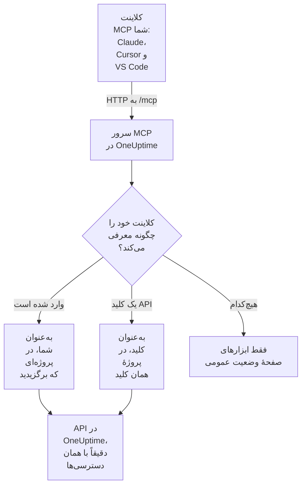

# سرور MCP

سرور MCP در OneUptime به یک دستیار هوش مصنوعی اجازه می‌دهد مستقیماً با پروژهٔ OneUptime شما کار کند. Claude، Cursor، VS Code همراه با GitHub Copilot یا هر کلاینت دیگری از Model Context Protocol (MCP) را وصل کنید و از آن بخواهید یک حادثه را بررسی کند، لاگ‌ها و ردیابی‌ها را جست‌وجو کند، یک هشدار را تأیید کند یا یک مانیتور راه بیندازد: کلاینت ابزارهای OneUptime را با دسترسی‌های شما، یا دسترسی‌های یک کلید API، فراخوانی می‌کند.

:::cards
- [اتصال یک کلاینت](#اتصال-یک-کلاینت): نشانی سرور را به کلاینت بدهید و وارد شوید.
- [ورود با OneUptime](#ورود-با-oneuptime): کلاینت متصل چه کارهایی می‌تواند بکند و چطور اتصال آن را قطع کنید.
- [گرفتن کلید API](#گرفتن-کلید-api): برای عاملی که بدون حضور کسی اجرا می‌شود.
- [رفع اشکال](#رفع-اشکال): مشکلات ورود، دسترسی و اتصال.
:::

این صفحه درباره دستیارهای هوش مصنوعی است که به OneUptime وصل می‌شوند. برای اینکه به‌جای آن OneUptime AI از ابزارهای سرورهای MCP دیگر، مانند سرورهای AWS یا GitHub، استفاده کند، [سرورهای MCP خارجی](/docs/ai/external-mcp-servers) را ببینید.

## چگونه کار می‌کند

سرور MCP بخشی از هر نمونهٔ OneUptime است، در `/mcp` روی همان نشانی داشبورد قرار دارد و با انتقال streamable HTTP کار می‌کند. چیزی برای نصب وجود ندارد.

- **OneUptime Cloud**: `https://oneuptime.com/mcp`
- **خودمیزبان**: `https://your-oneuptime-domain.com/mcp`



سرور بی‌حالت است: هیچ شناسهٔ نشستی صادر نمی‌کند و هر درخواست مستقل است، بنابراین پشت متعادل‌کننده‌های بار و با چند نسخهٔ تکراری کار می‌کند.

## ابزارها چه چیزهایی را پوشش می‌دهند

- **مانیتورها**: مانیتورها را بسازید و پیکربندی کنید، وضعیتشان را بررسی کنید و سابقه‌شان را مرور کنید.
- **پاسخ به حادثه**: حادثه‌ها را بسازید، تأیید و حل کنید، یادداشت داخلی یا عمومی بیفزایید و آن‌ها را تا حل شدن دنبال کنید.
- **هشدارها**: هشدارها را تأیید و حل کنید، یادداشت بیفزایید و وضعیت‌ها و شدت‌های هشدار را مدیریت کنید.
- **تیم‌ها و آنکال**: تیم‌ها و سیاست‌های آنکال را مدیریت کنید.
- **صفحه‌های وضعیت**: صفحه‌های وضعیت را مدیریت کنید و اطلاعیه منتشر کنید.
- **نگهداری زمان‌بندی‌شده**: رویدادهای نگهداری را بسازید و مدیریت کنید.
- **تله‌متری**: لاگ‌ها، متریک‌ها، ردیابی‌ها، استثناها، لاگ‌های مانیتور، رویدادهای امنیتی و موارد دیگر را، فقط به‌صورت خواندنی، جست‌وجو کنید.

برای 42 نوع رکورد ابزارهای ساخت، دریافت، فهرست، به‌روزرسانی، حذف و شمارش وجود دارد، برای 9 نوع تله‌متری ابزارهای فهرست و شمارش، و ابزارهایی هم برای پاسخ به حادثه ساخته شده‌اند. ابزارهای فقط‌خواندنی `readOnlyHint` دارند، هر ابزاری که چیزی را تغییر می‌دهد `destructiveHint` دارد و فقط ابزارهای صفحهٔ وضعیت عمومی `openWorldHint` دارند، بنابراین کلاینت می‌تواند فراخوانی‌های فقط‌خواندنی را خودش اجرا کند و پیش از هر تغییری از شما بپرسد. یک فراخوانی ناموفق ابزار، نه به‌صورت خطای پروتکل MCP، بلکه به‌صورت نتیجهٔ ابزار (`isError: true`) همراه با `statusCode`، جزئیات و یک پیشنهاد برمی‌گردد، تا عامل بتواند خطا را بخواند و خودش را اصلاح کند.

## پیش از شروع

- یک نمونهٔ OneUptime: OneUptime Cloud یا خودمیزبان.
- یک کلاینت MCP، مانند Claude Code، Claude، VS Code همراه با GitHub Copilot یا Cursor.
- یک حساب OneUptime برای ورود، یا یک کلید API در OneUptime برای عاملی که بدون حضور کسی اجرا می‌شود. ابزارهای صفحهٔ وضعیت عمومی به هیچ‌کدام نیاز ندارند.
- در OneUptime Cloud، طرح Growth یا بالاتر: اتصال یک کلاینت MCP در همان طرح‌هایی در دسترس است که کلیدهای API.

## اتصال یک کلاینت

فقط نشانی سرور را به کلاینت بدهید و هیچ چیز دیگری. نخستین بار که کلاینت به داده‌های شما نیاز دارد، OneUptime را در مرورگرتان باز می‌کند تا وارد شوید (ببینید [ورود با OneUptime](#ورود-با-oneuptime)). در یک نمونهٔ خودمیزبان، به‌جای `https://oneuptime.com/mcp` از `https://your-oneuptime-domain.com/mcp` استفاده کنید.

:::tabs
@tab Claude Code
```bash
claude mcp add --transport http oneuptime https://oneuptime.com/mcp
```
سپس درون Claude Code دستور `/mcp` را اجرا کنید و برای ورود **oneuptime** را انتخاب کنید.
@tab Claude
در Claude، **Customize → Connectors** را باز کنید، **Add custom connector** را انتخاب کنید و `https://oneuptime.com/mcp` را وارد کنید. Claude نخستین بار که به داده‌های شما نیاز دارد، از شما می‌خواهد وارد OneUptime شوید.
@tab VS Code
این را به پیکربندی MCP خود اضافه کنید (برای جای آن، ببینید [VS Code همراه با GitHub Copilot](#vs-code-همراه-با-github-copilot)). وقتی سرور را راه می‌اندازید، VS Code صفحهٔ OneUptime را برای ورود شما باز می‌کند:
```json
{
  "servers": {
    "oneuptime": {
      "type": "http",
      "url": "https://oneuptime.com/mcp"
    }
  }
}
```
@tab Cursor
```json
{
  "mcpServers": {
    "oneuptime": {
      "url": "https://oneuptime.com/mcp"
    }
  }
}
```
:::

هر کلاینت دیگری که از مجوزدهی MCP پشتیبانی کند به همین شکل کار می‌کند: نشانی را به آن بدهید و بقیه را خودش پیدا می‌کند. برای پروتکل، ببینید [ورود (OAuth 2.1)](#ورود-oauth-21).

داشبورد هم همین گام‌ها را دارد، با نشانی نمونهٔ شما که از پیش پر شده است: **تنظیمات پروژه** > **هوش مصنوعی** > **سرور MCP**. همچنین در هر منبعی (یک مانیتور، یک حادثه، یک صفحهٔ وضعیت و غیره)، **توسعه‌دهنده** را در منوی کناری آن باز کنید و **دستیارهای هوش مصنوعی** را انتخاب کنید: آن صفحه پرامپت‌هایی هم پیشنهاد می‌کند که منبع و شناسهٔ آن را نام می‌برند، تا دستیار بی‌درنگ آن را پیدا کند. برای منبعی که سرور MCP هنوز ابزاری برایش ندارد، مانند یک گردش کار، صفحه نشان می‌دهد که دستیاری که می‌تواند فرمان اجرا کند، چطور به‌جای آن از راه REST API با آن کار کند.

## ورود با OneUptime

ساده‌ترین راه اتصال این است که فقط نشانی سرور را به کلاینت MCP خود بدهید. نخستین بار که کلاینت به داده‌های شما نیاز دارد، صفحه‌ای از OneUptime را در مرورگرتان باز می‌کند:

:::steps
1. اگر هنوز وارد نشده‌اید، وارد OneUptime شوید.
2. پروژه‌ای را که کلاینت باید در آن کار کند انتخاب کنید.
3. **خواندن و نوشتن** یا **فقط خواندن** را انتخاب کنید.
4. روی **اعطای دسترسی** کلیک کنید.
:::

از آن پس کلاینت در آن پروژه به‌عنوان شما عمل می‌کند. هیچ کلید API برای ساختن، کپی کردن یا چرخاندن وجود ندارد و هیچ رازی در فایل پیکربندی ذخیره نمی‌شود.

آنچه یک کلاینت متصل می‌تواند انجام دهد:

- **دسترسی‌های شما را دارد و هرگز بیشتر.** هر کاری که تیم‌هایتان در پروژه به شما اجازه می‌دهند، همان کاری است که کلاینت می‌تواند بکند. اگر نقش شما تغییر کند یا پروژه را ترک کنید، این از همان درخواست بعدی کلاینت اعمال می‌شود. ترک پروژه همچنین کلاینت را قطع می‌کند: مجوز آن حذف می‌شود و اگر دوباره به پروژه بپیوندید، آن را از نو وصل می‌کنید.
- **فقط خواندنی یعنی فقط خواندنی.** کلاینتی که به‌صورت فقط خواندنی مجوز گرفته، می‌تواند ابزارهای `get_`، `list_` و `count_` را به کار ببرد. ابزارهایی که می‌سازند، به‌روزرسانی می‌کنند، حذف می‌کنند، تأیید می‌کنند یا حل می‌کنند، هم از سوی سرور MCP و هم از سوی API در OneUptime که پشت آن است رد می‌شوند. هرگز نمی‌توانید به کلاینت دسترسی‌ای بیش از آنچه خواسته است بدهید.
- **برای یک پروژه است.** برای استفاده از پروژهٔ دیگر، کلاینت را دوباره وصل کنید و آن پروژه را انتخاب کنید.
- **فقط از راه سرور MCP کار می‌کند.** توکن دسترسی کلاینت فقط در نقطهٔ پایانی MCP پذیرفته می‌شود و هیچ جای دیگری نه. نمی‌توان با آن مستقیماً REST API در OneUptime را فراخوانی کرد.
- **مدیران نمونه هم رفتار ویژه‌ای ندارند.** کلاینتی که یک مدیر ارشد وصل کرده، همان دسترسی‌هایی را دارد که تیم‌های آن شخص در پروژه می‌دهند، نه دسترسی به کل نمونه.

### مدیریت کلاینت‌های متصل

هر کلاینتی که با ورود وصل شده باشد در **تنظیمات پروژه** > **هوش مصنوعی** > **سرور MCP**، زیر **کلاینت‌های MCP متصل** فهرست می‌شود، همراه با اینکه چه کسی آن را وصل کرده، چه کاری می‌تواند بکند و آخرین بار کی استفاده شده است. شما کلاینت‌هایی را که خودتان وصل کرده‌اید می‌بینید؛ مالکان و مدیران پروژه کلاینت‌های همه را می‌بینند.

برای خارج کردن یک کلاینت از حساب، روی **قطع اتصال** کلیک کنید. کلاینت بی‌درنگ از کار می‌افتد.

کلاینت تا زمانی که استفاده شود متصل می‌ماند. کلاینتی که ۳۰ روز استفاده نشده باشد باید دوباره وارد شود.

### کنترل اینکه چه کسی می‌تواند کلاینت وصل کند

به‌طور پیش‌فرض هر عضو پروژه می‌تواند یک کلاینت MCP وصل کند. برای اینکه اعضای یک تیم نتوانند چنین کنند، صفحهٔ **دسترسی‌ها** را در آن تیم باز کنید، **تنظیمات بیشتر** را در پایین صفحه باز کنید و دسترسی **Authorize MCP Client** را زیر **مسدود کردن دسترسی‌ها** اضافه کنید. کلاینت‌هایی که آن اعضا از قبل وصل کرده‌اند، بی‌درنگ از کار می‌افتند.

اگر پروژه ورود یکپارچه (SSO) را الزامی کرده است، پیش از اینکه به کلاینتی مجوز بدهید، در مرورگر خود با SSO وارد پروژه شوید. اتصال کلاینت تا زمانی دوام دارد که آن ورود با SSO برقرار است؛ وقتی منقضی شود، یا ارائه‌دهندهٔ SSO که با آن وارد شده‌اید خاموش یا حذف شود، کلاینت را دوباره وصل کنید.

در OneUptime Cloud، اتصال یک کلاینت MCP در همان طرح‌هایی در دسترس است که کلیدهای API (Growth و بالاتر).

در Enterprise Edition، هر تغییری که یک کلاینت متصل انجام دهد، به نام شخصی که آن را وصل کرده و همراه با نام کلاینت، در گزارش ممیزی ثبت می‌شود. تغییراتی که با یک کلید API انجام شوند، نام کلید را نشان می‌دهند.

## گرفتن کلید API

برای عاملی که بدون حضور کسی اجرا می‌شود، مانند یک کار زمان‌بندی‌شده یا یک خط لولهٔ CI، که کسی آنجا نیست تا وارد شود، از کلید API استفاده کنید.

:::steps
### کلید را بسازید

به **تنظیمات پروژه** > **پیشرفته** > **کلیدهای API** بروید و روی **ساخت کلید API** کلیک کنید. نامی مانند "MCP Server" به آن بدهید.

### کارهای مجاز آن را انتخاب کنید

در **دسترسی**، برای عاملی که فقط می‌خواند **بیننده** را انتخاب کنید و برای عاملی که ساخت، به‌روزرسانی و حذف هم انجام می‌دهد **مدیر پروژه** را (ببینید [دسترسی‌های کلید API](#دسترسیهای-کلید-api)).

### کلید را کپی کنید

روی **ساخت کلید API** کلیک کنید: صفحهٔ کلید باز می‌شود. کلید را از آنجا کپی کنید.
:::

کلیدهای API به یک پروژه تعلق دارند: سرور MCP پروژه را از روی کلید تشخیص می‌دهد، بنابراین ابزارهای ساخت هرگز به آرگومان `projectId` نیاز ندارند.

> [!WARNING]
> هرگز کلید اصلی را به یک عامل هوش مصنوعی ندهید. کلید API اصلی OneUptime هم در این سرآیند پذیرفته می‌شود و دسترسی مدیر به کل نمونه می‌دهد. همیشه از کلید API یک پروژه با کمترین دسترسی‌ای که عامل نیاز دارد استفاده کنید: برای همهٔ ابزارهای `get_`، `list_` و `count_` یک کلید فقط خواندنی کافی است.

## اتصال با کلید API

کلید را در سرآیند `x-api-key` بفرستید. از درخواستی که کلید API دارد هرگز خواسته نمی‌شود وارد شود. در یک نمونهٔ خودمیزبان، به‌جای `oneuptime.com` از دامنهٔ خودتان استفاده کنید.

:::tabs
@tab Claude Code
```bash
claude mcp add --transport http oneuptime https://oneuptime.com/mcp --header "x-api-key: your-api-key-here"
```
@tab Claude Desktop
این را به `claude_desktop_config.json` اضافه کنید، که در macOS در `~/Library/Application Support/Claude/`، در Windows در `%APPDATA%\Claude\` و در Linux در `~/.config/Claude/` است:
```json
{
  "mcpServers": {
    "oneuptime": {
      "transport": "streamable-http",
      "url": "https://oneuptime.com/mcp",
      "headers": {
        "x-api-key": "your-api-key-here"
      }
    }
  }
}
```
@tab VS Code
متغیر ورودی با `"password": true` هنگام راه‌اندازی سرور کلید را می‌پرسد، به‌جای اینکه آن را به‌صورت متن ساده نگه دارد:
```json
{
  "servers": {
    "oneuptime": {
      "type": "http",
      "url": "https://oneuptime.com/mcp",
      "headers": {
        "x-api-key": "${input:oneuptime-api-key}"
      }
    }
  },
  "inputs": [
    {
      "type": "promptString",
      "id": "oneuptime-api-key",
      "description": "OneUptime API Key",
      "password": true
    }
  ]
}
```
@tab Cursor
```json
{
  "mcpServers": {
    "oneuptime": {
      "url": "https://oneuptime.com/mcp",
      "headers": {
        "x-api-key": "your-api-key-here"
      }
    }
  }
}
```
:::

## VS Code همراه با GitHub Copilot

VS Code 1.99 و نسخه‌های بعدی، در GitHub Copilot Chat به‌طور بومی از سرورهای MCP پشتیبانی می‌کنند.

:::steps
### آنچه لازم دارید را بررسی کنید

VS Code 1.99 یا بالاتر، با افزونهٔ GitHub Copilot نصب‌شده و واردشده، و GitHub Copilot Chat روشن.

### پیکربندی MCP را باز کنید

`Ctrl+Shift+P` (در macOS `Cmd+Shift+P`) را بزنید، "MCP: Open User Configuration" را تایپ کنید و Enter را بزنید. فایل `mcp.json` باز یا ساخته می‌شود. برای فقط یک فضای کاری، به‌جای آن `.vscode/mcp.json` را در آن بسازید.

### OneUptime را اضافه کنید

پیکربندی VS Code بالا را بچسبانید: آنکه بدون کلید است برای ورود، یا آنکه کلید API دارد.

### سرور را راه بیندازید

`Ctrl+Shift+P` (در macOS `Cmd+Shift+P`) را بزنید، "MCP: List Servers" را تایپ کنید و برای راه‌اندازی، **oneuptime** را انتخاب کنید. VS Code بار اول می‌پرسد که آیا به سرور اعتماد دارید، سپس از شما می‌خواهد وارد شوید یا کلید API خود را وارد کنید.

### از Copilot بپرسید

GitHub Copilot Chat را در حالت عامل باز کنید و برای نمونه بپرسید: «چه مانیتورهایی در OneUptime دارم؟»، «حادثه‌های اخیر را نشانم بده» یا «یک مانیتور جدید برای https://example.com بساز».
:::

## احراز هویت

سرور MCP به سه شکل کار می‌کند.

### ابزارهای عمومی (بدون نیاز به احراز هویت)

بدون کلید API یا ورود، یک کلاینت می‌تواند از ابزارهای عمومی استفاده کند:

- **`oneuptime_help`**: راهنما و توضیح دربارهٔ ابزارهای MCP در OneUptime
- **`oneuptime_list_resources`**: منابع و کارهایی که با هر کدام می‌توانید بکنید
- **`get_public_status_page_overview`**: نمای کلی یک صفحهٔ وضعیت عمومی
- **`get_public_status_page_incidents`**: حادثه‌های یک صفحهٔ وضعیت عمومی
- **`get_public_status_page_scheduled_maintenance`**: رویدادهای نگهداری زمان‌بندی‌شدهٔ آن
- **`get_public_status_page_announcements`**: اطلاعیه‌های آن

ابزارهای صفحهٔ وضعیت عمومی شناسهٔ صفحهٔ وضعیت (یک UUID) یا نام دامنهٔ آن را می‌گیرند. برای استفادهٔ تنها از این‌ها، فقط با نشانی و بدون هیچ اعتبارنامه‌ای وصل شوید:

```json
{
  "mcpServers": {
    "oneuptime": {
      "transport": "streamable-http",
      "url": "https://oneuptime.com/mcp"
    }
  }
}
```

مالکان یک صفحهٔ وضعیت می‌توانند دسترسی MCP را برای آن صفحه خاموش کنند: در صفحهٔ وضعیت، **MCP** را در بخش **هوش مصنوعی** منوی کناری آن باز کنید و **فعال کردن سرور MCP** را خاموش کنید. کلید به‌محض تغییر ذخیره می‌شود. دسترسی MCP به‌طور پیش‌فرض روشن است. تا وقتی خاموش است، چهار ابزار `get_public_status_page_*` برای آن صفحهٔ وضعیت خطا برمی‌گردانند؛ وب‌سایت صفحهٔ وضعیت، خوراک RSS آن و JSON API عمومی آن تأثیری نمی‌پذیرند، و ابزارهای صفحهٔ وضعیت که به ورود نیاز دارند (`get_status_page`، `list_status_pages` و مانند آن‌ها) برای پروژهٔ خود آن صفحه همچنان کار می‌کنند.

### ورود (OAuth 2.1)

همهٔ ابزارهای دیگر باید بدانند چه کسی فراخوانی می‌کند. کلاینتی که هیچ اعتبارنامه‌ای نفرستد و یکی از آن‌ها را فراخوانی کند، `401 Unauthorized` را همراه با سرآیند `WWW-Authenticate` دریافت می‌کند که به فرادادهٔ منبع محافظت‌شدهٔ سرور اشاره دارد. این همان نشانه‌ای است که کلاینت MCP با آن شما را به ورود می‌برد؛ `initialize`، `tools/list` و ابزارهای عمومی هرگز آن را نمی‌خواهند.

سرور [مشخصات مجوزدهی MCP](https://modelcontextprotocol.io/specification/latest/basic/authorization) را پیاده‌سازی می‌کند:

- **جریان**: کد مجوز OAuth 2.1 همراه با PKCE (فقط `S256`). توکن‌های دسترسی به‌صورت `Authorization: Bearer` فرستاده می‌شوند.
- **کشف**: فرادادهٔ منبع محافظت‌شده (RFC 9728) و فرادادهٔ سرور مجوزدهی (RFC 8414). صادرکننده و منبع هر دو `https://<host>/mcp` هستند.
- **هویت کلاینت**: یک Client ID Metadata Document (شناسهٔ کلاینت یک نشانی `https` است که سرور آن را می‌خواند)، یا ثبت پویای کلاینت (RFC 7591). لازم نیست هیچ کلاینتی را یک مدیر ثبت کند.
- **دامنه‌ها**: `mcp:read` برای ابزارهای `get_`، `list_` و `count_`؛ `mcp:write` هر ابزاری را که چیزی را تغییر می‌دهد اضافه می‌کند و `mcp:read` را هم در بر دارد. توکن فقط خواندنی که یک ابزار نوشتن را فراخوانی کند، `403` را همراه با `error="insufficient_scope"` می‌گیرد.
- **طول عمر توکن‌ها**: توکن دسترسی یک ساعت اعتبار دارد. توکن تازه‌سازی ۳۰ روز اعتبار دارد و هر بار که استفاده شود جایگزین می‌شود؛ استفاده از توکن تازه‌سازی‌ای که پیش‌تر جایگزین شده، اتصال را پایان می‌دهد.
- **نشانگرهای منبع** (RFC 8707): توکن برای `https://<host>/mcp` صادر می‌شود و هیچ جای دیگری پذیرفته نمی‌شود.
- **ابطال** (RFC 7009): ابطال هر یک از دو توکن اتصال را پایان می‌دهد.

### کلید API

عاملی که بدون حضور کسی اجرا می‌شود، کلید API در OneUptime را در یکی از این سرآیندها می‌فرستد:

- `x-api-key`: کلید API شما در OneUptime
- `Authorization`: یک توکن bearer با کلید API شما (برای نمونه `Bearer your-api-key-here`)

طرح `Bearer` به بزرگی و کوچکی حروف حساس نیست. از درخواستی که کلید API دارد هرگز خواسته نمی‌شود وارد شود.

در OneUptime Cloud، کلیدهای API فقط تا زمانی کار می‌کنند که پروژه روی **Growth** یا بالاتر باشد. پایین‌تر از آن، هر ابزاری که به کلید نیاز دارد با `402` و پیامی که طرح را نام می‌برد پاسخ می‌دهد، و به عامل گفته می‌شود دوباره تلاش نکند. چیزی حذف نمی‌شود: وقتی پروژه به Growth برگردد، کلید همان‌طور که هست دوباره کار می‌کند و چیزی برای اتصال دوباره نیست. کلاینتی که با ورود وصل شده، به‌عنوان یک شخص عمل می‌کند و همچنان کار می‌کند ([کلیدهای API و SCIM پایین‌تر از طرحشان](/docs/api-reference/api-reference#کلیدهای-api-و-scim-پایینتر-از-طرحشان)).

## نقاط پایانی در دسترس

| نقطهٔ پایانی | روش | توضیح |
| --- | --- | --- |
| `/mcp` | POST | درخواست‌های JSON-RPC برای فراخوانی ابزارها و دیگر عملیات |
| `/mcp` | GET | بدون سرآیند `Accept` از نوع SSE: توضیح کوتاهی از سرور به‌صورت JSON. با آن: `405`، چون سرور بی‌حالت هیچ جریان SSE مستقلی ارائه نمی‌کند (کلاینت‌هایی که از مشخصات پیروی می‌کنند بدون آن ادامه می‌دهند) |
| `/mcp` | DELETE | کاری نمی‌کند: سرور بی‌حالت است، پس نشستی برای پایان دادن وجود ندارد |
| `/mcp/health` | GET | بررسی سلامت |
| `/mcp/tools` | GET | فهرست ابزارها، به‌صورت REST ساده |

کلاینت‌های MCP که وارد می‌شوند، از نقاط پایانی OAuth زیر هم استفاده می‌کنند. کلاینت آن‌ها را خودش پیدا می‌کند؛ این فهرست برای کسانی است که کلاینت می‌نویسند یا یک پراکسی راه می‌اندازند.

| نقطهٔ پایانی | روش | توضیح |
| --- | --- | --- |
| `/mcp/.well-known/oauth-protected-resource` | GET | فرادادهٔ منبع محافظت‌شده (RFC 9728). همچنین در `/.well-known/oauth-protected-resource/mcp` |
| `/.well-known/oauth-authorization-server/mcp` | GET | فرادادهٔ سرور مجوزدهی (RFC 8414). همچنین در `/mcp/.well-known/oauth-authorization-server` |
| `/mcp/oauth/authorize` | GET | نقطهٔ پایانی مجوزدهی: جایی که کلاینت مرورگر شما را برای ورود به آن می‌فرستد |
| `/mcp/oauth/token` | POST | نقطهٔ پایانی توکن: یک کد مجوز یا یک توکن تازه‌سازی را مبادله می‌کند |
| `/mcp/oauth/register` | POST | ثبت پویای کلاینت (RFC 7591) |
| `/mcp/oauth/revoke` | POST | ابطال توکن (RFC 7009) |

برای بررسی اینکه سرور در حال اجراست، و برای فهرست کردن ابزارهای آن:

```bash
curl https://oneuptime.com/mcp/health
curl https://oneuptime.com/mcp/tools
```

## ابزارهای پاسخ به حادثه

افزون بر ابزارهای هر نوع رکورد، سرور ابزارهایی دارد که برای پاسخ به حادثه‌ها و هشدارها ساخته شده‌اند:

- **`acknowledge_incident`** / **`resolve_incident`**: یک حادثه را به وضعیت Acknowledged یا Resolved پروژه می‌برد، همان‌طور که دکمهٔ داشبورد این کار را می‌کند
- **`acknowledge_alert`** / **`resolve_alert`**: همین کار برای هشدارها
- **`add_incident_note`**: یادداشتی را با `visibility: "internal"` (فقط تیم، پیش‌فرض) یا `visibility: "public"` (منتشرشده در صفحهٔ وضعیت) به یک حادثه می‌افزاید. از Markdown پشتیبانی می‌کند
- **`add_alert_note`**: یک یادداشت داخلی به یک هشدار می‌افزاید

یک چرخهٔ معمول: `list_incidents`، سپس `acknowledge_incident`، سپس بررسی با `list_logs`، سپس `add_incident_note` (عمومی) و در پایان `resolve_incident`.

ابزار **`oneuptime_whoami`** پروژه‌ای را که اعتبارنامهٔ شما به آن تعلق دارد (شناسه و نام آن) برمی‌گرداند. برای کلاینتی که وارد شده، همچنین می‌گوید به نام چه کسی وارد شده و آیا می‌تواند تغییری بدهد. این فراخوانی نخست خوبی است تا عامل جای خود را پیدا کند، و چون ابزارهای ساخت `projectId` را از اعتبارنامه می‌گیرند، عامل هرگز لازم نیست شناسهٔ پروژه را بفرستد.

## جست‌وجوی تله‌متری

لاگ‌ها، متریک‌ها، ردیابی‌ها (spanها)، استثناها، لاگ‌های مانیتور و دیگر انواع تله‌متری به‌صورت ابزارهای فقط خواندنی `list_` و `count_` ارائه می‌شوند (`list_logs`، `list_metrics`، `list_spans`، `list_exception_instances`، `list_monitor_logs` و همتای `count_` هر کدام). تله‌متری از راه OpenTelemetry می‌رسد، پس ابزار ساختی وجود ندارد.

تله‌متری را همیشه با یک بازهٔ زمانی جست‌وجو کنید. یک فیلد پرس‌وجو یک مقدار، یا یک شیء عملگر می‌گیرد:

```json
{
  "query": {
    "time": { "_type": "GreaterThan", "value": "2026-07-04T00:00:00.000Z" }
  },
  "sort": { "time": "DESC" },
  "limit": 50
}
```

عملگرها عبارت‌اند از `EqualTo`، `NotEqual`، `IsNull`، `NotNull`، `EqualToOrNull`، `GreaterThan`، `LessThan`، `GreaterThanOrEqual`، `LessThanOrEqual`، `InBetween`، `Search` و `Includes`. مقدارهای مرتب‌سازی `"ASC"` یا `"DESC"` هستند.

## انتخاب فیلدها و صفحه‌بندی

ابزارهای `get_` و `list_` آرایهٔ اختیاری `select` از نام فیلدها را می‌گیرند. به‌طور پیش‌فرض همهٔ فیلدهای خواندنی برمی‌گردند جز فیلدهای سنگین (ستون‌های JSON، متن بسیار طولانی و HTML)، که باید در `select` خواسته شوند.

ابزارهای فهرست با `limit` (به‌طور پیش‌فرض ۱۰ و حداکثر ۱۰۰) و `skip` صفحه‌بندی می‌کنند، و هر پاسخ فهرست دقیقاً می‌گوید چه چیزی برگردانده است:

```json
{
  "returnedCount": 10,
  "totalCount": 42,
  "skip": 0,
  "limit": 10,
  "hasMore": true,
  "data": ["..."]
}
```

## نمونه‌های استفاده

### پرسش‌های روزمره

```text
"What's the current status of all my monitors?"
"Show me incidents from the last 24 hours"
"List the teams in this project"
"Show me our on-call policies"
```

### مانیتورها و حادثه‌ها

```text
"Create a new website monitor for https://example.com that checks every 5 minutes"
"Set up an API monitor for https://api.example.com/health with a 30-second timeout"
"Disable the monitor for staging.example.com while we're doing maintenance"
"Create a high-priority incident for the database outage affecting user authentication"
"Add a note to incident #123 saying 'Database connection restored, monitoring for stability'"
"Mark incident #456 as resolved"
```

### صفحه‌های وضعیت

```text
"Update our status page to show 'Investigating Payment Issues' for the payment service"
"Create a status page announcement about scheduled maintenance this weekend"
```

### پرسش از صفحه‌های وضعیت عمومی (بدون نیاز به کلید API)

این‌ها بدون اعتبارنامه و تنها با ابزارهای صفحهٔ وضعیت عمومی کار می‌کنند:

```text
"What's the current status of status.example.com?"
"Show me recent incidents from the OneUptime status page"
"Are there any scheduled maintenance events on status.acme.com?"
"Get the latest announcements from my public status page with ID abc123-..."
```

### چند گام با هم

```text
"Create a scheduled maintenance window for Saturday 2-4 AM, disable all monitors for api.example.com during that time, and update the status page"
"Show me all monitors that have been down in the last hour, create incidents for any that don't already have one"
```

## دسترسی‌های کلید API

| کاری که عامل انجام می‌دهد | آنچه در **دسترسی** انتخاب می‌کنید |
| --- | --- |
| فقط می‌خواند | **بیننده**، یا افزودن دسترسی‌های خواندن در صفحهٔ کلید |
| ساخت، به‌روزرسانی و حذف هم انجام می‌دهد | **مدیر پروژه**، یا افزودن نقش Project Admin در صفحهٔ کلید |

به هر کلید کمترین دسترسی‌ای را که نیاز دارد بدهید، کلیدها را مرتب بچرخانید، برای هر محیط کلید جداگانه‌ای نگه دارید و کارهایی را که هر کلید در OneUptime انجام می‌دهد زیر نظر بگیرید.

## پیکربندی خودمیزبان

ورود در یک نمونهٔ خودمیزبان بدون هیچ تنظیمی کار می‌کند. دو تنظیم آن را تغییر می‌دهند:

| متغیر محیطی | مقدار Helm | کاری که می‌کند |
| --- | --- | --- |
| `DISABLE_MCP_OAUTH` | `mcpOAuth.disabled` | با `true` ورود را خاموش می‌کند. نقاط پایانی OAuth دیگر ارائه نمی‌شوند و سرور MCP فقط کلیدهای API را می‌پذیرد. چیزی حذف نمی‌شود؛ وقتی دوباره روشن شود، کلاینت‌های متصل دوباره کار می‌کنند. |
| `DISABLE_MCP_OAUTH_CLIENT_ID_METADATA_DOCUMENTS` | `mcpOAuth.disableClientIdMetadataDocuments` | آن را در نمونه‌ای که به اینترنت دسترسی ندارد `true` کنید. یک کلاینت می‌تواند خود را با نشانی‌ای معرفی کند که OneUptime آن را می‌خواند؛ با این تنظیم، کلاینت‌ها به‌جای آن مستقیماً در نمونهٔ شما ثبت می‌شوند، که به هیچ درخواست خروجی نیاز ندارد. |

اگر پراکسی معکوس خودتان را جلوی OneUptime اجرا می‌کنید، `/.well-known/oauth-protected-resource` و `/.well-known/oauth-authorization-server` (و هر چه زیر آن‌هاست) را همراه با `/mcp` به OneUptime بفرستید. ingress همراه از پیش همین کار را می‌کند.

سرور هر نشانی OAuth را از تنظیمات `HOST` و `HTTP_PROTOCOL` می‌سازد، پس این‌ها باید با نشانی‌ای که افراد با آن به نمونهٔ شما می‌رسند یکی باشند.

## رفع اشکال

### مشکلات ورود

- **کلاینت هرگز از من نمی‌خواهد وارد شوم**: شاید کلاینت از مجوزدهی MCP پشتیبانی نکند، یا با یک سرآیند کلید API پیکربندی شده باشد که اولویت دارد. برای ورود به‌جای آن، سرآیند را بردارید.
- **پروژه‌ام در صفحهٔ مجوزدهی خاکستری است**: صفحه دلیل را کنار نام پروژه می‌گوید: طرح پروژه اتصال کلاینت‌های MCP را در بر ندارد، پروژه SSO را الزامی کرده و این مرورگر با SSO وارد آن نشده است، یا تیم شما از اتصال کلاینت‌ها منع شده است.
- **یک ابزار با "read-only" رد می‌شود**: کلاینت به‌صورت فقط خواندنی مجوز گرفته است. دوباره وصلش کنید و **خواندن و نوشتن** را انتخاب کنید.
- **کلاینت از کار افتاده است**: اتصالش قطع شده، ۳۰ روز استفاده نشده، شما از پروژه حذف شده‌اید، یا ورود با SSO پروژه منقضی شده یا ارائه‌دهندهٔ آن خاموش شده است. دوباره وصلش کنید.
- **خودمیزبان - کلاینت می‌گوید سرور مجوزدهی را پیدا نمی‌کند**: بررسی کنید که `HOST` و `HTTP_PROTOCOL` با نشانی عمومی شما یکی باشند و پراکسی شما مسیرهای `/.well-known/oauth-*` را بفرستد.

### خطاهای دسترسی

کلید API، یا برای کلاینتی که وارد شده حساب خود شما، به دسترسی‌های درست نیاز دارد: دسترسی خواندن برای فهرست کردن رکوردها، دسترسی نوشتن برای ساختن و به‌روزرسانی آن‌ها و دسترسی حذف برای پاک کردنشان.

### مشکلات اتصال

بررسی کنید که نشانی OneUptime درست و در دسترس باشد، کلید API معتبر باشد و نقطهٔ پایانی سلامت پاسخ بدهد (ببینید [نقاط پایانی در دسترس](#نقاط-پایانی-در-دسترس)).

### کلید API نامعتبر

- کلید API را در تنظیمات OneUptime خود بررسی کنید، بدون فاصله یا نویسهٔ اضافه
- بررسی کنید که کلید منقضی نشده باشد
- در OneUptime Cloud، پاسخ `402` که می‌گوید کلیدهای API به طرح Growth نیاز دارند یعنی پروژه پایین‌تر از آن است: پروژه را در **تنظیمات پروژه** > **صورت‌حساب و فاکتورها** > **صورت‌حساب** ارتقا دهید تا همان کلید دوباره کار کند

### خطاهای نشست

سرور MCP بی‌حالت است: نه شناسهٔ نشست صادر می‌کند و نه آن را دنبال می‌کند، بنابراین هر درخواست روی هر نسخهٔ تکراری کار می‌کند. کلاینتی که سرآیند `mcp-session-id` را از نسخهٔ قدیمی‌تر سرور می‌فرستد می‌تواند آن را کنار بگذارد؛ نادیده گرفته می‌شود. پیکربندی قدیمی کلاینت را که انتظار دارد سرور شناسهٔ نشست برگرداند به‌روزرسانی کنید.

## منابع در دسترس

| حوزه | رکوردهایی با ابزارهای ساخت، دریافت، فهرست، به‌روزرسانی، حذف و شمارش |
| --- | --- |
| مانیتورینگ | Monitor, Monitor Status, Monitor Status Event |
| حادثه‌ها | Incident, Incident State, Incident Severity, Incident State Timeline, Incident Public Note, Incident Internal Note, Incident Alert, Postmortem Status |
| هشدارها | Alert, Alert State, Alert Severity, Alert State Timeline, Alert Internal Note |
| صفحه‌های وضعیت | Status Page, Status Page Announcement |
| نگهداری زمان‌بندی‌شده | Scheduled Maintenance Event, Scheduled Maintenance State, Scheduled Maintenance State Timeline |
| تیم‌ها و آنکال | Team, On-Call Policy |
| برچسب‌ها | Label |
| امنیت | Security Case, Security Case Evidence, Security Case Note, Security Case Priority, Security Case Status, Security Case Task, Security Detection, Security Playbook |
| امنیت داده | Data Store, Data Store Finding, Data Store Access Entry, Data Flow, Data Security Issue, Data Security Scan, Data Security Setting, Check Setting, Custom Data Type, Residency Rule |

| حوزه | تله‌متری با ابزارهای فهرست و شمارش و بس |
| --- | --- |
| مشاهده‌پذیری | Log, Metric, Span, Exception Instance, Monitor Log |
| امنیت | Security Event, Threat Intel Indicator |
| تغییرات و هزینه | Change Event, Kubernetes Cost Allocation |

نام ابزارها به سبک snake case است: `create_incident`، `get_incident`، `list_incidents`، `update_incident`، `delete_incident` و `count_incidents`، یا برای تله‌متری `list_logs` و `count_spans`.

## گام‌های بعدی

:::cards
- [پرسش از هوش مصنوعی](/docs/ai/ask-ai): به‌جای آن، درون OneUptime دربارهٔ پروژه‌تان بپرسید.
- [مرجع API در OneUptime](/docs/api-reference/api-reference): REST API پشت هر ابزار.
- [دسترسی‌ها](/docs/permissions/index): یک نقش، یک تیم یا یک کلید API چه کارهایی می‌تواند بکند.
:::
