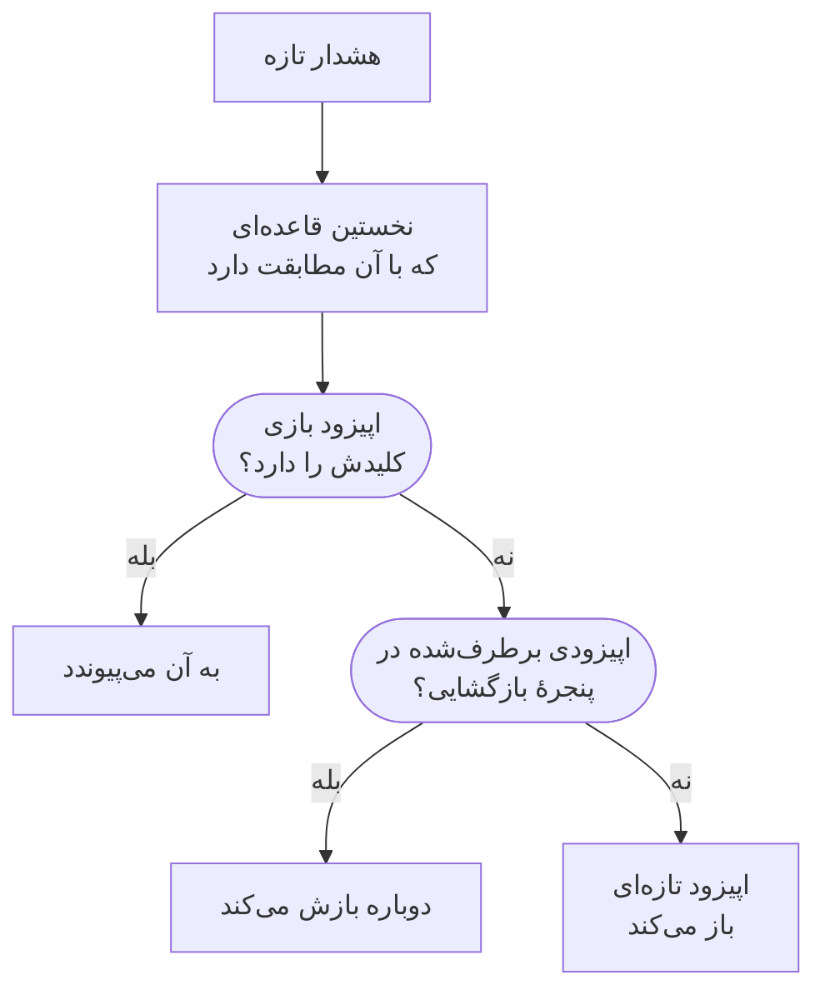

# اپیزودهای هشدار و قواعد گروه‌بندی

وقتی یک پایگاه‌داده از کار می‌افتد، بیست مانیتور می‌توانند در چند دقیقه بیست هشدار بسازند. یک اپیزود آن‌ها را در یک رکورد جمع می‌کند که تیم شما با هم تأییدش می‌کند و برطرفش می‌کند، و یک قاعدهٔ گروه‌بندی تعیین می‌کند کدام هشدارها در آن جای می‌گیرند. این صفحه نشان می‌دهد گروه‌بندی چگونه کار می‌کند، چگونه یک قاعده تنظیم کنید، و اپیزود پس از باز شدن چگونه رفتار می‌کند.

:::cards
- [گروه‌بندی چگونه کار می‌کند](#گروهبندی-چگونه-کار-میکند): قواعد، کلیدهای گروه‌بندی و پنجره‌های زمانی.
- [ساخت یک قاعدهٔ گروه‌بندی](#ساخت-یک-قاعدهٔ-گروهبندی): از روی یک قالب با یک کلیک، یا قاعدهٔ خودتان.
- [اپیزود چگونه رفتار می‌کند](#اپیزود-چگونه-رفتار-میکند): شدتش، وضعیت‌هایش و اینکه کی برطرف می‌شود.
- [اپیزود چه کسانی را فرا می‌خواند](#اپیزود-چه-کسانی-را-فرا-میخواند): سیاست‌های آنکال قاعده و سیاست‌های خود هشدارها.
:::

## گروه‌بندی چگونه کار می‌کند

گروه‌بندی برای هر هشدار تازه یک بار اجرا می‌شود، درست پس از اجرای سیاست‌های آنکالش. هشدار با قواعد گروه‌بندی فعال شما، از بالای فهرست به پایین، سنجیده می‌شود، و نخستین قاعده‌ای که با آن مطابقت دارد اپیزودش را تعیین می‌کند. هشداری که هیچ قاعده‌ای با آن مطابقت ندارد تنها می‌ماند.



- **شرط‌های قاعده** تعیین می‌کنند قاعده برای کدام هشدارها به کار می‌رود. قاعده‌ای بدون شرط برای هر هشدار تازه به کار می‌رود.
- **کلید گروه‌بندی** تعیین می‌کند کدام هشدارها در یک اپیزود شریک‌اند: آن‌هایی با مانیتور یکسان، شدت یکسان، عنوان یکسان، یا هر ترکیبی که قاعده بر اساس آن گروه‌بندی می‌کند. قاعده‌ای که بر اساس هیچ چیز گروه‌بندی نمی‌کند هر هشداری را که با آن مطابقت دارد در یک اپیزود می‌گذارد.
- **پنجرهٔ زمانی** تعیین می‌کند یک اپیزود تا کی هشدار می‌پذیرد. وقتی روشن است، هشدار فقط وقتی می‌پیوندد که در پنجرهٔ پس از آخرین هشدار اپیزود برسد. وقتی خاموش است، هشدارهای مطابق تا برطرف شدن اپیزود همچنان می‌پیوندند.

گروه‌بندی هنگام ساخته شدن هشدار رخ می‌دهد. قاعده‌ای که امروز می‌افزایید هشدارهایی را که پس از آن ساخته می‌شوند گروه‌بندی می‌کند؛ هشدارهای موجود را دوباره گروه‌بندی نمی‌کند.

> [!NOTE]
> هشداری که از پیش تأییدشده ساخته شود می‌تواند به یک اپیزود باز بپیوندد اما هرگز اپیزودی باز نمی‌کند، و هشداری که برطرف‌شده ساخته شود اصلاً گروه‌بندی نمی‌شود. [ساخته‌شده در حالت تأییدشده یا برطرف‌شده](/docs/alerts/index#ساختهشده-در-حالت-تأییدشده-یا-برطرفشده) را ببینید.

## ساخت یک قاعدهٔ گروه‌بندی

به **هشدارها** > **قواعد** > **قواعد گروه‌بندی** بروید. بخش **قواعد** در منوی کناری جمع‌شده آغاز می‌شود، پس اول بازش کنید.

### آغاز از روی یک قالب

پروژه‌ای که قاعدهٔ گروه‌بندی ندارد به‌جای فهرستی خالی چهار قاعدهٔ آماده می‌بیند؛ وقتی قاعده دارید، **ساخت از روی قالب** روی کارت آن‌ها را باز می‌کند. **افزودن قاعده** یکی را با یک کلیک ذخیره می‌کند، فعال، در انتهای فهرست و برای هر هشدار تازه. پس از آن مانند هر قاعدهٔ دیگری ویرایشش کنید.

| قالب                                            | گروه‌بندی                                                                   | پنجرهٔ زمانی |
| ----------------------------------------------- | --------------------------------------------------------------------------- | ------------ |
| **گروه‌بندی هشدارهای یک مانیتور**               | یک اپیزود برای هر مانیتور                                                   | ۳۰ دقیقه     |
| **گروه‌بندی هشدارهایی که با هم رخ می‌دهند**      | یک اپیزود مشترک، هر مانیتوری که باشد                                        | ۱۰ دقیقه     |
| **گروه‌بندی هشدارها بر اساس شدت**               | یک اپیزود برای هر شدت                                                       | ۳۰ دقیقه     |
| **گروه‌بندی تکرارهای یک هشدار**                 | یک اپیزود برای هر عنوان هشدار، بدون توجه به عددها و بزرگی و کوچکی حروف      | ۱ ساعت       |

### ساختن قاعدهٔ خودتان

:::steps
#### پاسخ به اینکه چگونه گروه‌بندی شود

زیر قالب‌ها روی **ساخت قاعده سفارشی** کلیک کنید، یا وقتی قاعده دارید، روی **ساخت قاعده گروه‌بندی هشدار** روی کارت. در گام **گروه‌بندی**، **گروه‌بندی هشدارها بر اساس** یک پرسش می‌پرسد: **مانیتور**، **همه با هم**، **شدت**، **عنوان** یا **سفارشی**. **نام** از پاسخ شما پیروی می‌کند تا وقتی نام خودتان را بنویسید.

#### تنظیم پنجرهٔ زمانی

**فقط هشدارهایی را که نزدیک به هم می‌رسند گروه‌بندی کن** روشن است، با پنجره‌ای ۳۰ دقیقه‌ای. دقیقه‌ها را تغییر دهید، یا آن را خاموش کنید تا یک اپیزود تا برطرف شدن باز بماند.

#### ترکیب فیلدها، برای سفارشی

**سفارشی** گام **گروه‌بندی بر اساس** را با پنج کلید می‌افزاید: **گروه‌بندی بر اساس مانیتور**، **گروه‌بندی بر اساس شدت هشدار**، **گروه‌بندی بر اساس عنوان هشدار**، **گروه‌بندی بر اساس برچسب‌های هشدار** و **گروه‌بندی بر اساس برچسب‌های مانیتور**. برچسب‌ها بر اساس مجموعهٔ دقیقشان گروه‌بندی می‌شوند.

#### محدود کردن آن

در **کدام هشدارها**، **همه هشدارها**، که قاعده تازه با آن آغاز می‌شود، هر هشدار تازه‌ای را گروه‌بندی می‌کند. برای محدود کردن آن، **فقط آن دسته از هشدارها که با شرط‌ها مطابقت دارند** را برگزینید و شرط‌هایی روی مانیتورها، شدت‌ها، برچسب‌ها، عنوان‌ها و توضیحات بیفزایید. سپس روی **ساخت قاعده گروه‌بندی هشدار** کلیک کنید.
:::

هر کار دیگری که یک قاعده می‌تواند بکند زیر **فیلدهای بیشتر** در انتهای گام **گروه‌بندی**، در سه گروه، جمع شده است. در حالت جمع، سرتیترش نام آنچه را در خود دارد می‌برد و می‌گوید هر تنظیمی که قاعده به کار می‌برد روی چه مقداری است، پس ویرایش یک قاعده هرگز کارش را پنهان نمی‌کند.

| گروه                      | تنظیمات                                                                                                    |
| ------------------------- | ---------------------------------------------------------------------------------------------------------- |
| **آنکال و مالکیت**        | **سیاست‌های کشیک آنکال** برای اجرا وقتی قاعده اپیزودی باز می‌کند، و **مالکان اپیزود**.                     |
| **چرخه عمر اپیزود**       | **بازگشایی اپیزودهای تازه حل‌شده**، **پیش از حل کردن اپیزود صبر کن** و **حل کردن اپیزودهای ساکت**، هر کدام یک کلید با دقیقه‌هایش. |
| **جزئیات**                | **توضیحات** قاعده، **قالب عنوان اپیزود**، **قالب توضیحات اپیزود** و **برچسب‌های اپیزود**.                  |

قواعد از بالای فهرست به پایین سنجیده می‌شوند، و نخستین تطبیق برنده است: قاعده‌ای را بکشید تا جایش عوض شود. قواعد مشخص را بالای قواعد کلی بگذارید. ستون **گروه‌بندی** فهرست در یک جمله می‌گوید هر قاعده چه می‌کند، مانند «یک اپیزود برای هر مانیتور».

## عنوان اپیزودها

بدون قالب، اپیزود به نام مانیتور نخستین هشدارش نام‌گذاری می‌شود، یا وقتی آن هشدار مانیتوری ندارد، به نام ۵۰ نویسهٔ نخست عنوان هشدار. با یک **قالب عنوان اپیزود** یا یک **قالب توضیحات اپیزود**، این متغیرها پر می‌شوند. در هر کدام از دو فیلد `{{` را تایپ کنید تا یکی را برگزینید.

| متغیر                  | پر می‌شود با                                                                                  |
| ---------------------- | --------------------------------------------------------------------------------------------- |
| `{{alertTitle}}`       | عنوان نخستین هشدار.                                                                           |
| `{{alertDescription}}` | توضیحات نخستین هشدار.                                                                         |
| `{{alertSeverity}}`    | شدت نخستین هشدار.                                                                             |
| `{{monitorName}}`      | نام مانیتور نخستین هشدار.                                                                     |
| `{{alertCount}}`       | تعداد هشدارهای اپیزود، که با پیوستن یا رفتن هشدارها دوباره نوشته می‌شود.                      |

متغیری که نخستین هشدار برایش مقداری ندارد، یا متغیری که در این فهرست نیست، کنار گذاشته می‌شود. وقتی نخستین هشدار خصوصی است، `{{alertTitle}}` و `{{alertDescription}}` «Private alert» خوانده می‌شوند، چون اپیزود خصوصی نیست.

## اپیزود چگونه رفتار می‌کند

اپیزود از وضعیت‌های هشدار شما، همان فهرستی که هشدارها به کار می‌برند، می‌گذرد، و مالکان، یادداشت‌ها، علت ریشه‌ای و یادداشت‌های رفع مشکل خودش را دارد.

- **شدتش همراه هشدارهایش بالا می‌رود.** با شدت نخستین هشدارش آغاز می‌شود، و شدت هر هشدار شدیدتری را که به آن بپیوندد می‌گیرد، و «شدیدتر» یعنی بالاتر در **هشدارها** > **تنظیمات** > **شدت هشدار**.
- **وضعیتش هشدارهایش را جابه‌جا می‌کند.** اپیزودی را تأیید یا برطرف کنید، یا به وضعیتی از آنِ خودتان ببرید، و هر هشدار درون آن هم جابه‌جا می‌شود، جز هشداری که از پیش در آن وضعیت یا پس از آن است.
- **خودبه‌خود برطرف می‌شود** وقتی همهٔ هشدارهایش برطرف شوند. **پیش از حل کردن اپیزود صبر کن** آن را پیش از آن به همان تعداد دقیقه باز نگه می‌دارد، اگر هشداری برگردد.
- **می‌تواند دوباره باز شود.** با روشن بودن **بازگشایی اپیزودهای تازه حل‌شده**، هشدار مطابقی که در دقیقه‌های پس از برطرف شدن اپیزود برسد آن را دوباره باز می‌کند، به‌جای باز کردن اپیزودی دیگر. این تنها حرکت رو به بالای فهرست وضعیت‌هاست، و هشدارهای اپیزود را دوباره باز نمی‌کند.

> [!WARNING]
> **حل کردن اپیزودهای ساکت** اپیزودی را برطرف می‌کند وقتی در دقیقه‌هایی که تعیین می‌کنید هیچ هشدار تازه‌ای به آن نپیوسته باشد، و هر هشداری را هم که هنوز در آن باز است برطرف می‌کند. از آن برای هیاهویی استفاده کنید که مطمئنید پاسخی لازم ندارد.

## اپیزود چه کسانی را فرا می‌خواند

سیاست‌های آنکال خود هشدار هنگام ساخته شدنش، پیش از گروه‌بندی، اجرا می‌شوند، چه به اپیزودی بپیوندد چه نه. اپیزود سیاست‌های خودش را می‌افزاید:

```mermaid title="هشداری که اپیزودی باز می‌کند دو بار فرا می‌خواند؛ هشداری که می‌پیوندد یک بار"
flowchart TB
    alert["هشدار تازه"] --> own["سیاست‌های خود<br/>هشدار اجرا می‌شوند"]
    own --> grouped{"گروه‌بندی"}
    grouped -->|"اپیزودی باز می‌کند"| ep["سیاست‌های اپیزود هم<br/>اجرا می‌شوند"]
    grouped -->|"به اپیزودی می‌پیوندد"| none["چیز دیگری اجرا نمی‌شود"]
```

- **اپیزود تازه** سیاست‌هایی را که در **سیاست‌های کشیک آنکال** قاعده آمده اجرا می‌کند، به‌علاوهٔ سیاست‌های هر قاعدهٔ مطابق روی زبانهٔ **Episode Rules** در **هشدارها** > **قواعد** > **قواعد آنکال**.
- **هشداری که به اپیزودی باز می‌پیوندد** فقط سیاست‌های خودش را اجرا می‌کند. سیاست‌های اپیزود دوباره اجرا نمی‌شوند.
- **پاسخ دادن به فراخوان یک اپیزود** اپیزود را تأیید می‌کند، و همراه آن هر هشدار درونش را.

> [!TIP]
> برای فراخواندن یک بار برای هر مشکل به‌جای یک بار برای هر هشدار، سیاست‌های آنکال را روی قواعد گروه‌بندی‌تان بگذارید و از روی هشدارها بردارید: از معیارهای مانیتور، فرم ساخت و قواعد آنکال هشدارتان.

مالکان اپیزود هم باخبر می‌شوند: **اپیزود هشدار ساخته شد**، **وضعیت اپیزود هشدار تغییر کرد** و **هشدار به اپیزود هشدار افزوده شد** به‌طور پیش‌فرض از راه ایمیل روشن‌اند، در **تنظیمات کاربر** > **تنظیمات اعلان**، روی زبانهٔ **هشدارها**. **مالکان اپیزود** قاعده مالک هر اپیزودی می‌شوند که قاعده باز می‌کند، و مانند هر مالک دیگری باخبر می‌شوند.

## ساخت دستی اپیزود

:::steps
### باز کردن فرم

به **هشدارها** > **همه اپیزودها** بروید و روی **ساخت اپیزود** کلیک کنید. فرم **ساخت اپیزود هشدار جدید** باز می‌شود.

### توصیف اپیزود

در **جزئیات اپیزود**، **عنوان** را پر کنید و اگر خواستید، یک **شدت هشدار** و **توضیحات**. **وضعیت اولیه** و **برچسب‌ها** زیر **فیلدهای بیشتر** منتظرند.

### برگزیدن کسانی که فراخوانده می‌شوند و مالک آن

در **آنکال و مالکان**، یک **سیاست آنکال** برگزینید که هنگام ساخته شدن اپیزود اجرا شود، و **مالکان** آن را. سپس روی **ساخت اپیزود** کلیک کنید.

هر تیمی که عضو آن هستید زیر **مالکان** با یک کلیک در دسترس است، و خلاصه قواعد مالکیتی را که مالکان بیشتری می‌افزایند فهرست می‌کند.

### افزودن هشدارها

صفحهٔ **هشدارهای اعضا** اپیزود را باز کنید، روی **افزودن هشدارها** کلیک کنید و هشدارهایی را که به آن تعلق دارند علامت بزنید، هر چندتا که لازم است با هم. برای آغاز از خود هشدارها، آن‌ها را در فهرست **هشدارها** انتخاب کنید و از **اقدامات گروهی** گزینهٔ **افزودن به اپیزود جدید** را برگزینید (بنگرید به [اپیزودها](/docs/incidents/episodes)).
:::

اپیزودی که خودتان می‌سازید قاعدهٔ گروه‌بندی ندارد، پس فهرست **قاعده گروه‌بندی** آن را **دستی** نشان می‌دهد، و هیچ تنظیم چرخهٔ عمری روی آن اعمال نمی‌شود. با این حال وقتی همهٔ هشدارهایش برطرف شوند خودبه‌خود برطرف می‌شود.

## هر صفحهٔ اپیزود چه نشان می‌دهد

| بخش منوی کناری         | صفحه‌ها                                                                      |
| ---------------------- | ---------------------------------------------------------------------------- |
| **نمای کلی** | **نمای کلی**، **خط زمانی حالت** |
| **بررسی** | **توضیحات**، **علت ریشه‌ای**، **یادداشت‌های رفع مشکل** |
| **تیم** | **مالکان** |
| **هشدارها** | **هشدارهای اعضا** |
| **یادداشت‌ها** | **یادداشت‌های خصوصی** |
| **توسعه‌دهنده** | **Terraform**، **API**، **دستیارهای هوش مصنوعی** |
| **پیشرفته** | **گزارش‌های ممیزی**، **حذف اپیزود** |

**توسعه‌دهنده** و **پیشرفته** جمع‌شده آغاز می‌شوند. در **نمای کلی**، سرصفحه **مالکان** اپیزود را نام می‌برد، اول تیم‌ها، و نخستین کاشی، **ساخته‌شده**، نشان می‌دهد اپیزود کی ساخته شد — **به‌صورت خودکار**، وقتی قاعدهٔ گروه‌بندی آن را گشوده باشد. کارت **آنچه رخ داد** در صدر صفحه است — توضیح اپیزود و **علت ریشه‌ای** آن — سپس **Alerts in this episode** و **فید اپیزود**، کنار کارت **جزئیات اپیزود**: شماره، وضعیت، شدت، تعداد هشدارها، قاعدهٔ گروه‌بندی و سیاست‌های آنکال آن. سرصفحه‌اش **تأیید** و **رفع** دارد، و **انتقال اپیزود به** در منوی **⋯**.

**هشدارها** > **اپیزودهای فعال** اپیزودهایی را که هنوز برطرف نشده‌اند فهرست می‌کند، و نشان کنارش آن‌ها را می‌شمارد.

## عیب‌یابی

:::details هشدار تازه‌ای به اپیزودی که انتظار داشتم نپیوست
به این ترتیب بررسی کنید: قاعده فعال است؛ هیچ قاعده‌ای بالای آن زودتر با هشدار مطابقت نداشت؛ هشدار با شرط‌های قاعده مطابقت دارد؛ همان کلید گروه‌بندی هشدارهای اپیزود را دارد، مانند همان مانیتور؛ و با روشن بودن پنجرهٔ زمانی، در پنجرهٔ پس از آخرین هشدار اپیزود رسیده است. هشداری که از پیش تأییدشده ساخته شود هرگز اپیزودی باز نمی‌کند، و هشداری که برطرف‌شده ساخته شود هرگز گروه‌بندی نمی‌شود.
:::

:::details برای یک مشکل دو بار فراخوانده شدیم
سیاست آنکال خود هشدار اجرا شد، و سیاست اپیزود تازه هم اجرا شد. سیاست‌ها را روی قاعدهٔ گروه‌بندی نگه دارید، و آن‌ها را از معیارها، فرم یا قواعد آنکال هشدار بردارید.
:::

:::details اپیزودی خودبه‌خود برطرف شد
همهٔ هشدارهای آن برطرف شده بودند، پس اپیزود وقتی انتظارش تمام شد برطرف شد. وقتی **حل کردن اپیزودهای ساکت** روشن است، اپیزودی را هم که به همان مدت هشدار تازه‌ای نگرفته برطرف می‌کند.
:::

## گام‌های بعدی

:::cards
- [قواعد و تنظیمات هشدار](/docs/alerts/settings): قواعد دیگری که روی هشدارها و اپیزودهای تازه عمل می‌کنند.
- [وضعیت‌ها و شدت‌های هشدار](/docs/alerts/states-and-severities): وضعیت‌هایی که یک اپیزود از آن‌ها می‌گذرد.
- [قواعد تشدید](/docs/on-call/escalation-rules): سیاست‌هایی که یک اپیزود اجرا می‌کند چگونه آدم‌ها را فرا می‌خوانند.
- [تنظیمات و خودکارسازی حادثه](/docs/incidents/settings): قواعد گروه‌بندی برای حوادث.
:::
