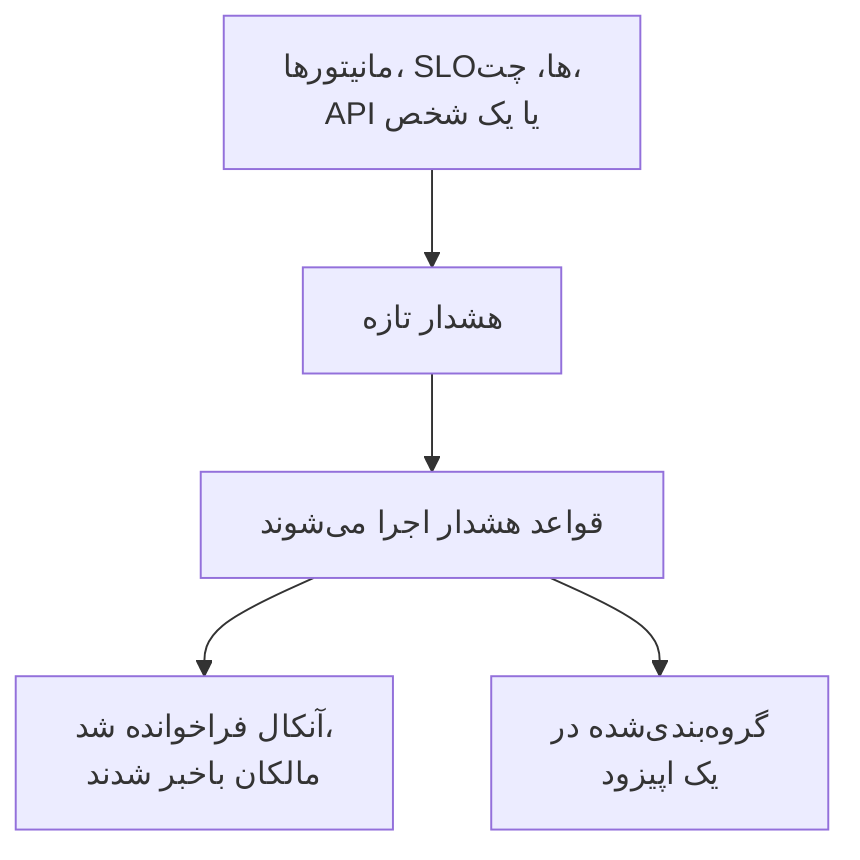

# نمای کلی هشدارها

هشدار تیم شما را از مشکلی باخبر می‌کند که باید پیش از آنکه کاربرانتان متوجه شوند بررسی شود: دیسکی که در حال پر شدن است، گواهی‌ای که به‌زودی منقضی می‌شود، نرخ خطایی که آرام‌آرام بالا می‌رود. هشدار می‌تواند فرد آنکال را فرا بخواند و به مالکانش خبر دهد، اما هرگز روی صفحهٔ وضعیت نمی‌آید و هرگز به مشترکان شما خبر نمی‌دهد. این صفحه توضیح می‌دهد هشدارها از کجا می‌آیند، در داشبورد کجا هستند و تیم شما چگونه با آن‌ها کار می‌کند.

:::cards
- [هشدارها و حوادث](#هشدارها-و-حوادث): یک مشکل کدام‌یک باید باشد، و این دو چگونه به هم وصل می‌شوند.
- [هشدارها از کجا می‌آیند](#هشدارها-از-کجا-میآیند): مانیتورها، SLOها، چت، API یا به‌صورت دستی.
- [ساخت دستی هشدار](#ساخت-دستی-هشدار): دو گام در داشبورد.
- [پاسخ به یک هشدار](#پاسخ-به-یک-هشدار): تأییدش کنید، برطرفش کنید یا حادثه اعلام کنید.
:::

## چگونه کار می‌کند

بیشتر هشدارها را مانیتوری می‌سازد که معیارهایش برآورده شده‌اند. برخی از یک SLO می‌آیند که بودجهٔ خطایش را مصرف می‌کند، از یک قاعدهٔ امنیتی، از فراخوانی که از Slack یا Microsoft Teams فرستاده شده، یا از یک شخص. از هر راهی که برسد، هشدار همان رکورد است و همان قواعد روی آن اجرا می‌شوند.

- **قواعد شکلش می‌دهند.** قواعد حریم خصوصی، مالکیت، برچسب و آنکال همان لحظه‌ای که هشدار ساخته می‌شود اجرا می‌شوند، و قواعد رانبوک روال‌های مطابق را آغاز می‌کنند. [قواعد و تنظیمات هشدار](/docs/alerts/settings) را ببینید.
- **سیاست‌های آنکال آدم‌ها را فرا می‌خوانند.** سیاست‌هایی که هشدار نام می‌برد، به‌علاوهٔ آن‌هایی که قواعد آنکالش می‌افزایند، افرادشان را فرا می‌خوانند تا کسی هشدار را تأیید کند.
- **اپیزودها هیاهو را گروه می‌کنند.** یک قاعدهٔ گروه‌بندی هشدارهای مرتبط را در یک اپیزود جمع می‌کند، تا بیست هشدارِ یک قطعی یک کار باشند. [اپیزودهای هشدار و قواعد گروه‌بندی](/docs/alerts/episodes) را ببینید.

## هشدارها و حوادث

هر دو مشکلی را ثبت می‌کنند، و هر دو می‌توانند فرد آنکال را فرا بخوانند. تفاوت در این است که مشکل روی چه کسی اثر می‌گذارد.

|                                | هشدار                                                  | حادثه                                             |
| ------------------------------ | ------------------------------------------------------ | ------------------------------------------------- |
| **چیست**                       | مشکلی که تیم شما باید پیش از اثر گذاشتن روی کاربران بررسی کند | مشکلی که روی کاربرانتان اثر می‌گذارد، مانند یک قطعی |
| **روی صفحه‌های وضعیت**          | هرگز                                                   | می‌تواند بیاید و به مشترکان خبر می‌دهد            |
| **یادداشت‌ها**                  | یادداشت‌های خصوصی، فقط برای تیم شما                    | یادداشت‌های عمومی برای مشتریان، و یادداشت‌های خصوصی |
| **وضعیت‌های آغازین**            | **شناسایی‌شده**، **تأییدشده**، **برطرف‌شده**            | **شناسایی‌شده**، **تأییدشده**، **برطرف‌شده**       |
| **شدت‌های آغازین**              | **زیاد**، **کم**                                      | Critical Incident، Major Incident، Minor Incident |
| **شماره‌ها در یک پروژهٔ تازه**   | `ALT-42`، و `AE-42` برای اپیزودها                      | `INC-42`، و `IE-42` برای اپیزودها                 |

وقتی تیم شما باید پیش از آنکه کسی بیرون از آن متوجه شود نگاهی بیندازد، هشدار بسازید، و وقتی کاربران تحت تأثیرند، حادثه اعلام کنید. اگر معلوم شد هشداری بخشی از یک قطعی است، از رویش حادثه اعلام کنید، یا آن را به حادثه‌ای که توضیحش می‌دهد پیوند دهید: [هشدارهای پیوندشده](/docs/incidents/linked-alerts) را ببینید.

## هشدارها از کجا می‌آیند

- **معیارهای یک مانیتور.** زیر **اقدام‌ها** در یک معیار، **وقتی فیلترها مطابقت پیدا کردند، یک هشدار بساز.** را روشن کنید و هشداری را که می‌سازد پر کنید: **عنوان هشدار** و **شدت**، سپس، هر کدام جمع‌شده، **توضیحات**، **مالکیت و برچسب‌ها**، **آنکال** و **فیلدهای بیشتر**، که **رفع خودکار هشدار**، **هشدار خصوصی** و **یادداشت‌های رفع مشکل** را در خود دارد. یک معیار در هر زمان یک هشدار باز نگه می‌دارد، در مانیتوری که بر اساس یک فیلد گروه‌بندی می‌کند یکی برای هر سری، و **رفع خودکار هشدار** آن را وقتی معیار دیگر برآورده نشود برطرف می‌کند. [ساخت مانیتور](/docs/monitor/create-monitor) و [قالب‌بندی حادثه و هشدار](/docs/monitor/incident-alert-templating) را ببینید.
- **به‌صورت دستی.** روی **ساخت هشدار** در فهرست هشدارها کلیک کنید، یا روی زبانهٔ **هشدارها** در یک مانیتور، یک میزبان، یک دستگاه شبکه یا منبعی دیگر، که آن منبع را برایتان برمی‌گزیند. [ساخت دستی هشدار](#ساخت-دستی-هشدار) را ببینید.
- **نرخ مصرف یک SLO.** یک قاعدهٔ نرخ مصرف می‌تواند وقتی یک SLO بودجهٔ خطایش را بیش از حد سریع خرج می‌کند هشدار بسازد. [هشدارها و حوادث نرخ مصرف](/docs/slo/burn-rate-alerts) را ببینید.
- **سایت‌های شبکه و رویدادهای امنیتی.** سایت شبکه‌ای که برای هشدار دادن هنگام ناسالم بودن تنظیم شده، وقتی تجمیعش دیگر عملیاتی نباشد هشداری باز می‌کند، و قواعد تشخیص رویدادهای امنیتی شما هم هشدار باز می‌کنند. [سایت‌های شبکه (تجمیع سلامت و زمان کارکرد)](/docs/monitor/network-sites) و [رویدادهای امنیتی (SIEM)](/docs/telemetry/security-events) را ببینید.
- **یک فراخوان.** `/oneuptime page` در Slack یا Microsoft Teams، هر جایی جز کانال خودِ یک حادثه یا هشدار، هشداری باز می‌کند که عنوانش پیام شماست، و کسانی را که نام می‌برید فرا می‌خواند. بلوک‌های فراخوان یک گردش کاری همین کار را با عنوان و پیامی که به آن‌ها می‌دهید می‌کنند. [فراخواندن کسی از Slack](/docs/workspace-connections/slack#فراخواندن-کسی-از-slack) و [Paging](/docs/workflows/components#paging) را ببینید.
- **API، Terraform و گردش‌های کاری.** هشدارها یک منبع معمولی‌اند: `/api/alert`، منبع Terraform به نام `oneuptime_alert` و گام **Create One Alert** در یک گردش کاری.

## هشدارها در داشبورد کجا هستند

**هشدارها** را از منوی **محصولات** در نوار بالا باز کنید. فهرست هشدارها در `/dashboard/{projectId}/alerts` است، و منوی کناری‌اش همه‌چیز دربارهٔ هشدارها را در خود دارد:

| بخش              | آنچه آنجا انجام می‌دهید                                                                                                   |
| ---------------- | ------------------------------------------------------------------------------------------------------------------------- |
| **هشدارها**      | **همه هشدارها** و **هشدارهای فعال**، که نشان قرمزش هشدارهایی را می‌شمارد که هنوز برطرف نشده‌اند.                           |
| **اپیزودها** | **همه اپیزودها** و **اپیزودهای فعال**: هشدارهای مرتبط، گروه‌بندی‌شده در یک مشکل برای کار روی آن. |
| **هوش مصنوعی**   | **بینش‌ها**، **لاگ‌ها** و **تنظیمات**: آنچه OneUptime AI از هشدارهای شما آموخته، هر کاری که کرده، و آنچه مجاز است انجام دهد. |
| **فضای کاری**    | **Slack** و **Microsoft Teams**، هر کدام که پروژه وصل کرده باشد، یا **اتصال Slack یا Teams** وقتی هیچ‌کدام را ندارد.      |
| **قواعد**        | **قواعد گروه‌بندی**، **قواعد آنکال**، **قواعد مالکیت**، **قواعد رانبوک**، **قواعد حریم خصوصی**، **قواعد برچسب**، **Reminder Rules**. |
| **تنظیمات**      | **وضعیت هشدار**، **شدت هشدار**، **قالب‌های یادداشت**، **فیلدهای سفارشی**، **اندازه‌گیری‌ها**، **عضویت در اپیزود**، **شماره‌گذاری**.            |

**هشدارها** و **اپیزودها** باز هستند؛ **هوش مصنوعی**، **فضای کاری**، **قواعد**، **تنظیمات** و **توسعه‌دهنده** جمع‌شده آغاز می‌شوند، و هر بخش وقتی در یکی از صفحه‌هایش باشید خودبه‌خود باز می‌شود. پیکربندی هشدارها اینجاست، نه در **تنظیمات پروژه**.

فهرست این ستون‌ها را نشان می‌دهد: **شماره هشدار**، **عنوان**، **حالت**، **شدت**، **منابع تحت تأثیر** (نخست مانیتور هشدار)، **ساخته‌شده**، **مدت**، **برچسب‌ها** و **مالکان**. هشدارها را برگزینید تا روی چندتا با هم کار کنید: **تأیید**، **رفع**، **تغییر وضعیت**، **تغییر شدت**، **تخصیص به من**، **افزودن مالک**، **حذف مالک**، **افزودن برچسب‌ها**، **حذف برچسب‌ها**، **پیوند به حادثه**، **اعلام حادثه** یا حذفشان.

منوی **⋯** در انتهای ردیف هر هشدار همین کارها را فقط برای همان هشدار انجام می‌دهد: **تأیید** و **رفع** تا وقتی هشدار می‌تواند آن گام را بردارد، **تغییر وضعیت**، **تغییر شدت**، **تخصیص به من** تا وقتی مالک آن نیستید، و **افزودن مالک** برای سپردن آن به کس دیگر.

## ساخت دستی هشدار

:::steps
### باز کردن فرم

به **هشدارها** > **همه هشدارها** بروید و روی **ساخت هشدار** کلیک کنید. فرم **ساخت هشدار جدید** در نخستین گامش، **جزئیات هشدار**، باز می‌شود.

### توصیف هشدار

**عنوان** را پر کنید و یک **شدت هشدار** برگزینید؛ هر دو الزامی‌اند. اگر کمک می‌کند **توضیحات** بیفزایید. زیر **فیلدهای بیشتر**، که جمع است، می‌توانید یک **وضعیت اولیه** برگزینید، **برچسب‌ها** بیفزایید یا **هشدار خصوصی** را روشن کنید. **مالکان** هم آنجاست: به هر حال مالک هشداری می‌شوید که می‌سازید، و هر تیمی که عضو آن هستید زیر انتخابگر با یک کلیک در دسترس است. مدیر ارشد، که کل نصب را اداره می‌کند، تنها استثناست: مالک چیزی که می‌سازد نمی‌شود.

### برگزیدن آنچه تحت تأثیر است و کسانی که فراخوانده می‌شوند

روی **بعدی** کلیک کنید تا به **منابع و آنکال** برسید. **مانیتور** مربوط و هر یک از **سایر منابع تحت تأثیر**، مانند میزبان‌ها، دستگاه‌های شبکه، خوشه‌های Kubernetes یا سرویس‌ها، را برگزینید. در **سیاست آنکال**، سیاست‌هایی را برگزینید که هنگام ساخته شدن هشدار اجرا شوند.

### ساختن آن

روی **بعدی** کلیک کنید تا خلاصه را بررسی کنید، سپس روی **ساخت هشدار**. صفحهٔ خود هشدار باز می‌شود و قواعد شروع به اجرا می‌کنند. در خلاصه، ردیف **مالکان** هر قاعدهٔ مالکیتی را که کسی را خواهد افزود، و اینکه چه کسی را، فهرست می‌کند: ببینید [چه کسی مالک آن خواهد بود](/docs/incidents/declaring-incidents#چه-کسی-مالک-آن-خواهد-بود).
:::

اگر **وضعیت اولیه** را خالی بگذارید، هشدار همان‌جا آغاز می‌شود که هر هشدار تازه‌ای آغاز می‌شود: در وضعیت ساخت شما، که در پروژهٔ تازه **شناسایی‌شده** است. برگزیدن وضعیتی بعدی هشداری را ثبت می‌کند که کسی از پیش به آن رسیدگی می‌کند، یا از پیش تمام شده است؛ [ساخته‌شده در حالت تأییدشده یا برطرف‌شده](#ساختهشده-در-حالت-تأییدشده-یا-برطرفشده) را ببینید.

## وقتی هشدار ساخته می‌شود چه رخ می‌دهد

همان لحظه‌ای که هشدار ساخته می‌شود، OneUptime این گام‌ها را به این ترتیب طی می‌کند:

1. **شماره و وضعیت می‌گیرد.** شمارهٔ هشدار از یک شمارندهٔ مخصوص هر پروژه می‌آید و با پیشوند شما نشان داده می‌شود (`ALT-42`). هشدار در وضعیت ساخت شما آغاز می‌شود، مگر آنکه فرم، API یا یک گردش کاری وضعیت دیگری برگزیده باشد.
2. **قواعد حریم خصوصی اول اجرا می‌شوند**، تا هر چه پس از آن‌ها می‌آید بداند هشدار خصوصی است یا نه.
3. **فید و ابزارهای چت شما باخبر می‌شوند.** ورودی **هشدار ساخته شد** در **فید هشدار** نوشته می‌شود، و به کانال‌هایی که قواعد Slack و Microsoft Teams شما نام می‌برند خبر داده می‌شود؛ یک قاعده می‌تواند برای هشدار کانالی بسازد.
4. **مالکان و برچسب‌ها افزوده می‌شوند**: آن‌هایی که معیارهای مانیتور یا درخواست نام می‌برند، سپس آن‌های قواعد مالکیت و برچسبِ مطابق.
5. **قواعد آنکال سیاست‌هایشان را می‌افزایند**، سپس قواعد رانبوک رانبوک‌های مطابق را آغاز می‌کنند.
6. **سیاست‌های آنکال اجرا می‌شوند.** هر سیاستِ روی هشدار افرادش را هم‌زمان فرا می‌خواند؛ شکست یکی جلوی بقیه را نمی‌گیرد.
7. **قواعد گروه‌بندی آن را در یک اپیزود می‌گذارند**، وقتی یکی مطابقت پیدا کند. [اپیزودهای هشدار و قواعد گروه‌بندی](/docs/alerts/episodes) را ببینید.
8. **یادآوری‌ها زمان‌بندی می‌شوند**، وقتی یک قاعدهٔ یادآوری مطابقت پیدا کند، و **OneUptime AI** هشدار را بررسی می‌کند وقتی **بررسی هشدارهای تازه** در **هشدارها** > **هوش مصنوعی** > **تنظیمات** روشن است، و اصلاحش می‌کند وقتی **اصلاح خودکار هشدارهای تازه** روشن است. [AI SRE](/docs/ai/ai-sre) را ببینید.

یک کار پس‌زمینه ظرف یک دقیقه به مالکان هشدار خبر می‌دهد، و راه‌انداز گردش کاری **On Create Alert** هر گردش کاری را که بر پایهٔ آن ساخته شده آغاز می‌کند.

### ساخته‌شده در حالت تأییدشده یا برطرف‌شده

هشداری که در وضعیتی بعدی آغاز می‌شود ثبتِ مشکلی است که کسی از پیش به آن رسیدگی می‌کند، پس مانند یک وضعیت اضطراری تازه با آن رفتار نمی‌شود:

- **در وضعیت تأییدشدهٔ شما یا پس از آن**، هیچ سیاست آنکالی اجرا نمی‌شود. هشدار سیاست‌هایش را نگه می‌دارد، و فیدش در یک خط می‌گوید چرا کسی فراخوانده نشد. می‌تواند به یک اپیزود باز بپیوندد، اما هرگز اپیزودی باز نمی‌کند، چون آن کار از راه سیاست‌های اپیزود فراخوان می‌فرستاد.
- **در وضعیت برطرف‌شدهٔ شما یا پس از آن**، هشدار تمام شده است: در هیچ اپیزودی گروه‌بندی نمی‌شود، هیچ رانبوک یا رفع خودکاری روی آن عمل نمی‌کند، OneUptime AI بررسی‌اش نمی‌کند، و هیچ کانال Slack یا Microsoft Teams برایش ساخته نمی‌شود.

قواعدش، مالکانش، فیدش و نخستین وضعیتش در هر دو حالت همچنان رخ می‌دهند. حوادث از همین قاعده پیروی می‌کنند: [حادثه‌ای که از پیش تأییدشده یا برطرف‌شده اعلام می‌شود](/docs/incidents/declaring-incidents#حادثهای-که-از-پیش-تأییدشده-یا-برطرفشده-اعلام-میشود) را ببینید.

## پاسخ به یک هشدار

هشدار را باز کنید. سرصفحه‌اش وضعیت، شدت، مدت، مالکان و مانیتور و اپیزودی را که به آن تعلق دارد نشان می‌دهد، همراه با دکمه‌هایی که گام بعدی شما لازم دارد:

- **تأیید** می‌گوید کسی به آن رسیدگی می‌کند. جلوی سیاست‌های آنکال هشدار را می‌گیرد تا سطح بعدی را فرا نخوانند.
- **رفع** آن را می‌بندد. هشدار از **هشدارهای فعال** بیرون می‌رود، و یادآوری‌هایش متوقف می‌شوند.
- **تغییر وضعیت به**، در منوی **⋯** کنار آن‌ها، آن را به وضعیتی از آنِ خودتان می‌برد، مانند «در حال بررسی».
- **اعلام حادثه** حادثه‌ای تازه باز می‌کند که از روی هشدار از پیش پر شده است، وقتی معلوم شود مشکل روی کاربران اثر می‌گذارد. [هشدارهای پیوندشده](/docs/incidents/linked-alerts) را ببینید.

رفتن به وضعیتی دیگر از شما تأیید می‌خواهد، با یادداشتی خصوصی و اختیاری که زیر **افزودن یادداشت خصوصی** جمع شده است. اینکه هر وضعیت چه می‌کند در [وضعیت‌ها و شدت‌های هشدار](/docs/alerts/states-and-severities) آمده است.

در حین کار روی آن، آنچه را می‌آموزید به‌صورت **یادداشت‌های خصوصی** بنویسید، صفحه‌های **علت ریشه‌ای** و **رفع مشکل** آن را پر کنید و **مالکان** بیفزایید. منوی **اقدام‌ها** در **فید هشدار** همچنین با **Execute Runbook** یک رانبوک اجرا می‌کند، یا با **اجرای سیاست آنکال** افراد بیشتری را فرا می‌خواند.

## هر صفحهٔ هشدار چه نشان می‌دهد

| بخش منوی کناری       | صفحه‌ها                                                                                                       |
| -------------------- | ------------------------------------------------------------------------------------------------------------- |
| **نمای کلی** | **نمای کلی** و **خط زمانی حالت** |
| **بررسی** | **توضیحات**، **علت ریشه‌ای**، **رفع مشکل**، **رانبوک‌ها**، **حوادث پیوندشده** |
| **تیم** | **اجراهای آنکال** و **مالکان**: چه کسی برای هشدار فراخوانده شد، و مالک آن کیست |
| **اعلان‌ها**            | **گزارش‌های اعلان** و **گزارش‌های هوش مصنوعی**: هر پیامی که دربارهٔ هشدار فرستاده شد، و هر کاری که هوش مصنوعی برایش کرد |
| **یادداشت‌ها** | **یادداشت‌های خصوصی**                                                                                         |
| **توسعه‌دهنده**       | **Terraform**، **API** و **دستیارهای هوش مصنوعی**: مدیریت هشدار از راه کد                                    |
| **پیشرفته** | **فیلدهای سفارشی**، **تنظیمات**، **گزارش‌های ممیزی**، **حذف هشدار** |

**نمای کلی**، **بررسی**، **تیم** و **یادداشت‌ها** باز هستند؛ بخش‌های دیگر تا وقتی رویشان کلیک نکنید جمع‌شده می‌مانند.

- **نمای کلی** — سرصفحه **مالکان** هشدار را کنار مانیتور و اپیزود آن نام می‌برد، اول تیم‌ها. کاشی **ساخته‌شده** نشان می‌دهد هشدار کی و توسط چه چیزی ساخته شد، و دو کاشی دیگر اینکه تأیید و برطرف شدن هشدار چقدر طول کشید؛ مدت آن نخستین مورد سرصفحه است. کارت **آنچه رخ داد** در بالای صفحه است — توضیح هشدار و **علت ریشه‌ای** آن — سپس کارت **OneUptime AI**، با **Ask OneUptime AI** در پایینش، و **فید هشدار** هر آنچه را بر سر هشدار آمده ثبت می‌کند. کنار آن‌ها کارت **منابع تحت تأثیر**، کارت **جزئیات هشدار** و اندازه‌گیری‌های هشدار قرار دارند.
- **خط زمانی حالت** — هر وضعیتی که هشدار در آن بوده، کی و برای چه مدت. [خط زمانی وضعیت](/docs/alerts/states-and-severities#خط-زمانی-وضعیت) را ببینید.
- **حوادث پیوندشده** — حوادثی که این هشدار بخشی از آن‌هاست، با **پیوند حادثه** و **اعلام حادثه**.
- **تنظیمات** — **چه کسانی می‌توانند این هشدار را ببینند**، با کلید **هشدار خصوصی**، و **یادآوری‌ها**، با **فرستادن یادآوری‌ها**. هر کلید همان لحظه‌ای که آن را می‌زنید ذخیره می‌شود.

## هشدارهای خصوصی

هشدار خصوصی را فقط مالکانش، یعنی کاربران مالک و اعضای تیم‌های مالکش، و مدیران و مالکان پروژهٔ شما می‌بینند. هیچ کس دیگری در پروژه نمی‌تواند بازش کند.

هشداری را با **هشدار خصوصی** زیر **فیلدهای بیشتر** در فرم ساخت یا در معیارهای یک مانیتور، با **هشدارها** > **قواعد** > **قواعد حریم خصوصی**، یا بعدها در صفحهٔ **تنظیمات** آن خصوصی کنید، که پیش از پنهان کردن هشدار می‌پرسد **این هشدار خصوصی شود؟**. اگر هیچ‌یک از این افراد نباشید، دسترسی خودتان هم از دست می‌رود.

اپیزودی که یک هشدار خصوصی باز می‌کند خصوصی نیست، پس هرگز عنوان یا توضیحات هشدار را نشان نمی‌دهد: جایی که عنوان یا توضیحاتش آن‌ها را در بر می‌گرفت، «Private alert» نوشته می‌شود.

## چه کسانی از یک هشدار باخبر می‌شوند

- **آنکال.** سیاست‌های آنکال هشدار افرادشان را فرا می‌خوانند، هر کس به همان شکلی که در **تنظیمات کاربر** > **قواعد آنکال**، روی زبانهٔ **هشدارها**، تنظیم کرده است. پاسخ دادن به فراخوان هشدار را تأیید می‌کند، و فراخوان‌ها متوقف می‌شوند.
- **مالکانش.** از راه ایمیل، مگر آنکه در **تنظیمات کاربر** > **تنظیمات اعلان**، روی زبانهٔ **هشدارها**، کانال‌های دیگری برگزیده باشند: **هشدار ساخته شد**، **وضعیت هشدار تغییر کرد** و **Alert reminder** به‌طور پیش‌فرض روشن‌اند، و **یادداشت هشدار منتشر شد** و **به‌عنوان مالک هشدار افزوده شد** تا وقتی کسی روشنشان نکند خاموش‌اند. هشداری که مالک ندارد به‌جایش به مالکان پروژه خبر می‌دهد.
- **ابزارهای چت شما.** **هشدارها** > **فضای کاری** قواعد Slack و Microsoft Teams را در خود دارد که هشدارها و اپیزودها را در کانال‌ها منتشر می‌کنند. [Slack](/docs/workspace-connections/slack) و [Microsoft Teams](/docs/workspace-connections/microsoft-teams) را ببینید.

## عیب‌یابی

:::details برای یک هشدار تازه کسی فراخوانده نشد
صفحهٔ **اجراهای آنکال** هشدار را باز کنید. اگر خالی است، هشدار هیچ سیاست آنکالی نداشت: نه در فرم و نه در معیارهای مانیتور سیاستی برگزیده نشد، و هیچ قاعدهٔ آنکالی با آن مطابقت نداشت. اگر هشدار از پیش تأییدشده یا برطرف‌شده ساخته شده باشد، فیدش می‌گوید کسی فراخوانده نشد، و چرا.
:::

:::details مانیتور مدام شکست می‌خورد، اما هشدار تازه‌ای نمی‌آید
یک معیار در هر زمان یک هشدار باز نگه می‌دارد. تا آن هشدار برطرف نشود، مانیتور برای همان معیار چیز تازه‌ای نمی‌افزاید. برطرفش کنید، یا **رفع خودکار هشدار** را روشن کنید تا مانیتور وقتی معیار دیگر برآورده نشود آن را برطرف کند.
:::

:::details هم‌تیمی‌ام هشداری را باز می‌کند که من پیدایش نمی‌کنم
هشدار احتمالاً خصوصی است. از یک مدیر پروژه بخواهید شما را به‌عنوان مالک بیفزاید، یا **هشدار خصوصی** را در صفحهٔ **تنظیمات** هشدار خاموش کند.
:::

## گام‌های بعدی

:::cards
- [وضعیت‌ها و شدت‌های هشدار](/docs/alerts/states-and-severities): تأیید و برطرف کردن چه می‌کنند، و چگونه وضعیت‌های خودتان را بیفزایید.
- [اپیزودهای هشدار و قواعد گروه‌بندی](/docs/alerts/episodes): سیلی از هشدارها را به یک کار تبدیل کنید.
- [قواعد و تنظیمات هشدار](/docs/alerts/settings): فراخوان، مالکیت، برچسب‌گذاری و یادآوری خودکار.
- [هشدارهای پیوندشده](/docs/incidents/linked-alerts): هشدارها را به حادثه‌ای که توضیحشان می‌دهد پیوند دهید.
:::
