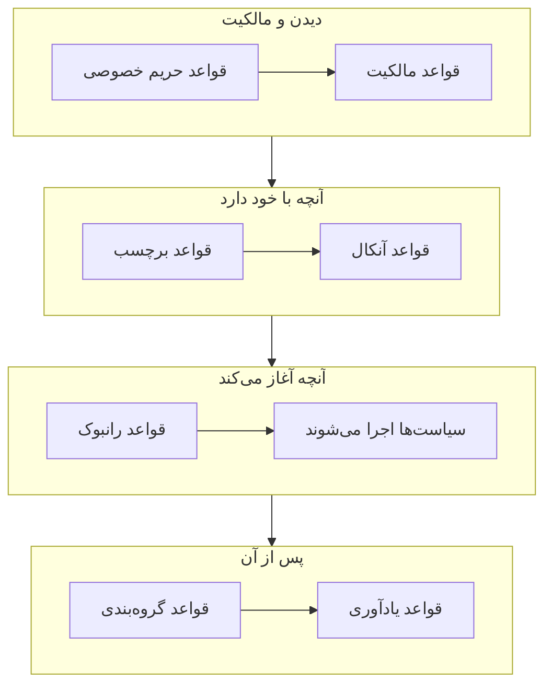

# قواعد و تنظیمات هشدار

پیکربندی هشدارها درون **هشدارها** است، نه در **تنظیمات پروژه**: قواعدی که روی هر هشدار تازه عمل می‌کنند، و تنظیماتی که به هر هشدار در پروژه شکل می‌دهند. این صفحه مرجع هر یک از آن‌هاست، و مرجع آنچه هنگام ساخته شدن هشدار خودبه‌خود اجرا می‌شود.

:::cards
- [قواعدی که هشدار تازه از آن‌ها می‌گذرد](#قواعدی-که-هشدار-تازه-از-آنها-میگذرد): به ترتیب، و اینکه هر کدام چه می‌کند.
- [قواعد آنکال](#قواعد-آنکال): افراد درست را بدون برگزیدن سیاست در هر بار فرا بخوانید.
- [قواعد یادآوری](#قواعد-یادآوری): تا وقتی هشدار باز است به مالکان یادآوری کنید.
- [تنظیمات](#تنظیمات): قالب‌های یادداشت، فیلدهای سفارشی، اندازه‌گیری‌ها، عضویت در اپیزود و شماره‌گذاری.
:::

## تنظیمات هشدار کجا هستند

**هشدارها** را از منوی **محصولات** در نوار بالا باز کنید. بخش‌های **قواعد** و **تنظیمات** در منوی کناری آن جمع‌شده آغاز می‌شوند، پس اول بازشان کنید. هر صفحهٔ اینجا برای کل پروژه است، در نشانی‌هایی که با `/dashboard/{projectId}/alerts/settings/` آغاز می‌شوند.

| صفحهٔ قواعد             | چه می‌کند                                                                                      |
| ----------------------- | ---------------------------------------------------------------------------------------------- |
| **قواعد گروه‌بندی**     | هشدارهای مرتبط را در اپیزودها جمع می‌کند. [اپیزودهای هشدار و قواعد گروه‌بندی](/docs/alerts/episodes) را ببینید. |
| **قواعد آنکال**         | سیاست‌های آنکال را برای هشدارها و اپیزودهای مطابق اجرا می‌کند.                                 |
| **قواعد مالکیت**        | به هشدارها و اپیزودهای مطابق مالک می‌افزاید.                                                   |
| **قواعد رانبوک**        | برای هشدارهای مطابق رانبوک آغاز می‌کند.                                                        |
| **قواعد حریم خصوصی**    | هشدارها و اپیزودهای مطابق را خصوصی می‌کند.                                                     |
| **قواعد برچسب**         | به هشدارها و اپیزودهای مطابق برچسب می‌افزاید.                                                  |
| **Reminder Rules**      | تا وقتی هشدار باز است، در فاصله‌های معین به مالکان یادآوری می‌کند.                             |

در بخش **تنظیمات**، **وضعیت هشدار** و **شدت هشدار** هستند، که در [وضعیت‌ها و شدت‌های هشدار](/docs/alerts/states-and-severities) آمده‌اند، سپس **قالب‌های یادداشت**، **فیلدهای سفارشی**، **اندازه‌گیری‌ها**، **عضویت در اپیزود** و **شماره‌گذاری**، که پایین‌تر آمده‌اند.

دو بخش دیگر هم روی هشدارها عمل می‌کنند. **هشدارها** > **هوش مصنوعی** > **تنظیمات** تعیین می‌کند OneUptime AI خودبه‌خود چه کند: **بررسی هشدارهای تازه**، که برای پروژه‌های تازه روشن است، و **اصلاح خودکار هشدارهای تازه**، که تا روشنش نکنید خاموش است. [AI SRE](/docs/ai/ai-sre) را ببینید. **هشدارها** > **فضای کاری** قواعد Slack و Microsoft Teams را در خود دارد که هشدارها و اپیزودها را در کانال‌ها منتشر می‌کنند، و زبانهٔ **خلاصه** آن را. [Slack](/docs/workspace-connections/slack) را ببینید.

## قواعدی که هشدار تازه از آن‌ها می‌گذرد

قواعد در نحوهٔ حل شدن چند تطبیق با هم فرق دارند:

- **قواعد گروه‌بندی** و **Reminder Rules** از بالای فهرستشان به پایین سنجیده می‌شوند، و نخستین تطبیق برنده است. قاعده‌ای را بکشید تا جایش عوض شود؛ قاعدهٔ تازه به انتها می‌رود.
- **قواعد آنکال**، **قواعد مالکیت**، **قواعد برچسب**، **قواعد حریم خصوصی** و **قواعد رانبوک** همگی وقتی مطابقت دارند عمل می‌کنند. سیاست‌های آنکال، مالکان و برچسب‌هایی که چند قاعده می‌افزایند یک بار افزوده می‌شوند.

**قواعد آنکال**، **قواعد مالکیت**، **قواعد برچسب** و **قواعد حریم خصوصی** دو زبانه دارند: **Alert Rules** برای هشدارها، و **Episode Rules** که به همان شکل روی هر اپیزود هشدار تازه عمل می‌کنند. قاعدهٔ تازه فعال آغاز می‌شود؛ برای توقف موقتش **فعال** را در فرم ویرایش آن خاموش کنید، و فهرست برای هر قاعده **فعال** سبز یا **غیرفعال** قرمز نشان می‌دهد.

بیشتر قواعد روی هشدارها و اپیزودهایی عمل می‌کنند که پس از ذخیرهٔ آن‌ها ساخته می‌شوند. برای اعمال یک قاعدهٔ مالکیت، برچسب یا حریم خصوصی روی آنچه از پیش دارید، از **اجرا همین حالا** استفاده کنید: [اجرای قواعد روی منابع موجود](/docs/configuration/run-rules-now) را ببینید. قواعد یادآوری استثنا هستند: ذخیرهٔ یکی همهٔ هشدارهای باز را دوباره تطبیق می‌دهد.

### شرط‌ها

شرط‌های یک قاعده تعیین می‌کنند روی کدام هشدارها عمل کند، و مانند جمله خوانده می‌شوند: «اگر **عنوان هشدار** شامل `database` باشد»، «و **برچسب‌های مانیتور** یکی از *Production* را داشته باشد». قاعده‌ای بدون شرط با هر هشداری مطابقت دارد.

| شرط                                                           | مقایسه با                                                                                                      |
| ------------------------------------------------------------- | -------------------------------------------------------------------------------------------------------------- |
| **مانیتورها**، **شدت‌های هشدار**، **برچسب‌های هشدار**، **برچسب‌های مانیتور** | **یکی از این‌ها را دارد**، **همه این‌ها را دارد** یا **هیچ‌یک از این‌ها را ندارد** نسبت به مقدارهایی که برمی‌گزینید. |
| **عنوان هشدار**، **توضیحات هشدار**، **نام مانیتور**، **توضیحات مانیتور** | **شامل است**، **شامل نیست**، **مساوی است با**، **مساوی نیست با**، **شروع می‌شود با**، **پایان می‌یابد با**، بدون توجه به بزرگی و کوچکی حروف، یا **با الگو مطابقت دارد** و **با الگو مطابقت ندارد**، برای یک عبارت باقاعده یا یک نویسهٔ جایگزین `*`. |

با دو شرط یا بیشتر، **تطبیق با همه** را برگزینید، که همهٔ شرط‌ها باید برقرار باشند، یا **تطبیق با هر یک** را، که یکی کافی است. قواعد اپیزود به‌جای آن با شدت، برچسب‌ها، عنوان و توضیحات یک اپیزود تطبیق می‌کنند.

## قواعد آنکال

**هشدارها** > **قواعد** > **قواعد آنکال** فراخوانی را خودکار می‌کند. هر قاعدهٔ مطابق سیاست‌هایش را به هشدار تازه می‌افزاید، و هشدار آن‌ها را همراه سیاست‌هایی که از پیش داشت اجرا می‌کند، هر کدام یک بار.

:::steps
### برگزیدن هشدارها

روی **ساخت Alert On-Call Rule** کلیک کنید. در **تطبیق**، **همه هشدارها**، که قاعده تازه با آن آغاز می‌شود، با هر هشدار تازه‌ای مطابقت دارد. برای محدود کردن آن، **فقط آن دسته از هشدارها که با شرط‌ها مطابقت دارند** را برگزینید و شرط‌هایی را که هشدار باید برآورده کند بیفزایید.

### برگزیدن سیاست‌ها

در **سیاست‌های آنکال**، **سیاست‌های کشیک آنکال** را که قاعده فرا می‌خواند برگزینید. **نام** آن تا وقتی نام خودتان را وارد نکنید همراه آن‌ها تغییر می‌کند، مانند «فراخواندن Platform on-call»، و **توضیحات** زیر **فیلدهای بیشتر** است. سپس قاعده را بسازید.
:::

یک شدت به‌تنهایی کسی را فرا نمی‌خواند: قاعدهٔ آنکالی که با **شدت‌های هشدار** تطبیق می‌کند راه تنظیم «فراخواندن تیم پایگاه داده برای هر هشدار High» است. برای دیدن آنچه برای یک هشدار اجرا شد، صفحهٔ **اجراهای آنکال** آن را باز کنید. سپس هر فرد به همان شکلی که در **تنظیمات کاربر** > **قواعد آنکال**، روی زبانهٔ **هشدارها**، تنظیم کرده است خبردار می‌شود؛ [قواعد تشدید](/docs/on-call/escalation-rules) را ببینید.

یک قاعده به‌محض اینکه هشداری با آن منطبق شود فرا می‌خواند. برای اینکه به‌جای آن منتظر ساعات کاری بماند، به **این قاعده کی باید فرابخواند؟** زیر **فیلدهای بیشتر** پاسخ **فقط در ساعات کاری** را بدهید. **ساعات کاری** در آغاز دوشنبه تا جمعه، ساعت 09:00 تا 17:00، در منطقه زمانی خودتان است: روزهای دیگر، **زمان شروع** یا **زمان پایان** دیگر، یا **منطقه زمانی** دیگری انتخاب کنید، و جمله‌ای زیر گزینه می‌گوید چه پیش می‌آید. در فهرست، قاعده ساعات کاری‌اش را زیر نامش نشان می‌دهد. هشداری که بیرون از این ساعت‌ها منطبق شود اجرایی می‌گیرد که منتظر می‌ماند و کسی را فرا نمی‌خواند؛ وقتی ساعات کاری آغاز شود، سیاست نخستین قاعدهٔ تشدیدش را فرا می‌خواند و مثل همیشه تشدید می‌شود. اگر هشدار پیش از آن تأیید یا برطرف شود، کسی فراخوانده نمی‌شود. اگر هشدار در حین انتظار تغییر کند و اکنون با قاعده‌ای منطبق شود که بی‌درنگ فرا می‌خواند، مثلاً چون شدتش بالا رفته، اجرا همان موقع فراخوانی را آغاز می‌کند، و فید هشدار می‌گوید چرا. دو قاعده‌ای که یک سیاست را فرا می‌خوانند، آن را به‌محض اینکه هر یک اجازه دهد فرا می‌خوانند: قاعده‌ای برای بالاترین شدت‌ها که بی‌درنگ فرا می‌خواند، کنار قاعده‌ای برای بقیه که منتظر ساعات کاری می‌ماند، شب‌ها را آرام نگه می‌دارد.

## قواعد مالکیت و برچسب

**قواعد مالکیت** کاربران و تیم‌های مالک را به هشدارهای تازهٔ مطابق می‌افزایند، و **قواعد برچسب** برچسب می‌افزایند. ساختن یکی دو گام دارد: **تطبیق**، یعنی شرط‌ها، سپس **مالکان** یا **برچسب‌ها**، یعنی آنچه قاعده می‌افزاید. **نام** قاعده از آنچه برمی‌گزینید پیروی می‌کند تا وقتی نام خودتان را بنویسید.

- **قاعده می‌تواند به ارث ببرد.** شش کلید، جمع‌شده زیر **به ارث بردن مالکان** یا **به ارث بردن برچسب‌ها**، مالکان یا برچسب‌های مانیتور، میزبان‌ها، خوشه‌های Kubernetes، میزبان‌های Docker، میزبان‌های Podman و سرویس‌های هشدار را منتقل می‌کنند. قواعد اپیزود چنین کلیدهایی ندارند. بخش **به ارث بردن مالکان** در قاعدهٔ مالکیت با **تیم سازنده** پایان می‌یابد: از تیم‌هایی که آنجا آمده‌اند، هر تیمی که سازندهٔ هشدار عضوش باشد هم مالک می‌شود.
- **قاعدهٔ تازه باید چیزی بیفزاید**: دست‌کم یک مالک یا برچسب برگزینید، یا یک کلید را روشن کنید. در یک قاعدهٔ مالکیت حادثه یا هشدار، یک تیم زیر **تیم سازنده** هم کافی است.
- **اطلاع به مالکان**، زیر **فیلدهای بیشتر** در یک قاعدهٔ مالکیت، تعیین می‌کند افراد افزوده‌شده باخبر شوند یا نه.

[قواعد برچسب و مالکیت](/docs/configuration/label-and-owner-rules) فرم را گام‌به‌گام، برای هر نوع منبع، شرح می‌دهد.

## قواعد حریم خصوصی و رانبوک

**قواعد حریم خصوصی** هشدارهای تازهٔ مطابق را پیش از اجرای هر چیز دیگری خصوصی می‌کنند: فقط مالکانشان و مدیران و مالکان پروژه می‌توانند آن‌ها را ببینند. یک قاعده دو گام دارد: **تطبیق**، هشدارهایی که خصوصی می‌کند، و سپس **نام**، که از پیش با «خصوصی کردن هشدارها» پر شده است. [هشدارهای خصوصی](/docs/alerts/index#هشدارهای-خصوصی) را ببینید.

**قواعد رانبوک** وقتی هشدار تازه‌ای مطابقت دارد یک رانبوک را آغاز می‌کنند، مگر آنکه هشدار برطرف‌شده ساخته شده باشد. [قواعد رانبوک](/docs/runbooks/rules) را ببینید.

## قواعد یادآوری

**هشدارها** > **قواعد** > **Reminder Rules** تا وقتی هشدار باز می‌ماند به مالکانش یادآوری می‌کند. هر هشدار تازه نخستین قاعده‌ای را می‌گیرد که با آن مطابقت دارد، از بالای فهرست به پایین.

:::steps
### برگزیدن هشدارهایی که یادآوری می‌شوند

روی **ساخت Alert Reminder Rule** کلیک کنید. در **تطبیق**، **همه هشدارها** را انتخاب‌شده بگذارید تا برای هر هشداری یادآوری شود، یا **فقط آن دسته از هشدارها که با شرط‌ها مطابقت دارند** را برگزینید و سپس **شدت‌های هشدار** و **برچسب‌ها** را برای این قاعده انتخاب کنید.

### تنظیم فاصله

در **یادآوری‌ها**، **بازه یادآوری (دقیقه)** را تنظیم کنید، یعنی هر چند وقت یک بار به مالکان یادآوری شود، و **زمان توقف یادآوری‌ها** را: **برطرف‌شده**، که پیش‌فرض است، یا **تأییدشده**. **نام** تا وقتی نام خودتان را وارد نکنید همراه هر دو تغییر می‌کند، مانند «یادآوری هر 30 دقیقه تا برطرف شدن». سپس قاعده را بسازید.
:::

مالکان هر یادآوری را به‌صورت **Alert reminder** می‌گیرند، که به‌طور پیش‌فرض از راه ایمیل روشن است. قاعدهٔ یک هشدار وقتی شدت یا برچسب‌هایش تغییر کند دوباره تطبیق داده می‌شود. برای قطع یادآوری‌های یک هشدار، **فرستادن یادآوری‌ها** را در صفحهٔ **تنظیمات** آن خاموش کنید؛ همان لحظه‌ای که آن را می‌زنید ذخیره می‌شود.

## تنظیمات

### قالب‌های یادداشت

**هشدارها** > **تنظیمات** > **قالب‌های یادداشت** متن‌های آماده برای یادداشت‌های خصوصی را نگه می‌دارد. کارت **قالب‌های یادداشت خصوصی برای هشدارها** آن‌ها را فهرست می‌کند؛ **ساخت قالب یادداشت هشدار** یک **نام قالب**، یک **توضیحات قالب** و **یادداشت** را می‌خواهد. قالب وقتی پیشنهاد می‌شود که کسی یادداشتی خصوصی روی یک هشدار یا اپیزود می‌نویسد، و وقتی یکی را تأیید یا برطرف می‌کند، و متنش پیش از انتشار ویرایش‌پذیر است. قالب‌های یادداشت هشدار متن ساده‌اند: برخلاف قالب‌های یادداشت حادثه، هیچ متغیری را پر نمی‌کنند.

### فیلدهای سفارشی

**هشدارها** > **تنظیمات** > **فیلدهای سفارشی** فیلدهای خودتان را به هر هشدار می‌افزاید، مانند ردهٔ مشتری یا شمارهٔ تیکت. آن‌ها را در صفحهٔ **فیلدهای سفارشی** یک هشدار پر کنید، یا از راه API به‌صورت `customFields`. یک فیلد می‌تواند به‌جای تایپ شدن مقدارش را از یک فیلد سفارشی مانیتور کپی کند: [فیلدهای کپی‌شده از مانیتور](/docs/incidents/settings#فیلدهای-کپیشده-از-مانیتور) را ببینید، که برای هشدارها هم به همین شکل کار می‌کند.

### اندازه‌گیری‌ها

**هشدارها** > **تنظیمات** > **اندازه‌گیری‌ها** زمان کارها را روی هر هشدار می‌سنجد. **زمان تا تأیید** یا **زمان تا برطرف‌شدن** را برگزینید، یا دو لحظهٔ دلخواه خودتان، مانند وقتی **هشدار ساخته می‌شود** و وقتی به وضعیتی که برمی‌گزینید وارد می‌شود. هر اندازه‌گیری در صفحهٔ هشدار نشان داده می‌شود و به‌صورت `oneuptime.alert.measurement.<key>` نمودار می‌شود. [اندازه‌گیری‌ها](/docs/incidents/settings#اندازهگیریها) را ببینید، که برای هشدارها هم به همین شکل کار می‌کند.

**زمان تا تأیید پس از فراخوانی** از وقتی شمرده می‌شود که **نخستین بار کسی فراخوانده می‌شود**، یعنی وقتی یک سیاست آنکال یا یک فراخوانی مستقیم نخستین بار کسی را از هشدار باخبر کرد، نه از وقتی که هشدار ساخته شد: هشداری که شب رخ داده و فراخوانی‌اش صبح فرستاده شده، آن شب به حسابش گذاشته نمی‌شود. هشداری که کسی برایش فراخوانده نشده مقداری ندارد. [زمان تا تأیید پس از فراخوانی](/docs/incidents/settings#زمان-تا-تأیید-پس-از-فراخوانی) را ببینید.

### عضویت در اپیزود

**هشدارها** > **تنظیمات** > **عضویت در اپیزود** تعیین می‌کند که آیا یک هشدار می‌تواند در بیش از یک اپیزود باشد. **هر هشدار فقط می‌تواند در یک اپیزود باشد** را روشن کنید تا هشداری که در یک اپیزود است به اپیزود دیگری افزوده نشود، نه از داشبورد و نه از طریق API، گردش کار یا قاعدهٔ گروه‌بندی، مگر اینکه اول از آن اپیزود برداشته شود. این کلید تا وقتی روشنش نکنید خاموش است، و فقط Project Owner و Project Admin می‌توانند تغییرش دهند. روشن کردن آن هیچ هشداری را از اپیزود بیرون نمی‌آورد. [هر حادثه فقط در یک اپیزود](/docs/incidents/episodes#هر-حادثه-فقط-در-یک-اپیزود) را ببینید، که برای هشدارها هم به همین شکل کار می‌کند.

### شماره‌گذاری

**هشدارها** > **تنظیمات** > **شماره‌گذاری** متن پیش از شماره‌های هشدار و اپیزود را تعیین می‌کند: `ALT-` و `AE-` در پروژهٔ تازه، یا `#` بدون پیشوند. دکمهٔ **به‌روزرسانی** فیلدهای **پیشوند شماره هشدار** و **پیشوند شماره اپیزود هشدار** را باز می‌کند، با پیش‌نمایشی هنگام تایپ. فقط هشدارها و اپیزودهایی که پس از آن ساخته می‌شوند پیشوند تازه را می‌گیرند. قواعد پیشوند در [پیشوندهای شماره](/docs/incidents/settings#پیشوندهای-شماره) آمده‌اند.

کارت **شماره بعدی** زیر آن شماره‌ای را تعیین می‌کند که هشدار بعدی و اپیزود بعدی می‌گیرند، تا شماره‌های ابزاری دیگر ادامه پیدا کنند: دکمهٔ **به‌روزرسانی** فیلدهای **شماره بعدی هشدار** و **شماره بعدی اپیزود هشدار** را باز می‌کند، که هر کدام باید از بزرگ‌ترین شماره تاکنون بزرگ‌تر باشد. [شماره‌های بعدی](/docs/incidents/settings#شمارههای-بعدی) را ببینید.

> [!NOTE]
> در OneUptime Cloud، قالب‌های یادداشت و فیلدهای سفارشی به طرح **Growth** یا بالاتر نیاز دارند.

## گردش‌های کاری

هر مدل هشدار راه‌اندازها و کنش‌های گردش کاری دارد که به نام آن‌اند: **On Create Alert**، **On Update Alert**، **On Create or Update Alert** و **On Delete Alert**، همین‌طور برای **اپیزود هشدار**، **خط زمانی وضعیت هشدار** و بقیه، و کنش‌هایی مانند **Create One Alert** و **Update One Alert**. تعریف‌های فیلد سفارشی هشدار تنها استثنا هستند: هیچ راه‌انداز گردش کاری ندارند. [نمای کلی گردش‌های کاری](/docs/workflows/index) را ببینید.

## چه کسانی می‌توانند این‌ها را تغییر دهند

قواعد، فیلدهای سفارشی و اندازه‌گیری‌ها به Project Owner یا Project Admin نیاز دارند، یا به نقشی سفارشی با مجوز خود آن قاعده. **عضو هشدارها** با هشدارها و اپیزودها، یادداشت‌ها، مالکان و خط‌های زمانی وضعیتشان، و قالب‌های یادداشت کار می‌کند، و **مدیر هشدارها** افزون بر آن وضعیت‌ها و شدت‌های هشدار را مدیریت می‌کند. [کاربران، تیم‌ها و دسترسی‌ها](/docs/permissions/index) را ببینید.

## گام‌های بعدی

:::cards
- [اپیزودهای هشدار و قواعد گروه‌بندی](/docs/alerts/episodes): قواعد گروه‌بندی، به تفصیل.
- [قواعد تشدید](/docs/on-call/escalation-rules): وقتی یک قاعدهٔ آنکال سیاستی را اجرا می‌کند چه رخ می‌دهد.
- [قواعد برچسب و مالکیت](/docs/configuration/label-and-owner-rules): فرم قاعده، گام‌به‌گام.
- [AI SRE](/docs/ai/ai-sre): بررسی و اصلاح خودکار هشدارهای تازه.
:::
