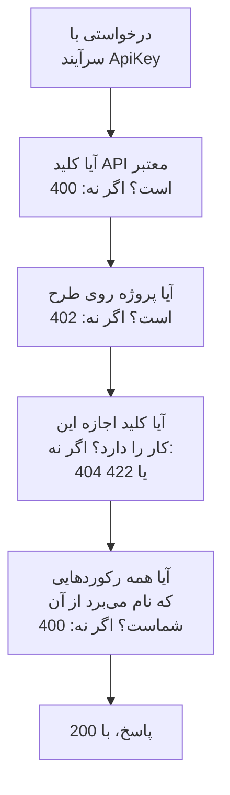

# مرجع API OneUptime

هر کاری که در داشبورد OneUptime می‌توانید بکنید، از راه REST API آن هم می‌توانید: کارهای تکراری را خودکار کنید، OneUptime را به ابزارهای دیگرتان وصل کنید، یا یکپارچه‌سازی‌های خودتان را بسازید. این صفحه نشان می‌دهد نخستین درخواستتان را چگونه بفرستید، و قاعده‌هایی که هر درخواستی از آن‌ها پیروی می‌کند. هر نقطه پایانی و فیلد در [مرجع کامل API](/reference) فهرست شده است.

:::cards
- [نخستین درخواستتان را بفرستید](#نخستین-درخواستتان-را-بفرستید): یک کلید API، یک سرآیند و یک فرمان curl.
- [درخواست‌ها و پاسخ‌ها](#درخواستها-و-پاسخها): شش درخواستی که هر منبعی دارد، و معنای هر کد وضعیت.
- [طرح‌ها و API](#طرحها-و-api): یک طرح چه می‌فروشد، و پایین‌تر از آن چه هنوز کار می‌کند.
- [نام بردن و نوشتن رکوردها](#نام-بردن-و-نوشتن-رکوردها): شناسه‌ها، ارجاع‌ها، کلیدهای روشن‌وخاموش و فیلدهایی که OneUptime تنظیم می‌کند.
- [وضعیت‌ها و اپیزودها](#وضعیتها-و-اپیزودها): وضعیتی که یک رکورد در آن آغاز می‌شود و از آن‌ها می‌گذرد.
- [یک درخواست به چه می‌رسد](#یک-درخواست-به-چه-میرسد): خواندن، تغییر و حذف، در یک پروژه در هر بار.
:::

## درخواست چگونه پاسخ داده می‌شود

API بر پایه REST سازمان یافته است: متدها و کدهای وضعیت استاندارد HTTP، با JSON در ورودی و JSON در خروجی. هر درخواست یک کلید API همراه دارد و از چند بررسی می‌گذرد. نخستین بررسی‌ای که در آن شکست بخورد با یک کد وضعیت و `{ "message": "..." }` پاسخ می‌دهد، پس پیام می‌گوید چه چیزی جلویش را گرفته است.



## نخستین درخواستتان را بفرستید

همه درخواست‌های API با یک کلید API احراز هویت می‌شوند. یک کلید از آنِ یک پروژه است، و همان کاری را می‌کند که مجوزهایش اجازه می‌دهند.

:::steps
### یک کلید API بسازید

**تنظیمات پروژه** > **پیشرفته** > **کلیدهای API** را باز کنید و روی **ساخت کلید API** کلیک کنید. به آن یک **نام** بدهید، و زیر **دسترسی** برگزینید چه کاری می‌تواند بکند: **مدیر پروژه**، **عضو پروژه**، **بیننده**، یا **دسترسی‌ها را بعداً انتخاب کنید** برای افزودن تک‌مجوزها در صفحه کلید. کلید یک سال پس از امروز منقضی می‌شود، مگر این‌که زیر **پیشرفته** تاریخ دیگری برگزینید.

### کلید را کپی کنید

صفحه کلید باز می‌شود. **کلید API** را از کارت **جزئیات کلید API** کپی کنید، و آن را بیرون از کدتان نگه دارید:

```bash
export ONEUPTIME_API_KEY="your-api-key"
```

### یک درخواست بفرستید

ده مانیتور نخست را فهرست کنید. کلید پروژه خودش را می‌خواند، پس درخواست نام هیچ پروژه‌ای را نمی‌برد:

```bash
curl -X POST 'https://oneuptime.com/api/monitor/get-list?skip=0&limit=10' \
  -H "ApiKey: $ONEUPTIME_API_KEY" \
  -H 'Content-Type: application/json' \
  -d '{ "select": { "name": true } }'
```

پاسخ `{ "data": [...], "count": ... }` است: مانیتورها، و این‌که روی هم چندتا هستند. در نصب خودمیزبان، به جای `https://oneuptime.com` نشانی OneUptime خودتان را به کار ببرید.
:::

### نمونه‌هایی برای هر منبع

هر منبع در داشبورد OneUptime در منوی کناری‌اش یک بخش **توسعه‌دهنده** دارد که تا بازش نکنید بسته است. صفحه **API** آن فرمان‌های `curl` آماده اجرا برای آن منبع دارد، رو به OneUptime شما و پرشده از پروژه خودتان: خواندن، تغییر و حذف آن از صفحه خود منبع، یا فهرست کردن، شمردن و ساختن از یک صفحه فهرست (برای نمونه **مانیتورها**). فرمان‌ها کلید API شما را از متغیر محیطی `ONEUPTIME_API_KEY` می‌خوانند.

نمونه‌ها برای همان منبع نوشته شده‌اند. برای نمونه، در فهرست **حوادث**، درخواست فهرست پاسخش را با نخستین حادثه شما نشان می‌دهد، پالایه‌ها حوادثی را می‌یابند که حل نشده‌اند، از یک شدت هستند، درباره یک مانیتورند یا از هفت روز گذشته‌اند، با وضعیت‌ها، شدت‌ها و مانیتورهای خودتان، و درخواست ساختن حادثه‌ای را با یکی از شدت‌های شما اعلام می‌کند، با یک خط درباره این‌که هر فیلد برای چیست. صفحه خود یک حادثه آن را با پاسخ واقعی‌اش می‌خواند، آن را به شدت دیگری از شدت‌های شما می‌برد، و کارهای رایجش را دارد: تأیید و حل آن (با وضعیت‌های خود پروژه‌تان)، و افزودن یادداشت‌های داخلی یا عمومی. هر صفحه API با نقطه‌های پایانی منبع پایان می‌یابد.

## درخواست‌ها و پاسخ‌ها

هر منبعی همان درخواست‌ها را دارد، زیر `https://oneuptime.com/api` و مسیر منبع، مانند `/monitor` یا `/incident`:

| درخواست | متد و مسیر | بدنه چه دارد |
| --- | --- | --- |
| فهرست | `POST /api/<resource>/get-list` | `query`، `select` و `sort` |
| شمارش | `POST /api/<resource>/count` | `query` |
| خواندن یکی | `POST /api/<resource>/<id>/get-item` | `select` |
| ساختن | `POST /api/<resource>` | `{ "data": { ... } }` |
| تغییر یکی | `PUT /api/<resource>/<id>` | `{ "data": { ... } }`، فیلدهایی که باید تغییر کنند |
| حذف یکی | `DELETE /api/<resource>/<id>` | هیچ |

`POST /api/<resource>/<id>/update-item` و `POST /api/<resource>/<id>/delete-item` هم یک رکورد را تغییر می‌دهند و حذف می‌کنند، برای کلاینت‌هایی که تنها `POST` می‌فرستند.

### پالایش، مرتب‌سازی و صفحه‌بندی

فهرست یا شمارش یک `query` می‌پذیرد. فیلدی با یک مقدار با همان مقدار تطبیق می‌کند؛ شیئی با `_type` مقایسه می‌کند:

| `_type` | با چه چیزی تطبیق می‌کند |
| --- | --- |
| `Search` | متنی که `value` را در بر دارد |
| `NotEqual` | هر چیزی جز `value` |
| `GreaterThan`، `LessThan` | تاریخ‌های دیرتر یا عددهای بزرگ‌تر، یا زودتر و کوچک‌تر |
| `InBetween` | تاریخ‌ها یا عددهای میان `startValue` و `endValue` |
| `Includes` | هر یک از مقدارهای `value` |
| `IsNull`، `NotNull` | بی‌مقدار، یا هر مقداری |

فیلدی از رکوردی که منبع نام می‌برد، زیر رابطه‌اش فیلتر می‌شود: `"user": { "name": { "_type": "Search", "value": "ada" } }` اعضای تیمی را پیدا می‌کند که نام کاربرشان «ada» را در بر دارد. فیلتر کردن بر پایهٔ یک فیلد اجازهٔ خواندن آن را می‌خواهد، از راه یک رابطه همان‌طور که روی خود منبع: فیلتری روی فیلدی که اجازهٔ خواندنش را ندارید با یک `422` که نام آن فیلد را می‌برد رد می‌شود.

منبعی که مالک دارد - یک مانیتور، یک حادثه، یک خط‌مشی آنکال و هر منبع دیگری با مالکان کاربر و تیم - بر پایهٔ این‌که مالکش کیست هم فیلتر می‌شود، زیر `owners`: `"owners": { "_type": "OwnedBy", "userIds": ["..."], "teamIds": ["..."] }` رکوردهایی را پیدا می‌کند که یک یا چند نفر از آن افراد و تیم‌ها مالکشان هستند. `match` همان `AnyOf` است مگر این‌که تنظیمش کنید: `NoneOf` رکوردهایی را پیدا می‌کند که هیچ‌یک از آن‌ها مالکشان نیست، از جمله رکوردهای بی‌مالک، و `AnyOwner` و `NoOwner` رکوردهای دارای مالک یا بی‌مالک را پیدا می‌کنند و کسی را نام نمی‌برند. اعضای یک تیم مالک آنچه تیم مالکش است نیستند. هر فیلتر روی هم حداکثر ۱٬۰۰۰ نفر و تیم را نام می‌برد، منبعی که مالک ندارد آن را با یک `400` رد می‌کند، و فیلتر کردن بر پایهٔ مالکان بدون اجازهٔ خواندن آن‌ها با یک `422` رد می‌شود.

`select` فیلدهایی را که باید برگردند نام می‌برد، و `_id` همیشه برمی‌گردد. `sort` آن‌ها را مرتب می‌کند، `ASC` یا `DESC`؛ بی آن، تازه‌ترین‌ها نخست می‌آیند. فهرست ۱۰ رکورد برمی‌گرداند مگر این‌که `limit` را تنظیم کنید، تا ۱۰٬۰۰۰، و `skip` نخست همان تعداد را رد می‌کند: `skip` را پیوسته به اندازه `limit` بالا ببرید تا `count` رکورد داشته باشید. برای CSV به جای JSON، `?output-type=csv` را به درخواست فهرست بیفزایید.

برای نمونه، مانیتورهایی که نامشان «checkout» را در بر دارد و از آغاز ۲۰۲۶ ساخته شده‌اند، تازه‌ترین‌ها نخست:

```bash
curl -X POST 'https://oneuptime.com/api/monitor/get-list' \
  -H "ApiKey: $ONEUPTIME_API_KEY" \
  -H 'Content-Type: application/json' \
  -d '{
    "query": {
      "name": { "_type": "Search", "value": "checkout" },
      "createdAt": { "_type": "GreaterThan", "value": "2026-01-01T00:00:00.000Z" }
    },
    "select": { "name": true, "createdAt": true },
    "sort": { "createdAt": "DESC" },
    "limit": 100
  }'
```

تاریخ‌ها و شناسه‌های جز `_id` پیچیده‌شده برمی‌گردند، به‌صورت `{ "_type": "DateTime", "value": "..." }` و `{ "_type": "ObjectID", "value": "..." }`: آن‌ها را از `value` بخوانید.

هر شناسه‌ای که یک درخواست با آن فیلتر می‌کند یا آن را می‌نویسد - `_id`، فیلدی مانند `monitorId` و هر رکوردی که یک رابطه فهرست می‌کند، مانند `"labels": [{ "_id": "..." }]` - یک UUID است که به‌صورت متن یا پیچیده‌شده، همان‌طور که برمی‌گردد، فرستاده می‌شود. هر چیز دیگری، مانند متنی که UUID نیست یا شیئی به‌جای یک شناسه، با یک `400` رد می‌شود که فیلد را نام می‌برد و می‌گوید در `query` بوده یا در `data`، و هیچ چیزی خوانده یا نوشته نمی‌شود:

```text
Invalid ID for "currentIncidentStateId" in the query: "resolved". An ID is a UUID, such as "550e8400-e29b-41d4-a716-446655440000".
```

### کدهای وضعیت

| کد | معنایش | بیشتر بخوانید |
| --- | --- | --- |
| `200` | انجام شد. فهرست یا شمارش با رکوردهایی پاسخ می‌دهد که می‌توانید بخوانید، و اگر هیچ نباشد، هیچ. | [خواندن یک رکورد با شناسه‌اش](#خواندن-یک-رکورد-با-شناسهاش) |
| `400` | درخواست نادرست است: کلید API نامعتبر است، مقداری مجاز نیست، فیلدی نوشتنی نیست، رکوردی که نام می‌برد از آنِ شما نیست، یا چند پروژه را یک‌جا تغییر می‌دهد. پیام می‌گوید چه چیزی نادرست است. | [رکوردهایی که یک درخواست نام می‌برد](#رکوردهایی-که-یک-درخواست-نام-میبرد) |
| `402` | طرح پروژه آنچه را درخواست به کار می‌برد دربر ندارد. پیام نام طرح را می‌برد. | [قابلیت‌هایی که طرح شما دربر ندارد](#قابلیتهایی-که-طرح-شما-دربر-ندارد) |
| `404` | رکورد وجود ندارد، در پروژه دیگری است، یا رکوردی است که نمی‌توانید بخوانید: پاسخ برای هر کدام یکسان است. | [تغییر یا حذف رکوردی که نمی‌توانید بخوانید](#تغییر-یا-حذف-رکوردی-که-نمیتوانید-بخوانید) |
| `422` | اجازه این کار را ندارید: کلید API هیچ مجوزی برای این نوع رکورد ندارد، می‌توانید رکورد را بخوانید ولی تغییرش نه، یا برچسب‌های یک مجوز آن را بیرون می‌گذارند. پیام می‌گوید چرا. | [تغییر یا حذف رکوردی که نمی‌توانید بخوانید](#تغییر-یا-حذف-رکوردی-که-نمیتوانید-بخوانید) |
| `500` | چیزی در سرور شکست خورد. وقتی مالک یک رکورد تازه نوشته نشود، رکورد دوباره حذف می‌شود، تا بتوان ساختن را دوباره آزمود. | [رکوردهایی که یک درخواست نام می‌برد](#رکوردهایی-که-یک-درخواست-نام-میبرد) |

## طرح‌ها و API

### قابلیت‌هایی که طرح شما دربر ندارد

در OneUptime Cloud، برخی منابع روی یک طرح فروخته می‌شوند: فراهم‌کننده‌های ورود یکپارچه و اتصال‌های SCIM روی **Scale**؛ کلیدهای API، برنامه‌های آنکال، و قاعده‌ها و خلاصه‌های اعلان Slack و Microsoft Teams روی **Growth**، در کنار موارد دیگر. ساختن یکی، تغییر یکی یا روشن کردن یکی به همان طرح نیاز دارد. پایین‌تر از آن، درخواست با `402 Payment Required` رد می‌شود، و پیام نام طرح را می‌برد.

برخی تنظیم‌های یک منبع هم به همین شیوه روی یک طرح فروخته می‌شوند. برای نمونه: صفحه وضعیتی که خصوصی است، یکی از فهرست‌هایش را پنهان می‌کند، یا HTML، CSS یا JavaScript سفارشی، گزارش‌های ایمیلی، مشترکان SMS، Slack، Microsoft Teams یا وب‌هوک، یا فهرست مجاز IP دارد؛ داشبوردی که عمومی به اشتراک گذاشته شده، یا فهرست مجاز IP آن؛ فهرست مجاز IP یک فرم؛ گزارش‌های ممیزی یک پروژه. راهنمای هر کدام، و داشبورد در کنار آن تنظیم، طرحی را که لازم دارد نام می‌برد. چنین تنظیمی هر بار که نوشته شود به طرحش نیاز دارد - چه منبع با آن ساخته شود چه بعدتر تغییر کند - پس ساختنی که یکی از آن‌ها را پایین‌تر از طرح روشن کند هم با `402` رد می‌شود. تنظیمی که در پیش‌فرضش رها شده، یا به آن بازگردانده شده، روی هر طرحی کار می‌کند: ساختنی که این تنظیم‌ها را دست نزند انجام می‌شود، و پیکربندی Terraform‌ای که آن‌ها را تنظیم نکند هم.

آنچه یک پروژه از پیش دارد، با هر طرحی مدیریت‌پذیر می‌ماند، برای نمونه پس از پایان یک دوره آزمایشی یا پایین آمدن طرح:

- می‌توانید آن رکوردها را حذف کنید؛
- می‌توانید یکی را، روی منبعی با فیلد `isEnabled`، با فرستادن `"isEnabled": false` و هیچ چیز دیگر خاموش کنید؛
- می‌توانید آن‌هایی را که یک پروژه پس از پایین آمدن طرح باید بیابد فهرست کنید و بخوانید - تا خاموششان کنید، یا ببینید چه چیزی متوقف شده: فراهم‌کننده‌های ورود یکپارچه، اتصال‌های SCIM، کلیدهای API و مجوزهایشان، برنامه‌های آنکال، و قاعده‌ها و خلاصه‌های اعلان Slack و Microsoft Teams.

مجوزهای معمول همچنان تعیین می‌کنند چه کسی چه کاری می‌تواند بکند، درست مانند روی طرح. خواندن منابع دیگری که یک طرح می‌فروشد، مانند قالب‌ها، فیلدهای سفارشی، گروه‌های مانیتور، گزارش‌های آنکال و ارسال‌های فرم، همچنان به طرح نیاز دارد: خواندن آن‌ها همان به کار بردن قابلیت است. مجوزهای یک کلید API پایین‌تر از **Growth** یکی‌یکی حذف نمی‌شوند، چون حذف یک مجوز مسدودکننده به کلید دسترسی بیشتری می‌دهد؛ به جایش کلید را حذف کنید.

### کلیدهای API و SCIM پایین‌تر از طرحشان

در OneUptime Cloud، کلیدهای API یک پروژه تنها تا وقتی کار می‌کنند که پروژه روی **Growth** یا بالاتر باشد، و اتصال‌های SCIM آن - چه از آنِ خود پروژه چه از آنِ صفحه‌های وضعیتش - تنها تا وقتی کاملاً کار می‌کنند که روی **Scale** یا بالاتر باشد. وقتی پروژه پایین‌تر از آن طرح می‌رود:

- هر درخواستی که با یکی از کلیدهای API پروژه فرستاده شود با `402 Payment Required` رد می‌شود، هر چه بخواهد: REST API، و هر چیزی که آن را با یک کلید API فرامی‌خواند - Terraform، CLI `oneuptime`، کلاینت‌های MCP که با یک کلید API وصل شده‌اند، گردش‌های کاری‌ای که کلیدی را در سرآیند درخواست می‌فرستند، و اسکریپت‌های خودتان. پیام نام طرح را می‌برد: `API keys need the Growth plan. This project's plan does not include them, so its API keys stopped working. The keys are kept: upgrade the project to Growth in Project Settings > Billing and Invoices > Billing and they work again.`
- اتصال‌های SCIM آن تنها افراد را برمی‌دارند. غیرفعال کردن و حذف افراد، و بیرون بردنشان از گروه‌ها، همچنان کار می‌کند، پس هر کس برود همچنان دسترسی‌اش را از دست می‌دهد؛ هر درخواست SCIM که افراد یا گروه‌ها را بیفزاید یا تغییر دهد با `402`، در قالب خطای SCIM، رد می‌شود، تا فراهم‌کننده هویت شما دلیلش را نشان دهد ([SCIM پایین‌تر از طرح Scale](/docs/identity/scim#زیر-طرح-scale)).

هیچ چیز حذف یا خاموش نمی‌شود. کلیدها و اتصال‌ها نگه داشته می‌شوند، و به محض بازگشت پروژه به طرح، همان‌طور که هستند دوباره کاملاً کار می‌کنند: نه کلید تازه‌ای باید ساخت، نه چیزی را در فراهم‌کننده هویت باید دوباره راه انداخت. تغییر طرح در کمتر از یک دقیقه اثر می‌کند.

پایین‌تر از **Growth**، **تنظیمات پروژه** > **پیشرفته** > **کلیدهای API** کلیدهایی را که پروژه هنوز دارد فهرست می‌کند و می‌گوید متوقف شده‌اند، پس هر کدام را روی هر طرحی می‌توان حذف (باطل) کرد. ساختن یا تغییر کلیدها به **Growth** نیاز دارد. **تنظیمات پروژه** > **صورت‌حساب و فاکتورها** > **صورت‌حساب** برای هر طرحی که می‌توانید برگزینید نام می‌برد که یک طرح پایین‌تر چند کلید API را متوقف و چند اتصال SCIM را محدود می‌کند، و طرح پروژه چه چیزی را متوقف کرده است؛ وقتی یک تغییر طرح آن‌ها را متوقف کند، مالکان پروژه ایمیل می‌گیرند. مالکان پروژه‌هایی که هنگام آغاز این قاعده از پیش پایین‌تر از این طرح‌ها بودند یک ایمیل می‌گیرند که می‌گوید چه چیزی متوقف شده و چگونه دوباره روشنش کنند.

تنها کلیدهای API و اتصال‌های SCIM یک پروژه تأثیر می‌پذیرند. افراد تأثیر نمی‌پذیرند: ورود به داشبورد، و کلاینت‌های MCP که با ورود وصل شده‌اند، مانند پیش کار می‌کنند. کلیدهای دریافت تله‌متری، کلیدهای پراب و کلیدهای عامل کلید API نیستند، و به کار ادامه می‌دهند. نصب‌های خودمیزبان طرحی ندارند، پس برایشان هیچ چیز تغییر نمی‌کند.

## نام بردن و نوشتن رکوردها

### یافتن شناسه یک منبع

درخواست‌هایی که یک منبع را می‌خوانند، تغییر می‌دهند یا حذف می‌کنند، آن را با شناسه‌اش، یک UUID، نام می‌برند. در صفحه خود منبع، کارت جزئیاتش با یک خط کوچک **ID** پایان می‌یابد که آغاز شناسه را نشان می‌دهد: برای کپی کردن کل شناسه روی آن، یا روی دکمه کپی کنارش، کلیک کنید. فهرست‌هایی که این را پیش می‌گذارند در منوی **⋯** هر سطر **نمایش شناسه** دارند، و شناسه بخش پایانی نشانی صفحه هم هست. شناسه پروژه شما نخستین چیز روی کارت **جزئیات پروژه** در **تنظیمات پروژه** > **پروژه** است.

### رکوردهایی که یک درخواست نام می‌برد

بسیاری از منابع رکوردهای دیگری را نام می‌برند: یک مانیتور برچسب‌ها و پراب‌هایش را، یک مشترک صفحه وضعیت صفحه وضعیتش را، یک دستگاه شبکه سایتش را، و عضو یک حادثه، حادثه و نقش را. هر قاعده زیر برای API، Terraform و گردش‌های کاری یکسان برقرار است:

| وقتی یک درخواست | باید | وگرنه |
| --- | --- | --- |
| رکوردی را با شناسه‌اش نام می‌برد | رکوردی از پروژه شما را نام ببرد | `400` |
| رکوردی می‌سازد که از راه رکورد دیگری خوانده می‌شود، مانند یک یادداشت | آن را زیر رکوردی بسازد که می‌توانید بخوانید | `400`، یا `422` اگر مجوز خواندن آن نوع رکورد را نداشته باشید |
| رکوردی را زیر رکورد دیگری می‌برد | آن را زیر رکوردی ببرد که می‌توانید بخوانید | `400` |
| رکوردهایی را فهرست می‌کند، یا یکی را در فیلدی از خودش نام می‌برد | رکوردهایی را نام ببرد که مجوز خواندن شما به آن‌ها می‌رسد | `400` |
| تنظیمی را نام می‌برد که اعتبارنامه نگه می‌دارد | از کسی بیاید که می‌تواند آن نوع تنظیم را بخواند | `400` |
| رکوردی را زیر مجوزی محدود به برچسب‌ها می‌سازد یا برچسبش را تغییر می‌دهد | یکی از آن برچسب‌ها را به رکورد بدهد | `422` |
| یک رکورد را به دو شیوه نام می‌برد | هر دو بار همان رکورد را نام ببرد | `400` |

#### هر شناسه باید از آنِ پروژه شما باشد

هر شناسه‌ای که برای رکوردی که یک منبع نام می‌برد می‌فرستید باید رکوردی از پروژه شما باشد — انتخابگرهای داشبورد چیز دیگری پیش نمی‌گذارند — و درخواست‌های Terraform و گردش‌های کاری هم به همین پایبندند. شناسه رکورد یک پروژه دیگر و شناسه‌ای که وجود ندارد به یک شکل رد می‌شوند، با یک `400` که فیلد و شناسه را نام می‌برد:

```text
This network device references records that are not in this project: Network Site "…". Please pick values from this project and try again.
```

افراد با عضویتشان سنجیده می‌شوند: کسی که عضو پروژه نیست به همین شکل رد می‌شود. پراب سراسری، که هر پروژه‌ای می‌تواند به کارش ببرد، از آنِ پروژه شما به شمار می‌آید. تغییر یک منبع تنها شناسه‌هایی را می‌سنجد که آن تغییر می‌افزاید، پس منبعی که چیزی را نام می‌برد که از آن پس رفته است همچنان می‌تواند ذخیره شود.

#### رکوردهایی که از راه رکورد دیگری خوانده می‌شوند

رکوردی که از راه رکورد دیگری خوانده می‌شود - یادداشت‌ها و خط زمانی وضعیت یک حادثه یا هشدار، اعلان‌ها، دامنه‌ها و گروه‌های یک صفحه وضعیت - باید رکوردی را هم نام ببرد که می‌توانید بخوانید، با همان قاعده‌ای که خواندنش از آن پیروی می‌کند: حادثه‌ای بیرون از برچسب‌ها یا مالکانی که مجوز خواندن حوادث شما به آن‌ها می‌رسد، دارای برچسبی که یک مسدودسازی روی خواندن حوادث برمی‌دارد، یا خصوصی‌شده بی‌آنکه شما، مستقیم یا از راه یک تیم، در میان مالکانش باشید (مالکان و مدیران پروژه هر حادثه، هشدار و اپیزود خصوصی را می‌بینند)، با همان `400` رد می‌شود، و هیچ چیز نوشته نمی‌شود. هر صفحه وضعیتی که یک اعلان نام می‌برد باید صفحه‌ای باشد که می‌توانید بخوانید، و کلیدی که مجوز خواندن صفحه‌های وضعیتش تنها به برخی از آن‌ها می‌رسد باید دست‌کم یکی را نام ببرد. مجوز ساختن چنین رکوردی به مجوز خواندن رکوردی نیاز دارد که زیرش ساخته می‌شود؛ بی آن، ساختن با یک `422` رد می‌شود که مجوزهایی را نام می‌برد که اجازه ورودش را می‌دادند:

```text
You do not have permissions to create Incident Internal Note. It is read through its Incident, and you need one of these permissions to read Incidents: …
```

تغییری که چنین رکوردی را جابه‌جا می‌کند از همان قاعده پیروی می‌کند: هر رکوردی که به‌عنوان والد می‌افزاید - صفحه وضعیت دیگری برای یک اعلان، سرویس دیگری برای رکوردی که از راه سرویسش خوانده می‌شود - باید رکوردی باشد که می‌توانید بخوانید، وگرنه تغییر با همان `400` رد می‌شود و هیچ چیز نوشته نمی‌شود. والدهایی که یک رکورد از پیش دارد دوباره سنجیده نمی‌شوند، و تغییری که آن را زیر هیچ رکوردی رها کند، به مجوز خواندنی از آن نوع رکورد نیاز دارد که به همه آن‌ها برسد، همان‌گونه که ساختنی که هیچ‌کدام را نام نبرد نیاز دارد.

#### مالکان

مالکان یک منبع - رکوردهای مالک کاربر و تیم یک مانیتور، یک خط‌مشی آنکال، یک داشبورد و هر منبع دیگری که مالک دارد - به همان شیوه از راه منبعی که مالکش هستند خوانده می‌شوند: فهرست کردن، خواندن، افزودن و برداشتنشان به مجوز خواندن آن منبع، زیر برچسب‌ها و مالکانش، نیاز دارد، و به رکورد مالکِ منبعی که نمی‌توانید بخوانید چنان پاسخ داده می‌شود که گویی وجود ندارد. افزودن و برداشتن آن‌ها هم تابع دامنه مجوزی است که اجازه‌اش را می‌دهد: مجوزی با دامنه `Owned` فقط به مالکان منابعی می‌رسد که شما یا یکی از تیم‌هایتان مالکشان هستید، و افزودن مالک به هر منبع دیگری با یک `422` که همین را می‌گوید رد می‌شود.

#### رکوردهایی که یک نوشتن فهرست می‌کند یا نام می‌برد

رکوردهایی که یک ساختن یا تغییر فهرست می‌کند - مانیتورها و خط‌مشی‌های آنکال یک حادثه، سرویس‌های یک هشدار، صفحه‌های وضعیت یک رویداد نگهداری زمان‌بندی‌شده، رانبوک‌های یک قاعده - وقتی مجوز خواندن آن نوع رکورد را دارید در محدوده آن می‌مانند، و در هر حال در محدوده یک مسدودسازی برچسب‌دار روی خواندنش: رکوردی بیرون از آن‌ها با همان `400` رد می‌شود. یک تغییر تنها رکوردهایی را می‌سنجد که به یک فهرست می‌افزاید، پس رکوردهایی که فهرست از پیش دارد می‌مانند.

تک‌رکوردی که یک ساختن یا تغییر در فیلدی از خودش نام می‌برد - مانیتور یک هشدار، مانیتوری که یک منبع صفحه وضعیت نشان می‌دهد، سرویس یک بودجه هزینه، حادثه‌ای که یک اجرای رانبوک به آن پیوند خورده - به همان قاعده پایبند است، با هر کدام از دو نامش: رکوردی بیرون از مجوز خواندن شما برای آن نوع رکورد، یا دارای برچسبی که یک مسدودسازی روی خواندنش برمی‌دارد، با همان `400` رد می‌شود. یک تغییر آن را تنها وقتی می‌سنجد که رکوردی جز آنچه فیلد از پیش دارد نام ببرد. پراب‌های سراسری و عامل‌های هوش مصنوعی OneUptime، که هر پروژه‌ای می‌تواند به کار ببرد، برای هر پروژه‌ای باز می‌مانند. رکوردهایی که یک قالب برایتان پر می‌کند هم پس از پر شدن، پیش از ذخیره هر چیزی، به همان شیوه سنجیده می‌شوند: مانیتورها، صفحه‌های وضعیت و خط‌مشی‌های آنکالی که یک قالب حادثه به حادثه اعلام‌شده از آن می‌افزاید باید رکوردهایی باشند که می‌توانید بخوانید، گویی خودتان آن‌ها را برگزیده‌اید.

#### تنظیم‌هایی که اعتبارنامه نگه می‌دارند

تنظیمی که اعتبارنامه نگه می‌دارد - یک سرور SMTP، یک فراهم‌کننده تماس و SMS، اعتبارنامه‌های SNMP، یک اتصال تماس ویدیویی، یک کلید API، یک سرور MCP خارجی - تنها از سوی فراخواننده‌ای نام برده می‌شود که می‌تواند آن نوع تنظیم را بخواند: `smtpConfig` و `callSmsConfig` یک صفحه وضعیت، `projectCallSMSConfig` یک خط‌مشی تماس ورودی، `snmpCredentialProfile` یک دستگاه شبکه یا سایت، `videoCallConnection` تماس ویدیویی یک حادثه یا هشدار، `apiKey` یک مجوز کلید API، و `externalMcpServers` یک قاعدهٔ هوش مصنوعی. نام بردن یکی بی مجوز خواندن آن نوع تنظیم - یا با مجوزی که یک مسدودسازی بی‌برچسب برمی‌دارد - با همان `400` رد می‌شود، با هر کدام از دو نامش؛ از تغییری که تنظیمی را که یک رکورد از پیش نام می‌برد نگه می‌دارد چیزی پرسیده نمی‌شود. جست‌وجوی شماره و فهرست شماره‌های خودِ یک خط‌مشی تماس ورودی هم به همان خواندنِ پیکربندی Call/SMS‌ای نیاز دارند که نام می‌برند.

#### برچسب‌ها و مالکان هنگام ساختن

مجوز ساختنی که به برچسب‌ها محدود است تنها رکوردهایی می‌سازد که یکی از برچسب‌هایش را دارند - برای رکوردی که برچسب‌های خودش را ندارد، رکوردهایی زیر رکوردی که یکی را دارد - مگر این‌که مجوز دیگری برای ساختن آن نوع رکورد به کل پروژه برسد، و یک مسدودسازی برچسب‌دار روی مجوز ساختن رکوردی را که یکی از برچسب‌هایش را دارد رد می‌کند. ساختنی بیرون از آن‌ها با یک `422` رد می‌شود که برچسب‌ها را نام می‌برد:

```text
Your access lets you create Status Pages only with one of these labels: Production. Add one of them and try again.
```

مجوز ساختنی که به **Owned** محدود است یک مانیتور، یک صفحه وضعیت یا رکورد دیگری با مالکان خودش را تنها برای یک فرد می‌سازد، که یکی از مالکانش می‌شود، و یک یادداشت یا رکورد دیگری که مالکانش را از رکوردی که به آن تعلق دارد می‌گیرد، تنها زیر رکوردی که شما یا یکی از تیم‌هایتان مالکش هستید.

سازنده درست پس از ذخیره رکورد، پیش از آنکه هر چیز دیگری برایش رخ دهد، مالک آن می‌شود. اگر سطر مالک نوشته نشود، رکورد دوباره حذف می‌شود و ساختن با یک `500` رد می‌شود، تا هیچ رکوردی به جا نماند که سازنده‌اش نتواند به آن برسد.

#### تغییر برچسب‌ها

تغییر برچسب‌هایی که یک رکورد دارد - برچسب‌های خودش، یا برای رکوردی که برچسب‌های خودش را ندارد، رکوردهایی که نام می‌برد - به همان شیوه در محدوده مجوز شما برای تغییر آن نوع رکورد می‌ماند: با مجوزی محدود به برچسب‌ها، رکورد دست‌کم یکی از آن‌ها را نگه می‌دارد، مگر این‌که مجوز دیگری برای تغییرش به کل پروژه برسد، و یک مسدودسازی برچسب‌دار روی مجوز تغییر، دادن یکی از برچسب‌هایش را رد می‌کند. چنین تغییری با یک `422` رد می‌شود که برچسب‌ها را نام می‌برد:

```text
Your access lets you change Monitors only with one of these labels: Production. Keep one of them and try again.
```

#### نام بردن یک رکورد به دو شیوه

یک رکورد را می‌توان به دو شیوه نام برد: با فیلد شناسه‌اش (`monitorId`)، یا با رابطه (`"monitor": { "_id": "…" }`)، که فرم‌های داشبورد همان را می‌فرستند. یکی از این دو را بفرستید. اگر درخواستی هر دو را بفرستد، هر دو باید یک رکورد را نام ببرند: درخواستی که این دو در آن ناهمخوان‌اند — دو شناسه متفاوت، یا یک شناسه و یک مقدار خالی — با یک `400` رد می‌شود که هر دو فیلد را نام می‌برد:

```text
Conflicting Monitor references were provided. monitorId and monitor are names for the same field and must hold the same value: send only one of them, or the same id in each.
```

هر دو نام به یک شکل سنجیده می‌شوند. قاعده‌های مربوط به رکوردی که نام می‌برید، با هر نامی که آن را بفرستید، برقرار می‌مانند: گروه والدِ یک گروه صفحه وضعیت باید در همان صفحه وضعیت باشد، یک صفحه وضعیت حداکثر سه پیوند سرآیند می‌پذیرد، و نام یک گروه در صفحه وضعیتش باید یکتا باشد.

### کلیدهای روشن‌وخاموش

فیلدی که روشن یا خاموش است - `isEnabled`، `isVisibleOnStatusPage`، `isArchived` و هر فیلد `true` یا `false` دیگری - مقدار `true` یا `false` می‌پذیرد. متن و عددهایی که پایگاه داده یکی از آن دو می‌خواند، به همان مقدار پذیرفته می‌شوند، برای API، Terraform و گردش‌های کاری به یک شکل: `"true"`، `"yes"`، `"on"`، `"1"` و `1` یعنی `true`، و `"false"`، `"no"`، `"off"`، `"0"` و `0` یعنی `false`، با حروف بزرگ یا کوچک. هر کاری که OneUptime با رکورد می‌کند هم آن را همان مقدار می‌شمارد: رویداد نگهداری زمان‌بندی‌شده‌ای که با `"isVisibleOnStatusPage": "true"` فرستاده شود تصویرهایش را در صفحه وضعیت نشان می‌دهد، و `"isEnabled": "false"` منبعی را پایین‌تر از طرحش همان‌گونه خاموش می‌کند که `false` می‌کند. هر مقدار دیگری، مانند `"maybe"`، `""` یا `2`، با یک `400` رد می‌شود که فیلد را نام می‌برد:

```text
isVisibleOnStatusPage must be true or false.
```

به‌روزرسانی‌ای که مقدارهای یک رکورد را همان‌گونه که هستند می‌نویسد هیچ چیز را تغییر نمی‌دهد: گردش‌های کاری **On Update** رکورد را آغاز نمی‌کند، به‌روزرسانی زنده نمی‌فرستد و ورودی گزارش ممیزی نمی‌افزاید. `false` نوشته‌شده روی `false` همان مقدار شمرده می‌شود، و همچنین `"false"` نوشته‌شده روی `false`، عددی که به‌صورت متنش نوشته شود، زمانی که به‌صورت همان لحظه در قالب دیگری نوشته شود، و برچسب‌هایی که به‌صورت همان برچسب‌ها با هر ترتیبی نوشته شوند. وقتی یک به‌روزرسانی برخی مقدارها را تغییر می‌دهد و بقیه را همان‌گونه که هستند بازمی‌نویسد، ورودی گزارش ممیزی‌اش تنها مقدارهای تغییرکرده را فهرست می‌کند، و **Fields to watch** یک گردش کاری تنها همان‌ها را می‌شنود.

### پروژه از کجا خریده شده

فروشنده مجدد، طرح فروشنده مجدد و پروانه فروشنده مجدد یک پروژه (`resellerId`، `resellerPlanId`، `resellerLicenseId`، و رابطه‌های `reseller` و `resellerPlan`) را تنها OneUptime تنظیم می‌کند: وقتی پروژه‌ای با کد تبلیغاتی یک فروشنده مجدد ساخته شود، و وقتی فروشنده مجدد طرح را تغییر دهد. ساختن یا تغییر پروژه‌ای که یکی از آن‌ها را بفرستد با یک `400` رد می‌شود که فیلد را نام می‌برد، هر که آن را بفرستد:

```text
User is not allowed to create on resellerId column of Project. No permission allows it: the column is set by the server, not by a request.
```

### چه کسی رکوردی را ساخته است

OneUptime ثبت می‌کند چه کسی رکوردی را ساخته است — و چه کسی بایگانی‌اش کرده، حلش کرده، تأییدش کرده یا آن را راه انداخته است — از روی خود درخواست: فردی که وارد شده است، یا هیچ‌کس وقتی درخواست با یک کلید API یا از یک گردش کاری بیاید. این فیلدها (`createdByUserId` و فیلدهای دیگری که به `ByUserId` پایان می‌یابند، با رابطه‌هایشان مانند `createdByUser`) فقط‌خواندنی‌اند، و همچنین زمانی که رکورد بایگانی یا حل شده است (`archivedAt`، `markedAsResolvedAt`، `markedAsArchivedAt`): روشن کردن `isArchived` یا `isResolved` ثبت می‌کند چه کسی و کی آن را کرد، و خاموش کردنش هر دو را پاک می‌کند. فرستادن یک کلید روشن‌وخاموش همان‌گونه که هست، این‌که چه کسی و کی آن را تغییر داده نگه می‌دارد.

مرجع API این فیلدها را فقط‌خواندنی نشان می‌دهد. مقداری که یک درخواست در کنار تغییرهای دیگر برای یکی از آن‌ها می‌فرستد نادیده گرفته می‌شود، تا بقیه تغییر انجام شود؛ به‌روزرسانی‌ای که چیز دیگری نمی‌فرستد با پیامی که فیلدها را نام می‌برد رد می‌شود. رکوردهایی که خود OneUptime از سوی کسی می‌سازد — یادداشتی که از Slack یا Microsoft Teams فرستاده شده، حسابی که با یک دعوت‌نامه ساخته شده — همان فرد را نام می‌برند.

## وضعیت‌ها و اپیزودها

### وضعیتی که رکورد تازه در آن آغاز می‌شود

یک حادثه، یک هشدار، یک اپیزود حادثه و یک اپیزود هشدار را می‌توان در هر یک از وضعیت‌های پروژه‌تان ساخت، همان‌گونه که فیلد **وضعیت اولیه** فرم‌های ساختنشان می‌کند: `currentIncidentStateId` (حوادث و اپیزودهای حادثه) یا `currentAlertStateId` (هشدارها و اپیزودهای هشدار)، یا رابطه را بفرستید. رکورد در همان وضعیت آغاز می‌شود و خط زمانی وضعیتش با آن آغاز می‌شود. اگر آن را نفرستید، در وضعیت ساخته‌شده پروژه‌تان آغاز می‌شود، همانی که با `isCreatedState` نشان خورده — یا، برای حادثه‌ای که از قالبی با وضعیت اولیه اعلام شده، در وضعیت قالب. وضعیتی از پروژه‌ای دیگر مانند هر رکورد دیگری رد می‌شود. `current_incident_state_id` و `current_alert_state_id` در Terraform هم به همین شیوه کار می‌کنند. رکوردی که در وضعیت تأییدشده شما یا پس از آن ساخته شود کسی را پیج نمی‌کند، و رکوردی که حل‌شده ساخته شود گروه‌بندی، اصلاح خودکار یا بررسی با هوش مصنوعی هم نمی‌شود و کانال Slack یا Microsoft Teams نمی‌گیرد — [حادثه‌ای که از پیش تأییدشده یا برطرف‌شده اعلام می‌شود](/docs/incidents/declaring-incidents#حادثهای-که-از-پیش-تأییدشده-یا-برطرفشده-اعلام-میشود) را ببینید.

### تغییر وضعیت یک رکورد

وضعیت یک رکورد با سطری از خط زمانی وضعیتش تغییر می‌کند - `POST /api/incident-state-timeline`، `/api/alert-state-timeline`، `/api/incident-episode-state-timeline`، `/api/alert-episode-state-timeline` یا `/api/scheduled-maintenance-state-timeline` - یا با به‌روزرسانی‌ای که وضعیت کنونی‌اش را می‌نویسد (`currentIncidentStateId`، `currentAlertStateId`، `currentScheduledMaintenanceStateId`، یا رابطه)، که همان سطر را ثبت می‌کند. در هر دو حال یک قاعده بر این جابه‌جایی حاکم است، برای یک اپیزود مانند یک حادثه، یک هشدار یا یک رویداد نگهداری زمان‌بندی‌شده: وضعیتی که در ترتیب پروژه‌تان پیش از وضعیت کنونی رکورد باشد پیش از ذخیره هر چیزی رد می‌شود، و همچنین وضعیتی که رکورد از پیش در آن است:

```text
Episode cannot transition to Acknowledged state from Resolved state because Acknowledged is before Resolved in the order of incident states.
```

وضعیتی که به اشتباه تنظیم شده با حذف سطرش از خط زمانی وضعیت رکورد درست می‌شود. [ترتیب محدودیتی واقعی است، نه ترجیحی نمایشی](/docs/incidents/states-and-severities#ترتیب-محدودیتی-واقعی-است-نه-ترجیحی-نمایشی) را ببینید.

### اپیزودی که یک حادثه یا هشدار در آن است

`incidentEpisodeId` یک حادثه و `alertEpisodeId` یک هشدار — و رابطه‌هایشان `incidentEpisode` و `alertEpisode` — تازه‌ترین اپیزودی را نام می‌برند که به آن افزوده شده و هنوز عضوش است، یا هیچ. فقط‌خواندنی‌اند: OneUptime آن‌ها را از روی اعضای اپیزود تنظیم می‌کند. برای گذاشتن یک حادثه در یک اپیزود، یک Incident Episode Member بسازید (`POST /api/incident-episode-member` با `incidentEpisodeId` و `incidentId`)؛ برای بیرون آوردنش، آن عضو را حذف کنید، و آنگاه حادثه تازه‌ترین اپیزودی را که هنوز در آن است نام می‌برد، یا هیچ. هشدارها از راه Alert Episode Members به همین شیوه کار می‌کنند (`/api/alert-episode-member`، با `alertEpisodeId` و `alertId`). قاعده‌های گروه‌بندی هم حوادث و هشدارها را به همین شیوه به اپیزودها می‌افزایند. ساختن یا به‌روزرسانی حادثه یا هشداری که اپیزودش را بفرستد رد می‌شود، هر که آن را بفرستد — API، Terraform، ابزارهای MCP یا یک گردش کاری. در Terraform، `incident_episode_id` و `alert_episode_id` خواندنی‌اند ولی تنظیم‌شدنی نیستند؛ منابع `oneuptime_incident_episode_member` و `oneuptime_alert_episode_member` عضویت را مدیریت می‌کنند.

## یک درخواست به چه می‌رسد

### تغییر یا حذف رکوردی که نمی‌توانید بخوانید

یک تغییر یا حذف تنها به رکوردهایی می‌رسد که کلید API - یا فردی که وارد شده - می‌تواند بخواند. رکوردی بیرون از برچسب‌ها یا مالکانش، پشت یک مسدودسازی روی خواندن، یا خوانده‌شده از راه رکورد دیگری که نمی‌تواند بخواند (یادداشت یک حادثه، اعلان یک صفحه وضعیت) هم نه تغییرپذیر است و نه حذف‌پذیر. مجوز تغییر یا حذف یک نوع رکورد همراه با مجوز خواندن آن کار می‌کند، و مجوز تغییر یادداشت‌های یک حادثه همراه با مجوز خواندن حوادث.

درخواستی که یک رکورد را با شناسه‌اش تغییر می‌دهد یا حذف می‌کند - `PUT /api/<resource>/<id>` یا `POST /api/<resource>/<id>/update-item`، `DELETE /api/<resource>/<id>` یا `POST /api/<resource>/<id>/delete-item` - و به هیچ چیز نمی‌رسد، این پاسخ را می‌دهد:

- `404` وقتی رکورد وجود ندارد، در پروژه دیگری است، یا رکوردی است که نمی‌توانید بخوانید - پاسخ برای هر کدام یکسان است:

```text
Incident not found.
```

- `422` وقتی می‌توانید رکورد را بخوانید ولی نمی‌توانید تغییرش دهید یا حذفش کنید، با دلیل:

```text
You do not have permission to update this incident.
```

حذفی که به هیچ چیز نمی‌رسید پیش‌تر `200` پاسخ می‌داد. به‌روزرسانی‌ها و حذف‌ها با پرس‌وجو، مانند گام‌های به‌روزرسانی و حذف یک گردش کاری، با تعداد رکوردهایی که تغییر داده‌اند پاسخ می‌دهند، و اگر به هیچ چیز نرسند `0`. Terraform یک `404` در `terraform destroy` را منبعی می‌خواند که از پیش رفته است.

تله‌متری هم از همین قاعده پیروی می‌کند. حذف لاگ‌ها، ترِیس‌ها، متریک‌ها، استثناها، پروفایل‌ها یا بازپخش‌های نشست به سطرهای منابعی می‌رسد - سرویس‌ها، میزبان‌ها، خوشه‌ها و مانند آن‌ها - که می‌توانید تله‌متری‌شان را هم بخوانید و هم حذف کنید، و در یک پروژه در هر بار انجام می‌شود: درخواستی در سراسر همه پروژه‌هایتان رد می‌شود. حذف یک سطر با شناسه‌اش که به هیچ چیز نرسد، مانند بالا `404` یا `422` پاسخ می‌دهد.

### تغییرها در یک پروژه در هر بار انجام می‌شوند

به‌روزرسانی یا حذف رکوردهای یک پروژه در پروژه‌ای انجام می‌شود که درخواست نام می‌برد: سرآیند `tenantid`، یا برای یک کلید API، پروژه خود کلید. به‌روزرسانی یا حذفِ کاربرِ واردشده‌ای که هیچ پروژه‌ای را نام نبرد، یا با سرآیند `is-multi-tenant-query` در سراسر همه پروژه‌هایش بپرسد، با `400` رد می‌شود:

```text
Changes to incidents are made in one project at a time. Please pass the project ID in the 'tenantid' header.
```

چنین درخواستی پیش‌تر با `500` شکست می‌خورد. خواندن‌ها همچنان می‌توانند در سراسر همه پروژه‌هایتان بپرسند.

### خواندن یک رکورد با شناسه‌اش

خواندن یک رکورد با شناسه‌اش - `POST /api/<resource>/<id>/get-item` - وقتی رکورد وجود ندارد، در پروژه دیگری است، یا رکوردی است که نمی‌توانید بخوانید، `404` پاسخ می‌دهد، و پاسخ برای هر کدام یکسان است:

```text
Incident not found.
```

پیش‌تر با بدنه‌ای خالی `200` پاسخ می‌داد. فهرست (`get-list`) و شمارش همچنان با `200` و رکوردهایی که می‌توانید بخوانید پاسخ می‌دهند، و اگر هیچ نباشد، هیچ. فراهم‌کننده Terraform یک `404` هنگام تازه‌سازی را منبعی رفته می‌خواند و آن را از state برمی‌دارد، پس plan بعدی دوباره آن را می‌سازد: به کلید API‌ای که به کار می‌برد مجوزها و برچسب‌هایی بدهید که بتواند هر منبعی را که مدیریت می‌کند بخواند. ابزارهای MCP به یک `404` با خطایی پاسخ می‌دهند که به ابزار فهرست متناظر اشاره می‌کند، و CLI با کد `3` خارج می‌شود.

## مرجع کامل نقطه‌های پایانی

هر منبع، نقطه پایانی و فیلد در [مرجع API OneUptime](/reference) فهرست شده است. این مرجع به چند زبان در دسترس است: زبان شما از مرورگرتان برگزیده می‌شود، و هر وقت بخواهید می‌توانید با انتخابگر بالای صفحه آن را عوض کنید.

## رفع اشکال

:::details هر درخواست پاسخ 400 Invalid API Key می‌دهد
سرآیند `ApiKey` خالی است، کلید نیست، یا کلیدی را نام می‌برد که منقضی یا بازنشانی شده است. کلید را دوباره از صفحه‌اش زیر **تنظیمات پروژه** > **پیشرفته** > **کلیدهای API** کپی کنید، جایی که تاریخ **انقضا** آن هم هست.
:::

:::details هر درخواست پاسخ 402 Payment Required می‌دهد
در OneUptime Cloud، کلیدهای API تنها تا وقتی کار می‌کنند که پروژه روی طرح **Growth** یا بالاتر باشد. کلیدها نگه داشته می‌شوند، و به محض بازگشت پروژه به طرح همان‌طور که هستند دوباره کار می‌کنند: [کلیدهای API و SCIM پایین‌تر از طرحشان](#کلیدهای-api-و-scim-پایینتر-از-طرحشان) را ببینید.
:::

:::details هر درخواست پاسخ 422 You do not have permissions می‌دهد
کلید API هیچ مجوزی برای آن نوع رکورد ندارد. کلیدی که با **دسترسی‌ها را بعداً انتخاب کنید** ساخته شده تا مجوزی نگیرد هیچ کاری نمی‌تواند بکند: آن را زیر **تنظیمات پروژه** > **پیشرفته** > **کلیدهای API** باز کنید، سپس روی **افزودن نقش** یا **افزودن دسترسی** کلیک کنید. پیام مجوزهایی را نام می‌برد که اجازه عبور درخواست را می‌دادند.
:::

:::details رکوردی که در داشبورد می‌بینم پاسخ 404 می‌دهد
کلید API تنها چیزی را می‌خواند که مجوزهایش، و برچسب‌های آن‌ها، به آن می‌رسند، و یک کلید ممکن است به کمتر از حساب خودتان برسد. به کلید مجوزی بدهید که به رکورد برسد: [خواندن یک رکورد با شناسه‌اش](#خواندن-یک-رکورد-با-شناسهاش) را ببینید.
:::

:::details یک به‌روزرسانی پاسخ 400 Invalid request body می‌دهد
یک به‌روزرسانی فیلدهایی را که باید تغییر کنند درون `data` می‌فرستد، به‌صورت `{ "data": { "name": "New name" } }`. بدنه‌ای بدون آن رد می‌شود، به جای این‌که پاسخ `200` بدهد و هیچ چیز را تغییر ندهد:

```text
Invalid request body. The update payload should be an object of the form { "data": { ...fields to update... } }.
```
:::

:::details یک نوشتن پاسخ 400 می‌دهد و یک فیلد و یک شناسه را نام می‌برد
شناسه رکوردی از پروژه دیگری، رکوردی که وجود ندارد، یا رکوردی را نام می‌برد که مجوزهای شما به آن نمی‌رسند. [رکوردهایی که یک درخواست نام می‌برد](#رکوردهایی-که-یک-درخواست-نام-میبرد) را ببینید.
:::

## گام‌های بعدی

:::cards
- [کاربران، تیم‌ها و مجوزها](/docs/permissions/index): مجوزها و برچسب‌های یک کلید API به چه چیزی می‌رسند.
- [فراهم‌کننده Terraform](/docs/terraform/index): منابع OneUptime را به‌صورت کد مدیریت کنید، از راه همان API.
- [CLI OneUptime](/docs/cli/index): API را از ترمینال و اسکریپت‌هایتان فرابخوانید.
- [سرور MCP](/docs/ai/mcp-server): بگذارید دستیاران هوش مصنوعی با پروژه‌تان کار کنند.
:::
