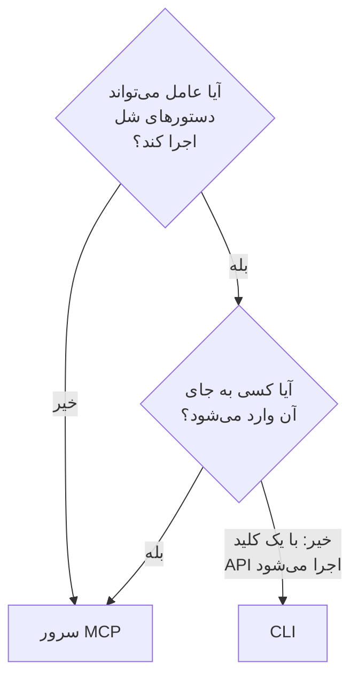

# CLI برای عامل‌های هوش مصنوعی

عامل هوش مصنوعی‌ای که می‌تواند دستورهای شل اجرا کند، مانند یک عامل برنامه‌نویسی در ویرایشگر شما یا یک کار در خط لولهٔ شما، می‌تواند به جای [سرور MCP](/docs/ai/mcp-server) از راه CLI با OneUptime کار کند. این صفحه می‌گوید هر کدام کی مناسب است، و یک عامل چگونه CLI را نصب می‌کند، راهش را پیدا می‌کند و پاسخ‌هایش را می‌خواند.

:::cards
- [CLI یا سرور MCP](#cli-یا-سرور-mcp): یک عامل از کدام باید استفاده کند.
- [راه‌اندازی برای یک عامل](#راهاندازی-برای-یک-عامل): آن را نصب کنید و یک کلید در محیط به آن بدهید.
- [عامل چگونه راهش را پیدا می‌کند](#عامل-چگونه-راهش-را-پیدا-میکند): منابع، فیلدهایشان و راهنما.
- [خواندن پاسخ‌ها](#خواندن-پاسخها): JSON از هر دستور، خطاها هم.
:::

## CLI یا سرور MCP

هر دو به API OneUptime می‌رسند و همان کاری را می‌کنند که اعتبارنامه‌هایشان اجازه می‌دهد. تفاوتشان در چیزی است که عامل برای رسیدن به آن‌ها نیاز دارد:



| | CLI | سرور MCP |
| --- | --- | --- |
| عامل نیاز دارد به | یک شل، و Node.js ۲۲ یا بالاتر | یک کلاینت MCP، مانند Claude یا Cursor |
| با چه وارد می‌شود | یک کلید API پروژه، در `ONEUPTIME_API_KEY` | حساب OneUptime شما، یا یک کلید API |
| به چه می‌رسد | هر منبع API، ۴۵۰ منبع و بیشتر | رکوردها و تله‌متری‌ای که برایشان ابزار دارد، و ابزارهای پاسخ به حادثه |
| مناسب است برای | اسکریپت‌هایی که عامل می‌نویسد تا افراد نگهشان دارند، بررسی‌ها در خط لوله، و کار با رکوردهای زیاد | یک گفت‌وگو: بررسی یک حادثه، راه‌اندازی یک مانیتور |

وقتی عامل از پیش دستور اجرا می‌کند، مانند یک عامل برنامه‌نویسی، یا وقتی آن‌چه می‌سازد باید بدون آن به کار ادامه دهد، از CLI استفاده کنید: یک اسکریپت در یک مخزن، یک گام از یک خط لوله. وقتی کسی در یک کلاینت گفت‌وگو با عامل حرف می‌زند، از سرور MCP استفاده کنید، تا عامل با مجوزهای او کار کند و کلاینت پیش از هر تغییری بپرسد.

## راه‌اندازی برای یک عامل

هر OneUptime اسکریپت نصب CLI را برای نسخهٔ خودش در اختیار می‌گذارد: دستورهای زیر آن را از `https://oneuptime.com` دریافت می‌کنند، پس در OneUptime خودمیزبان این نشانی را با URL خود جایگزین کنید. اسکریپت نخست با نام `install.sh` ذخیره می‌شود تا بتوانید پیش از اجرا آن را بخوانید:

```bash
curl -fsSL https://oneuptime.com/install/cli -o install.sh
ONEUPTIME_URL=https://oneuptime.com bash install.sh
```

به عامل یک کلید API پروژه بدهید که فقط دسترسی لازم برای کارش را داشته باشد، در محیط و نه در خط فرمان، و بگذارید نخست کلید را بررسی کند:

```bash
export ONEUPTIME_API_KEY="your-api-key"
export ONEUPTIME_URL=https://oneuptime.com
oneuptime whoami --check -o json
```

کلید را در **تنظیمات پروژه** > **پیشرفته** > **کلیدهای API** بسازید: [یک کلید API بسازید](/docs/api-reference/api-reference#یک-کلید-api-بسازید) را ببینید. کلیدی که فقط می‌تواند بخواند، به عامل فقط اجازهٔ نگاه کردن می‌دهد و نه چیز دیگری.

## عامل چگونه راهش را پیدا می‌کند

CLI می‌گوید چه کارهایی می‌تواند بکند، بدون کلید API و بدون درخواست:

| دستور | چه پاسخی می‌دهد |
| --- | --- |
| `oneuptime resources -o json` | هر منبع: دستورش، نام‌هایش، مسیر API آن، عملیاتش و کنش‌هایش |
| `oneuptime incident fields -o json` | فیلدهای یک منبع: هر کدام برای چیست، نوعش، این‌که ساختن به آن نیاز دارد یا نه، و پرچمش |
| `oneuptime incident create --help` | آرگومان‌ها و پرچم‌های یک دستور |

فیلدی که یک شناسه در خود دارد می‌گوید شناسهٔ کدام منبع را می‌گیرد، پس عامل نخست آن منبع را فهرست می‌کند: `incidentSeverityId` یک شناسه از `oneuptime incident-severity list` می‌گیرد. فیلدی که یک نفر را نام می‌برد نشانی ایمیل او را هم می‌پذیرد، مانند `--user-email`.

## خواندن پاسخ‌ها

بگذارید عامل `-o json` یا `--json` را به هر دستوری اضافه کند. آن‌گاه هر دستوری با JSON پاسخ می‌دهد، از جمله آن‌هایی که پاسخشان یک جمله است، و خطا یک شیء JSON در خطای استاندارد است:

```bash
oneuptime incident acknowledge 6f1c2a40-3b1e-4c55-9a0b-3e2f8d7c1a11 -o json
```

```json
{
  "_id": "6f1c2a40-3b1e-4c55-9a0b-3e2f8d7c1a11",
  "action": "acknowledge",
  "changed": true,
  "state": {
    "_id": "0b7d5e2c-8f4a-4d1b-9c3e-5a6f7b8c9d0e",
    "name": "Acknowledged"
  }
}
```

کد خروج می‌گوید چه اتفاقی افتاد: `0` وقتی کار انجام شد، `1` وقتی شکست خورد، `2` وقتی کلید API نیست یا رد شده است، و `3` وقتی رکورد وجود ندارد. JSON یک خطا همان کد را در `exitCode` دارد، و در `hint` این‌که گام بعدی چیست. [قالب‌های خروجی](/docs/cli/output-formats#json) و [کدهای خروج](/docs/cli/scripting#کدهای-خروج) را ببینید.

## گام‌های بعدی

:::cards
- [عملیات روی منابع](/docs/cli/resource-operations): هر عملیات، با پرچم‌ها و فیلترهایش.
- [مرجع دستورها](/docs/cli/command-reference): همهٔ دستورها، گزینه‌ها و مقادیر پیش‌فرض.
- [سرور MCP](/docs/ai/mcp-server): به جای آن یک کلاینت گفت‌وگو را به OneUptime وصل کنید.
:::
