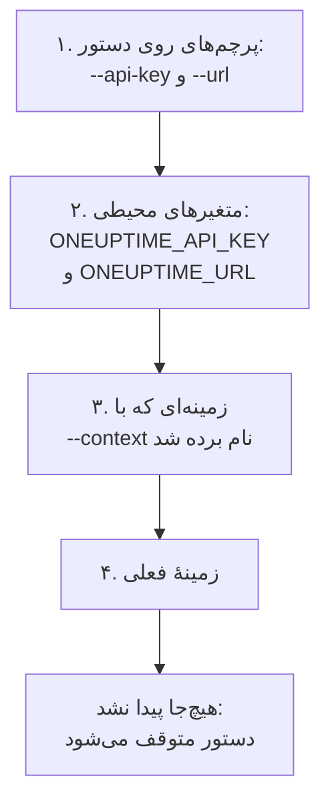

# احراز هویت

هر درخواستی که CLI می‌فرستد یک کلید API از پروژهٔ شما را با خود دارد. کلیدها را یک بار با `oneuptime login` ذخیره کنید، برای هر محیط یک زمینه، یا مانند اسکریپت‌ها آن‌ها را با پرچم‌ها یا متغیرهای محیطی به یک دستور بدهید. این صفحه هر روش را نشان می‌دهد، و این‌که وقتی چند روش هست، دستور کدام را به کار می‌برد.

:::cards
- [ورود](#ورود): یک کلید API و نشانی OneUptime خود را ذخیره کنید.
- [زمینه‌ها](#زمینهها): یک ورود ذخیره‌شده برای هر پروژه یا محیط، و جابه‌جایی میان آن‌ها.
- [دستور کدام اعتبارنامه‌ها را به کار می‌برد](#دستور-کدام-اعتبارنامهها-را-به-کار-میبرد): اول پرچم‌ها، سپس متغیرهای محیطی، سپس زمینه‌ها.
- [عیب‌یابی](#عیبیابی): اعتبارنامه‌ای پیدا نشد، کلیدهای نامعتبر و رد شدن‌ها.
:::

## پیش از شروع

به یک کلید API از پروژهٔ خود نیاز دارید. آن را در **تنظیمات پروژه** > **پیشرفته** > **کلیدهای API** با **ساخت کلید API** بسازید و دسترسی‌ای را که دستورهایتان نیاز دارند به آن بدهید: [یک کلید API بسازید](/docs/api-reference/api-reference#یک-کلید-api-بسازید) را ببینید. کلید همان کاری را می‌کند که مجوزهایش اجازه می‌دهند، پس کلیدی که فقط می‌تواند رکوردها را بخواند، می‌تواند آن‌ها را فهرست کند و بخواند، اما نمی‌تواند تغییرشان دهد.

در OneUptime Cloud، کلیدهای API فقط تا وقتی کار می‌کنند که پروژه روی طرح **Growth** یا بالاتر باشد. پایین‌تر از آن، هر دستور با `API error (402)` و پیامی که نام طرح را می‌آورد پاسخ می‌دهد، تا وقتی پروژه ارتقا یابد؛ پس از آن همان کلید دوباره کار می‌کند. [کلیدهای API و SCIM پایین‌تر از طرحشان](/docs/api-reference/api-reference#کلیدهای-api-و-scim-پایینتر-از-طرحشان) را ببینید.

## ورود

`oneuptime login` یک کلید API و نشانی OneUptime شما را به‌عنوان یک زمینه ذخیره می‌کند و آن را زمینهٔ فعلی می‌کند:

```bash
oneuptime login <api-key> <instance-url> [--context-name <name>]
```

| آرگومان یا گزینه | چیست |
| --- | --- |
| `<api-key>` | یک کلید API از پروژهٔ شما |
| `<instance-url>` | نشانی OneUptime شما: `https://oneuptime.com`، یا نشانی سرور خودتان، مانند `https://oneuptime.example.com` |
| `--context-name <name>` | نامی که زمینه با آن ذخیره می‌شود. پیش‌فرض: `default` |

برای نمونه، زمینه‌ای به نام `production`:

```bash
oneuptime login <api-key> https://oneuptime.com --context-name production
```

پاسخ آن `Logged in successfully. Context "production" is now active.` است. اسلش پایان نشانی حذف می‌شود، و ورود دوباره با همان نام آن زمینه را جایگزین می‌کند.

> [!NOTE]
> `login` کلید را بدون پرسیدن از OneUptime ذخیره می‌کند. برای دیدن این‌که کلید کار می‌کند، دستوری مانند `oneuptime incident count` را اجرا کنید.

## زمینه‌ها

زمینه یک ورود ذخیره‌شده است: یک نام، یک نشانی و یک کلید API. برای هر پروژه یا محیط یکی ذخیره کنید، سپس یکی را برای همهٔ دستورهای بعدی، یا برای یک دستور، انتخاب کنید.

:::steps
### برای هر محیط یک زمینه ذخیره کنید

```bash
oneuptime login <production-api-key> https://oneuptime.com --context-name production
oneuptime login <staging-api-key> https://oneuptime.example.com --context-name staging
```

هر ورود زمینهٔ خودش را زمینهٔ فعلی می‌کند، پس اکنون `staging` زمینهٔ فعلی است.

### آن‌ها را فهرست کنید

```bash
oneuptime context list
```

```text
┌───┬────────────┬───────────────────────────────┐
│   │ Name       │ URL                           │
├───┼────────────┼───────────────────────────────┤
│   │ production │ https://oneuptime.com         │
├───┼────────────┼───────────────────────────────┤
│ * │ staging    │ https://oneuptime.example.com │
└───┴────────────┴───────────────────────────────┘
```

نشانهٔ `*` زمینهٔ فعلی را مشخص می‌کند. کلیدهای API هرگز فهرست نمی‌شوند.

### به زمینهٔ دیگری بروید

```bash
oneuptime context use production
```

پاسخ آن `Switched to context "production".` است و دستورهای بعدی از آن استفاده می‌کنند.

### برای یک دستور از یک زمینه استفاده کنید

```bash
oneuptime incident list --context staging
```

زمینهٔ فعلی همان‌طور که بود می‌ماند.
:::

| دستور | چه می‌کند |
| --- | --- |
| `oneuptime context list` | زمینه‌های ذخیره‌شده را فهرست می‌کند؛ `*` زمینهٔ فعلی را مشخص می‌کند. با `-o json`، برای هر زمینه `name`، `apiUrl` و `isCurrent`، و هرگز کلیدش را |
| `oneuptime context use <name>` | یک زمینهٔ ذخیره‌شده را زمینهٔ فعلی می‌کند |
| `oneuptime context current` | نام، URL و کلید API زمینهٔ فعلی را نشان می‌دهد، با پنهان بودن همهٔ نویسه‌های کلید جز چهار نویسهٔ اول و چهار نویسهٔ آخر |
| `oneuptime context delete <name>` | یک زمینهٔ ذخیره‌شده را حذف می‌کند. اگر زمینهٔ فعلی بود، نخستین زمینهٔ باقی‌مانده زمینهٔ فعلی می‌شود |

## دستور کدام اعتبارنامه‌ها را به کار می‌برد

دستور به یک کلید API و یک URL نیاز دارد. هر کدام از این دو را از نخستین جایی در این فهرست برمی‌دارد که آن را داشته باشد:



پس می‌توانید آن‌ها را با هم ترکیب کنید: برای نمونه، کلید API از یک متغیر محیطی همراه با URL زمینهٔ فعلی. متغیرهای محیطی برای اسکریپت‌ها و جاب‌های CI، که زمینهٔ ذخیره‌شده‌ای ندارند، مناسب‌اند:

:::tabs
@tab Linux
```bash
export ONEUPTIME_API_KEY=<api-key>
export ONEUPTIME_URL=https://oneuptime.com
oneuptime incident list
```
@tab macOS
```bash
export ONEUPTIME_API_KEY=<api-key>
export ONEUPTIME_URL=https://oneuptime.com
oneuptime incident list
```
@tab Windows
```powershell
$env:ONEUPTIME_API_KEY = "<api-key>"
$env:ONEUPTIME_URL = "https://oneuptime.com"
oneuptime incident list
```
:::

برای یک دستور، پرچم‌ها بر همه‌چیز مقدم‌اند:

```bash
oneuptime --api-key <api-key> --url https://oneuptime.com incident list
```

> [!WARNING]
> کلیدی که به‌صورت پرچم داده شود در تاریخچهٔ پوستهٔ شما می‌ماند، و کاربران دیگر آن ماشین می‌توانند آن را در فهرست فرایندها ببینند. روی ماشین مشترک، به‌جای آن از یک زمینه یا یک متغیر محیطی استفاده کنید.

## ببینید CLI از چه چیزی استفاده خواهد کرد

`oneuptime whoami` نشانی URL و کلید API را که دستور بعدی به کار می‌برد، و زمینه‌ای را که از آن آمده‌اند، نشان می‌دهد:

```bash
oneuptime whoami
```

```text
URL:     https://oneuptime.com
API Key: 4f1c****0a13
Context: production
```

فقط چهار نویسهٔ اول و چهار نویسهٔ آخر کلید نشان داده می‌شوند. سطر `Context` فقط وقتی ظاهر می‌شود که URL و کلید مقادیر خود آن زمینه باشند، نه مقادیری که یک پرچم یا یک متغیر محیطی جایگزینشان کرده است. `whoami` تنظیمات شما را بدون فراخوانی OneUptime می‌خواند: نشان می‌دهد دستور چه چیزی خواهد فرستاد، نه این‌که OneUptime آن را می‌پذیرد یا نه. وقتی هیچ چیزی ذخیره یا تنظیم نشده باشد، پاسخ می‌دهد:

```text
Not authenticated. Run `oneuptime login` to authenticate.
```

## فایل پیکربندی

`oneuptime login` زمینه‌ها را در `~/.oneuptime/config.json`، در پوشهٔ خانگی شما، ذخیره می‌کند (در Windows، `%USERPROFILE%\.oneuptime\config.json`). CLI آن را طوری می‌سازد که فقط کاربر شما بتواند آن را بخواند و بنویسد (حالت `0600`):

```json title="~/.oneuptime/config.json"
{
  "currentContext": "production",
  "contexts": {
    "production": {
      "name": "production",
      "apiUrl": "https://oneuptime.com",
      "apiKey": "<api-key>"
    },
    "staging": {
      "name": "staging",
      "apiUrl": "https://oneuptime.example.com",
      "apiKey": "<api-key>"
    }
  }
}
```

این فایل کلیدهای API را همان‌طور که هستند نگه می‌دارد: آن را از پوشه‌های مشترک، پشتیبان‌ها و مخزن‌ها دور نگه دارید. برای خروج از یک زمینه، آن را با `oneuptime context delete <name>` حذف کنید؛ برای خروج از همهٔ آن‌ها، فایل را حذف کنید. کلیدی که ممکن است فاش شده باشد تا وقتی آن را در OneUptime، در **تنظیمات پروژه** > **پیشرفته** > **کلیدهای API**، حذف نکنید معتبر می‌ماند.

قالب‌های خروجی و اندازهٔ فهرست‌ها اینجا ذخیره نمی‌شوند: `-o` و `--limit` را به هر دستور بدهید.

## عیب‌یابی

:::details پیام «No credentials found»
`Authentication error: No credentials found.` یعنی هیچ پرچم، متغیر محیطی یا زمینهٔ ذخیره‌شده‌ای کلید API و URL دستور را به آن نداده است. `oneuptime login` را اجرا کنید، یا هر دو `ONEUPTIME_API_KEY` و `ONEUPTIME_URL` را تنظیم کنید. دستور با کد `2` خارج می‌شود.
:::

:::details پیام «API error (400): Invalid API Key»
کلید، کلید API OneUptime نیست، منقضی شده، یا بازنشانی شده است. آن را دوباره از صفحه‌اش در **تنظیمات پروژه** > **پیشرفته** > **کلیدهای API** کپی کنید، جایی که تاریخ **انقضا** آن هم هست، و با همان نام زمینه دوباره وارد شوید. دستور با کد `2` خارج می‌شود.
:::

:::details پیام «API error (402): API keys need the Growth plan»
در OneUptime Cloud، پروژه پایین‌تر از طرح **Growth** است، پس کلیدهای API آن دیگر کار نمی‌کنند. پروژه را ارتقا دهید تا همان کلید دوباره کار کند: در CLI چیزی برای تغییر نیست.
:::

:::details پیام «API error (422): You do not have permissions»
مجوزهای کلید به آنچه دستور می‌خواهد نمی‌رسند. در صفحهٔ کلید در **تنظیمات پروژه** > **پیشرفته** > **کلیدهای API** یک نقش یا یک مجوز به آن بدهید: پیام، مجوزهایی را که درخواست را راه می‌دهند نام می‌برد.
:::

:::details پیام «Context "staging" does not exist»
هیچ زمینه‌ای با آن نام ذخیره نشده است. `oneuptime context list` نام‌های موجود را نشان می‌دهد.
:::

:::details نشانی یا کلیدی که whoami نشان می‌دهد با زمینه فرق دارد
یک متغیر محیطی یا یک پرچم مقدار زمینه را جایگزین می‌کند. `env | grep ONEUPTIME` متغیرهای تنظیم‌شده را نشان می‌دهد، و `unset ONEUPTIME_API_KEY ONEUPTIME_URL` شما را به زمینه‌هایتان برمی‌گرداند.
:::

:::details درخواست به آن نشانی ناموفق بود
`Error: Request failed to https://...` یعنی CLI نتوانست در آن نشانی به OneUptime برسد. URL را با `oneuptime whoami` بررسی کنید: همان نشانی‌ای است که OneUptime را در آن باز می‌کنید، با `https://`، مانند `https://oneuptime.com`.
:::

## گام‌های بعدی

:::cards
- [عملیات روی منابع](/docs/cli/resource-operations): رکوردها را فهرست کنید، بخوانید، بسازید، تغییر دهید، حذف کنید و بشمارید.
- [اسکریپت‌نویسی و CI/CD](/docs/cli/scripting): کلید یک خط لوله را با متغیرهای محیطی به آن بدهید.
- [مرجع API OneUptime](/docs/api-reference/api-reference): یک کلید API چه کارهایی می‌تواند بکند، و هر پاسخ چه معنایی دارد.
:::
