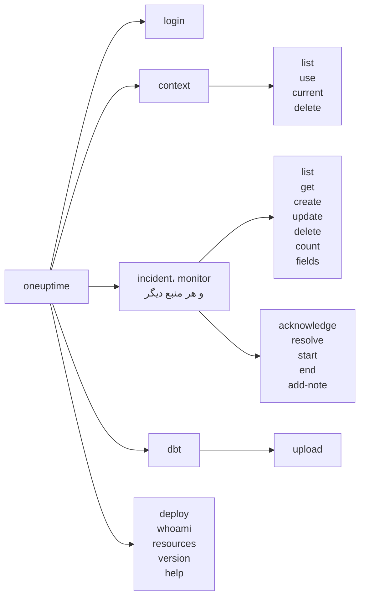

# مرجع دستورها

همهٔ دستورهای CLI `oneuptime`، با آرگومان‌ها، گزینه‌ها و مقادیر پیش‌فرضشان. برای دیدن همین‌ها در ترمینال، `--help` را به هر دستوری اضافه کنید.

:::cards
- [گزینه‌های سراسری](#گزینههای-سراسری): گزینه‌هایی که هر دستور می‌پذیرد.
- [ورود و زمینه‌ها](#ورود-و-زمینهها): login و دستورهای context.
- [دستورهای منبع](#دستورهای-منابع): عملیات، فیلدها و کنش‌های هر منبع.
- [دستورهای دیگر](#دستورهای-دیگر): deploy، dbt upload، data-checks apply، whoami، resources، version و help.
:::

## دستورها



## گزینه‌های سراسری

| گزینه | چه می‌کند | پیش‌فرض |
| --- | --- | --- |
| `--api-key <key>` | کلید API برای همین دستور | `ONEUPTIME_API_KEY`، سپس کلید زمینه |
| `--url <url>` | نشانی OneUptime شما برای همین دستور | `ONEUPTIME_URL`، سپس URL زمینه |
| `--context <name>` | زمینهٔ ذخیره‌شده‌ای که این دستور به کار می‌برد | زمینهٔ فعلی |
| `-o, --output <format>` | `json`، `table` یا `wide` | `table` در ترمینال، `json` در پایپ |
| `--json` | همان `-o json` | |
| `--no-color` | بدون رنگ چاپ می‌کند | رنگی، مگر این‌که `NO_COLOR` تنظیم شده باشد |
| `-V, --version` | نسخهٔ CLI را چاپ می‌کند | |
| `-h, --help` | راهنمای یک دستور را نشان می‌دهد | |

گزینه‌ها پیش یا پس از دستور می‌آیند: `oneuptime --context staging incident list` و `oneuptime incident list --context staging` یک کار را انجام می‌دهند.

هر دستوری `-o` و `--json` را می‌پذیرد، پس جدول‌های زیر آن‌ها را نمی‌آورند. دستوری که پاسخش یک جمله است، مانند `delete`، آن جمله را چاپ می‌کند مگر این‌که `-o json` یا `--json` JSON بخواهد: [قالب‌های خروجی](/docs/cli/output-formats#json) را ببینید.

## ورود و زمینه‌ها

### `oneuptime login`

یک کلید API و یک نشانی را به‌عنوان یک زمینه ذخیره می‌کند و آن را زمینهٔ فعلی می‌کند. [ورود](/docs/cli/authentication#ورود) را ببینید.

```bash
oneuptime login <api-key> <instance-url> [--context-name <name>]
```

| آرگومان یا گزینه | الزامی | چیست | پیش‌فرض |
| --- | --- | --- | --- |
| `<api-key>` | بله | یک کلید API از پروژهٔ شما | |
| `<instance-url>` | بله | نشانی OneUptime شما، مانند `https://oneuptime.com` | |
| `--context-name <name>` | خیر | نامی که زمینه با آن ذخیره می‌شود | `default` |

### `oneuptime context list`

زمینه‌های ذخیره‌شده را فهرست می‌کند؛ `*` زمینهٔ فعلی را نشان می‌دهد. کلیدهای API هرگز فهرست نمی‌شوند: JSON برای هر زمینه `name`، `apiUrl` و `isCurrent` را می‌دهد.

```bash
oneuptime context list
```

### `oneuptime context use`

یک زمینهٔ ذخیره‌شده را زمینهٔ فعلی می‌کند.

```bash
oneuptime context use <name>
```

| آرگومان | الزامی | چیست |
| --- | --- | --- |
| `<name>` | بله | نام یک زمینهٔ ذخیره‌شده |

### `oneuptime context current`

نام و URL زمینهٔ فعلی را نشان می‌دهد، و کلید API آن را با پنهان بودن همهٔ نویسه‌ها جز چهار نویسهٔ اول و چهار نویسهٔ آخر.

```bash
oneuptime context current
```

### `oneuptime context delete`

یک زمینهٔ ذخیره‌شده را حذف می‌کند. اگر زمینهٔ فعلی بود، نخستین زمینهٔ باقی‌مانده زمینهٔ فعلی می‌شود.

```bash
oneuptime context delete <name>
```

| آرگومان | الزامی | چیست |
| --- | --- | --- |
| `<name>` | بله | نام یک زمینهٔ ذخیره‌شده |

## دستورهای منابع

`<resource>` دستور یک نوع رکورد است، از جدول [منابع](#منابع)، مانند `incident` یا `monitor`. یک منبع عملیاتی را دارد که API برای آن می‌پذیرد، بیشترشان هر شش عملیات را، و `oneuptime <resource> --help` عملیات خود آن را فهرست می‌کند. برای نمونه‌ها [عملیات روی منابع](/docs/cli/resource-operations) را ببینید.

### `oneuptime <resource> list`

رکوردها را فهرست می‌کند، تازه‌ترین‌ها در ابتدا. برچسب‌ها در عوض به ترتیب نام فهرست می‌شوند، برچسب‌های شماره‌دار اول (`2. Team` پیش از `10. Owner`).

```bash
oneuptime <resource> list [--query <json>] [--limit <n>] [--skip <n>] [--sort <json>] [--fields <names>] [--all]
```

| گزینه | چه می‌کند | پیش‌فرض |
| --- | --- | --- |
| `--query <json>` | یک فیلتر، به‌صورت JSON | هر رکوردی که کلید می‌تواند بخواند |
| `--limit <n>` | بیشترین تعداد رکوردهای برگشتی، تا ۱۰٬۰۰۰ | `10` |
| `--skip <n>` | چند رکورد اول نادیده گرفته شوند | `0` |
| `--sort <json>` | ترتیب، به‌صورت JSON: `{"<field>":"ASC"}` یا `{"<field>":"DESC"}` | تازه‌ترین‌ها در ابتدا |
| `--fields <names>` | فیلدهایی که برگردانده می‌شوند، جداشده با ویرگول؛ فیلدی از یک رکورد مرتبط پس از یک نقطه، مانند `currentIncidentState.name` | هر فیلدی که کلید می‌تواند بخواند |
| `--all` | همهٔ رکوردهای منطبق، هر بار ۱۰۰ رکورد، تا ۱۰۰٬۰۰۰، به جای `--limit` و `--skip`. فقط برای رکوردها: تله‌متری `--all` ندارد | |

### `oneuptime <resource> get`

یک رکورد را می‌خواند.

```bash
oneuptime <resource> get <id> [--fields <names>]
```

| آرگومان یا گزینه | الزامی | چیست |
| --- | --- | --- |
| `<id>` | بله | شناسهٔ رکورد، یک UUID |
| `--fields <names>` | خیر | فیلدهایی که برگردانده می‌شوند، جداشده با ویرگول. پیش‌فرض: هر فیلدی که کلید می‌تواند بخواند |

### `oneuptime <resource> create`

یک رکورد می‌سازد و آن را چاپ می‌کند.

```bash
oneuptime <resource> create [--<field> <value>]... [--data <json>] [--file <path>]
```

| گزینه | الزامی | چیست |
| --- | --- | --- |
| `--<field> <value>` | فیلدهایی که ساختن باید بدهد | مقدار یک فیلد: `--title <text>`، `--incident-severity-id <id>`، `--labels <ids>`. `oneuptime <resource> create --help` آن‌ها را فهرست می‌کند. فقط برای رکوردها |
| `--data <json>` | خیر | رکورد، به‌صورت JSON |
| `--file <path>` | خیر | یک فایل JSON که رکورد را در خود دارد. اگر همراه با `--data` داده شود، فایل به کار می‌رود |

پرچم‌ها روی `--data` یا `--file` اعمال می‌شوند. فیلدی که یک نفر را با شناسهٔ کاربری نام می‌برد، پرچمی هم دارد که او را با نشانی ایمیل نام می‌برد: `--user-email` در کنار `--user-id`.

### `oneuptime <resource> update`

فیلدهایی را که می‌دهید تغییر می‌دهد.

```bash
oneuptime <resource> update <id> [--<field> <value>]... [--data <json>] [--file <path>]
```

| آرگومان یا گزینه | الزامی | چیست |
| --- | --- | --- |
| `<id>` | بله | شناسهٔ رکورد |
| `--<field> <value>` | خیر | فیلدی که باید تغییر کند: `oneuptime <resource> update --help` آن‌ها را فهرست می‌کند. فقط برای رکوردها |
| `--data <json>` | خیر | فیلدهایی که باید تغییر کنند، به‌صورت JSON |
| `--file <path>` | خیر | یک فایل JSON که فیلدهای در حال تغییر را در خود دارد. اگر همراه با `--data` داده شود، فایل به کار می‌رود |

### `oneuptime <resource> delete`

یک رکورد را بی‌درنگ و بدون پرسش حذف می‌کند.

```bash
oneuptime <resource> delete <id> [--force]
```

| آرگومان یا گزینه | الزامی | چیست |
| --- | --- | --- |
| `<id>` | بله | شناسهٔ رکورد |
| `--force` | خیر | پذیرفته می‌شود و چیزی را تغییر نمی‌دهد: `delete` هرگز تأیید نمی‌خواهد |

### `oneuptime <resource> count`

رکوردها را می‌شمارد و عدد را چاپ می‌کند.

```bash
oneuptime <resource> count [--query <json>]
```

| گزینه | الزامی | چیست |
| --- | --- | --- |
| `--query <json>` | خیر | یک فیلتر، به‌صورت JSON. بدون آن، هر رکوردی که کلید می‌تواند بخواند |

### `oneuptime <resource> fields`

فیلدهای منبع را فهرست می‌کند: هر کدام برای چیست، نوعش، این‌که ساختن باید آن را بدهد یا نه، و پرچمی که آن را تنظیم می‌کند. آن‌ها را از خود CLI می‌خواند، بدون کلید API و بدون درخواست.

```bash
oneuptime <resource> fields
```

### `oneuptime <resource> acknowledge`

یک حادثه، یک هشدار یا اپیزودی از یکی از آن‌ها را، همان‌طور که دکمهٔ داشبورد می‌کند، به وضعیت تأییدشدهٔ پروژهٔ شما می‌برد. رکوردی که از پیش تأیید شده یا فراتر از آن است، همان‌طور که هست می‌ماند.

```bash
oneuptime <resource> acknowledge <id>
```

| آرگومان | الزامی | چیست |
| --- | --- | --- |
| `<id>` | بله | شناسهٔ رکورد |

### `oneuptime <resource> resolve`

یک حادثه، یک هشدار یا اپیزودی از یکی از آن‌ها را به وضعیت حل‌شدهٔ پروژهٔ شما می‌برد.

```bash
oneuptime <resource> resolve <id>
```

| آرگومان | الزامی | چیست |
| --- | --- | --- |
| `<id>` | بله | شناسهٔ رکورد |

### `oneuptime <resource> start`

یک رویداد تعمیر و نگهداری را به وضعیت در جریانِ پروژهٔ شما می‌برد.

```bash
oneuptime <resource> start <id>
```

| آرگومان | الزامی | چیست |
| --- | --- | --- |
| `<id>` | بله | شناسهٔ رویداد |

### `oneuptime <resource> end`

یک رویداد تعمیر و نگهداری را به وضعیت پایان‌یافتهٔ پروژهٔ شما می‌برد.

```bash
oneuptime <resource> end <id>
```

| آرگومان | الزامی | چیست |
| --- | --- | --- |
| `<id>` | بله | شناسهٔ رویداد |

### `oneuptime <resource> add-note`

به یک حادثه، یک هشدار، اپیزودی از یکی از آن‌ها یا یک رویداد تعمیر و نگهداری یادداشتی اضافه می‌کند.

```bash
oneuptime <resource> add-note <id> --note <markdown> [--public]
```

| آرگومان یا گزینه | الزامی | چیست |
| --- | --- | --- |
| `<id>` | بله | شناسهٔ رکورد |
| `--note <markdown>` | بله | یادداشت، به Markdown |
| `--public` | خیر | آن را روی صفحه‌های وضعیت رکورد منتشر می‌کند، جایی که مشترکانش باخبر می‌شوند. فقط حادثه‌ها، اپیزودهایشان و تعمیر و نگهداری زمان‌بندی‌شده |

### منابع

هر منبع API OneUptime یک دستور است، با عملیاتی که API برای آن می‌پذیرد، `fields`، و کنش‌های رکوردهایی که کنش دارند:

{{CLI_RESOURCE_COMMANDS}}

CLI همراه با OneUptime منتشر می‌شود، پس `oneuptime resources` دستورهای همان نسخه‌ای را که نصب کرده‌اید فهرست می‌کند.

### درخواست‌های API

هر عملیات یک درخواست به API است، با کلید در سرآیند `APIKey`. `<path>` مسیر API منبع است که `oneuptime resources` آن را می‌دهد: `/incident` برای `incident`، و `/on-call-duty-policy` برای `on-call-policy`.

| عملیات | درخواست | بدنه |
| --- | --- | --- |
| `list` | `POST /api/<path>/get-list` | `query`، `select`، `skip`، `limit` و `sort` |
| `get` | `POST /api/<path>/<id>/get-item` | `select` |
| `create` | `POST /api/<path>` | `{"data": ...}` |
| `update` | `PUT /api/<path>/<id>/` | `{"data": ...}` |
| `delete` | `DELETE /api/<path>/<id>/` | هیچ |
| `count` | `POST /api/<path>/count` | `query` |

یک کنش وضعیت‌های پروژهٔ شما و رکورد را می‌خواند، سپس همان‌طور که دکمهٔ داشبورد می‌کند، یک سطر در خط زمانی وضعیت رکورد می‌سازد: `acknowledge` روی یک حادثه یک `incident-state-timeline` می‌سازد. `add-note` یک `incident-internal-note` می‌سازد، یا با `--public` یک `incident-public-note`. یک پرچم ایمیل نخست اعضای تیم پروژه را که آن نشانی را دارند فهرست می‌کند. وقتی OneUptime فیلدی را که کلید نمی‌تواند بخواند رد کند، یک list یا یک get بدون آن دوباره می‌خواهد.

## دستورهای دیگر

### `oneuptime deploy`

یک استقرار، یا تغییری دیگر، را از یک خط لوله ثبت می‌کند: روی نمودارهای سرویس کشیده می‌شود و OneUptime AI هنگام بررسی یک حادثه آن را می‌خواند. با یک کلید دریافت دادهٔ تله‌متری می‌نویسد، نه با کلید API. [استقرارها و تغییرها](/docs/telemetry/change-events) را ببینید.

```bash
oneuptime deploy [--service <name>] [--service-version <version>] [--previous-version <version>] [--commit <sha>] [--repository <url>] [--branch <name>] [--pull-request <number>] [--environment <name>] [--title <title>] [--description <text>] [--type <type>] [--time <time>] [--attribute <key=value...>] [--ingestion-key <key>]
```

| گزینه | الزامی | چیست | پیش‌فرض |
| --- | --- | --- | --- |
| `--service <name>` | خیر | سرویسی که مستقر شد | یک تغییر در سطح کل پروژه |
| `--service-version <version>` | خیر | نسخهٔ مستقرشده | |
| `--previous-version <version>` | خیر | نسخه‌ای که جایگزینش شد | |
| `--commit <sha>` | خیر | کامیت مستقرشده | |
| `--repository <url>` | خیر | مخزنی که کامیت در آن است | |
| `--branch <name>` | خیر | شاخهٔ مستقرشده | |
| `--pull-request <number>` | خیر | Pull Request مستقرشده | |
| `--environment <name>` | خیر | محیطی که در آن مستقر شد | |
| `--title <title>` | خیر | عنوان تغییر؛ هر نوعی جز استقرار به آن نیاز دارد | `Deploy <version>` |
| `--description <text>` | خیر | جزئیات تغییر | |
| `--type <type>` | خیر | نوع تغییر، مانند `config-change` یا `rollback` | `deployment` |
| `--time <time>` | خیر | زمان رخ دادن آن، مانند `2026-10-19T10:00:00Z` | اکنون |
| `--attribute <key=value...>` | خیر | ویژگی‌های بیشتر، به‌صورت `key=value`، یک یا چند تا | |
| `--ingestion-key <key>` | خیر | یک کلید دریافت دادهٔ تله‌متری پروژه | `ONEUPTIME_TELEMETRY_INGESTION_KEY` |

### `oneuptime dbt upload`

پس از یک ساخت، از CI یا یک جاب dbt Cloud، آرتیفکت‌های یک پروژهٔ dbt را به مشاهده‌پذیری داده می‌فرستد. مدل‌های آن همراه با تبارشان روی جدول‌هایی که می‌سازند نشان داده می‌شوند، آزمون‌های آن کنار بررسی‌های OneUptime نشان داده می‌شوند و می‌توانند هشدار ایجاد کنند، و هر ساخت یک اجرای خط لولهٔ پروژه است. `manifest.json` و `run_results.json` را از پوشهٔ هدف dbt می‌خواند، تنها آنچه را مشاهده‌پذیری داده از آن‌ها می‌خواند می‌فرستد، و با یک کلید دریافت دادهٔ تله‌متری می‌نویسد، نه با کلید API. صفحهٔ مستندات مشاهده‌پذیری داده، در داشبورد شما، آن را در یک جاب CI نشان می‌دهد.

```bash
oneuptime dbt upload [--target-path <dir>] [--manifest <file>] [--run-results <file>] [--project <name>] [--ingestion-key <key>]
```

| گزینه | الزامی | چیست | پیش‌فرض |
| --- | --- | --- | --- |
| `--target-path <dir>` | خیر | پوشه‌ای که dbt آرتیفکت‌هایش را در آن نوشته است | `target` |
| `--manifest <file>` | خیر | مانیفستی که فرستاده می‌شود | `manifest.json` در پوشهٔ هدف |
| `--run-results <file>` | خیر | نتایج اجرایی که فرستاده می‌شوند | `run_results.json` در پوشهٔ هدف |
| `--project <name>` | خیر | نام پروژهٔ dbt، که تنها وقتی لازم است که هیچ مانیفستی فرستاده نشود | پروژهٔ مانیفست |
| `--ingestion-key <key>` | خیر | یک کلید دریافت دادهٔ تله‌متری پروژه | `ONEUPTIME_TELEMETRY_INGESTION_KEY` |

### `oneuptime data-checks apply`

بررسی‌های داده پروژه را با یک فایل YAML یکی می‌کند، تا در یک مخزن نگه داشته شوند و مانند کد بازبینی شوند. یک اشتباه در هر جای فایل باعث می‌شود چیزی اعمال نشود و با خطا خارج شود. قالب فایل در [بررسی‌ها و تطبیق‌ها](/docs/data-observability/checks) آمده است.

```bash
oneuptime data-checks apply <file> [--dry-run] [--prune]
```

| گزینه | الزامی | چیست | پیش‌فرض |
| --- | --- | --- | --- |
| `--dry-run` | خیر | می‌گوید چه چیزی تغییر می‌کرد، و چیزی را تغییر نمی‌دهد | خاموش |
| `--prune` | خیر | بررسی‌هایی را که یک اعمال قبلی ساخته و فایل دیگر نامی از آن‌ها نمی‌برد حذف می‌کند | خاموش |

### `oneuptime whoami`

URL و کلید API را که دستور بعدی به کار می‌برد، با کلید پوشانده‌شده، و زمینه‌ای را که از آن آمده‌اند نشان می‌دهد. بدون `--check`، OneUptime را فرانمی‌خواند. [ببینید CLI از چه چیزی استفاده خواهد کرد](/docs/cli/authentication#ببینید-cli-از-چه-چیزی-استفاده-خواهد-کرد) را ببینید.

```bash
oneuptime whoami [--check]
```

| گزینه | الزامی | چیست |
| --- | --- | --- |
| `--check` | خیر | از OneUptime می‌پرسد که آیا کلید را می‌پذیرد، و پروژهٔ کلید، نسخهٔ OneUptime شما و نسخهٔ CLI را نشان می‌دهد |

### `oneuptime resources`

هر نوع رکوردی را که CLI برایش دستور دارد فهرست می‌کند: دستورش، نام‌های مفرد و جمع، نوع و مسیر API، و شمار کل. JSON برای هر کدام `name`، `singularName`، `pluralName`، `modelType`، `apiPath`، `operations` و `actions` را می‌دهد.

```bash
oneuptime resources [--type <type>]
```

| گزینه | الزامی | چیست | پیش‌فرض |
| --- | --- | --- | --- |
| `--type <type>` | خیر | `database` برای رکوردها، `analytics` برای تله‌متری | هر دو |

### `oneuptime version`

نسخهٔ CLI را چاپ می‌کند، همان‌طور که `oneuptime --version` می‌کند.

```bash
oneuptime version
```

### `oneuptime help`

راهنمای CLI، یا یک دستور، را نشان می‌دهد.

```bash
oneuptime help [command]
```

## متغیرهای محیطی

| متغیر | چه می‌کند |
| --- | --- |
| `ONEUPTIME_API_KEY` | کلید API، وقتی هیچ پرچم `--api-key` کلیدی ندهد |
| `ONEUPTIME_URL` | نشانی OneUptime شما، وقتی هیچ پرچم `--url` نشانی‌ای ندهد |
| `ONEUPTIME_TELEMETRY_INGESTION_KEY` | کلید دریافت دادهٔ تله‌متری‌ای که `oneuptime deploy` با آن می‌نویسد، وقتی هیچ پرچم `--ingestion-key` کلیدی ندهد |
| `NO_COLOR` | با هر مقداری، رنگ‌ها را خاموش می‌کند |

## فایل‌ها

| فایل | چه چیزی را نگه می‌دارد |
| --- | --- |
| `~/.oneuptime/config.json` | زمینه‌های ذخیره‌شده، کلیدهای API آن‌ها و زمینهٔ فعلی |

## کدهای خروج

| کد | معنا |
| --- | --- |
| `0` | کار کرد |
| `1` | شکست خورد: OneUptime درخواست را رد کرد، یا دستور اشتباه بود |
| `2` | کلید API قابل‌استفاده‌ای نیست: پیدا نشد، نامعتبر است، یا پایین‌تر از طرحش است |
| `3` | پیدا نشد: OneUptime پاسخ `404` داد |

برای نمونه‌ها [کدهای خروج](/docs/cli/scripting#کدهای-خروج) را ببینید.

## گام‌های بعدی

:::cards
- [نمای کلی CLI](/docs/cli/index): CLI را نصب کنید و نخستین دستورهایتان را اجرا کنید.
- [عملیات روی منابع](/docs/cli/resource-operations): نمونه‌هایی از هر عملیات.
- [اسکریپت‌نویسی و CI/CD](/docs/cli/scripting): CLI در اسکریپت‌ها و خط لوله‌ها.
:::
