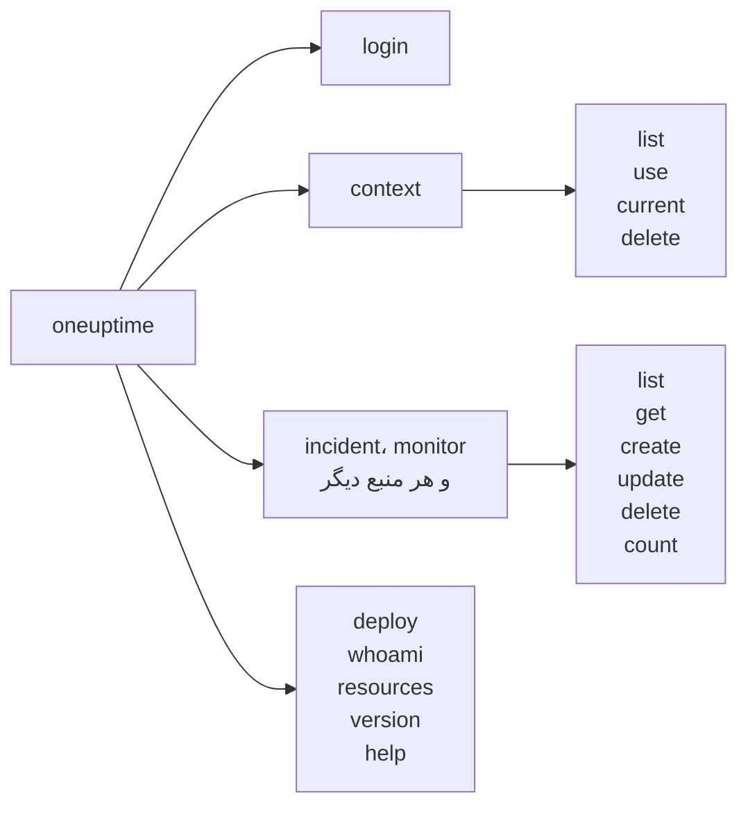

# مرجع دستورها

همهٔ دستورهای CLI `oneuptime`، با آرگومان‌ها، گزینه‌ها و مقادیر پیش‌فرضشان. برای دیدن همین‌ها در ترمینال، `--help` را به هر دستوری اضافه کنید.

:::cards
- [گزینه‌های سراسری](#گزینههای-سراسری): گزینه‌هایی که هر دستور می‌پذیرد.
- [ورود و زمینه‌ها](#ورود-و-زمینهها): login و دستورهای context.
- [دستورهای منابع](#دستورهای-منابع): list، get، create، update، delete و count.
- [دستورهای دیگر](#دستورهای-دیگر): deploy، whoami، resources، version و help.
:::

## دستورها



## گزینه‌های سراسری

| گزینه | چه می‌کند | پیش‌فرض |
| --- | --- | --- |
| `--api-key <key>` | کلید API برای همین دستور | `ONEUPTIME_API_KEY`، سپس کلید زمینه |
| `--url <url>` | نشانی OneUptime شما برای همین دستور | `ONEUPTIME_URL`، سپس URL زمینه |
| `--context <name>` | زمینهٔ ذخیره‌شده‌ای که این دستور به کار می‌برد | زمینهٔ فعلی |
| `-o, --output <format>` | `json`، `table` یا `wide` | `table` در ترمینال، `json` در پایپ |
| `--no-color` | بدون رنگ چاپ می‌کند | رنگی، مگر این‌که `NO_COLOR` تنظیم شده باشد |
| `-V, --version` | نسخهٔ CLI را چاپ می‌کند | |
| `-h, --help` | راهنمای یک دستور را نشان می‌دهد | |

گزینه‌ها پیش یا پس از دستور می‌آیند: `oneuptime --context staging incident list` و `oneuptime incident list --context staging` یک کار را انجام می‌دهند.

## ورود و زمینه‌ها

### `oneuptime login`

یک کلید API و یک نشانی را به‌عنوان یک زمینه ذخیره می‌کند و آن را زمینهٔ فعلی می‌کند. [ورود](/docs/cli/authentication#ورود) را ببینید.

```bash
oneuptime login <api-key> <instance-url> [--context-name <name>]
```

| آرگومان یا گزینه | الزامی | چیست | پیش‌فرض |
| --- | --- | --- | --- |
| `<api-key>` | بله | یک کلید API از پروژهٔ شما | |
| `<instance-url>` | بله | نشانی OneUptime شما، مانند `https://oneuptime.com` | |
| `--context-name <name>` | خیر | نامی که زمینه با آن ذخیره می‌شود | `default` |

### `oneuptime context list`

زمینه‌های ذخیره‌شده را فهرست می‌کند؛ `*` زمینهٔ فعلی را مشخص می‌کند. کلیدهای API هرگز فهرست نمی‌شوند.

```bash
oneuptime context list [-o <format>]
```

| گزینه | الزامی | چیست |
| --- | --- | --- |
| `-o, --output <format>` | خیر | `json`، `table` یا `wide`. JSON برای هر زمینه `name`، `apiUrl` و `isCurrent` را می‌دهد |

### `oneuptime context use`

یک زمینهٔ ذخیره‌شده را زمینهٔ فعلی می‌کند.

```bash
oneuptime context use <name>
```

| آرگومان | الزامی | چیست |
| --- | --- | --- |
| `<name>` | بله | نام یک زمینهٔ ذخیره‌شده |

### `oneuptime context current`

نام و URL زمینهٔ فعلی را نشان می‌دهد، و کلید API آن را با پنهان بودن همهٔ نویسه‌ها جز چهار نویسهٔ اول و چهار نویسهٔ آخر.

```bash
oneuptime context current
```

### `oneuptime context delete`

یک زمینهٔ ذخیره‌شده را حذف می‌کند. اگر زمینهٔ فعلی بود، نخستین زمینهٔ باقی‌مانده زمینهٔ فعلی می‌شود.

```bash
oneuptime context delete <name>
```

| آرگومان | الزامی | چیست |
| --- | --- | --- |
| `<name>` | بله | نام یک زمینهٔ ذخیره‌شده |

## دستورهای منابع

`<resource>` دستور یک نوع رکورد است، از جدول‌های [منابع](#منابع)، مانند `incident` یا `monitor`. برای نمونه‌ها [عملیات روی منابع](/docs/cli/resource-operations) را ببینید.

### `oneuptime <resource> list`

رکوردها را فهرست می‌کند، تازه‌ترین‌ها در ابتدا. برچسب‌ها در عوض به ترتیب نام فهرست می‌شوند، برچسب‌های شماره‌دار اول (`2. Team` پیش از `10. Owner`).

```bash
oneuptime <resource> list [--query <json>] [--limit <n>] [--skip <n>] [--sort <json>] [-o <format>]
```

| گزینه | چه می‌کند | پیش‌فرض |
| --- | --- | --- |
| `--query <json>` | یک فیلتر، به‌صورت JSON | هر رکوردی که کلید می‌تواند بخواند |
| `--limit <n>` | بیشترین تعداد رکوردهای برگشتی، تا ۱۰٬۰۰۰ | `10` |
| `--skip <n>` | چند رکورد اول نادیده گرفته شوند | `0` |
| `--sort <json>` | ترتیب، به‌صورت JSON: `{"<field>":"ASC"}` یا `{"<field>":"DESC"}` | تازه‌ترین‌ها در ابتدا |
| `-o, --output <format>` | `json`، `table` یا `wide` | `table` در ترمینال، `json` در پایپ |

### `oneuptime <resource> get`

یک رکورد را می‌خواند. فقط برای رکوردها: تله‌متری `get` ندارد.

```bash
oneuptime <resource> get <id> [-o <format>]
```

| آرگومان یا گزینه | الزامی | چیست |
| --- | --- | --- |
| `<id>` | بله | شناسهٔ رکورد، یک UUID |
| `-o, --output <format>` | خیر | `json`، `table` یا `wide` |

### `oneuptime <resource> create`

یک رکورد می‌سازد و آن را چاپ می‌کند.

```bash
oneuptime <resource> create (--data <json> | --file <path>) [-o <format>]
```

| گزینه | الزامی | چیست |
| --- | --- | --- |
| `--data <json>` | یکی از این دو | رکورد، به‌صورت JSON |
| `--file <path>` | یکی از این دو | یک فایل JSON که رکورد را در خود دارد. اگر همراه با `--data` داده شود، فایل به کار می‌رود |
| `-o, --output <format>` | خیر | `json`، `table` یا `wide` |

### `oneuptime <resource> update`

فیلدهایی را که می‌دهید تغییر می‌دهد. فقط برای رکوردها: تله‌متری `update` ندارد.

```bash
oneuptime <resource> update <id> --data <json> [-o <format>]
```

| آرگومان یا گزینه | الزامی | چیست |
| --- | --- | --- |
| `<id>` | بله | شناسهٔ رکورد |
| `--data <json>` | بله | فیلدهایی که باید تغییر کنند، به‌صورت JSON |
| `-o, --output <format>` | خیر | `json`، `table` یا `wide` |

### `oneuptime <resource> delete`

یک رکورد را بی‌درنگ و بدون پرسیدن حذف می‌کند. فقط برای رکوردها: تله‌متری `delete` ندارد.

```bash
oneuptime <resource> delete <id> [--force]
```

| آرگومان یا گزینه | الزامی | چیست |
| --- | --- | --- |
| `<id>` | بله | شناسهٔ رکورد |
| `--force` | خیر | پذیرفته می‌شود و چیزی را تغییر نمی‌دهد: `delete` هرگز تأیید نمی‌خواهد |

### `oneuptime <resource> count`

رکوردها را می‌شمارد و عدد را چاپ می‌کند.

```bash
oneuptime <resource> count [--query <json>] [-o <format>]
```

| گزینه | الزامی | چیست |
| --- | --- | --- |
| `--query <json>` | خیر | یک فیلتر، به‌صورت JSON. بدون آن، هر رکوردی که کلید می‌تواند بخواند |
| `-o, --output <format>` | خیر | `json`، `table` یا `wide` |

### منابع

رکوردها `list`، `get`، `create`، `update`، `delete` و `count` را می‌پذیرند:

| حوزه | دستورها |
| --- | --- |
| پایش | `monitor`, `monitor-status`, `monitor-status-event` |
| حادثه‌ها | `incident`, `incident-state`, `incident-severity`, `incident-state-timeline`, `incident-public-note`, `incident-internal-note`, `incident-alert`, `postmortem-status` |
| هشدارها | `alert`, `alert-state`, `alert-severity`, `alert-state-timeline`, `alert-internal-note` |
| صفحه‌های وضعیت | `status-page`, `status-page-announcement` |
| نگهداری زمان‌بندی‌شده | `scheduled-maintenance-event`, `scheduled-maintenance-state`, `scheduled-maintenance-state-timeline` |
| تیم‌ها و کشیک | `team`, `on-call-policy` |
| امنیت | `security-case`, `security-case-evidence`, `security-case-note`, `security-case-priority`, `security-case-status`, `security-case-task`, `security-detection`, `security-playbook` |
| امنیت داده | `data-store`, `data-store-finding`, `data-store-access-entry`, `data-flow`, `data-security-issue`, `data-security-scan`, `custom-data-type`, `check-setting`, `residency-rule`, `data-security-setting` |
| برچسب‌ها | `label` |

تله‌متری `list`، `create` و `count` را می‌پذیرد:

| حوزه | دستورها |
| --- | --- |
| مشاهده‌پذیری | `log`, `metric`, `span`, `exception-instance`, `monitor-log` |
| امنیت | `security-event`, `threat-intel-indicator` |
| تغییرها و هزینه | `change-event`, `kubernetes-cost-allocation` |

CLI همراه با OneUptime منتشر می‌شود، پس `oneuptime resources` دستورهای همان نسخه‌ای را که نصب کرده‌اید فهرست می‌کند.

### درخواست‌های API

هر عملیات یک درخواست به API است، با کلید در سرآیند `APIKey`. `<path>` مسیر API منبع است که `oneuptime resources` آن را می‌دهد: `/incident` برای `incident`، و `/on-call-duty-policy` برای `on-call-policy`.

| عملیات | درخواست | بدنه |
| --- | --- | --- |
| `list` | `POST /api/<path>/get-list` | `query`، `select`، `skip`، `limit` و `sort` |
| `get` | `POST /api/<path>/<id>/get-item` | `select` |
| `create` | `POST /api/<path>` | `{"data": ...}` |
| `update` | `PUT /api/<path>/<id>/` | `{"data": ...}` |
| `delete` | `DELETE /api/<path>/<id>/` | هیچ |
| `count` | `POST /api/<path>/count` | `query` |

## دستورهای دیگر

### `oneuptime deploy`

یک استقرار، یا تغییری دیگر، را از یک خط لوله ثبت می‌کند: روی نمودارهای سرویس کشیده می‌شود و OneUptime AI هنگام بررسی یک حادثه آن را می‌خواند. با یک کلید دریافت دادهٔ تله‌متری می‌نویسد، نه با کلید API. [استقرارها و تغییرها](/docs/telemetry/change-events) را ببینید.

```bash
oneuptime deploy [--service <name>] [--service-version <version>] [--previous-version <version>] [--commit <sha>] [--repository <url>] [--branch <name>] [--pull-request <number>] [--environment <name>] [--title <title>] [--description <text>] [--type <type>] [--time <time>] [--attribute <key=value...>] [--ingestion-key <key>]
```

| گزینه | الزامی | چیست | پیش‌فرض |
| --- | --- | --- | --- |
| `--service <name>` | خیر | سرویسی که مستقر شد | یک تغییر در سطح کل پروژه |
| `--service-version <version>` | خیر | نسخهٔ مستقرشده | |
| `--previous-version <version>` | خیر | نسخه‌ای که جایگزینش شد | |
| `--commit <sha>` | خیر | کامیت مستقرشده | |
| `--repository <url>` | خیر | مخزنی که کامیت در آن است | |
| `--branch <name>` | خیر | شاخهٔ مستقرشده | |
| `--pull-request <number>` | خیر | Pull Request مستقرشده | |
| `--environment <name>` | خیر | محیطی که در آن مستقر شد | |
| `--title <title>` | خیر | عنوان تغییر؛ هر نوعی جز استقرار به آن نیاز دارد | `Deploy <version>` |
| `--description <text>` | خیر | جزئیات تغییر | |
| `--type <type>` | خیر | نوع تغییر، مانند `config-change` یا `rollback` | `deployment` |
| `--time <time>` | خیر | زمان رخ دادن آن، مانند `2026-10-19T10:00:00Z` | اکنون |
| `--attribute <key=value...>` | خیر | ویژگی‌های بیشتر، به‌صورت `key=value`، یک یا چند تا | |
| `--ingestion-key <key>` | خیر | یک کلید دریافت دادهٔ تله‌متری پروژه | `ONEUPTIME_TELEMETRY_INGESTION_KEY` |

### `oneuptime whoami`

URL و کلید API را که دستور بعدی به کار می‌برد، با کلید پوشانده‌شده، و زمینه‌ای را که از آن آمده‌اند نشان می‌دهد. OneUptime را فرا نمی‌خواند. [ببینید CLI از چه چیزی استفاده خواهد کرد](/docs/cli/authentication#ببینید-cli-از-چه-چیزی-استفاده-خواهد-کرد) را ببینید.

```bash
oneuptime whoami
```

### `oneuptime resources`

هر نوع رکوردی را که CLI برایش دستور دارد فهرست می‌کند: دستورش، نام‌های مفرد و جمع، نوع و مسیر API آن، و شمار کل.

```bash
oneuptime resources [--type <type>] [-o <format>]
```

| گزینه | الزامی | چیست | پیش‌فرض |
| --- | --- | --- | --- |
| `--type <type>` | خیر | `database` برای رکوردها، `analytics` برای تله‌متری | هر دو |
| `-o, --output <format>` | خیر | `json`، `table` یا `wide`. JSON برای هر کدام `name`، `singularName`، `pluralName`، `modelType` و `apiPath` را می‌دهد | `table` در ترمینال، `json` در پایپ |

### `oneuptime version`

نسخهٔ CLI را چاپ می‌کند، همان‌طور که `oneuptime --version` می‌کند.

```bash
oneuptime version
```

### `oneuptime help`

راهنمای CLI، یا یک دستور، را نشان می‌دهد.

```bash
oneuptime help [command]
```

## متغیرهای محیطی

| متغیر | چه می‌کند |
| --- | --- |
| `ONEUPTIME_API_KEY` | کلید API، وقتی هیچ پرچم `--api-key` کلیدی ندهد |
| `ONEUPTIME_URL` | نشانی OneUptime شما، وقتی هیچ پرچم `--url` نشانی‌ای ندهد |
| `ONEUPTIME_TELEMETRY_INGESTION_KEY` | کلید دریافت دادهٔ تله‌متری‌ای که `oneuptime deploy` با آن می‌نویسد، وقتی هیچ پرچم `--ingestion-key` کلیدی ندهد |
| `NO_COLOR` | با هر مقداری، رنگ‌ها را خاموش می‌کند |

## فایل‌ها

| فایل | چه چیزی را نگه می‌دارد |
| --- | --- |
| `~/.oneuptime/config.json` | زمینه‌های ذخیره‌شده، کلیدهای API آن‌ها و زمینهٔ فعلی |

## کدهای خروج

| کد | معنا |
| --- | --- |
| `0` | کار کرد |
| `1` | شکست خورد: OneUptime درخواست را رد کرد، یا دستور اشتباه بود |
| `2` | کلید API قابل‌استفاده‌ای نیست: پیدا نشد، نامعتبر است، یا پایین‌تر از طرحش است |
| `3` | پیدا نشد: OneUptime پاسخ `404` داد |

برای نمونه‌ها [کدهای خروج](/docs/cli/scripting#کدهای-خروج) را ببینید.

## گام‌های بعدی

:::cards
- [نمای کلی CLI](/docs/cli/index): CLI را نصب کنید و نخستین دستورهایتان را اجرا کنید.
- [عملیات روی منابع](/docs/cli/resource-operations): نمونه‌هایی از هر عملیات.
- [اسکریپت‌نویسی و CI/CD](/docs/cli/scripting): CLI در اسکریپت‌ها و خط لوله‌ها.
:::
