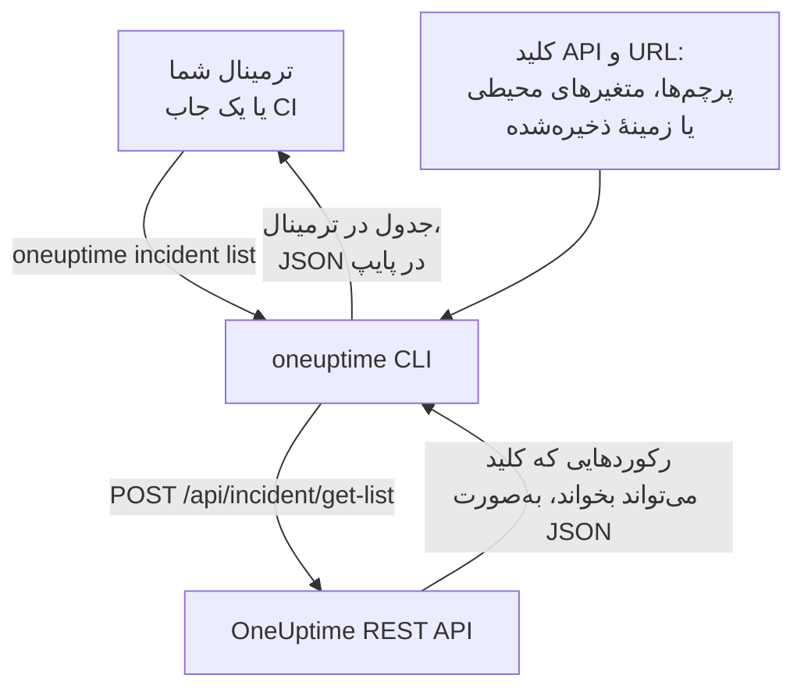

# نمای کلی CLI

CLI OneUptime، یعنی `oneuptime`، پروژهٔ OneUptime شما را از ترمینال یا یک اسکریپت مدیریت می‌کند. با یک کلید API از پروژه‌تان، مانیتورها، حادثه‌ها، هشدارها، صفحه‌های وضعیت و دیگر رکوردهایی را که API OneUptime ارائه می‌دهد فهرست کنید، بخوانید، بسازید، تغییر دهید، حذف کنید و بشمارید.

:::cards
- [CLI چگونه کار می‌کند](#cli-چگونه-کار-میکند): یک دستور، یک درخواست API، یک پاسخ.
- [نصب CLI](#نصب-cli): یک دستور npm، و نسخه‌ای که باید انتخاب کنید.
- [اجرای نخستین دستورها](#اجرای-نخستین-دستورها): کلید API خود را ذخیره کنید، سپس حادثه‌هایتان را فهرست کنید.
- [نگاهی کلی به دستورها](#نگاهی-کلی-به-دستورها): همهٔ دستورها، و صفحه‌ای که هر کدام را توضیح می‌دهد.
:::

## CLI چگونه کار می‌کند

هر دستور یک درخواست به REST API OneUptime می‌فرستد و پاسخ را چاپ می‌کند. CLI کلید API و نشانی OneUptime شما را از پرچم‌ها، متغیرهای محیطی یا زمینه‌ای که `oneuptime login` ذخیره کرده است برمی‌دارد. کلید تعیین می‌کند که یک دستور چه چیزی را می‌تواند بخواند و تغییر دهد، دقیقاً همان‌طور که برای API.



دستورهای رکوردها همراه CLI می‌آیند: هر نوع رکوردی که API OneUptime به روی ابزارها باز می‌کند یک دستور دارد، همان رکوردهایی که [سرور MCP](/docs/ai/mcp-server) برایشان ابزار دارد. برای فهرست کردن آن‌ها `oneuptime resources` را اجرا کنید.

## پیش از شروع

- **Node.js و npm**، یک نسخهٔ LTS فعلی، برای نصب CLI.
- **یک کلید API از پروژهٔ شما.** آن را در **تنظیمات پروژه** > **پیشرفته** > **کلیدهای API** با **ساخت کلید API** بسازید: [یک کلید API بسازید](/docs/api-reference/api-reference#یک-کلید-api-بسازید) را ببینید.
- **در OneUptime Cloud، طرح Growth یا بالاتر.** کلیدهای API یک پروژه فقط روی آن کار می‌کنند: [کلیدهای API و SCIM پایین‌تر از طرحشان](/docs/api-reference/api-reference#کلیدهای-api-و-scim-پایینتر-از-طرحشان) را ببینید.

## نصب CLI

بستهٔ `@oneuptime/cli` را از npm نصب کنید. این بسته دستور `oneuptime` را اضافه می‌کند و `--version` نسخه‌ای را که نصب کرده‌اید چاپ می‌کند:

```bash
npm install -g @oneuptime/cli
oneuptime --version
```

CLI همراه با OneUptime منتشر می‌شود و همان شمارهٔ نسخه را دارد. در OneUptime خودمیزبان، CLI هم‌نسخهٔ OneUptime خود را نصب کنید تا دستورهایش با رکوردهای سرور شما جور باشند:

```bash
npm install -g @oneuptime/cli@<your-oneuptime-version>
```

> [!WARNING]
> نسخه‌های CLI پیش از 14.0.64 همان لحظهٔ اجرا با خطایی مانند `Cannot find module 'Common/Models/DatabaseModels/Index'` متوقف می‌شوند. نسخهٔ 14.0.64 یا جدیدتر را با `npm install -g @oneuptime/cli@latest` نصب کنید. در OneUptime خودمیزبانِ قدیمی‌تر از 14.0.64، نخست [OneUptime را ارتقا دهید](/docs/installation/upgrading#روش-ارتقا) و سپس CLI همان نسخه‌ای را نصب کنید که به آن ارتقا داده‌اید.

## اجرای نخستین دستورها

:::steps
### کلید API خود را ذخیره کنید

با کلید و نشانی OneUptime خود وارد شوید. CLI آن‌ها را به‌عنوان زمینه‌ای به نام `default` ذخیره می‌کند و از این پس از آن استفاده می‌کند:

```bash
oneuptime login <your-api-key> https://oneuptime.com
```

پاسخ آن `Logged in successfully. Context "default" is now active.` است. در OneUptime خودمیزبان، به‌جای `https://oneuptime.com` نشانی آن را بنویسید.

### حادثه‌هایتان را فهرست کنید

```bash
oneuptime incident list
```

تازه‌ترین ده حادثه به‌صورت جدول نمایش داده می‌شوند. `login` کلید را بدون بررسی ذخیره می‌کند، پس این نخستین دستوری است که نشان می‌دهد کلید کار می‌کند: اگر رد شد، [عیب‌یابی](/docs/cli/authentication#عیبیابی) را ببینید.

### ببینید چه چیزهای دیگری را می‌توانید مدیریت کنید

```bash
oneuptime resources
```

این فهرست هر نوع رکوردی را که می‌توانید با آن کار کنید، همراه با دستورش نشان می‌دهد، مانند `monitor`، `status-page` یا `on-call-policy`.
:::

## نگاهی کلی به دستورها

| دستور | چه می‌کند | بیشتر بخوانید |
| --- | --- | --- |
| `oneuptime login <api-key> <instance-url>` | یک کلید API و یک نشانی را به‌عنوان زمینه ذخیره می‌کند | [احراز هویت](/docs/cli/authentication#ورود) |
| `oneuptime context list`, `use`, `current`, `delete` | زمینه‌های ذخیره‌شده را فهرست می‌کند، عوض می‌کند، نشان می‌دهد و حذف می‌کند | [احراز هویت](/docs/cli/authentication#زمینهها) |
| `oneuptime whoami` | URL و کلید API را که دستور بعدی به کار می‌برد نشان می‌دهد | [احراز هویت](/docs/cli/authentication#ببینید-cli-از-چه-چیزی-استفاده-خواهد-کرد) |
| `oneuptime deploy` | یک استقرار، یا تغییری دیگر، را برای نمودارها و OneUptime AI ثبت می‌کند | [استقرارها و تغییرها](/docs/telemetry/change-events) |
| `oneuptime <resource> list`, `get`, `create`, `update`, `delete`, `count` | با یک نوع رکورد کار می‌کند | [عملیات روی منابع](/docs/cli/resource-operations) |
| `oneuptime resources` | انواع رکورد را همراه با دستورهایشان فهرست می‌کند | [مرجع دستورها](/docs/cli/command-reference#oneuptime-resources) |
| `oneuptime version` | نسخهٔ CLI را چاپ می‌کند | [مرجع دستورها](/docs/cli/command-reference#oneuptime-version) |
| `oneuptime help [command]` | راهنمای یک دستور را نشان می‌دهد | [گرفتن راهنما](#گرفتن-راهنما) |

## گزینه‌های سراسری

این گزینه‌ها با هر دستوری کار می‌کنند، پیش یا پس از آن:

| گزینه | چه می‌کند |
| --- | --- |
| `--api-key <key>` | کلید API برای همین دستور، به‌جای کلید ذخیره‌شده |
| `--url <url>` | نشانی OneUptime شما برای همین دستور |
| `--context <name>` | یک زمینهٔ ذخیره‌شده برای همین دستور، به‌جای زمینهٔ فعلی |
| `-o, --output <format>` | `table`، `json` یا `wide`: [قالب‌های خروجی](/docs/cli/output-formats) را ببینید |
| `--no-color` | بدون رنگ چاپ می‌کند |
| `-V, --version` | نسخهٔ CLI را چاپ می‌کند |
| `-h, --help` | راهنمای دستور را نشان می‌دهد |

## گرفتن راهنما

هر دستور راهنمای خودش را دارد، با آرگومان‌ها، گزینه‌ها و مقادیر پیش‌فرضش:

```bash
oneuptime --help
oneuptime help incident
oneuptime incident list --help
```

## گام‌های بعدی

:::cards
- [احراز هویت](/docs/cli/authentication): زمینه‌ای برای هر محیط، و این‌که یک دستور کدام کلید را به کار می‌برد.
- [عملیات روی منابع](/docs/cli/resource-operations): رکوردها را فهرست کنید، بخوانید، بسازید، تغییر دهید، حذف کنید و بشمارید.
- [قالب‌های خروجی](/docs/cli/output-formats): جدول برای آدم‌ها، JSON برای اسکریپت‌ها.
- [اسکریپت‌نویسی و CI/CD](/docs/cli/scripting): کدهای خروج، jq و خط لوله‌ها.
- [مرجع دستورها](/docs/cli/command-reference): همهٔ دستورها، گزینه‌ها و مقادیر پیش‌فرض.
:::
