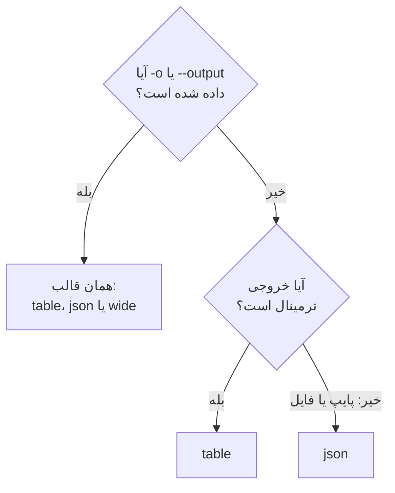

# قالب‌های خروجی

وقتی پاسخ را در ترمینال می‌خوانید، CLI جدول چاپ می‌کند، و وقتی یک اسکریپت یا برنامهٔ دیگری آن را می‌خواند، JSON. قالب هر دستوری را با `-o` یا `--output` انتخاب کنید.

:::cards
- [قالب چگونه انتخاب می‌شود](#قالب-چگونه-انتخاب-میشود): ترمینال جدول می‌گیرد، پایپ JSON.
- [جدول](#جدول): شش ستون، هر مقدار در ۶۰ نویسه کوتاه‌شده.
- [JSON](#json): همهٔ فیلدها، کامل، برای اسکریپت‌ها و jq.
- [پهن](#پهن): جدولی با همهٔ ستون‌ها.
:::

## قالب چگونه انتخاب می‌شود



| قالب | چه چیزی چاپ می‌کند | بهترین کاربرد |
| --- | --- | --- |
| `table` | جدولی با حداکثر شش ستون؛ یک رکورد به‌صورت یک سطر برای هر فیلد | خواندن در ترمینال |
| `json` | پاسخ همان‌طور که OneUptime فرستاده، با تورفتگی دو فاصله | اسکریپت‌ها، `jq` و فایل‌ها |
| `wide` | جدولی با یک ستون برای هر فیلد | مقایسهٔ فیلدهای زیاد در یک نگاه |

`-o` روی هر دستوری که رکورد چاپ می‌کند کار می‌کند: `list`، `get`، `create`، `update` و `count` یک منبع، `oneuptime resources` و `oneuptime context list`. می‌تواند هر جای خط فرمان بیاید. هر مقدار دیگری پیش از فرستادن درخواست رد می‌شود:

```text
error: option '-o, --output <format>' argument 'yaml' is invalid. Allowed choices are json, table, wide.
```

## جدول

جدول در ترمینال پیش‌فرض است. برای نمونه، `oneuptime resources --type analytics` این جدول را چاپ می‌کند:

```text
┌────────────────────────────┬────────────────────────────┬─────────────────────────────┬───────────┬─────────────────────────────┐
│ Command                    │ Singular                   │ Plural                      │ Type      │ API Path                    │
├────────────────────────────┼────────────────────────────┼─────────────────────────────┼───────────┼─────────────────────────────┤
│ log                        │ Log                        │ Logs                        │ analytics │ /logs                       │
├────────────────────────────┼────────────────────────────┼─────────────────────────────┼───────────┼─────────────────────────────┤
│ span                       │ Span                       │ Spans                       │ analytics │ /span                       │
├────────────────────────────┼────────────────────────────┼─────────────────────────────┼───────────┼─────────────────────────────┤
│ metric                     │ Metric                     │ Metrics                     │ analytics │ /metrics                    │
├────────────────────────────┼────────────────────────────┼─────────────────────────────┼───────────┼─────────────────────────────┤
│ exception-instance         │ Exception Instance         │ Exception Instances         │ analytics │ /exceptions                 │
├────────────────────────────┼────────────────────────────┼─────────────────────────────┼───────────┼─────────────────────────────┤
│ monitor-log                │ Monitor Log                │ Monitor Logs                │ analytics │ /monitor-log                │
├────────────────────────────┼────────────────────────────┼─────────────────────────────┼───────────┼─────────────────────────────┤
│ kubernetes-cost-allocation │ Kubernetes Cost Allocation │ Kubernetes Cost Allocations │ analytics │ /kubernetes-cost-allocation │
├────────────────────────────┼────────────────────────────┼─────────────────────────────┼───────────┼─────────────────────────────┤
│ security-event             │ Security Event             │ Security Events             │ analytics │ /security-events            │
├────────────────────────────┼────────────────────────────┼─────────────────────────────┼───────────┼─────────────────────────────┤
│ change-event               │ Change Event               │ Change Events               │ analytics │ /change-events              │
├────────────────────────────┼────────────────────────────┼─────────────────────────────┼───────────┼─────────────────────────────┤
│ threat-intel-indicator     │ Threat Intel Indicator     │ Threat Intel Indicators     │ analytics │ /threat-intel-indicators    │
└────────────────────────────┴────────────────────────────┴─────────────────────────────┴───────────┴─────────────────────────────┘

Total: 9 resources
```

برای فهرستی از رکوردها، جدول حداکثر شش ستون نشان می‌دهد: اول از میان `_id`، `name`، `title`، `status`، `createdAt` و `updatedAt` آن‌هایی که رکوردها دارند، سپس فیلدهای بعدی رکوردها به ترتیب. ستون‌ها از نخستین رکورد گرفته می‌شوند. مقداری که بلندتر از ۶۰ نویسه باشد به ۵۷ نویسهٔ اولش کوتاه می‌شود و پس از آن `...` می‌آید.

یک رکورد، همان‌طور که `get` و `create` چاپش می‌کنند، جدولی با دو ستون است: نام فیلد و مقدار آن، یک سطر برای هر فیلد.

OneUptime تاریخ‌ها و شناسه‌های رکوردهای دیگر را به‌صورت شیء می‌فرستد، مانند `{"_type":"DateTime","value":"2026-10-14T09:12:44.000Z"}`، و جدول آن‌ها را به همان صورت متنی نشان می‌دهد. مقدارشان در `value` است: [JSON](#json) را ببینید.

## JSON

JSON پاسخ است همان‌طور که OneUptime فرستاده، با تورفتگی دو فاصله: یک فهرست آرایه‌ای از رکوردهاست، و یک رکورد یک شیء.

```bash
oneuptime incident list --limit 1 -o json
```

```json
[
  {
    "_id": "6f1c2a40-3b1e-4c55-9a0b-3e2f8d7c1a11",
    "createdAt": {
      "_type": "DateTime",
      "value": "2026-10-14T09:12:44.000Z"
    },
    "title": "Checkout API is down",
    "currentIncidentStateId": {
      "_type": "ObjectID",
      "value": "0b7d5e2c-8f4a-4d1b-9c3e-5a6f7b8c9d0e"
    }
  }
]
```

یک رکورد همهٔ فیلدهایی را دارد که کلید می‌تواند بخواند؛ این رکورد به چهار فیلد کوتاه شده است. `_id` خود رکورد متن است، و شناسه‌های دیگر و تاریخ‌ها شیءهایی هستند که `value` آن‌ها مقدار را نگه می‌دارد:

```bash
oneuptime incident list -o json | jq -r '.[] | "\(.createdAt.value)  \(.title)"'
```

وقتی خروجی ترمینال نیست، مانند `oneuptime incident list | jq '.[].title'`، CLI بدون `-o json` هم JSON چاپ می‌کند. با این حال در اسکریپت‌ها `-o json` را بنویسید تا به این رفتار وابسته نباشند.

## پهن

`-o wide` جدولی است با یک ستون برای هر فیلد رکوردها. هر مقدار همچنان در ۶۰ نویسه کوتاه می‌شود، و رکوردها فیلدهای زیادی دارند، پس جدول پهن بسیار پهن است: آن را با `less -S` ورق بزنید.

```bash
oneuptime incident list -o wide | less -S
```

## رنگ‌ها

سرستون‌های جدول فیروزه‌ای‌اند؛ پیام‌ها وقتی کاری انجام شد سبز، برای اطلاعات آبی و برای خطاها قرمزند. رنگ‌ها را با `--no-color`، یا با تنظیم `NO_COLOR` روی هر مقداری، خاموش کنید:

```bash
oneuptime incident list --no-color
NO_COLOR=1 oneuptime incident list
```

## هر دستور چه چیزی چاپ می‌کند

رکوردها و شمارش‌ها به خروجی استاندارد می‌روند، و خطاها به خطای استاندارد، پس یک پایپ فقط پاسخ را می‌خواند.

| دستور | در جدول | در JSON |
| --- | --- | --- |
| یک `list` که چیزی پیدا نمی‌کند | `No results found.` | `[]` |
| یک `get` یا یک `create` | یک سطر برای هر فیلد | رکورد |
| یک `count` | عدد | عدد |
| یک `update` | یک سطر خالی | `{}` |
| یک `delete` | `Monitor <id> deleted successfully.` | همان سطر |

## گام‌های بعدی

:::cards
- [اسکریپت‌نویسی و CI/CD](/docs/cli/scripting): JSON را با jq در اسکریپت‌ها و خط لوله‌ها بخوانید.
- [عملیات روی منابع](/docs/cli/resource-operations): عملیاتی که این‌ها پاسخ‌هایشان هستند.
- [مرجع دستورها](/docs/cli/command-reference): همهٔ دستورها و گزینه‌ها.
:::
