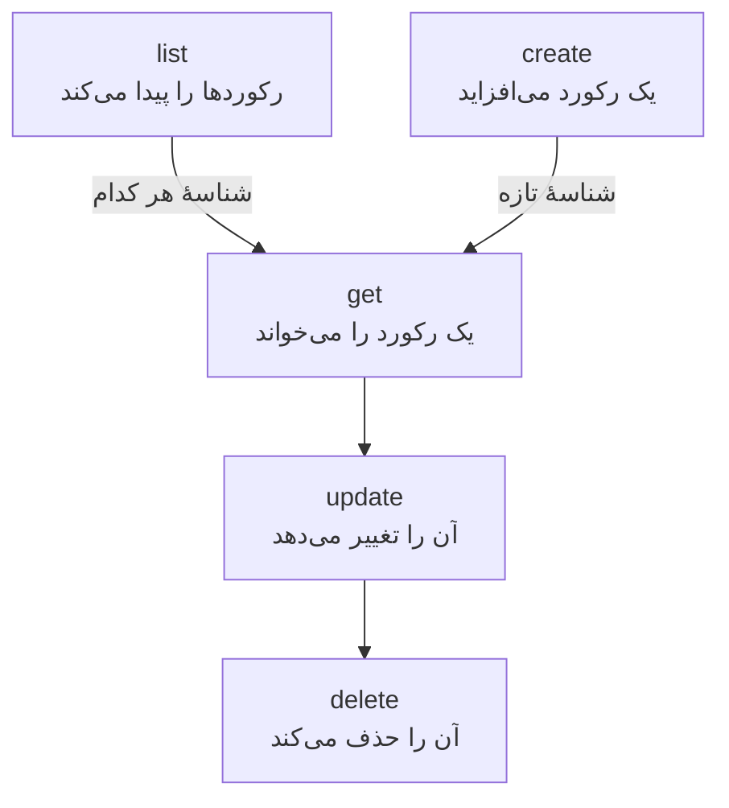

# عملیات روی منابع

هر نوع رکورد دستور خودش را دارد، مانند `incident`، `monitor` یا `status-page`، با عملیاتی که API برای آن می‌پذیرد: برای بیشترشان `list`، `get`، `create`، `update`، `delete` و `count`. این صفحه هر عملیات را نشان می‌دهد، همراه با فیلترها، صفحه‌بندی و پرچم‌هایی که رکورد با آن‌ها نوشته می‌شود، و دستورهایی که همان کار دکمه‌های داشبورد را می‌کنند.

:::cards
- [دستور یک رکورد را پیدا کنید](#دستور-یک-رکورد-را-پیدا-کنید): oneuptime resources همهٔ آن‌ها را فهرست می‌کند.
- [فهرست کردن رکوردها](#فهرست-کردن-رکوردها): فیلتر، مرتب‌سازی و صفحه‌بندی.
- [ساختن یک رکورد](#ساختن-یک-رکورد): یک پرچم برای هر فیلد، یا رکورد به‌صورت JSON.
- [تأیید، رفع و افزودن یادداشت](#تأیید-رفع-و-افزودن-یادداشت): دکمه‌های داشبورد، به‌صورت دستور.
- [حذف یک رکورد](#حذف-یک-رکورد): بی‌درنگ و بدون بازگشت.
:::

## عملیات چگونه کنار هم قرار می‌گیرند

خواندن، تغییر دادن و حذف یک رکورد به شناسهٔ آن نیاز دارد. فهرست کردن، شمردن و ساختن به هیچ شناسه‌ای نیاز ندارند، و یک list یا یک create شناسه‌هایی را به شما می‌دهد که بقیه می‌گیرند:



شناسه یک UUID است، مانند `6f1c2a40-3b1e-4c55-9a0b-3e2f8d7c1a11`. می‌توانید آن را از صفحهٔ رکورد در OneUptime هم کپی کنید: [یافتن شناسه یک منبع](/docs/api-reference/api-reference#یافتن-شناسه-یک-منبع) را ببینید.

## دستور یک رکورد را پیدا کنید

```bash
oneuptime resources
```

این فهرست هر نوع رکورد را با دستورش، نام‌هایش، نوعش و مسیر API آن نشان می‌دهد. دو نوع وجود دارد:

| نوع | چه چیزی را در خود دارد |
| --- | --- |
| `database` | رکوردهایی که مدیریت می‌کنید: مانیتورها، حادثه‌ها، هشدارها، صفحه‌های وضعیت، تیم‌ها و موارد دیگر |
| `analytics` | تله‌متری: لاگ‌ها، اسپن‌ها، متریک‌ها، استثناها و دیگر رویدادها |

برای نشان دادن یک نوع، `oneuptime resources --type database` یا `--type analytics` را به کار ببرید. [مرجع دستورها](/docs/cli/command-reference#منابع) همهٔ دستورها را فهرست می‌کند.

یک منبع عملیاتی را می‌پذیرد که API برای آن می‌پذیرد. بیشترشان هر شش عملیات را می‌پذیرند؛ منبعی که OneUptime خودش می‌نویسد، مانند لاگ ایمیل، فقط‌خواندنی است. `oneuptime <resource> --help` زیردستورهای یک منبع را فهرست می‌کند.

## دیدن فیلدهای یک منبع

`fields` فیلدهای یک منبع را از خود CLI فهرست می‌کند، بدون کلید API و بدون درخواست:

```bash
oneuptime incident fields
```

هر فیلد نوع خود، کاربردش، این‌که ساختن باید آن را بدهد یا نه، و پرچمی را که تنظیمش می‌کند دارد. فیلدی که یک شناسه در خود دارد، منبعی را که شناسه به آن تعلق دارد نام می‌برد: `incidentSeverityId` یک شناسه از `oneuptime incident-severity list` می‌گیرد. با `-o json`، یک اسکریپت یا یک عامل هوش مصنوعی همین‌ها را می‌خواند، با کلیدهای یکسان برای هر فیلد: `name`، `title`، `type`، `description`، `required`، `create`، `update`، `read`، `flag`، `emailFlag` و `relatedResource`.

## فهرست کردن رکوردها

```bash
oneuptime <resource> list [--query <json>] [--limit <n>] [--skip <n>] [--sort <json>] [--fields <names>] [--all] [-o <format>]
```

| گزینه | چه می‌کند | پیش‌فرض |
| --- | --- | --- |
| `--query <json>` | فقط رکوردهای منطبق را برمی‌گرداند: [فیلتر کردن یک فهرست](#فیلتر-کردن-یک-فهرست) را ببینید | هر رکوردی که کلید می‌تواند بخواند |
| `--limit <n>` | بیشترین تعداد رکوردهای برگشتی، تا ۱۰٬۰۰۰ | `10` |
| `--skip <n>` | چند رکورد منطبق اول نادیده گرفته شوند | `0` |
| `--sort <json>` | ترتیب، مانند `{"createdAt":"ASC"}`، یا `"DESC"` برای تازه‌ترین‌ها در ابتدا | تازه‌ترین‌ها در ابتدا |
| `--fields <names>` | فیلدهایی که برگردانده می‌شوند، جداشده با ویرگول، مانند `title,createdAt` | هر فیلدی که کلید می‌تواند بخواند |
| `--all` | همهٔ رکوردهای منطبق، صفحه به صفحه، به جای `--limit` و `--skip`. فقط برای رکوردها | |
| `-o, --output <format>` | `table`، `json` یا `wide` | `table` در ترمینال، `json` در پایپ |

```bash
# The ten newest incidents
oneuptime incident list

# The oldest monitors first, 50 at a time: the second page
oneuptime monitor list --sort '{"createdAt":"ASC"}' --limit 50 --skip 50

# Every field of each incident, as JSON
oneuptime incident list -o json

# The title, the state and the creation date of every incident
oneuptime incident list --all --fields title,currentIncidentState.name,createdAt -o json
```

یک فهرست، هر فیلدی از هر رکورد را که کلید می‌تواند بخواند از OneUptime می‌خواهد. `--fields` به جای آن فیلدهایی را که نام می‌برد می‌خواهد، و پس از یک نقطه، فیلدی از یک رکورد مرتبط را، مانند `currentIncidentState.name`. جدول شش فیلد را نشان می‌دهد؛ JSON همه را نشان می‌دهد ([قالب‌های خروجی](/docs/cli/output-formats) را ببینید). `--all` همهٔ صفحه‌ها را می‌خواند، هر بار ۱۰۰ رکورد، تا ۱۰۰٬۰۰۰؛ `count` می‌گوید چند رکورد وجود دارد.

برچسب‌ها به جای تازه‌ترین‌ها در ابتدا، به ترتیب نام فهرست می‌شوند: برچسب‌هایی که نامشان با عدد شروع می‌شود اول می‌آیند، به ترتیب همان عدد (`2. Team` پیش از `10. Owner`)، و سپس بقیه به ترتیب الفبایی. برای فهرست کردن آن‌ها به ترتیبی دیگر، `--sort` را بدهید.

### فیلتر کردن یک فهرست

`--query` همان فیلتر API را می‌گیرد: فیلدی با یک مقدار با همان مقدار منطبق می‌شود، و شیئی با `_type` مقایسه می‌کند.

| فیلتر | با چه چیزی منطبق می‌شود |
| --- | --- |
| `{"title":"Checkout API is down"}` | رکوردهایی که دقیقاً همان مقدار را دارند |
| `{"title":{"_type":"Search","value":"checkout"}}` | متنی که مقدار را در بر دارد |
| `{"createdAt":{"_type":"GreaterThan","value":"2026-10-01T00:00:00.000Z"}}` | تاریخ‌های دیرتر، یا عددهای بزرگ‌تر |
| `{"currentIncidentState":{"isResolvedState":false}}` | فیلدی از رکوردی که منبع به آن اشاره می‌کند: اینجا، حادثه‌هایی که حل نشده‌اند |

```bash
oneuptime incident list --query '{"title":{"_type":"Search","value":"checkout"}}'
```

[پالایش، مرتب‌سازی و صفحه‌بندی](/docs/api-reference/api-reference#پالایش-مرتبسازی-و-صفحهبندی) در مرجع API همهٔ `_type`ها را فهرست می‌کند.

## خواندن یک رکورد

```bash
oneuptime <resource> get <id> [--fields <names>] [-o <format>]
```

```bash
oneuptime incident get 6f1c2a40-3b1e-4c55-9a0b-3e2f8d7c1a11
```

جدول برای هر فیلد رکورد یک سطر نشان می‌دهد و هر مقدار را در ۶۰ نویسه کوتاه می‌کند؛ `-o json` مقدارها را کامل نشان می‌دهد. شناسه‌ای که به هیچ رکوردی که کلید شما بتواند بخواند اشاره نکند، پاسخ `Not found` می‌گیرد، و دستور با کد `3` خارج می‌شود.

## ساختن یک رکورد

```bash
oneuptime <resource> create [--<field> <value>]... [--data <json>] [--file <path>] [-o <format>]
```

هر فیلدی که ساختن می‌پذیرد یک پرچم دارد: `--title <text>`، `--incident-severity-id <id>`، `--labels <ids>` برای شناسه‌های جداشده با ویرگول، `--is-visible-on-status-page [true|false]` برای یک فیلد بله یا خیر، که اگر تنها داده شود true است، و `--monitor-steps <json>` برای فیلدی که JSON در خود دارد. `oneuptime <resource> create --help` آن‌ها را فهرست می‌کند، و [`fields`](#دیدن-فیلدهای-یک-منبع) می‌گوید هر کدام برای چیست. پروژه از کلید API می‌آید، پس هیچ رکوردی نام آن را نمی‌آورد.

```bash
# A manual monitor
oneuptime monitor create --name "Checkout API" --monitor-type Manual

# An incident with one of your severities
oneuptime incident create --title "Checkout API is down" --incident-severity-id <severity-id>

# The same incident, from a file
oneuptime incident create --file incident.json
```

`--data` رکورد را به‌صورت JSON می‌گیرد، و `--file` آن را از یک فایل JSON می‌خواند، با فیلدهای API: [مرجع API](/reference) فیلدهای هر منبع را فهرست می‌کند. اگر هر دو داده شوند، فایل به کار می‌رود، و پرچم‌ها روی هر کدام اعمال می‌شوند.

فیلدی که یک نفر را با شناسهٔ کاربری نام می‌برد پرچم دومی دارد که او را با نشانی ایمیل نام می‌برد: `--user-email` در کنار `--user-id`، و `--owner-user-emails` در کنار `--owner-users`. CLI آن نفر را میان اعضای پروژهٔ کلید API و افرادی که به آن دعوت شده‌اند پیدا می‌کند. عضو تیمی که با نشانی‌ای نام برده شود که هیچ‌کس در پروژه ندارد، به پروژه دعوت می‌شود، همان‌طور که دعوت از داشبورد این کار را می‌کند:

```bash
oneuptime team-member create --team-id <team-id> --user-email alice@example.com
```

CLI رکورد تازه را همراه با `_id` آن چاپ می‌کند. یک حادثه در وضعیت ساخته‌شدهٔ پروژهٔ شما آغاز می‌شود، مگر این‌که `currentIncidentStateId` وضعیت دیگری را نام ببرد: [وضعیتی که رکورد تازه در آن آغاز می‌شود](/docs/api-reference/api-reference#وضعیتی-که-رکورد-تازه-در-آن-آغاز-میشود) را ببینید. برای یافتن شناسه‌های سطح‌های شدت خود:

```bash
oneuptime incident-severity list -o json | jq -r '.[] | "\(._id)  \(.name)"'
```

> [!TIP]
> در Windows، فیلدها را با پرچم‌هایشان بدهید، یا JSON را در یک فایل بگذارید و از `--file` استفاده کنید: PowerShell و Command Prompt نقل‌قول JSON در خط فرمان را متفاوت از Bash انجام می‌دهند.

## به‌روزرسانی یک رکورد

```bash
oneuptime <resource> update <id> [--<field> <value>]... [--data <json>] [--file <path>] [-o <format>]
```

فقط فیلدهایی را که باید تغییر کنند بدهید، با پرچم‌هایشان یا به‌صورت JSON:

```bash
# Rename a monitor
oneuptime monitor update <monitor-id> --name "Checkout API (EU)"

# Record an incident's root cause
oneuptime incident update <incident-id> --root-cause "A full disk on the primary database"
```

OneUptime به یک به‌روزرسانی با یک شیء خالی پاسخ می‌دهد: CLI یک سطر خالی چاپ می‌کند، یا با `-o json`، `{}` را. برای دیدن رکورد در وضعیت کنونی‌اش `get` را اجرا کنید. برای بردن یک حادثه به وضعیتی دیگر، `--current-incident-state-id` را بدهید: تغییر مانند داشبورد روی خط زمانی آن ثبت می‌شود، و وضعیتی پیش از وضعیت کنونی آن رد می‌شود. [`acknowledge` و `resolve`](#تأیید-رفع-و-افزودن-یادداشت) وضعیت را برایتان پیدا می‌کنند. برای یافتن شناسهٔ وضعیت حل‌شده، که نخستین وضعیت در ترتیب پروژهٔ شماست:

```bash
oneuptime incident-state list --query '{"isResolvedState":true}' --sort '{"order":"ASC"}' --limit 1 -o json | jq -r '.[0]._id'
```

## تأیید، رفع و افزودن یادداشت

حادثه‌ها، هشدارها، اپیزودهای آن‌ها و رویدادهای تعمیر و نگهداری برای کارهایی که دکمه‌های داشبورد روی آن‌ها انجام می‌دهند دستور دارند:

| دستور | چه کاری می‌کند | منابع |
| --- | --- | --- |
| `acknowledge <id>` | رکورد را به وضعیت تأییدشدهٔ پروژهٔ شما می‌برد | `incident`, `alert`, `incident-episode`, `alert-episode` |
| `resolve <id>` | آن را به وضعیت حل‌شدهٔ پروژهٔ شما می‌برد | همین چهار منبع |
| `start <id>` | رویداد را به وضعیت در جریانِ پروژهٔ شما می‌برد | `scheduled-maintenance-event` |
| `end <id>` | آن را به وضعیت پایان‌یافتهٔ پروژهٔ شما می‌برد | `scheduled-maintenance-event` |
| `add-note <id> --note <markdown>` | یادداشتی اضافه می‌کند که فقط کسانی که رکورد را می‌بینند می‌توانند آن را بخوانند، یا با `--public` یادداشتی روی صفحه‌های وضعیت رکورد | هر پنج منبع |

```bash
oneuptime incident acknowledge 6f1c2a40-3b1e-4c55-9a0b-3e2f8d7c1a11
oneuptime incident add-note 6f1c2a40-3b1e-4c55-9a0b-3e2f8d7c1a11 --note "Rolled back the 14:05 deploy."
oneuptime incident resolve 6f1c2a40-3b1e-4c55-9a0b-3e2f8d7c1a11
```

پاسخ `acknowledge` این است: `Incident 6f1c2a40-3b1e-4c55-9a0b-3e2f8d7c1a11 acknowledged: it is in Acknowledged now.` رکوردی که از پیش در آن وضعیت یا فراتر از آن است، همان‌طور که هست می‌ماند: دستور این را می‌گوید و با `0` خارج می‌شود. با `-o json`، با `_id` رکورد، `action`، این‌که چیزی تغییر کرده یا نه (`changed`)، و `state` که رکورد در آن است پاسخ می‌دهد. هشدارها و اپیزودهای هشدار فقط یادداشت داخلی می‌پذیرند.

## حذف یک رکورد

```bash
oneuptime <resource> delete <id>
```

```bash
oneuptime monitor delete 6f1c2a40-3b1e-4c55-9a0b-3e2f8d7c1a11
```

پاسخ آن `Monitor 6f1c2a40-3b1e-4c55-9a0b-3e2f8d7c1a11 deleted successfully.` است. با `-o json`، با `_id` رکورد و `"deleted": true` پاسخ می‌دهد.

> [!CAUTION]
> `delete` رکورد را بی‌درنگ حذف می‌کند. CLI از شما تأیید نمی‌خواهد، و هیچ بازگشتی وجود ندارد. این دستور `--force` را برای اسکریپت‌هایی که با آن نوشته شده‌اند می‌پذیرد، و `--force` چیزی را تغییر نمی‌دهد.

## شمردن رکوردها

```bash
oneuptime <resource> count [--query <json>]
```

```bash
# Every incident
oneuptime incident count

# Incidents that are not resolved
oneuptime incident count --query '{"currentIncidentState":{"isResolvedState":false}}'
```

CLI یک عدد چاپ می‌کند، در جدول و در JSON یکسان، تا اسکریپت بتواند آن را همان‌طور که هست بخواند.

## عیب‌یابی

:::details پیام «Not found: API error (404)»
رکورد وجود ندارد، در پروژهٔ دیگری است، یا کلید نمی‌تواند آن را بخواند: OneUptime به هر کدام پاسخ یکسانی می‌دهد. شناسه را با `list` بررسی کنید، و مجوزهای کلید را هم. دستور با کد `3` خارج می‌شود.
:::

:::details پیام «Left out fields this API key may not read»
یک list یا یک get همهٔ فیلدهای رکورد را می‌خواهد، و OneUptime فیلدی را که کلید نمی‌تواند بخواند رد می‌کند: CLI بدون آن دوباره می‌خواهد و فیلدهایی را که کنار گذاشته در خطای استاندارد نام می‌برد. به کلید مجوزی بدهید که آن‌ها را بخواند، یا فیلدهایی را که نیاز دارید با `--fields` نام ببرید: فیلدی که نام برده شود و کلید نتواند آن را بخواند، دستور را با `API error (422)` متوقف می‌کند.
:::

:::details پیام «Error: Invalid JSON»
مقدار `--query`، `--sort` یا `--data` JSON نیست. در Bash و zsh آن را میان نقل‌قول تکی بگذارید؛ در Windows، فیلدها را با پرچم‌هایشان بدهید، یا رکورد را در یک فایل بگذارید و از `--file` استفاده کنید.
:::

:::details خطای API error (400) هنگام ساختن یا به‌روزرسانی
OneUptime یک فیلد را رد کرد: پیام آن را نام می‌برد، و `oneuptime <resource> fields` فیلدها را همراه با پرچم‌هایی که آن‌ها را تنظیم می‌کنند فهرست می‌کند. دستوری که هیچ فیلدی نمی‌دهد، پیش از فرستاده شدن رد می‌شود، همراه با پرچم‌هایی که باید داده شوند.
:::

:::details پیام «No one in this project, or invited to it, has the email address»
یک پرچم ایمیل کسی را نام می‌برد که نه عضو پروژهٔ کلید API است و نه به آن دعوت شده است. او را با `oneuptime team-member create --team-id <team-id> --user-email <email>` دعوت کنید، یا با شناسهٔ کاربری نامش را ببرید.
:::

## گام‌های بعدی

:::cards
- [قالب‌های خروجی](/docs/cli/output-formats): پاسخ‌ها را به‌صورت جدول یا JSON بخوانید.
- [اسکریپت‌نویسی و CI/CD](/docs/cli/scripting): این عملیات را در اسکریپت‌ها و خط لوله‌ها به کار ببرید.
- [مرجع دستورها](/docs/cli/command-reference): همهٔ دستورها، گزینه‌ها و مقادیر پیش‌فرض.
:::
