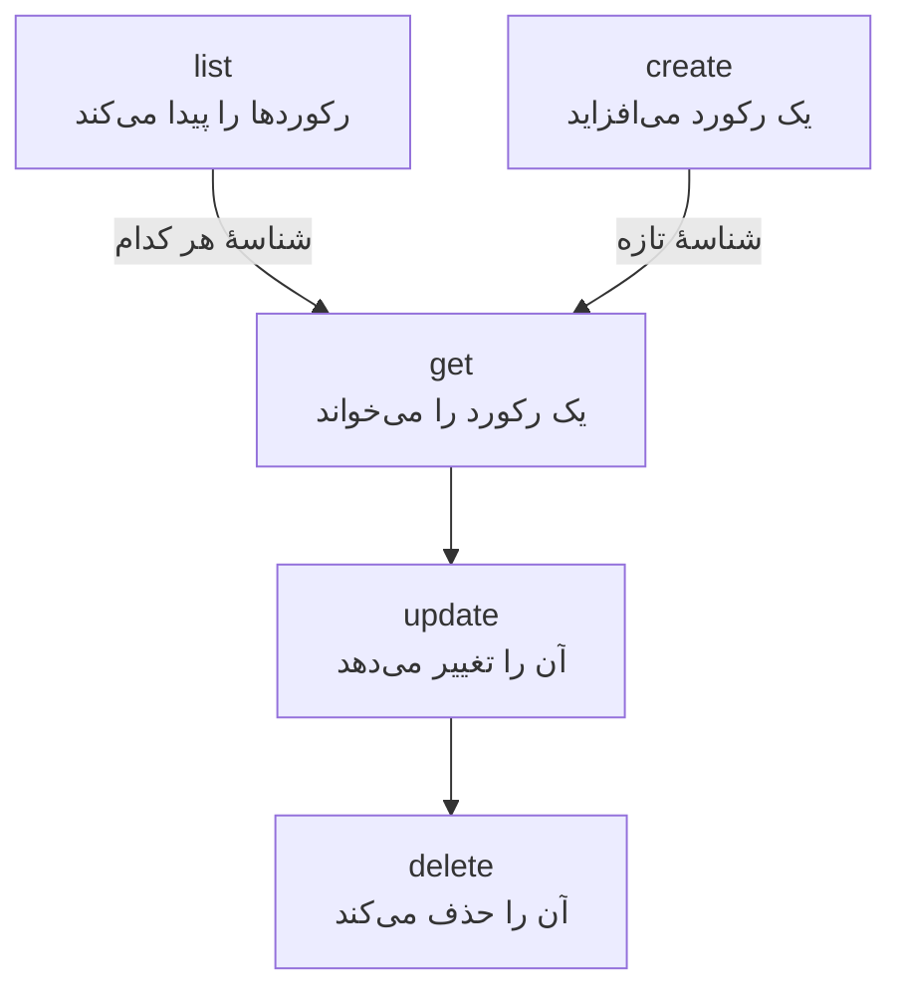

# عملیات روی منابع

هر نوع رکورد دستور خودش را دارد، مانند `incident`، `monitor` یا `status-page`، و همهٔ آن‌ها عملیات یکسانی را می‌پذیرند: `list`، `get`، `create`، `update`، `delete` و `count`. این صفحه هر عملیات را نشان می‌دهد، همراه با فیلترها، صفحه‌بندی و JSONی که رکورد با آن نوشته می‌شود.

:::cards
- [دستور یک رکورد را پیدا کنید](#دستور-یک-رکورد-را-پیدا-کنید): oneuptime resources همهٔ آن‌ها را فهرست می‌کند.
- [فهرست کردن رکوردها](#فهرست-کردن-رکوردها): فیلتر، مرتب‌سازی و صفحه‌بندی.
- [ساختن یک رکورد](#ساختن-یک-رکورد): از JSON در خط فرمان یا در یک فایل.
- [حذف یک رکورد](#حذف-یک-رکورد): بی‌درنگ و بدون بازگشت.
:::

## عملیات چگونه کنار هم قرار می‌گیرند

خواندن، تغییر دادن و حذف یک رکورد به شناسهٔ آن نیاز دارد. فهرست کردن، شمردن و ساختن به هیچ شناسه‌ای نیاز ندارند، و یک list یا یک create شناسه‌هایی را به شما می‌دهد که بقیه می‌گیرند:



شناسه یک UUID است، مانند `6f1c2a40-3b1e-4c55-9a0b-3e2f8d7c1a11`. می‌توانید آن را از صفحهٔ رکورد در OneUptime هم کپی کنید: [یافتن شناسه یک منبع](/docs/api-reference/api-reference#یافتن-شناسه-یک-منبع) را ببینید.

## دستور یک رکورد را پیدا کنید

```bash
oneuptime resources
```

این فهرست هر نوع رکورد را با دستورش، نام‌هایش، نوعش و مسیر API آن نشان می‌دهد. دو نوع وجود دارد:

| نوع | چه چیزی را نگه می‌دارد | عملیات |
| --- | --- | --- |
| `database` | رکوردهایی که مدیریت می‌کنید: مانیتورها، حادثه‌ها، هشدارها، صفحه‌های وضعیت، تیم‌ها و موارد دیگر | `list`, `get`, `create`, `update`, `delete`, `count` |
| `analytics` | تله‌متری: لاگ‌ها، اسپن‌ها، متریک‌ها، استثناها و رویدادهای دیگر | `list`, `create`, `count` |

برای نشان دادن یک نوع، `oneuptime resources --type database` یا `--type analytics` را به کار ببرید. [مرجع دستورها](/docs/cli/command-reference#منابع) همهٔ دستورها را فهرست می‌کند.

## فهرست کردن رکوردها

```bash
oneuptime <resource> list [--query <json>] [--limit <n>] [--skip <n>] [--sort <json>] [-o <format>]
```

| گزینه | چه می‌کند | پیش‌فرض |
| --- | --- | --- |
| `--query <json>` | فقط رکوردهای منطبق را برمی‌گرداند: [فیلتر کردن یک فهرست](#فیلتر-کردن-یک-فهرست) را ببینید | هر رکوردی که کلید می‌تواند بخواند |
| `--limit <n>` | بیشترین تعداد رکوردهای برگشتی، تا ۱۰٬۰۰۰ | `10` |
| `--skip <n>` | چند رکورد منطبق اول نادیده گرفته شوند | `0` |
| `--sort <json>` | ترتیب، مانند `{"createdAt":"ASC"}`، یا `"DESC"` برای تازه‌ترین‌ها در ابتدا | تازه‌ترین‌ها در ابتدا |
| `-o, --output <format>` | `table`، `json` یا `wide` | `table` در ترمینال، `json` در پایپ |

```bash
# The ten newest incidents
oneuptime incident list

# The oldest monitors first, 50 at a time: the second page
oneuptime monitor list --sort '{"createdAt":"ASC"}' --limit 50 --skip 50

# Every field of each incident, as JSON
oneuptime incident list -o json
```

یک فهرست، هر فیلدی از هر رکورد را که کلید می‌تواند بخواند از OneUptime می‌خواهد. جدول شش تا از آن‌ها را نشان می‌دهد؛ JSON همه را نشان می‌دهد ([قالب‌های خروجی](/docs/cli/output-formats) را ببینید). برای ورق زدن همهٔ رکوردها، `--skip` را هر بار به اندازهٔ `--limit` بالا ببرید تا صفحه‌ای خالی برگردد؛ `count` می‌گوید چند رکورد وجود دارد.

برچسب‌ها به جای تازه‌ترین‌ها در ابتدا، به ترتیب نام فهرست می‌شوند: برچسب‌هایی که نامشان با عدد شروع می‌شود اول می‌آیند، به ترتیب همان عدد (`2. Team` پیش از `10. Owner`)، و سپس بقیه به ترتیب الفبایی. برای فهرست کردن آن‌ها به ترتیبی دیگر، `--sort` را بدهید.

### فیلتر کردن یک فهرست

`--query` همان فیلتر API را می‌گیرد: فیلدی با یک مقدار با همان مقدار منطبق می‌شود، و شیئی با `_type` مقایسه می‌کند.

| فیلتر | با چه چیزی منطبق می‌شود |
| --- | --- |
| `{"title":"Checkout API is down"}` | رکوردهایی که دقیقاً همان مقدار را دارند |
| `{"title":{"_type":"Search","value":"checkout"}}` | متنی که مقدار را در بر دارد |
| `{"createdAt":{"_type":"GreaterThan","value":"2026-10-01T00:00:00.000Z"}}` | تاریخ‌های دیرتر، یا عددهای بزرگ‌تر |
| `{"currentIncidentState":{"isResolvedState":false}}` | فیلدی از رکوردی که منبع به آن اشاره می‌کند: اینجا، حادثه‌هایی که حل نشده‌اند |

```bash
oneuptime incident list --query '{"title":{"_type":"Search","value":"checkout"}}'
```

[پالایش، مرتب‌سازی و صفحه‌بندی](/docs/api-reference/api-reference#پالایش-مرتبسازی-و-صفحهبندی) در مرجع API همهٔ `_type`ها را فهرست می‌کند.

## خواندن یک رکورد

```bash
oneuptime <resource> get <id> [-o <format>]
```

```bash
oneuptime incident get 6f1c2a40-3b1e-4c55-9a0b-3e2f8d7c1a11
```

جدول برای هر فیلد رکورد یک سطر نشان می‌دهد و هر مقدار را در ۶۰ نویسه کوتاه می‌کند؛ `-o json` مقدارها را کامل نشان می‌دهد. شناسه‌ای که به هیچ رکوردی که کلید شما بتواند بخواند اشاره نکند، پاسخ `Not found` می‌گیرد، و دستور با کد `3` خارج می‌شود.

## ساختن یک رکورد

```bash
oneuptime <resource> create --data <json> [-o <format>]
oneuptime <resource> create --file <path> [-o <format>]
```

`--data` رکورد را به‌صورت JSON می‌گیرد، و `--file` آن را از یک فایل JSON می‌خواند. یکی از این دو را بدهید؛ اگر هر دو داده شوند، فایل به کار می‌رود. فیلدها همان فیلدهای API هستند، و [مرجع API](/reference) فیلدهای هر منبع را فهرست می‌کند. پروژه از کلید API می‌آید، پس هیچ رکوردی نام آن را نمی‌آورد.

```bash
# A manual monitor
oneuptime monitor create --data '{"name":"Checkout API","monitorType":"Manual"}'

# An incident with one of your severities
oneuptime incident create --data '{"title":"Checkout API is down","incidentSeverityId":"<severity-id>"}'

# The same incident, from a file
oneuptime incident create --file incident.json
```

CLI رکورد تازه را همراه با `_id` آن چاپ می‌کند. یک حادثه در وضعیت ساخته‌شدهٔ پروژهٔ شما آغاز می‌شود، مگر این‌که `currentIncidentStateId` وضعیت دیگری را نام ببرد: [وضعیتی که رکورد تازه در آن آغاز می‌شود](/docs/api-reference/api-reference#وضعیتی-که-رکورد-تازه-در-آن-آغاز-میشود) را ببینید. برای یافتن شناسه‌های سطح‌های شدت خود:

```bash
oneuptime incident-severity list -o json | jq -r '.[] | "\(._id)  \(.name)"'
```

> [!TIP]
> در Windows، JSON را در یک فایل بگذارید و از `--file` استفاده کنید: PowerShell و Command Prompt نقل‌قول JSON در خط فرمان را متفاوت از Bash انجام می‌دهند.

## به‌روزرسانی یک رکورد

```bash
oneuptime <resource> update <id> --data <json> [-o <format>]
```

`--data` الزامی است و فقط فیلدهایی را که باید تغییر کنند در بر دارد:

```bash
# Rename a monitor
oneuptime monitor update <monitor-id> --data '{"name":"Checkout API (EU)"}'

# Move an incident to your resolved state
oneuptime incident update <incident-id> --data '{"currentIncidentStateId":"<resolved-state-id>"}'
```

OneUptime به یک به‌روزرسانی با یک شیء خالی پاسخ می‌دهد: CLI یک سطر خالی چاپ می‌کند، یا با `-o json`، `{}` را. برای دیدن رکورد در وضعیت کنونی‌اش `get` را اجرا کنید. بردن یک حادثه به وضعیتی دیگر به این روش، تغییر را مانند داشبورد روی خط زمانی آن ثبت می‌کند، و وضعیتی پیش از وضعیت کنونی آن رد می‌شود. برای یافتن شناسهٔ وضعیت حل‌شده، که نخستین وضعیت در ترتیب پروژهٔ شماست:

```bash
oneuptime incident-state list --query '{"isResolvedState":true}' --sort '{"order":"ASC"}' --limit 1 -o json | jq -r '.[0]._id'
```

## حذف یک رکورد

```bash
oneuptime <resource> delete <id>
```

```bash
oneuptime monitor delete 6f1c2a40-3b1e-4c55-9a0b-3e2f8d7c1a11
```

پاسخ آن `Monitor 6f1c2a40-3b1e-4c55-9a0b-3e2f8d7c1a11 deleted successfully.` است.

> [!CAUTION]
> `delete` رکورد را بی‌درنگ حذف می‌کند. CLI از شما تأیید نمی‌خواهد، و هیچ بازگشتی وجود ندارد. این دستور `--force` را برای اسکریپت‌هایی که با آن نوشته شده‌اند می‌پذیرد، و `--force` چیزی را تغییر نمی‌دهد.

## شمردن رکوردها

```bash
oneuptime <resource> count [--query <json>]
```

```bash
# Every incident
oneuptime incident count

# Incidents that are not resolved
oneuptime incident count --query '{"currentIncidentState":{"isResolvedState":false}}'
```

CLI یک عدد چاپ می‌کند، در جدول و در JSON یکسان، تا اسکریپت بتواند آن را همان‌طور که هست بخواند.

## هر نوع چه کارهایی می‌تواند بکند

| عملیات | `database` | `analytics` |
| --- | --- | --- |
| `list` | بله | بله |
| `get` | بله | خیر |
| `create` | بله | بله |
| `update` | بله | خیر |
| `delete` | بله | خیر |
| `count` | بله | بله |

## عیب‌یابی

:::details پیام «Not found: API error (404)»
رکورد وجود ندارد، در پروژهٔ دیگری است، یا کلید نمی‌تواند آن را بخواند: OneUptime به هر کدام پاسخ یکسانی می‌دهد. شناسه را با `list` بررسی کنید، و مجوزهای کلید را هم. دستور با کد `3` خارج می‌شود.
:::

:::details پیام «API error (422): You do not have permissions to select on»
یک list یا یک get همهٔ فیلدهای رکورد را می‌خواهد، و کلید نمی‌تواند یکی از آن‌ها را بخواند: پیام، آن فیلد و مجوزهایی را که می‌توانند آن را بخوانند نام می‌برد. یکی از آن مجوزها را به کلید بدهید.
:::

:::details پیام «Error: Invalid JSON»
مقدار `--query`، `--sort` یا `--data` JSON نیست. در Bash و zsh آن را میان نقل‌قول تکی بگذارید؛ در Windows، رکورد را در یک فایل بگذارید و از `--file` استفاده کنید.
:::

:::details خطای API error (400) هنگام ساختن یا به‌روزرسانی
OneUptime یک فیلد را رد کرد: پیام نام آن را می‌آورد. `No fields to update` یعنی `--data` هیچ فیلدی برای تغییر نداشت.
:::

## گام‌های بعدی

:::cards
- [قالب‌های خروجی](/docs/cli/output-formats): پاسخ‌ها را به‌صورت جدول یا JSON بخوانید.
- [اسکریپت‌نویسی و CI/CD](/docs/cli/scripting): این عملیات را در اسکریپت‌ها و خط لوله‌ها به کار ببرید.
- [مرجع دستورها](/docs/cli/command-reference): همهٔ دستورها، گزینه‌ها و مقادیر پیش‌فرض.
:::
