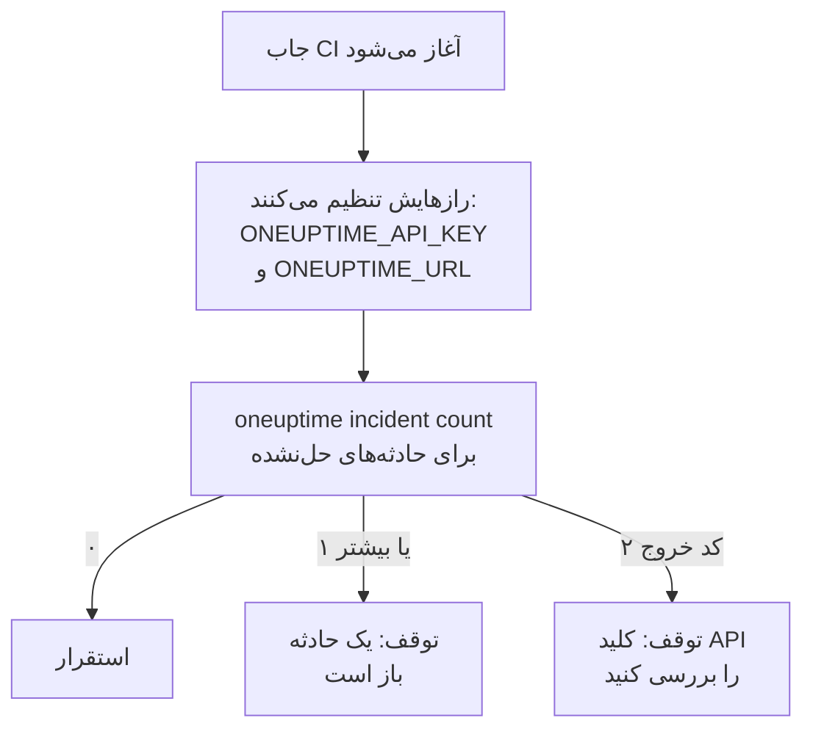

# اسکریپت‌نویسی و CI/CD

CLI در اسکریپت همان‌طور کار می‌کند که در ترمینال. کلید API را با متغیرهای محیطی به آن بدهید، پاسخ‌هایش را به‌صورت JSON بخوانید، و بگذارید کد خروجش به اسکریپت بگوید چه اتفاقی افتاد. این صفحه هر کدام از این‌ها را نشان می‌دهد، همراه با خط لوله‌های کامل برای GitHub Actions، GitLab CI و Docker.

:::cards
- [کلید API یک اسکریپت را به آن بدهید](#کلید-api-یک-اسکریپت-را-به-آن-بدهید): دو متغیر محیطی، بدون زمینهٔ ذخیره‌شده.
- [کدهای خروج](#کدهای-خروج): ۰ وقتی کار کرد، و چرا کار نکرد.
- [خواندن پاسخ‌ها با jq](#خواندن-پاسخها-با-jq): شناسه‌ها، عنوان‌ها و تاریخ‌ها از دل JSON.
- [نمونه‌های خط لوله](#نمونههای-خط-لوله): GitHub Actions، GitLab CI و Docker.
:::

## اسکریپت چگونه از CLI استفاده می‌کند

یک استقرار می‌تواند اول از OneUptime بپرسد که آیا حادثه‌ای باز است، و اگر هست متوقف شود:



## کلید API یک اسکریپت را به آن بدهید

`ONEUPTIME_API_KEY` و `ONEUPTIME_URL` را از رازهای سیستم CI خود تنظیم کنید. آن‌گاه CLI نه به `login` نیاز دارد و نه به فایل پیکربندی. برای یک دستور، پرچم همچنان بر آن‌ها مقدم است، و آن‌ها بر زمینه‌های ذخیره‌شده مقدم‌اند.

```bash
export ONEUPTIME_API_KEY="$CI_ONEUPTIME_API_KEY"
export ONEUPTIME_URL="https://oneuptime.com"
oneuptime incident count
```

> [!TIP]
> به هر خط لوله کلید API خودش را بدهید، فقط با دسترسی‌ای که نیاز دارد: بررسی‌ای که فقط می‌خواند به کلیدی نیاز دارد که فقط می‌خواند. وقتی خط لوله کنار گذاشته شد، کلید را در OneUptime حذف کنید.

اگر یک ماشین جاب‌های چند پروژه را اجرا می‌کند، برای هر پروژه یک زمینه ذخیره کنید و در هر دستور نامش را بیاورید، تا هیچ جابی هرگز زمینهٔ فعلی جاب دیگری را به کار نبرد:

```bash
oneuptime --context production incident count
oneuptime --context staging monitor count
```

## کدهای خروج

| کد | معنا | نمونه |
| --- | --- | --- |
| `0` | کار کرد | یک list، حتی اگر چیزی پیدا نکند |
| `1` | شکست خورد | OneUptime درخواست را رد کرد، مانند `API error (422)`؛ JSON نامعتبر؛ گزینه‌ای جاافتاده یا ناشناخته؛ زمینه‌ای که ذخیره نشده است |
| `2` | کلید API قابل‌استفاده‌ای نیست | اعتبارنامه‌ای پیدا نشد؛ کلید API نامعتبر؛ کلیدی پایین‌تر از طرحش (`402`)؛ `401` |
| `3` | پیدا نشد | OneUptime پاسخ `404` داد: رکورد وجود ندارد، در پروژهٔ دیگری است، یا کلید نمی‌تواند آن را بخواند |

`whoami` و `context current` حتی وقتی چیزی ذخیره نشده با `0` خارج می‌شوند: آنچه را تنظیم شده گزارش می‌کنند و آن را بررسی نمی‌کنند. اسکریپت حالت‌ها را با کد از هم جدا می‌کند:

```bash
oneuptime incident get "$INCIDENT_ID" -o json > incident.json
case $? in
  0) echo "Saved the incident to incident.json" ;;
  2) echo "Check ONEUPTIME_API_KEY and ONEUPTIME_URL" >&2; exit 1 ;;
  3) echo "There is no incident $INCIDENT_ID" >&2; exit 1 ;;
  *) echo "OneUptime refused the request" >&2; exit 1 ;;
esac
```

پیام‌های خطا به خطای استاندارد می‌روند، پس `incident.json` فقط پاسخ را در خود دارد.

## خواندن پاسخ‌ها با jq

در اسکریپت‌ها `-o json` را بنویسید. CLI در پایپ به هر حال JSON چاپ می‌کند، اما این پرچم اسکریپت را هر جا که اجرا شود کارا نگه می‌دارد:

```bash
# The title of each incident
oneuptime incident list -o json | jq -r '.[].title'

# The ID of a new monitor
MONITOR_ID=$(oneuptime monitor create --data '{"name":"Checkout API","monitorType":"Manual"}' -o json | jq -r '._id')

# When each incident was created: dates come as objects
oneuptime incident list -o json | jq -r '.[] | "\(.createdAt.value)  \(.title)"'

# The newest 100 incidents as CSV
oneuptime incident list --limit 100 -o json | jq -r '.[] | [._id, .title, .createdAt.value] | @csv'
```

شمارش یک عدد چاپ می‌کند، آمادهٔ مقایسه:

```bash
OPEN=$(oneuptime incident count --query '{"currentIncidentState":{"isResolvedState":false}}')
echo "$OPEN incidents are open"
```

## ساختن رکوردها از فایل‌ها

رکوردها را به‌صورت فایل‌های JSON کنار کدتان نگه دارید و از همان‌جا بسازیدشان:

```json title="monitors/checkout-api.json"
{
  "name": "Checkout API",
  "monitorType": "Manual"
}
```

```bash
oneuptime monitor create --file monitors/checkout-api.json
```

چند رکورد از یک آرایهٔ JSON، برای هر کدام یک create:

```bash
jq -c '.[]' monitors.json | while IFS= read -r monitor; do
  oneuptime monitor create --data "$monitor" -o json | jq -r '._id'
done
```

> [!NOTE]
> هر اجرا رکوردهای تازه می‌سازد. برای هماهنگ نگه داشتن مانیتورها و صفحه‌های وضعیت با فایل‌ها، که فقط آنچه تغییر کرده را تغییر دهد و آنچه رفته را حذف کند، از [ارائه‌دهندهٔ Terraform](/docs/terraform/index) استفاده کنید.

## نمونه‌های خط لوله

:::tabs
@tab GitHub Actions
```yaml title=".github/workflows/deploy.yml"
name: Deploy
on:
  push:
    branches: [main]

jobs:
  deploy:
    runs-on: ubuntu-latest
    steps:
      - uses: actions/checkout@v4
      - uses: actions/setup-node@v4
        with:
          node-version: lts/*
      - name: Install the OneUptime CLI
        run: npm install -g @oneuptime/cli
      - name: Stop while an incident is open
        env:
          ONEUPTIME_API_KEY: ${{ secrets.ONEUPTIME_API_KEY }}
          ONEUPTIME_URL: https://oneuptime.com
        run: |
          OPEN=$(oneuptime incident count --query '{"currentIncidentState":{"isResolvedState":false}}')
          if [ "$OPEN" -gt 0 ]; then
            echo "$OPEN incidents are open: not deploying."
            exit 1
          fi
      - name: Deploy
        run: ./deploy.sh
```
@tab GitLab CI
```yaml title=".gitlab-ci.yml"
check-incidents:
  stage: test
  image: node:lts
  variables:
    ONEUPTIME_URL: https://oneuptime.com
  script:
    - npm install -g @oneuptime/cli
    - OPEN=$(oneuptime incident count --query '{"currentIncidentState":{"isResolvedState":false}}')
    - echo "$OPEN incidents are open"
    - test "$OPEN" -eq 0
```
@tab Docker
```dockerfile title="Dockerfile"
FROM node:lts-slim
RUN npm install -g @oneuptime/cli
ENTRYPOINT ["oneuptime"]
```
:::

در GitHub Actions، `ONEUPTIME_API_KEY` را زیر **Settings → Secrets and variables → Actions** در مخزن اضافه کنید؛ در GitLab، آن را به‌عنوان یک متغیر CI/CD پوشیده (masked) اضافه کنید. با ایمیج Docker، متغیرها را به هر اجرا بدهید:

```bash
docker build -t oneuptime-cli .
docker run --rm -e ONEUPTIME_API_KEY -e ONEUPTIME_URL oneuptime-cli incident count
```

## گام‌های بعدی

:::cards
- [احراز هویت](/docs/cli/authentication): وقتی چند کلید تنظیم شده باشد، دستور کدام را به کار می‌برد.
- [قالب‌های خروجی](/docs/cli/output-formats): JSONی که اسکریپت‌هایتان می‌خوانند.
- [عملیات روی منابع](/docs/cli/resource-operations): فیلترها، صفحه‌بندی و فیلدهای یک رکورد.
- [ارائه‌دهندهٔ Terraform](/docs/terraform/index): پیکربندی OneUptime را در فایل‌ها نگه دارید.
:::
